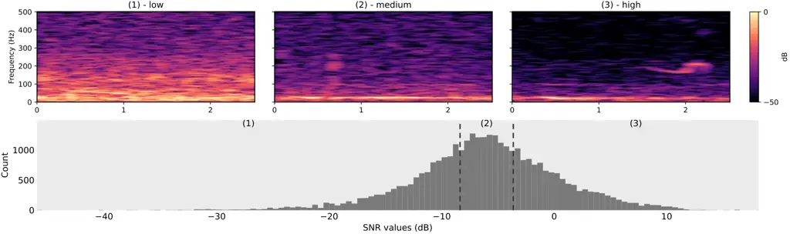
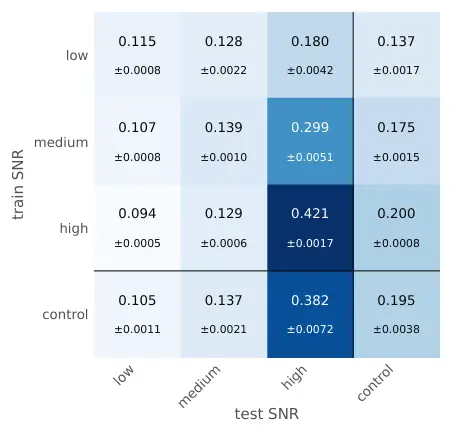

# DO BIOACOUSTIC FOUNDATION MODELS HEAR THROUGH THE NOISE? SNR AND GENERALIZATION IN UNDERWATER DETECTION

Lucie JEAN-LABADYE    Nicolas FARRUGIA    Axel MARMORET    Dorian CAZAU
   Olivier ADAM

###### Abstract

Bioacoustic foundation models are claimed to generalize across taxa and
recording conditions, but are trained mainly on terrestrial archives of
focal, high-quality recordings and evaluated on benchmarks emphasizing
architecture over data conditions. We evaluate four such models as
frozen encoders on an underwater detection task, using linear probing on
continuously recorded data from the Kerguelen Plateau. Four datasets of
identical size were built to differ only in the signal-to-noise ratio
(SNR) of their positive segments, and probes were trained and evaluated
across all combinations. Evaluation SNR accounts for more variation in
average precision (AP) than model choice, and performance peaks when
training and evaluation share a noise regime — the configuration least
representative of a continuous deployment. Training on mixed SNR
redistributes performance toward low-SNR conditions without improving it
overall, and AP remains low throughout. In light of these results, we
call for evaluation standards grounded in realistic noise and deployment
conditions rather than curated, high-quality recordings.

###### Index Terms: 

Bioacoustics, passive acoustic monitoring, deep learning,
generalization, SNR

^(†)^(†)address: ¹Sorbonne Université, Institut $`\partial`$’Alembert,
UMR CNRS 7190, F-75005, Paris, France  
²ENSTA, Lab-STICC, UMR CNRS 6285, F-29806, Brest, France  
³IMT Atlantique, Lab-STICC, UMR CNRS 6285, F-29238 Brest, France

## 1 Introduction & prior work

Passive acoustic monitoring (PAM) is a remote observation method well
suited to ecosystems where visual surveys are difficult and where the
species of interest are vocally active. It is therefore especially
valuable for studying cetaceans, which rely on sound for all their vital
activities. Their study is of growing importance as whale populations
face sustained pressure from human activities at sea \[2\]. Assessing
such pressures requires monitoring over years, which PAM makes feasible
through continuous, long-term campaigns. The resulting data volumes,
however, make purely manual analysis intractable. The process is indeed
time- and attention-consuming and requires substantial expertise to
discriminate between sound sources. Because it relies on expert
judgment, the process is difficult to reproduce, and annotation quality
varies between analysts \[4\]. These constraints have motivated the
development of automatic methods.

Early automation of detection (is a signal of interest present?), on
which this study focuses, and classification (what is its source?)
relied on advanced signal processing methods such as spectrogram
correlation \[14\]. More recently, deep learning has substantially
improved PAM data analysis \[22\], with automatic detectors and
classifiers often outperforming traditional approaches \[21\]. However,
such models are often developed by practitioners for a specific
geographic area, deployment period, or ecological question, and are
neither designed nor evaluated for transfer beyond that setting. In
parallel, following broader developments in deep learning, bioacoustic
foundation models have begun to emerge \[20\]. Trained on large and
taxonomically diverse datasets, these models are designed to address a
range of tasks with little or no retraining, and to be inexpensive to
specialize when adaptation is required. Their promise for PAM is
therefore considerable: detectors and classifiers that generalize across
geographic areas and recording conditions without site-specific
training.

Nonetheless, two obstacles seem to limit the adoption of foundation
models for marine detection tasks. First, these models are predominantly
trained on terrestrial data, where large multi-species archives such as
Xeno-Canto \[24\] are more readily compiled. Such archives consist
largely of focal recordings, which differ markedly from continuous
marine recordings. Available underwater datasets such as Watkins \[19\]
are, by contrast, often dated, distributed as focal clipped
excerpts \[1\] — suitable for classification but ill-suited to detection
— or only partially annotated (e.g. restricted to a single species,
vocalization, or family of vocalizations). Benchmarks such as
BEANS \[8\] have considerably advanced the development and fair
comparison of deep learning models, but do not make operability an
explicit criterion. Second, benchmarks often emphasize models and their
ability to generalize across biomes, with comparatively little attention
paid to how data are partitioned between training, validation, and test
sets, to the statistical differences between those partitions, or to
data quality under operational conditions. As a result, reported
performance does not necessarily reflect the conditions practitioners
face.

This gap has consequences on both sides. Foundation models remain
underused by the community that would benefit from them most, and the
biases they carry remain uncharted. Unless these sources of bias and
uncertainty are accounted for, trends in estimated call densities cannot
be reliably attributed to biological drivers, such as changes in animal
density or call production rates \[16\]. One data property is
particularly consequential in this respect: the signal-to-noise ratio
(SNR). By quantifying a signal’s level relative to the surrounding
background noise, SNR directly determines the difficulty of the
detection task. It is also used by biologists and ecologists to model
detection probability and, in turn, to estimate population density from
acoustic data \[3\].

Recent work \[15\] has examined the impact of SNR on the performance of
automatic detectors, showing that shifting the SNR distribution of the
training set alters a model’s ability to generalize. That study,
however, used terrestrial recordings and task-specific models, whereas
foundation models are explicitly claimed to offer superior
generalization. To our knowledge, that claim has not been tested under
the noise conditions of continuous underwater recordings.

This work then makes the following contributions. First, we use linear
probing to evaluate the representations produced by four bioacoustic
foundation models used as frozen encoders. Second, we conduct this
evaluation on continuously recorded PAM data reflecting the conditions
and class balance of operational deployments. Third, we assess
generalization across controlled SNR strata, isolating noise level as a
variability factor and quantifying its effect on detection performance.
We hypothesize, first, that evaluations that do not control for data
properties such as SNR give an optimistic picture of model ability; and
second, that training on a mixture of SNR conditions generalizes better
to realistic noise regimes than any single condition.



Figure 1: SNR distribution across the whole dataset, with an example
spectrogram for each level

## 2 MATERIAL & METHODS

### 2.1 Data collection

We used an open-access dataset, collected and annotated by Miller et
al. \[17\] as part of the Acoustic Trends Project, which investigates
the populations and dynamics of Antarctic blue and fin whales
(Balaenoptera musculus intermedia and Balaenoptera physalus) in the
Southern Ocean through acoustics. Recordings were acquired by a moored
recorder deployed off the Kerguelen Plateau in 2014 and 2015. The
hydrophone recorded continuously throughout each year, at a sampling
rate of 12 kHz with 16-bits resolution. To limit the annotation
workload, the authors uniformly subsampled 200 one-hour files per year
and annotated those. Their annotation protocol targeted seven call
types,¹¹ 1 Blue whale: BmA, BmB, and BmZ; fin whale: Bp20 and Bp20plus;
both species: BmDs and BpDs. annotated as time–frequency bounding boxes
on spectrograms. We pooled them into a single presence/absence label per
segment, framing the problem as weakly labeled detection.

### 2.2 Data preprocessing

To match the input format expected by the pre-trained encoders, each
one-hour recording was divided into 5 s segments with 50% overlap,
yielding 1440 segments per file. A segment was considered positive if it
contained at least 50% of the duration of an overlapping sound event.
Note that the resulting dataset is strongly imbalanced, with 96% of the
segments labeled negative.

Following Miller et al. \[17\], the SNR of each annotated event was
computed as in \[13, Eq. 6.26\], which defines the output SNR of a
quadratic receiver in natural values. Equation 1 expresses this result
in decibels:

```math
\mathrm{SNR}_{\mathrm{dB}}=10\log_{10}\left(\frac{\langle z_{s+n}(t)\rangle-\langle z_{n}(t)\rangle}{\sqrt{\sigma^{2}_{n}}}\right) \tag{1}
```

where $`z_{s+n}`$ is the power within the annotation box, computed from
the spectrogram; $`z_{n}`$ is the power of a noise-only window of equal
bandwidth, taken 5 s before the annotation box and separated from it by
a 1 s buffer to accommodate variability in the annotators’ box edges;
and $`\sigma_{n}^{2}`$ is the variance of the noise power over that
window, homogeneous to its power under white-noise assumption. Finally,
$`\langle\cdot\rangle`$ denotes the temporal mean. The selection of this
SNR definition was informed by preliminary studies that fall outside the
scope of this work.

When a segment overlapped several events, it inherited the SNR of the
event with which it overlapped the most. Positive segments were then
divided into three equal-size SNR levels, each containing one third of
the positive segments. The resulting boundaries are $`-8.66`$ dB between
low and medium levels and $`-4.01`$ dB between medium and high levels.
Fig. 1 shows their distribution.

### 2.3 Pre-trained models

The foundation models used in this study were published in 2025–2026.
Two of them come from the Earth Species Project (ESP) and their AVEX
library \[9\]: an EfficientNet B0 (esp-effnet) and a Transformer based
on Audio Transformer (esp-eat). Both were trained on a mixture of
bioacoustic datasets (Xeno-Canto \[24\], iNaturalist \[12\],
Watkins \[19\], and Animal Sound Archive \[6\]) and on AudioSet \[7\], a
general-purpose corpus spanning speech, music, and environmental sounds.
The two other models were published by Google: Perch2.0 (perch) \[23\]
and multi-species-whales (msw) \[10\]. Both are also EfficientNet-based
(B0 for msw, B3 for perch), but were trained on different data mixtures.
Perch was trained on Xeno-Canto, iNaturalist and Animal Sound Archive,
and on the general-purpose FSD50k \[5\], whereas msw was mostly trained
on underwater acoustic data compiled by NOAA \[18\].

|                      | Train | Val. | Test  |
| -------------------- | ----- | ---- | ----- |
| Positive segments    | 6996  | 1749 | 2187  |
| Negative segments    | 6996  | 1749 | 36187 |
| Control, per stratum | 2332  | 583  | 729   |

Table 1: Data splits. All four conditions have the same size and differ
only in the SNR of their positives.

### 2.4 Experimental set-up

We built four datasets, identical in size and stratified across labels
before binarization, differing only in the SNR of their positive
segments. Three are SNR-specific and contain positives drawn only from a
single level (low, medium or high). The fourth serves as a control and
draws its positives in equal proportion from the three levels, to ensure
no impact of data volume. Negative segments were drawn from a common
pool.

Each dataset was then split into training, validation, and test sets. To
mitigate class imbalance, the training and validation sets were balanced
to a 1:1 positive-to-negative ratio by subsampling negatives, whereas
the test sets retained the original class distribution to reflect
realistic deployment conditions. The resulting splits are detailed in
Table 1.

To match the sampling rate expected by each model, the 5 s segments were
resampled from 12 kHz to 16 kHz for the ESP models, to 24 kHz for msw,
and to 32 kHz for perch. Segments were then encoded, and the resulting
embeddings were evaluated through linear probing. Since the aim of this
study is to assess whether SNR affects the generalization ability of the
embeddings themselves, a more expressive downstream model would have
confounded representation quality with the capacity of the classifier
trained on top of it.

A linear probe was trained on each of the four datasets, using 5-fold
cross-validation to characterize variability across folds, and evaluated
on the test sets of all four conditions. This yields the full matrix of
training and evaluation SNR combinations reported in Fig. 3. Performance
is reported as average precision (AP), which summarizes the
precision–recall curve without committing to a single operating
threshold \[11\].

## 3 RESULTS & DISCUSSION

Each factor (model, training SNR, and test SNR) was tested as a separate
one-way repeated-measures ANOVA on marginal means, with fold as the
repeated-measures unit and AP as the dependent variable. As a mixture,
the control condition was excluded from the SNR marginals and tested
through planned contrasts (t-tests) against the mean of the three pure
levels.

### 3.1 Model comparison

Fig. 2 reports pairwise differences between the four models, averaged
across SNR conditions. The main effect of model on AP is significant
$`\left(F(3,12)=1831,\text{p}_{\text{holm}}<10^{-5}\right)`$. In
particular, esp-effnet outperforms the three others by $`+0.017`$,
$`+0.061`$, and $`+0.062`$ over msw, perch, and esp-eat, respectively
$`\left(\text{all}~\text{p}_{\text{holm}}<10^{-3}\right)`$. We thus
retain esp-effnet for the remaining analysis.

Yet differences between models remain modest compared to the impact of
the SNR levels: across the marginal means, test sets span 0.139 AP, more
than twice the spread observed between models (0.062). The following
therefore focuses on how SNR shapes detection performance.

### 3.2 Effects of the SNR

Figure 2: Pairwise AP differences between models



Figure 3: AP of esp-effnet across training and evaluation SNR

Fig. 3 reports esp-effnet’s AP for every combination of training and
evaluation strata. Three patterns emerge that are consistent across
models.

First, AP increases monotonically with test SNR
($`F(2,8)=3.9\times 10^{4}`$, partial $`\eta^{2}=0.999`$), irrespective
of training stratum: a probe trained only on low-SNR examples still
improves from 0.115 on low-SNR data to 0.180 on high-SNR data.

Second, this relationship is asymmetric. Exposure to high-SNR examples
during training does not transfer downwards: the high-trained probe
reaches 0.094 on low-SNR data, below both the medium-trained (0.107) and
the low-trained (0.115) probes. Training on easy examples therefore
costs performance where detection is hardest.

Third, performance is highest when the training and evaluation strata
match. Averaged over models, matched SNR levels exceed mismatched ones
by $`+0.049`$ AP beyond what the main effects alone predict, and
performance decays further as the gap widens ($`+0.047`$ AP for a
one-step versus a two-step mismatch, e.g. low–medium versus low–high).
Each of the low, medium, and high test columns is maximized on the
diagonal, an oracle condition that assumes the noise regime of the
deployment is known in advance. The exception is the control column,
where the high-trained probe (0.200) marginally exceeds the
control-trained one (0.195).

Exposure to a range of SNR levels during training nonetheless improves
generalization overall, with a mean gain of $`+0.0221`$ across models
and evaluation strata $`(t(4)=33.78,\text{p}_{\text{holm}}<10^{-5})`$.
For esp-effnet, the benefit is concentrated where it matters: the
control-trained probe outperforms the high-trained one on low- (0.105
vs. 0.094) and medium-SNR (0.137 vs. 0.129) evaluation data, while
giving up ground on high-SNR data (0.382 vs. 0.421).

### 3.3 Discussion

Training and evaluating on high-SNR data yields an AP of 0.421, more
than four times that obtained when the same probe is evaluated on
low-SNR data (0.094). Yet high-SNR training and evaluation is the
configuration most likely to be reported in benchmark settings and the
least representative of deployment. Recordings from a continuously
deployed mooring are dominated by distant, low-SNR calls, and the
corresponding cells of Fig. 3 fall between 0.094 and 0.115. Absolute
values are low throughout, and we take this as the central result: on
continuous, long-term marine PAM data, current bioacoustic foundation
models do not deliver the out-of-the-box generalization their framing
suggests. Moreover, given that the effect of the test set exceeds that
of the model, how a model is evaluated seems to matter more than which
model is evaluated. This argues for future work in which test sets are
characterized as carefully as architectures are compared.

Another factor plausibly contributes: low-SNR calls are harder to
annotate, so the ground truth is likely least complete where performance
is lowest. A preliminary visual inspection of high-confidence estimated
detections (using esp-effnet and perch) supports this: several
spectrograms display patterns consistent with calls that remain
unannotated. Part of the gap may thus reflect annotation completeness
rather than model capability. This motivates active learning pipelines:
rather than replacing expert analysts, such models could support PAM
post-processing by directing annotation effort toward the most
informative examples, helping complete the ground truth where it matters
most.

## 4 CONCLUSION

By isolating SNR as a single controlled factor, this study shows that
the noise conditions of the evaluation data account for more variation
in detection performance than the choice of foundation model.
Performance is also highest when training and evaluation share a noise
regime — a condition rarely met in practice, since the noise conditions
of a long-term deployment are neither known in advance nor stable.

Multiple directions follow. Extending this protocol to other sources of
variability — geographic area, time period, recording hardware — would
establish whether the observed patterns generalize beyond SNR level.
Detections on unannotated segments also suggest an active learning
pipeline in which model confidence is used to direct annotation effort
toward the faintest calls.

These results argue for evaluating bioacoustic foundation models on the
data conditions practitioners actually encounter. Bridging the two
communities matters, as acoustic monitoring directly feeds conservation
policies. Given the pressure cetaceans are under, characterizing
foundation models’ biases is an immediate practical requirement, not a
refinement for later work.

## References

- \[1\] A. Burns, L. Harrell, B. van Merriënboer, et al. (2025) Perch
  2.0 transfers ‘whale’ to underwater tasks. Note: arXiv:2512.03219
  Cited by: §1.
- \[2\] T. Cheeseman, J. Barlow, J. M. Acebes, et al. Bellwethers of
  change. Royal Society Open Science 11 (2), pp. 231462. External Links:
  ISSN 2054-5703, [Document](https://dx.doi.org/10.1098/rsos.231462)
  Cited by: §1.
- \[3\] F. R. de Castro, D. V. Harris, S. J. Buchan, N. Balcazar,
  and B. S. Miller (2024) Beyond counting calls. Frontiers in Marine
  Science 11. External Links: ISSN 2296-7745,
  [Document](https://dx.doi.org/10.3389/fmars.2024.1406678) Cited by:
  §1.
- \[4\] G. Dubus, M. Torterotot, P. N. H. Duc, J. Beesau, et al. (2023)
  Better quantifying inter-annotator variability: A step towards citizen
  science in underwater passive acoustics. In OCEANS 2023 - Limerick,
  pp. 1–8. External Links:
  [Document](https://dx.doi.org/10.1109/OCEANSLimerick52467.2023.10244502)
  Cited by: §1.
- \[5\] E. Fonseca, X. Favory, J. Pons, et al. (2022) FSD50K: An Open
  Dataset of Human-Labeled Sound Events. Note: arXiv:2010.00475 Cited
  by: §2.3.
- \[6\] K. Frommolt, R. Bardeli, F. Kurth, and M. Clausen (2006) The
  animal sound archive at the Humboldt-University of Berlin. Slovenska
  akademija znanosti in umetnosti. Cited by: §2.3.
- \[7\] J. F. Gemmeke, D. P. W. Ellis, D. Freedman, et al. (2017) Audio
  Set: An ontology and human-labeled dataset for audio events. In 2017
  IEEE International Conference on Acoustics, Speech and Signal
  Processing (ICASSP), New Orleans, LA, pp. 776–780. External Links:
  [Document](https://dx.doi.org/10.1109/ICASSP.2017.7952261) Cited by:
  §2.3.
- \[8\] M. Hagiwara, B. Hoffman, J. Liu, et al. (2023) BEANS: The
  Benchmark of Animal Sounds. In ICASSP 2023, Rhodes Island, Greece,
  pp. 1–5. External Links: ISSN 2379-190X,
  [Document](https://dx.doi.org/10.1109/ICASSP49357.2023.10096686) Cited
  by: §1.
- \[9\] M. Hagiwara (2023) AVES: Animal Vocalization Encoder Based on
  Self-Supervision. In ICASSP 2023, pp. 1–5. External Links: ISSN
  2379-190X,
  [Document](https://dx.doi.org/10.1109/ICASSP49357.2023.10095642) Cited
  by: §2.3.
- \[10\] L. Harrell (2024) Whistles, songs, boings, and biotwangs:
  recognizing whale vocalizations with AI. Note: Google Research Blog,
  https://research.google/blog/whistles-songs-boings-and-biotwangs-recognizing-whale-vocalizations-with-ai/Accessed:
  2026-09-15 Cited by: §2.3.
- \[11\] J. A. Hildebrand, K. E. Frasier, T. A. Helble, and M. A.
  Roch (2022) Performance metrics for marine mammal signal detection and
  classification. J. Acoust. Soc. Am. 151 (1), pp. 414–427. External
  Links: ISSN 0001-4966, 1520-8524,
  [Document](https://dx.doi.org/10.1121/10.0009270) Cited by: §2.4.
- \[12\] G. V. Horn, O. M. Aodha, Y. Song, et al. (2018) The iNaturalist
  Species Classification and Detection Dataset. arXiv. Note:
  arXiv:1707.06642 External Links: 1707.06642,
  [Document](https://dx.doi.org/10.48550/arXiv.1707.06642) Cited by:
  §2.3.
- \[13\] X. Lurton (2010) An Introduction to Underwater Acoustics. Cited
  by: §2.2.
- \[14\] D. K. Mellinger and C. W. Clark (2000) Recognizing transient
  low-frequency whale sounds by spectrogram correlation. J. Acoust.
  Soc. Am. 107 (6), pp. 3518–3529. External Links: ISSN 0001-4966,
  [Document](https://dx.doi.org/10.1121/1.429434) Cited by: §1.
- \[15\] F. Michaud, J. Sueur, F. Sèbe, et al. (2025) Acoustic detection
  of a nocturnal bird with deep learning: the challenge of low
  signal-to-noise ratio. Ecological Indicators 181, pp. 114475. External
  Links: ISSN 1470-160X,
  [Document](https://dx.doi.org/https%3A//doi.org/10.1016/j.ecolind.2025.114475),
  [Link](https://www.sciencedirect.com/science/article/pii/S1470160X25014074)
  Cited by: §1.
- \[16\] B. S. Miller, N. Kelly, M. G. Aulich, N. Balcazar, et
  al. (2026) Common ground. Methods in Ecology and Evolution. External
  Links: ISSN 2041-210X,
  [Document](https://dx.doi.org/10.1111/2041-210x.70331) Cited by: §1.
- \[17\] B. S. Miller The IWC-SORP/SOOS Acoustic Trends Working Group et
  al. (2021) An open access dataset for developing automated detectors
  of Antarctic baleen whale sounds. Scientific Reports 11 (1), pp. 806.
  External Links: ISSN 2045-2322,
  [Document](https://dx.doi.org/10.1038/s41598-020-78995-8) Cited by:
  §2.1, §2.2.
- \[18\] NOAA Pacific Islands Fisheries Science Center (2021) Pacific
  islands passive acoustic network (PIPAN) 10 kHz data. NOAA National
  Centers for Environmental Information. Note: Accessed: 2026-09-15
  External Links: [Document](https://dx.doi.org/10.25921/Z787-9Y54)
  Cited by: §2.3.
- \[19\] L. Sayigh, M. A. Daher, J. Allen, et al. (2016) The Watkins
  Marine Mammal Sound Database: An online, freely accessible resource.
  Proceedings of Meetings on Acoustics 27 (1), pp. 040013. External
  Links: ISSN 1939-800X,
  [Document](https://dx.doi.org/10.1121/2.0000358) Cited by: §1, §2.3.
- \[20\] R. Schwinger, P. Vali Zadeh, L. Rauch, et al. (2026) Foundation
  models for bioacoustics – A comparative review. Ecological Informatics
  96, pp. 103765. External Links: ISSN 1574-9541,
  [Document](https://dx.doi.org/10.1016/j.ecoinf.2026.103765) Cited by:
  §1.
- \[21\] Y. Shiu, K. J. Palmer, M. A. Roch, et al. (2020) Deep neural
  networks for automated detection of marine mammal species. Scientific
  Reports 10 (1), pp. 607. External Links: ISSN 2045-2322,
  [Document](https://dx.doi.org/10.1038/s41598-020-57549-y) Cited by:
  §1.
- \[22\] D. Stowell (2022) Computational bioacoustics with deep
  learning: a review and roadmap. PeerJ 10, pp. e13152. External Links:
  ISSN 2167-8359, [Document](https://dx.doi.org/10.7717/peerj.13152)
  Cited by: §1.
- \[23\] B. van Merriënboer, V. Dumoulin, and J. o. Hamer (2025) Perch
  2.0: The Bittern Lesson for Bioacoustics. arXiv. Note:
  arXiv:2508.04665 External Links: 2508.04665,
  [Document](https://dx.doi.org/10.48550/arXiv.2508.04665) Cited by:
  §2.3.
- \[24\] W. Vellinga and R. Planqué (2015) The Xeno-canto Collection and
  its Relation to Sound Recognition and Classification.. CLEF (Working
  Notes) 1391. Cited by: §1, §2.3.
