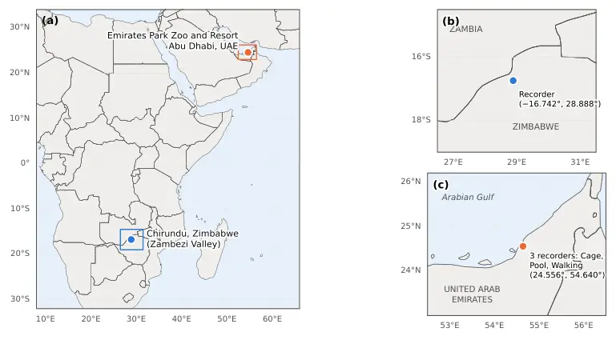
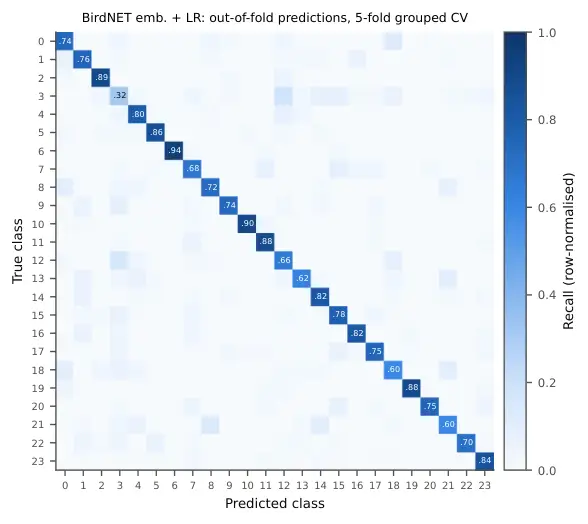
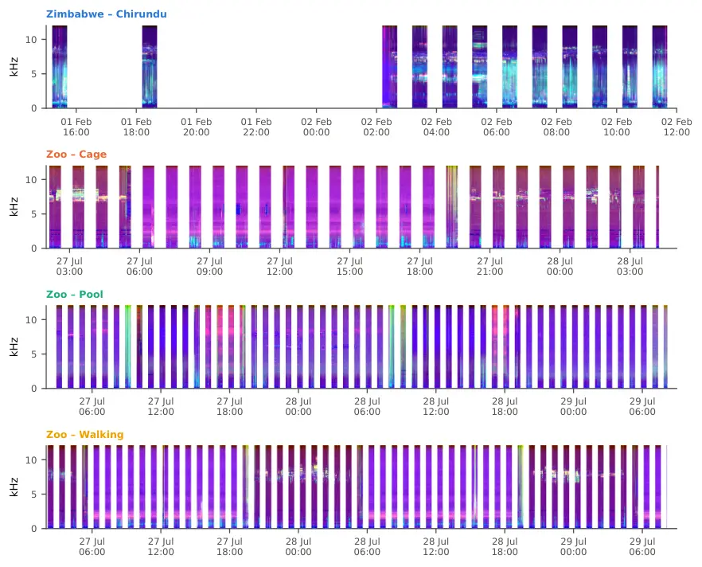
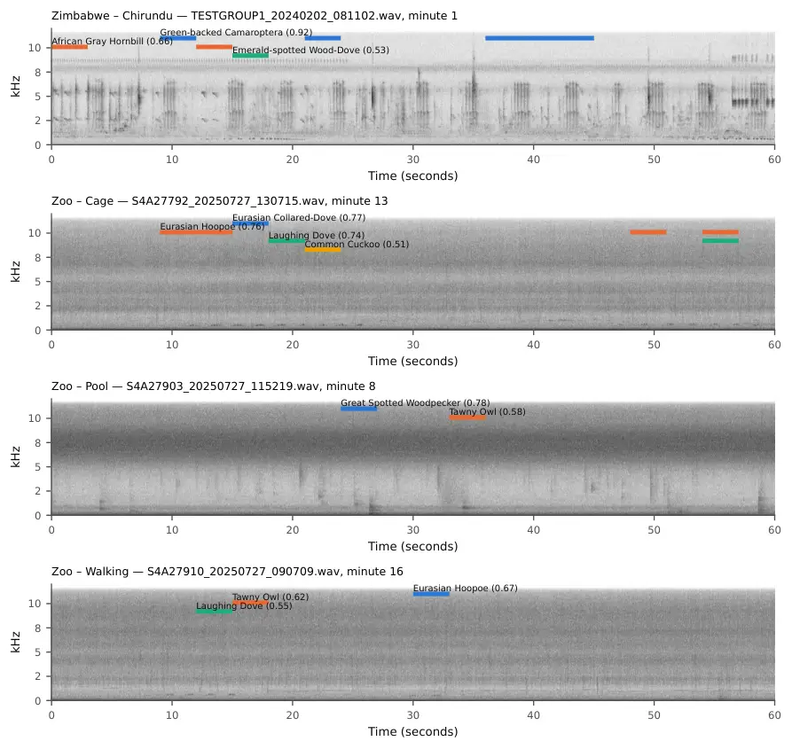
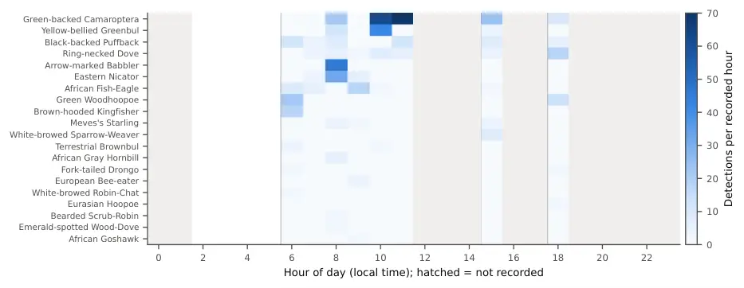
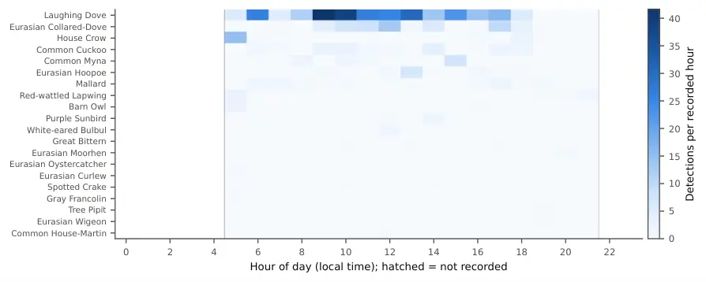
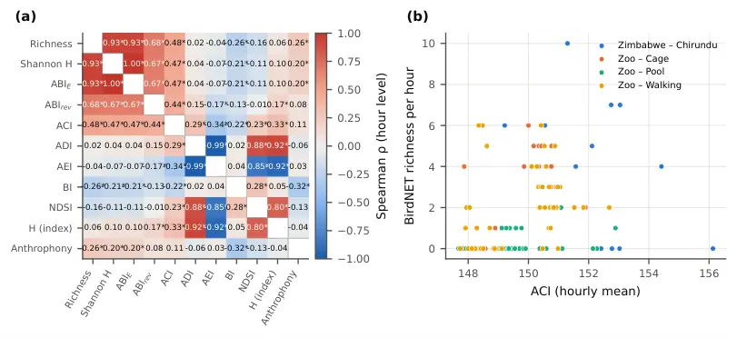

A richness-sensitive Acoustic Biodiversity Index from species-level
detections: classifier benchmarking, false-positive control and
validation against standard soundscape indices in an African savanna and
an urban zoo

Muhammad Saeed^(a,\*), Dmitry Mikhaylov^(a), Mohamed H. Alhosani^(a),
Yasser F. Al Wahedi^(a), Rory Pilossof^(b), Ahmed Arabi^(c), Walid
Shaaba^(c)

^(a) Abu Dhabi Maritime Academy, P.O. Box 54477, Abu Dhabi, United Arab
Emirates

^(b) My Trees Trust, 88 Broadlands Road, Mount Pleasant, Harare,
Zimbabwe

^(c) Emirates Park Zoo and Resort, Abu Dhabi, United Arab Emirates

^(\*) Corresponding author: muhammad.saeed@adports.ae (M. Saeed)

## Abstract

Acoustic indices are widely used as rapid proxies for biodiversity, but
they summarise the distribution of sound energy rather than the species
producing it and often track richness poorly. We revise and test an
Acoustic Biodiversity Index (ABI) built from species-level detections.
Its primary form, ABI*(E), is Shannon diversity of detections normalised
by the regional species pool expected at the site and season (H / ln
S*(ref)); temporal stability T is reported as a separate component. We
first benchmarked four classifiers on a strongly labelled tropical
dataset (1,216 calls, 24 classes) with recording-grouped
cross-validation. BirdNET embeddings + logistic regression performed
best (macro-F1 0.750 $`\pm`$ 0.029), and random frame-level splits
inflated accuracy from 0.41 to 0.70. We then applied BirdNET v2.4 with a
location and season filter to recordings from a riverine savanna in the
Zambezi Valley, Zimbabwe, and from three habitats at Emirates Park Zoo
and Resort, Abu Dhabi, United Arab Emirates. A stricter post-hoc
location filter removed 517 high-confidence detections of 9 implausible
species, all at the zoo. After diel-matched rarefaction to equal effort
(6 h), the savanna site held 21 species (¹D = 9.83; ABI*(E) = 0.38)
against 1.3–13 species (ABI*(E) = 0.03–0.21) at the zoo sites. Across
149 recorded hours, ABI\_(E) correlated strongly with richness (Spearman
$`\rho`$ = 0.93), whereas six standard indices did not (best: ACI,
$`\rho`$ = 0.48). The stability term was lower at the savanna site
(0.39) than at the zoo (0.65–0.67), showing that it penalises the
natural diel cycle of bird activity. Species-level indices with explicit
false-positive control, a declared regional reference pool and effort
standardisation provide a more interpretable biodiversity indicator than
energy-based acoustic indices.

Keywords: passive acoustic monitoring; acoustic indices; BirdNET; Hill
numbers; soundscape ecology; false positives; Zambezi Valley

### Highlights

- •
  Species-level detections with a regional reference pool track richness
  ($`\rho`$ = 0.93)
- •
  Six standard acoustic indices tracked hourly richness weakly
  (\|$`\rho`$\| $`\leq`$ 0.48)
- •
  A location filter removed 517 high-confidence false detections at a
  zoo
- •
  At equal effort a savanna site held 21 bird species vs 1.3–13 at zoo
  sites
- •
  Temporal-stability terms penalise the natural diel cycle and should
  stand apart

## 1. Introduction

Passive acoustic monitoring (PAM) records whole soundscapes
continuously, at low cost and with little disturbance, and has become a
core tool for tracking biodiversity in places that are hard to survey on
foot (Gibb et al., 2019; Sugai et al., 2019). Autonomous recorders now
routinely produce thousands of hours of audio per deployment. At that
volume, manual listening is impossible and ecological inference depends
on automated summaries of the recordings.

The most common summaries are acoustic indices. The Acoustic Complexity
Index (ACI; Pieretti et al., 2011) measures intensity changes between
adjacent time frames; the Acoustic Diversity and Evenness Indices (ADI,
AEI; Villanueva-Rivera et al., 2011) measure how evenly energy is spread
across frequency bands; the Bioacoustic Index (BI; Boelman et al., 2007)
measures energy in the 2–8 kHz band typical of bird song; the Normalised
Difference Soundscape Index (NDSI; Kasten et al., 2012) contrasts
biophony with anthrophony; and acoustic entropy (H; Sueur et al., 2008)
combines temporal and spectral entropy. These indices are fast, need no
training data and can be computed for any recording.

However, acoustic indices describe how sound energy is distributed in
time and frequency, not which species are calling. A meta-analysis of
more than 1,000 index–biodiversity relationships found moderate and
highly variable correlations (Alcocer et al., 2022). Indices respond
strongly to rain, wind, insects and anthropogenic noise, and their
behaviour differs between ecosystems (Fairbrass et al., 2017; Buxton et
al., 2018; Sethi et al., 2020). A high index value therefore does not
necessarily indicate high diversity.

Deep-learning classifiers now offer a second route: identifying species
directly. BirdNET recognises more than 6,000 bird species and a set of
non-biological sound classes, and includes a location and season
meta-model that restricts predictions to species expected at a given
site and week (Kahl et al., 2021). Its internal embeddings also transfer
well to new classification tasks with little training data (Ghani et
al., 2023). Species-level detections can be turned directly into
community metrics such as richness and Hill numbers (Hill, 1973; Jost,
2006; Chao et al., 2014), which ecologists already know how to
interpret.

Two problems limit this route in practice. First, classifiers produce
false positives, sometimes with high confidence, and these inflate
richness unless detections are filtered and verified (Wood and Kahl,
2024). Second, classifier performance is often overestimated because
evaluation splits place short frames from the same recording, or even
the same call, in both training and test data (Roberts et al., 2017;
Stowell, 2022). An indicator built on detections inherits both problems.

A detection-based index also has to be defined carefully. Normalising
Shannon diversity by the observed richness gives Pielou’s evenness J^(′)
(Pielou, 1966), which is insensitive to richness. Combining it with an
unweighted temporal coefficient of variation makes the index dominated
by rare species, which have the largest CV, and dependent on the number
of time bins. In our earlier formulation of the ABI, these properties
caused the index to decrease as true richness increased (Section 3.7).

Here we revise the ABI and test every step of its production, from
classifier evaluation to field application. Our aims were to: (i)
benchmark species classifiers with leakage-free, recording-grouped
evaluation and quantify the effect of leakage and domain shift; (ii)
derive species-level detections with explicit false-positive control in
two contrasting soundscapes, a riverine savanna in the Zambezi Valley
(Zimbabwe) and a zoo in Abu Dhabi (United Arab Emirates); (iii) define a
bounded, richness-sensitive ABI and characterise its behaviour by
simulation; (iv) test its robustness to sampling effort, confidence
threshold, time-bin width and filter strictness; and (v) compare it with
six standard acoustic indices at hourly resolution. The two study areas
were chosen as a proof of concept across highly contrasting
environments, not as an ecological comparison of two regions: a useful
indicator must at least separate a natural savanna from a managed urban
setting, and the extreme contrast lets the behaviour of each index be
examined without ambiguity about which site is richer.

## 2. Materials and methods

The two study areas are mapped in Fig. 1 and described in Table 1; Fig.
2 summarises the workflow. The analysis has three steps (classifier
benchmark, field soundscapes, ABI analysis), implemented in a Python
package described in Section 2.8.



Figure 1: Fig. 1. Location of the two study areas: Chirundu in the
Zambezi Valley, northern Zimbabwe (riverine savanna; one recorder), and
Emirates Park Zoo and Resort, Abu Dhabi, United Arab Emirates (three
recorders in a cage enclosure, at the hippopotamus pool and along a
visitor walkway).

Figure 2: Fig. 2. Analysis workflow. Field recordings are standardised
to 30 min h^($`-`$1) and analysed in 1-min blocks for six acoustic
indices and for BirdNET species detections with a location and season
filter. A separate classifier benchmark on strongly labelled data
evaluates four models with recording-grouped cross-validation.
Detections feed the ABI, Hill numbers and their uncertainty, sensitivity
and simulation analyses, which are then compared with the acoustic
indices.

### 2.1 Study sites

Chirundu, Zimbabwe. The savanna site lies in the middle Zambezi Valley
near Chirundu ($`-`$16.742°, 28.888°), in woodland managed by My Trees
Trust. The vegetation is riverine woodland and mopane savanna close to
the Zambezi River. My Trees Trust runs restoration, anti-poaching and
conservation programmes in the middle Zambezi Valley, and its
conservation areas are managed under a Forest Stewardship Council plan
(My Trees Trust, 2023). Recordings were made on 1–2 February 2024,
during the wet season, when many resident and intra-African migrant
birds are breeding.

Emirates Park Zoo and Resort, Abu Dhabi, UAE. The contrasting site is a
zoological park in Abu Dhabi (24.556°, 54.640°) in the hyper-arid
lowlands of the Arabian Peninsula. Three recorders were placed in
different habitats: a caged animal enclosure (Cage), the hippopotamus
pool exhibit (Pool) and a visitor walkway with ornamental planting
(Walking). Recordings were made on 27–29 July 2025, in the hot season,
when wild bird activity in the region is low and resident urban species
dominate. The zoo soundscape also includes captive animals, visitors,
maintenance machinery and water pumps. Recordings were made with the
permission of the zoo management.

| Site          | Coordinates         | Habitat                          | Recorder     | Dates          | Files | Analysed (h) |
| ------------- | ------------------- | -------------------------------- | ------------ | -------------- | ----- | ------------ |
| Chirundu (ZW) | $`-`$16.742, 28.888 | Riverine savanna, Zambezi Valley | SM4          | 1–2 Feb 2024   | 12    | 6.0          |
| Zoo – Cage    | 24.556, 54.640      | Caged animal enclosure           | SM4 S4A27792 | 27–29 Jul 2025 | 27    | 13.1         |
| Zoo – Pool    | 24.556, 54.640      | Hippopotamus pool exhibit        | SM4 S4A27903 | 27–29 Jul 2025 | 54    | 26.8         |
| Zoo – Walking | 24.556, 54.640      | Visitor walkway                  | SM4 S4A27910 | 27–29 Jul 2025 | 55    | 27.0         |

Table 1: Table 1. Study sites, recorders and analysed effort. All
recorders sampled at the rate given in Table S3; effort is the analysed
duration after standardisation to 30 min h^($`-`$1).

### 2.2 Acoustic recording and sampling effort

All sites were recorded with Wildlife Acoustics Song Meter SM4 units
with built-in omnidirectional microphones. All files were sampled at 24
kHz (Table S3), so the usable bandwidth is limited to 12 kHz. The zoo
recorders were stereo and their channels were averaged. The Chirundu
recorder made files at 15:11 and 18:11 on 1 February and hourly from
02:11 to 11:11 on 2 February (12 files, 12.0 h). The zoo recorders ran
hourly for 1–2.3 days. The recorders followed different schedules, so
effort was standardised: the first 30 min of every hourly file was
analysed, matching the 30-min duty cycle of the Chirundu recorder. Audio
was processed in 1-min blocks, mixed to mono and resampled to 48 kHz
where a model required it. The analysed effort was 6.0 h at Chirundu,
13.1 h at Cage, 26.8 h at Pool and 27.0 h at Walking.

### 2.3 Classifier benchmark

#### 2.3.1 Benchmark data

Field recordings from Chirundu are not annotated, so classifiers were
compared on a public, strongly labelled dataset: the true-positive
annotations of the Rainforest Connection (RFCx) Species Audio Detection
challenge (Kaggle, 2021). It contains 1,216 annotated calls of 24 bird
and frog classes in 1,132 one-minute recordings from Puerto Rico, each
with start and end times and frequency limits (Table 2; Fig. 3).

#### 2.3.2 Features and models

Three input representations were computed for each annotated call:

- •
  Log-mel spectrogram: 128 mel bands between 50 Hz and 16 kHz (FFT size
  2,048, hop 1,024 samples at 48 kHz) of a 12-s window centred on the
  call. The networks were trained on random 10-s crops and tested on the
  central 10 s.
- •
  MFCC statistics: the mean and standard deviation of 20 mel-frequency
  cepstral coefficients and their deltas, plus spectral centroid,
  bandwidth and flatness, computed over the annotated call.
- •
  BirdNET embedding: the 1,024-dimensional embedding of BirdNET v2.4 for
  the 3-s window centred on the call.

Four models were compared: (1) a random forest (500 trees, balanced
class weights) on MFCC statistics; (2) MobileNetV2 (Sandler et al., 2018) and (3) EfficientNet-B0 (Tan and Le, 2019), both initialised from
ImageNet weights and fine-tuned on log-mel spectrograms; and (4)
logistic regression (L2, C = 0.5, balanced class weights) on
standardised BirdNET embeddings. The networks were trained with AdamW
(weight decay 0.01), a one-cycle learning-rate schedule (maximum
10^($`-`$3)), label smoothing of 0.1, mixed precision and SpecAugment
(two frequency and two time masks; Park et al., 2019) for up to 40
epochs. Training stopped early when the macro-F1 on an inner validation
split (15% of training recordings, grouped by recording) had not
improved for 10 epochs, and the best checkpoint was kept.

#### 2.3.3 Evaluation

All models were evaluated with stratified group 5-fold cross-validation
grouped by recording, so no recording contributed to both training and
test data in any fold. We report accuracy, balanced accuracy, macro-F1,
top-3 accuracy, label-weighted label-ranking average precision (LWLRAP,
equivalent here to the mean reciprocal rank of the true class) and
expected calibration error (ECE), each as the mean and standard
deviation over folds with a 95% confidence interval. Per-class F1 values
were computed from the pooled out-of-fold predictions. For K classes
with per-class precision P*(k) and recall R*(k),

```math
\mathrm{F1}_{\mathrm{macro}}=\frac{1}{K}\sum_{k=1}^{K}\frac{2\,P_{k}R_{k}}{P_{k}+R_{k}} \tag{1}
```

LWLRAP reduces, for single-label data, to the mean reciprocal rank of
the true class over the N test calls,

```math
\mathrm{LWLRAP}=\frac{1}{N}\sum_{j=1}^{N}\frac{1}{\mathrm{rank}_{j}} \tag{2}
```

and ECE is the weighted gap between confidence and accuracy over M = 15
equal-width confidence bins B\_(m),

```math
\mathrm{ECE}=\sum_{m=1}^{M}\frac{|B_{m}|}{N}\,\bigl|\mathrm{acc}(B_{m})-\mathrm{conf}(B_{m})\bigr| \tag{3}
```

#### 2.3.4 Leakage and domain-shift audits

Two audits tested how evaluation choices and domain shift affect
apparent performance. The leakage audit repeated a frame-level
random-forest analysis (13 MFCCs per 512-sample frame, 200 trees) with
two protocols: a random 80/20 split of frames, as in common practice,
and a recording-grouped 5-fold split. The domain-shift audit applied the
five fold models of the best CNN, as an ensemble, to 10-s windows of the
Chirundu recordings and compared the distribution of their maximum
softmax probability with that of out-of-fold RFCx predictions. Because
none of the 24 RFCx classes occurs in the Zambezi Valley, a well-behaved
classifier should be uncertain on these windows.

### 2.4 Species detection in the field recordings

#### 2.4.1 BirdNET detection

Field recordings were analysed with BirdNET v2.4 (TFLite model; Kahl et
al., 2021) in consecutive 3-s windows. All predictions with confidence
$`\geq`$ 0.10 were stored. During detection, predictions were restricted
to species with a meta-model score $`\geq`$ 0.03 for each site’s
coordinates and week of the year (BirdNET’s default). This gave 455
candidate species for Chirundu in early February. Eleven non-biological
classes (dog, engine, environmental, fireworks, gun, human non-vocal,
human vocal, human whistle, noise, power tools, siren) were always
retained but kept separate from the community data. Their detection rate
per analysed minute was used as a measure of anthropophony.

#### 2.4.2 Stricter post-hoc location filter

The default meta-model threshold is permissive by design. For each site
we therefore queried the meta-model at a grid of thresholds (0.01–0.30)
and recorded, for every species, the highest threshold at which it was
still expected (its location score). Detections of species with a
location score \< 0.10 were removed before analysis. The regional
reference pool S\_(ref) = 409 is the largest site species list at this
threshold (Chirundu). The effect of the filter threshold was tested in a
sensitivity analysis (Section 2.7.3).

#### 2.4.3 Confidence threshold and expert verification

Biological detections were retained at confidence $`\geq`$ 0.50. To
allow expert verification, a stratified random sample of detections
across species and confidence levels was exported as audio clips with
spectrograms and a verification template. When verified clips are
available, the workflow fits a logistic model of the probability that a
detection with confidence c is correct, pooled and per species ($`\geq`$
8 clips with both outcomes),

```math
P(\text{correct}\mid c)=\frac{1}{1+\exp\!\left[-\left(\beta_{0}+\beta_{1}\,\mathrm{logit}(c)\right)\right]} \tag{4}
```

and derives the threshold c\* that gives a target precision $`\pi`$ =
0.90 (Wood and Kahl, 2024),

```math
c^{*}=\mathrm{logit}^{-1}\!\left(\frac{\mathrm{logit}(\pi)-\beta_{0}}{\beta_{1}}\right) \tag{5}
```

These species-specific thresholds then replace the global value.

### 2.5 Acoustic indices

For every analysed minute we computed six standard indices with
scikit-maad (Ulloa et al., 2021): ACI, ADI, AEI, BI, NDSI and acoustic
entropy H = H*(t) $`\times`$ H*(f), the product of temporal and spectral
entropy (Sueur et al., 2008). Spectrograms were limited to the Nyquist
frequency of the recordings (12 kHz). ADI and AEI used 1-kHz bands from
0 to 12 kHz with a $`-`$50 dB threshold. BI used 2–8 kHz, the default of
the original implementation. NDSI used 2–11 kHz for biophony and 1–2 kHz
for anthrophony. We also computed the equivalent sound level (L\_(eq),
dBFS). Long-duration false-colour spectrograms (Towsey et al., 2014)
were built by mapping per-band ACI, the fraction of time a band exceeded
its median by 6 dB (event fraction) and mean spectral power to red,
green and blue, each normalised by percentiles per site.

With S\_(f,t) the spectrogram amplitude in frequency bin f and time frame
t, ACI sums, over frequency bins, the frame-to-frame amplitude change
relative to the total amplitude in the bin (Pieretti et al., 2011):

```math
\mathrm{ACI}=\sum_{f}\frac{\sum_{t}\left|S_{f,t+1}-S_{f,t}\right|}{\sum_{t}S_{f,t}} \tag{6}
```

ADI and AEI are the Shannon entropy and the Gini coefficient of q\_(b),
the proportion of time–frequency cells above the $`-`$50 dB threshold in
frequency band b, normalised over the B = 12 bands (Villanueva-Rivera et
al., 2011):

```math
\mathrm{ADI}=-\sum_{b=1}^{B}q_{b}\ln q_{b},\qquad\mathrm{AEI}=\frac{\sum_{i=1}^{B}\sum_{j=1}^{B}\left|q_{i}-q_{j}\right|}{2B\sum_{i=1}^{B}q_{i}} \tag{7}
```

BI is the area under the time-averaged spectrum in decibels above its
minimum, between 2 and 8 kHz (Boelman et al., 2007), and NDSI contrasts
the power $`\beta`$ in the biophony band with the power $`\alpha`$ in
the anthrophony band (Kasten et al., 2012):

```math
\mathrm{BI}=\sum_{f=2\,\mathrm{kHz}}^{8\,\mathrm{kHz}}\left(\bar{L}_{f}-\min_{f}\bar{L}_{f}\right)\Delta f,\qquad\mathrm{NDSI}=\frac{\beta-\alpha}{\beta+\alpha} \tag{8}
```

Acoustic entropy is the product of the normalised entropies of the
amplitude envelope A*(t) (n*(t) frames) and of the mean spectrum (n\_(f)
bins), each scaled to sum to one (Sueur et al., 2008):

```math
H=H_{t}H_{f},\qquad H_{t}=-\frac{\sum_{t}A_{t}\log_{2}A_{t}}{\log_{2}n_{t}},\qquad H_{f}=-\frac{\sum_{f}\bar{S}_{f}\log_{2}\bar{S}_{f}}{\log_{2}n_{f}} \tag{9}
```

### 2.6 The Acoustic Biodiversity Index

Let c*(i,t) be the number of 3-s windows in which species i is detected
in time bin t (t = 1, …, n), and let e*(t) be the analysed minutes in
bin t. The share of all detections that belongs to species i is p*(i) =
$`\Sigma`$*(t) c*(i,t) / $`\Sigma`$*(i,t) c*(i,t), S is the observed
number of species and r*(i,t) = c*(i,t) / e*(t) is the detection rate.
Shannon diversity of the detections is

```math
H=-\sum_{i=1}^{S}p_{i}\ln p_{i} \tag{10}
```

The primary index normalises H by the logarithm of the regional
reference pool rather than by the observed richness (Eq. 11):

```math
\mathrm{ABI}_{E}=\frac{H}{\ln S_{\mathrm{ref}}} \tag{11}
```

Because S*(ref) is fixed, ABI*(E) increases with richness as well as
with evenness, and lies in \[0, 1\] (it reaches 1 only if every species
in the pool is detected equally often). By contrast, Pielou’s J^(′) = H
/ ln S is independent of richness. ABI\_(E) is intended as a standardised
biodiversity indicator, which expresses the diversity of the detected
community as a fraction of what the regional pool could support, rather
than as a proxy for species richness alone; richness itself is reported
alongside it as ⁰D.

Temporal stability is measured from the coefficient of variation of each
species’ detection rate across time bins,

```math
\mathrm{CV}_{i}=\frac{\mathrm{sd}_{t}\left(r_{i,t}\right)}{\mathrm{mean}_{t}\left(r_{i,t}\right)} \tag{12}
```

The largest possible value of CV*(i), reached when a species occurs in a
single bin, is $`\surd`$(n $`-`$ 1). Dividing by this maximum makes the
term independent of the number of bins, and weighting by p*(i) prevents
rare species from dominating:

```math
T=1-\sum_{i=1}^{S}p_{i}\,\frac{\mathrm{CV}_{i}}{\sqrt{n-1}} \tag{13}
```

T lies in \[0, 1\] and equals 1 when every species is detected at a
constant rate. The combined index is

```math
\mathrm{ABI}_{\mathrm{rev}}=\mathrm{ABI}_{E}\times T \tag{14}
```

For comparison we also computed the earlier formulation,

```math
\mathrm{ABI}_{\mathrm{orig}}=\frac{H}{\ln S}\cdot\frac{1}{1+\overline{\mathrm{CV}}} \tag{15}
```

where the mean CV is taken over species without weighting. Hill numbers
of order q = 0, 1, 2 (Hill, 1973; Jost, 2006) were computed from the
same counts,

```math
{}^{q}D=\left(\sum_{i=1}^{S}p_{i}^{\,q}\right)^{1/(1-q)},\qquad{}^{1}D=\exp(H) \tag{16}
```

so that ⁰D is richness, ¹D the effective number of common species and ²D
the inverse Simpson index of dominant species.

### 2.7 Statistical analysis

#### 2.7.1 Uncertainty

Site-level metrics used 60-min time bins. Confidence intervals (95%)
were obtained from 2,000 bootstrap resamples of whole time bins (a block
bootstrap; Künsch, 1989), which preserves the dependence among
detections within a bin. Observed richness can only decrease under
resampling, so where the percentile interval excluded the point estimate
it was extended to include it.

#### 2.7.2 Effort standardisation

Analysed effort differed up to 4.5-fold between sites. We therefore
rarefied the zoo sites to the effort of the least-sampled site
(Chirundu) with a diel-matched design: in each of 500 draws, time bins
were sampled without replacement so that the hour-of-day composition
matched Chirundu’s exactly. Matching hours removes the confounding
effect of the strong diel cycle in bird activity. We report the mean and
the 2.5–97.5% range across draws. Species accumulation curves were built
from 100 random orderings of analysed minutes.

#### 2.7.3 Sensitivity analyses

We varied (i) the BirdNET confidence threshold from 0.10 to 0.90 in
steps of 0.05, (ii) the time-bin width (15, 30, 60 and 120 min) and
(iii) the location-filter threshold (0.03, 0.05, 0.10, 0.15, 0.20 and
0.30). For the location filter, S\_(ref) was recomputed at each
threshold.

#### 2.7.4 Simulation study

A simulation tested what each index responds to. Communities of S
species were drawn from a pool of 100 species. Abundances followed a
log-normal distribution with standard deviation $`\sigma`$ (unevenness).
Each species’ activity in 24 time bins followed a gamma distribution
with shape k, so that its true temporal CV is 1/$`\surd`$k. Detections
were Poisson with an expected total of N*(tot) = 3,000 over n = 24 bins,
with the abundances rescaled to sum to N*(tot):

```math
\lambda_{i}\sim\mathrm{LogNormal}(0,\sigma^{2}),\quad\textstyle\sum_{i}\lambda_{i}=N_{\mathrm{tot}};\qquad a_{i,t}\sim\mathrm{Gamma}(k,1/k);\qquad c_{i,t}\sim\mathrm{Poisson}\!\left(\lambda_{i}\,a_{i,t}/n\right) \tag{17}
```

False positives were added as a fraction of true detections, spread over
random pool species and bins. Four scenarios varied one factor at a time
from a baseline of S = 40, $`\sigma`$ = 1, k = 4 and no false positives:
richness (5–100), unevenness ($`\sigma`$ = 0–3), temporal CV (0.1–1.5)
and false-positive rate (0–30%). Each scenario used 40 replicates.

#### 2.7.5 Hour-level analyses

Within each recorded hour we computed richness, Shannon H, ABI*(E) and
ABI*(rev) (with 10-min sub-bins for T) and the hourly mean of each
acoustic index and of anthropophony. Relationships were measured with
Spearman’s rank correlation. Each zoo site was contrasted with Chirundu
with Mann–Whitney U tests, and p-values were adjusted with the Holm
method across all metrics and sites (Holm, 1979). Effect sizes were
expressed as Cliff’s $`\delta`$ (Cliff, 1993), the difference between
the probabilities that a Chirundu hour a exceeds a zoo hour b and the
reverse, over all n*(a) n*(b) pairs:

```math
\delta=\frac{\#\{(a,b):a>b\}-\#\{(a,b):a<b\}}{n_{a}\,n_{b}} \tag{18}
```

### 2.8 Software and reproducibility

Analyses used Python 3 with PyTorch and torchvision (CNNs), scikit-learn
(random forest, logistic regression, cross-validation), librosa (audio
features), scikit-maad (acoustic indices), birdnetlib and the BirdNET
v2.4 TFLite model (detection and location filter), pandas, SciPy and
statsmodels (statistics) and matplotlib and cartopy (figures). The CNNs
were trained on an NVIDIA T4 GPU in Google Colab. All random seeds were
fixed. The code is organised as a Python package with one command per
step (benchmark, field, analysis), which reproduces every number, table
and figure in this paper from the raw recordings.

## 3. Results

### 3.1 Benchmark data and classifier performance

The RFCx benchmark contained 1,216 calls in 24 classes, with between 34
and 100 calls per class (Table 2; Fig. 3). Under recording-grouped
cross-validation, BirdNET embeddings + logistic regression achieved the
highest macro-F1 (0.750 $`\pm`$ 0.029) and LWLRAP (0.846 $`\pm`$ 0.017)
(Table 3; Fig. 4). MobileNetV2 (0.738) and EfficientNet-B0 (0.737) were
close behind, whereas the random forest (MFCC statistics) was clearly
weaker (0.555). The embedding model needed no GPU training. Calibration
was best for MobileNetV2 (ECE = 0.079) and slightly poorer for the
embedding model (ECE = 0.108; Fig. S1). For both CNNs, inner-validation
macro-F1 rose steeply over the first 10 epochs and levelled off at about
0.72–0.79 after about 20 epochs, with a modest gap between training and
validation loss (Fig. 5). Per-class recall of the best model ranged from
0.60 to 0.94 for 23 of the 24 classes; class 3 was the exception (0.32),
with its errors spread over several other classes (Fig. 6; Table 4; Fig.
7).

| Class | Calls | Recordings | Median duration (s) | Median f\_(min) (Hz) | Median f\_(max) (Hz) |
| ----- | ----- | ---------- | ------------------- | -------------------- | -------------------- |
| 0     | 50    | 50         | 0.79                | 5,906                | 8,250                |
| 1     | 50    | 50         | 0.90                | 3,844                | 5,625                |
| 2     | 37    | 30         | 1.78                | 469                  | 3,000                |
| 3     | 50    | 50         | 0.74                | 1,031                | 2,812                |
| 4     | 50    | 50         | 1.86                | 2,344                | 4,219                |
| 5     | 50    | 50         | 2.35                | 4,781                | 10,406               |
| 6     | 50    | 49         | 2.14                | 562                  | 4,406                |
| 7     | 50    | 50         | 3.14                | 4,688                | 11,438               |
| 8     | 50    | 50         | 4.12                | 3,750                | 5,531                |
| 9     | 34    | 33         | 3.56                | 844                  | 5,719                |
| 10    | 50    | 49         | 2.44                | 947                  | 10,853               |
| 11    | 50    | 50         | 1.14                | 1,809                | 5,685                |
| 12    | 50    | 50         | 3.14                | 562                  | 3,281                |
| 13    | 50    | 50         | 0.62                | 94                   | 844                  |
| 14    | 50    | 50         | 0.59                | 2,812                | 5,531                |
| 15    | 50    | 47         | 3.34                | 94                   | 1,125                |
| 16    | 50    | 43         | 1.83                | 3,094                | 4,594                |
| 17    | 68    | 50         | 6.45                | 1,312                | 3,938                |
| 18    | 50    | 50         | 0.69                | 3,188                | 5,062                |
| 19    | 43    | 41         | 1.55                | 281                  | 2,812                |
| 20    | 40    | 35         | 3.44                | 2,344                | 5,719                |
| 21    | 50    | 50         | 1.09                | 3,281                | 4,125                |
| 22    | 44    | 44         | 1.61                | 10,688               | 13,688               |
| 23    | 100   | 90         | 7.00                | 6,848                | 11,456               |

Table 2: Table 2. RFCx benchmark data: annotations, recordings and
median call duration and frequency range per class.

Figure 3: Fig. 3. The RFCx strongly labelled benchmark: number of
annotated calls per class and the frequency range and duration of the
calls.

| Model                | Accuracy            | Balanced acc.       | Macro-F1            | Top-3 acc.          | LWLRAP              | ECE                 |
| -------------------- | ------------------- | ------------------- | ------------------- | ------------------- | ------------------- | ------------------- |
| BirdNET emb. + LR    | 0.754 $`\pm`$ 0.024 | 0.757 $`\pm`$ 0.026 | 0.750 $`\pm`$ 0.029 | 0.933 $`\pm`$ 0.010 | 0.846 $`\pm`$ 0.017 | 0.108 $`\pm`$ 0.024 |
| MobileNetV2          | 0.749 $`\pm`$ 0.015 | 0.752 $`\pm`$ 0.015 | 0.738 $`\pm`$ 0.020 | 0.917 $`\pm`$ 0.011 | 0.837 $`\pm`$ 0.011 | 0.079 $`\pm`$ 0.020 |
| EfficientNet-B0      | 0.754 $`\pm`$ 0.013 | 0.751 $`\pm`$ 0.015 | 0.737 $`\pm`$ 0.015 | 0.905 $`\pm`$ 0.009 | 0.838 $`\pm`$ 0.008 | 0.083 $`\pm`$ 0.015 |
| Random forest (MFCC) | 0.583 $`\pm`$ 0.040 | 0.571 $`\pm`$ 0.028 | 0.555 $`\pm`$ 0.029 | 0.817 $`\pm`$ 0.026 | 0.720 $`\pm`$ 0.027 | 0.309 $`\pm`$ 0.035 |

Table 3: Table 3. Classifier performance under stratified,
recording-grouped 5-fold cross-validation (mean $`\pm`$ s.d. over
folds). ECE = expected calibration error (lower is better).

Figure 4: Fig. 4. Comparison of the four classifiers under
recording-grouped 5-fold cross-validation (mean and 95% confidence
interval over folds).

Figure 5: Fig. 5. Training loss and inner-validation macro-F1 of
MobileNetV2 and EfficientNet-B0 by epoch for each fold; training stopped
when validation macro-F1 had not improved for 10 epochs.



Figure 6: Fig. 6. Row-normalised confusion matrix of the best model
(BirdNET embeddings + logistic regression), pooled over the out-of-fold
predictions of the five folds.

| Class | BirdNET emb. + LR | EfficientNet-B0 | MobileNetV2 | Random forest (MFCC) |
| ----- | ----------------- | --------------- | ----------- | -------------------- |
| 0     | 0.70              | 0.74            | 0.78        | 0.59                 |
| 1     | 0.72              | 0.70            | 0.71        | 0.66                 |
| 2     | 0.86              | 0.83            | 0.87        | 0.74                 |
| 3     | 0.30              | 0.08            | 0.17        | 0.22                 |
| 4     | 0.75              | 0.70            | 0.71        | 0.73                 |
| 5     | 0.86              | 0.86            | 0.87        | 0.65                 |
| 6     | 0.97              | 0.92            | 0.91        | 0.75                 |
| 7     | 0.65              | 0.55            | 0.54        | 0.42                 |
| 8     | 0.73              | 0.72            | 0.73        | 0.74                 |
| 9     | 0.77              | 0.71            | 0.74        | 0.11                 |
| 10    | 0.93              | 0.95            | 0.91        | 0.70                 |
| 11    | 0.83              | 0.78            | 0.73        | 0.76                 |
| 12    | 0.60              | 0.63            | 0.61        | 0.53                 |
| 13    | 0.70              | 0.91            | 0.90        | 0.51                 |
| 14    | 0.75              | 0.68            | 0.71        | 0.69                 |
| 15    | 0.72              | 0.74            | 0.75        | 0.57                 |
| 16    | 0.84              | 0.84            | 0.80        | 0.76                 |
| 17    | 0.79              | 0.88            | 0.90        | 0.49                 |
| 18    | 0.61              | 0.50            | 0.48        | 0.53                 |
| 19    | 0.92              | 0.89            | 0.89        | 0.62                 |
| 20    | 0.85              | 0.92            | 0.89        | 0.44                 |
| 21    | 0.61              | 0.56            | 0.53        | 0.45                 |
| 22    | 0.82              | 0.83            | 0.84        | 0.39                 |
| 23    | 0.86              | 0.90            | 0.88        | 0.53                 |

Table 4: Table 4. Per-class F1 score of each model (pooled out-of-fold
predictions).

Figure 7: Fig. 7. Per-class F1 score of the four classifiers.

Evaluation protocol had a large effect. In the frame-level analysis, a
random split of frames gave an accuracy of 0.70, whereas grouping by
recording gave 0.41 (Table S1): about 29 percentage points of the
apparent performance came from frames of the same calls appearing in
training and test sets. The RFCx-trained CNN did not transfer to
Zimbabwe. Its median maximum softmax probability was 0.82 on RFCx
out-of-fold predictions but 0.19 on 720 Chirundu windows, and only 0.1%
of Chirundu windows exceeded 0.5 (Table S2; Fig. S2). The field analysis
therefore used BirdNET’s named species with a location filter rather
than any RFCx-trained model.

### 3.2 Soundscape structure

The false-colour spectrograms show a very different structure at each
site (Fig. 8). At Chirundu, energy between 2 and 8 kHz was structured
into many discrete events, with narrow-band insect choruses near 7–9 kHz
and broadband bird activity from dawn to late morning. At Cage and
Walking, a broadband source was present from about 06:00 to 18:00 every
day and absent at night, when narrow-band insect choruses near 7–8 kHz
dominated. The source of this daytime noise was not identified;
ventilation, misting and water features are likely candidates. The Pool
had near-constant broadband noise day and night, consistent with water
pumps.

These sources shaped the diel profiles of the indices (Fig. 9). At Cage
and Walking, ADI and acoustic entropy H switched to near their maximum
values at about 06:00 and back at about 18:00, and AEI did the opposite.
At the Pool, ADI and H stayed high throughout. Chirundu had the highest
ACI in most recorded hours, and its ADI, AEI and H lay between the zoo’s
daytime and night-time values. Example spectrograms with BirdNET
detections are shown in Fig. 10.



Figure 8: Fig. 8. Long-duration false-colour spectrograms of the four
sites (0–12 kHz). Red = acoustic complexity, green = event fraction
(energy \> background + 6 dB), blue = mean spectral power, each
percentile-normalised per site. White = not recorded.

Figure 9: Fig. 9. Diel profiles of the six acoustic indices and the
sound level at each site (hourly means of 1-min values).



Figure 10: Fig. 10. Example spectrograms from each site with BirdNET
detections marked.

### 3.3 Detections and false-positive control

The strict location filter removed 517 detections of 9 species (13
site–species records), all at the zoo; no Chirundu detection was removed
(Table S8). Tawny Owl (Strix aluco) accounted for 466 of the removed
detections (Pool 135, Walking 307, Cage 24), with confidence up to
0.999. Great Spotted Woodpecker (Dendrocopos major) added 42 more. Both
are Palearctic woodland species without plausible wild occurrence in Abu
Dhabi in July. The remaining removals were single detections of other
Palearctic species. These detections are therefore most likely captive
animals or non-avian sounds that BirdNET classified with high
confidence.

After filtering, Chirundu held 287 detections of 21 species. The most
frequent were Green-backed Camaroptera (Camaroptera brachyura, 94),
Yellow-bellied Greenbul (Chlorocichla flaviventris, 29), Black-backed
Puffback (Dryoscopus cubla, 25), Ring-necked Dove (Streptopelia
capicola, 24), Arrow-marked Babbler (Turdoides jardineii, 23) (Table
S11; Fig. 11). The zoo sites held 459 detections of 17 species (Cage),
678 of 25 (Walking) and only 9 of 4 (Pool). The most frequent zoo
species were Cage: Laughing Dove (317), Eurasian Collared-Dove (60),
Eurasian Hoopoe (24); Walking: Laughing Dove (431), Eurasian
Collared-Dove (73), House Crow (53); Pool: Mallard (6), Dunlin (1),
Eurasian Collared-Dove (1). A few species that passed the filter are
still unexpected in Abu Dhabi in July, for example Eurasian Wigeon,
Great Bittern and Tree Pipit, each with few detections; they may be
captive birds or misclassifications and are priorities for expert
verification. These species were identified by screening the filtered
lists against the known status of birds in the United Arab Emirates.
They were retained in the metrics because removing them changes ABI\_(E)
by less than 0.005 at Cage and Walking, and their exported clips are
included in the verification set. Detection rates followed a strong diel
pattern at Chirundu: there were almost no detections in the recorded
pre-dawn hours (02:00–05:00), and most were made between 06:00 and
11:00, peaking at 08:00 and 10:00–11:00. Zoo detections were spread more
evenly across the day and night (Fig. 12).

Figure 11: Fig. 11. Species composition: the 15 most frequently detected
species at (a) Chirundu and (b) the zoo, stacked by recorder (3-s
windows with confidence $`\geq`$ 0.50, after the strict location
filter).





Figure 12: Fig. 12. Diel activity of the 20 most frequent species at
(top) Chirundu and (bottom) the zoo, as detections per recorded hour.
Hatched columns were not recorded.

### 3.4 Site comparison at full effort

Chirundu had the highest effective diversity (¹D = 9.83 vs 2.73–4.26 at
the zoo) and the highest ABI\_(E) (Eq. 11; 0.38 \[0.25–0.41\]), although
it had the least effort (Table 5; Fig. 13). Walking had more species (25
vs 21) with 4.5 times the effort, but a much lower ¹D because a few
species dominated its detections (J^(′) = 0.45). The Pool, with 9 bird
detections in 26.8 h, was almost devoid of birds.

The combined index ABI\_(rev) (Eq. 14) did not separate Chirundu (0.150
\[0.096–0.214\]) from Walking (0.162 \[0.129–0.189\]) or Cage (0.132
\[0.096–0.159\]). The reason is the stability term: T was higher at
Walking (0.67) and Cage (0.65) than at Chirundu (0.39), because
Chirundu’s birds were silent in the pre-dawn hours and concentrated
their calling in the morning. The original ABI (Eq. 15) ranked Chirundu
highest (0.205), but only because its evenness J^(′) was high; it is
insensitive to richness (Section 3.7).

| Site          | Effort (h) | Detections | S   | ¹D   | ²D   | J^(′) | ABI\_(E)           | T    | ABI\_(rev)            | ABI\_(orig) |
| ------------- | ---------- | ---------- | --- | ---- | ---- | ----- | ------------------ | ---- | --------------------- | ----------- |
| Chirundu      | 6.0        | 287        | 21  | 9.83 | 6.49 | 0.75  | 0.38 \[0.25–0.41\] | 0.39 | 0.150 \[0.096–0.214\] | 0.205       |
| Zoo – Walking | 27.0       | 678        | 25  | 4.26 | 2.34 | 0.45  | 0.24 \[0.17–0.29\] | 0.67 | 0.162 \[0.129–0.189\] | 0.069       |
| Zoo – Cage    | 13.1       | 459        | 17  | 3.37 | 2.00 | 0.43  | 0.20 \[0.14–0.25\] | 0.65 | 0.132 \[0.096–0.159\] | 0.088       |
| Zoo – Pool    | 26.8       | 9          | 4   | 2.73 | 2.08 | 0.72  | 0.17 \[0.00–0.21\] | 0.36 | 0.060 \[0.000–0.090\] | 0.098       |

Table 5: Table 5. Site-level diversity and ABI at full effort (60-min
bins, confidence $`\geq`$ 0.50, strict location filter). Brackets: 95%
block-bootstrap confidence intervals.

Figure 13: Fig. 13. Site comparison at full effort. (a) Hill numbers ⁰D
(richness), ¹D and ²D with 95% block-bootstrap confidence intervals. (b)
ABI and its components. (c) Species accumulation with analysed recording
time (mean $`\pm`$ s.d. of 100 random orderings of minutes).

### 3.5 Effort-standardised comparison and robustness

Diel-matched rarefaction to Chirundu’s effort made the difference
between sites larger (Table S9; Fig. S3a–b). Chirundu kept S = 21 and
ABI*(E) = 0.38, whereas the zoo sites fell to S = 13.0 (Cage), 12.6
\[10.0–15.0\] (Walking) and 1.3 \[1.0–2.0\] (Pool), with ¹D = 2.93, 3.51
and 1.28 and ABI*(E) = 0.18, 0.21 \[0.16–0.25\] and 0.03 \[0.00–0.12\].
The Cage values have no spread because that recorder had exactly one bin
for each hour of the day sampled at Chirundu, so every draw selected the
same bins.

Chirundu had the highest ABI*(E) at every threshold of the location
filter (0.03–0.30; Table S10; Fig. S3c). Chirundu was almost unaffected
(S = 21 throughout; ABI*(E) = 0.37–0.39). Zoo values fell as the filter
tightened (Cage S from 19 to 11, ABI*(E) from 0.22 to 0.18; Walking S
from 32 to 20, ABI*(E) from 0.27 to 0.21), as expected if the removed
species were false positives.

Chirundu had the highest ABI*(E) at 17 of 17 confidence thresholds
between 0.10 and 0.90 (Table S4; Fig. 14a–b). Its richness fell from 62
species at the lowest threshold to 10 at the highest. ABI*(E) does not
depend on bin width, because H and S*(ref) do not. Changing the bin
width from 15 to 120 min changed T by up to 0.09 and ABI*(rev) by up to
0.04 (Table S5; Fig. 14c).

Figure 14: Fig. 14. Sensitivity of the indices to analysis choices. (a)
Observed richness and (b) ABI*(rev) (solid) and ABI*(orig) (dotted)
against the BirdNET confidence threshold; the dashed line marks the
threshold used. (c) ABI against time-bin width.

### 3.6 Relationship with standard acoustic indices

Across 149 recorded hours, ABI*(E) tracked BirdNET richness closely
($`\rho`$ = 0.93), whereas no standard index exceeded \|$`\rho`$\| =
0.48 (Table 6; Fig. 15). ACI was the best index ($`\rho`$ = 0.48). ADI,
AEI, NDSI and H were essentially uncorrelated with richness
(\|$`\rho`$\| $`\leq`$ 0.16), and BI was negatively correlated ($`\rho`$
= $`-`$0.26). Anthropophony was weakly positively correlated with
richness ($`\rho`$ = 0.26), because visitor activity and bird activity
both peak in daylight. Within this analysis ABI*(E) and Shannon H had
identical ranks ($`\rho`$ = 1.00), because S\_(ref) is a constant.

Hour-by-hour contrasts with Chirundu (12 hours) were significant for
richness and ABI*(E) only against the Pool (Cliff’s $`\delta`$ = 0.62
and 0.66; Holm-adjusted p \< 0.001 and p \< 0.001; Table 7). Against
Cage and Walking the effects on ABI*(E) were moderate ($`\delta`$ = 0.40
and 0.39) but not significant (Holm-adjusted p = 0.568 and p = 0.476).
ACI and BI were higher at Chirundu than at every zoo site (ACI:
$`\delta`$ = 0.86, 0.82, 0.84; BI: $`\delta`$ = 0.94, 0.98, 0.56), and
anthropophony was higher at all zoo sites ($`\delta`$ = $`-`$0.70,
$`-`$0.60, $`-`$0.53). ADI and NDSI were highest at the Pool, the site
with almost no bird detections.

| Metric               | $`\rho`$ with richness | $`\rho`$ with Shannon H | $`\rho`$ with ABI\_(E) | $`\rho`$ with anthropophony |
| -------------------- | ---------------------- | ----------------------- | ---------------------- | --------------------------- |
| ACI                  | 0.48                   | 0.47                    | 0.47                   | 0.11                        |
| ADI                  | 0.02                   | 0.04                    | 0.04                   | $`-`$0.06                   |
| AEI                  | $`-`$0.04              | $`-`$0.07               | $`-`$0.07              | 0.03                        |
| BI                   | $`-`$0.26              | $`-`$0.21               | $`-`$0.21              | $`-`$0.32                   |
| NDSI                 | $`-`$0.16              | $`-`$0.11               | $`-`$0.11              | $`-`$0.13                   |
| H (acoustic entropy) | 0.06                   | 0.10                    | 0.10                   | $`-`$0.04                   |
| Anthropophony        | 0.26                   | 0.20                    | 0.20                   | –                           |
| ABI\_(rev)           | 0.68                   | 0.67                    | 0.67                   | 0.08                        |
| ABI\_(E)             | 0.93                   | 1.00                    | –                      | 0.20                        |

Table 6: Table 6. Spearman rank correlations between hourly metrics (149
recorded hours, four sites).

| Site          | Metric               | Median Chirundu | Median zoo | Cliff’s $`\delta`$ | p (Holm) |
| ------------- | -------------------- | --------------- | ---------- | ------------------ | -------- |
| Zoo – Cage    | Richness             | 4.5             | 2          | 0.34               | 0.850    |
| Zoo – Cage    | Shannon H            | 1.2             | 0.179      | 0.40               | 0.568    |
| Zoo – Cage    | ABI\_(E)             | 0.199           | 0.0297     | 0.40               | 0.568    |
| Zoo – Cage    | ABI\_(rev)           | 0.0199          | 0          | 0.20               | 1.000    |
| Zoo – Cage    | ACI                  | 153             | 150        | 0.86               | \< 0.001 |
| Zoo – Cage    | ADI                  | 2.25            | 1.74       | 0.07               | 1.000    |
| Zoo – Cage    | AEI                  | 0.317           | 0.614      | $`-`$0.05          | 1.000    |
| Zoo – Cage    | BI                   | 22.6            | 13         | 0.94               | \< 0.001 |
| Zoo – Cage    | NDSI                 | 0.337           | 0.475      | 0.23               | 1.000    |
| Zoo – Cage    | H (acoustic entropy) | 0.706           | 0.342      | 0.93               | \< 0.001 |
| Zoo – Cage    | Anthropophony        | 0               | 0.0667     | $`-`$0.70          | 0.004    |
| Zoo – Pool    | Richness             | 4.5             | 0          | 0.62               | \< 0.001 |
| Zoo – Pool    | Shannon H            | 1.2             | 0          | 0.66               | \< 0.001 |
| Zoo – Pool    | ABI\_(E)             | 0.199           | 0          | 0.66               | \< 0.001 |
| Zoo – Pool    | ABI\_(rev)           | 0.0199          | 0          | 0.65               | \< 0.001 |
| Zoo – Pool    | ACI                  | 153             | 149        | 0.84               | \< 0.001 |
| Zoo – Pool    | ADI                  | 2.25            | 2.46       | $`-`$0.87          | \< 0.001 |
| Zoo – Pool    | AEI                  | 0.317           | 0.0646     | 0.89               | \< 0.001 |
| Zoo – Pool    | BI                   | 22.6            | 16         | 0.56               | 0.046    |
| Zoo – Pool    | NDSI                 | 0.337           | 0.814      | $`-`$0.57          | 0.039    |
| Zoo – Pool    | H (acoustic entropy) | 0.706           | 0.793      | $`-`$0.36          | 0.568    |
| Zoo – Pool    | Anthropophony        | 0               | 0.0333     | $`-`$0.53          | 0.032    |
| Zoo – Walking | Richness             | 4.5             | 2          | 0.37               | 0.549    |
| Zoo – Walking | Shannon H            | 1.2             | 0.41       | 0.39               | 0.476    |
| Zoo – Walking | ABI\_(E)             | 0.199           | 0.0682     | 0.39               | 0.476    |
| Zoo – Walking | ABI\_(rev)           | 0.0199          | 0          | 0.31               | 0.850    |
| Zoo – Walking | ACI                  | 153             | 150        | 0.82               | \< 0.001 |
| Zoo – Walking | ADI                  | 2.25            | 2.38       | $`-`$0.04          | 1.000    |
| Zoo – Walking | AEI                  | 0.317           | 0.152      | 0.05               | 1.000    |
| Zoo – Walking | BI                   | 22.6            | 10.6       | 0.98               | \< 0.001 |
| Zoo – Walking | NDSI                 | 0.337           | 0.735      | 0.04               | 1.000    |
| Zoo – Walking | H (acoustic entropy) | 0.706           | 0.705      | $`-`$0.01          | 1.000    |
| Zoo – Walking | Anthropophony        | 0               | 0.0333     | $`-`$0.60          | 0.009    |

Table 7: Table 7. Hour-level contrasts between Chirundu and each zoo
site: medians, Cliff’s $`\delta`$ (positive = higher at Chirundu) and
Holm-adjusted p-values of Mann–Whitney U tests.



Figure 15: Fig. 15. (a) Spearman correlations between hourly metrics (\*
p \< 0.05). (b) Hourly BirdNET richness against the acoustic index most
correlated with it (ACI), by site.

### 3.7 Simulation

The simulation confirmed the analytical properties of each index (Fig.
16; Table S6). As true richness increased from 5 to 100 species,
ABI*(orig) decreased from 0.52 to 0.37 and J^(′) changed little (0.81 to
0.89), whereas ABI*(E) increased from 0.28 to 0.89. ABI*(E) decreased as
abundances became more uneven (0.80 at $`\sigma`$ = 0 to 0.36 at
$`\sigma`$ = 3). T fell from 0.90 to 0.70 as the true temporal CV rose
to 1.5. False positives spread over the pool inflated observed richness
from 40 to 100 species and ABI*(E) from 0.69 to 0.83 at a false-positive
rate of 30%. This shows why false-positive control must precede any
detection-based index.

Figure 16: Fig. 16. Response of the indices to (a) true richness, (b)
abundance unevenness $`\sigma`$, (c) true temporal CV and (d) the
false-positive rate in simulated communities (means of 40 replicates;
pool of 100 species, 24 time bins).

## 4. Discussion

### 4.1 Species-level detections outperform energy-based indices

Species-based metrics separated a natural savanna from three zoo
habitats, whereas the six standard acoustic indices did not. At the
hourly scale ABI\_(E) followed richness almost one to one ($`\rho`$ =
0.93). The best index, ACI, reached 0.48, and BI, ADI, AEI, NDSI and H
were near zero or negative. This is consistent with the moderate and
context-dependent index–biodiversity relationships reported across
studies (Alcocer et al., 2022), and with the biases of indices in urban
soundscapes (Fairbrass et al., 2017).

The indices responded to sound sources other than birds. ADI and NDSI
were highest at the hippo pool, which held almost no bird detections,
and at Cage and Walking they switched with the daytime broadband source
rather than with bird activity. Both indices measure how evenly energy
fills the frequency bands, and continuous mechanical or water noise
fills them well. BI was negatively correlated with richness because it
integrates all energy between 2 and 8 kHz, including insects and
machinery. The indices still carried information: ACI and BI were higher
at Chirundu than at every zoo site. They are best read as descriptors of
soundscape structure, not as measures of biodiversity.

The very low diversity at the hippopotamus pool (9 detections of 4
species in 26.8 h) has two likely causes that the index cannot separate.
The exhibit is an open water body with little tree or shrub cover, so it
offers few perches or foraging sites for the doves, crows and mynas that
dominate the other two zoo sites, and the species detected there
(Mallard, Dunlin, Barn Owl) are consistent with a water body or captive
birds rather than a passerine community. In addition, the near-constant
pump noise raises the level a call must exceed to be detected, so
quieter species may be present but missed. The Pool value is therefore
best read as a lower bound, and it shows that ABI\_(E) responds to
habitat structure within a single site at the scale of tens of metres.

### 4.2 What the ABI adds, and what it does not

ABI*(E) is Shannon entropy scaled by the logarithm of a fixed regional
pool. Within a study where S*(ref) is constant it ranks samples exactly
as H does. Its value therefore lies in the framework around it rather
than in a new formula:

- •
  it is bounded in \[0, 1\] on a scale fixed by the regional pool, so
  values can be compared across sites and seasons, and read as the
  fraction of the maximum diversity the region could support;
- •
  unlike Pielou’s J^(′), it increases with richness (Fig. 16a);
- •
  it is computed from species-level detections that have passed
  explicit, reproducible false-positive control;
- •
  it is reported with Hill numbers and effort-standardised estimates, so
  that richness and dominance can be examined separately.

The choice of S*(ref) matters. We used the largest BirdNET site list at
a meta-model score of 0.10. Studies that compare ABI*(E) values should
declare and share the pool definition, and report ABI*(E) together with
⁰D and ¹D. Because S*(ref) depends on the BirdNET meta-model, it changes
with the model version, so the version should be reported too.

### 4.3 Temporal stability should be reported separately

The stability term behaved opposite to the intended direction of a
biodiversity indicator. T was lower at Chirundu (0.39) than at Walking
(0.67) and Cage (0.65), because a natural bird community is silent at
night and concentrates its calling around and after dawn (Fig. 12a). The
zoo produced steadier detections from resident and captive animals.
Multiplying diversity by T removed most of the difference between sites
(ABI\_(rev) 0.150 \[0.096–0.214\] vs 0.132 \[0.096–0.159\] and 0.162
\[0.129–0.189\]).

We therefore recommend reporting T as a separate descriptor of temporal
structure, not as part of the diversity index. A more ecologically
meaningful stability measure would compare the same hour across days
(day-to-day consistency) rather than hours within a day. That requires
multi-day series, which our Chirundu data do not provide.

### 4.4 High-confidence false positives

Confidence thresholds alone did not remove the largest errors. Tawny Owl
detections reached a confidence of 0.999, and 466 of them would have
made it one of the most abundant species at the zoo. The location and
season meta-model removed them without manual review. In the simulation,
false positives at a rate of 30% raised observed richness from 40 to 100
species, showing how quickly uncontrolled errors inflate detection-based
indices.

The sources of these sounds remain to be identified. Most came from the
Pool and Walking recorders and could be captive owls, other captive
animals or hippopotamus vocalisations. Captive and managed settings,
where many non-native animals vocalise, therefore need location
filtering and verification of the dominant species, following
recommendations for the use of detector scores (Wood and Kahl, 2024).
Expert verification of the exported clips will allow species-specific
thresholds to replace the global value of 0.50.

Several observations support confidence in the detections that passed
both filters. The species that dominate each site are the expected
residents: Green-backed Camaroptera, Yellow-bellied Greenbul,
Black-backed Puffback, Ring-necked Dove and Arrow-marked Babbler at
Chirundu, and Laughing Dove, Eurasian Collared-Dove, House Crow,
Eurasian Hoopoe and Common Myna at the zoo, which are the characteristic
birds of Abu Dhabi’s urban parks. The five most frequent species account
for 68% of the Chirundu detections and 91–93% of those at Cage and
Walking, with mean confidence 0.65–0.83, and the detection-weighted mean
confidence is 0.74–0.77 at every site except the Pool. Most retained
species were detected in several hours, and the few species that remain
unexpected (Section 3.3) have a negligible effect on the index. The
remaining uncertainty concerns the precision of rare species, which only
expert verification can resolve.

### 4.5 Evaluation practice for bioacoustic classifiers

Recording-grouped cross-validation is not optional. A random split of
frames inflated accuracy from 0.41 to 0.70, an error large enough to
change conclusions about model choice. A classifier trained on Puerto
Rican species also failed on African recordings, where only 0.1% of
windows exceeded a confidence of 0.5. Region-specific training sets
cannot be transferred to other regions without new labels. Pretrained
embeddings from a global model with a simple linear classifier matched
or exceeded fine-tuned CNNs at a small fraction of the computing cost,
in line with recent work on bioacoustic foundation models (Ghani et al.,
2023).

### 4.6 Limitations

1.  1.  Replication. Chirundu is represented by one recorder and 6 h over
        two days, and each zoo habitat by one recorder. Site contrasts
        therefore rest on temporal, not spatial, replication, and hour-level
        contrasts with Cage and Walking were not significant.
2.  2.  Season and year. The sites were recorded in different seasons and
        years (wet-season February 2024 vs hot-season July 2025), which
        confounds habitat with phenology.
3.  3.  Taxonomic scope. BirdNET targets birds. Frogs, insects and mammals,
        which dominate parts of both soundscapes, are not included in the
        species metrics.
4.  4.  Verification. The detections have not yet been verified by an
        expert, so the precision of most species is unknown.
5.  5.  Bandwidth. The sampling rate limits the analysis to 12 kHz, which
        excludes high-frequency insects and bats.
6.  6.  Contrast design. The savanna–zoo comparison is a proof of concept
        across highly contrasting environments. Gradients of disturbance
        within natural habitats would be a stronger test of the index’s
        sensitivity.

### 4.7 Recommendations for practitioners

- •
  Evaluate classifiers with folds grouped by recording or site, never by
  random frames.
- •
  Apply a location and season filter as well as a confidence threshold,
  and verify the most frequent species manually.
- •
  Standardise effort by diel-matched rarefaction before comparing sites.
- •
  Report ⁰D, ¹D and ²D, ABI*(E) with a declared S*(ref) and model
  version, and T separately.
- •
  Use acoustic indices to describe soundscape structure, not as
  stand-alone measures of biodiversity.

## 5. Conclusions

Species-level detections tracked bird richness and separated a Zambezi
Valley savanna from three zoo habitats, which standard acoustic indices
did not. Under equal effort the savanna held 21 species and ABI*(E) =
0.38, against 1.3–13 species and ABI*(E) = 0.03–0.21 at the zoo. A
location filter removed high-confidence false positives that a
confidence threshold missed, and leakage-free evaluation changed the
apparent classifier performance substantially. We recommend the ABI
framework of verified detections, a declared regional pool, effort
standardisation and Hill numbers, with temporal stability reported as a
separate component.

### CRediT authorship contribution statement

Muhammad Saeed: Conceptualisation, Methodology, Software, Formal
analysis, Investigation, Validation, Visualisation, Writing – original
draft, Writing – review and editing. Dmitry Mikhaylov: Data curation,
Software, Supervision, Writing – review and editing. Mohamed H.
Alhosani: Supervision, Resources, Writing – review and editing. Yasser
F. Al Wahedi: Supervision, Project administration, Writing – review and
editing. Rory Pilossof: Investigation (field deployment, Chirundu),
Resources, Writing – review and editing. Ahmed Arabi: Resources,
Investigation (zoo recordings), Writing – review and editing. Walid
Shaaba: Resources, Project administration, Writing – review and editing.

### Data and code availability

The analysis code is released as a Python package
(acoustic-biodiversity-index) and will be deposited in a public
repository with the journal version; recordings and detection tables are
available from the corresponding author on reasonable request. The RFCx
data are available from Kaggle (Rainforest Connection Species Audio
Detection, 2021). Table S7 (hourly metrics) is available as a CSV file
on request.

### Declaration of competing interest

The authors declare that they have no known competing financial
interests or personal relationships that could have appeared to
influence the work reported in this paper.

### Acknowledgements

We thank My Trees Trust for access to the Chirundu site and for the
field deployment of the recorder, and the management and staff of
Emirates Park Zoo and Resort for permitting and supporting the
recordings.

## References

Alcocer, I., Lima, H., Sugai, L.S.M., Llusia, D., 2022. Acoustic indices
as proxies for biodiversity: a meta-analysis. Biol. Rev. 97, 2209–2236.

Boelman, N.T., Asner, G.P., Hart, P.J., Martin, R.E., 2007.
Multi-trophic invasion resistance in Hawaii: bioacoustics, field
surveys, and airborne remote sensing. Ecol. Appl. 17, 2137–2144.

Buxton, R.T., McKenna, M.F., Clapp, M., Meyer, E., Stabenau, E.,
Angeloni, L.M., Crooks, K., Wittemyer, G., 2018. Efficacy of extracting
indices from large-scale acoustic recordings to monitor biodiversity.
Conserv. Biol. 32, 1174–1184.

Chao, A., Gotelli, N.J., Hsieh, T.C., Sander, E.L., Ma, K.H., Colwell,
R.K., Ellison, A.M., 2014. Rarefaction and extrapolation with Hill
numbers: a framework for sampling and estimation in species diversity
studies. Ecol. Monogr. 84, 45–67.

Cliff, N., 1993. Dominance statistics: ordinal analyses to answer
ordinal questions. Psychol. Bull. 114, 494–509.

Fairbrass, A.J., Rennert, P., Williams, C., Titheridge, H., Jones, K.E., 2017. Biases of acoustic indices measuring biodiversity in urban areas.
Ecol. Indic. 83, 169–177.

Ghani, B., Denton, T., Kahl, S., Klinck, H., 2023. Global birdsong
embeddings enable superior transfer learning for bioacoustic
classification. Sci. Rep. 13, 22876.

Gibb, R., Browning, E., Glover-Kapfer, P., Jones, K.E., 2019. Emerging
opportunities and challenges for passive acoustics in ecological
assessment and monitoring. Methods Ecol. Evol. 10, 169–185.

Hill, M.O., 1973. Diversity and evenness: a unifying notation and its
consequences. Ecology 54, 427–432.

Holm, S., 1979. A simple sequentially rejective multiple test procedure.
Scand. J. Stat. 6, 65–70.

Jost, L., 2006. Entropy and diversity. Oikos 113, 363–375.

Kaggle, 2021. Rainforest Connection Species Audio Detection.
https://www.kaggle.com/c/rfcx-species-audio-detection

Kahl, S., Wood, C.M., Eibl, M., Klinck, H., 2021. BirdNET: a deep
learning solution for avian diversity monitoring. Ecol. Inform. 61, 101236.

Kasten, E.P., Gage, S.H., Fox, J., Joo, W., 2012. The remote
environmental assessment laboratory’s acoustic library: an archive for
studying soundscape ecology. Ecol. Inform. 12, 50–67.

Künsch, H.R., 1989. The jackknife and the bootstrap for general
stationary observations. Ann. Stat. 17, 1217–1241.

My Trees Trust, 2023. Operations Update 2022/2023. My Trees Trust,
Harare, Zimbabwe. https://mytreestrust.org/

Park, D.S., Chan, W., Zhang, Y., Chiu, C.-C., Zoph, B., Cubuk, E.D., Le,
Q.V., 2019. SpecAugment: a simple data augmentation method for automatic
speech recognition. Proc. Interspeech 2019, 2613–2617.

Pielou, E.C., 1966. The measurement of diversity in different types of
biological collections. J. Theor. Biol. 13, 131–144.

Pieretti, N., Farina, A., Morri, D., 2011. A new methodology to infer
the singing activity of an avian community: the Acoustic Complexity
Index (ACI). Ecol. Indic. 11, 868–873.

Roberts, D.R., Bahn, V., Ciuti, S., Boyce, M.S., Elith, J.,
Guillera-Arroita, G., Hauenstein, S., Lahoz-Monfort, J.J., Schröder, B.,
Thuiller, W., Warton, D.I., Wintle, B.A., Hartig, F., Dormann, C.F., 2017. Cross-validation strategies for data with temporal, spatial,
hierarchical, or phylogenetic structure. Ecography 40, 913–929.

Sandler, M., Howard, A., Zhu, M., Zhmoginov, A., Chen, L.-C., 2018.
MobileNetV2: inverted residuals and linear bottlenecks. Proc. IEEE Conf.
Comput. Vis. Pattern Recognit., 4510–4520.

Sethi, S.S., Jones, N.S., Fulcher, B.D., Picinali, L., Clink, D.J.,
Klinck, H., Orme, C.D.L., Wrege, P.H., Ewers, R.M., 2020. Characterizing
soundscapes across diverse ecosystems using a universal acoustic feature
set. Proc. Natl. Acad. Sci. U.S.A. 117, 17049–17055.

Stowell, D., 2022. Computational bioacoustics with deep learning: a
review and roadmap. PeerJ 10, e13152.

Sueur, J., Pavoine, S., Hamerlynck, O., Duvail, S., 2008. Rapid acoustic
survey for biodiversity appraisal. PLoS ONE 3, e4065.

Sugai, L.S.M., Silva, T.S.F., Ribeiro, J.W., Llusia, D., 2019.
Terrestrial passive acoustic monitoring: review and perspectives.
BioScience 69, 15–25.

Tan, M., Le, Q.V., 2019. EfficientNet: rethinking model scaling for
convolutional neural networks. Proc. 36th Int. Conf. Mach. Learn., PMLR
97, 6105–6114.

Towsey, M., Zhang, L., Cottman-Fields, M., Wimmer, J., Zhang, J., Roe,
P., 2014. Visualization of long-duration acoustic recordings of the
environment. Procedia Comput. Sci. 29, 703–712.

Ulloa, J.S., Haupert, S., Latorre, J.F., Aubin, T., Sueur, J., 2021.
scikit-maad: an open-source and modular toolbox for quantitative
soundscape analysis in Python. Methods Ecol. Evol. 12, 2334–2340.

Villanueva-Rivera, L.J., Pijanowski, B.C., Doucette, J., Pekin, B., 2011. A primer of acoustic analysis for landscape ecologists. Landsc.
Ecol. 26, 1233–1246.

Wood, C.M., Kahl, S., 2024. Guidelines for appropriate use of BirdNET
scores and other detector outputs. J. Ornithol. 165, 777–782.

## Appendix A. Supplementary material

| Protocol                                 | Accuracy            |
| ---------------------------------------- | ------------------- |
| Frame-level random 80/20 split           | 0.703               |
| Frame-level, recording-grouped 5-fold CV | 0.409 $`\pm`$ 0.022 |

Table 8: Table S1. Leakage audit: frame-level random-forest accuracy
under two evaluation protocols.

| Data                               | Windows | Median max. probability | Share \> 0.5 |
| ---------------------------------- | ------- | ----------------------- | ------------ |
| RFCx (in-domain, OOF)              | 1216    | 0.82                    | 83.4%        |
| Chirundu, Zimbabwe (out-of-domain) | 720     | 0.19                    | 0.1%         |

Table 9: Table S2. Domain shift: maximum softmax probability of the
RFCx-trained CNN ensemble in-domain (out-of-fold RFCx) and out-of-domain
(Chirundu 10-s windows).

| Site          | Files | First file          | Last file           | Sample rate (Hz) | Recorded (h) | Analysed (h) |
| ------------- | ----- | ------------------- | ------------------- | ---------------- | ------------ | ------------ |
| Chirundu      | 12    | 2024-02-01 15:11:02 | 2024-02-02 11:11:02 | 24000            | 12.0         | 6.0          |
| Zoo – Walking | 55    | 2025-07-27 02:07:29 | 2025-07-29 08:07:11 | 24000            | 54.0         | 27.0         |
| Zoo – Cage    | 27    | 2025-07-27 02:07:32 | 2025-07-28 04:07:30 | 24000            | 26.1         | 13.1         |
| Zoo – Pool    | 54    | 2025-07-27 02:52:36 | 2025-07-29 07:52:40 | 24000            | 53.3         | 26.8         |

Table 10: Table S3. Recording inventory and analysed effort.

| Site          | Threshold | S   | ¹D    | J^(′) | ABI\_(E) | T         | ABI\_(rev) | ABI\_(orig) |
| ------------- | --------- | --- | ----- | ----- | -------- | --------- | ---------- | ----------- |
| Chirundu      | 0.10      | 62  | 18.65 | 0.71  | 0.49     | 0.47      | 0.228      | 0.195       |
| Chirundu      | 0.30      | 31  | 12.16 | 0.73  | 0.42     | 0.43      | 0.178      | 0.198       |
| Chirundu      | 0.50      | 21  | 9.83  | 0.75  | 0.38     | 0.39      | 0.150      | 0.205       |
| Chirundu      | 0.70      | 15  | 8.96  | 0.81  | 0.36     | 0.32      | 0.117      | 0.215       |
| Chirundu      | 0.90      | 10  | 6.86  | 0.84  | 0.32     | 0.25      | 0.080      | 0.220       |
| Zoo – Walking | 0.10      | 89  | 13.86 | 0.59  | 0.44     | 0.67      | 0.293      | 0.094       |
| Zoo – Walking | 0.30      | 40  | 6.42  | 0.50  | 0.31     | 0.67      | 0.206      | 0.077       |
| Zoo – Walking | 0.50      | 25  | 4.26  | 0.45  | 0.24     | 0.67      | 0.162      | 0.069       |
| Zoo – Walking | 0.70      | 16  | 3.34  | 0.43  | 0.20     | 0.68      | 0.136      | 0.070       |
| Zoo – Walking | 0.90      | 8   | 2.41  | 0.42  | 0.15     | 0.63      | 0.092      | 0.062       |
| Zoo – Cage    | 0.10      | 46  | 8.02  | 0.54  | 0.35     | 0.64      | 0.221      | 0.112       |
| Zoo – Cage    | 0.30      | 24  | 4.72  | 0.49  | 0.26     | 0.64      | 0.166      | 0.097       |
| Zoo – Cage    | 0.50      | 17  | 3.37  | 0.43  | 0.20     | 0.65      | 0.132      | 0.088       |
| Zoo – Cage    | 0.70      | 10  | 2.59  | 0.41  | 0.16     | 0.66      | 0.104      | 0.088       |
| Zoo – Cage    | 0.90      | 7   | 2.53  | 0.48  | 0.15     | 0.61      | 0.094      | 0.101       |
| Zoo – Pool    | 0.10      | 36  | 5.30  | 0.47  | 0.28     | 0.69      | 0.192      | 0.076       |
| Zoo – Pool    | 0.30      | 13  | 5.40  | 0.66  | 0.28     | 0.53      | 0.148      | 0.094       |
| Zoo – Pool    | 0.50      | 4   | 2.73  | 0.72  | 0.17     | 0.36      | 0.060      | 0.098       |
| Zoo – Pool    | 0.70      | 2   | 2.00  | 1.00  | 0.12     | $`-`$0.00 | -0.000     | 0.120       |
| Zoo – Pool    | 0.90      | 0   | nan   | nan   | nan      | nan       | nan        | nan         |

Table 11: Table S4. Sensitivity to the BirdNET confidence threshold
(selected thresholds; full table in the data deposit).

| Site          | Bin (min) | Bins | ABI\_(E) | T    | ABI\_(rev) | ABI\_(orig) |
| ------------- | --------- | ---- | -------- | ---- | ---------- | ----------- |
| Chirundu      | 15        | 36   | 0.38     | 0.45 | 0.170      | 0.137       |
| Chirundu      | 30        | 24   | 0.38     | 0.44 | 0.169      | 0.161       |
| Chirundu      | 60        | 12   | 0.38     | 0.39 | 0.150      | 0.205       |
| Chirundu      | 120       | 7    | 0.38     | 0.36 | 0.135      | 0.251       |
| Zoo – Walking | 15        | 163  | 0.24     | 0.71 | 0.170      | 0.044       |
| Zoo – Walking | 30        | 109  | 0.24     | 0.69 | 0.166      | 0.052       |
| Zoo – Walking | 60        | 55   | 0.24     | 0.67 | 0.162      | 0.069       |
| Zoo – Walking | 120       | 28   | 0.24     | 0.63 | 0.152      | 0.091       |
| Zoo – Cage    | 15        | 79   | 0.20     | 0.65 | 0.132      | 0.056       |
| Zoo – Cage    | 30        | 53   | 0.20     | 0.60 | 0.122      | 0.064       |
| Zoo – Cage    | 60        | 27   | 0.20     | 0.65 | 0.132      | 0.088       |
| Zoo – Cage    | 120       | 14   | 0.20     | 0.61 | 0.122      | 0.113       |
| Zoo – Pool    | 15        | 161  | 0.17     | 0.38 | 0.063      | 0.061       |
| Zoo – Pool    | 30        | 108  | 0.17     | 0.36 | 0.060      | 0.073       |
| Zoo – Pool    | 60        | 55   | 0.17     | 0.36 | 0.060      | 0.098       |
| Zoo – Pool    | 120       | 28   | 0.17     | 0.37 | 0.062      | 0.132       |

Table 12: Table S5. Sensitivity to the time-bin width.

| Scenario              | Value | Observed S | J^(′) | ABI\_(E) | T    | ABI\_(rev) | ABI\_(orig) |
| --------------------- | ----- | ---------- | ----- | -------- | ---- | ---------- | ----------- |
| Richness S            | 5     | 5.0        | 0.81  | 0.28     | 0.89 | 0.25       | 0.52        |
| Richness S            | 10    | 10.0       | 0.80  | 0.40     | 0.89 | 0.36       | 0.49        |
| Richness S            | 20    | 20.0       | 0.86  | 0.56     | 0.87 | 0.49       | 0.49        |
| Richness S            | 40    | 40.0       | 0.87  | 0.70     | 0.85 | 0.59       | 0.44        |
| Richness S            | 60    | 59.9       | 0.89  | 0.79     | 0.84 | 0.66       | 0.42        |
| Richness S            | 80    | 79.7       | 0.88  | 0.84     | 0.82 | 0.69       | 0.39        |
| Richness S            | 100   | 99.5       | 0.89  | 0.89     | 0.81 | 0.72       | 0.37        |
| Unevenness $`\sigma`$ | 0     | 40.0       | 1.00  | 0.80     | 0.85 | 0.68       | 0.58        |
| Unevenness $`\sigma`$ | 0.5   | 40.0       | 0.96  | 0.77     | 0.85 | 0.66       | 0.54        |
| Unevenness $`\sigma`$ | 1     | 40.0       | 0.87  | 0.70     | 0.85 | 0.60       | 0.45        |
| Unevenness $`\sigma`$ | 1.5   | 39.4       | 0.74  | 0.59     | 0.86 | 0.51       | 0.32        |
| Unevenness $`\sigma`$ | 2     | 36.8       | 0.64  | 0.50     | 0.86 | 0.43       | 0.24        |
| Unevenness $`\sigma`$ | 2.5   | 32.1       | 0.57  | 0.43     | 0.87 | 0.37       | 0.20        |
| Unevenness $`\sigma`$ | 3     | 25.9       | 0.50  | 0.36     | 0.88 | 0.32       | 0.17        |
| Temporal CV           | 0.1   | 40.0       | 0.87  | 0.70     | 0.90 | 0.63       | 0.48        |
| Temporal CV           | 0.25  | 40.0       | 0.87  | 0.70     | 0.89 | 0.62       | 0.47        |
| Temporal CV           | 0.5   | 40.0       | 0.88  | 0.70     | 0.85 | 0.60       | 0.45        |
| Temporal CV           | 0.75  | 40.0       | 0.87  | 0.70     | 0.82 | 0.57       | 0.42        |
| Temporal CV           | 1     | 40.0       | 0.87  | 0.69     | 0.78 | 0.54       | 0.38        |
| Temporal CV           | 1.5   | 40.0       | 0.86  | 0.69     | 0.70 | 0.48       | 0.33        |
| False-positive rate   | 0     | 40.0       | 0.86  | 0.69     | 0.85 | 0.59       | 0.44        |
| False-positive rate   | 0.02  | 66.9       | 0.79  | 0.72     | 0.85 | 0.61       | 0.24        |
| False-positive rate   | 0.05  | 85.3       | 0.76  | 0.73     | 0.84 | 0.61       | 0.22        |
| False-positive rate   | 0.1   | 97.0       | 0.76  | 0.75     | 0.84 | 0.63       | 0.24        |
| False-positive rate   | 0.2   | 99.8       | 0.80  | 0.80     | 0.83 | 0.67       | 0.31        |
| False-positive rate   | 0.3   | 100.0      | 0.83  | 0.83     | 0.84 | 0.69       | 0.36        |

Table 13: Table S6. Simulation results (means of 40 replicates).

| Site          | Species                                      | Detections | Max. confidence | Location score |
| ------------- | -------------------------------------------- | ---------- | --------------- | -------------- |
| Zoo – Cage    | Tawny Owl (Strix aluco)                      | 24         | 0.87            | 0.03           |
| Zoo – Cage    | Rock Sparrow (Petronia petronia)             | 1          | 0.51            | 0.03           |
| Zoo – Pool    | Tawny Owl (Strix aluco)                      | 135        | 0.99            | 0.03           |
| Zoo – Pool    | Great Spotted Woodpecker (Dendrocopos major) | 41         | 0.95            | 0.03           |
| Zoo – Pool    | Redwing (Turdus iliacus)                     | 2          | 0.76            | 0.03           |
| Zoo – Pool    | Common Buzzard (Buteo buteo)                 | 1          | 0.67            | 0.05           |
| Zoo – Walking | Tawny Owl (Strix aluco)                      | 307        | 1.00            | 0.03           |
| Zoo – Walking | Common Buzzard (Buteo buteo)                 | 1          | 0.94            | 0.05           |
| Zoo – Walking | Great Spotted Woodpecker (Dendrocopos major) | 1          | 0.93            | 0.03           |
| Zoo – Walking | Reed Bunting (Emberiza schoeniclus)          | 1          | 0.52            | 0.03           |
| Zoo – Walking | Ring-necked Pheasant (Phasianus colchicus)   | 1          | 0.57            | 0.05           |
| Zoo – Walking | European Golden-Plover (Pluvialis apricaria) | 1          | 0.92            | 0.05           |
| Zoo – Walking | Eurasian Bullfinch (Pyrrhula pyrrhula)       | 1          | 0.58            | 0.03           |

Table 14: Table S8. Species removed by the strict location filter
(meta-model score \< 0.10).

| Site          | Effort (h) | S                  | ¹D                  | ABI\_(E)           | T                  | ABI\_(rev)            |
| ------------- | ---------- | ------------------ | ------------------- | ------------------ | ------------------ | --------------------- |
| Chirundu      | 6.0        | 21.0 \[11.0–21.0\] | 9.83 \[4.48–11.90\] | 0.38 \[0.25–0.41\] | 0.39 \[0.29–0.61\] | 0.150 \[0.096–0.214\] |
| Zoo – Walking | 5.8        | 12.6 \[10.0–15.0\] | 3.51 \[2.68–4.62\]  | 0.21 \[0.16–0.25\] | 0.54 \[0.42–0.62\] | 0.110 \[0.096–0.125\] |
| Zoo – Cage    | 5.8        | 13.0               | 2.93                | 0.18               | 0.60               | 0.108                 |
| Zoo – Pool    | 5.8        | 1.3 \[1.0–2.0\]    | 1.28 \[1.00–2.00\]  | 0.03 \[0.00–0.12\] | 0.11 \[0.00–0.48\] | 0.001 \[0.000–0.023\] |

Table 15: Table S9. Effort-standardised, diel-matched comparison
(reference: Chirundu, 6.0 h). Zoo values are means of 500 draws with
2.5–97.5% ranges; Chirundu shows block-bootstrap 95% CIs.

| Site          | 0.03      | 0.05      | 0.10      | 0.15      | 0.20      | 0.30      |
| ------------- | --------- | --------- | --------- | --------- | --------- | --------- |
| Chirundu      | 21 / 0.37 | 21 / 0.38 | 21 / 0.38 | 21 / 0.38 | 21 / 0.38 | 21 / 0.39 |
| Zoo – Walking | 32 / 0.27 | 28 / 0.24 | 25 / 0.24 | 24 / 0.24 | 22 / 0.24 | 20 / 0.21 |
| Zoo – Cage    | 19 / 0.22 | 17 / 0.20 | 17 / 0.20 | 15 / 0.20 | 14 / 0.20 | 11 / 0.18 |
| Zoo – Pool    | 8 / 0.14  | 5 / 0.20  | 4 / 0.17  | 4 / 0.17  | 4 / 0.17  | 4 / 0.17  |
| S\_(ref)      | 455       | 432       | 409       | 394       | 383       | 359       |

Table 16: Table S10. Sensitivity to the location-filter threshold
(columns): richness S / ABI*(E) per site, and the regional pool S*(ref)
at each threshold.

| Site          | Species                                             | Detections | Max. conf. | Mean conf. | Hours present |
| ------------- | --------------------------------------------------- | ---------- | ---------- | ---------- | ------------- |
| Chirundu      | Green-backed Camaroptera (Camaroptera brachyura)    | 94         | 0.99       | 0.74       | 5             |
| Chirundu      | Yellow-bellied Greenbul (Chlorocichla flaviventris) | 29         | 0.98       | 0.73       | 3             |
| Chirundu      | Black-backed Puffback (Dryoscopus cubla)            | 25         | 0.99       | 0.73       | 6             |
| Chirundu      | Ring-necked Dove (Streptopelia capicola)            | 24         | 0.97       | 0.69       | 7             |
| Chirundu      | Arrow-marked Babbler (Turdoides jardineii)          | 23         | 0.99       | 0.81       | 1             |
| Chirundu      | Eastern Nicator (Nicator gularis)                   | 21         | 0.94       | 0.66       | 3             |
| Chirundu      | African Fish-Eagle (Haliaeetus vocifer)             | 19         | 1.00       | 0.84       | 5             |
| Chirundu      | Green Woodhoopoe (Phoeniculus purpureus)            | 18         | 1.00       | 0.89       | 2             |
| Chirundu      | Brown-hooded Kingfisher (Halcyon albiventris)       | 9          | 0.91       | 0.79       | 1             |
| Chirundu      | Meves’s Starling (Lamprotornis mevesii)             | 5          | 0.73       | 0.59       | 3             |
| Chirundu      | White-browed Sparrow-Weaver (Plocepasser mahali)    | 4          | 0.94       | 0.78       | 1             |
| Chirundu      | African Gray Hornbill (Lophoceros nasutus)          | 3          | 0.74       | 0.63       | 1             |
| Chirundu      | Terrestrial Brownbul (Phyllastrephus terrestris)    | 3          | 0.82       | 0.76       | 2             |
| Chirundu      | Fork-tailed Drongo (Dicrurus adsimilis)             | 2          | 0.53       | 0.53       | 2             |
| Chirundu      | European Bee-eater (Merops apiaster)                | 2          | 0.63       | 0.60       | 1             |
| Chirundu      | African Goshawk (Accipiter tachiro)                 | 1          | 0.88       | 0.88       | 1             |
| Chirundu      | Bearded Scrub-Robin (Cercotrichas quadrivirgata)    | 1          | 0.54       | 0.54       | 1             |
| Chirundu      | White-browed Robin-Chat (Cossypha heuglini)         | 1          | 0.58       | 0.58       | 1             |
| Chirundu      | Crested Barbet (Trachyphonus vaillantii)            | 1          | 0.70       | 0.70       | 1             |
| Chirundu      | Emerald-spotted Wood-Dove (Turtur chalcospilos)     | 1          | 0.53       | 0.53       | 1             |
| Chirundu      | Eurasian Hoopoe (Upupa epops)                       | 1          | 0.76       | 0.76       | 1             |
| Zoo – Walking | Laughing Dove (Streptopelia senegalensis)           | 431        | 0.99       | 0.79       | 13            |
| Zoo – Walking | Eurasian Collared-Dove (Streptopelia decaocto)      | 73         | 1.00       | 0.82       | 10            |
| Zoo – Walking | House Crow (Corvus splendens)                       | 53         | 0.97       | 0.69       | 6             |
| Zoo – Walking | Common Cuckoo (Cuculus canorus)                     | 38         | 0.90       | 0.69       | 9             |
| Zoo – Walking | Common Myna (Acridotheres tristis)                  | 22         | 0.92       | 0.69       | 3             |
| Zoo – Walking | Red-wattled Lapwing (Vanellus indicus)              | 12         | 1.00       | 0.84       | 4             |
| Zoo – Walking | Mallard (Anas platyrhynchos)                        | 11         | 0.89       | 0.61       | 5             |
| Zoo – Walking | Barn Owl (Tyto alba)                                | 8          | 0.98       | 0.78       | 1             |
| Zoo – Walking | Eurasian Hoopoe (Upupa epops)                       | 4          | 0.72       | 0.70       | 4             |
| Zoo – Walking | Great Bittern (Botaurus stellaris)                  | 3          | 0.73       | 0.68       | 3             |
| Zoo – Walking | Purple Sunbird (Cinnyris asiaticus)                 | 3          | 0.75       | 0.65       | 1             |
| Zoo – Walking | Eurasian Moorhen (Gallinula chloropus)              | 3          | 0.88       | 0.72       | 2             |
| Zoo – Walking | Eurasian Oystercatcher (Haematopus ostralegus)      | 2          | 0.57       | 0.56       | 1             |
| Zoo – Walking | Eurasian Curlew (Numenius arquata)                  | 2          | 0.72       | 0.68       | 1             |
| Zoo – Walking | Gray Francolin (Ortygornis pondicerianus)           | 2          | 0.91       | 0.80       | 1             |
| Zoo – Walking | Spotted Crake (Porzana porzana)                     | 2          | 0.69       | 0.63       | 2             |
| Zoo – Walking | Eurasian Nightjar (Caprimulgus europaeus)           | 1          | 0.55       | 0.55       | 1             |
| Zoo – Walking | Eurasian Dotterel (Charadrius morinellus)           | 1          | 0.62       | 0.62       | 1             |
| Zoo – Walking | Peregrine Falcon (Falco peregrinus)                 | 1          | 0.79       | 0.79       | 1             |
| Zoo – Walking | Eurasian Coot (Fulica atra)                         | 1          | 0.69       | 0.69       | 1             |
| Zoo – Walking | Whimbrel (Numenius phaeopus)                        | 1          | 0.87       | 0.87       | 1             |
| Zoo – Walking | Black-bellied Plover (Pluvialis squatarola)         | 1          | 0.55       | 0.55       | 1             |
| Zoo – Walking | Red-vented Bulbul (Pycnonotus cafer)                | 1          | 0.53       | 0.53       | 1             |
| Zoo – Walking | White-eared Bulbul (Pycnonotus leucotis)            | 1          | 0.68       | 0.68       | 1             |
| Zoo – Walking | Song Thrush (Turdus philomelos)                     | 1          | 0.59       | 0.59       | 1             |
| Zoo – Cage    | Laughing Dove (Streptopelia senegalensis)           | 317        | 0.99       | 0.77       | 14            |
| Zoo – Cage    | Eurasian Collared-Dove (Streptopelia decaocto)      | 60         | 1.00       | 0.83       | 9             |
| Zoo – Cage    | Eurasian Hoopoe (Upupa epops)                       | 24         | 0.94       | 0.70       | 6             |
| Zoo – Cage    | House Crow (Corvus splendens)                       | 13         | 0.95       | 0.68       | 3             |
| Zoo – Cage    | Mallard (Anas platyrhynchos)                        | 11         | 0.88       | 0.65       | 7             |
| Zoo – Cage    | Common Cuckoo (Cuculus canorus)                     | 10         | 0.94       | 0.61       | 6             |
| Zoo – Cage    | Common Myna (Acridotheres tristis)                  | 7          | 0.96       | 0.83       | 2             |
| Zoo – Cage    | Purple Sunbird (Cinnyris asiaticus)                 | 4          | 0.61       | 0.56       | 3             |
| Zoo – Cage    | White-eared Bulbul (Pycnonotus leucotis)            | 3          | 0.73       | 0.68       | 1             |
| Zoo – Cage    | Red-wattled Lapwing (Vanellus indicus)              | 3          | 0.93       | 0.90       | 2             |
| Zoo – Cage    | Graylag Goose (Anser anser)                         | 1          | 0.52       | 0.52       | 1             |
| Zoo – Cage    | Tree Pipit (Anthus trivialis)                       | 1          | 0.74       | 0.74       | 1             |
| Zoo – Cage    | Rock Pigeon (Columba livia)                         | 1          | 0.53       | 0.53       | 1             |
| Zoo – Cage    | Common Wood-Pigeon (Columba palumbus)               | 1          | 0.58       | 0.58       | 1             |
| Zoo – Cage    | Common House-Martin (Delichon urbicum)              | 1          | 0.62       | 0.62       | 1             |
| Zoo – Cage    | Eurasian Wigeon (Mareca penelope)                   | 1          | 0.67       | 0.67       | 1             |
| Zoo – Cage    | Eurasian Blackbird (Turdus merula)                  | 1          | 0.57       | 0.57       | 1             |
| Zoo – Pool    | Mallard (Anas platyrhynchos)                        | 6          | 0.79       | 0.61       | 5             |
| Zoo – Pool    | Dunlin (Calidris alpina)                            | 1          | 0.86       | 0.86       | 1             |
| Zoo – Pool    | Eurasian Collared-Dove (Streptopelia decaocto)      | 1          | 0.62       | 0.62       | 1             |
| Zoo – Pool    | Barn Owl (Tyto alba)                                | 1          | 0.61       | 0.61       | 1             |

Table 17: Table S11. All species detected per site (confidence $`\geq`$
0.50, strict location filter).

Figure 17: Fig. S1. Reliability diagrams of the four classifiers
(out-of-fold predictions; ECE in the legend).

Figure 18: Fig. S2. Domain shift. (a) Distribution of the maximum
softmax probability of the RFCx-trained CNN ensemble on RFCx (in-domain)
and Chirundu (out-of-domain) windows. (b) RFCx classes predicted for
Chirundu windows.

Figure 19: Fig. S3. Robustness. (a) Hill numbers and (b) T, ABI*(rev)
and ABI*(E) after diel-matched rarefaction to Chirundu’s effort (mean
and 2.5–97.5% range of 500 draws). (c) ABI\_(E) against the
location-filter threshold; the dashed line marks the threshold used
(0.10).
