#   World-Grounded Reinforcement Learning for Pollution-Aware Bird Movement Modeling Using a Multi-Instance DQN Framework Extended Version  

Shivin Mangal Affiliation: Vellore Institute of Technology (VIT),
Chennai, India    Divyansh Chawla Affiliation: Vellore Institute of
Technology (VIT), Chennai, India    Anshu Garg Affiliation: Vellore
Institute of Technology (VIT), Chennai, India    Isshaan Singh
Affiliation: MBZUAI, Abu Dhabi, UAE

###### Abstract

Birds are widely used as bioindicators because their movement,
physiology and habitat use respond to atmospheric pollution, which is
summarised by the Air Quality Index (AQI). Conventional avian and
environmental monitoring relies largely on static datasets, field
observation and costly tracking, which limits the study of how movement
could respond to spatially varying pollution. This paper presents a
_world-grounded_ reinforcement learning (RL) framework in which measured
environmental data, rather than a synthetic environment, supply the
feedback signal for learning agents. India is discretised into a
land-masked $`109\times 108`$ grid of $`0.27^{\circ}`$ cells; a
precomputed AQI matrix, assembled from sampled air-quality data and
neighbour imputation, replaces repeated API queries during training and
execution; and state and union-territory boundaries are rasterised into
an encoded state map. A multi-instance Deep Q-Network (DQN) is trained
over more than 400 agents initialised from 479 Xeno-canto bird-recording
locations, using $`\epsilon`$-greedy exploration, experience replay, a
target network and anti-stagnation heuristics. The agents navigate the
AQI-integrated environment under a pollution-aware reward with boundary,
out-of-scope and repetition penalties. We compare DQN with Monte Carlo,
Q-Learning and Value Iteration on cumulative reward, action diversity,
reward change rate, step efficiency and distance travelled, and analyse
simulated traversal paths and learning error. In the reported runs DQN
attains the highest cumulative reward and step efficiency, the per-step
reward reaches a peak of 722, and the mean absolute error over the first
ten agents averages 1.0716 (minimum 0.0291, maximum 5.1144). Because the
recordings are occurrences rather than tracks and the AQI layer is
static, the generated paths are simulated responses to a specified
objective, not reconstructions of migration; we therefore present the
framework as a computational proof of concept and decision-support
basis, and outline the multi-seed, time-resolved and trajectory-based
validation required for ecological conclusions. This extended version
gives the complete formulation, algorithms, data description and
analysis that were condensed in the workshop paper.

A condensed version of this work has been accepted at the GlobalSouthAI
Affinity Event at NeurIPS 2026.  
Workshop paper and poster:
[https://neurips.cc/virtual/2026/loc/sydney/162655](https://neurips.cc/virtual/2026/loc/sydney/162655)  
This arXiv preprint is the extended version, with the full methodology,
algorithms, data analysis and discussion.

Keywords: world-grounded reinforcement learning; Deep Q-Network;
multi-instance simulation; Air Quality Index (AQI); bioindicator
species; avian movement modeling; environmental monitoring; decision
support.

## 1 Introduction

Understanding the effects of pollution and climate change requires
moving beyond static observation toward learning frameworks that take
measurable environmental consequences as feedback \[1\]. Modern sensing
and computational tools allow ecological systems to be analysed at
scale, yet many approaches still rely on fixed models that do not
capture the interaction between environmental conditions and
behaviour \[2\]. Treating high-resolution pollution data as a feedback
signal for adaptive learning systems offers a route to more responsive,
consequence-aware modelling \[3\]. We refer to this setting as
_world-grounded_ reinforcement learning: the agent’s environment, and
the reward it learns from, are built from measured geographic and
air-quality data rather than from an abstract simulator.

The quantification and prediction of pollution and climate change
impacts on ecosystems and natural hazards are essential for effective
environmental monitoring and modeling. Advanced data collection and
analytical techniques, utilizing highly sensitive sensors and
computational models, are employed to estimate ecological processes,
species distributions, and the frequency and intensity of natural
hazards in response to environmental variations. Recent studies on
pollution \[7, 8\] and climate change \[9, 10, 11\] emphasize the
necessity of continuous monitoring and the compilation of holistic
datasets, which facilitate trend identification and long-term ecosystem
health assessments. Freshwater ecosystems play a crucial role in
transporting land-based plastics into oceans, with microplastic
particles exhibiting persistent and complex behaviors influenced by
local hydrodynamics and water chemistry. Environmental monitoring and
modeling techniques have been demonstrated to effectively capture these
dynamics, including processes such as settling, aggregation, retention,
and suspension \[7\]. The accurate prediction of microplastic transport
and fate underscores the need for comprehensive monitoring strategies to
mitigate pollution. Additionally, studies on polyurethane plastic
degradation in aquatic environments have highlighted the significant
role of microorganisms and light exposure in the process \[8\]. The
interplay between microbial activity and photodegradation governs
microplastic formation rates and their environmental impact, thereby
providing critical insights for pollution management strategies.

In the context of climate change, research has quantified its effects on
wetland shrinkage in Iran, predicting severe desiccation due to rising
temperatures and declining precipitation levels \[9\]. A novel gray-box
modeling framework, integrating process-based models with machine
learning techniques, has been employed to predict wetland shrinkage,
illustrating the intricate relationships between climate variables and
human activities. Such advanced modeling approaches are essential for
forecasting and mitigating the impacts of climate change on critical
ecosystems. Furthermore, research on resilient infrastructure design has
assessed the effects of catastrophic floods on essential structures,
such as bridges, using computational and predictive modeling tools
\[10\]. The integration of computational fluid dynamics (CFD) with
machine learning approaches has facilitated the simulation of
hydrodynamic pressures and the evaluation of structural resilience
against extreme flood events. The predictive accuracy of these models is
significantly enhanced through the combined use of CFD and machine
learning, offering valuable insights for designing and maintaining
infrastructure amid climate-induced disasters. Advances in
physics-informed machine learning have further led to the development of
surrogate models for flood prediction, demonstrating robustness in
data-limited contexts \[11\]. By incorporating physical prior knowledge
into neural networks, these models improve the efficiency and accuracy
of flood simulations, supporting the development of real-time flood
prediction models that enhance disaster preparedness and response.

Environmental monitoring and modeling provide a comprehensive
understanding of ecosystems and their responses to pollution and climate
change. The integration of advanced computational techniques, machine
learning, and traditional monitoring methods allows for a more dynamic
and precise analysis of ecological changes \[13\]. Such methodologies
facilitate accurate environmental predictions, enabling the formulation
of effective mitigation strategies to enhance ecosystem resilience and
sustainability in response to global environmental challenges.

Bird species are recognized as critical bioindicators in environmental
monitoring due to their sensitivity to ecological changes, making them
reliable indicators of ecosystem health and biodiversity. The
significance of tracking bird populations to assess the impacts of
pollution and climate change has been underscored by Rigal et
al. \[60\], who emphasize that fluctuations in bird populations reflect
broader ecological shifts, providing valuable insights into ecosystem
stability and environmental health. Insects, including beetles and
butterflies, are also widely utilized as bioindicators to evaluate
contamination levels across various environments \[15\], offering
critical information regarding pollutant presence and concentration.
Seabirds, in particular, serve as effective indicators of marine
ecosystem health, given their heightened sensitivity to habitat changes
\[16\]. Physiological biomarkers in seabirds facilitate the assessment
of environmental stressors and ecological pressures on populations
\[17\], providing a means of evaluating exposure to chemical pollutants
and other environmental disturbances. The diverse dietary and habitat
requirements of bird species further reinforce their role as indicators
of environmental change, illustrating the widespread impact of
ecological stressors on ecosystems \[18\].

Given the ecological significance of birds, simulating their movement
under varying environmental conditions is a useful complement to field
observation for anticipating ecological impacts. Modelling such
scenarios on measured environmental data allows the exploration of how
movement might respond to pollution and habitat availability, which can
inform conservation strategies and management decisions. However,
existing environmental monitoring systems predominantly rely on static
datasets and lack the capacity for adaptive, interaction-driven
modelling. Traditional observation and data collection techniques,
although valuable, are resource-intensive and often fail to account for
the complexities of ecological systems. Moreover, many current models,
as discussed in subsequent sections, provide only a fragmented
understanding of ecosystem interactions, lacking the integration of
diverse data sources and advanced computational methodologies.
Data-driven, learning-based modelling approaches are therefore a natural
extension of environmental monitoring and conservation efforts.

By leveraging measured data and advanced computational techniques,
simulations can offer a richer representation of ecosystem interactions.
Such approaches can help identify candidate ecological thresholds and
pressure points for closer study. Simulation models that integrate
climate variables, pollutant levels, and habitat changes provide a
structured way to assess their potential impact on bioindicator species,
and can serve as decision-support tools for conservation strategies and
evidence-based policy.

To address the limitations of conventional monitoring approaches, this
work introduces a world-grounded simulation framework that uses
multi-instance reinforcement learning to model bird movement across a
large region. The framework integrates hybrid data types—latitude,
longitude, altitude, and Air Quality Index (AQI) values—with AQI acting
as the measured environmental signal \[19\]. Deep Q-Network (DQN) agents
learn to adjust their paths in response to AQI variations and geospatial
constraints, making the agents’ learning process and decision-making
strategies observable and comparable across algorithms. By grounding the
simulation in real geographic structure and measured air quality, the
framework provides a data-driven basis for studying environmental
interactions and for supporting conservation policy and management
\[20\].

The simulations are grounded in real-world observations through bird
data from the Xeno-canto database, which contains extensive bird call
recordings along with associated metadata \[Xeno-canto\]. The recording
locations provide geographic context and initial states for the agents;
they are occurrence records rather than movement tracks, so the
trajectories produced by the framework are simulated responses to a
specified pollution-aware objective. Environmental conditions are
relevant to avian physiology and ecology \[17\]; here, a preference for
cleaner cells is a modelling assumption rather than an empirically
established movement rule, and AQI is used as a relative
environmental-quality proxy that is not calibrated to species-specific
exposure or fitness. The major contributions of this study are as
follows:

- •
  World-grounded AQI-integrated environment: A country-scale environment
  for India that combines state and union-territory boundaries,
  bird-recording locations and a measured AQI layer on a land-masked
  $`109\times 108`$ grid of $`0.27^{\circ}`$ cells. Habitat and
  environmental quality enter the agent’s state and reward through
  latitude, longitude, AQI and an encoded state identifier.
- •
  Precomputed AQI matrix: AQI values over the whole region are
  precomputed into a NumPy matrix using sub-cell sampling and neighbour
  imputation, replacing repeated API queries and making state
  transitions and reward computation fast enough for large-scale
  training.
- •
  Multi-instance DQN framework: More than 400 agents, each initialised
  from a Xeno-canto record, are trained with a DQN using
  $`\epsilon`$-greedy exploration, experience replay, a target network
  and anti-stagnation heuristics (repetition penalties, weight
  restoration and exploration resets), together with environment
  functions for movement, reward computation and state updates.
- •
  Comparative evaluation and analysis: DQN is compared with Monte Carlo,
  Q-Learning and Value Iteration on cumulative reward, action diversity,
  reward change rate, step efficiency and distance travelled,
  complemented by traversal-path, reward-trajectory and error analyses
  and by qualitative comparison with bioindicator, simulation and RL
  literature.

The remainder of the paper is organised as follows. Section 2 reviews
related work and formulates the problem. Section 3 details the
world-grounded environment, the AQI mapping, the DQN formulation, the
multi-instance runtime and the data. Section 4 presents the experimental
setup, the evaluation metrics and the comparative results. Section 5
compares the framework qualitatively with related work, and Section 6
discusses implications and extensions. Section 7 sets out limitations,
validation requirements and future work, and Section 8 concludes.

## 2 Background and Problem Formulation

This section reviews the methodologies that underpin the proposed
world-grounded simulation framework and the multi-instance reinforcement
learning model for bird movement analysis. Relevant studies and
technological advances are reviewed, and the problem is then formally
stated, positioning the framework within the broader scientific
landscape.

### 2.1 Literature Review

Effective environmental monitoring plays a crucial role in assessing
ecosystem health and detecting changes driven by natural or
anthropogenic factors. Traditional approaches, including satellite
imagery and ground-level sensors, encounter limitations related to cost,
spatial coverage, and real-time responsiveness \[22\]. An alternative
strategy involves utilizing bioindicator species, particularly birds,
which offer dynamic insights into ecosystem health and pollution levels
\[23\]. The integration of ecological monitoring with drone-enabled
Internet of Remote Things (IoRT) has introduced a transformative
approach, facilitating data collection in remote and extreme
environments while enhancing the accuracy of environmental assessments
\[24\]. Birds contribute significantly to ecological processes such as
pollination, seed dispersal, and predation, as demonstrated in multiple
studies \[25, 26, 27, 28\]. Their population dynamics and behavioral
patterns serve as reliable indicators of habitat quality and
environmental stressors, making them essential for the early detection
of ecological disturbances \[29\]. Research consistently establishes a
strong correlation between avian health and environmental conditions,
reinforcing their importance in conservation initiatives and
biodiversity preservation.

Bird movement and habitat selection are influenced by multiple
environmental factors across species. Migration route preferences in
passerines, such as the Golden-crowned Sparrow, are determined by
vegetation types, climate conditions, and land cover characteristics
\[30\]. Urbanization alters avian fitness and behavior by modifying
vegetation, temperature, and resource availability, subsequently
affecting breeding success \[31\]. Free-ranging domestic dogs
demonstrate habitat selection patterns that prioritize human-associated
resources \[32\], while vultures select roosting sites based on urban
cover and proximity to water, with diurnal roosts frequently located
near human settlements \[33\]. Likewise, urbanization presents
challenges for species such as the great tit, an insectivorous
passerine, by diminishing food availability and increasing
susceptibility to climatic variations, ultimately reducing reproductive
success in urban environments \[34\]. These findings collectively
highlight the intricate relationship between bird movement, habitat
selection, environmental factors, and human-induced landscape
transformations. Understanding these dynamics is essential for
developing effective conservation strategies and mitigating the adverse
effects of environmental change.

Agent-based models (ABMs) have been widely employed in ecological
research to simulate interactions among individual agents within an
ecosystem, facilitating the analysis of population dynamics and
ecosystem processes \[35, 36\]. Recent advancements in deep learning,
particularly deep reinforcement learning (DRL), have substantially
enhanced ecological modeling by enabling the processing of large
datasets and improving predictive accuracy, thereby providing deeper
insights into ecosystem dynamics \[37\]. The introduction of
computational frameworks such as ecological reservoir computing (ERC)
has demonstrated that ecological networks possess computational
capabilities, allowing real-time predictions and information processing
based on population dynamics \[38\]. The integration of ABMs with DRL
has emerged as a promising approach for developing sophisticated
simulation models capable of predicting complex system behaviors under
varying conditions while enabling adaptive learning in response to
environmental changes. This integration strengthens ecological studies
and enhances conservation and management strategies.

Deep reinforcement learning incorporates reinforcement learning
principles with deep neural networks, allowing agents to optimize their
behavior through trial-and-error interactions with the environment
\[39\]. Applications of DRL in ecological research have successfully
modeled the adaptive behaviors of species in response to environmental
variations, such as bird movement influenced by fluctuating pollution
levels \[40\]. Multi-agent reinforcement learning (MARL) systems have
been employed to investigate the emergence of strategic behaviors in
microscopic environments, emphasizing the role of temperature in shaping
ecological responses \[41\]. Beyond ecological applications, DRL
algorithms have been utilized in modern renewable energy systems to
address uncertainty and complexity, optimizing control policies through
Markov Decision Process (MDP) formulations \[42\]. Furthermore, automata
learning techniques have been developed to model environmental behaviors
under agent control, thereby improving the transparency and
interpretability of decision-making processes in complex ecosystems
\[43\]. These findings further highlight the broad applicability of DRL
methodologies across various domains, demonstrating their potential to
transform ecological modeling and environmental management.

### 2.2 Problem Formulation

Predicting bird trajectories based solely on location data and Air
Quality Index (AQI) values presents significant challenges, particularly
when utilizing supervised learning methods. A primary limitation arises
from the difficulty of constructing a large, labeled dataset that
accurately maps bird movements to AQI levels. Bird flight
patterns—encompassing both migratory and localized behaviors—are
influenced by a multitude of environmental, biological, and
anthropogenic factors, including wind patterns, habitat fragmentation,
food availability, breeding seasons, and climate fluctuations. These
factors collectively contribute to bird movement in ways that cannot be
fully determined using only AQI and location data. Supervised learning
depends on predefined relationships within the training dataset,
assuming that future bird movements will resemble past patterns.
However, bird behavior exhibits high nonlinearity, often undergoing
abrupt and unpredictable shifts due to factors such as sudden changes in
air quality, wind conditions, or food availability. Capturing such
unpredictability within a static training dataset remains challenging,
leading to poor generalization and inaccurate trajectory predictions.
Furthermore, generating an exhaustive dataset that meticulously labels
each bird movement with corresponding AQI values is not only
resource-intensive but also impractical. Many critical variables that
shape avian behavior may remain unaccounted for, making it difficult to
create a sufficiently comprehensive training set. Consequently, a purely
supervised learning approach is likely to oversimplify the problem,
resulting in error-prone models with limited predictive accuracy for
bird trajectories.

Unsupervised learning, particularly clustering techniques such as
K-means, has been explored to uncover hidden patterns in bird movement
data without requiring labeled datasets. By analyzing AQI and geographic
data, clustering enables the grouping of birds based on movement
similarities, potentially revealing trends and correlations between
environmental conditions and avian trajectories. However, significant
limitations arise in this context. A primary drawback of unsupervised
clustering methods, including K-means, is their static nature. These
techniques assign bird movements to predefined clusters based on
existing features such as AQI levels, latitude, and longitude. While
this approach highlights general movement patterns, it fails to capture
the temporal and dynamic nature of bird behavior. Birds respond to
environmental changes in real time, a factor that clustering methods are
not designed to accommodate. Additionally, clustering remains inherently
retrospective—it classifies past behavior but lacks predictive
capabilities for future movements. This rigidity represents a major
limitation in bird movement prediction, as it does not account for the
continuous, adaptive decision-making processes that birds employ in
response to evolving environmental conditions. Another limitation of
K-means and similar clustering approaches is their dependence on a fixed
number of movement patterns or behavioral clusters, which oversimplifies
avian behavior. Bird movement is inherently fluid, shaped by multiple
fluctuating variables that cannot be easily categorized into a finite
set of clusters. Furthermore, clustering algorithms typically assign
equal weight to all features, failing to consider that certain
environmental factors—such as sudden pollution spikes or abrupt weather
changes—may exert a more immediate and significant impact on bird
movement than others. Although unsupervised learning provides
exploratory insights, it lacks the adaptability and predictive
capabilities required for modeling bird movements in a dynamic
environment.

As summarized in Table 1, various indirect approaches have been employed
for environmental health monitoring through external indicators.
Biomarkers have been utilized to assess population dynamics and measure
the impact of targeted interventions in both humans and flowers \[23,
29\]. The integration of IoT-based systems has further facilitated
remote environmental health assessments by leveraging technology for
real-time ecosystem monitoring. Additionally, hybrid approaches that
combine technological tools with natural indicators have demonstrated
improved monitoring capabilities \[31, 33, 34\]. Computational models
are often employed to simulate ecological and evolutionary processes;
however, their effectiveness is constrained by data availability and
computational resource limitations \[37\]. Agent-based models (ABMs) are
preferred in scenarios where well-defined decision-making processes
exist, allowing for detailed simulations of individual and
population-level interactions. Recent advancements have enabled the
direct application of Deep Reinforcement Learning (DRL) to ecological
and environmental tasks, yielding significant performance improvements
\[40, 43\]. Some studies have also developed phenomenological models to
replicate natural processes \[44\], while integrated frameworks that
consider both static and dynamic environmental parameters have been
employed to analyze bird activity in relation to multiple variables and
movement patterns \[47, 48\]. Building on these insights, this study
introduces a novel approach to environmental monitoring, utilizing birds
as indirect yet highly informative indicators of ecological conditions.
Unlike traditional methods that involve physical tagging or sensor-based
tracking, this approach computationally models bird behavior through
simulated agents, incorporating AQI data and observational records.
Reinforcement learning (RL) models should not replace conventional
ecological monitoring techniques but rather complement them to enhance
predictive accuracy and scalability. Established methods, including
field observations, GPS tracking, and remote sensing, provide essential
empirical data necessary for validating AI-driven models. However, these
approaches are often limited by resource constraints, observational
biases, and difficulties in capturing dynamic ecological interactions
across large spatial and temporal scales. By integrating RL models with
traditional techniques, avian movement patterns can be simulated,
responses to varying AQI conditions can be predicted, and long-term
environmental impacts can be analyzed with greater precision. This
hybrid approach ensures that real-world ecological complexities are
incorporated into computational frameworks while leveraging AI’s
capability to efficiently process vast datasets. Consequently, RL-based
systems should function as decision-support tools, augmenting
traditional monitoring rather than replacing well-established ecological
methodologies.

This modelling framework is based on phenomenological principles and
structured assumptions regarding the influence of pollution on movement.
By grounding bird movement simulations in measured AQI data and real
geography, it offers a scalable computational basis for environmental
monitoring studies and a foundation on which ornithological factors can
later be incorporated.

After evaluating the limitations of both supervised and unsupervised
learning approaches, their inadequacy for modelling movement as a
sequential decision process in a spatially varying environment becomes
evident. Given the complexity of avian behaviour, which is shaped by
many environmental and ecological factors, an approach is required in
which behaviour emerges from interaction with the environment rather
than from a fixed labelled mapping. We therefore formulate movement as a
sequential decision problem in a world-grounded environment and solve it
with Deep Reinforcement Learning. Deep RL enables an agent to learn
movement policies through repeated interaction with the environment,
making decisions from environmental feedback such as variations in AQI.
The subsequent sections describe how the proposed DQN-based framework is
constructed and evaluated, and how it complements traditional methods
for studying bird propagation.

| Ref.   | Method                            | Advantages                                                                    | Disadvantages                                                          |
| ------ | --------------------------------- | ----------------------------------------------------------------------------- | ---------------------------------------------------------------------- |
| \[23\] | Biomonitoring for Metal Pollution | Evaluates metal effects via biological specimens. Identifies high-risk areas. | Limited by sample availability. Costly atomic absorption spectrometry. |
| \[24\] | Drone-Enabled IoRT                | Real-time monitoring in remote areas. Reduces human risk.                     | High cost. Impacted by weather and regulations.                        |
| \[29\] | eDNA for Bird Pollination         | Non-invasive. Works across ecosystems.                                        | DNA degradation affects accuracy. Needs extensive databases.           |
| \[31\] | GPS-Based Bird Tracking           | High-resolution migration insights. Supports conservation.                    | Expensive. Data gaps due to environmental factors.                     |
| \[33\] | GPS Tracking of Free-Roaming Dogs | Reveals habitat reliance. Aids rabies control.                                | Assumes data represents all dogs. Region-specific.                     |
| \[34\] | Vulture Roost-Site Analysis       | Identifies nocturnal vs. diurnal patterns. Helps urban planning.              | Site-specific findings. May not reflect natural behaviors.             |
| \[37\] | Ecological Reservoir Computing    | Predicts nonlinear ecological trends. Integrates real-world data.             | Lags in real-time applications. Needs extensive validation.            |
| \[39\] | Agent-Based Learning Models       | Enhances learning via simulations. Promotes critical thinking.                | Complexity can overwhelm beginners.                                    |
| \[40\] | DRL for Flocking                  | Minimal parameter tuning. Enhances coordination.                              | High computational cost. Long training times.                          |
| \[43\] | CASTLE for RL                     | Transparent decision-making. Adapts to continuous dynamics.                   | Slow without GPU. Suboptimal reward optimization.                      |
| \[44\] | Virtual Species Modeling          | Enhances species distribution models. Aids conservation.                      | Needs high-quality spatiotemporal data.                                |
| \[45\] | Bird Occupancy Modeling           | Reduces spatial bias. Merges multiple datasets.                               | Hard to harmonize different surveys.                                   |
| \[46\] | CTMM-based Analysis               | Reveals hidden interactions. Aids disease and behavior studies.               | Model errors can affect accuracy.                                      |
| \[47\] | Species Distribution Prediction   | Captures dynamic habitat use.                                                 | Limited transferability. Needs extensive validation.                   |
| \[48\] | Avian Radar Forecasting           | Uses weather & radar data for prediction. Machine learning boosts accuracy.   | Hard to reconcile nocturnal data with weather. Needs simplification.   |

Table 1: Indirect environmental-monitoring and modelling approaches
reviewed in this work, with their main advantages and disadvantages.

## 3 Methodology: A World-Grounded Multi-Instance DQN Framework

In the proposed framework, bird-recording data are retrieved from the
Xeno-canto database via API calls, followed by preprocessing that
handles missing values and imputes state–city locations to ensure
accurate geographic referencing. Bird locations are georeferenced using
a shapefile of the study region, and a state-level map is obtained by
rasterising the shapefile into a NumPy array, giving a structured
representation of state boundaries. To ground the environment in
measured air quality, a precomputed AQI matrix is generated on a grid.
Specifically, a $`109\times 108`$ grid is constructed from the country’s
coordinate bounds, and AQI values for each grid cell are obtained with
the Ozon3 library \[6\]. The resulting NumPy matrix supports state
transitions and reward computation in the reinforcement learning
framework without frequent API queries. A state-level mask restricts the
environment to the region of interest, excluding neighbouring countries,
oceans and other non-relevant areas. These spatial layers together form
the world-grounded RL environment. The framework trains many agents with
a Deep Q-Network (DQN) in a multi-instance setting. Each agent is
initialised from an individual bird record in the Xeno-canto dataset and
navigates a structured environment in which the AQI map and state-level
geography shape movement. Agents first explore the environment to learn
its spatial structure and then exploit what they have learned. The
environment is initialised with bird-recording metadata, AQI values and
state boundaries. Agents operate on a 2D grid map and can move in four
directions—north, south, east and west. Each action triggers a state
transition governed by latitude, longitude and AQI. The environment is
defined by the functions step, take_action, test_conditions and reset,
which together regulate movement, reward assignment and state updates.
The reward reinforces favourable actions and penalises undesirable
movements, guiding agents toward behaviour that satisfies the
pollution-aware objective. An $`\epsilon`$-greedy policy balances
exploration and exploitation, and, for learning stability, the DQN uses
replay memory and two networks, with the target network periodically
synchronised to the primary network. Figure 1 gives an overview of the
methodology.

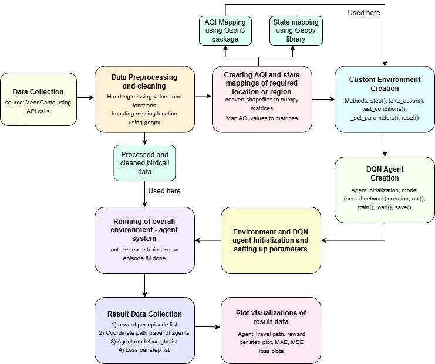

Figure 1: Overview of the world-grounded multi-instance DQN framework:
data collection, spatial discretisation and masking, the precomputed AQI
matrix, the AQI-integrated environment, DQN training and evaluation.

### 3.1 World-Grounded AQI Mapping

The Air Quality Index (AQI) summarises key atmospheric pollutants,
including particulate matter (PM*(2.5) and PM₁₀), ozone (O₃), sulfur
dioxide (SO₂), nitrogen oxides (NO*(x)), and carbon monoxide (CO), which
are known to affect avian physiology and behaviour. Fine particulate
matter can penetrate deep into birds’ respiratory systems, leading to
oxidative stress and respiratory complications. Elevated ozone levels
can disrupt oxygen exchange, impairing flight endurance and migratory
efficiency. Sulfur dioxide and nitrogen oxides contribute to acid
deposition, which affects food availability and nesting habitats, while
carbon monoxide exposure interferes with oxygen transport. These
pollutants can collectively influence migratory routes, breeding success
and habitat selection, which motivates AQI as the environmental signal
of the framework. In this work AQI is used as a relative measure of
environmental quality that feeds the reward; it is not calibrated to
species-specific exposure or fitness.

The methodology combines AQI mapping and state mapping so that the RL
environment can be constructed for any geographic location for which
boundary and air-quality data are available. The environment represents
geographic regions through their environmental conditions, focusing on
AQI and geographic parameters.

In the RL environment, states are defined by longitude, latitude and
AQI, and AQI changes as the agent moves across the region. AQI values
can be retrieved with the Ozon3 library \[6\], which provides
atmospheric and pollution data for fixed locations. However, querying
the API at every step is computationally expensive and subject to delays
and rate limits. To avoid this and improve runtime efficiency, a
precomputed AQI mapping of the study region is used.

The process of creating this mapping involves two key tasks: grid
generation and AQI updating. A grid is defined over the geographical
boundaries of the region, converting geographical locations (latitude
and longitude) into discrete grid cells. The mathematical transformation
from geographical coordinates to grid cells is represented as:

```math
x=\frac{\text{longitude}-\text{min}_{\text{long}}}{\Delta\text{long}} \tag{1}
```

```math
y=\frac{\text{latitude}-\text{min}_{\text{lat}}}{\Delta\text{lat}} \tag{2}
```

where $`\text{min}_{\text{long}}`$ and $`\text{min}_{\text{lat}}`$ are
the minimum longitude and latitude in the shapefile of the selected
region, and $`\Delta\text{long}`$ and $`\Delta\text{lat}`$ are the
grid-cell sizes, approximately 0.27^(∘). The indices $`x`$ and $`y`$
identify the grid cell of a geographic coordinate. Equations (1) and (2)
define the cells of a 2D matrix covering the region of interest.

Each grid cell is assigned specific longitude and latitude coordinates,
later used to assign AQI values. The grid has a $`109\times 108`$
structure, with each cell representing a 0.27-degree change in longitude
and latitude, approximately 30 square kilometers. This grid is then
masked to include only areas within the targeted region, excluding
neighboring countries, oceans, and seas.

After establishing the grid, the AQI for each cell is calculated.
Instead of querying AQI data for each coordinate in real-time during the
simulation, a pre-computed AQI mapping matrix is used. The center points
of the grid cells are queried to determine the average AQI for each
cell:

```math
\text{AQI}_{\text{cell}}=\frac{1}{n}\sum_{i=1}^{n}\text{AQI}_{i} \tag{3}
```

where $`\text{AQI}_{\text{cell}}`$ is the AQI assigned to a grid cell,
$`\text{AQI}_{i}`$ is the AQI of each sampled sub-cell or point within
the cell, and $`n`$ is the number of sub-cells sampled. If data for a
cell are unavailable, the missing value is approximated by averaging the
values of the neighbouring cells:

```math
\text{AQI}_{\text{approx}}=\frac{\text{AQI}_{\text{left}}+\text{AQI}_{\text{right}}+\text{AQI}_{\text{up}}+\text{AQI}_{\text{down}}}{4} \tag{4}
```

Equation (4) maintains spatial continuity of the AQI map in the presence
of missing data points. The AQI values are retrieved iteratively with
the Ozon3 library \[6\], with delays and retry attempts to respect rate
limits. The resulting matrix is static: it represents spatial
heterogeneity in air quality at the time of sampling, not temporal
pollution dynamics.

For state mapping, the shapefile is rasterised into a binary matrix,
where 1 marks regions of interest and 0 marks areas outside the study
scope. Each state or union territory is uniquely encoded as:

```math
\text{State\_Code}(S)=i,\quad\text{where }i=1,2,3,\dots,n \tag{5}
```

where $`S`$ is a region of interest and $`i`$ is its unique encoded
value. In the RL environment, each agent’s state is represented as:

```math
\text{State}_{\text{agent}}=(\text{lat},\text{long},\text{AQI},\text{State\_Code}) \tag{6}
```

Transitions between these states are made by the agent according to its
learned policy. The base pollution-aware reward for transitioning into a
grid cell is:

```math
R(s,a)=-\text{AQI}(s) \tag{7}
```

where $`R(s,a)`$ is the reward for transitioning into state $`s`$ after
taking action $`a`$, and $`\text{AQI}(s)`$ is the AQI of that state. The
negative sign penalises entering states with higher AQI, encouraging the
agent to avoid areas with poor air quality.

1: Input: Map grid with longitude and latitude coordinates

2: Output: AQI mapping grid for RL framework

3: function CreateAQIMappingGrid

4:   Divide the input map into a $`109\times 108`$ grid.

5:   Calculate latitude and longitude change per cell ($`\approx 0.27`$
degrees).

6:   Determine area covered per cell ($`\approx 30`$ sq. km).

7:   for each cell in the grid do

8:    Divide the cell into $`10\times 10`$ sub-cells.

9:    Compute latitude and longitude change per sub-cell
($`\approx 0.09`$ degrees).

10:    Determine area per sub-cell ($`\approx 10`$ sq. km).

11:    for each sub-cell do

12:      Compute AQI using mid-point latitude and longitude.

13:    end for

14:    Compute the average AQI for all sub-cells within the cell.

15:   end for

16:   for each cell do

17:    Count sub-cells inside and outside the region of interest.

18:    if sub-cells inside region $`>`$ sub-cells outside then

19:      Assign AQI as computed average.

20:    else

21:      Set AQI as -1 (insufficient data).

22:    end if

23:   end for

24:   return AQI mapping grid

25: end function

Algorithm 1 Precomputed AQI mapping for the world-grounded RL
environment

Using Algorithm 1, the AQI mapping is generated and stored in a NumPy
matrix in which each entry is the AQI of one grid cell. Each cell
corresponds to a defined geographic region, giving a granular
representation of air quality. This matrix is the environmental layer of
the world-grounded RL framework, linking the agents’ decisions to
measured environmental conditions.

### 3.2 AQI-Integrated Environment

The AQI mapping is integrated with a multi-instance reinforcement
learning framework trained with Deep Q-Learning (DQN). Agents are
initialised from bird records in the Xeno-canto dataset and navigate an
environment built from geographic and AQI data, so that their decisions
depend on both location and air quality.

Birds are widely regarded as bioindicators of air quality because of
their sensitivity to atmospheric pollutants, rapid physiological
responses and extensive geographic distribution. Their highly efficient
yet vulnerable respiratory systems mean that airborne contaminants such
as particulate matter (PM*(2.5), PM₁₀), ozone (O₃), sulfur dioxide (SO₂)
and nitrogen oxides (NO*(x)) can affect them more rapidly than mammals.
Changes in bird populations, migratory behaviour and physiology can
therefore provide early indications of deteriorating environmental
conditions, and, because birds occupy various trophic levels and
habitats, their responses can reflect broader ecological health. This
motivates bird-recording locations as the anchor points of the
simulation.

During the exploration phase, agents traverse the environment and gather
information about different states, defined as combinations of
geographic coordinates and AQI. After sufficient exploration, agents
exploit the acquired knowledge to move toward states that yield higher
cumulative reward. The environment is constructed from three datasets:

- •
  Bird-recording metadata from Xeno-canto
- •
  The precomputed AQI matrix
- •
  State and union-territory boundary data

Together these datasets ground the environment in real geographic and
environmental variation. The AQI matrix provides measured air-quality
information, while the state data define geographic boundaries as
polygons in latitude and longitude.

The action space for agents is defined as:

```math
\text{Action Space}=\{\text{North, South, East, West}\} \tag{8}
```

The observation space consists of three features: latitude, longitude
and AQI. The environment defines the step, take-action, test-conditions
and set-parameters functions outlined in Algorithm 2.

The reward at time step $`t`$ is computed as:

```math
R_{t}=\beta-\alpha\times\text{AQI}_{t} \tag{9}
```

where $`\alpha`$ is the penalty weight for poor air quality and
$`\beta`$ is a constant base reward for maintaining favourable AQI
levels.

Agent movement updates are defined as:

```math
\displaystyle=\text{Current Latitude}\pm 0.27 \tag{10}
```

```math
\displaystyle=\text{Current Longitude}\pm 0.27 \tag{11}
```

AQI acceptance bounds are evaluated relative to the agent’s reference
AQI:

```math
\displaystyle=0.25\times\text{AQI}_{\text{agent}} \tag{12}
```

```math
\displaystyle=1.40\times\text{AQI}_{\text{agent}} \tag{13}
```

and the AQI-based reward is:

```math
R_{\text{AQI}}=\begin{cases}+7,&\text{if }\text{Lower Limit}\leq\text{AQI}_{\text{Location}}\leq\text{Upper Limit}\\
-5,&\text{otherwise}\end{cases} \tag{14}
```

##### Relationship between the reward expressions.

The affine reward (9) reduces to the negative-AQI reward (7) when
$`\alpha=1`$ and $`\beta=0`$, provided both evaluate AQI at the same
point of the transition. The acceptance-band rule (14) is qualitatively
different: it rewards remaining within a band relative to the agent’s
reference AQI, so it can reward an AQI increase of up to 40% and
penalise a reduction below 25% of the reference. It therefore expresses
a preference for conditions similar to the agent’s reference rather than
a monotonic preference for cleaner cells. These thresholds are
simulation design choices, not validated avian tolerance limits, and
reward magnitude alone does not establish reduced pollution exposure.

1: Input:

2:  Data: Bird data (latitude, longitude, altitude, AQI)

3:  Country: Geopandas DataFrame containing region shapefile

4:  State Data: Dictionary of states and boundary coordinates

5:  AQI Matrix: AQI mapped data of the region

6: Output:

7:  (a) Total reward accumulated

8:  (b) Traversal coordinates for each agent

9:  (c) New state values after taking action

10:  (d) Done flag for execution status

11:  (e) Finish flag for completion status

12: function InitializeEnvironment

13:   Initialize the AQI-integrated environment with data, state data,
and AQI matrix

14:   Define action space: Discrete(4) {North, South, East, West}

15:   Set observation space with latitude, longitude, and AQI features

16:   Initialize parameters with reset()

17:   Set finish flag to False

18: end function

19: function StepFunction(action)

20:   if episode is complete then

21:    if all rows processed then

22:      Reset index and return results

23:    else

24:      Increment step index, reset parameters, and update state

25:    end if

26:   end if

27:   Execute action by calling take_action(action)

28:   Compute reward using test_conditions()

29:   return new state, traversal coordinates, reward, and completion
status

30: end function

31: function TakeAction(action)

32:   Update latitude or longitude based on action

33:   Append new coordinates to travel list

34:   Update state with new latitude, longitude, and altitude

35: end function

36: function TestConditions

37:   Retrieve AQI value for current step

38:   if latitude/longitude out of bounds then

39:    Reset parameters and return penalty

40:   end if

41:   if AQI location is zero (out of scope) then

42:    Return penalty

43:   end if

44:   Compute AQI range and check if within limits

45:   Assign rewards accordingly

46: end function

47: function SetParameters

48:   Initialize agent latitude, longitude, and altitude

49:   Track traversal paths and cumulative rewards

50: end function

51: function ResetEnvironment

52:   Reset state list, longitude, latitude, altitude

53:   Reset location, done flag, and travel list

54: end function

Algorithm 2 World-grounded bird propagation environment (AQI-integrated,
DQN approach)

The environment handles a discrete action space with a structured state
representation. Several challenges nonetheless arise, including
computational demand, the size of the state space and the complexity of
reward design. Q-learning provides a way to learn policies without an
explicit model of the environment, and Deep Q-Learning (DQN) extends it
by approximating Q-values with a deep neural network, which allows the
agents to generalise across the continuous-valued state of latitude,
longitude and AQI.

### 3.3 DQN Model Formulation

The DQN approach is used to model bird propagation over the AQI map. The
agent learns to navigate an environment defined by coordinates and AQI
values, with the objective of maximising cumulative reward by reaching
and remaining in regions that satisfy the pollution-aware objective. The
environment is a 2D grid on which agents move in one of four cardinal
directions, as detailed in the previous subsection. At each time step
$`t`$, the agent’s state $`s_{t}`$ is:

```math
s_{t}=[\text{latitude},\text{longitude},AQI] \tag{15}
```

The agent selects an action using an epsilon-greedy policy, balancing
exploration and exploitation. The probability of selecting a random
action decreases over time, following:

```math
a_{t}=\begin{cases}\text{random action},&\text{if }\epsilon>\text{random value}\\
\arg\max_{a}Q(s_{t},a),&\text{otherwise}\end{cases} \tag{16}
```

where $`\epsilon`$ decays according to:

```math
\epsilon=\max(\epsilon_{\text{min}},\epsilon\times\epsilon_{\text{decay}}) \tag{17}
```

The Q-values are updated using the Bellman equation:

```math
Q(s_{t},a_{t})=R_{t}+\gamma\max_{a^{\prime}}Q(s_{t+1},a^{\prime}) \tag{18}
```

where $`R_{t}`$ represents the reward at time step $`t`$, $`\gamma`$ is
the discount factor, and $`s_{t+1}`$ is the next state after taking
action $`a_{t}`$. The loss function for training the Q-network is
defined as:

```math
L(Q)=\frac{1}{N}\sum_{i=1}^{N}\left(Q(s_{t},a_{t})-\left[R_{t}+\gamma\max_{a^{\prime}}Q(s_{t+1},a^{\prime})\right]\right)^{2} \tag{19}
```

where $`N`$ is the batch size during training. The Q-network consists of
fully connected layers with the following architecture:

- •
  Layer 1: Dense with 64 units, ReLU activation
- •
  Layer 2: Dense with 32 units, ReLU activation
- •
  Layer 3: Dense with 16 units, ReLU activation
- •
  Layer 4: Dense with 8 units, ReLU activation
- •
  Output layer: Dense with action_dim units (linear activation)

Each layer $`l`$ computes the output as:

```math
h^{l}=\text{ReLU}(W^{l}h^{l-1}+b^{l}) \tag{20}
```

where $`W^{l}`$ and $`b^{l}`$ denote the weights and biases of layer
$`l`$. As training progresses, $`\epsilon`$ decreases, reducing
exploration and increasing exploitation. Through DQN, agents develop
policies that optimise cumulative reward by selecting regions with
favourable AQI. The procedure is outlined in Algorithm 3.

1: Input:

2:  State size $`(\text{latitude},\text{longitude},\text{AQI})`$

3:  Action size $`(\text{north},\text{south},\text{east},\text{west})`$

4: Hyperparameters:

5:  Discount factor $`(\gamma)`$, Learning Rate $`(\alpha)`$

6:  Exploration Rate
$`(\epsilon,\epsilon_{\text{min}},\epsilon_{\text{decay}})`$

7:  Batch Size $`(N)`$

8: Output:

9:  Optimal policy for agents

10:  Total reward accumulated

11:  Traversal coordinates

12: function InitializeEnvironment

13:   Initialize replay memory $`D`$ to store past experiences

14:   Initialize primary network $`Q`$ and target network $`Q^{\prime}`$
with random weights

15:   Set environment with AQI, bird call data, and state boundaries

16: end function

17: function TrainDQN

18:   for each episode do

19:    Reset environment, get initial state $`s_{1}`$

20:    for each step $`t`$ do

21:      Select action $`a_{t}`$ using epsilon-greedy policy

22:      Execute action, observe reward $`R_{t}`$ and next state
$`s_{t+1}`$

23:      Store transition $`(s_{t},a_{t},R_{t},s_{t+1})`$ in $`D`$

24:      Sample mini-batch from $`D`$

25:      Compute target values based on Bellman equation

26:      Train $`Q`$ by minimizing loss function $`L(Q)`$

27:      Periodically update target network $`Q^{\prime}\leftarrow Q`$

28:      Update state $`s_{t}\leftarrow s_{t+1}`$

29:      Decay $`\epsilon`$

30:    end for

31:   end for

32: end function

Algorithm 3 DQN training in the AQI-integrated world-grounded
environment

The computational demands of deep reinforcement learning (DRL) pose
challenges for scalability and practical use in large-scale
environmental modelling. Training a DQN requires substantial computation
because of the state space, the reward structure and iterative learning
updates. As the number of agents grows—each initialised from a bird
record and navigating the AQI-mapped environment—memory, processing and
storage requirements grow accordingly. Applications that need fast
inference may also be limited by networks with high computational
overhead. Cloud-based and parallelised training can mitigate these
limits, but deployment in resource-constrained settings remains a
challenge; network pruning, quantisation and adaptive sampling are
possible optimisations.

With DQN, agents learn navigation strategies driven by AQI, which allows
the framework to simulate movement patterns that respond to air quality
and geographic constraints. The integration of measured AQI data with
reinforcement learning makes these agent–environment interactions
explicit and open to analysis.

### 3.4 Multi-Instance Runtime Integration

A key aspect of the framework is the integration of the custom
environment with the DQN model. Training begins by loading the data
sources—bird-recording metadata, the AQI grid matrix and the states or
sub-territories of the study region—so that the simulation is grounded
in the real geography and air quality of the region. Agent movement is
shaped by variations across environmental zones as given by the AQI
data: the agents adjust their moves north, south, east or west in
response to air-quality conditions, in a manner loosely analogous to
birds adjusting their flight in response to environmental change.

Learning is organised into structured episodes that together involve
more than 400 agents, which optimises computational resource allocation
and streamlines data processing. Each agent derives feedback from the
rewards obtained for its actions, giving an efficient mechanism for
performance evaluation. Analogous to observing a large flock during a
single migration period, this design gives a collective snapshot of
agent behaviour, and analysing how agents modify their behaviour in
response to environmental variation provides insight into their learning
dynamics. Agents or timesteps that share a training run should not,
however, be treated as independent replications.

To mitigate overfitting, the behaviour of the DQN model is regulated.
The learned weights are monitored, and when an agent exhibits repetitive
behaviour, the agent and the DQN model are reset to previously
successful weight configurations. This prevents agents from becoming
trapped in rigid action sequences and encourages adaptive learning. In
addition, agents that exhibit repetitive actions are penalised with a
reward of $`-10`$, and agents that consistently fail to perform are
excluded from further training, which encourages diverse strategies.
These mechanisms are training heuristics rather than established
ecological processes; their effect on generalisation requires ablation,
and agent removal changes the evaluated population, which must be
considered when interpreting aggregate metrics.

The resulting runtime captures agent adaptability and exploratory
tendencies while proactively addressing overfitting. The full procedure
is given in Algorithm 4.

1: Input:

2:  Preprocessed bird-recording data from Xeno-canto

3:  State data, AQI matrix data

4:  State and action dimensions

5:  Learning rate, discount factor $`(\gamma)`$

6:  Exploration rate $`(\epsilon)`$, decay factor
$`(\epsilon_{\text{decay}})`$, minimum exploration rate
$`(\epsilon_{\text{min}})`$

7: Output:

8:  Total reward per agent

9:  Trained DQN weights

10:  Traversal coordinates

11: function InitializeEnvironment

12:   Initialize custom environment with input data

13:   Initialize DQN agent with hyperparameters

14:   Set number of episodes

15:   Initialize lists to store episode rewards, paths, model weights,
and epsilon values

16: end function

17: function TrainAgents

18:   for each episode do

19:    Reset environment to initial state

20:    Initialize variables to track episode rewards and paths

21:    while episode is not finished do

22:      Select action using epsilon-greedy policy

23:      Execute action, observe next state, reward, and done status

24:      Train agent with transition $`(s_{t},a_{t},r_{t},s_{t+1})`$

25:      Update state and cumulative episode reward

26:      if length of action list $`>`$ 70 and majority of actions are
repetitive then

27:       Reset model weights to last saved state

28:       Reset $`\epsilon`$ value to last saved state

29:       Set flag condition as true

30:      end if

31:      if actions persist for extended duration then

32:       Display status (reward total, actions, location data, etc.)

33:       Append total reward to episode rewards list

34:       Prepare environment for next agent

35:       Store traversal data into paths list

36:       Empty action list and continue execution

37:      end if

38:      if done condition is true then

39:       Display episode status

40:       Store episodic data

41:       if flag condition is true then

42:         Store trained weights and $`\epsilon`$ value

43:       end if

44:      end if

45:    end while

46:    Append episode rewards and status details to lists

47:   end for

48: end function

Algorithm 4 Multi-instance runtime execution

### 3.5 Bird Occurrence Data and AQI Integration

Bird data were sourced from Xeno-canto \[Xeno-canto\], a widely used
platform hosting one of the most comprehensive collections of bird
vocalisations and their metadata. India was selected as the study region
because of its heterogeneous AQI distribution and rich avian
biodiversity. The dataset was obtained through API requests to the
Xeno-canto database, extracting latitude, longitude and altitude. The
AQI at each recording location was computed with the Ozon3 library from
its latitude and longitude. The final dataset comprises 479 instances,
each representing a bird recording occurrence. These coordinates allow
the recordings and their AQI values to be mapped, giving the spatial
distribution of the recordings across India and the air-quality
conditions at those locations.

These records do not provide individually linked, time-ordered tracks:
the instances must not be interpreted as tracked birds or independent
experimental replications, and the generated paths are simulated
trajectories rather than reconstructions of observed migration.
Recording effort, accessibility and species detectability may influence
the sampled locations, and spatial association with the AQI matrix does
not establish contemporaneous exposure unless recording dates and
pollution timestamps are matched.

The dataset contains geographical coordinates (latitude and longitude)
for 478 locations across India. The descriptive statistics for latitude
include a mean of 22.992704 degrees and a standard deviation of 7.135504
degrees, with values ranging from a minimum of 9.136100 degrees to a
maximum of 32.911200 degrees. The median latitude is 26.767300 degrees,
with the 25th and 75th percentiles at 15.544200 and 28.633350 degrees,
respectively. For longitude, the mean is 81.401885 degrees with a
standard deviation of 7.674811. Longitude values range from 69.203600
degrees to 97.021000 degrees, with a median of 78.369100 degrees, while
the 25th and 75th percentiles are at 76.250775 and 92.106519 degrees,
respectively. The dataset includes 226 unique locations corresponding to
sightings of 41 bird species. Figure 2 presents the locations of these
observations, while Figure 3 illustrates their spatial distribution
across India, with blue dots representing bird sightings. Figures 5
and 5 display the distributions of latitude and longitude values,
respectively, providing insights into the geographical spread of
observations.

In terms of AQI, the dataset includes 478 observations with a mean AQI
of 111.57 and a standard deviation of 49.84. The AQI values range from 5
to 999, with quartile values at 25% (Q1) = 71, 50% (median, Q2) = 118,
and 75% (Q3) = 151. Figure 6 visualizes AQI values across study
locations, with the x-axis representing location indices and the y-axis
denoting AQI values within the range of 5 to 999. This plot highlights
spatial variability in air quality across different study regions.
Figure 7 provides a histogram of AQI frequency distribution across 226
locations, with AQI values plotted along the x-axis and their
corresponding frequency along the y-axis, offering an overview of air
quality variability in the dataset.

Figures 8 and 9 add state boundaries and the AQI heatmap of India,
respectively, both produced by the framework, which integrates
air-quality data with the geographic grid. Figure 8 shows the state-wise
mask, and Figure 9 shows the spatial distribution of AQI across the
country, which forms the environmental layer of the simulation. The
shapefile of India was sourced from a government data portal \[51\],
with remote-sensing resources \[5\] providing state and union-territory
delineations. Shapefiles for other countries can be obtained from
sources such as OpenStreetMap, and the framework can be connected to
other geographic data sources, which makes it applicable to other
regions.

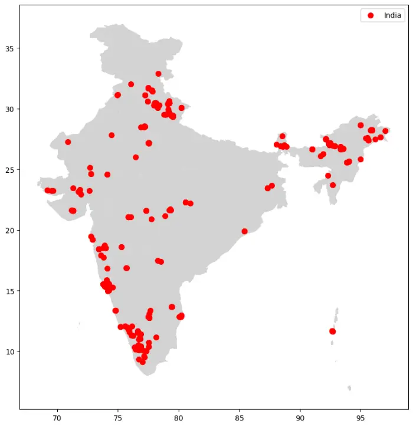

Figure 2: Bird-recording locations from the Xeno-canto dataset (red
dots) overlaid on the shapefile of India.

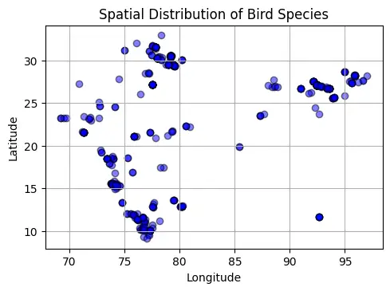

Figure 3: Spatial distribution of the bird-recording locations by
latitude and longitude.

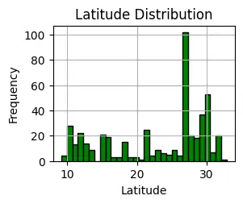

Figure 4: Histogram of recording latitudes.

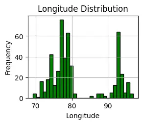

Figure 5: Histogram of recording longitudes.

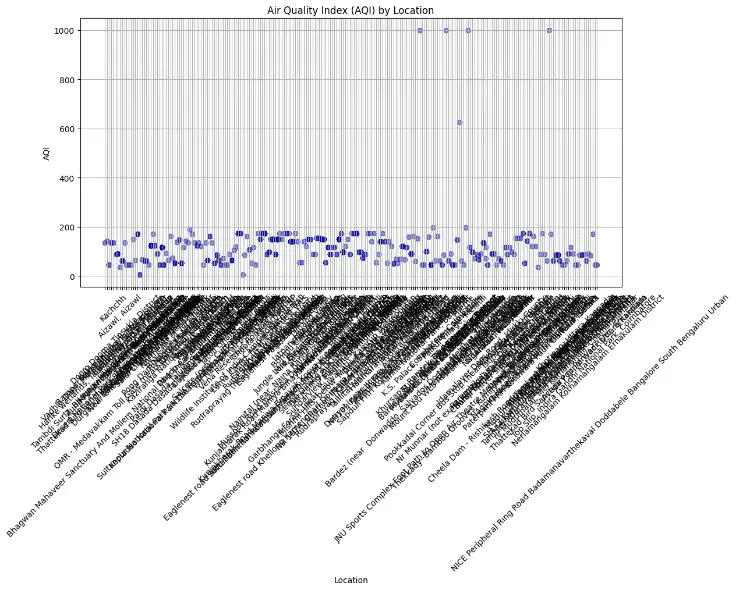

Figure 6: AQI values at each of the 226 unique recording locations.

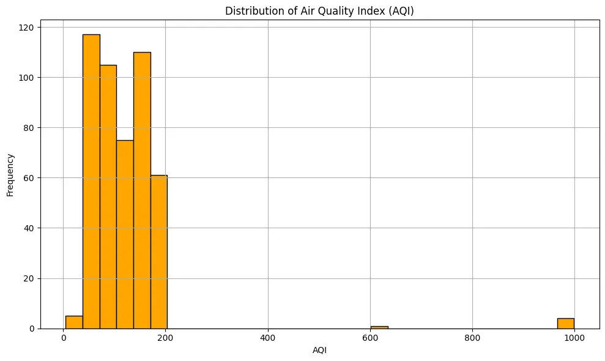

Figure 7: Histogram of AQI values across the 226 unique recording
locations.

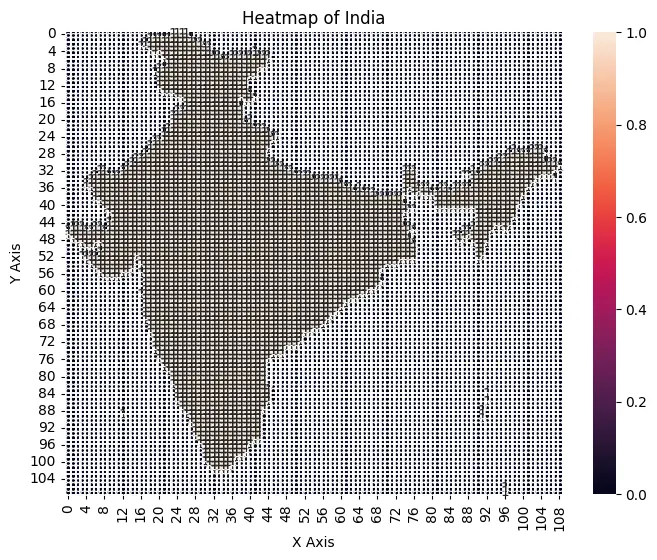

Figure 8: State-wise binary mask of India used to define valid cells of
the environment and to update the AQI matrix.

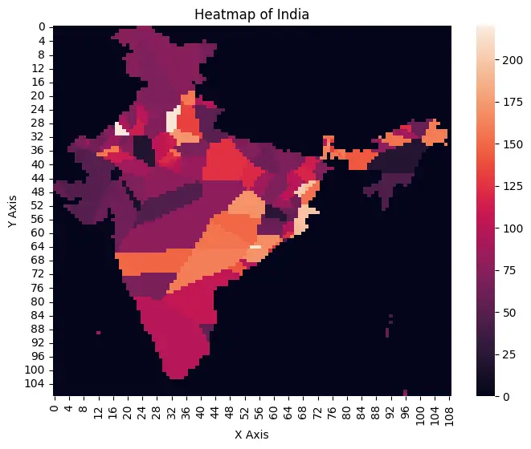

Figure 9: Heatmap of the precomputed AQI matrix over India, the
environmental feedback layer of the world-grounded environment.

### 3.6 Scope of the Simulation

The framework is a computational model of pollution-aware navigation,
and several of its components are modelling choices whose scope should
be explicit. Bird movement is represented as navigation over the
AQI-integrated grid with four discrete actions of fixed $`0.27^{\circ}`$
shifts in latitude or longitude; the observation includes geographic
position and AQI, so that decisions are driven by both spatial and
environmental signals. The fixed AQI matrix represents spatial
heterogeneity, not temporal pollution dynamics. Grid steps are
computational transitions without a calibrated flight duration, and
fixed angular increments do not represent equal physical distances
across latitudes. The study therefore examines an explicit navigation
objective in a world-grounded environment without claiming that birds
perceive AQI or optimise the same reward.

## 4 Experiments and Results

This section presents the deployment of the framework on India, with all
mappings integrated and bird propagation simulated across the region.
Bird data for India from Xeno-canto were used to initialise the agents.
Graphical analyses and quantitative metrics are presented to assess the
behaviour and learning of the framework, covering how agent movement
responds to air quality and geographic constraints and how the agents’
decision-making evolves during training.

### 4.1 Experimental Setup

An empirical analysis of the proposed methodology was conducted by
integrating reinforcement learning (RL) frameworks and simulations,
which were implemented using Python within a Windows 10 environment. The
computational setup consisted of a system equipped with 8GB of RAM and a
Ryzen 5 5000 series CPU. All experiments were executed using Python
version 3.10, leveraging Google Collaboratory for computational
resources. This experimental configuration provided the requisite
environment for running RL simulations and systematically evaluating the
performance of the proposed approach.

### 4.2 Evaluation Metrics

We evaluate five simulation metrics. They quantify the specified
simulation objective rather than biological fitness.

##### Cumulative reward.

```math
R_{\text{cumulative}}=\sum_{t=1}^{T}r_{t} \tag{21}
```

where $`r_{t}`$ is the reward at timestep $`t`$ and $`T`$ is the total
number of timesteps in an episode.

##### Reward change rate.

```math
\Delta R_{t}=r_{t}-r_{t-1},\quad\forall t\in\{2,3,\dots,T\} \tag{22}
```

which describes consecutive reward differences.

##### Action diversity (entropy).

```math
D_{\text{action}}=-\sum_{a\in A}p(a)\log p(a) \tag{23}
```

where $`A`$ is the set of possible actions and $`p(a)=n(a)/N`$, with
$`n(a)`$ the number of times action $`a`$ is selected and $`N`$ the
total number of actions. Its exponential moving average is

```math
D_{\text{action,EMA}}(t)=\alpha D_{\text{action}}(t)+(1-\alpha)D_{\text{action,EMA}}(t-1), \tag{24}
```

with smoothing factor $`0<\alpha\leq 1`$. Entropy measures action
frequencies and does not by itself demonstrate adaptive behaviour.

##### Total distance travelled.

```math
D_{\text{travelled}}=\sum_{t=2}^{T}\left\|s_{t}-s_{t-1}\right\| \tag{25}
```

where $`s_{t}`$ denotes geographic position only, excluding AQI and
state code, and $`\|\cdot\|`$ is the Euclidean distance in the
coordinate representation. Computed from latitude and longitude, this is
angular displacement rather than physical flight distance, which would
require a geodesic calculation.

##### Step efficiency.

```math
E_{\text{step}}=\frac{R_{\text{cumulative}}}{T} \tag{26}
```

the mean reward per timestep.

##### Mean absolute error.

To monitor learning, the mean absolute error (MAE) of the agent model is
tracked against the steps taken by each agent (Section 4.3.5).

### 4.3 Multi-Instance DQN Environment Analysis

This section analyses the aggregated rewards and traversal paths of the
agents after all DQN agents initialised from the Xeno-canto dataset have
been executed. Each agent corresponds to a data record with its own
initial state of longitude, latitude and AQI. Throughout the simulation,
whether an action comes from the DQN’s prediction or from exploration,
the cumulative reward of each successful step is logged, as described in
the methodology. For spatial analysis and visualisation, the coordinates
of the agents’ movement across India are also recorded, which is needed
to understand collective agent behaviour under the varying AQI of
different locations.

Beyond reward analysis, the learning error of the agents is evaluated
and visualised to monitor learning efficiency and adaptation, which
helps assess the convergence behaviour of the framework. In addition, a
comparative analysis of different RL algorithms is carried out, covering
reward accumulation, traversal and decision-making behaviour, to assess
how the proposed approach behaves relative to standard alternatives in
the same world-grounded environment.

#### 4.3.1 Performance Analysis of Agents

As outlined above, the behavioural and learning trends of the DQN model
are examined using reward data together with the states and actions of
the agents. The reward plot in Figure 10 shows the cumulative reward
accumulated at each action step. The trend first increases, reaching a
peak reward of 722, as agents find regions with valid AQI values that
satisfy the reward conditions. A subsequent decline in total reward
follows from environmental and model constraints, including boundary
violations, cells with zero AQI and AQI comparisons outside the
acceptance band. These constraints are part of the environment design
and keep agent movement within the world-grounded region.

The key environmental constraints incorporated into the framework are:

- •
  Boundary violations: A penalty of $`-5`$ is imposed and the agent’s
  position is reset to its original state. These violations represent
  natural and geopolitical boundaries and prevent movement outside the
  modelled region, keeping trajectories within the land-masked grid.
- •
  Zero-AQI cells: A penalty of $`-4`$ is applied when agents enter cells
  with zero AQI, which correspond to locations such as oceans or cells
  outside the study scope. The penalty steers agents back toward valid
  land cells.
- •
  AQI outside the acceptance band: Agents are penalised when they reach
  cells whose AQI falls outside the acceptance band defined relative to
  their reference AQI (Equation (14)). This keeps exploration within
  conditions similar to the agent’s starting environment, which the
  framework uses as a proxy for ecological tolerance.

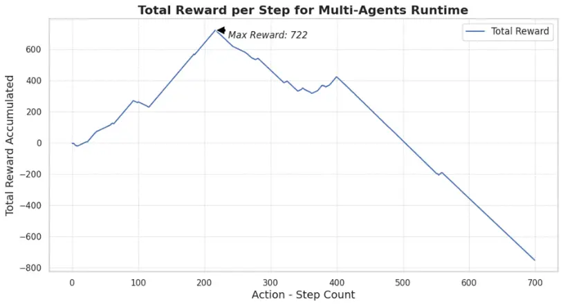

Figure 10: Cumulative reward collected at each step by the DQN agents,
peaking at 722.

Integrating these constraints into the RL framework keeps agent
behaviour consistent with the modelled geography and the specified
objective. The penalties also improve learning efficiency by directing
agents toward valid regions and reduce overfitting to specific
locations.

The reward plot of the DQN model gives insight into agent–environment
interaction. From step 0 to step 200, total reward increases
consistently, indicating effective adaptation. The peak reward of 722
around step 200 corresponds to a phase in which agents successfully
apply learned strategies. The subsequent decline corresponds to agents
moving into new territory and incurring penalties that reduce cumulative
reward. This balance between exploration and exploitation is a
characteristic of the RL framework.

The reduction in reward after the peak plays a role in learning: by
penalising agents in less suitable regions, the model prevents
over-reliance on known areas and encourages agents to experience a
broader range of environmental conditions. The reward dynamics show how
the model evaluates cells under varying AQI, which is relevant for using
the framework to study movement within real-world environmental
constraints.

To further assess the framework, a comparative analysis is conducted
across different RL algorithms in the same environment. The resulting
metrics provide a baseline for future RL models in world-grounded
ecological simulation.

#### 4.3.2 Comparison with Classical RL Methods

Figure 11 presents a detailed comparative analysis of the performance of
the four agents within the AQI-integrated environment. This analysis
explores the underlying mechanisms governing agent behavior, focusing on
how each approach influences performance within this dynamic and complex
setting. The Deep Q-Network (DQN) demonstrates superior performance
among all methods, achieving the highest cumulative rewards as episodes
progress. Its trajectory is characterized by a steady and steep upward
trend, reflecting its capacity to effectively learn optimal policies.
After approximately 250 episodes, DQN’s performance distinctly surpasses
other methods. While initial growth is gradual, the model stabilizes
quickly and exhibits a steep increase in cumulative rewards, indicative
of efficient learning through experience replay and neural network
function approximation. The sharp improvement beyond 250 episodes
demonstrates the model’s enhanced capacity to generalize across the
state-action space. Unlike other methods, DQN does not exhibit
oscillations or slow convergence, maintaining a consistently strong
trajectory across episodes. This superior performance is attributed to
DQN’s use of deep neural networks to approximate the Q-value function
and the implementation of experience replay to stabilize learning. These
mechanisms enable effective generalization in complex, high-dimensional
state spaces.

Conversely, the Monte Carlo method exhibits the weakest performance, as
reflected in its significantly lower cumulative rewards and unstable
trajectory in earlier episodes. Between 0 and 500 episodes, Monte Carlo
demonstrates pronounced instability, with cumulative rewards declining
into negative values and recovering intermittently. This behavior is
attributed to its reliance on high-variance updates based on complete
episode returns. Recovery begins around 500 episodes, where a noticeable
upward trend is observed; however, growth remains slower relative to
other methods. The instability of Monte Carlo in early episodes
underscores its inefficiency in environments that require incremental
updates, and its delayed recovery suggests a prolonged convergence
period for optimal policies.

Q-Learning and Value Iteration exhibit intermediate performance levels,
with both demonstrating steady and consistent increases in cumulative
rewards. Q-Learning, despite outperforming Monte Carlo, lags slightly
behind Value Iteration and DQN. This performance is attributed to its
reliance on tabular Q-value updates, which do not scale as efficiently
as the function approximation techniques employed in DQN. Initially,
cumulative rewards exhibit gradual growth, reflecting the iterative
nature of tabular updates. Between 200 and 500 episodes, a pronounced
upward trend is observed as the algorithm refines its policy. However,
its growth rate eventually stabilizes, with DQN and Value Iteration
surpassing it in later episodes. This plateau effect results from
Q-Learning’s limited scalability in high-dimensional state spaces
without function approximation.

Value Iteration benefits from its model-based approach, allowing for
more efficient convergence compared to Q-Learning. However, its
inability to match the scalability and representational power of DQN
becomes apparent as episodes increase, with DQN ultimately achieving
superior cumulative rewards. Initially, Value Iteration exhibits strong
performance, demonstrating steady growth from the outset of the
simulation. Between 0 and 250 episodes, its trajectory slightly exceeds
that of Q-Learning, indicating faster convergence during early training
phases. This early advantage stems from its model-based nature, which
enables efficient computation of optimal policies using the
environment’s transition dynamics. However, beyond 500 episodes, growth
decelerates, and cumulative rewards are ultimately surpassed by DQN.
This slowdown suggests that while Value Iteration achieves rapid initial
convergence, it lacks the scalability and flexibility of neural
network-based approaches in complex environments.

These performance trends highlight the diverse learning dynamics of the
evaluated algorithms. DQN excels in both stability and scalability,
demonstrating superior performance beyond 250 episodes. Value Iteration
and Q-Learning exhibit strong early-phase learning but experience slower
long-term growth. Monte Carlo’s poor initial performance and delayed
recovery further emphasize its limitations in environments requiring
incremental and stable policy updates.

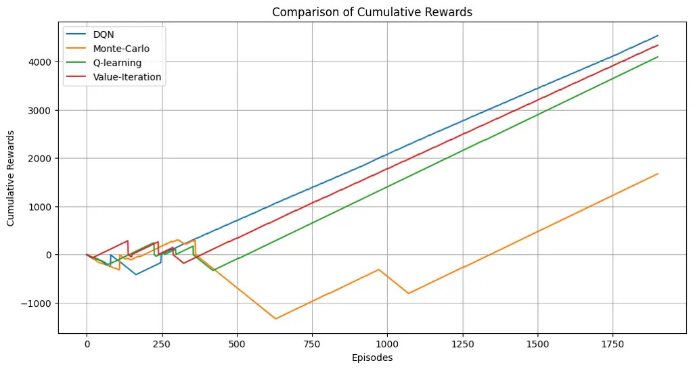

Figure 11: Cumulative reward per episode for DQN, Monte Carlo,
Q-Learning and Value Iteration in the world-grounded environment.

Figure 12 illustrates the evolution of action diversity across training
episodes for four reinforcement learning algorithms. Action diversity,
which represents the variability in selected actions, provides insights
into an agent’s balance between exploration and exploitation and the
refinement of its policy over time. The analysis reveals significant
differences in algorithmic behavior within the AQI-integrated
environment, emphasizing how their respective exploration strategies
influence learning dynamics.

DQN exhibits high action diversity at the beginning of training,
indicative of its initial exploratory phase, which is guided by the
epsilon-greedy exploration strategy. A sharp decline in diversity is
observed within the first 100 episodes, signaling a rapid transition
toward policy exploitation. However, complete elimination of variability
does not occur, as action diversity stabilizes at moderate levels
throughout the remainder of training. This behavior reflects the dynamic
nature of DQN, where the gradual decay of the epsilon parameter ensures
that a nonzero probability of exploration is maintained. The residual
variability allows the model to adapt to environmental changes and
mitigate the risk of convergence to suboptimal policies. Periodic
fluctuations in later episodes suggest that strategic exploration
continues, which is particularly advantageous in environments
characterized by complex dynamics or high-dimensional state spaces. This
ability to balance exploration and exploitation contributes to the
robustness of DQN, as evidenced by its superior cumulative rewards
(Figure 11). The moderate yet consistent action diversity underscores
the flexibility of DQN’s neural network-based architecture, facilitating
generalization across a broad range of state-action pairs.

Monte Carlo exhibits the highest and most sustained action diversity
among all evaluated algorithms. In the initial episodes, significant
fluctuations in diversity are observed, with pronounced peaks and
troughs indicating instability in policy updates. This behavior is
expected, as Monte Carlo relies on episodic returns, which are
inherently high in variance due to their dependence on complete episode
outcomes. After 500 episodes, action diversity stabilizes but remains
consistently high, often exceeding 0.4 throughout training. The
sustained variability indicates a strong emphasis on broad exploration
of the state-action space, making Monte Carlo suitable for environments
where exhaustive exploration is essential for identifying optimal
policies. However, this extensive exploration comes at the cost of
delayed convergence and reduced policy stability. The persistent high
action diversity suggests difficulty in stabilizing a deterministic
policy, particularly in dynamic or noisy environments. Consequently,
Monte Carlo may exhibit suboptimal performance in scenarios that require
rapid convergence or fine-tuned exploitation strategies.

Q-Learning demonstrates a steady decline in action diversity, with a
distinct transition from exploration to exploitation occurring around
200–250 episodes. Initially, moderate variability is observed,
reflecting the exploration phase driven by the epsilon-greedy strategy.
As Q-values are iteratively refined, action diversity decreases,
eventually stabilizing at approximately 0.2. This stabilization
indicates a transition toward a predominantly deterministic policy once
optimal Q-values for state-action pairs are established. The low action
diversity following convergence highlights Q-Learning’s strength in
policy exploitation, wherein actions with the highest Q-values are
consistently selected. However, this deterministic behavior may limit
adaptability, reducing the algorithm’s ability to respond to unforeseen
changes or explore alternative policies. In environments with
high-dimensional or partially observable state spaces, this reduction in
exploration could lead to suboptimal performance. Nonetheless, the
structured and predictable reduction in action diversity reflects the
stability and systematic nature of Q-Learning’s learning process.

Value Iteration maintains minimal action diversity throughout the
training process, stabilizing near zero after the initial episodes. This
behavior is a direct consequence of the algorithm’s reliance on a fixed
model of the environment’s transition dynamics. Unlike other algorithms,
Value Iteration does not incorporate stochastic exploration mechanisms
such as epsilon-greedy strategies. Instead, it computes a deterministic
policy by iteratively solving the Bellman equation for each state-action
pair. While this deterministic approach facilitates rapid and reliable
convergence, it severely restricts the algorithm’s ability to explore
alternative actions or adapt to dynamic environments. The absence of
variability renders Value Iteration well-suited for tasks with fully
known and static dynamics but poorly equipped for problems requiring
flexible adaptation or learning under uncertainty. The consistently low
action diversity underscores the rigidity of the algorithm, which,
although computationally efficient in predictable settings, limits its
broader applicability.

The action diversity analysis provides critical insights into the
exploration strategies and learning dynamics of these reinforcement
learning algorithms. DQN emerges as the most versatile approach,
effectively balancing exploration and exploitation to adapt to complex
environments. Monte Carlo exhibits the highest exploratory tendencies
but struggles with policy stability and convergence. Q-Learning and
Value Iteration demonstrate increasingly deterministic behavior, with
the former achieving gradual convergence and the latter prioritizing
rapid stabilization. These findings highlight the trade-offs between
exploration and exploitation across different RL algorithms, influencing
their suitability for various ecological modeling tasks.

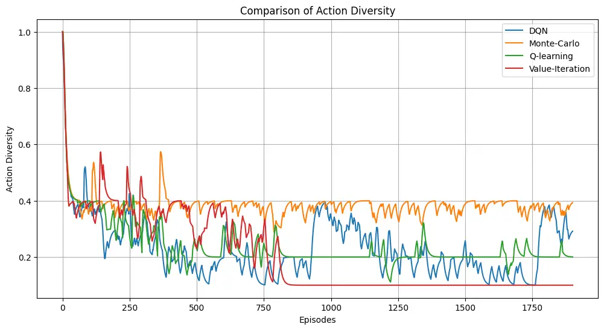

Figure 12: Action diversity (entropy-based) per episode for the four
algorithms.

Figure 13 illustrates the evolution of cumulative reward changes per
episode. The vertical axis represents the reward change rate, while the
horizontal axis denotes the number of episodes. Each trajectory
corresponds to the reward change rate of an individual algorithm over
time. During the initial learning phase, both DQN and Q-learning exhibit
rapid learning, achieving high reward change rates early in training.

The performance trajectory of the Deep Q-Network (DQN) is characterized
by an initial phase of rapid improvement followed by stabilization.
Within the first 250 episodes, a steep increase in the reward change
rate is observed, indicating the algorithm’s ability to quickly adapt
and optimize its policy. This rapid ascent is facilitated by DQN’s deep
learning architecture, which enables effective approximation of Q-values
and efficient generalization of state-action value mappings. The
$`\epsilon`$-greedy exploration strategy ensures adequate exploration,
while the neural network rapidly prioritizes actions that yield higher
rewards. The aggressive learning phase underscores DQN’s strength in
navigating high-dimensional and complex environments. As training
progresses, the reward change rate stabilizes at a consistently high
level, indicating convergence toward an optimal or near-optimal policy.
The minimal fluctuations observed in later episodes highlight the
robustness of DQN, demonstrating its ability to maintain stable policies
even in dynamic environments. The sustained high performance suggests
that the learned policies are not only optimal but also resilient to
perturbations in input conditions.

Q-learning follows a similar trend, with a rapid increase in the reward
change rate during the early episodes. Its off-policy nature accelerates
the learning process by allowing updates from actions outside the
current policy. The deterministic update rule, which incorporates
maximum future rewards, further contributes to the fast learning rate.
Compared to Monte Carlo, Q-learning stabilizes earlier and exhibits
reduced fluctuation, indicating a more stable learning process. The
lower variability suggests robustness in policy convergence, despite the
algorithm’s known susceptibility to overestimation bias in Q-values. The
overall consistency in performance highlights Q-learning’s ability to
effectively balance exploration and exploitation, making it a reliable
approach for reinforcement learning tasks.

Monte Carlo and Value Iteration also demonstrate effective learning but
require a longer stabilization period due to differences in update
mechanisms and algorithmic sensitivities. Between 250 and 750 episodes,
Monte Carlo exhibits significant fluctuations in the reward change rate,
reflecting its inherent instability arising from the high variance in
episodic returns. Unlike Q-learning and DQN, which update policies more
frequently and smooth out learning trajectories, Monte Carlo’s reliance
on complete episodes results in volatile changes when policies are
adjusted based on cumulative episode outcomes. Beyond 750 episodes, the
reward change rate begins to stabilize, though variability remains
present. This suggests gradual convergence toward an optimal policy
while highlighting the method’s sensitivity to episodic return variance
and the initial state distribution. The learning curve of Monte Carlo is
less smooth compared to other algorithms, with higher variance and less
frequent updates slowing down the learning process. However, its ability
to capture long-term dependencies and delayed rewards makes it
advantageous in tasks where these factors play a critical role.

Value Iteration exhibits a rapid increase in the reward change rate
similar to DQN but with more pronounced fluctuations in the early
episodes. This initial variability is attributed to the iterative nature
of value updates, which can cause oscillations as the algorithm seeks to
converge to the optimal value function. As training progresses, the
reward change rate stabilizes, albeit with minor fluctuations. This
indicates that while Value Iteration achieves high rewards early in
training, maintaining consistent performance may be challenging. The
observed fluctuations may result from the algorithm’s sensitivity to the
precision of value updates and its deterministic policy structure.
Despite these challenges, Value Iteration is theoretically guaranteed to
converge to the optimal policy under certain conditions, making it
well-suited for applications requiring optimality guarantees, such as
planning and scheduling tasks.

In terms of overall performance, DQN achieves the highest and most
stable reward change rate, making it the most effective algorithm in
this comparison. Q-learning also performs well, striking a balance
between rapid learning and stability. Monte Carlo’s performance, though
variable, remains suitable for scenarios where episodic returns are
significant. Value Iteration, while effective, may require additional
tuning to achieve long-term stability comparable to DQN and Q-learning.

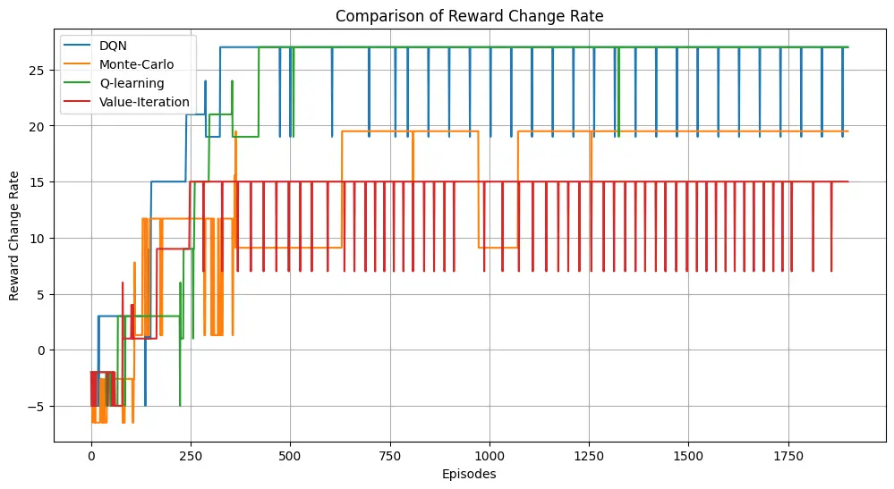

Figure 13: Reward change rate per episode for the four algorithms.

Figure 14 presents a comparative analysis of the four agents based on
step-efficiency metrics across the training episodes. Step efficiency
serves as a critical metric for evaluating how effectively an algorithm
improves its policy per step or episode. A higher step efficiency
indicates faster and more stable learning.

DQN exhibits a robust and steady learning process. In the initial
episodes, fluctuations in step efficiency are observed, starting at
approximately -3 and gradually increasing as learning progresses. These
early instabilities are mitigated through the use of neural networks for
value function approximation and experience replay to stabilize
learning. By the 250th episode, DQN demonstrates a consistent upward
trajectory in efficiency, surpassing the 1.0 mark. This steady
improvement persists through the mid-phase (250 to 750 episodes) and
later phases (750 to 1750 episodes), with step efficiency approaching
2.0. DQN’s sustained increase in efficiency highlights its effectiveness
in environments with large state-action spaces, where neural network
generalization and experience replay contribute to balancing exploration
and exploitation. This mechanism helps to break the correlation between
consecutive updates, resulting in more stable and reliable learning.
Over time, early fluctuations are further mitigated as the network
refines its parameters. DQN’s capacity to continuously improve and
maintain high step efficiency, particularly in later episodes,
underscores its suitability for environments that require function
approximation and stabilized learning processes.

Monte Carlo exhibits distinct learning characteristics due to its
episodic nature. During the initial 250 episodes, significant
variability in step efficiency is observed, fluctuating between -3 and
values above 1.5. This high variance arises from the algorithm’s
dependence on complete episodes for policy updates, leading to unstable
early performance. As training progresses, a pronounced dip in
efficiency is noted between 250 and 750 episodes, occasionally dropping
below -2. This decline reflects the challenges posed by high variance in
episodic returns, which complicates stable learning. Beyond 750
episodes, Monte Carlo gradually recovers and improves its step
efficiency. However, despite showing a positive trend, its efficiency
remains lower than that of other algorithms, indicating persistent
sensitivity to episodic variance and less frequent policy updates. The
results suggest that while Monte Carlo is effective in capturing
long-term dependencies, its application is best suited for environments
where episodes yield significant cumulative reward information, despite
its slower convergence and higher variability.

Q-learning exhibits a balanced and steady learning curve. Initially,
moderate fluctuations in step efficiency occur, reflecting the
algorithm’s trade-off between exploration and exploitation. Step
efficiency begins at approximately -3 but rapidly increases, stabilizing
around 1.0 by the 250th episode. This stability is maintained through
the mid-phase, with Q-learning displaying a smooth and consistent upward
trajectory. In the later episodes, Q-learning converges towards a high
step efficiency, slightly below that of DQN but still significant. The
direct updates to Q-values allow Q-learning to refine its policy
effectively, demonstrating robust learning dynamics. The results
indicate that Q-learning performs well in environments with well-defined
state-action spaces, where its incremental Q-value updates ensure stable
and consistent improvements. Its effectiveness in such settings makes it
a reliable choice for reinforcement learning tasks of moderate
complexity.

Value Iteration, represented by the red line, achieves high and
consistent step efficiency among the algorithms. From the initial
episodes, Value Iteration exhibits a rapid increase in efficiency,
quickly surpassing Q-learning and Monte Carlo. This early advantage is
attributed to its reliance on a complete model of the environment, which
allows for iterative computation of the optimal policy. By the 250th
episode, Value Iteration attains efficiency values around 1.5,
maintaining strong performance throughout the learning process. In the
mid and later phases, step efficiency remains consistently around 2.0,
demonstrating the algorithm’s stable learning dynamics. The results
highlight Value Iteration’s advantages in environments where a full
model is available, enabling efficient and effective policy
optimization. However, despite its strong performance, Value Iteration
falls slightly short of DQN, which benefits from neural network
generalization and experience replay, resulting in marginally higher
overall efficiency in complex environments.

This comparative analysis highlights the distinct strengths and
limitations of the four algorithms. Monte Carlo, while effective for
episodic tasks with complete return information, suffers from high
variance and slower convergence, limiting its efficiency in dynamic
environments. DQN demonstrates robust performance, leveraging neural
networks and experience replay to achieve steady learning and
scalability in large and complex state-action spaces. Q-learning, with
its direct Q-value updates, offers stability and moderate scalability,
making it effective in environments with manageable complexity. Value
Iteration emerges as the most step-efficient approach, excelling in
model-based environments due to its iterative optimization capabilities.
These insights underscore the importance of aligning algorithm selection
with task characteristics and resource constraints to maximize learning
efficiency and performance.

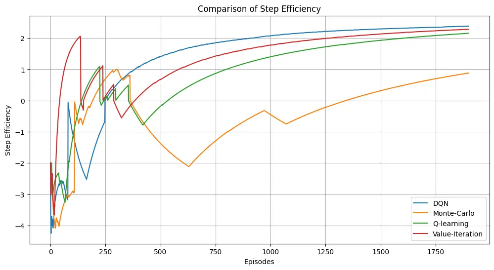

Figure 14: Step efficiency (reward per timestep) across episodes for the
four algorithms.

The total distance traveled by an agent serves as a crucial metric for
evaluating its exploration behavior within an environment. By summing
the Euclidean distances between successive positions, this metric
provides insight into how effectively an agent navigates the state space
to discover and refine its policy. Figure 15 presents the comparative
analysis of the agents based on their cumulative distances traveled.

DQN exhibits steady growth in cumulative distance traveled, reflecting a
well-balanced exploration strategy. During the initial episodes, the
algorithm prioritizes exploration to gather diverse experiences, as
evidenced by the gradual increase in distance. This exploration phase is
facilitated by DQN’s $`\epsilon`$-greedy policy and the use of
experience replay, which ensures that the agent learns from varied
transitions while mitigating the instability typically associated with
online updates. Over time, the cumulative distance traveled increases at
an approximately linear rate, indicating that DQN effectively
transitions from exploration to exploitation, focusing on refining its
policy to optimize performance. The substantial distance covered by DQN
underscores its ability to systematically explore complex state spaces
and adapt its policy to enhance efficiency.

Monte Carlo exhibits the slowest growth in cumulative distance traveled
among the four algorithms, characterized by a nearly flat trajectory
over the episodes. This behavior highlights the episodic nature of Monte
Carlo, which updates its policy only at the conclusion of each episode.
The dependence on complete returns introduces inefficiencies in
exploration, as the agent may repeatedly follow suboptimal paths before
adjusting its policy. Consequently, the limited distance covered
suggests insufficient exploration of the state space, hindering the
agent’s ability to discover improved policies. Although Monte Carlo
remains theoretically robust in environments with well-defined episodes,
its poor exploration efficiency in this context represents a fundamental
limitation in tasks requiring dynamic and proactive policy refinement.

Q-learning demonstrates moderate exploration efficiency, as indicated by
its cumulative distance traveled. In the early episodes, the agent
covers a substantial area, reflecting an effective balance between
exploration and exploitation. This efficiency arises from the
temporal-difference learning framework, which enables incremental
Q-value updates based on immediate feedback. However, as training
progresses, the rate of growth in distance declines, suggesting a
gradual shift toward exploitation. While this behavior signifies that
Q-learning effectively consolidates its policy, the relatively lower
cumulative distance compared to DQN and Value Iteration suggests
limitations in exploring larger or more complex state spaces. Q-learning
performs adequately in environments with simpler dynamics but may
struggle to match the scalability of more advanced algorithms.

Value Iteration exhibits rapid and consistent growth in cumulative
distance traveled, covering the largest total distance among the four
algorithms. However, this extensive movement does not necessarily result
in proportional performance improvements. The algorithm’s reliance on a
complete model of the environment enables iterative computation of
optimal policies, but its resulting behavior often entails exhaustive
exploration of the state space, including regions that may not
meaningfully contribute to policy refinement. This tendency toward
over-exploration may highlight inefficiencies or suboptimal pathfinding,
as the agent expends significant resources navigating areas of marginal
value. While Value Iteration benefits from deterministic updates and
comprehensive state space coverage, its excessive movement suggests a
lack of focus in exploration compared to more adaptive algorithms such
as DQN. As a result, although Value Iteration is thorough, it may not
utilize its exploration efforts as efficiently as DQN, particularly in
environments with complex or high-dimensional state spaces where
targeted exploration is essential.

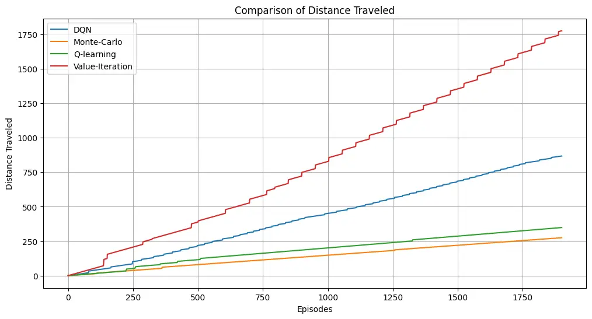

Figure 15: Cumulative distance travelled across episodes for the four
algorithms (angular grid displacement).

The comparative analysis reveals distinct exploration patterns and
trade-offs among the four algorithms. DQN emerges as the most balanced
and efficient in its exploration strategy, demonstrating a steady
increase in cumulative distance while maintaining a strong focus on
identifying high-value regions within the state space. This behavior
highlights its capacity to adapt dynamically and refine its policy
effectively in complex environments. Value Iteration, while achieving
the greatest overall distance traveled, frequently engages in excessive
and unfocused exploration, resulting in inefficiencies and suboptimal
pathfinding in scenarios where targeted exploration is essential. This
tendency underscores its reliance on exhaustive state space coverage,
which may not always translate into optimal performance improvements.
Q-learning exhibits moderate exploration efficiency, characterized by
significant early improvements but a slower cumulative growth in later
episodes. This pattern suggests a gradual shift toward exploitation,
leading to a more conservative learning approach over time. Monte Carlo
demonstrates the lowest exploration efficiency among the four
algorithms, with limited cumulative distance traveled and a slow rate of
improvement. This outcome reflects its episodic nature, which restricts
its ability to adapt rapidly to environmental changes.

These findings emphasize the importance of selecting an algorithm based
on the specific requirements of the task. DQN is well suited for
high-dimensional, complex environments due to its adaptive
exploration-exploitation balance. Value Iteration performs optimally in
fully modeled, structured tasks but may suffer from inefficient
exploration. Q-learning provides a balance between simplicity and
effectiveness in environments with manageable state spaces. Monte Carlo
remains best suited for well-defined episodic environments where rapid
adaptation is not a primary concern.

#### 4.3.3 Traversal Paths of the Agents

Traversal coordinates recorded for each agent during runtime give
insight into the behaviour and decision-making of the DQN model. The
paths are computed on the India grid, which is aligned with the AQI
matrix, so each cell traversed by an agent can be tracked. Analysing the
paths shows the learning progression of the model, in which exploratory
behaviour gradually gives way to exploitation as agents use acquired
knowledge to navigate more efficiently—a fundamental characteristic of
reinforcement learning.

Visualising the paths also shows where agents incur penalties, such as
boundary violations or entry into unfavourable AQI regions, which
supports evaluation of the learned navigation strategies. From an
ecological perspective, the paths illustrate how agents following a
pollution-aware objective move through a landscape of varying AQI; they
can be used to formulate hypotheses about how movement might respond to
air quality, to be tested against independent movement data. They are
simulated paths, not observed bird tracks.

Because more than 400 agents are trained, plotting all their paths in
one figure would be unreadable. A subset of 15 agents is therefore shown
in Figure 16, each in a distinct colour, with start and end points
marked as (x) and (◆), respectively. The simulation uses an India grid
of $`108\times 109`$ cells, each corresponding to a 0.27-degree shift in
latitude or longitude, approximately a 30 km displacement in either
direction.

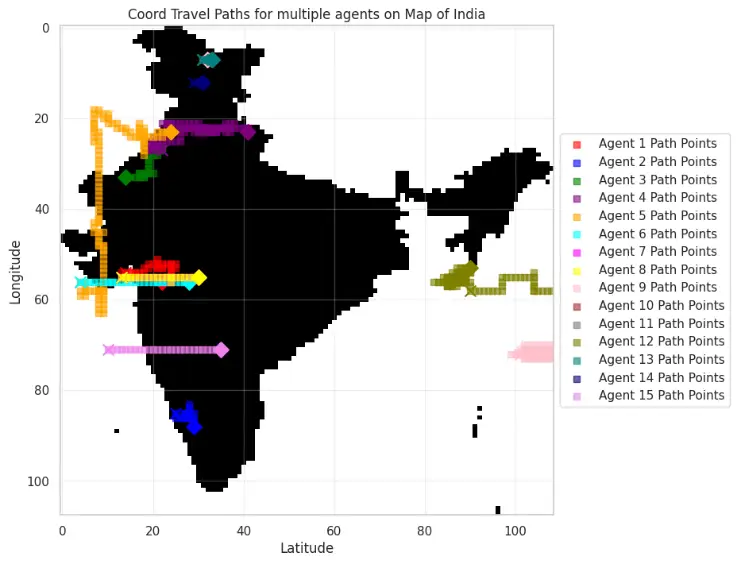

Figure 16: Simulated traversal paths of a subset of 15 agents on the map
of India. These are simulated paths under the grid and reward
constraints, not observed bird tracks.

#### 4.3.4 Analysis of Agent Traversal Paths

The diversity of agent paths reflects the exploration–exploitation
trade-off of reinforcement learning. Initially, agents explore and
gather information about regions that may yield higher reward. Over
time, behaviour shifts toward exploitation, in which agents favour
regions that have produced favourable outcomes, allowing them to
maximise cumulative reward while refining their navigation strategies.

This pattern has an ecological analogue: birds explore new environments
but tend to return to places where they have found favourable
conditions, such as good air quality or abundant food. The agents’ shift
toward known favourable regions mirrors, at a conceptual level, how
birds might adapt movement to environmental cues such as AQI, weather or
habitat availability. The interpretations below should be read as
hypotheses generated by the simulation rather than as validated
ecological findings.

Agents can be grouped by their traversal patterns, which relate to the
environmental conditions they encounter:

- •
  Group A: Coastal Regions The simulations conducted using the DQN model
  in coastal regions indicate stable and consistent agent movement
  patterns. This stability primarily results from relatively constant
  AQI values, as pollutants in these areas are consistently dispersed by
  sea breezes. From an ornithological perspective, coastal birds are
  accustomed to stable environmental conditions, leading to minimal
  variability in foraging and migration behaviors. This ecological
  stability is reflected in the simulation, where the agents’
  trajectories converge toward consistent paths due to predictable
  resource availability and limited AQI fluctuations.
- •
  Group B: Urban Areas In urban environments, AQI values fluctuate
  significantly, leading to highly adaptive and variable agent movement
  paths. The unpredictability in AQI conditions necessitates real-time
  decision-making, akin to the complex navigation strategies required in
  urban settings. From an ecological standpoint, birds in urban habitats
  must adapt to highly dynamic and often hazardous pollution levels,
  which fosters behavioral plasticity and erratic movement patterns.
  This adaptability is mirrored in the DQN model, where agents
  continuously adjust their navigation strategies in response to the
  volatile urban landscape to optimize exposure to better air quality.
- •
  Group C: Rural or Forested Regions In rural and forested regions,
  consistently low AQI values contribute to stable agent trajectories.
  The simulations in these areas yield predictable movement patterns, as
  the minimal pollution levels facilitate more efficient learning of
  navigation strategies. Similarly, birds inhabiting these regions are
  conditioned to function in relatively undisturbed environments,
  resulting in less erratic movement patterns. The congruence between
  the model’s outcomes and observed bird behavior highlights the strong
  influence of stable environmental conditions on agent navigation and
  habitat quality assessments.

These groupings enable a comparative analysis of how diverse
environmental conditions influence air quality and agent movement
patterns. Figure 16 illustrates the traversal paths of selected agents,
demonstrating the impact of AQI variations on navigation strategies. For
instance, Agents 1 and 3 initially follow similar trajectories in
northern India before diverging—Agent 1 moves westward into a region
with relatively stable AQI, while Agent 3 navigates toward the eastern
region, characterized by greater AQI variability. The DQN algorithm
learns these variations and formulates distinct navigation strategies
for each agent. Similarly, Agents 7 and 14, moving along coastal
regions, exhibit stable movement patterns, reinforcing the model’s
preference for paths with minimal AQI fluctuations. Conversely, Agents
10 and 15, navigating central India, demonstrate extensive traversal and
adaptive movement strategies in response to highly dynamic AQI
conditions. These results highlight how the DQN model captures
environmental variations and adjusts agent trajectories accordingly. A
more intricate analysis of agent traversal paths allows for several
critical deductions:

- •
  Diversity of Agent Paths The variation in agent paths reflects diverse
  exploration and exploitation strategies. This diversity parallels
  migration patterns in bird species such as the European Swallow, where
  differences in air quality and resource availability drive variations
  in migration routes. The observed trajectories provide insight into
  how agents adapt to AQI variations and geographical constraints.
- •
  Revisitation of Locations Agents revisiting previously explored
  locations may indicate regions with high AQI variability. This
  behavior resembles the tendency of birds to return to areas with
  inconsistent food sources or fluctuating environmental conditions,
  reinforcing the relevance of the RL model in ecological studies.
- •
  Performance Assessment of the DQN Model The analysis of agent paths
  offers a means to evaluate the efficiency of the DQN learning process.
  Well-optimized trajectories demonstrate strategic navigation with
  minimal deviations, akin to how migratory birds optimize routes across
  seasons. Additionally, adaptive responses to AQI fluctuations and
  geographical boundaries reflect the model’s ability to dynamically
  adjust, similar to how birds alter migration routes based on
  environmental changes.
- •
  Environmental Insights from Agent Paths Correlating agent movement
  with AQI data provides valuable environmental insights. For instance,
  avoidance of specific regions may indicate areas of high pollution,
  akin to how birds circumvent polluted habitats. Habitat quality
  assessments can be derived by tracking agent interactions with the
  environment, where frequent penalties or route deviations may signal
  adverse ecological conditions.
- •
  Identification of Key Locations The traversal path analysis helps
  identify critical regions, such as penalty zones where agents
  consistently experience negative reinforcement, suggesting challenging
  terrain or poor air quality. Conversely, zones where agents receive
  sustained positive rewards resemble ideal habitats with optimal living
  conditions. These findings contribute to targeted environmental
  monitoring and conservation strategies.

Overall, the traversal-path analysis shows how the RL agents interact
with the environmental variables of the world-grounded environment. It
improves the interpretability of the DQN model and suggests ecological
hypotheses about pollution-aware movement that can be examined with
independent data.

#### 4.3.5 Learning Error Analysis

Figure 17 presents the plot of the Mean Absolute Error (MAE) of the
agent model against the steps taken by each agent, capturing the
distribution of approximately 10 agents over a total of 610 steps in the
environment. The plot reveals multiple plateau-like curves, indicating
points where the agent’s learning or adaptation slows down
significantly. These plateaus correspond to saturation points, where the
agent temporarily ceases to gain new information. For example, when
negative reward criteria are applied to regions outside India or near
water bodies, agents may continue exploring those areas for a predefined
number of steps before resetting to a new location. This reset
mechanism, visible in the stopping curves within plateau regions, marks
the transition of agents toward exploring different areas.

The presence of these plateau curves highlights the fundamental
exploration-exploitation trade-off inherent in the model. Exploration
reflects an agent’s tendency to search for new regions and gather
additional information, while exploitation involves leveraging prior
knowledge to maximize rewards. The appearance of these plateaus suggests
that agents have effectively navigated all known regions, optimizing
their learning to achieve peak performance. This balance between
exploration and exploitation facilitates efficient adaptation to dynamic
environments.

The reported average MAE is 1.0716, with a minimum MAE of 0.0291 and a
maximum MAE of 5.1144. These values quantify the error in the agent
model, reflecting some variation in learning performance while
maintaining a relatively low average error rate. The MAE plot thus
provides critical insights into the learning dynamics of the agents,
demonstrating their ability to evolve and adjust to environmental
conditions. The observed saturation points and subsequent resets
reinforce the model’s capacity to maintain an effective balance between
exploration and exploitation while operating in a complex environment.

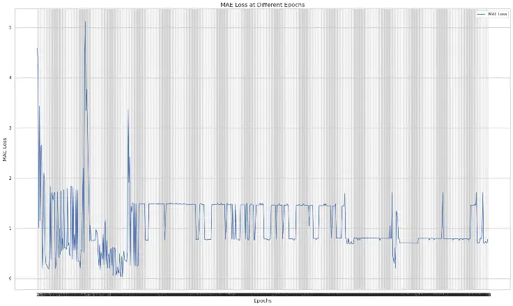

Figure 17: Mean absolute error of the agent model for the first 10
agents across 610 steps; plateaus mark saturation points followed by
resets.

### 4.4 Evaluation Protocol and Validity Considerations

The comparisons above are descriptive evaluations under the reported
simulation setup. Cumulative reward and reward per timestep quantify the
specified objective rather than biological fitness; distance measures
grid traversal rather than validated flight distance; and smoothness
within a run is not evidence of reproducibility across independent runs.
The current report does not provide the number of independent training
seeds or between-run uncertainty estimates, so the algorithm rankings
remain provisional. A stronger evaluation would repeat the full training
and evaluation procedure across independent seeds, report seed-level
means with 95% confidence intervals, and match initial-location
distributions, rewards, transition rules, episode horizons and
evaluation budgets across methods. Because Value Iteration uses an
explicit transition model, its information access and convergence
tolerance should also be documented. Useful sensitivity checks include
the reward coefficients, repetition penalties, agent removal, grid
resolution and AQI imputation, and a direct comparison of the mean AQI
encountered by each method would help distinguish pollution avoidance
from optimisation of the reward-shaping terms. These checks are
requirements for further validation rather than experiments claimed
here.

## 5 Comparative Analysis with Related Works

This section presents a qualitative comparative analysis of existing
frameworks reviewed in the literature. Due to the novelty of the
proposed approach and the lack of a standardized quantitative evaluation
framework, the comparison is conducted based on three key aspects:
bioindicator studies, computational simulation, and reinforcement
learning (RL).

### 5.1 Bioindicator Studies

Table 2 provides a comparative overview of various bioindicator studies
relevant to the proposed work, evaluating their contexts, specific
indicators, data collection methodologies, and inherent challenges.

|                    |                                 |                                  |                                                |                                           |
| ------------------ | ------------------------------- | -------------------------------- | ---------------------------------------------- | ----------------------------------------- |
| Study              | Context                         | Specified Indicators             | Data Collection Method                         | Challenges                                |
| Singh et al.       | Environmental Monitoring        | Data Openness, ML Algorithms     | Aggregated multi-source data                   | Data availability, quality issues         |
| Zhang et al.       | Ecosystem Monitoring            | Drone Relay, IoRT                | Drones, IoRT devices                           | Connectivity issues, high energy use      |
| Iverson et al.     | Migration Ecology               | Land Cover, NDVI, GPS Tracking   | GPS tracking, NDVI satellite data              | Small bird tracking, data accuracy        |
| Cunha Silva et al. | Disease Ecology                 | Habitat Selection, Rabies Risk   | Field observations, GPS, surveys               | Dog behavior variability, rural data gaps |
| Hill et al.        | Urban Ecology                   | Urbanization, Roost Sites        | GPS tracking, field observations               | Urban accessibility, observer bias        |
| Proposed Work      | Environmental Health Monitoring | AQI, Geographic Data, Bird Calls | API-based bird data, measured AQI, geolocation | Computational cost, static AQI snapshot   |

Table 2: Comparison with bioindicator studies.

A distinguishing feature of the proposed framework is the use of
reinforcement learning, specifically Deep Q-Networks, to model movement
as an adaptive, interaction-driven process in a world-grounded
environment. Unlike Singh et al., who used machine learning for data
analysis without an interactive model, the proposed approach embeds
measured data in an environment in which agents learn from feedback.
While Singh et al.’s method benefited from data openness, it was
constrained by data availability and quality; the proposed framework
mitigates the cost of repeated data access through its precomputed AQI
layer.

Zhang et al. used drones and the Internet of Remote Things (IoRT) for
continuous environmental monitoring. Despite high-resolution sensing,
this approach is constrained by energy consumption and connectivity in
remote areas. By contrast, the proposed study relies on AQI data and
bird-recording metadata that are accessible through existing APIs and
require no field infrastructure, and its reinforcement learning model
adds a simulation capability that sensing alone does not provide.

Studies such as Iverson et al. and Cunha Silva et al. used GPS tracking
and field observation to analyse habitat selection and migration. These
methods are effective for localised studies but face scalability and
accuracy limits in remote or inaccessible regions, and they do not
provide a simulation model for exploring scenarios. The proposed
multi-instance RL framework integrates AQI, geospatial parameters and
bird-recording metadata to simulate pollution-aware movement at country
scale, complementing such observational data, which remain essential for
validation.

Hill et al. studied vulture responses to urbanisation with spatial
analysis, facing accessibility constraints in urban environments and
potential observer bias. The proposed work instead combines AQI data,
geolocation and reinforcement learning to simulate movement. While
computationally intensive, this approach offers a scalable complement to
field methods for environmental health monitoring.

By addressing limitations in data collection, scalability and modelling
found in prior bioindicator studies, the proposed work contributes a
data-driven simulation approach that can support ecological monitoring
and environmental health assessment.

### 5.2 Computational Simulation Methods

Table 3 evaluates different studies based on the simulation
methodologies they employed, with a focus on the metrics used, results
obtained, and the challenges encountered.

|                 |                                                                           |                                                              |                                                                            |                                                            |
| --------------- | ------------------------------------------------------------------------- | ------------------------------------------------------------ | -------------------------------------------------------------------------- | ---------------------------------------------------------- |
| Paper           | Proposed Methodology                                                      | Metrics Used                                                 | Results                                                                    | Challenges                                                 |
| Saulnier et al. | Statistical Analysis, Climate Models                                      | Reproductive Success Rates, Environmental Correlations       | Significant differences in reproductive success                            | Data variability, modeling diverse conditions              |
| Antelmi et al.  | Agent-Based Models (ABM)                                                  | Simulation Accuracy, Agent Behavior Patterns                 | Captures complex interactions at a micro level                             | Computational intensity, scalability issues                |
| Perry et al.    | Deep Learning, Neural Networks                                            | Model Accuracy, Predictive Power                             | Improved ecosystem modeling                                                | High data requirements, model interpretability             |
| Tovey et al.    | Multi-Agent Reinforcement Learning (MARL)                                 | Strategy Effectiveness, Adaptability                         | Models complex adaptive behaviors                                          | High training data demands, computational complexity       |
| Tappler et al.  | Continuous Stochastic Dynamics, RL                                        | Predictive Accuracy, Adaptability                            | Captures dynamic environmental processes                                   | High computational cost, complex implementation            |
| Ellis et al.    | Data Integration, Machine Learning                                        | Habitat Use Patterns, Predictive Accuracy                    | Insights into habitat use patterns                                         | Data integration complexity, data variability              |
| Proposed Work   | World-grounded multi-instance RL, DQN, AQI and bird-recording integration | Cumulative reward, diversity, step efficiency, distance, MAE | Highest reward and step efficiency among compared RL methods (single runs) | Computational burden, static AQI, no trajectory validation |

Table 3: Comparison with computational simulation studies.

Previous research has used computational methods that face challenges in
scalability and complexity. For instance, Antelmi et al. applied
agent-based modelling (ABM) to simulate micro-level interactions within
ecosystems, but ABM faced scalability issues that limit its use for
large systems. Our study, though computationally intensive because of
its RL setup, reduces data-collection cost by using existing
APIs—Xeno-canto for bird-recording data and Ozon3 for air
quality—instead of extensive field collection, and reduces runtime cost
through the precomputed AQI matrix.

Several studies, including those by Perry et al. and Ellis et al.,
applied deep learning and statistical models to ecological systems.
These methods improved model accuracy but were hindered by complex data
interpretation, high computational cost and difficult data integration.
Perry et al. highlighted large data requirements and the complexity of
neural network outputs as key obstacles, and Ellis et al. integrated
diverse data sources to study habitat use, which made the approach
cumbersome. Our work keeps data integration simple by using
well-structured, readily available data such as AQI and bird-recording
metadata, and the DQN within a multi-instance framework exposes
reward-based metrics that are straightforward to interpret.

Many studies that used machine learning or statistical models were
limited in adaptability. Tappler et al. used RL with continuous
stochastic dynamics to simulate environmental processes; the method was
adaptable but required high computational power at scale. Saulnier et
al. applied statistical analysis to relate environmental factors to bird
reproductive success; their results highlighted important influences but
did not provide an adaptive model. In contrast, the proposed work models
movement as an interactive learning process, in which the DQN adapts to
the environmental feedback it receives and the system can simulate
different environmental scenarios. With time-resolved AQI inputs, the
same structure could be updated as conditions change.

In ecological contexts, studies such as those of Iverson et al. and
Cunha Silva et al. faced scalability and applicability issues when
extended to broader settings. Our framework integrates environmental and
ecological data in one model and is designed to accept data from
different regions and geographic scales, including air-quality indices,
geographic information and species metadata, so it can be applied across
urban and rural settings and, with suitable data, to other species and
processes.

### 5.3 Reinforcement Learning-Based Modelling

Table 4 evaluates various studies based on the reinforcement learning
(RL) methodologies employed, focusing on their specific RL approaches,
key metrics, results, inferences, and limitations.

|                 |                                                        |                                              |                                                                               |                                                              |                                                             |
| --------------- | ------------------------------------------------------ | -------------------------------------------- | ----------------------------------------------------------------------------- | ------------------------------------------------------------ | ----------------------------------------------------------- |
| Paper           | Proposed RL Methodology                                | Metrics Used                                 | Results                                                                       | Inferences                                                   | Cons                                                        |
| Haensel et al.  | Agent-Based Modeling (ABM)                             | Student Outcomes in Complexity               | ABM aids teaching of human-environment interactions                           | Suitable for complex system simulations in education         | Simplistic model, limited real-time adaptability            |
| Martínez et al. | DRL for Autonomous Flocking                            | Convergence, Stability, Flocking Behavior    | DRL optimizes coordination and navigation in flocking                         | Adaptable to dynamic environments, real-time effectiveness   | Computationally expensive, lengthy training, complex tuning |
| Tovey et al.    | Micro-scale Multi-Agent RL (MARL)                      | Strategy Emergence, Adaptability             | MARL models adaptive behavior under diverse conditions                        | Suitable for emergent behavior modeling in dynamic systems   | High training data needs, high computational cost           |
| Tappler et al.  | Continuous Stochastic Dynamics in RL                   | Model Accuracy, Predictive Performance       | Captures dynamic environmental processes effectively                          | Supports continuous learning in environmental systems        | High computational cost, complex implementation             |
| Li et al.       | Ensemble RL Gated Unit Model                           | PM2.5 Forecasting Accuracy                   | Improved air quality forecasting with ensemble learning                       | Effective for environmental predictions                      | Complex model, high data requirements                       |
| Proposed Work   | Multi-instance DQN in a world-grounded AQI environment | Reward, diversity, efficiency, distance, MAE | Peak per-step reward of 722; highest cumulative reward among compared methods | Pollution-aware movement simulation grounded in measured AQI | High computational needs; static AQI; validation pending    |

Table 4: Comparison with reinforcement learning-based studies.

The proposed study embeds Deep Q-Networks in a multi-instance
reinforcement learning framework designed to simulate bird propagation
driven by environmental variables, in particular the Air Quality Index.
This extends the agent-based modelling (ABM) of Haensel et al., which
was effective for teaching human–environment systems but did not
integrate measured environmental data, which is essential for
world-grounded simulation. Haensel et al.’s ABM focused on representing
interactions within land-use policies rather than environmental
interactions at scale, and the simplifications of rule-based ABM
restrict its use for modelling the environmental variation that
influences movement. In the DQN-based approach, agents learn navigation
policies from measured AQI data rather than from hand-specified rules.
The use of bird-recording metadata from Xeno-canto further anchors the
simulation in real-world observations.

A key feature of this work is the integration of diverse
datasets—geographic coordinates, AQI values and bird-recording
metadata—into a single multi-instance simulation. Martínez et al., who
used Deep Reinforcement Learning (DRL) for autonomous robot flocking,
demonstrated the suitability of DRL for dynamic decision-making,
achieving good stability and adaptability at the cost of high
computational demand and extensive parameter tuning. The proposed
DQN-based method shares the challenge of computational intensity, while
addressing a different, ecologically motivated problem in which the
effect of air quality on movement is explicitly modelled.

Whereas Martínez et al. focused on coordination among robotic agents,
our multi-instance DQN framework trains many agents, each initialised
from a different recording location, as they respond to the AQI
landscape across a large geographic region. This makes it possible to
study how regional variation in air quality shapes simulated movement.
Li et al. used an ensemble RL method for daily PM2.5 forecasting;
although their work advanced air-quality prediction, it did not model
the effect of air quality on animal movement, which is the focus here.

A general limitation of RL-based methods is their computational cost,
which the proposed model shares. Martínez et al., Tovey et al. and
Tappler et al. all highlight the cost of RL techniques on large datasets
or environments, and our multi-instance framework likewise requires
substantial resources to simulate many agents across a large region.

To mitigate these costs, the framework uses several optimisations. AQI
data are precomputed and stored on a grid, so that no API calls are
needed during simulation, and the geographic space is restricted by
masking to valid cells of the study region. This improves scalability
without changing the environment’s structure. Compared with studies such
as Li et al. and Tappler et al., the framework aims for a practical
balance between model complexity and scalability, particularly in data
retrieval.

## 6 Discussion

AI-driven simulations, in particular those based on reinforcement
learning, offer a structured and scalable approach to modelling
ecological dynamics that complements traditional observational methods.
Concerns that such models omit real-world ecological factors are
legitimate; the world-grounded design addresses part of this by building
the environment from domain data—AQI, bird-recording metadata and
geographic structure—while the remaining factors are discussed in
Section 7. Unlike approaches based on static observations and small
samples, the framework allows large-scale, data-driven exploration of
possible interactions between movement and air quality. Reinforcement
learning does not replace ecological expertise; it complements it by
allowing hypotheses to be explored in a controlled and reproducible
setting, and the framework can be refined as new ecological data are
incorporated.

The framework has potential implications for urban planning and
pollution control by providing a data-driven way to explore the
ecological relevance of air-quality variation. Simulating movement in
response to AQI can help identify candidate pollution hotspots and
regions whose habitat value may be at risk, to be examined with field
data. Such analyses could inform targeted mitigation, such as
green-space planning, buffer zones and emission controls in areas
important for avian biodiversity, and could feed into urban planning
that aims to minimise ecological disruption.

The framework uses a holistic multi-instance reinforcement learning
design to simulate movement across India. Although the implementation
overlays an AQI mask on India, the framework is adaptable to other
regions. The AQI layer shapes where agents can profitably move, and the
DQN selects actions by predicting Q-values to maximise cumulative
reward. The framework visualises traversal paths and cumulative rewards,
showing how the DQN agents adjust their paths to AQI and geographic
constraints while balancing exploration and exploitation. The
learning-error plot reflects the adaptive nature of the setup, with
plateaus indicating exploration of new areas alongside reinforcement of
learned behaviour, and the average MAE of 1.0716 over the first ten
agents summarises the stability of the agent model during learning.
Together these results show that DQN can learn effective policies for
the specified pollution-aware objective in a world-grounded environment.

The framework addresses several limitations identified in the
literature. Satellite imagery and on-ground sensors face high costs,
limited coverage and delays. GPS tags on species such as the
Golden-crowned Sparrow provide valuable movement data but are expensive
and difficult to deploy at scale. Remote-camera studies of vulture roost
sites give insight into urbanisation’s effect on behaviour but do not
model environmental interactions. Inspired by data-acquisition systems
such as drone-enabled IoRT, the framework integrates diverse data
sources into one simulation. Its DQN addresses the limitations of
supervised and unsupervised methods identified in Section 2 by modelling
movement as adaptive behaviour in response to AQI and geographic
constraints.

The methodology can also be extended to other environmental questions.
Avian movement as a bioindicator could be adapted to aquatic ecosystems
by simulating waterfowl responses to water-quality variation, including
pollution and vegetation cover, which would be useful in wetlands and
coastal environments where conventional monitoring is logistically
difficult. Multi-instance simulations with measured data could also
support urban wildlife management by exploring the effects of
green-space availability, noise and air quality on bird populations,
informing ecologically sensitive infrastructure. In agricultural
landscapes, simulated animal movement could help with early detection of
pest pressure and crop health issues. These extensions illustrate the
versatility of world-grounded reinforcement learning as a basis for
data-driven environmental management.

## 7 Limitations, Validation and Future Work

### 7.1 Limitations

While the framework offers a new approach, it has several data and
methodological limitations. First, the AQI dataset is static,
representing a snapshot in time rather than a dynamically updated
series; its results therefore concern navigation within a fixed AQI
landscape, not responses to temporal environmental change. Dynamic AQI
data would improve fidelity but increase computational demands. Second,
the Xeno-canto records are occurrences rather than tracks, so the
generated paths cannot be validated against observed trajectories.
Third, the current evaluation does not report independent training seeds
or between-run uncertainty, so algorithm rankings remain provisional.
Fourth, the reward expressions in Section 3 are not equivalent, and the
implemented reward, its coefficients and the timing of AQI evaluation
should be fixed for each method. Fifth, agent removal changes the
evaluated population.

For visual clarity, path projections are shown for a subset of agents
only, and learning-error curves for the first ten agents, since plotting
the full set would be difficult to interpret; this selective
presentation helped identify saturation points and the loss trends. The
overall reinforcement learning process was computationally intensive and
required long execution times. Although AQI is an important
environmental factor, relying on it alone is limiting: bird movement and
habitat selection depend on many variables, including food availability,
climate, predation risk and habitat structure, which AQI does not
capture. AQI is also a generalised metric that may not reflect
microhabitat-level air quality, which limits precision for fine-scale
responses, and seasonal variation and sudden pollution spikes may cause
transient behavioural shifts that are difficult to generalise. Despite
these limitations, AQI is a useful environmental signal, and combined
with additional ecological parameters it can support a computationally
efficient framework for studying pollution-driven movement.

In the model, agents are treated as independent entities per record,
which may overlook species-specific behaviour. Involving ornithologists
and incorporating richer behavioural data would help refine the
simulations. Expanding geographic coverage, integrating time-resolved
data and using more advanced algorithms could further improve the model,
and other bioindicator species such as butterflies and bees could give a
more comprehensive view of ecosystem health. The method remains
adaptable and serves as a starting point for multidisciplinary
investigation.

### 7.2 Validation Requirements

Before ecological conclusions can be drawn, the following validation
steps are required: (i) repeating the complete training and evaluation
across independent seeds and reporting seed-level means with 95%
confidence intervals; (ii) matching initial-location distributions,
rewards, transition rules, horizons and evaluation budgets across
methods; (iii) sensitivity analyses over reward coefficients, repetition
penalties, agent removal, grid resolution and AQI imputation; (iv)
reporting the mean AQI encountered by each method to separate pollution
avoidance from reward shaping; and (v) testing against timestamp-aligned
AQI sequences and independent movement-tracking data with
species-specific habitat and seasonal information.

### 7.3 Future Work

Future work should focus on further refining our simulation model to
develop more holistic and realistic representations of bird propagation
and environmental monitoring. The simulation environment could
incorporate additional environmental variables, such as temperature,
humidity, vegetation cover, water availability, and noise pollution, to
enhance the realism of modeled bird behaviors and align them more
closely with real-world scenarios \[52, 53\]. While the current
demonstration used India as the test case, the framework is easily
adaptable to other countries, and expanding it to different regions
would further test its strength and versatility. This would help better
understand migratory behaviors and habitat preferences across various
ecological zones \[54, 55\]. For instance, applying the model in regions
like North America or Europe could showcase how birds adapt to differing
climatic conditions, land use patterns, and further our understanding of
global migratory patterns. Integrating time-resolved data, such as live
AQI feeds, would improve the model’s relevance and accuracy. Real-time
data integration would allow for immediate feedback on how changes in
pollution and other environmental factors influence bird movements,
offering an opportunity to enhance adaptive conservation strategies
\[56, 57, 58\]. This could be achieved by developing real-time
environmental monitoring stations that directly feed data into the
model, ensuring that predictions and analyses remain current and
actionable. Furthermore, it would be essential to model how different
species respond to changes in their environments, providing valuable
insights into ecosystem health and biodiversity \[59, 60\]. This would
enable simulations of how various bird species interact with their
environments in an integrated manner. The results from such scenario
analyses, along with input from stakeholder consultations, could guide
the development of policy and conservation strategies that are practical
and culturally relevant \[61, 62\]. The simulation framework could also
be used to test selected conservation scenarios and policies, working
collaboratively with local communities, governments, and conservation
organizations to implement the most effective strategies. Enhancing
visualization and creating interactive user interfaces, such as
augmented reality (AR), could help illustrate bird movement patterns and
environmental changes more vividly \[63, 64, 65\]. AR could provide
interactive maps and simulations, making the impact of bird migration
and environmental factors more engaging and educational. This approach
would help increase public participation in conservation efforts by
making such information more accessible and relevant to local
communities.

## 8 Conclusion

This paper presented a world-grounded, multi-instance reinforcement
learning framework for pollution-aware bird movement modelling within a
geographically constrained grid of India. A precomputed AQI matrix,
built from sampled air-quality data with neighbour imputation and
aligned with a rasterised state map, supplies measured environmental
inputs to the agents’ reward, and more than 400 DQN agents initialised
from Xeno-canto recording locations learn to navigate this environment.
In comparisons with Monte Carlo, Q-Learning and Value Iteration, DQN
attained the highest cumulative reward and step efficiency in the
reported runs, with a peak per-step reward of 722 and an average MAE of
1.0716 over the first ten agents. Traversal-path and learning-error
analyses illustrate how the agents balance exploration and exploitation
under environmental constraints.

The Xeno-canto occurrences provide geographic grounding but do not
validate the generated movement paths, and the present evaluation does
not establish robustness across independent training seeds. The
contribution is therefore a computational proof of concept and a
decision-support basis for environmental monitoring. Explicit
reconciliation of the implemented reward, uncertainty-aware evaluation,
and validation against time-resolved environmental and movement data are
the next steps toward conclusions about avian behaviour or ecological
outcomes. Extending the environment with additional variables and
regions would further broaden its use in conservation planning,
environmental policy and ecological research.

## Note on This Version

A condensed version of this work, titled _World-Grounded Reinforcement
Learning for Pollution-Aware Bird Movement Modeling Using a
Multi-Instance DQN Framework_, has been accepted at the GlobalSouthAI
Affinity Event at NeurIPS 2026
([https://neurips.cc/virtual/2026/loc/sydney/162655](https://neurips.cc/virtual/2026/loc/sydney/162655)).
Because of the workshop page limit, that paper presents the framework
and main comparative results in condensed form. This arXiv preprint is
the extended version: it gives the complete literature review and
problem formulation, the full AQI-mapping, environment, DQN and runtime
algorithms, the data description and exploratory analysis, the detailed
per-metric comparison and traversal-path analysis, the learning-error
analysis, the qualitative comparison with related work, and an expanded
discussion of limitations and validation. This preprint has not been
peer reviewed in this extended form.

## Availability of Data and Materials

The external datasets and tools used in this study are referenced in the
manuscript: AQI mapping was performed with the Ozon3 library
([https://github.com/Ozon3Org/Ozon3](https://github.com/Ozon3Org/Ozon3)),
state-level shapefiles were obtained from
[https://www.data.gov.in](https://www.data.gov.in), and bird-recording
data were retrieved from
[https://xeno-canto.org](https://xeno-canto.org). Procured and processed
data are available from the authors on reasonable request.

## References

- \[1\] Reinforcement learning in sustainable energy and electric
  systems: a survey. Annual Reviews in Control, 49, 2020.
  [https://www.sciencedirect.com/science/article/pii/S1367578820300079](https://www.sciencedirect.com/science/article/pii/S1367578820300079)
- \[2\] Advancements in mathematical and remote sensing techniques for
  ecological modelling and environmental impact assessment: a systematic
  review (2014–2024). 2024.
  [https://doi.org/10.5281/zenodo.14231255](https://doi.org/10.5281/zenodo.14231255)
- \[3\] A framework of DQN/PPO coupling reinforcement learning for
  dynamic environmental policy decision assessment. Results in
  Engineering, 2026.
  [https://www.sciencedirect.com/science/article/pii/S2590123026009217](https://www.sciencedirect.com/science/article/pii/S2590123026009217)
- \[4\] Boso, À., Álvarez, B., Cruces-Zárate, Á., Oltra-Algado, C., &
  Hofflinger, Á. (2026). The paradox of cleaning the air: social
  dynamics of air quality perceptions in urban settings. Human Ecology,
  54(2), 19.
- \[5\] India Remote Sensing Resources.
  [https://www.indiaremotesensing.com/](https://www.indiaremotesensing.com/)
- \[6\] Ozon3 Organization. Ozon3: an open-source Python library for
  air-quality data.
  [https://github.com/Ozon3Org/Ozon3](https://github.com/Ozon3Org/Ozon3)
- \[7\] Chen, X., Shi, P., & Wang, H. (2025). Life cycle environmental
  impact assessment of bridges based on comparison of different
  construction schemes. Environment, Development and Sustainability,
  1-33.
- \[8\] Tian, H., Du, Y., Luo, X., Dong, J., Chen, S., Hu, X., … &
  Abolfathi, S. (2024). Understanding visible light and microbe-driven
  degradation mechanisms of polyurethane plastics: pathways, property
  changes, and product analysis. Water Research, 121856.
- \[9\] Mahdian, M., Noori, R., Salamattalab, M. M., Heggy, E.,
  Bateni, S. M., Nohegar, A., … & Abolfathi, S. (2024). Anzali wetland
  crisis: unraveling the decline of Iran’s ecological gem. Journal of
  Geophysical Research: Atmospheres, 129(4), e2023JD039538.
- \[10\] Ahmadi, S. M., Balahang, S., & Abolfathi, S. (2024). Predicting
  the hydraulic response of critical transport infrastructures during
  extreme flood events. Engineering Applications of Artificial
  Intelligence, 133(Part F), 108573.
  [https://doi.org/10.1016/j.engappai.2024.108573](https://doi.org/10.1016/j.engappai.2024.108573)
- \[11\] Donnelly, J., Daneshkhah, A., & Abolfathi, S. (2024).
  Physics-informed neural networks as surrogate models of hydrodynamic
  simulators. Science of the Total Environment, 912, 168814.
- \[12\] Igondova, E., Pavlickova, K., & Majzlan, O. (2016). The
  ecological impact assessment of a proposed road development (the
  Slovak approach). Environmental Impact Assessment Review, 59, 43-54.
- \[13\] Henheik, P. M. (2022). Environmental Monitoring—Important for
  Climate Protection Policy and Measures. CLEAN: Soil, Air, Water,
  50(12).
- \[14\] Guo, Z.-H., Huang, D.-S., & Zhang, S. (2025). Multi-species
  integration, alignment and annotation of single-cell RNA-seq data with
  CAMEX. bioRxiv, 2025-01.
- \[15\] Sanhita, C., Dubey, V., Choudhury, S., Das, A., Jeengar, D.,
  Sujatha, B., Kumar, G. A., Kumar, N., Semwal, A., & Kumar, V. (2023).
  Insects as bioindicator: A hidden gem for environmental monitoring.
  Frontiers in Environmental Science.
  [https://doi.org/10.3389/fenvs.2023.1146052](https://doi.org/10.3389/fenvs.2023.1146052)
- \[16\] Laini, A., Guareschi, S., Bolpagni, R., Burgazzi, G., Bruno,
  D., Gutiérrez-Cánovas, C., Miranda, R., Mondy, C. P., Várbíró, G., &
  Cancellario, T. (2022). biomonitoR: an R package for managing
  ecological data and calculating biomonitoring indices. PeerJ.
  [https://doi.org/10.7717/peerj.14183](https://doi.org/10.7717/peerj.14183)
- \[17\] Norte, A. C., Araújo, P. M. M., & Costantini, D. (2022). A
  Physiological Toolbox to Explore the Relationships Between Seabirds
  and Their Changing Environments. In Seabird Biodiversity and Human
  Activities (pp. 36-58). CRC Press.
- \[18\] Milla, G. A., Oliveira, S. S., Marques, V. C., Arruda, S., &
  El-Deir, S. G. (2022). Uso de bioindicadores como auxílio no
  monitoramento de rios com presença de dejetos de animais: revisão de
  literatura. Revista AIDIS de ingeniería y ciencias ambientales.
  [https://doi.org/10.22201/iingen.0718378xe.2022.15.1.77686](https://doi.org/10.22201/iingen.0718378xe.2022.15.1.77686)
- \[19\] Ware, L., Mahon, C. L., & Jette, J. F. (2023). Artificial
  intelligence (BirdNET) supplements manual methods to maximize bird
  species richness from acoustic datasets generated from regional
  monitoring. Canadian Journal of Zoology.
  [https://doi.org/10.1139/cjz-2023-0044](https://doi.org/10.1139/cjz-2023-0044)
- \[20\] Xu, Q., Liu, J., Su, M., & Chen, W. (2023). Quantitative Bird
  Activity Characterization and Prediction Using Multivariable Weather
  Parameters and Avian Radar Datasets. Aerospace.
  [https://doi.org/10.3390/aerospace10050462](https://doi.org/10.3390/aerospace10050462)
- \[21\] [https://xeno-canto.org](https://xeno-canto.org)
- \[22\] Singh, G. (2023). Environmental monitoring with machine
  learning. EPRA International Journal of Multidisciplinary Research
  (IJMR), 9(5), 208-212.
- \[23\] Larionova, T. K., et al. (2023). Use of Biological Monitoring
  to Assess Health Damage in Conditions of Environmental Pollution by
  Metals. Population Health and Environment – PH&E, 31(6), 44-53.
- \[24\] Zhang, M., et al. (2022). Fetching ecosystem monitoring data in
  extreme areas via a drone-enabled internet of remote things. IEEE
  Internet of Things Journal, 9(24), 25052-25067.
- \[25\] Environmental Monitoring and Management (2022).
  [https://doi.org/10.2174/9789815036244122010011](https://doi.org/10.2174/9789815036244122010011)
- \[26\] Platel, H., et al. (2023). Ecological Role and Ecosystem
  Services of Birds: A Review.
- \[27\] Ortega-Alvarez, R., & Casas, A. (2023). Biocultural salient
  birds: which biological and cultural factors define them?. Frontiers
  in Conservation Science, 4, 1215967.
- \[28\] Lapbaeva, S. Sh., Ishik, M., & Shmanova, N. S. (2023). Animal
  diseases and their impact on the ecological environment and population
  health. Qainar Journal of Social Science, 2(2), 61-75.
- \[29\] Jønsson, K. A., et al. (2023). Using environmental DNA to
  investigate avian interactions with flowering plants. Environmental
  DNA, 5(3), 462-475.
- \[30\] Conete, M. D. (2022). Ecosystem services associated with
  trophic analysis of the avifauna of the dam lakes in the middle area
  of the Arge
  | |
  |-----|
  | s |
  | , |

  valley. Current Trends in Natural Sciences, 11(22), 209-219.

- \[31\] Iverson, A. R., et al. (2023). Land cover and NDVI are
  important predictors in habitat selection along migration for the
  Golden-crowned Sparrow, a temperate-zone migrating songbird. Movement
  Ecology, 11(1), 2.
- \[32\] Chen, S., et al. (2023). A multidimensional framework to
  quantify the effects of urbanization on avian breeding fitness.
  Ecology and Evolution, 13(7), e10259.
- \[33\] Cunha Silva, L., et al. (2022). Habitat selection by
  free-roaming domestic dogs in rabies endemic countries in rural and
  urban settings. Scientific Reports, 12(1), 20928.
- \[34\] Hill, J. E., et al. (2023). Urbanization influences
  spatiotemporal patterns of roost site selection by black vultures and
  turkey vultures. Urban Ecosystems, 26(4), 967-979.
- \[35\] Saulnier, A., et al. (2023). Reproductive differences between
  urban and forest birds across the years: importance of environmental
  and weather parameters. Urban Ecosystems, 26(2), 395-410.
- \[36\] Antelmi, A., et al. (2022). Experimenting with agent-based
  model simulation tools. Applied Sciences, 13(1), 13.
- \[37\] Ushio, M., et al. (2023). Computational capability of
  ecological dynamics. Royal Society Open Science, 10(4), 221614.
- \[38\] Perry, G. L. W., et al. (2022). An outlook for deep learning in
  ecosystem science. Ecosystems, 25(8), 1700-1718.
- \[39\] Haensel, M., Schmitt, T. M., & Bogenreuther, J. (2023).
  Teaching the modeling of human–environment systems: Acknowledging
  complexity with an agent-based model. Journal of Science Education and
  Technology, 32(2), 256-266.
- \[40\] Martínez, F., Montiel, H., & Wanumen, L. (2023). A deep
  reinforcement learning strategy for autonomous robot flocking.
  International Journal of Electrical & Computer Engineering
  (2088-8708), 13(5).
- \[41\] Tovey, S., et al. (2023). Environmental effects on emergent
  strategy in micro-scale multi-agent reinforcement learning. arXiv
  preprint arXiv:2307.00994.
- \[42\] Li, Q., et al. (2023). Review of deep reinforcement learning
  and its application in modern renewable power system control.
  Energies, 16(10), 4143.
- \[43\] Tappler, M., et al. (2023). Learning environment models with
  continuous stochastic dynamics. arXiv preprint arXiv:2306.17204.
- \[44\] Malinowska, K., Markowska, K., & Kuczyński, L. (2023). Making
  virtual species less virtual by reverse engineering of spatiotemporal
  ecological models. Methods in Ecology and Evolution, 14(9), 2376-2389.
- \[45\] Emmet, R. L., et al. (2023). Integrating multiple data sources
  improves prediction and inference for upland game bird occupancy
  models. Ornithological Applications, 125(2), duad005.
- \[46\] Yang, A., et al. (2023). Deriving spatially explicit direct and
  indirect interaction networks from animal movement data. Ecology and
  Evolution, 13(3), e9774.
- \[47\] Ellis, K. S., et al. (2023). Data integration reveals dynamic
  and systematic patterns of breeding habitat use by a threatened
  shorebird. Scientific Reports, 13(1), 6087.
- \[48\] Gong, Y., Wang, C., Fu, H., Afrane, S., Yang, P., Chen, J. L.,
  & Mao, G. (2025). Spatiotemporal Analysis and Prediction of Avian
  Migration Under Climate Change. Sustainability, 17(7), 2793.
- \[49\] Chen, X., & Wang, J. (2022). Inhomogeneous deep Q-network for
  time-sensitive applications. Artificial Intelligence, 312, 103757.
- \[50\] Neves, M., & Neto, P. (2022). Deep reinforcement learning
  applied to an assembly sequence planning problem with user
  preferences. The International Journal of Advanced Manufacturing
  Technology, 122(11), 4235-4245.
- \[51\] Government of India. (2023). Data Portal India. Retrieved from
  [https://www.data.gov.in/](https://www.data.gov.in/).
- \[52\] Colin, A., Quinn, P. J., Burns, C. R., Hakkenberg, L., Salas,
  B., Pasch, S. J., Goetz, M. D., & Clark, M. D. (2023). Soundscape
  components inform acoustic index patterns and refine estimates of bird
  species richness. Frontiers in Remote Sensing.
  doi:[10.3389/frsen.2023.1156837](https://doi.org/10.3389/frsen.2023.1156837).
- \[53\] Chen, S., Liu, Y., Patrick, S. C., Goodale, E., Safran, R. J.,
  & Pagani-Núñez, E. (2023). A multidimensional framework to quantify
  the effects of urbanization on avian breeding fitness. Ecology and
  Evolution.
  doi:[10.1002/ece3.10259](https://doi.org/10.1002/ece3.10259).
- \[54\] Anonymous. (2022). A statistical framework for modelling
  migration corridors. Methods in Ecology and Evolution.
  doi:[10.1111/2041-210x.13969](https://doi.org/10.1111/2041-210x.13969).
- \[55\] Huang, L. (2022). Unravelling the processes between phenotypic
  plasticity and population dynamics in migratory birds. Journal of
  Animal Ecology.
  doi:[10.1111/1365-2656.13686](https://doi.org/10.1111/1365-2656.13686).
- \[56\] Mutalemwa, L. C. (2023). On the use of wireless technologies
  for wildlife monitoring: Wireless sensor network routing protocols.
  Tanzania Journal of Engineering and Technology.
  doi:[10.52339/tjet.v42i2.837](https://doi.org/10.52339/tjet.v42i2.837).
- \[57\] Timm, A. W., van Schalkwyk, L., Viljoen, P., Heine, G.,
  Richter, N., Vorneweg, B., Koblitz, J. C., Dechmann, D. K. N., Rogers,
  W., Partecke, J., Linek, N., Volkmer, T., Gregersen, R. W., Havmøller,
  K., Morelle, K., Daim, A., Wiesner, M., Wolter, K., Fiedler, W., Kays,
  R., Ezenwa, V. O., Meboldt, M., & Wikelski, M. (2023). A multi-species
  evaluation of digital wildlife monitoring using the Sigfox IoT
  network. Animal Biotelemetry.
  doi:[10.1186/s40317-023-00326-1](https://doi.org/10.1186/s40317-023-00326-1).
- \[58\] Ilai, N., & Converse, S. J. (2023). Integrating community
  science and agency-collected monitoring data to expand monitoring
  capacity at large spatial scales. Ecosphere.
  doi:[10.1002/ecs2.4585](https://doi.org/10.1002/ecs2.4585).
- \[59\] De Laender, F., Carpentier, C., Carletti, T., Song, C.-W.,
  Rumschlag, S. L., Mahon, M. B., Simonin, M.-P., Meszéna, G., &
  Barabás, G. (2023). Mean species responses predict effects of
  environmental change on coexistence. Ecology Letters.
  doi:[10.1111/ele.14278](https://doi.org/10.1111/ele.14278).
- \[60\] Rigal, S. (2023). A toolbox to explore the composition of
  species dynamics behind multi-species indices. Methods in Ecology and
  Evolution.
  doi:[10.1111/2041-210x.14117](https://doi.org/10.1111/2041-210x.14117).
- \[61\] Gianicolo, E. A. L., Cervino, M., Russo, A., Singer, S.,
  Blettner, M., & Mangia, C. (2021). Environmental assessment of
  interventions to restrain the impact of industrial pollution using a
  quasi-experimental design: limitations of the interventions and
  recommendations for public health policy. BMC Public Health.
  doi:[10.1186/S12889-021-11832-3](https://doi.org/10.1186/S12889-021-11832-3).
- \[62\] Monniez, E., Jiguet, F., Vignal, C., & Biard, C. (2022).
  Differential effects of anthropogenic noise and vegetation cover on
  the breeding phenology and success of two urban passerines. Frontiers
  in Ecology and Evolution.
  doi:[10.3389/fevo.2022.1058584](https://doi.org/10.3389/fevo.2022.1058584).
- \[63\] Waghmare, A. B., & Jondhale, S. D. (2016). An interactive
  augmented reality system for enhancing spatial visualization skills in
  education. International Journal of Advance Research and Innovative
  Ideas in Education.
- \[64\] Veas, E., Grasset, R., Ferencik, I., Grünewald, T., &
  Schmalstieg, D. (2013). Mobile augmented reality for environmental
  monitoring.
  doi:[10.1007/S00779-012-0597-Z](https://doi.org/10.1007/S00779-012-0597-Z).
- \[65\] Kim, M., Yi, S., Jung, D., Park, S.-J., & Seo, D. (2018).
  Augmented-reality visualization of aerodynamics simulation in
  sustainable cloud computing. Sustainability.
  doi:[10.3390/SU10051362](https://doi.org/10.3390/SU10051362).
