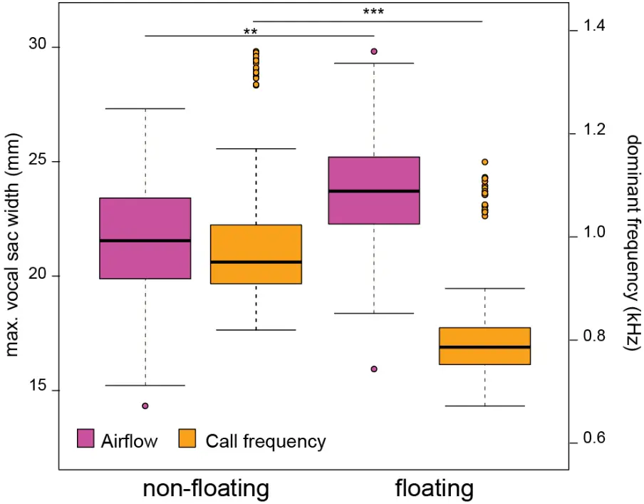

10

15

20

25

30

## Title

Floating frogs sound larger: environmental constraints on signal production drives call frequency changes.

## Authors 5

Sandra Goutte 1 , Mat'as I. Mu-oz 2 , Michael J. Ryan 3,4 , Wouter Halfwerk 2\*

## Affiliations

1 New York University Abu Dhabi, Saadiyat island campus, Abu Dhabi, United Arab Emirates

2 Department of Ecological Science, VU University, Amsterdam 1081 HV, the Netherlands

3 Department of Integrative Biology, University of Texas, Austin TX 78712 USA 4 Smithsonian Tropical Research Institute, Apartado 0843-03092, Balboa, Panama \* Corresponding author: w.h.halfwerk@vu.nl

## Abstract

In animal communication, receivers benefit from signals providing reliable information on signallersÕ traits of interest. Individuals involved in conflicts, such as competition between rivals, should pay particular attention to cues that are ÔunfakeableÕ by the senders due to the intrinsic properties of the production process. In bioacoustics, the best-known example of such Ôindex signalsÕ is the relationship between a senderÕs body size and the dominant frequency of their vocalizations. Dominant frequency may however not only depend on an animalÕs morphology but also on the interaction between the sound production system and its immediate environment. Here, we experimentally altered the environment surrounding calling frogs and assessed its impact on the signal produced. More specifically, we altered water level, which forced frogs to float on the surface and tested how this manipulation affected the shuttling of air between the lungs and the vocal sac, and how this in turn impacted the callsÕ dominant frequency. Our results show that frogs that are floating are able to fully inflate their lungs and vocal sacs, and that the associated change in airflow or air pressure is correlated with a decrease of call dominant frequency.

Keywords: acoustics; sexual signalling; honest communication; sound production; morphological constraints

35

40

45

50

55

60

65

## 1.Introduction

Animal communication signals are generally presumed to convey information about the sender to the intended receiver(s). These signals must, on average, provide reliable cues regarding senderÕs attributes, such as e.g. identity, size, motivation, or fecundity, in order to be maintained throughout evolution [1Ð3]. The evolutionary stability of these signalling systems is however challenged in the context of sexual selection, as mates and rivals often have conflicting interests in maximizing their fitness [4].

Senders may benefit from signals providing unreliable information about their traits, especially when these trait characteristics do not trigger the preferred response by the receivers. For example, across many taxa as well as sensory modalities, males have evolved signals that make them appear larger than they really are [5]. Receivers, on the other hand, may evolve counter-strategies when these so called ÒdeceptiveÓ signals impose a fitness cost to them. Those relying on signals that are ÒunfakeableÓ due to morphological or physiological constraints imposed on their production process (also known as Ôindex signalsÕ [1,3,6]) ensure reliable (ÔhonestÕ) communication and avoid such cost. Characteristics of these signals thus provide reliable information on the signallerÕs particular morphological or physiological traits [7].

The most widely used example of ÔhonestÕ communication, especially in the context of sexual selection, is the negative frequency-body size relationship that is often reported in bioacoustics [5-7]. VocalizationsÕ frequency range is determined by the size of the sound producing organs, and individuals that differ in size tend to call or sing at different frequencies, providing receivers with a reliable cue about the size of their mate or opponent [6,8]. Not surprisingly, correlations between body size and frequency both within and between species abound [9]. The observation that bigger animals vocalize at lower frequencies compared to smaller animals can almost be viewed as a fundamental law of communication in vertebrates [2,6]. The relatively few, but clear exceptions to the rule are therefore likely to reflect strong historical sexual or natural selection pressure operating on acoustic frequency. In some taxa, signallers have evolved extreme morphologies, such as coiled trachea [6], or air-filled pouches to lower their vocalizations beyond the constraints imposed by their overall body size [5]. The slow evolutionary change of sound production

70

75

80

85

90

95

100

structuresÕ morphology, however, is not the only channel animals may use to lower their vocalizationsÕ frequency.

Certain characteristics of display sites can directly influence signal production and transmission. Signallers often exploit the resonance properties of the structures from where they call [10,11]. For example, the sounds of signallers that call or chirp from burrows in the ground or hollow tree cavities are amplified [11,12]. The amplification is typically frequency-dependent, allowing signallers in some cases to lower the dominant frequency of their vocalizations. Call-site properties may also influence signal production more directly through the interaction with signallersÕ morphology. A recent study on tœngara frogs revealed, for example, that when the water level is experimentally lowered males are less able to inflate their lungs and therefore there is less air available to push from their lungs through their larynx into their vocal sac [13]. The consequence of this environmentally induced constraint is that males in shallower water called at lower amplitudes and with less complexity, which in turn influenced their attractiveness to females. Importantly, the impact of water level treatment appeared to be size-dependent [14]. Larger males were more influenced by water level treatment compared to smaller males. In fact, a binary choice experiment, playing calls of a large versus small male from opposite directions revealed that females preferred the calls of the larger male when these were recorded in deep water, and calls of the smaller males when recorded from shallow water [14].

Here, we re-examine the videos of the experiments described above [13] with the specific aim to link call site-induced signalling constraints to variation in dominant frequency. More specifically, we selected the trials in which males were fully floating, allowing for maximum signalling performance, and the trials in which the same males were clearly non-floating. We compared floating and non-floating trials to test whether males were constrained in vocal sac inflation when non-floating, and whether this was related to variation in dominant frequencies.

## 2. Material and Methods

The study was carried out on male tœngara frogs, Engystomops (= Physalaemus) pustulosus collected in August 2014 from Soberan'a National Park, near Gamboa, Republic of Panama.

105

110

115

120

125

All individuals were released back to the site from which they were collected on the same night. All experiments with frogs were licensed and approved by STRI (IACUC permit: 2014-0805-2017) and the Autoridad Nacional del Ambiente de Panama (SE/A-82Ð14).

Male frogs were recorded individually in a hemi-anechoic chamber under IR-lighting. At the start of the experiment they were placed in a small cage consisting of a ring of evenly spaced nylon monofilament (diameter of 0.05 mm fishing line every 0.5 cm). The cage was placed in a pool (diameter of 50 cm) containing a tube that allowed the experimenter to either add (using a funnel) or subtract (using a 50 ml syringe) water, in order to manipulate water depth at the position of the frog. Males were stimulated with a low-amplitude chorus recording until they were readily calling for 1 min. We assessed male calling behaviour at four different water depths (0.25, 0.5, 1.0, and 2.0 cm). Each trial lasted for 1 min, followed by a 2-min break during which the water depth was altered (starting 1 min before the next trial).

We recorded male calling behaviour with a camera that was mounted on top of the cage (mini 1/4″ CCTV camera; 2.8 mm lens; connected to a desktop PC). We recorded male calls with a microphone setup (G.R.A.S. 40 BF microphone amplified by 20 dB by G.R.A.S. 26 AC amplifier connected to an Avisoft 116Hm Ultrasound gate, G.R.A.S. Sound &amp; Vibration A/S, Holte, Denmark) onto a desktop PC, using a sampling rate of 50 kHz. The microphone was placed at a 45¡ angle and at a distance of 50 cm from the frog. The microphone was calibrated prior to each experiment using a tone generator (G.R.A.S. 42 AB, 114 dB at 1 kHz).

We analysed the videos of male calling in our setup and scored whether males were completely floating or not. We selected for each trial three video stills from the beginning, middle and end of a call bout. We selected for each call the video still with the maximum inflation of the lungs as well as maximum inflation of the vocal sac. We used the programme ImageJ to measure from the width of the vocal sac at maximum inflation (in mm). Sound recordings were analysed in SASLab Pro (Avisoft Bioacoustics, Berlin, Germany). We selected three calls from the start, middle and end of a trial and measured the dominant frequency of each call.

130

135

140

145

150

155

We assessed whether floating affected vocal sac inflation and dominant frequency during calling in R (v.3.2.2). We constructed linear mixed models using the package lme4 with a Gaussian distribution with identity link function. Significance of fixed effect (floating or non-floating) was assessed using likelihood (ML) ratio test. All models were tested for normality, overdispersion and heteroscedasticy. See [13] for a more detailed description of the setup, experimental procedures and analyses.

## 3. Results

We placed male tœngara frogs in an experimental setup that allowed us to manipulate the water level while a focal individual was calling (see methods). Thus, males called either floating or with their legs or belly touching the ground. All twenty males we tested floated in the trials in which the water level was raised above 2 cm whereas none of these males were able to float when we lowered the water level to below 0.25 cm. During intermediate water level (0.5 and 1 cm) trials, males would often have their front or hindlegs touching the base of the setup. When the water level was raised we could clearly see males actively pumping air into their lungs until they had enough buoyancy to allow them to float freely on the water surface.

We compared trials in which males were fully floating with trials in which they were partially submerged (with either their front or hindlegs touching the base). Floating males were able to inflate their vocal sacs and thus their lungs to a greater extent during trials in which they could float (GLMM; n = 20 males; χ 2 = 67.67; d.f. = 1; P &lt; 0.001; Fig. 1). The increase in vocal sac inflation was accompanied by a decrease in dominant frequency (from 995 ± 307 Hz to 797 ± 63 Hz; Fig. 1.) as we found floating malesÕ calls had a lower dominant frequency compared to non-floating males (χ 2 = 67.65; d.f. = 1; P &lt; 0.001).

## 4. Discussion

The dominant frequency of vocalizations is generally assumed to be a reliable indicator of a signallerÕs body size [15]. In this study, we show that the environment can directly influence 160 signal production, thereby affecting dominant frequency, and hence alter signal reliability in reference to body size. We found that frogs vocalizing while floating on the water produced calls with lower frequencies compared to trials during which they did not float.

- This environment-based modulation of call frequency may have important consequences on 165 an individualsÕ fitness. Multiple studies have shown that lower frequency calls are preferred by gravid females in frogs [16,17] in general, and specifically in tœngara frogs [18,19,20,21]. Producing calls with lower frequencies thus confers a fitness benefit to the signaller by attracting more mates. In addition, in the species tested here, the lowering of the dominant frequency in floating males (about -200 Hz) approaches the 520 Hz peak sensitivity of the 170 amphibian papilla (the organ responsible for hearing low-frequency airborne sounds) [22]. The decrease in frequency therefore might result in a greater detectability of floating malesÕ calls by conspecifics, which may facilitate recruiting females and repelling competitors over greater distances. Individual males can thus increase the reach and attractiveness of their calls by signalling from deeper puddles where they are able to float on the surface and inflate their 175 lungs and vocal sacs to the fullest. In natural conditions, however, male tœngara frogs are found vocalizing in both conditions (while floating and not floating), perhaps due to additional balancing selection pressures such as predation or reflecting the availability of ideal calling sites.

180

185

Our study demonstrating the effect of the external environment on the tœngara frogÕs dominant frequency has intriguing parallels to a study showing how this same frogÕs internal environment influences call frequency. Kime et al. (2010) [23] showed that males treated with the hormone peptide arginine vasotocin (AVT) produce calls with higher frequencies, and that these calls are less attractive to females than the calls of control males. They speculated that AVT might influence motor output to cause more rapid airflow through the larynx and into the vocal sac.

- Our results suggest that the properties of anuran call sites can have a strong influence on sexual selection. For example, in shallow water females may choose and rivals may respond 190 stronger to smaller floating males over larger, non-floating ones as sound production is only constrained in larger males [14]. Display site properties may therefore drive signal evolution through biomechanical constraints on signal production.

## 5. References

1. Searcy WA, Nowicki S. 2010 The Evolution of Animal Communication: Reliability and Deception in Signaling Systems. Princeton University Press.
2. Bradbury JW, Vehrencamp SL. 2011 Principles of Animal Communication. Sinauer. 200
3. Smith JM, Harper D. 2004 Animal Signals. 1 edition. New York: Oxford University Press, USA.
4. Andersson M, Simmons LW. 2006 Sexual selection and mate choice. Trends Ecol. Evol. 21, 296Ð302. (doi:10.1016/j.tree.2006.03.015)
5. Dunn JC, Halenar LB, Davies TG, Cristobal-Azkarate J, Reby D, Sykes D, Dengg S, 205 Fitch WT, Knapp LA. 2015 Evolutionary Trade-Off between Vocal Tract and Testes Dimensions in Howler Monkeys. Curr. Biol. 25, 2839Ð2844. (doi:10.1016/j.cub.2015.09.029)
6. Fitch WT, Hauser MD. 2003 Unpacking ÒHonestyÓ: Vertebrate Vocal Production and the Evolution of Acoustic Signals. In Acoustic Communication (eds AM Simmons, RR Fay, 210 AN Popper), pp. 65Ð137. New York, NY: Springer. (doi:10.1007/0-387-22762-8_3)
7. Garcia M, Herbst CT, Bowling DL, Dunn JC, Fitch WT. 2017 Acoustic allometry revisited: morphological determinants of fundamental frequency in primate vocal production. Sci. Rep. 7, 1Ð11. (doi:10.1038/s41598-017-11000-x)
8. Gerhardt HC, Huber F. 2002 Acoustic Communication in Insects and Anurans: Common 215 Problems and Diverse Solutions. University of Chicago Press.
9. Ryan MJ, Brenowitz EA. 1985 The role of body size, phylogeny, and ambient noise in the evolution of bird song. , 126:87Ð100.
10. Mhatre N, Pollack G, Mason A. 2016 Stay tuned: active amplification tunes tree cricket ears to track temperature-dependent song frequency. Biol. Lett. 12, 20160016. 220 (doi:10.1098/rsbl.2016.0016)
11. Cui J, Tang Y, Narins PM. 2012 Real estate ads in Emei music frog vocalizations: female preference for calls emanating from burrows. Biol. Lett. 8, 337Ð340. (doi:10.1098/rsbl.2011.1091)
12. Mu-oz MI, Penna M. 2016 Extended amplification of acoustic signals by amphibian 225 burrows. J. Comp. Physiol. A Neuroethol. Sens. Neural. Behav. Physiol. 202, 473Ð487. (doi:10.1007/s00359-016-1093-0)
13. Halfwerk W, Smit JAH, Loning H, Lea AM, Geipel I, Ellers J, Ryan MJ. 2017 Environmental conditions limit attractiveness of a complex sexual signal in the tœngara frog. Nat. Commun. 8, 1Ð7. (doi:10.1038/s41467-017-02067-1) 230
14. Smit JAH, Loning H, Ryan MJ, Halfwerk W. 2019 Environmental constraints on sizedependent signaling affects mating and rival interactions. Behav. Ecol. 30, 724Ð732. (doi:10.1093/beheco/arz009)

15. Gillooly JF, Ophir AG. 2010 The energetic basis of acoustic communication. Proc. R. Soc. B Biol. Sci. 277, 1325Ð1331. (doi:10.1098/rspb.2009.2134) 235
16. Davies NB, Halliday TR. 1978 Deep croaks and fighting assessment in toads Bufo bufo. Nature 274, 683Ð685. (doi:10.1038/274683a0)
17. Arak A. 1983 Sexual selection by maleÐmale competition in natterjack toad choruses. Nature 306, 261Ð262. (doi:10.1038/306261a0)
18. Ryan MJ. 1980 Female Mate Choice in a Neotropical Frog. Science 209, 523Ð525. 240 (doi:10.1126/science.209.4455.523)
19. Ryan MJ. 1983 Sexual Selection and Communication in a Neotropical Frog, Physalaemus pustulosus. Evolution 37, 261Ð272. (doi:10.2307/2408335)
20. Wilczynski W, Rand SA, Ryan MJ. 1995 The processing of spectral cues by the call analysis system of the tœngara frog, Physalaemus pustulosus. Anim. Behav. 49, 911Ð929. 245 (doi:10.1006/anbe.1995.0123)
21. Bosch J, Rand AS, Ryan MJ. 2000 Signal variation and call preferences for whine frequency in the tœngara frog, Physalaemus pustulosus. Behav. Ecol. Sociobiol. 49, 62Ð 66. (doi:10.1007/s002650000280)
22. Wilczynski W, Rand AS, Ryan MJ. 2001 Evolution of calls and auditory tuning in the 250 Physalaemus pustulosus species group. Brain. Behav. Evol. 58, 137Ð151. (doi:10.1159/000047268)
23. Kime NM, Whitney TK, Ryan MJ, Rand AS, Marler CA. 2010 Treatment with arginine vasotocin alters mating calls and decreases call attractiveness in male tœngara frogs. Gen. Comp. Endocrinol. 165, 221Ð228. (doi:10.1016/j.ygcen.2009.06.023) 255

260

270

275

## Figures

Fig. 1. Effect of floating ability on vocal sac inflation and call dominant frequency

