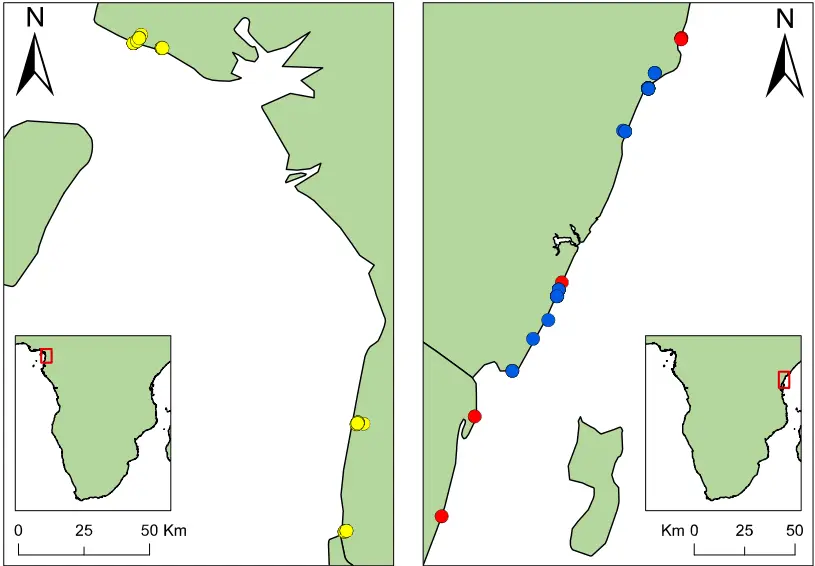
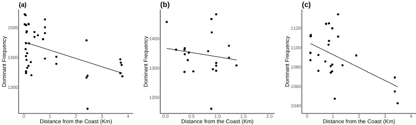
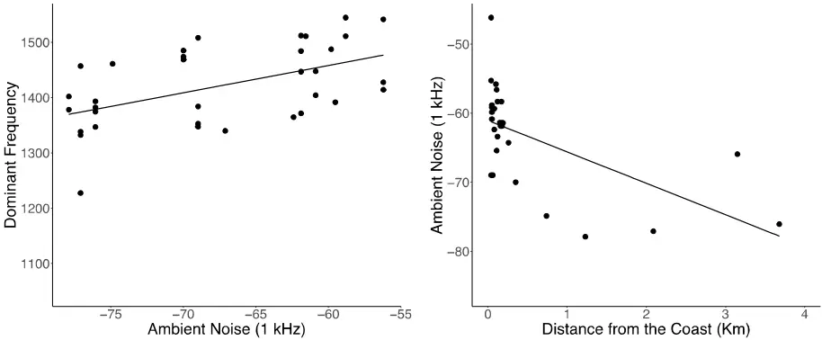
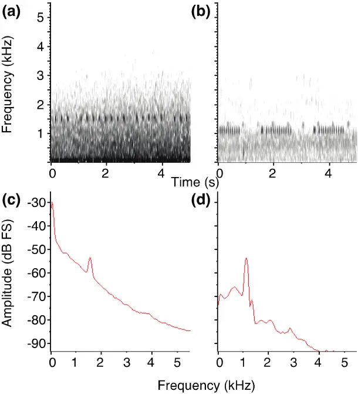

- Ambient noise from ocean surf drives frequency shifts in non-passerine bird song 1

2

3

4

Matteo Sebastianelli 1 , Daniel T. Blumstein 2 and Alexander N. G. Kirschel 1,2,3\*

- 1 Department of Biological Sciences, University of Cyprus, PO Box 20537, Nicosia 1678,
- Cyprus 5
- 2 University of California Los Angeles, Department of Ecology and Evolutionary Biology, 6
- Los Angeles, CA, USA 7

8

9

10

11

12

13

14

- 3 Edward Grey Institute, Department of Zoology, University of Oxford, South Parks Road,

Oxford OX1 3PS, UK.

- Email of corresponding author: kirschel@ucy.ac.cy

Keywords: geophony, acoustic adaptation, tinkerbirds, birdsong, acoustic communication.

15

16

17

18

19

20

21

22

23

24

25

26

27

28

29

30

31

32

33

34

35

36

37

38

39

## Abstract

Effective communication in birds is often hampered by background noise, with many recent studies focusing on the effect of anthropogenic noise on passerine bird song. Continuous lowfrequency natural noise is predicted to drive changes in both frequency and temporal patterning of bird vocalizations, but the extent to which these effects may also affect birds that lack vocal learning is not yet fully understood. Here we use a gradient of exposure to natural low-frequency noise to assess whether it exerts selective pressure on vocalizations in a species whose songs are innate. We tested whether three species of Pogoniulus tinkerbirds adapt their song when exposed to a source of continuous low-frequency noise from ocean surf. We show that dominant frequency increases the closer birds are to the coast in all the three species, and in line with higher noise levels, indicating that ocean surf sound may apply a selective pressure on tinkerbird songs. As a consequence, tinkerbirds adapt their songs with an increase in frequency to avoid the masking effect due to overlapping frequencies with ambient noise, therefore improving long-range communication with intended receivers. Our study provides for the first time, compelling evidence that natural ambient noise affects vocalizations in birds whose songs are developed innately. We believe that our results can also be extrapolated in the context of anthropogenic noise pollution, hence providing a baseline for the study of the effects of low-frequency ambient noise on birds that lack vocal learning.

## Significance Statement

Birdsong is constantly under selection as it mediates key interactions such as mate attraction, competition with same-sex individuals for reproduction and competition with heterospecifics for space-related resources. Any phenomenon that interferes with communication can therefore have a profound impact on individual fitness. Passerines are more likely to avoid

40

41

42

43

44

45

46

47

48

49

50

51

52

53

54

55

56

57

58

59

60

61

62

63

64

the masking effect of background noise because of their higher vocal flexibility. Many nonpasserine species lacking such flexibility might therefore be more vulnerable to the negative effects on their fitness of exposure to low-frequency background noise. Species incapable of adapting their signals to background noise are predicted to disappear from noisy areas. Despite this, we show that species that lack song learning may show an adaptive response to natural noise which may develop over evolutionary timescales.

## Introduction

Many species rely on acoustic communication to accomplish functions that are crucial for their survival (Bradbury and Vehrencamp 2011). Bird song, for instance, has been shown to mediate behaviours involved in mate attraction, competition for partners, food and space (Catchpole and Slater 2008; Naguib and Riebel 2014); even though it may also function to coordinate group movements and to warn other individuals against potential threats (Naguib and Wiley 2001; Bradbury and Vehrencamp 2011; Halfwerk et al. 2018). An effective signal transfer is therefore essential to ensure the prompt behavioural response of the receiver. The transfer of clear signals might be hampered by the sound transmission properties of the environment, which may degrade signals (Brumm and Naguib 2009), or by interference from environmental noise (Brumm and Slabbekoorn 2005; Blumstein et al. 2011). Under the latter scenario, sounds similar in frequency and amplitude can have a masking effect and potentially lead to the transmission of incomplete or incorrect information (Slabbekoorn 2013). Such effects have a strong effect on vocal behaviour of birds (Patricelli and Blickley 2006; Slabbekoorn 2013). Indeed, experiments have shown birds in one environment with a specific ambient noise profile respond less to songs adapted to different ambient noise profiles than to those adapted to similar ambient noise profiles (Kirschel et al. 2011). Therefore, loud and continuous background noise impose strong selective pressures on

65

66

67

68

69

70

71

72

73

74

75

76

77

78

79

80

81

82

83

84

85

86

87

88

89

bird song to increase its effectiveness in noisy environments (Slabbekoorn and Smith 2002; Brumm and Slabbekoorn 2005; Patricelli and Blickley 2006; Slabbekoorn and den BoerVisser 2006; Slabbekoorn and Ripmeester 2008; Halfwerk and Slabbekoorn 2009; Nemeth and Brumm 2010). Birds react to low frequency ambient noise pressure in different ways (Brumm and Slabbekoorn 2005; Swaddle et al. 2015). Some have been shown to increase their minimum frequency (Slabbekoorn and den Boer-Visser 2006; Nemeth and Brumm 2009, 2010; Hu and Cardoso 2010; Mendes et al. 2011; Ríos-Chelén et al. 2012), maximum frequency (Francis et al. 2011; Mendes et al. 2011) and others their dominant frequency (Nemeth and Brumm 2009; Hu and Cardoso 2010; Proppe et al. 2011, 2012; Lazerte et al. 2016; Luther et al. 2016; LaZerte et al. 2017; Tolentino et al. 2018) in response to background noise. Increases in frequency may, however, be a side effect of singing at higher amplitude in noisy environments (Nemeth and Brumm 2010) - the Lombard Effect (Brumm and Zollinger 2011; Zollinger and Brumm 2011) - as amplitude and song frequency are often correlated (Beckers et al. 2003; Amador et al. 2008; Zollinger et al. 2012). Other adaptations to low-frequency ambient noise include increasing signal redundancy (Brumm and Slater 2006; Deoniziak and Osiejuk 2016), singing more often (Deoniziak and Osiejuk 2019), for longer periods (Brumm and Slater 2006; Nemeth and Brumm 2009; Sierro et al. 2017) or at specific time intervals (Dominoni et al. 2016). Changes in vocal parameters can result from different mechanisms, for instance, response to background noise might be plastic, as found in House Finches (Carpodacus mexicanus) (Bermúdez-Cuamatzin et al. 2009), or learned, as demonstrated in Black-capped chickadees (Poecile atricapillus) (Lazerte et al. 2016) and White-crowned sparrows (Zonotrichia laucophyrs) (Moseley et al. 2018). Shifts in signal design might also arise because selection may favor individuals that minimize the masking effect of ambient noise

90

91

92

93

94

95

96

97

98

99

100

101

102

103

104

105

106

107

108

109

110

111

112

113

114

(Slabbekoorn and Smith 2002; Kirschel et al. 2009a, 2011). This scenario is compatible with the song developing by sensory drive (Endler 1992), a mechanism which appears to have shaped acoustic signals of many Neotropical suboscines (Seddon 2005) that lack song learning capabilities (Touchton et al. 2014). Most studies on the effects of noise on acoustic communication have addressed this issue by looking at the effects of anthropogenic noise pollution. However, natural sources of noise may have similar masking effects on animal signalling (Davidson et al. 2017; Goutte et al. 2018). For instance, Halfwerk et al (2016) show multimodal communication between male Tungara frogs (Physalaemus pustulosus) was hindered when geophonic noise from windy and rainy conditions was simulated. Other studies on birds and other taxa have also shown an effect of natural background noise on communication (Lengagne et al. 1999; Lengagne and Slater 2002; Brumm and Slater 2006; Feng et al. 2006; Kirschel et al. 2009a; Davidson et al. 2017). Therefore, natural ambient noise is likely to be as impactful as anthropogenic noise and with such noise present over evolutionary timescales it is likely to have evolutionary implications for acoustic communication (Davidson et al. 2017). To date, the study of the effects of ambient noise on bird signalling has focused mostly on oscine passerines that learn their songs by way of auditory feedback (Hu and Cardoso 2010; Ríos-Chelén et al. 2012). By contrast, there is scant information on how taxa that lack vocal learning, such as suboscines and many non-passerines birds, cope with high background noise levels (Gentry et al. 2018; Tolentino et al. 2018). Studies on non-passerines include those on King penguins (Apten odytes) (Lengagne et al. 1999) and Tawny owls (Lengagne and Slater 2002). In both cases, responses to increased ambient noise were in temporal patterning of their vocalizations. King penguins increased both the number of calls and syllables per call emitted under strong winds, whereas Tawny owls reduced call rates under rainy conditions because the interference of rain noise increased the unreliability of the

115

116

117

118

119

120

121

122

123

124

125

126

127

128

129

130

131

132

133

134

135

136

137

138

139

information conveyed in their calls. Hu and Cardoso (2010) did document changes in the frequency domain in response to anthropogenic noise in a non-passerine by observing an increase in minimum frequency in urban rainbow lorikeets (Tricoglossus haematodus) and eastern rosellas (Platycercus eximius), two Psittaculidae (Order: Psittaciformes). However, parrots, like hummingbirds and oscine passerines, are capable of vocal learning (Nottebohm 1972; Kroodsma 1982; Saranathan et al. 2007; Catchpole and Slater 2008) and therefore may respond plastically to increased background noise levels (Osmanski and Dooling 2009; Scarl and Bradbury 2009). Although birds not capable of learning such as suboscines and many non-passerines may be more vulnerable to the effects of increased background noise given their inability to adapt their signals (Ríos-Chelén et al. 2012), little is known about the mechanisms that ensure efficient communication under noisy conditions in such taxa. Here, we investigate whether Pogoniulus tinkerbirds (Family: Lybiidae; Order: Piciformes) might adapt the frequency of their songs in response to increased geophonic ambient noise from ocean surf. Tinkerbirds emit a simple, single pitch, stereotyped song that develops innately (Kirschel et al. 2009a, 2020; Nwankwo et al. 2018). Because of the absence of auditory feedback in song development, adaptation to noisy environments is unlikely to involve a learned or plastic response. Instead, any variation in tinkerbird song that would minimize the masking effect of noise may reflect an adaptive change. Hence, our study specifically addresses whether there could be a selective pressure on tinkerbird song of low frequency surf sound by focusing on species whose songs are innately developed. Previous work has found evidence for character displacement in tinkerbird song frequency when two species coexist at high densities, consistent with a role of competitive or reproductive interference of songs of similar frequencies (Kirschel et al. 2009b, 2020). We test whether yellow-throated (Pogoniulus subsulphureus), red-fronted (P. pusillus) and the coastal subspecies of yellow-rumped tinkerbird (P. bilineatus fischeri) adjust their song along

140

141

142

143

144

145

146

147

148

149

150

151

152

153

154

155

156

157

158

159

160

161

162

163

a gradient of exposure to low-frequency ambient noise emanating from ocean surf in their coastal populations. In the case of P. subsulphureus, we also measure local ambient noise to test for a gradient in noise levels with distance and whether there is a direct relationship of low frequency surf sound and song frequency.

## Methods

## Study Species

Pogoniulus tinkerbirds are barbets (Family: Lybiidae) that are widely distributed throughout Sub-Saharan Africa. They are mostly frugivorous, feeding mainly on mistletoe, even though they also take small invertebrates (Godschalk 1985; Dowsett-Lemaire 1988; Short and Horne 2001). P. subsulphureus (hereafter subsulphureus) strictly inhabits tropical lowland rainforests in Central and Western Africa (Short and Horne 2002; Kirschel et al. 2020), whereas P. pusillus (hereafter pusillus) occupy savanna woodland and secondary forest below 2000 meters. On the other hand, P. b. fischeri (hereafter fischeri) only occurs in coastal forests in southern Kenya and on the island of Zanzibar (Nwankwo et al. 2018).

## Song Collection and Acoustical Analysis

We obtained recordings of P. subsulphureus, P. pusillus and P. b. fischeri from a total of 15 coastal locations in Cameroon and Kenya within 4 km from the shore (Fig.1). Fifty ambient noise recordings were obtained from four locations in Cameroon by taking 1-minute long recordings every hour from 7:00 to 12:00, holding the microphone horizontally every 10 seconds in each of the four cardinal direction (North, South, East, West) and then vertically upwards, as described in Kirschel et al. (2009a). Ambient noise and subsulphureus songs were recorded using a Marantz PMD670 a Sennheiser ME67, while pusillus and fischeri

164

165

166

167

168

169

170

171

172

173

174

175

176

177

songs were recorded with a Marantz PMD661 recorder with a MKH8050 or MKH8020 microphone, the latter housed in a Telinga parabolic reflector.

Fig. 1 Map of recording localities in Cameroon (left) and Kenya (right). Coloured points represent recording locations of P. subsulphureus (yellow), P. pusillus (red), and P. b. fischeri (blue).

Recordings were saved as WAV or MP3 files and imported into Raven Pro 1.6 (Center for Conservation Bioacoustics 2019), in which songs were measured using its built-in automated energy detectors. Target signal parameters were set as follow: minimum and maximum frequencies spanned from 800 to 1700 Hz according to the species, minimum duration was 0.03 s and maximum duration 0.3; minimum separation was set to 0.01 s for fischeri, 0.05 s for subsulphureus and 0.25 for pusillus. The signal to noise ratio (SNR)

178

179

180

181

182

183

184

185

186

187

188

189

190

191

192

193

194

195

196

197

198

199

200

201

threshold was set in order to detect the maximum number of notes and varied depending on the background noise levels on the recording. Most of the detections were obtained setting the SNR above the threshold of 10-20 dB. We chose this instead of a manual-measurement approach since the latter can lead to biased measurements (Brumm et al. 2017; Ríos-Chelén et al. 2017). Raven provided peak frequency measurements from the spectrogram view (DFT size: 4096; Window: Hanning, 3 dB; overlap: 50) and we obtained the dominant frequency by calculating the mean from peak frequency values of all notes detected on each recording. From the 50 ambient noise recordings, six were removed because of loud anthropogenic traffic noise in the background and another was excluded because of loud stream waterfall noise, both of obscured natural surf sound. From the remaining recordings, we selected and merged together five high quality 5 s intervals per direction. In one instance we included just the four 5 s intervals from cardinal directions, because the vertical recording was beset by mechanical interference. Each 25 s song cut was then imported into R and the ambient noise amplitude (dBA) at 1 kHz was calculated using the noise profile function provided in the baRulho R package (Araya-Salas 2020). Subsequently, we used amplitude at 1 kHz (a measure of low frequency noise) as covariate in statistical models. It was not possible to record data blind because our study was specifically focused on tinkerbirds. While subsulphureus in Cameroon was sampled with this specific question in mind, sampling of pusillus and fischeri was performed as part of parallel studies on song variation (e.g., Nwankwo et al. 2018).

## Spatial Distance Calculation

GPS coordinates of singing tinkerbirds and ambient noise recorded in the field were obtained using a Garmin GPSMap. We imported the coordinates into Google Earth Pro and calculated

202

203

204

205

206

207

208

209

210

211

212

213

214

215

216

217

218

219

220

221

222

223

224

225

226

the closest distance from each recording location to the coastline using its built-in measuring tool.

## Statistical Analysis

To test whether ocean surf sound affects tinkerbird song, we measured the effect of distance from the coast on dominant frequency of subsulphureus, pusillus and fischeri songs. This effect was measured within 4 km from the coast as ambient noise recordings were collected within that range and songs of birds further from the coast are likely influenced by other factors, including elevation (Kirschel et al. 2009b). We assumed that, if ocean surf sound has an effect on their song, dominant frequency would decrease as the distance from the coast increases. For the coastal population of subsulphureus in Cameroon, for which ambient noise recordings were also available, we tested whether dominant frequency increases with background noise amplitude measured at 1 kHz, and also whether ambient noise (1 kHz) also decreases with increased distance from the coast. We fitted Gaussian generalized linear mixed models (GLMMs) in the glmmTMB R package (Brooks et al. 2017) using log-transformed dominant frequency of subsulphureus, pusillus and fischeri as response variables in three separate models and including log-distance from the shore as a fixed factor. Bird ID nested in location were used as random factors to account for individual variation as well as variation among field sites. In the subsulphureus model, we also added ambient noise amplitude (measured at 1 kHz) of the closest ambient noise recording as fixed factor. We then measured the effect of distance from the coast (logtransformed) on ambient noise amplitude (1 kHz) in Cameroon coastal sites using the latter as response variable and location as random effect. subsulphureus models were selected according to the lowest corrected Akaike Information Criterion score. Assumptions of all models were validated using the functions provided in DHARMa (Harting 2019).

227

228

229

230

231

232

233

234

235

236

237

238

239

240

241

242

243

244

## Results

We obtained 86 recordings (39 subsulphureus, 21 pusillus and 26 fischeri) from a total of 65 individuals (31 subsulphureus, 16 pusillus and 18 fischeri) in our coastal sites in Cameroon and Kenya (Fig.1) within 4 km. Of these, 2 were sourced from Xenocanto (https://xenocanto.org), respectively 1 for pusillus and 1 for fischeri. We found a significant negative effect of distance from the coast (within 4 km) on dominant frequency (log-transformed) in subsulphureus, pusillus and in fischeri (Fig 2, Table 1). subsulphureus model with both area distance from the coast and ambient noise (1kHz) was not selected because presented high AICc scores (Table S1).

Table 1 Best fit Gaussian generalized linear mixed models output showing the relationship between (log) dominant frequency and (log) distance from the coast for subsulphureus (AICc: -138.24) (1), pusillus (2), fischeri (3) as well as relationship between surf sound ambient noise and distance from the coast in Cameroon (4) and between subsulphureus dominant frequency and ocean surf sound (5). Estimates and their lower (LCL) and upper (UCL) confidence limits are presented.

|                                                            | Estimate | LCL   | UCL   | z     | p      |
| ---------------------------------------------------------- | -------- | ----- | ----- | ----- | ------ |
| 1) Response: P. subsulphureus dominant frequency Intercept | 7.24     | 7.22  | 7.26  | 778.4 | <0.001 |
| (log) distance                                             | -0.012   | -0.02 | -0.07 | -3.2  | 0.001  |
| 2) Response: P. pusillus dominant frequency Intercept      | 7.17     | 7.13  | 7.21  | 378.6 | <0.001 |

245

246

247

248

249

250

251

| (log) distance                                         | -0.03 | -0.06  | -0.09  | -2.6   | 0.008  |
| ------------------------------------------------------ | ----- | ------ | ------ | ------ | ------ |
| 3) Response: P. bilineatus fischeri dominant frequency |       |        |        |        |        |
| Intercept                                              | 6.98  | 6.97   | 6.99   | 1445.2 | <0.001 |
| (log) distance                                         | -0.01 | -0.01  | -0.002 | -2.5   | 0.012  |
| 4) Response:                                           |       |        |        |        |        |
| Ambient amplitude 1kHz                                 |       |        |        |        |        |
| Intercept                                              | -70   | -73.43 | -67.26 | -44.69 | <0.001 |
| (log) distance                                         | -3.95 | -5.36  | -2.55  | -5.53  | <0.001 |
| 5) Response:                                           |       |        |        |        |        |
| P. subsulphureus dominant frequency                    |       |        |        |        |        |
| Intercept                                              | 7.25  | 7.23   | 7.28   | 632.2  | <0.001 |
| Ambient amplitude 1kHz                                 | 0.03  | 0.01   | 0.05   | 3.4    | <0.001 |

Fig. 2 Plots showing the relationship between dominant frequency and distance from the coast in (a) subsulphureus, (b) pusillus and (c) fischeri before controlling for other possible effects.

252

253

254

255

256

257

258

259

260

261

262

263

264

265

266

267

268

Our results also show a strong significant decrease of low-frequency ambient noise (1kHz) with log-distance from the coast in Cameroon as well as a significant positive relationship between subsulphureus dominant frequency and ambient noise amplitude at 1kHz (Fig 3, Table 1).

Fig. 3 Plots showing (a) the relationship between subsulphureus dominant frequency and ambient noise and (b) between ambient noise and distance from the coast in Cameroon.

## Discussion

We have shown that tinkerbirds sing at higher frequencies the closer they are to the coast and as the amplitude of low-frequency ambient noise from ocean surf increases. Our results are in line with the hypothesis that, as in the case of anthropogenic noise, natural ambient noise affects acoustic signalling in birds (Kirschel et al. 2009a; Davidson et al. 2017). We show that the masking effect of a natural low-frequency noise can affect vocalizations of animals that lack the capacity to develop vocalisations through auditory feedback. Higher dominant frequency may confer an adaptive advantage to coastal populations of the three species

269

270

271

272

273

274

275

276

277

278

279

280

281

282

283

284

285

286

287

288

289

290

291

292

293

tinkerbirds because they benefit from increased transmission of signals to intended receivers. Therefore, individuals with higher dominant frequency songs may have higher fitness at coastal sites. Low frequency natural noise such as from ocean surf, rivers and waterfalls can have a profound effect on auditory communication, as shown in concave-eared torrent frog (Amolops tormotus), whose calls include ultrasound elements in their preferred habitat alongside fast-flowing streams (Feng et al. 2006). Similar results have also been found in another study, where support for the acoustic adaptation hypothesis has been demonstrated when comparing torrent frogs to other species living in different habitats (Goutte et al. 2018). Tinkerbirds are not restricted to such noisy environments, yet divergence in frequency appears to occur in spite of ongoing gene flow with adjacent inland populations. The pressure imposed by ocean surf low-frequency noise may have strong effects on how species interact acoustically because of potential interference with their vocalizations in the frequency domain. The effects of low-frequency ambient noise are likely to have a stronger effect on species vocalizing at lower frequency and especially in birds that lack vocal learning, such as tinkerbirds (Goodwin and Shriver 2011; Halfwerk et al. 2011). In this study, fischeri is the species with the lowest dominant frequency and therefore may be subjected to a greater pressure by ocean surf. In Kenya, it co-occurs with two other Pogoniulus tinkerbirds: P. pusillus and eastern green tinkerbird P. simplex (hereafter simplex), both of which sing at higher frequencies than fischeri. Indeed, simplex sings a trilled song not unlike that of fischeri. It is therefore possible that continental populations of fischeri are constrained to avoid the masking effect of low-frequency ocean surf sound by increasing their dominant frequency because an increased pitch would result in greater interference with the two competitors. Indeed, an increase in dominant frequency in continental populations of fischeri could lead to song overlap in the frequency domain with its two congeners (Fig. 4b). Stabilising selection might maintain fischeri song frequency at a

294

295

296

297

298

299

300

301

302

303

304

305

306

307

308

309

310

311

312

313

314

315

316

317

318

level that best reduces the masking effects of surf sound while maintaining sufficient frequency differences between fischeri and other tinkerbird species. Coastal fischeri sing a much faster trilled song than other forms of P. bilineatus (Nwankwo et al. 2018) and the rapid repetition of pulses might itself be an adaptation to its sound environment in coastal forests. An alternative hypothesis is that fischeri song might have evolved by convergent character displacement to facilitate interspecific territoriality with simplex (e.g., Kirschel et al. 2019). The observed increase of frequency in fischeri might also reflect the increase in dominant frequency in pusillus song, as its frequency range may depend on pusillus minimum frequency. Hence, the observed decreasing pattern in fischeri dominant frequency with distance from the coast may in part be an effect of variation in pusillus song with distance from the shore. A similar, if not stronger, correlation between frequency ranges is expected to occur between fischeri and simplex, given the similarity of the song between the two species. However, we did not have access to a suitable sample of simplex recordings to test this hypothesis. Further work is needed to investigate the extent to which fischeri song may also vary because of interactions with its congeners. Higher dominant frequency have been suggested to be a consequence of an increased song amplitude in non-passerines (Elemans et al. 2008; Nemeth and Brumm 2010; Nemeth et al. 2012), whereas this is not always the case in passerines, which present higher vocal flexibility (Zollinger et al. 2017). An increased amplitude can be an adaptation to noisy environments according to the Lombard effect, which occurs when frequency range of the vocalizing animal and the background noise overlap (Brumm and Todt 2002). In our study, ocean surf sound widely overlaps with tinkerbirds song frequencies (Fig. 4), therefore one possibility is that increased dominant frequency in tinkerbird song at coastal sites is a consequence of raised vocal amplitude. The Lombard effect is a common trait in many bird clades including passerines (Brumm and Todt 2002), Galliformes (Brumm et al. 2009) and

319

320

321

322

323

324

325

326

327

328

329

330

331

even in Paleognathae species such as tinamous (Schuster et al. 2012). The ancestral nature of the Lombard effect suggests it occurs independently of the ontogeny of vocal learning in birds (Brumm et al. 2009; Brumm and Zollinger 2011) and increased frequencies in tinkerbird song might also be a consequence of increased vocal amplitude. This phenomenon has been observed in other birds that lack song learning (Schuster et al. 2012). However, we did not specifically test whether the increased dominant frequency occurs as a consequence of the Lombard effect in tinkerbirds, but our results highlight this as a compelling area for future investigations.

Fig. 4 Figure showing the masking effect of ocean surf sound in spectrograms (a-b) and power spectra profiles (c-d) of subsulphureus (left panels), pusillus and fischeri (right panels) vocalizations, with subsulphureus song being recoded at 68 m form the shore and pusillus

332

333

334

335

336

337

338

339

340

341

342

343

344

345

346

347

348

349

350

351

352

353

354

355

356

and fischeri recording at 330 m.

Singing higher pitch songs in coastal sites may be an advantage in tinkerbirds, as higher frequency songs often represent a selected trait by females (Hasegawa and Arai 2016). Also, an increased pitch may result in an increased detectability by opposite-sex individuals. Assuming that song frequency is correlated with amplitude, increased frequency would result in a far-reaching signal which may further aid mate attraction. Similarly, in territorial contests, higher pitch song may result in a larger active space (Brumm and Todt 2002) - a potential advantage in territorial birds like tinkerbirds. However, pitch has been shown in many birds to be negatively correlated with body size (Ryan and Brenowitz 1985; Brumm and Goymann 2017, Kirschel et al. 2020, in press), whereas it does not seem to affect song amplitude (Brumm 2009). Hence, any relative advantage in terms of signal transmission may be counterbalanced by increased aggression from larger males, as higher frequency song may be interpreted as a sign of weakness (Kirschel et al. 2020, in press). Ocean surf sound is a continuous noise which pressure acts over evolutionary timescales on birdsong, therefore the trade-offs between the potential advantages of increased mate attraction and at the same time increased territorial response from other males may have had profound evolutionary implications in shaping tinkerbird acoustic signals. In this paper, we show that three tinkerbird species sing at a higher dominant frequency the closer they are to the coastline. We suggest that low-frequency noise from ocean surf imposes a selective pressure on tinkerbird acoustic signalling, and higher dominant frequency songs may be selected because they reduce the masking effect of ocean surf sound. This effect might be boosted if an increase in dominant frequency is accompanied by an increase in amplitude. We predict that an increase in dominant frequency will occur but caution that overlapping frequencies with related species might influence acoustic competition, as might

357

358

359

360

361

362

363

364

365

366

367

368

369

370

371

372

373

374

375

376

377

378

379

380

381

occur in fischeri where it coexists with pusillus and simplex. Our results show that natural ambient noise has a similar impact to anthropogenic noise even on birds that do not learn their songs, in line with the effects of natural ambient noise on oscine passerine vocalizations (Davidson et al. 2017). We believe that our results can be extrapolated in other contexts of background noise, including anthropogenic noise pollution, and therefore represent a baseline for further studies on the effect of background noise on bird song.

## References

Amador A, Goller F, Mindlin GB (2008) Frequency modulation during song in a suboscine does not require vocal muscles. J Neurophysiol 99:2383-2389. https://doi.org/10.1152/jn.01002.2007 Araya-Salas M (2020) baRulho: quantifying habitat-induced degradation of (animal) acoustic signals in R Beckers GJL, Suthers RA, Ten Cate C (2003) Mechanisms of frequency and amplitude modulation in ring dove song. J Exp Biol 206:1833-1843. https://doi.org/10.1242/jeb.00364 Bermúdez-Cuamatzin E, Ríos-Chelén AA, Gil D, Garcia CMÍ (2009) Strategies of song adaptation to urban noise in the house finch: syllable pitch plasticity or differential syllable use? Behaviour 146:1269-1286. https://doi.org/10.1163/156853909X423104 Blumstein DT, Mennill DJ, Clemins P, et al (2011) Acoustic monitoring in terrestrial environments using microphone arrays: applications, technological considerations and prospectus. J Appl Ecol 48:758-767. https://doi.org/10.1111/j.1365-2664.2011.01993.x Bradbury JW, Vehrencamp SL (2011) Principles of Animal Communication, Second Ed. The University of Chicago Press Brooks ME, Kristensen K, van Benthem KJ, et al (2017) glmmTMB Balances Speed and Flexibility Among Packages for Zero-inflated Generalized Linear Mixed Modeling. R J

382

383

384

385

386

387

388

389

390

391

392

393

394

395

396

397

398

399

400

401

402

403

404

405

406

9:378-400

Brumm H (2009) Song amplitude and body size in birds. Behav Ecol Sociobiol 63:11571165. https://doi.org/10.1007/s00265-009-0743-4 Brumm H, Goymann W (2017) On the natural history of duetting in White-browed Coucals: sex- and body-size-dependent differences in a collective vocal display. J Ornithol 158:669-678. https://doi.org/10.1007/s10336-016-1429-0 Brumm H, Naguib M (2009) Environmental Acoustics and the Evolution of Bird Song. In: Advances in the Study of Behavior Brumm H, Schmidt R, Schrader L (2009) Noise-dependent vocal plasticity in domestic fowl. Anim Behav 78:741-746. https://doi.org/10.1016/j.anbehav.2009.07.004 Brumm H, Slabbekoorn H (2005) Acoustic Communication in Noise. Adv Study Behav 35:151-209. https://doi.org/10.1016/S0065-3454(05)35004-2 Brumm H, Slater PJB (2006) Ambient noise, motor fatigue, and serial redundancy in chaffinch song. Behav Ecol Sociobiol 60:475-481. https://doi.org/10.1007/s00265-0060188-y Brumm H, Todt D (2002) Noise-dependent song amplitude regulation in a territorial songbird. Anim Behav 63:891-897. https://doi.org/10.1006/anbe.2001.1968 Brumm H, Zollinger A (2011) The evolution of the Lombard effect: 100 years of psychoacoustic research. Behaviour 148:1173-1198. https://doi.org/10.1163/000579511X605759 Brumm H, Zollinger SA, Niemelä PT, Sprau P (2017) Measurement artefacts lead to false positives in the study of birdsong in noise. Methods Ecol Evol 8:1617-1625. https://doi.org/10.1111/2041-210X.12766 Catchpole CK, Slater PJB (2008) Bird song: biological themes and variation, 2nd Editio. Cambridge University Press, Cambridge, UK

407

408

409

410

411

412

413

414

415

416

417

418

419

420

421

422

423

424

425

426

427

428

429

430

431

Center for Conservation Bioacoustics (2019) Raven Pro: Interactive Sound Analysis Software (Version 1.6) [Computer software] Davidson BM, Antonova G, Dlott H, et al (2017) Natural and anthropogenic sounds reduce song performance: insights from two emberizid species. Behav Ecol 28:974-982. https://doi.org/10.1093/beheco/arx036 Deoniziak K, Osiejuk TS (2016) Disentangling Relations among Repertoire Size, Song Rate, Signal Redundancy and Ambient Noise Level in European Songbird. Ethology 122:734744. https://doi.org/10.1111/eth.12520 Deoniziak K, Osiejuk TS (2019) Habitat-related differences in song structure and complexity in a songbird with a large repertoire. BMC Ecol 19:1-11. https://doi.org/10.1186/s12898-019-0255-7 Dominoni DM, Greif S, Nemeth E, Brumm H (2016) Airport noise predicts song timing of European birds. Ecol Evol 6:6151-6159. https://doi.org/10.1002/ece3.2357 Dowsett-Lemaire F (1988) Fruit Choice and Seed Dissemination By Birds and Mammals in the Evergreen Forests of upland Malawi. Rev Ecol 43:251-285 Elemans CPH, Zaccarelli R, Herzel H (2008) Biomechanics and control of vocalization in a non-songbird. J R Soc Interface 5:691-703. https://doi.org/10.1098/rsif.2007.1237 Endler JA (1992) Signals, signal conditions, and the direction of evolution. Am Nat 139:S125-S153 Feng AS, Narins PM, Xu CH, et al (2006) Ultrasonic communication in frogs. Nature 440:333-336. https://doi.org/10.1038/nature04416 Francis CD, Ortega CP, Cruz A (2011) Different behavioural responses to anthropogenic noise by two closely related passerine birds. Biol Lett 7:850-852. https://doi.org/10.1098/rsbl.2011.0359 Gentry KE, McKenna MF, Luther DA (2018) Evidence of suboscine song plasticity in

432

433

434

435

436

437

438

439

440

441

442

443

444

445

446

447

448

449

450

451

452

453

454

455

456

response to traffic noise fluctuations and temporary road closures. Bioacoustics 27:165181. https://doi.org/10.1080/09524622.2017.1303645 Godschalk SKB (1985) Feeding behaviour of avian dispersers of mistletoe fruit in the Loskop Dam Nature Reserve, South Africa. South African J Zool 20:136-146. https://doi.org/10.1080/02541858.1985.11447926 Goodwin SE, Shriver WG (2011) Effects of traffic noise on occupancy patterns of forest birds. Conserv Biol 25:406-411. https://doi.org/10.1111/j.1523-1739.2010.01602.x Goutte S, Dubois A, Howard SD, et al (2018) How the environment shapes animal signals: a test of the acoustic adaptation hypothesis in frogs. J Evol Biol 31:148-158. https://doi.org/10.1111/jeb.13210 Halfwerk W, Bot S, Buikx J, et al (2011) Low-frequency songs lose their potency in noisy urban conditions. Proc Natl Acad Sci U S A 108:14549-14554. https://doi.org/10.1073/pnas.1109091108 Halfwerk W, Lohr B, Slabbekoorn H (2018) Impact of man-made sound on birds and their songs. In: Effects od Anthropogenic Noise on Animals. Springer, New York, NY Halfwerk W, Ryan MJ, Wilson PS (2016) Wind- and rain-induced vibrations impose different selection pressures on multimodal signaling. Am Nat 188:279-288. https://doi.org/10.1086/687519 Halfwerk W, Slabbekoorn H (2009) A behavioural mechanism explaining noise-dependent frequency use in urban birdsong. Anim Behav 78:1301-1307. https://doi.org/10.1016/j.anbehav.2009.09.015 Harting F (2019) DHARMa: Residual Diagnostics for Hierarchical (Multi-Level / Mixed) Regression Models Hasegawa M, Arai E (2016) Female attraction to higher pitched male enticement calls in Barn Swallows. Ethology 122:430-441. https://doi.org/10.1111/eth.12492

457

458

459

460

461

462

463

464

465

466

467

468

469

470

471

472

473

474

475

476

477

478

479

480

481

Hu Y, Cardoso GC (2010) Which birds adjust the frequency of vocalizations in urban noise? Anim Behav 79:863-867. https://doi.org/10.1016/j.anbehav.2009.12.036 Kirschel ANG, Blumstein DT, Cohen RE, et al (2009a) Birdsong tuned to the environment: Green hylia song varies with elevation, tree cover, and noise. Behav Ecol 20:10891095. https://doi.org/10.1093/beheco/arp101 Kirschel ANG, Blumstein DT, Smith TB (2009b) Character displacement of song and morphology in African tinkerbirds. Proc Natl Acad Sci U S A 106:8256-8261. https://doi.org/10.1073/pnas.0810124106 Kirschel ANG, Nwankwo EC, Seal N, Grether GF (2020) Time spent together and time spent apart affect song, feather colour and range overlap in tinkerbirds. Biol J Linn Soc 129:439-458. https://doi.org/10.1093/biolinnean/blz191 Kirschel ANG, Seddon N, Tobias JA (2019) Range-wide spatial mapping reveals convergent character displacement of bird song. Proc R Soc B Biol Sci 286:17-19. https://doi.org/10.1098/rspb.2019.0443 Kirschel ANG, Slabbekoorn H, Blumstein DT, et al (2011) Testing alternative hypotheses for evolutionary diversification in an African songbird: rainforest refugia versus ecological gradients. Evolution 65:3162-3174. https://doi.org/https://doi.org/10.1111/j.15585646.2011.01386.x Kroodsma DE (1982) Acoustic communication in birds. Academid Press, New York LaZerte SE, Otter KA, Slabbekoorn H (2017) Mountain chickadees adjust songs, calls and chorus composition with increasing ambient and experimental anthropogenic noise. Urban Ecosyst 20:989-1000. https://doi.org/10.1007/s11252-017-0652-7 Lazerte SE, Slabbekoorn H, Otter KA (2016) Learning to cope: vocal adjustment to urban noise is correlated with prior experience in black-capped chickadees. Proc R Soc B Biol Sci 283:. https://doi.org/10.1098/rspb.2016.1058

482

483

484

485

486

487

488

489

490

491

492

493

494

495

496

497

498

499

500

501

502

503

504

505

506

Lengagne T, Aubin T, Lauga J, Jouventin P (1999) How do king penguins (Aptenodytes patagonicus) apply the mathematical theory of information to communicate in windy conditions? Proc R Soc B Biol Sci 266:1623-1628. https://doi.org/10.1098/rspb.1999.0824 Lengagne T, Slater PJB (2002) The effects of rain on acoustic communication: Tawny owls have good reason for calling less in wet weather. Proc R Soc B Biol Sci 269:2121-2125. https://doi.org/10.1098/rspb.2002.2115 Luther DA, Phillips J, Derryberry EP (2016) Not so sexy in the city: Urban birds adjust songs to noise but compromise vocal performance. Behav Ecol 27:332-340. https://doi.org/10.1093/beheco/arv162 Mendes S, Colino-Rabanal VJ, Peris SJ (2011) Bird song variations along an urban gradient: The case of the European blackbird (Turdus merula). Landsc Urban Plan 99:51-57. https://doi.org/10.1016/j.landurbplan.2010.08.013 Moseley DL, Derryberry GE, Phillips JN, et al (2018) Acoustic adaptation to city noise through vocal learning by a songbird. Proc R Soc B Biol Sci 285:. https://doi.org/10.1098/rspb.2018.1356 Naguib M, Riebel K (2014) Singing in space and time: the biology of birdsong. In: Biocommunication of Animals. Springer Naguib M, Wiley RH (2001) Review: Estimating the distance to a source of sound: Mechanisms and adaptations for long-range communication. Anim Behav 62:825-837. https://doi.org/10.1006/anbe.2001.1860 Nemeth E, Brumm H (2010) Birds and anthropogenic noise: Are urban songs adaptive? Am Nat 176:465-475. https://doi.org/10.1086/656275 Nemeth E, Brumm H (2009) Blackbirds sing higher-pitched songs in cities: adaptation to habitat acoustics or side-effect of urbanization? Anim Behav 78:637-641.

507

508

509

510

511

512

513

514

515

516

517

518

519

520

521

522

523

524

525

526

527

528

529

530

531

https://doi.org/10.1016/j.anbehav.2009.06.016 Nemeth E, Zollinger SA, Brumm H (2012) Effect sizes and the integrative understanding of urban bird song: (A Reply to Slabbekoorn et al.). Am Nat 180:146-152. https://doi.org/10.1086/665994 Nottebohm F (1972) The origins of vocal learning. Am Nat 106:116-140 Nwankwo EC, Pallari CT, Hadjioannou L, et al (2018) Rapid song divergence leads to discordance between genetic distance and phenotypic characters important in reproductive isolation. Ecol Evol 8:716-731. https://doi.org/10.1002/ece3.3673 Osmanski MS, Dooling RJ (2009) The effect of altered auditory feedback on control of vocal production in budgerigars (Melopsittacus undulatus). J Acoust Soc Am 126:911-919. https://doi.org/10.1121/1.3158928 Patricelli GL, Blickley JL (2006) Avian Communication in Urban Noise: Causes and Consequences of Vocal Adjustment. Auk 123:639. https://doi.org/10.1642/00048038(2006)123[639:aciunc]2.0.co;2 Proppe DS, Avey MT, Hoeschele M, et al (2012) Black-capped chickadees Poecile atricapillus sing at higher pitches with elevated anthropogenic noise, but not with decreasing canopy cover. J Avian Biol 43:325-332. https://doi.org/10.1111/j.1600048X.2012.05640.x Proppe DS, Sturdy CB, St. Clair CC (2011) Flexibility in animal signals facilitates adaptation to rapidly changing environments. PLoS One 6:1-4. https://doi.org/10.1371/journal.pone.0025413 Ríos-Chelén AA, McDonald AN, Berger A, et al (2017) Do birds vocalize at higher pitch in noise, or is it a matter of measurement? Behav Ecol Sociobiol 71:1-12. https://doi.org/10.1007/s00265-016-2243-7 Ríos-Chelén AA, Salaberria C, Barbosa I, et al (2012) The learning advantage: bird species

532

533

534

535

536

537

538

539

540

541

542

543

544

545

546

547

548

549

550

551

552

553

554

555

556

that learn their song show a tighter adjustment of song to noisy environments than those that do not learn. J Evol Biol 25:2171-2180. https://doi.org/10.1111/j.14209101.2012.02597.x Ryan MJ, Brenowitz EA (1985) The role of body size, phylogeny, and ambient noise in the evolution of bird song. Am Nat 126:87-100. https://doi.org/10.1086/284398 Saranathan V, Hamilton D, Powell GVN, et al (2007) Genetic evidence supports song learning in the three-wattled bellbird Procnias tricarunculata (Cotingidae). Mol Ecol 16:3689-3702. https://doi.org/10.1111/j.1365-294X.2007.03415.x Scarl JC, Bradbury JW (2009) Rapid vocal convergence in an Australian cockatoo, the galah Eolophus roseicapillus. Anim Behav 77:1019-1026. https://doi.org/10.1016/j.anbehav.2008.11.024 Schuster S, Zollinger SA, Lesku JA, Brumm H (2012) On the evolution of noise-dependent vocal plasticity in birds. Biol Lett 8:913-916. https://doi.org/10.1098/rsbl.2012.0676 Seddon N (2005) Ecological adaptation and species recognition drives vocal evolution in neotropical suboscine birds. Evolution 59:200-215 Short LL, Horne JFM (2002) Family Capitonidae (barbets). In: del Hoyo, J., Elliott, A., Sargatal, J., Christie, D.A. &amp; de Juana, E. (eds.). Handbook of the Birds of the World, Vol. 7. Lynx Edicions, Barcelona, Spain, Barcelona, pp 140-219 Short LL, Horne JFM (2001) Toucans, Barbets and Honeyguides. Oxford University Press Sierro J, Schloesing E, Pavón I, Gil D (2017) European blackbirds exposed to aircraft noise advance their chorus, modify their song and spend more time singing. Front Ecol Evol 5:1-13. https://doi.org/10.3389/fevo.2017.00068 Slabbekoorn H (2013) Songs of the city: Noise-dependent spectral plasticity in the acoustic phenotype of urban birds. Anim Behav 85:1089-1099. https://doi.org/10.1016/j.anbehav.2013.01.021

557

558

559

560

561

562

563

564

565

566

567

568

569

570

571

572

573

574

575

576

577

578

579

580

581

Slabbekoorn H, den Boer-Visser A (2006) Cities Change the Songs of Birds. Curr Biol 16:2326-2331. https://doi.org/10.1016/j.cub.2006.10.008 Slabbekoorn H, Ripmeester EAP (2008) Birdsong and anthropogenic noise: implications and applications for conservation. Mol Ecol 17:72-83. https://doi.org/10.1111/j.1365294X.2007.03487.x Slabbekoorn H, Smith TB (2002) Bird song, ecology and speciation. Philos Trans R Soc B Biol Sci 357:493-503. https://doi.org/10.1098/rstb.2001.1056 Swaddle JP, Francis CD, Barber JR, et al (2015) A framework to assess evolutionary responses to anthropogenic light and sound. Trends Ecol Evol 30:550-560. https://doi.org/10.1016/j.tree.2015.06.009 Tolentino VC de M, Baesse CQ, Melo C de (2018) Dominant frequency of songs in tropical bird species is higher in sites with high noise pollution. Environ Pollut 235:983-992. https://doi.org/10.1016/j.envpol.2018.01.045 Touchton JM, Seddon N, Tobias JA (2014) Captive rearing experiments confirm song development without learning in a tracheophone suboscine bird. PLoS One 9:. https://doi.org/10.1371/journal.pone.0095746 Zollinger SA, Brumm H (2011) The Lombard effect. Curr Biol 21:R614-R615. https://doi.org/10.1016/j.cub.2011.06.003 Zollinger SA, Podos J, Nemeth E, et al (2012) On the relationship between , and measurement of , amplitude and frequency in birdsong. Anim Behav 1-9. https://doi.org/10.1016/j.anbehav.2012.04.026 Zollinger SA, Slater PJB, Nemeth E, Brumm H (2017) Higher songs of city birds may not be an individual response to noise. Proc R Soc B Biol Sci 284:. https://doi.org/10.1098/rspb.2017.0602
