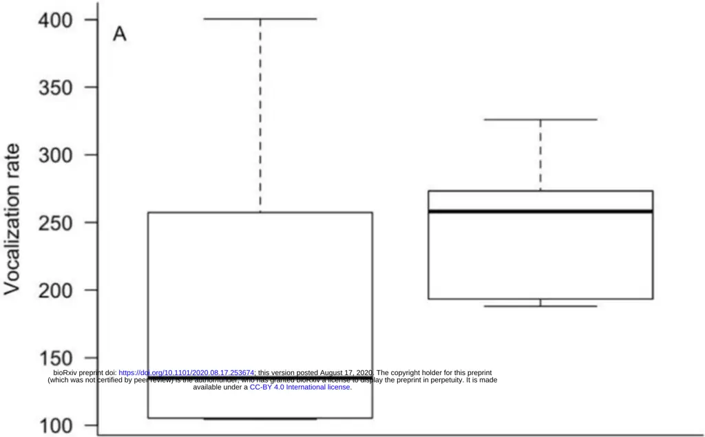
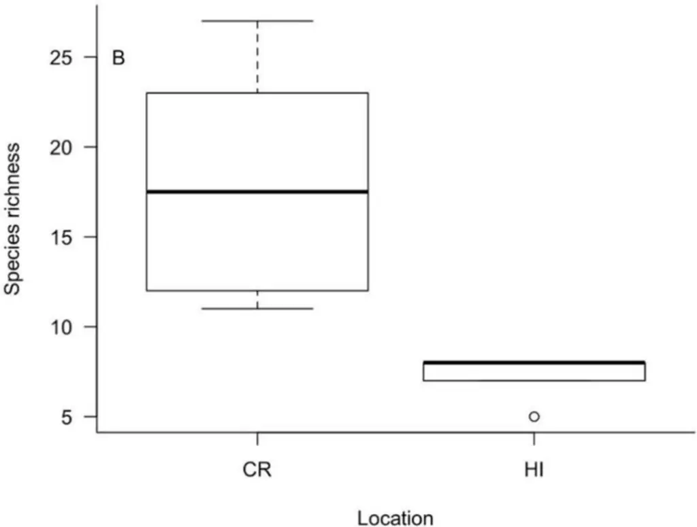
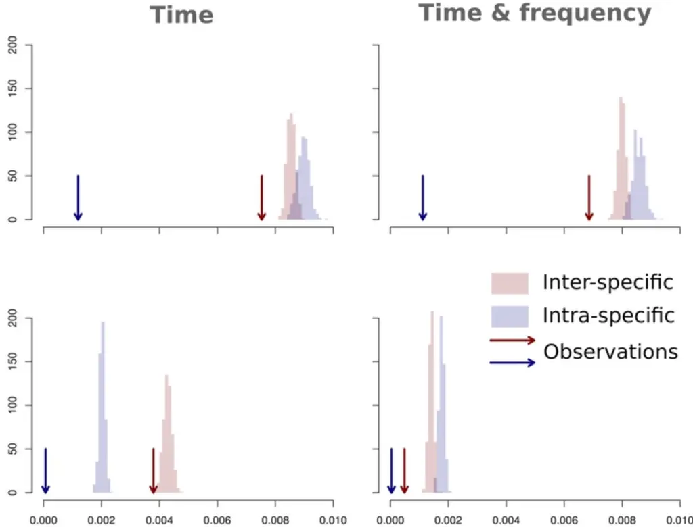
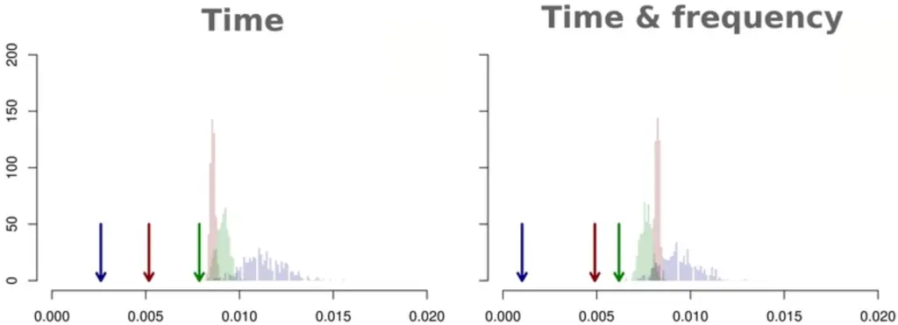

. CC-BY 4.0 International license available under a (which was not certified by peer review) is the author/funder, who has granted bioRxiv a license to display the preprint in perpetuity. It is made The copyright holder for this preprint this version posted August 17, 2020. ; https://doi.org/10.1101/2020.08.17.253674 doi: bioRxiv preprint

| 1   |                                                                                                     |
| --- | --------------------------------------------------------------------------------------------------- |
| 2   |                                                                                                     |
| 3   | Acoustic niche partitioning in two tropical wet forest bird communities                             |
| 4   |                                                                                                     |
| 5   | Patrick J. Hart 1,\* , Kristina Paxton 1 , Thomas Ibanez 1 , Grace Tredinnick 1 , Esther Sebastián- |
| 6 7 | González 1,2 , Ann Tanimoto-Johnson 1                                                               |
| 8   |                                                                                                     |
| 9   | 1 Department of Biology, University of Hawai'i at Hilo, Hawai'i, United                             |
|     | States of America                                                                                   |
|     | 2 Current Address: Departamento de Biologia Aplicada, Universidad Miguel Hernández, Elche,          |
|     | Spain                                                                                               |
|     | \* Corresponding author: pjhart@hawaii.edu (PJH)                                                    |
|     | Running title: Acoustic niche partitioning in bird communities                                      |

## 19 Abstract

20 When acoustic signals sent from individuals overlap in frequency and time, acoustic interference 21 and signal masking may occur. Under the acoustic niche hypothesis (ANH), signaling behavior 22 has evolved to minimize overlap with other calling individuals through selection on signal 23 structure and the sender's ability to adjust the timing of signals. In this study, we examine the 24 fine-scale use of acoustic space and the relevance of the acoustic niche hypothesis in two 25 montane tropical wet forest bird communities (Costa Rica and Hawai'i) that vary in bird species 26 richness. We used a null model approach to test the prediction that there are differences between 27 observed and expected signal overlap in both communities. As predicted under ANH, we found 28 much lower overlap of acoustic signals than expected by chance. In addition, spectral and 29 temporal overlap between different signals was far more common in Hawaii than Costa Rica. 30 These findings constitute strong support that there is competition for acoustic space in signaling 31 communities, and this has resulted in temporal and spectral partitioning of the soundscape.

## 32 Introduction

33 Acoustic signaling is a major form of social behavior in many terrestrial and aquatic organisms. 34 When acoustic signals sent from individuals overlap in frequency and time, acoustic interference 35 and signal masking occurs, which may reduce the receiver's ability to discriminate information 36 from the signal [1, 2]. Under the acoustic niche hypothesis (ANH; 3, 4), signaling behavior has 37 evolved to minimize overlap with heterospecific calling individuals through selection on signal 38 structure and the sender's ability to adjust the timing of signals. This hypothesis may be viewed 39 as an extension of the niche theory of Hutchinson [5] whereby acoustic space is a resource that

40 organisms may compete for and that can be partitioned both spectrally (frequency range of the 41 signal) and temporally.

42 The ANH is central to describing how animal signals in diverse calling communities are 43 dispersed in space and time and is a major organizing hypothesis in the field of soundscape 44 ecology [6]. While the ANH makes intuitive sense and is based on both anecdotal and empirical 45 evidence from a broad range of studies and signaling taxa [7], the degree to which organisms 46 partition acoustic space in order to reduce interference remains the subject of recent debate [8]. 48 birds [14-17] have found evidence for niche partitioning through the apparent evolution of signal 49 character displacement among species. Other studies have demonstrated that birds can adjust the 50 fine-scale timing of their signals to take advantage of gaps in noise and thus minimize temporal 51 acoustic overlap with other birds [18-21] and even insects [22]. In all cases however, support for 52 ANH can only be considered partial. Those studies that have found evidence of spectral 53 character displacement of the signals themselves were not able to determine if that resulted in a 54 significant reduction in overlap with other signals in real time. Those studies that reported 55 temporal adjustments in signals generally did so for select species groups and not the signaling 56 community as a whole. In order to have the clearest test of ANH, it is important to determine 57 how organisms simultaneously partition both the frequency and the timing of their vocalizations 58 in real time and at the community level.

47 Studies in biodiverse calling communities such as cicadas [9], crickets [10], anurans [11-13], and 59 Similar to the way other limiting resources (and thus niche partitioning) vary across space and 60 time, acoustic niche space would be expected to be partitioned in some habitats, communities, 61 and time periods, but not in others. Tropical wet forests have the most species-rich assemblages 62 of organisms that signal acoustically, and thus competition for acoustic niche-space is expected

63 to be strongest there [14, 23]. Conversely, acoustic space is not expected to be limiting in 64 ecosystems that have a low richness or density of signaling organisms. In this study, we examine 65 the fine-scale use of acoustic space and the relevance of the acoustic niche hypothesis in 66 montane tropical wet forest bird communities in both Costa Rica and Hawaii. We used a null 67 model approach to test the major prediction under the ANH that there are differences between 68 observed and expected levels of signal overlap in both communities. We also examined the way 69 the use of acoustic space differs between the two bird communities, and predicted that the degree 70 of partitioning is greater in the species-rich community due to selection to reduce inter-specific 71 signal overlap.

## 72 Materials and methods

## 73 Study sites

74 The Costa Rica study site was within an approximately 360 ha forest fragment at the 75 Organization for Tropical Studies (OTS) Las Cruces Biological Field Station in southern Costa 76 Rica at elevations between 1025 and 1200 m. This site is dominated by a mix of primary and 77 secondary wet forest with a canopy up to 30 m tall and a midcanopy layer comprised of 78 broadleaf trees, palms, and tree-ferns. Annual precipitation ranges from 3500-4000 mm and 79 mean annual temperature at Las Cruces Biological Station is ~21ºC [24]. The bird checklist 80 maintained by OTS for the station is comprised of over 400 species [25]. The Hawai'i study site 81 was within the Maulua tract of Hakalau Forest National Wildlife Refuge on the island of 82 Hawai'i. The canopy at this site is dominated by a Metrosideros polymorpha-Acacia koa trees up 83 to 25 m tall with a mid-canopy of at least six native tree and tree-fern species. Mean annual 84 precipitation is approximately 2500 mm and mean annual daily temperature is approximately is

85 ~15 ºC at the study site [26]. Hakalau contains the most intact forest bird community remaining 86 in the state with nine native species, plus an additional four non-native species that are common 87 in the forest. Within each site, we recorded bird songs using automated acoustic recorders (SM2 88 Wildlife Acoustics Inc.) placed ~1 meter above the ground at six different locations separated by 89 at least 200 m. Recordings were made for 3-5 days at each location, depending on weather 90 conditions. We programmed the acoustic recorders to record at 5-minute intervals (5-minutes on 91 and 5-minutes off) throughout the day during the breeding season months of June through July 92 2012 in Costa Rica and March through April 2015 in Hawai'i. Recordings were made in WAV 93 file format at a sampling rate of 44.1 kHz using a single omnidirectional microphone (SMX-II 94 Wildlife Acoustics) with a sensitivity of -35 dBV/Pa and frequency response of 20-20,000 Hz. 95 This study relied solely on the use of passive acoustic monitors placed in the forest to collect 96 acoustic data. No animals were captured, handled, housed, monitored, or followed. No 97 University IACUC permits were required for this study. Permission to conduct field work was 98 given by landowners in both Costa Rica (Organization for Tropical Studies) and Hawai'i 99 (Hakalau Forest National Wildlife Refuge).

100

## 101 Acoustic and statistical analysis

102

All recordings were visualized on a spectrogram using Raven Pro 1.5 software (Bioacoustics 103 Research Program 2017). Within each forest, we randomly selected one day at each of the six 104 recording locations. We then selected three 5-minute recordings per day during the dawn chorus 105 that did not contain rain or overlap with the chorus of cicada species such as Zammara 106 smaragdina which can alter the timing and frequency of bird vocalizations in Costa Rica [22].

107 Interference by cicada choruses resulted in two sites in Costa Rica with only two 5-min 108 recordings available.

109 We identified the bird species associated with each vocalization, then used the selection tool 110 in RavenPro 1.5 to determine the minimum and maximum frequency and signal start and end 111 time for all vocalizations within each 5-min recording period. Only selections &gt; 5dB of the 112 background noise of each recording were included in the analysis. All signals were measured 113 using a Hann window type and a window size of 23.2 ms, window overlap of 50%, and DFT 114 (discreet Fourier transform) size of 1024 samples [27]. Because signal characteristics can vary 115 somewhat as a function of distance from the sender to the recorder, we calculated a mean 116 minimum and maximum frequency for the signal of each species, and used this to calculate each 117 signal's average frequency range. We then created a frequency accumulation curve with 118 frequency on the x-axis and the number of species using at least a portion of each frequency bin 119 of 100 Hz on the y-axis. For each of the six recording locations, we calculated total species 120 richness across the 5-minute time periods, and vocalization rate as the total number of 121 vocalizations within a 5-min time period. We examined differences in species richness and 122 vocalization rate between Hawai'i and Costa Rica using general linear mixed models and a 123 Poisson link function in R (R Core Development Team 2018, version 3.5.1) with "forest" (Costa 124 Rica, Hawaiʻi) as a fixed variable and "recorder site" as a random variable.

125

We used a null model approach (e.g., Masco et al. [28]) to test the ANH. For each 5-min 126 recording period, we computed (i) the temporal and frequency overlap between each possible 127 pair of vocalizations, and (ii) the total possible number of vocalization pairs as n!/(2!(n-2)!, 128 where n = the number of vocalizations in a 5-min period (e.g., if n = 400, then the number of 129 possible pairs is 79800). For each forest (Costa Rica, Hawaiʻi), the observed proportion of

130 overlapping vocalization was computed as the sum of the number of overlapping pairs of 131 vocalizations (i.e., pair of vocalizations with a spectral and temporal overlap &gt; 0) divided by the 132 sum of the total possible number of vocalization pairs. These observed proportions of 133 overlapping vocalizations were then compared with the proportions obtained after randomizing 134 the beginning of each vocalization 500 times but keeping the signal duration and average 135 frequency range unchanged. Significantly fewer observed vs. expected overlaps between signals 136 was considered evidence that birds partition acoustic space in each community. These analyses 137 were performed separately for conspecific and heterospecific pairs of vocalizations. For Hawaii, 138 we also examined whether there were differences in observed vs. expected overlap between pairs 139 of native species vocalizations, pairs of alien species vocalizations, and mixed pairs of 140 vocalizations (between one alien and one native species). We verified the results from the null 141 model approach described above by using an additional method in which we visually scanned a 142 set of 1-second "soundslices" from each recording to determine the proportion of overlapping vs. 143 non-overlapping signals (see Supplemental Materials S1).

## 144 Results

145

We detected 10 vocalizing species on our recordings from Hawaii and 47 from Costa 146 Rica, though a number of the vocalizations from Costa Rica, primarily short calls, could not be 147 identified to the species level (Table 1). There was a total of 4485 vocalizations detected with a 148 duration of 6098 s from Hawaii and 2880 vocalizations with a duration of 1613 s from Costa 149 Rica (Table 1). Three of the 10 species from Hawai'i were non-native and accounted for &lt; 10% 150 of total vocalizations. Recording locations in Costa Rica had more than double the median 151 number of species (median = 17.5, range = 11 to 27) compared to locations in Hawai'i (median =

152 8, range = 5 to 8). We found a high degree of overlap in frequency use by species in both study 153 areas with the most commonly used frequencies in Costa Rica ranging from 3000-3500 Hz (25 154 species) and from approximately 3000-6000 Hz (eight species) in Hawaii (Fig. 1). The mean 155 (SD) length of vocalizations was similar between study areas (1.130.96 seconds vs. 1.150.59 156 seconds in Costa Rica and Hawaii respectively). There was little difference in vocalization rate, 157 indicating that the number of vocalizations per 5-minute period was similar between the two 158 locations (z=1.77, P=0.077; Fig. 2A). As expected, there were significantly more species 159 vocalizing per 5-minute recording period in Costa Rica than in Hawaii (z=-3.185, P= 0.001; Fig. 160 2B).

161 Table 1. The identity, total number of vocalizations detected, and total duration (in seconds) of 162 vocalizations detected within 5400 and 4800 seconds of recordings analyzed for Hawaii and 163 Costa Rica respectively.

| Site | Common name                      | Scientific name          | Total vocalizations | Total duration |
| ---- | -------------------------------- | ------------------------ | ------------------- | -------------- |
| CR   | Rufous-tailed hummingbird        | Amazilia tzacatl         | 107                 | 42.15          |
| CR   | Orange-billed sparrow            | Arremon aurantiirostris  | 143                 | 143.46         |
| CR   | Costa Rican brush finch          | Arremon costaricensis    | 84                  | 66.59          |
| CR   | Orange-billed nightingale thrush | Catharus aurantiirostris | 231                 | 215.01         |
| CR   | Dusky antbird                    | Cercomacroides tyrannina | 1                   | 1.77           |
| CR   | Golden-olive woodpecker          | Colaptes rubiginosus     | 22                  | 50.68          |
| CR   | White-ruffed manakin             | Corapipo altera          | 11                  | 4.7            |
| CR   | Red-faced spinetail              | Cranioleuca erythrops    | 3                   | 6.18           |

| CR  | Little tinamou              | Crypturellus soui               | 4    | 17.23  |
| --- | --------------------------- | ------------------------------- | ---- | ------ |
| CR  | Yellow-bellied elaenia      | Elaenia flavogaster             | 13   | 6.53   |
| CR  | Spot-crowned euphonia       | Euphonia imitans                | 7    | 1.97   |
| CR  | Black-faced antthrush       | Formicarius analis              | 27   | 38.21  |
| CR  | Ruddy quail-dove            | Geotrygon montana               | 2    | 3.62   |
| CR  | Red-crowned ant-tanager     | Habia rubica                    | 17   | 4.32   |
| CR  | White-breasted wood wren    | Henicorhina leucosticta         | 1052 | 409.67 |
| CR  | Lesser greenlet             | Hylophilus decurtatus           | 27   | 12.95  |
| CR  | Grey-chested dove           | Leptotila cassini               | 75   | 94.87  |
| CR  | Scale-crested pygmy tyrant  | Lophotriccus pileatus           | 111  | 75.08  |
| CR  | White-whiskered puff bird   | Malacoptila panamensis          | 15   | 10.82  |
| CR  | Greenish elaenia            | Myiopagis viridicata            | 1    | 0.97   |
| CR  | Buff-rumped warbler         | Myiothlypis fulvicauda          | 7    | 18.19  |
| CR  | Scaley-breasted hummingbird | Phaeochroa cuvierii             | 28   | 13.74  |
| CR  | Green hermit                | Phaethornis guy                 | 19   | 2.59   |
| CR  | Stripe-throated hermit      | Phaethornis striigularis        | 589  | 110.44 |
| CR  | Rufous breasted wren        | Pheugopedius rutilus            | 29   | 59.23  |
| CR  | Squirrel cuckoo             | Piaya cayana                    | 3    | 2.91   |
| CR  | Olivaceous piculet          | Picumnis olivaceus              | 1    | 1.39   |
| CR  | Chestnut-backed antbird     | Poliocrania exsul               | 1    | 0.77   |
| CR  | Chestnut-mandibled toucan   | Ramphastos ambiguous swainsonii | 65   | 33.78  |
| CR  | Long-billed gnatwren        | Ramphocaenus melanurus          | 12   | 23.52  |

164

165

166 Fig 1. Accumulated frequency use based on mean minimum and maximum frequencies of 167 vocalizations for 47 species in Costa Rica and 10 species in Hawaii.

| CR  | Rufous mourner          | Rhytipterna holerythra   | 7    | 7.48    |
| --- | ----------------------- | ------------------------ | ---- | ------- |
| CR  | Tropical parula         | Setophaga pitiayumi      | 10   | 18.87   |
| CR  | Russet antshrike        | Thamnistes anabatinus    | 59   | 21.3    |
| CR  | Yellow-olive flycatcher | Tolmomyias sulphurescens | 9    | 6.37    |
| CR  | White-throated thrush   | Turdus assimilis         | 23   | 45.7    |
| CR  | Clay-colored thrush     | Turdus grayi             | 40   | 23.21   |
| CR  | Paltry tyrannulet       | Zimmerius vilissimus     | 18   | 9.22    |
| HI  | Northern cardinal\*     | Cardinalis cardinalis    | 77   | 87.2    |
| HI  | Hawai'i 'Elepaio        | Chasiempis sandwichensis | 39   | 12.19   |
| HI  | Hawai'i 'Amakihi        | Chlorodrepanis virens    | 359  | 492.35  |
| HI  | 'I'iwi                  | Drepanis coccinea        | 2154 | 3221.59 |
| HI  | 'Apapane                | Himatione sanguinea      | 800  | 1357.61 |
| HI  | Red-billed leiothrix\*  | Leiothrix lutea          | 65   | 99.29   |
| HI  | Hawai'i 'Ākepa          | Loxops coccineus         | 7    | 3.4     |
| HI  | 'Alawī                  | Loxops mana              | 48   | 84      |
| HI  | 'Ōma'o                  | Myadestes obscurus       | 737  | 380.45  |
| HI  | Warbling white-eye\*    | Zosterops japonicus      | 203  | 358.49  |
| CR  | Unknown 9               |                          | 2    | 1.72    |
| CR  | Unknown 14              |                          | 6    | 1.25    |

168 Fig 2. Boxplots of the difference in A) vocalization rate (vocalizations per 5-minutes) and B) 169 species richness between the tropical forests in Costa Rica and Hawai'i . The whiskers are 170 representative of the 10 th and 90 th percentiles, the boxes show the 25 th and 75 th percentiles, the 171 mean value is indicated by the solid black line and circles represent outliers.

172

173

Observed intra- and interspecific signal overlap (in time and frequency combined) was 174 far less than expected by chance in both Costa Rica and Hawaii (Fig. 3). Indeed, there were no 175 randomly generated iterations of expected values that coincided with the number of observed 176 signal overlaps. Observed signal overlap (time, time and frequency combined) was generally 177 greater in Hawaii than in Costa Rica (Fig. 3). In particular, observed interspecific overlap in time 178 and frequency combined was more than an order of magnitude greater in Hawaii (Fig. 3). 179 Observed intraspecific overlap was rare in both study locations, but the difference between inter180 and intraspecific overlap for time and frequency combined was much greater in Hawaii than 181 Costa Rica. Finally, we did not detect a significant difference in the observed vs. expected level 182 of overlap between native and non-native species in Hawaii (Fig. 4).

183

184 Fig 3. Comparison between the observed proportion of overlapping pairs of vocalizations 185 (arrows) and the expected proportion of overlapping pairs of vocalizations under null models 186 (bars, 500 iterations) for both interspecific and intraspecific vocalization pairs in Hawai'i and 187 Costa Rica.

188 Fig 4. Comparison between the observed proportion of overlapping pairs of vocalizations 189 (arrows) and the expected proportion of overlapping pairs of vocalizations under null models 190 (bars, 500 iterations) among native and non-native (alien) vocalization pairs in Hawai'i.

191

## 192 Discussion

193

As predicted under ANH, we found significantly less temporal and spectral overlap of 194 acoustic signals than expected by chance in wet forest bird communities in Costa Rica and 195 Hawaii. These findings constitute strong support that there is competition for acoustic space in 196 species-rich signaling communities because they are based on null models generated at the level 197 of each recording period. Past studies using null models have found support for spectral 198 partitioning in anuran [11], orthopteran [10], and even spectral [8] or temporal [29] clustering of 199 acoustic signals at the community level. However, evidence for simultaneous spectral and 200 temporal partitioning at the community level, critically important to demonstrating acoustic 201 niche partitioning in real time, has been lacking. It was also notable that observed partitioning 202 was more pronounced within than among species in both locations (Fig. 3). This indicates that 203 there may be greater selection pressure to reduce overlap with conspecifics, possibly because 204 intraspecific signals are far more similar than interspecific ones.

205

While we found evidence for acoustic niche partitioning in both communities, and 206 despite similarities in signaling rate and in the range of spectral bandwidths used, we found 207 strong differences between communities in the use of acoustic space. Overlap between different 208 signals was very rare in Costa Rica but occurred within approximately 37 % of the sound slices

224

209 examined in Hawaii (Supplementary Material S1). These findings could be strengthened by 210 increasing replication across both regions, but they indicate that greater species richness in Costa 211 Rica may have led to stronger selection for reducing interspecific signal overlap there. In 212 addition, the island of Hawaii is geologically younger than much of Costa Rica (~0.5 vs 2.5-15 213 my; [30]) so there are likely differences in length of time available for the evolution of signal 214 character displacement between locations. There may be a phylogenetic effect as well - the 215 Costa Rican bird community represents a far greater diversity of avian lineages than Hawaii, 216 where most of the current species have evolved through adaptive radiation from just a handful of 217 colonizations from distant continents [31]. Differences in signal function may also partially 218 explain the different levels of signal overlap between the two communities. Most of the Costa 219 Rica species sampled here maintain year-round territories [32], whereas most of the Hawaiian 220 species are generally non-territorial outside the breeding season. The function of song may be 221 more associated with promoting social cohesion, with less selection against reducing 222 interspecific signal overlap, in communities with higher densities of individual species that are 223 non-territorial. We focused our analyses on the period during which birds most actively vocalize in each 225 forest. This period differs between Hawaii and Costa Rica, possibly as a function of the presence 226 of other calling taxa. In Costa Rica, the night-time soundscape is dominated by arthropods and 227 anurans, with relatively little bird activity. The dawn chorus for birds begins soon after first light, 228 and continues for approximately 1.5-3 hours, when the daily chorus of cicadas begins. Past work 229 has shown that cicada choruses dominate the frequency bands commonly used by birds and may 230 effectively shut down communication for many bird species in Costa Rica [22]. The dawn period 231 is when birds have the least apparent competition with other calling organisms and the avian

232 community may partition acoustic space to a greater degree than any other time period during the 233 day. Conversely, Hawaii has no native anurans, no cicadas, and far fewer arthropods that signal 234 acoustically during the day. Perhaps for this reason, the morning chorus period may last for up to 235 five hours or more in forests dominated by native Hawaiian bird species such as Hakalau Forest 236 NWR.

237

An important prediction that is based on the Acoustic Niche Hypothesis is that habitats 238 with less altered species assemblages will exhibit greater levels of acoustic partitioning than 239 habitats with more altered species assemblages [6]. For example, vocalizations of the non-native 240 Leiothrix lutea frequently overlap with those of native species, and thus reduce acoustic 241 partitioning at the community level in an Italian shrubland [33]. Most bird communities in 242 Hawaii are comprised of a mix of native species and non-native species that have been 243 introduced within the past 100 years. In our study, 30% (3 out of 10) of the bird recorded in 244 Hawaii were non-native species (including Leiothrix lutea), whereas none in Costa Rica are 245 considered non-native. We did not detect a significant difference in the observed vs. expected 246 level of overlap between native-native vs. native-non-native species (Fig. 4), however Hakalau 247 Forest is notable for its lack of non-native bird species relative to most other areas in Hawaii and 248 their vocalizations comprised less than 10% of the total. Future studies could compare overlap 249 between native and non-native dominated bird communities in Hawaii as a test of this prediction 250 of ANH.

## 251 Conclusions

252

Our finding that birds simultaneously partition acoustic space both spectrally and 253 temporally, and that the strength of this partitioning varies between two communities, adds to the

254 growing body of knowledge that this may be a general phenomenon in other areas with high 255 densities of signaling individuals. The null model approach we used here would likely be a 256 useful method for testing the acoustic niche hypothesis in these areas.

## 257 Acknowledgements

258 We thank Kary Perez and Michael Atencio-Picado for assistance with acoustic analysis. Also, 259 Zak Zahawi and the staff at the Organization for Tropical Studies Las Cruces Field Station for 260 facilitating field work in Costa Rica, and Steve Kendall of the US Fish and Wildlife Service for 261 permits and access to field sites in Hawaii.

262

263

## 264 References

265

266

267

268

269

270

271

272

273

274

275

1. Klump GM. Bird communication in the noisy world. In: Kroodsma DE, Miller EH, editors. Ecology and Evolution of Acoustic Communication in Birds. Ithaca: Cornell University Press; 1996.
2. Brumm H, Slabbekoorn H. Acoustic communication in noise. Adv. Study Anim Behav. 2005;35: 151-209.
3. Krause BL. Bioacoustics, Habitat Ambience in Ecological Balance. Whole Earth Review. 1987;57: 14 -18.
4. Krause B. The niche hypothesis. Soundscape Newsletter. 1993;6: 6-10.

276

277

278

279

280

281

282

283

284

5. Hutchinson GE. Concluding remarks. Cold Spring Harbor Symp Quant Biol. 1957; 415427.
6. Pijanowski BC, Villanueva-Rivera LJ, Dumyahn SL, Farina A, Krause BL, Napoletano BM, Gage SH, Pieretti N. Soundscape Ecology: The Science of Sound in the Landscape. BioScience. 2011;61: 203-216.
7. Farina A, James P. The acoustic communities: definition, description, and ecological role. Biosystems. 2016;147: 11-20.

285

286

287

288

289

290

291

292

293

294

295

296

297

298

299

300

301

302

303

304

305

306

307

308

309

310

311

312

313

314

315

316

317

318

319

320

321

322

323

8. Tobias JA, Planqué R, Cram DL, Seddon N. Species interactions and the structure of complex communication networks. Proc. Natl. Acad. Sci. USA. 2014;111: 1020-1025.
9. Sueur J. Cicada acoustic communication: potential sound partitioning in a multispecies community from Mexico (Hemiptera: Cicadomorpha: Cicadidae). Biol. J. Linn. Soc. 2002;75: 379-394.
10. Schmidt AKD, Römer H, Riede K. Spectral niche segregation and community organization in a tropical cricket assemblage. Behav. Ecol. 2013;24: 470-480.
11. Chek AA, Bogart JP, Lougheed SC. Mating signal partitioning in multi-species assemblages: a null model test using frogs. Ecol. Lett. 2003;6: 235-247.
12. Sinsch U, Lumkemann K, Rosar K. Acoustic niche partitioning in an anuran community inhabiting an Afromontane wetland (Butare, Rwanda). Afr. Zool. 2012;47: 60-73.
13. Villanueva-Rivera LJ. Eleutherodactylus frogs show frequency but no temporal partitioning: implications for the acoustic niche hypothesis. PeerJ. 2014;2:e496. Available from: https://doi.org/10.7717/peerj.496
14. Planqué R, Slabbekoorn H. Spectral overlap in songs and temporal avoidance in a Peruvian bird assemblage. Ethology 2008;114: 262-271.
15. Luther D. The influence of the acoustic community on songs of birds in a Neotropical rain forest. Behav. Ecol. 2009;20: 864-871.
16. Kirschel ANG, Blumstein DT, Cohen RE, Buermann W, Smith TB, Slabbekoorn H. Birdsong tuned to the environment: green hylia song varies with elevation, tree cover, and noise. Behav. Ecol. 2009;20: 1089-1095.
17. Azar JF, Bell BD. Acoustic features within a forest bird community of native and introduced species in New Zealand. Emu 2016;116: 22-31.
18. Ficken RW, Ficken MS, Hailman JP. Temporal pattern shifts to avoid acoustic interference in singing birds. Science 1974;183: 762-763.
19. Popp JW, Ficken RW, Reinartz JA. Short-term temporal avoidance of interspecific acoustic interference among forest birds. Auk 1985;102: 744-748.

324

325

326

327

328

329

330

331

332

333

334

335

336

337

338

339

340

341

342

343

344

345

346

347

348

349

350

351

352

353

354

355

356

357

358

359

360

361

362

363

364

20. Suzuki R, Taylor CE, Cody ML. Soundspace partitioning to increase communication efficiency in bird communities. Artif. Life Robot. 2012;17: 30-34.
21. Yang X, Ma X, Slabbekoorn H. Timing vocal behaviour: experimental evidence for song overlap avoidance in Eurasian wrens. Behav. Proc. 2014;103: 84-90.
22. Hart PJ, Hall R, Ray W, Beck A, Zook J. Cicadas impact bird communication in a noisy tropical rainforest. Behav. Ecol. 2015;26: 839-842.
23. Slabbekoorn H. Singing in the wild: the ecology of birdsong. In: Marler P, Slabbekoorn H, editors. Nature's Music: The Science of Birdsong. San Diego: Academic Press; 2004. pp. 178-205.
24. Zahawi Z, Duran G, Kormann U. Sixty-seven years of land-use change in southern Costa Rica. Plos One. 2015;10(11). e0143554. https://doi.org/10.1371/ journal.pone.0143554.
25. Martínez D. Lista de aves de la Estación Biológica Las Cruces y alrededores. 2010. Available from: http://www.ots.ac.cr.
26. Giambelluca TW, Shuai X, Barnes ML, Alliss RJ, Longman RJ, Miura T, Chen Q, Frazier AG, Mudd RG, Cuo L, Businger AD. Evapotranspiration of Hawai'i. Final report submitted to the U.S. Army Corps of Engineers-Honolulu District, and the Commission on Water Resource Management, State of Hawai'i. 2014.
27. Charif RA, Waack AM, Strickman LM. Raven Pro User's Manual, Ithaca: Cornell Lab of Ornithology; 2010.
28. Masco C, Allesina S, Mennill DJ, Pruett-Jones S. 2016. The Song Overlap Null model Generator (SONG): a new tool for distinguishing between random and non-random song overlap. Bioacoustics 2016;25: 29-40
29. Malavasi R, Farina A. Neighbors' talk: interspecific choruses among songbirds. Bioacoustics 2013; 22: 33-48.
30. Alvarado GE, Cárdenes G. Geology, Tectonics, and Geomorphology of Costa Rica: A Natural History Approach. In: Kappelle M, editor. Costa Rican Ecosystems. Chicago: The University of Chicago Press; 2016. pp. 30-63.
31. Freed LA, Conant S, Fleischer RC. Evolutionary ecology and radiation of Hawaiian passerine birds. Trends Ecol. Evol. 1987;2: 196-203.

365

366

367

368

369

370

371

372

373

32. Stiles GF, Skutch AF. A guide to the birds of Costa Rica. Ithaca: Cornell University Press; 1989.
33. Farina A, Pieretti N, Morganti N. Acoustic patterns of an invasive species: the Red-billed Leiothrix (Leiothrix lutea Scopoli 1786) in a Mediterranean shrubland. Bioacoustics 2013;22: 175-194.

Frequency (Hz)

14500-15000

14000-14500

13500-14000

13000-13500

bioRxiv preprint doi:

Costa Rica (CR)

Hawai'i (HI)

;

[https://doi.org/10.1101/2020.08.17.253674](https://doi.org/10.1101/2020.08.17.253674)

this version posted August 17, 2020.

The copyright holder for this preprint

(which was not certified by peer review) is the author/funder, who has granted bioRxiv a license to display the preprint in perpetuity. It is made

available under a

0

5

[CC-BY 4.0 International license](http://creativecommons.org/licenses/by/4.0/)

10

.

15

20

25

0

5

10

15

20

25

12000-12500

11500-12000

11000-11500

10500-11000

10000-10500

9500-10000

9000-9500

8500-9000

8000-8500

7500-8000

7000-7500

6500-7000

6000-6500

5500-6000

5000-5500

4500-5000

4000-4500

3500-4000

3000-3500

2500-3000

2000-2500

1500-2000

1000-1500

500-1000

0-500

Proportion of overlapping pairs of vocalizations

## Proportion of overlapping pairs of vocalizations

Native - native

Alien - alien

Native - alien Observations

