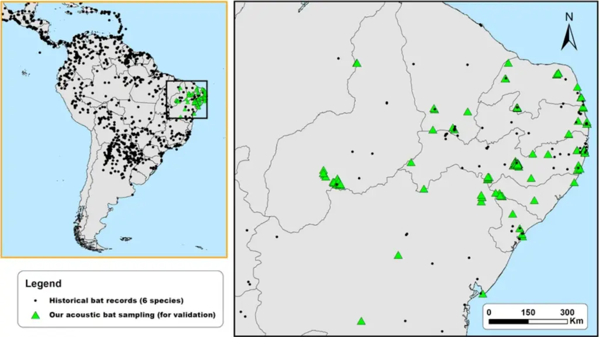
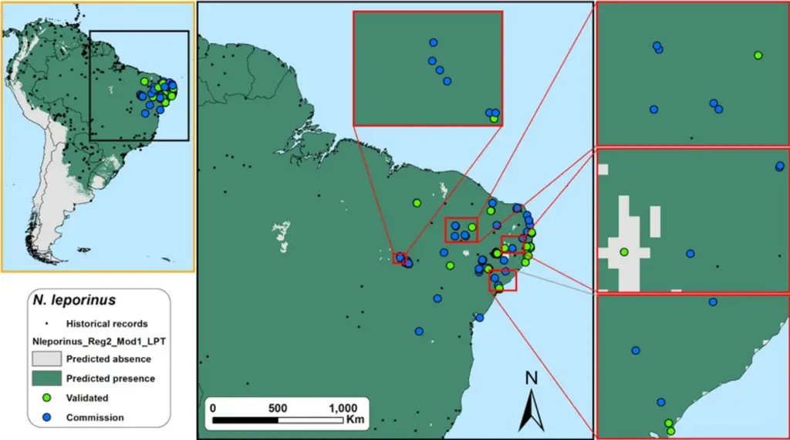
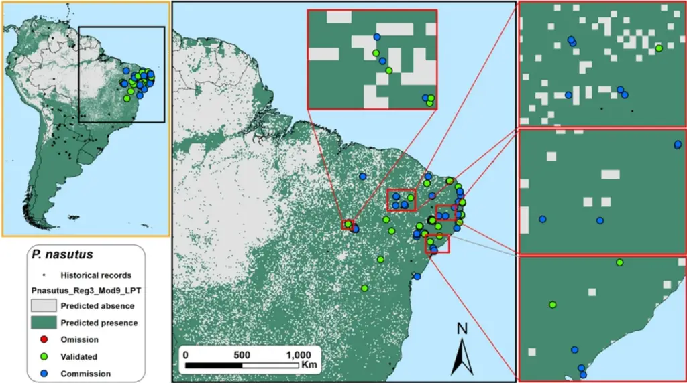
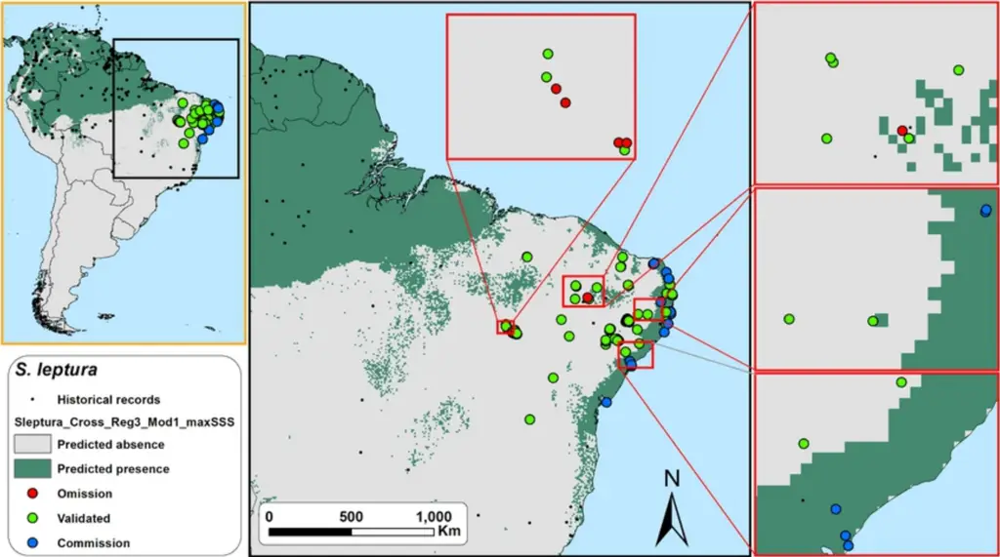

. CC-BY 4.0 International license made available under a (which was not certified by peer review) is the author/funder, who has granted bioRxiv a license to display the preprint in perpetuity. It is The copyright holder for this preprint this version posted March 8, 2021. ; https://doi.org/10.1101/2021.03.08.434378 doi: bioRxiv preprint

## 1 Bioacoustics for in situ validation of species distribution modelling: An example with bats

- 2 in Brazil
- 3 Using bioacoustics for field validation of bats' SDMs

## 4 Frederico Hintze a,b , Ricardo B. Machado c , Enrico Bernard a

- 5 a Laboratório de Ciência Aplicada à Conservação da Biodiversidade, Departamento de Zoologia, Universidade
- 6 Federal de Pernambuco, Rua Professor Nelson Chaves s/n, Cidade Universitária, Recife PE 50670-420, Brasil.
- 7 b Programa de Pós-graduação em Biologia Animal, Departamento de Zoologia, Universidade Federal de
- 8 Pernambuco, Av. Prof. Moraes Rego, 1235, Recife PE 50670-901, Brasil.
- 9 c Departamento de Zoologia, Instituto de Ciências Biológicas, Campus Darcy Ribeiro, Universidade de Brasília,
- 10 Brasília DF 70910-900, Brasil

11

## 12 Abstract

13

Species distribution modelling (SDM) gained importance on biodiversity distribution 14 and conservation studies worldwide, including prioritizing areas for public policies and 15 international treaties. Useful for large-scale approaches and estimates, is a plus considering 16 that a minor fraction of the planet is adequately sampled. However, SDM needs to be as reliable 17 as possible. Minimizing errors is challenging, but essential, considering the uses and 18 consequences of such models. In situ validation of the SDM outputs should be a key-step - in 19 some cases, urgent. Bioacoustics can be used to validate and refine those outputs, especially if 20 the focal species' vocalizations are conspicuous and species-specific. This is the case of 21 echolocating bats. Here, we used extensive acoustic monitoring (&gt;120 validation points, 22 covering &gt;758,000 km 2 , and &gt;300,000 sound files) to validate MaxEnt outputs for six 23 neotropical bat species in a poorly-sampled region of Brazil. Based on in situ validation, we 24 evaluated four threshold-dependent theoretical evaluation metrics' ability in predicting models' 25 performance. We also assessed the performance of three widely used thresholds to convert 26 continuous SDMs into presence/absence maps. We demonstrated that MaxEnt produces very 27 different outputs, requiring a careful choice on thresholds and modeling parameters. Although 28 all theoretical evaluation metrics studied were positively correlated with accuracy, we 29 empirically demonstrated that metrics based on specificity-sensitivity and sensitivity-precision 30 are better for testing models, considering that most SDMs are based on unbalanced data. 31 Without independent field validation, we found that using an arbitrary threshold for modelling 32 can be a precarious approach with many possible outcomes, even after getting good evaluation 33 scores. Bioacoustics proved to be important for validating SDMs for the six bat species 34 analyzed, allowing a better refinement of SDMs in large and under-sampled regions, with 35 relatively low sampling effort. Regardless of species assessing method used, our research 36 highlighted the vital necessity of in situ validation for SDMs.

37 Keywords: accuracy, echolocation calls, MaxEnt, predictive distribution maps, thresholds, 38 SDM.

39

## 40 Introduction

41

Species distribution modelling (SDM) gained importance in the development of studies 42 on biodiversity distribution and conservation worldwide [1, 2]. These distribution models can 43 be produced and refined by crossing species presence records with biological and non44 biological variables and environmental data [e.g., 3]. Such modelling can be beneficial for 45 large-scale approaches and estimates, a plus considering that fewer parts of planet Earth were 46 adequately sampled [4, 5]. Moreover, SDM has been used to support decision-making 47 processes, including prioritizing areas and regions in public policies and international treaties 48 [2, 5].

49

For biodiversity conservation purposes, SDM should be as reliable as possible. For 50 instance, imprecise models can undermine the calculation/estimate of a species' occupancy, a 51 criterion used to assess its conservation status, for example [6]. Depending on the quality of 52 the input data and modelling parameters chosen, the predictions created may not translate 53 precisely the species' distribution [7, 8]. Known as commission (false positives) and omission 54 (false negatives) errors, they can inflate or reduce a given taxon's potential distribution. 55 Minimizing such errors is a challenge for the spatial modelling science [4, 7, 9], but essential 56 considering the uses and consequences such models may have [10]. Therefore, in situ 57 validation of the SDM outputs should be a critical step - in some cases, urgent [10, 11].

58

Certifying that a species is present in a given area is not always straightforward, and 59 different and innovative approaches have been proposed for such task [e.g., e-DNA [12] or 60 satellite images [13]]. Bioacoustics is one of such techniques and has been used for a long time 61 to record species presence/absence for birds, cetaceans, and amphibians [14]. Bats are a 62 widespread group, using many habitats and resources, and most of the 1400 known species

63 depend on echolocation for navigation and food acquisition [15]. The bats' echolocation system 64 is based on ultrasonic signals which, although above the human hearing capacity, thanks to 65 recent electronics advances, can be easily recorded [16]. Moreover, most bats have 66 conspicuous and species-specific calls, allowing precise identification of the emitter's identity 67 and making the record of its presence accurate [16]. Therefore, bioacoustics can be a useful 68 technique applied to the in situ validation and refinement of SDM outputs for echolocating 69 bats.

70

Here, we used extensive in situ monitoring (&gt; 120 validation points, covering &gt; 71 758,000 km 2 , and &gt; 300,000 sound files) of echolocation calls to validate the outputs of the 72 most used SDM algorithm [MaxEnt; 3] for six neotropical bat species in a poorly-sampled part 73 of Brazil. Using independent acoustic data collected, we (a) evaluated the ability of four 74 threshold-dependent theoretical evaluation metrics in predicting models' performance, and (b) 75 assessed the ability of three widely used thresholds to convert continuous species habitat 76 suitability models into binary (presence/absence) maps.

77

## 78 Materials and Methods

## 79 Historical species records

80

In our analysis, we selected six neotropical bat species whose echolocation calls are 81 well-known, species-specific and unequivocally identifiable: Noctilio leporinus, Promops 82 centralis, Promops nasutus, Pteronotus gymnonotus, Pteronotus personatus, and Saccopteryx 83 leptura [17-19]. We gathered distribution records for these species from a bibliographic 84 revision using the following online databases and search engines: the Vertebrate Zoology 85 Database of the American Museum of Natural History (http://sci-web86 001.amnh.org/db/emuwebamnh/index.php); the database of the Division of Mammals 87 Collections of the Smithsonian National Museum of Natural History 88 (https://collections.nmnh.si.edu/search/mammals/); the Global Biodiversity Information

. CC-BY 4.0 International license made available under a (which was not certified by peer review) is the author/funder, who has granted bioRxiv a license to display the preprint in perpetuity. It is The copyright holder for this preprint this version posted March 8, 2021. ; https://doi.org/10.1101/2021.03.08.434378 doi: bioRxiv preprint

- 89 Facility (www.gbif.org); the SpeciesLink network (http://www.splink.org.br); Google Scholar
- 90 (scholar.google.com); the Web of Science (www.webofknowledge.com); Scopus
- 91 (www.scopus.com); the Periódicos CAPES (www.periodicos.capes.gov.br); and the Scientific

92 Electronic Library Online (www.scielo.br). We also reviewed occurrences in studies available 93 online such as Barquez, Ojeda [20] and Gardner [21]. Each record was checked for duplication 94 of localities and, eventually, to correct location or taxonomy problems [22]. For example, 95 following Gardner [21], we treated P. nasutus as a monotypic species (considering Promops 96 nasutus ancilla, P. nasutus pamana, P. nasutus fosteri or P. nasutus downsi as simply Promops 97 nasutus). Overall, we gathered a total of 1277 single records for the six studied bat species: 98 590 records for Noctilio leporinus, 70 for Promops centralis, 71 for Promops nasutus, 120 for 99 Pteronotus gymnonotus, 95 for Pteronotus personatus, and 331 for Saccopteryx leptura (Fig 100 1, and S1 Table in supplementary material).

101

102 Fig 1. Historical distribution records assembled from the literature review and the 129 acoustic sampling 103 points used for the validation of SDM of six neotropical bat species (Noctilio leporinus, Promops centralis, 104 Promops nasutus, Pteronutus gymnonotus, Pteronotus personatus, and Saccopteryx leptura).

105

## 106 Distribution modelling procedure

107

We used SDMtoolbox 2.4 for ArcGIS [23] to create an environmental heterogeneity 108 map with the bioclimatic variables of Worldclim [24]. To reduce the potential bias caused by 109 autocorrelation, we then used the Spatial Rarefy Occurrence Data tool of the SDMtoolbox 2.4 110 package to delete records under the same environmental conditions within 25 km from each 111 other [25]. Other studies usually use a 10km distance between points [e.g. 26, 27, 28], but given 112 the topographic and environmental heterogeneity of the studied region, we chose 25 km as a 113 spatial filter to avoid eventual spatial bias on historical records [29]. This process ensured that 114 all historical records gathered in our revision corresponded to a unique spatial sample, reducing 115 occurrence data from 1277 to 899 single localities: 375 localities for Noctilio leporinus, 61 for

116 Promops centralis, 65 for Promops nasutus, 87 for Pteronotus gymnonotus, 66 for Pteronotus 117 personatus, and 245 for Saccopteryx leptura.

118

We used MaxEnt 3.4 [3] to generate potential species distribution models for the six 119 selected species based on a set of variables at a 5 km 2 resolution. We used the 19 bioclimatic 120 variables plus elevation available at the Worldclim data website [24] and Globcover 2009 [30] 121 as a categorical variable for land cover. To reduce the multicollinearity among the predictor 122 variables, we performed a preliminary model with all variables and checked the weight of each 123 according to their contributions, using Jackknife tests. Next, using the Correlations and 124 Summary Stats tool of the SDMtoolbox 2.4 package, we obtained the correlation and 125 covariances matrices and removed highly correlated variables (i.e., those with the lowest value 126 when the pairwise correlation was &gt; 0.7) [31]. Therefore, we used different variables for each 127 modelled species (S2 Table, in supplementary material).

128

We used a logistic output to produce our models and obtain continuous suitability 129 values for species habitat suitability, which varies from 0 (lowest suitability) to 1 (highest 130 suitability) [3, 32]. Since default regularization values lead to overfitted models when using 131 spatial filtering [28], we calibrated the models with different regularization multiplier values 132 (default 1.0, 2.0, 3.0, and 4.0) [28, 33]. To generate overall predictive distribution models, we 133 used 75% of the data for calibration and 25% for internal evaluation (testing data).

134

We used ten cross-validation replications to test all models and calculate confidence 135 intervals, resulting in 40 models for each species, and a total of 240 continuous suitability 136 models for all species. Since we aimed to use bioacoustics data to validate binary maps 137 (presence-absence), we used three widely used thresholds to convert the continuous suitability 138 values of each model into binary maps: lowest presence threshold (hereafter LPT) [27]; 10 th 139 percentile of the predicted values (hereafter P10) [27]; and maximum sum of sensitivity and 140 specificity (hereafter maxSSS) [34, 35]. LPT is considered the least conservative threshold,

141 whereas maxSSS the most [34, 36]. We produced a total of 720 binary models (i.e., 120 binary 142 models for each species: 6 species x 120 binary models).

143 Using MaxEnt's background and sample predictions for each model, we then evaluated 144 each 120 species binary models for their predicting performance using four threshold145 dependent theoretical evaluation metrics: (1) overall accuracy (hereafter OAcc) [37, 38]; (2) 146 Cohen's maximized kappa statistics (hereafter P-kappa) [39, 40]; (3) True Skill Statistics 147 (hereafter TSS) [38, 41]; and, (4) Symmetric Extremal Dependence Index (hereafter SEDI) 148 [42]. OAcc measures the model predicted accuracy using the rate of correct classifications (true 149 positive + true negative) and ranges from 0 to 1; while P-kappa, TSS and SEDI measures the 150 model predicted accuracy taking into account the predicted accuracy of a by-chance model [38, 151 42]. Pkappa, TSS and SEDI range from -1 to +1, where values ≤ 0 suggest a performance equal 152 or worse than random, and as close the values get to +1, the better the prediction [38, 42]. For 153 the math behind each theoretical evaluation metrics calculation, please consult Allouche, Tsoar 154 [38], Cohen [39], Peirce [41], and Wunderlich, Lin [42].

155

As expected, the theoretical metrics did not converged on the same best models, 156 therefore we selected the two best-scored binary models based on each metric (i.e., the two 157 best-scored based on OAcc, the two best-scored based on P-kappa, and so on…) for each of 158 the thresholds used (LPT, P10, and maxSSS). Then, we did the field validation on the resulting 159 24 theoretical best binary models for each species, 144 binary models in total of the six studied 160 species.

161

## 162 Field validation sampling and acoustic identification

163

For the selection of the sampling points for field validation, we summed the average 164 potential distribution outputs of the six species to identify regions with highest and lowest 165 suitability of species occurrence, but without historical records. Considering the potential

166 distribution of those species covered extensive areas, we focused our field validation on 129 167 randomly-selected sampling points along 1000 km from east to west and 1000 km from north 168 to south, covering an area of 758,193 km 2 , in the Northeastern part of Brazil (Fig 1, and S3 169 Table supplementary material).

170

Between March 2014 and January 2020, we employed passive acoustic monitoring to 171 sample bat echolocation calls in the 129 sampling points (Fig 1, and S3 Table in supplementary 172 material), using a combination of SM2Bat+, SM3BAT, and SM4BAT-FS ultrasound recorders 173 (Wildlife Acoustics Inc., Massachusetts, USA). Since the highest frequency used by the studied 174 species is ~60 kHz (Noctilio leporinus) [18], we configured the bat detectors with a minimum 175 sampling rate of 384 kHz, enough to detect and record our focal species without distortions 176 (e.g., aliasing). Each sampling point was acoustically monitored for at least two nights, 177 recording continuously from 30 minutes before sunset until 30 minutes after sunrise. Since bat 178 activity and the reception of the calls can be affected by weather and local conditions, we 179 sampled only during nights with temperature &gt; 15ºC, without strong winds (&lt; 5 m/s) or rain 180 [16, 43, 44]. We set the microphones at 45º to the ground, avoiding highly cluttered areas [16, 181 43, 44].

182

We used Raven Pro 1.5 (The Cornell Lab of Ornithology 2014) for the acoustic 183 analysis performed in the laboratory. We configured the spectrograms to DFT equals 1024, 184 96% overlap, window length to 1 ms, using Hamming windows. We only analyzed sequences 185 containing a minimum of three search calls with a good signal-to-noise ratio (&gt; 15 dB) [45, 186 46]. We performed manual acoustic identification using qualitative (e.g., call structure and 187 modulation) and quantitative parameters (e.g., frequency of maximum energy, maximum and 188 minimum frequency, call duration, etc.), following previously published studies on neotropical 189 bat acoustic identification [e.g., 17-19, 46, 47, 48]. We did not use feeding-buzzes (and calls 190 immediately before and after) or social-calls for identification purposes. Although the chosen

191 species have different natural histories, all are considered as common in the sampled region 192 and can be easily detected and identified by acoustics. All fieldwork procedures complied with 193 the American Society of Mammalogists´ guidelines for the use of wild mammals in research 194 and education [49] and were previously approved by the Brazilian Ministry of the Environment 195 (SISBIO n.º 59743-1).

196

## 197 Models' field validation

198

We evaluated the total 144 selected binary models for the six focal species against the 199 results from the acoustic monitoring performed in the field. We used a confusion matrix to 200 compare the accuracy of the binary maps, where the observed presence and absence cases from 201 the acoustic monitoring were compared against the predicted presence and absence of the 202 models. This procedure allowed us to quantify true positives (TP), true negatives (TN), false 203 negatives (FN; omission errors, type I errors), and false positives (FP; commission errors, type 204 II errors).

205 We used six metrics for the model performance evaluation: (1) Accuracy, to quantify 206 how often the model is correct in the overall prediction [Accuracy = (TP + TN) / total cases]; 207 (2) Precision, to quantify how often is the model correct when it predicts the occurrence of the 208 species [Precision = TP / (TP + FP)]; (3) Sensitivity (true positive rate, or recall), to quantify 209 the ability of the model to predict species occurrence [Sensitivity = TP / (TP + FN)]; (4) 210 Specificity (or true negative rate), which quantifies the ability of the model to predict species 211 absence [Specificity = TN / (FP + TN)]; (5) geometric mean of sensitivity and specificity (g212 mean), is a performance metric for imbalanced classifications, high g-mean indicates a right 213 balance between sensitivity and specificity [g-mean =  (Sensitivity . Specificity)]. If the 214 species presence classification performance is weak, the g-mean will be low even with an 215 excellent species absence classification performance [50]; and (6) harmonic mean of precision

216 and sensitivity [f-score = (2 . Precision . Sensitivity) / (Precision + Sensitivity)], gives the same 217 importance to precision and sensitivity, i.e., high F-score indicates excellent model 218 performance on the minority class [50, 51]. The commission error rate is inversely proportional 219 to sensitivity (= 1 - sensitivity), whereas the omission error rate is inversely proportional to 220 specificity (= 1 - specificity).

221

To assess the overall performance of the theoretical evaluation metrics (OAcc, P222 kappa, TSS, and SEDI), we performed a Spearman rank-order correlation between those scores 223 and the post-validation performance metrics scores (accuracy, precision, sensitivity, 224 specificity, g-mean, and f-score). To test differences in the prediction performances (using the 225 post-validation performance metrics scores) between the thresholds used (LPT, maxSSS, and 226 P10), we employed the Kruskal-Wallis test with Mann-Whitney pairwise post hoc test. The 227 thresholds were tested with both all species together and separately for each one.

228

## 229 Results

## 230 SDM's and acoustic field validation

231

The acoustics sampling performed in this study resulted in more than 1.5 TB of raw 232 sound files, where more than 300,000 sound files contained bat calls. We identified 233 echolocation calls of Noctilio leporinus in 38 points (29,4%), of Promops centralis in 23 234 (17,8%), Promops nasutus in 44 (34,1%), Pteronotus gymnonotus in 53 (41,1%), Pteronotus 235 personatus in 21 (16,3%), and Saccopteryx leptura in 24 of the 129 sampled points (18,6%) 236 (S3 Table, in supplementary material).

237

After field validation, the performance scores varied considerably between the 144 238 binary models: accuracy varied from 0.16 to 0.81, precision varied between 0.09 and 0.59, 239 sensitivity varied from 0.17 to 1, specificity from 0 to 0.86, g-mean from 0 to 0.75 and f-score 240 from 0.12 to 0.60 (S4 Table, in supplementary material). We registered the highest accuracy 241 score (0.81) in a maxSSS thresholded map of Saccopteryx leptura, the highest precision score

242 (0.59) in a maxSSS thresholded map of Noctilio leporinus, and the highest sensitivity score (= 243 1) in LPT thresholded maps of four species (Noctilio leporinus, Pteronotus gymnonotus, 244 Promops nasutus, and Pteronotus personatus) (S4 Table and S5 Maps, in supplementary 245 material). The highest specificity score (0.86) was recorded in maxSSS thresholded maps of 246 two species (Noctilio leporinus and Saccopteryx leptura), the highest g-mean score (0.75) in a 247 P10 thresholded map of Saccopteryx leptura, and the highest f-score score (0.60) in a maxSSS 248 thresholded maps of Pteronotus gymononotus (S4 Table and S5 Maps, in supplementary 249 material).

250

## 251 Model evaluation vs. field validation

252

All theoretical model evaluation metrics analysed exhibited a significant monotonic 253 positive correlation with accuracy and specificity (Table 1). However, the evaluation metrics 254 exhibited an overall significant negative correlation with sensitivity (Table 1). We also found 255 very weak monotonic correlations between the evaluation metrics and precision (Table 1). 256 Although negative, the correlation between the theoretical evaluation metrics and f-score was 257 not significant (Table 1). Only TSS and overall accuracy exhibited significant monotonic 258 positive correlations with g-mean (Table 1).

259

260 Table 1. Spearman rank-order correlation results of the theoretical evaluation metrics and the post-validation 261 performance metric scores for the distribution modelling of six neotropical bats based on bioacoustics field validation 262 in northeastern Brazil.

263

| Theoretical evaluation metric | Validation performance metric | rs    | n   | p (w/ Bonferroni correction) |
| ----------------------------- | ----------------------------- | ----- | --- | ---------------------------- |
| TSS                           | Accuracy                      | 0.36  | 144 | <0.001                       |
| TSS                           | Precision                     | 0.08  | 144 | 1                            |
| TSS                           | Sensitivity                   | -0.54 | 144 | <0.001                       |
| TSS                           | Specificity                   | 0.47  | 144 | <0.001                       |
| TSS                           | G-mean                        | 0.43  | 144 | <0.001                       |
| TSS                           | F-score                       | -0.09 | 144 | 1                            |
| OAcc                          | Accuracy                      | 0.56  | 144 | <0.001                       |

264

## 265 Thresholds vs. validation

266

Based on the output maps of all species together, LPT threshold maps exhibited 267 significantly the lowest overall average accuracy, precision, specificity, and g-mean scores of 268 the three thresholds tested (Figs 2-8, and S6 Table in supplementary material). While P10 269 exhibited a significantly higher average f-score than maxSSS, we found no significant 270 differences between the f-score results between P10 and LPT, and between maxSSS and LPT 271 (Fig 2, and S6 Table in supplementary material). P10 obtained overall average sensitivity and 272 specificity scores between the other two thresholds (Fig 2, and S6 Table in supplementary 273 material). LPT maps scored the highest average sensitivity but also presented low average 274 specificity scores. Note that while LPT's sensitivity scores near one, its specificity scores are 275 also near zero (Fig 2). We found this same LPT and maxSSS behavior when we analyzed all 276 species separately (Figs 3-8, and S6 Table in supplementary material). One LPT map for N. 277 leporinus (Fig 9) exemplifies this odd behavior, where omission errors are minimal, but

|         | Precision   | 0.15  | 144 | 1      |
| ------- | ----------- | ----- | --- | ------ |
|         | Sensitivity | -0.86 | 144 | <0.001 |
|         | Specificity | 0.74  | 144 | <0.001 |
|         | G-mean      | 0.57  | 144 | <0.001 |
|         | F-score     | -0.19 | 144 | 0.91   |
| P-kappa | Accuracy    | 0.27  | 144 | <0.05  |
| P-kappa | Precision   | 0.06  | 144 | 1      |
| P-kappa | Sensitivity | -0.37 | 144 | <0.001 |
| P-kappa | Specificity | 0.35  | 144 | <0.001 |
| P-kappa | G-mean      | 0.38  | 144 | <0.001 |
| P-kappa | F-score     | -0.02 | 144 | 1      |
|         | Accuracy    | 0.26  | 97  | 0.31   |
|         | Precision   | 0.00  | 97  | 1.00   |
|         | Sensitivity | -0.38 | 97  | <0.05  |
|         | Specificity | 0.35  | 97  | <0.05  |
|         | G-mean      | 0.29  | 97  | 0.18   |
|         | F-score     | -0.18 | 97  | 1      |

- 278 commission errors are maximum (sensitivity = 1, specificity = 0, and g-mean = 0). Even the
- 279 LPT map with the highest g-mean score (P. nasutus, Fig 10) represented a commission error
- 280 rate of ~81% and an omission error rate of ~7% (sensitivity = 0.93, specificity = 0.19, and g-
- 281 mean = 0.42). While maxSSS scored the highest overall average accuracy and specificity, its
- 282 maps also exhibited the lowest average sensitivity scores (S6 Table in supplementary material).
- 283 Nevertheless, in contrast to LPT, maxSSS' sensitivity and specificity average scores are similar,
- 284 thus presenting higher g-mean scores than LPT (Fig 2, and S6 Table in supplementary
- 285 material). This was clear when the maxSSS with the highest g-mean (Fig 11), represented an
- 286 omission error of ~29% and a commission error of ~25% (sensitivity = 0.71, specificity = 0.75,
- 287 and g-mean = 0.73). All thresholds significantly presented different specificity and specificity
- 288 scores, but we found no significant differences between the overall accuracy, precision, and g-
- 289 mean scores of maxSSS and P10 threshold maps (Fig 2, and S6 Table in supplementary 290 material).

291

## 292 Fig 2. Box-plots of the accuracy, precision, sensitivity, specificity, g-mean, and f-score scores of LPT, 293 maxSSS, and P10 thresholded maps.

294 Lower and top box boundaries represent the 25 th and 75 th percentile, respectively. The point inside the box 295 represents the average, while the line represents the median. Error lines represent 1.5\*interquartile range, and any 296 asterisk outside the error lines represent outliers. Different letters indicate significant differences between groups 297 (p &lt; 0.05).

298

## 299 Fig 3. Box-plots of the accuracy, precision, sensitivity, specificity, g-mean, and f-score scores of Noctilio 300 leporinus' LPT, maxSSS, and P10 thresholded maps.

301 See Fig 2 caption for box-plot explanation. Different letters indicate significant differences between groups (p &lt; 302 0.05).

303

## 304 Fig 4. Box-plots of the accuracy, precision, sensitivity, specificity, g-mean, and f-score scores of Promops 305 centralis' LPT, maxSSS, and P10 thresholded maps.

306 See Fig 2 caption for box-plot explanation. Different letters indicate significant differences between groups (p &lt; 307 0.05).

308

## 309 Fig 5. Box-plots of the accuracy, precision, sensitivity, specificity, g-mean, and f-score scores of Pteronotus 310 gymnonotus' LPT, maxSSS, and P10 thresholded maps.

311 See Fig 2 caption for box-plot explanation. Different letters indicate significant differences between groups (p &lt; 312 0.05).

313

## 314 Fig 6. Box-plots of the accuracy, precision, sensitivity, specificity, g-mean, and f-score scores of Promops 315 nasutus' LPT, maxSSS, and P10 thresholded maps.

316 See Fig 2 caption for box-plot explanation. Different letters indicate significant differences between groups (p &lt; 317 0.05).

318

- 319 Fig 7. Box-plots of the accuracy, precision, sensitivity, specificity, g-mean, and f-score scores of Pteronotus 320 personatus' LPT, maxSSS, and P10 thresholded maps.

321 See Fig 2 caption for box-plot explanation. Different letters indicate significant differences between groups (p &lt; 322 0.05).

323

## 324 Fig 8. Box-plots of the accuracy, precision, sensitivity, specificity, g-mean, and f-score scores of Saccopteryx 325 leptura' LPT, maxSSS, and P10 thresholded maps.

326 See Fig 2 caption for box-plot explanation. Different letters indicate significant differences between groups (p &lt; 327 0.05).

328

329

## 330 Fig 9. Field validation results for the LPT binary map with the highest accuracy score (= 1) for Noctilio 331 leporinus in northeastern Brazil.

332 Omission errors are minimal but commission errors are maximum (sensitivity = 1, specificity = 0, and g-mean = 333 0). 'Omission' points represent locations where the model did not predict the species occurrence, but the species 334 was detected during the acoustics monitoring; 'Validated' points represent locations where the model predict the 335 species occurrence and the species was detected during the acoustics monitoring or locations where the model did 336 not predict the species occurrence, and the species was detected during the acoustics monitoring; 'commission' 337 points represent locations where the model predict the species occurrence but the species was not detected during 338 the acoustics monitoring.

339

## 340 Fig 10. Field validation results for the LPT binary map with the highest g-mean score (= 0.42) for Promops 341 nasutus in northeastern Brazil.

342 Omission errors are low but commission errors are very high (sensitivity = 0.93, specificity = 0.19). See Fig 7 343 caption for the explanation on omission, validation and commission points.

344

## 345 Fig 11. Field validation results for the maxSSS binary map with the highest g-mean score (= 0.73) for 346 Saccopteryx leptura in northeastern Brazil.

347 Omission errors and commission errors are balanced (sensitivity = 0.71, specificity = 0.75). See Fig 7 caption for 348 the explanation on omission, validation and commission points.

349

350

Analyzing species by species, LPT maps once again significantly exhibited the highest 351 average sensitivity scores. However, it also showed significantly the lowest average accuracy, 352 specificity, and g-mean scores for all six species studied (Figs 3-6, and S6 Table in 353 supplementary material). In the cases of N. leporinus and S. leptura (Figs 3 and 8), LPT maps 354 also significantly exhibited the lowest average precision and f-score, and the lowest average 355 precision scores for P. nasutus and P. personatus among the three thresholds tested (Figs 6 and 356 7, and S6 Table in supplementary material). Thresholded maps based on maxSSS significantly 357 exhibited the lowest average sensitivity scores among the three thresholds tested for N. 358 leporinus and P. gymnonotus (Figs 3 and 5, and S6 Table in supplementary material). Still, 359 maxSSS also showed significantly the highest average specificity and g-mean scores for the

360 same species. The maxSSS maps also presented the highest average accuracy for N. leporinus 361 and P. personatus, and the highest average g-mean for S. leptura among the three thresholds 362 tested (Figs 3, 7 and 8, and S6 Table in supplementary material). Saccopteryx leptura's P10 363 maps significantly exhibited the highest average g-mean of the three thresholds tested (Fig 8, 364 and S6 Table in supplementary material). We found no differences between the performance 365 scores based on maxSSS and P10 in all P. centralis and P. nasutus maps (Figs 4 and 6). We 366 also found no differences between the three thresholds in precision and f-score for P. centralis 367 and P. personatus (Figs 4 and 7), f-score of P. nasutus (Fig 6), and precision scores of P. 368 gymnonotus maps (Fig 5). See S5 Maps in supplementary material for the best performing 369 binary maps for the six species.

370

## 371 Discussion

372

This study evaluated and validated species binary distribution models using a 373 combination of acoustic data collected in the field and simple performance metrics. 374 Bioacoustics proved to be a very effective method for the in situ validation of SDM for six 375 neotropical bat species in a large and poorly-sampled area in Brazil. For species with 376 conspicuous vocalizations - like bats - this method has the potential to better refine SDMs in 377 large and under-sampled regions, requiring relatively low sampling effort. This is quite useful 378 in tropical areas, usually bat species-rich, but frequently understudied [52, 53]. However, we 379 also demonstrated that a careful decision on the modelling parameters and thresholds used is 380 pivotal since, depending on the combination, they can produce very different outputs. Our 381 observations highlight the importance and necessity of in situ validation of SDM' outputs.

382

Field validation of SDM is unusual [e.g., 54, 55], and very rare for bats [e.g., 10, 56, 383 57]. Still, we empirically demonstrated that independent field surveys are the best approach to 384 corroborate the predictions made by modelling, especially in subsampled regions with high 385 biodiversity like the Neotropics. We are aware that in situ validation of SDM is not always

386 possible, as that will depend on the focal species, its extension of occurrence, survey methods, 387 and the type and accessibility of the potential area modelled. However, field validation of SDM 388 - in smaller or focally-selected parts of the predicted distribution, or randomly-selected regions 389 - should be imperative. This is especially important in a conservation-focused scenario dealing 390 with such high habitat changes due to anthropogenic causes. Modelling species distributions 391 without proper in situ validation may result in inaccurate outputs, compromising the 392 implementation of better conservation policies or species management plans, for example [5, 393 9, 57, 58]. This can be particularly serious in the case of models with actual low sensibility 394 (high omission errors).

395

## 396 Theoretical model evaluation metrics and thresholds vs. validation

397

We found that all theoretical model evaluation metrics studied here correlated 398 positively with accuracy. However, caution is necessary, since the most detected species (P. 399 gymnonotus) was recorded in only 41% of the sampled points (meaning an unbalanced class 400 data, i.e., in this case absences are higher than presences). In situations like this, any random 401 model predicting more absences than presences would be benefited by an evaluation metric 402 that does not take into account results by chance - this is the case of accuracy [59]. Therefore, 403 accuracy should not be used when data used to train and/or test the models is unbalanced. Here, 404 we empirically demonstrated that sensitivity-specificity and precision-sensitivity metrics, as g405 mean and f-score, are better performance measures for the SDMs evaluation than accuracy [50, 406 59]. For example, the Pteronotus gymnonotus' distribution output with the highest accuracy 407 also had the third-highest omission rate. In opposition, the model with the highest g-mean and 408 f-score also presented low omission scores. These results were not a threshold-related since it 409 occurred in two different maxSSS models, evidencing the unbalanced nature of our SDM 410 outputs and the problem of using accuracy to measure model performance. Considering the

411 majority of SDMs are based on unbalanced data, instead of accuracy, the use of sensitivity412 specificity and precision-sensitivity metrics should be mandatory to test the models as they are 413 not affected by unbalanced class data sets [50, 59].

414

Surprisingly, we also found that all theoretical threshold-dependent evaluation metrics 415 tested here exhibited an overall significant negative correlation with sensitivity and a 416 significant positive correlation with specificity. This means that models with higher evaluation 417 scores predicted better locations with actual species absence than species presence. West, 418 Kumar [60] reported similar findings after field validation of MaxEnt's invasive cheatgrass 419 species models. This is probably because bioclimatic variables' values are more homogeneous 420 in species presence locations than in absence. Nevertheless, this 'issue' will be less a concern if 421 the modeler's goal is to balance actual presences and absences, as we found positive 422 correlations between evaluation metrics and g-mean or f-score.

423

We found that threshold performances varied largely. Despite having almost no 424 omission errors, the LPT models exhibited higher commission error rates and lower accuracy, 425 g-mean and precision scores. Thus, at least for the six widespread neotropical bat species 426 studied here, we were able to empirically confirm Liu, White [35]'s findings: maps based on 427 the LPT threshold are unsuitable for species distribution modelling. In our study, LPT428 thresholded maps of the two species with the most historical records (N. leporinus and S. 429 leptura) also had a worse performance than the other four LPT-modeled scores. Although 430 widespread and common, N. leporinus is a piscivorous bat species, strongly related to water 431 bodies, and S. leptura is a forest-dwelling species that forage next to edges [61, 62]. Thus, these 432 two species as less generalist than the other four we analyzed and the use of a less conservative 433 threshold can be detrimental in those cases. Therefore, knowledge of the species' natural history 434 and the use of land cover data in the models might be fundamental for best SDM practices and 435 the better output results [63].

436

But contrary to Liu, White [35], we also found that some maxSSS maps with high 437 accuracy scores were highly overfitted (exhibiting low sensitivity/high omission rates), 438 sometimes excluding historical locations for some species. Nevertheless, we also found that 439 some maxSSS and P10 thresholded maps performed reasonably well, exhibiting balanced 440 results between sensitivity and specificity (displaying high g-mean scores). In general, even 441 showing higher omission errors than LPT, P10 thresholded models performed best in 442 predicting actual species occurrences, while maxSSS models performed best in predicting 443 where we did not record the species in the field. Several authors agree that threshold selection 444 (as other parameters) has a high impact on the binary map (presence/absence) outputs and the 445 models' predictive capacity [e.g., 6, 8]. Several thresholds have been proposed and evaluated; 446 however, most of those evaluations are based on theoretical evaluation metrics without 447 independent field validation data. After using in situ validation in our study, we are cautionary 448 about some studies still proposing to model species distribution using a single threshold. 449 Without independent field validation of the results, we found that using an arbitrary threshold 450 for modelling can be a precarious approach with many possible outcomes, even if getting good 451 evaluation scores. Undoubtedly, validating the models using part of the historical occurrence 452 points is faster and less laborious than using independent data collected in the field. However, 453 one cannot guarantee if the species are still present in historical points in databases such as 454 GBIF [64]. Hence, independent field data are the safest way to validate the species´ presence 455 in the modelled region.

456

## 457 Authors' contributions

458

Frederico Hintze: Conceptualization, Methodology, Validation, Formal analysis, 459 Investigation, Data Curation, Writing - Original Draft, Writing - Review &amp; Editing, Project 460 administration; Ricardo B. Machado: Conceptualization, Methodology, Formal analysis, 461 Data curation, Writing - Review &amp; Editing; Enrico Bernard: Conceptualization, Resources,

- 462 Writing - Original Draft, Writing - Review &amp; Editing, Supervision, Project administration,
- 463 Funding acquisition.

464

## 465 Acknowledgments

466

We thank all those who helped during fieldwork. We are also grateful to ICMBio and

- 467 the surveyed conservation areas' staff for all the support. FH thanks the Raven Team
- 468 Bioacoustics Research Program for the free copy of Raven software. This manuscript was
- 469 based in one of the chapters of FH's PhD Thesis at PPGBA/UFPE, and we thank to the five
- 470 doctoral examiners for their constructive comments during the defense. This study was
- 471 financed in part by the Coordenação de Aperfeiçoamento de Pessoal de Nível Superior-Brasil
- 472 (CAPES) -Finance Code 001 supporting FH with a PhD grant. EB and RBM have CNPq
- 473 fellowships.

474

- 475 References
- 476 1. Zimmermann NE, Edwards Jr TC, Graham CH, Pearman PB, Svenning J-C. New
- 477 trends in species distribution modelling. Ecography. 2010;33(6):985-9. doi: 10.1111/j.1600-
- 478 0587.2010.06953.x.
- 479 2. Domisch S, Friedrichs M, Hein T, Borgwardt F, Wetzig A, Jähnig SC, et al. Spatially
- 480 explicit species distribution models: A missed opportunity in conservation planning? Divers
- 481 Distrib. 2019;25(5):758-69. doi: 10.1111/ddi.12891.
- 482 3. Phillips SJ, Anderson RP, Schapire RE. Maximum entropy modeling of species

483 geographic distributions. Ecological Modelling. 2006;190(3-4):231-59. doi:

- 484 10.1016/j.ecolmodel.2005.03.026.
- 485 4. Anderson RP. Harnessing the world's biodiversity data: promise and peril in ecological
- 486 niche modeling of species distributions. Annals of the New York Academy of Sciences.
- 487 2012;1260(1):66-80. doi: 10.1111/j.1749-6632.2011.06440.x.
- 488 5. Guisan A, Tingley R, Baumgartner JB, Naujokaitis-Lewis I, Sutcliffe PR, Tulloch AIT,
- 489 et al. Predicting species distributions for conservation decisions. Ecology Letters.
- 490 2013;16(12):1424-35. doi: 10.1111/ele.12189.
- 491 6. Fourcade Y, Besnard AG, Secondi J. Paintings predict the distribution of species, or
- 492 the challenge of selecting environmental predictors and evaluation statistics. Global Ecology
- 493 and Biogeography. 2018;27(2):245-56. doi: 10.1111/geb.12684.

- 494 7. Jiménez-Valverde A, Lobo JM, Hortal J. Not as good as they seem: the importance of

495 concepts in species distribution modelling. Divers Distrib. 2008;14(6):885-90. doi:

- 496 10.1111/j.1472-4642.2008.00496.x.

497 8. Benito BM, Cayuela L, Albuquerque FS. The impact of modelling choices in the

- 498 predictive performance of richness maps derived from species-distribution models: guidelines
- 499 to build better diversity models. Methods Ecol Evol. 2013;4(4):327-35. doi: 10.1111/2041-
- 500 210x.12022.
- 501 9. Visconti P, Di Marco M, Álvarez-Romero J, Januchowski-Hartley S, Pressey R, Weeks
- 502 R, et al. Effects of errors and gaps in spatial data sets on assessment of conservation progress.
- 503 Conservation Biology. 2013;27(5):1000-10. doi: 10.1111/cobi.12095.
- 504 10. Greaves GJ, Mathieu R, Seddon PJ. Predictive modelling and ground validation of the
- 505 spatial distribution of the New Zealand long-tailed bat (Chalinolobus tuberculatus). Biol
- 506 Conserv. 2006;132(2):211-21. doi: 10.1016/j.biocon.2006.04.016.
- 507 11. Hipólito J, Hasui É, Viana BF. Solving problems involving the distribution of a species
- 508 of unknown distribution via ecological niche modeling. Nat Conservacao. 2015;13(1):15-23.
- 509 doi: 10.1016/j.ncon.2015.03.001.
- 510 12. Carraro L, Mächler E, Wüthrich R, Altermatt F. Environmental DNA allows upscaling
- 511 spatial patterns of biodiversity in freshwater ecosystems. Nature Communications.
- 512 2020;11(1):3585. doi: 10.1038/s41467-020-17337-8.
- 513 13. Cubaynes HC, Fretwell PT, Bamford C, Gerrish L, Jackson JA. Whales from space:
- 514 Four mysticete species described using new VHR satellite imagery. Marine Mammal Science.
- 515 2019;35(2):466-91. doi: 10.1111/mms.12544.
- 516 14. Laiolo P. The emerging significance of bioacoustics in animal species conservation.
- 517 Biol Conserv. 2010;143(7):1635-45. doi: http://doi.org/10.1016/j.biocon.2010.03.025.
- 518 15. Schnitzler H-U, Moss CF, Denzinger A. From spatial orientation to food acquisition in
- 519 echolocating bats. Trends Ecol Evol. 2003;18(8):386-94. doi: 10.1016/s0169-5347(03)00185-
- 520 x.
- 521 16. Parsons S, Szewczak J. Detecting, recording and analysing the vocalisations of bats.
- 522 Ecological and Behavioral Methods for the Study of Bats [2nd Ed]: Johns Hopkins University
- 523 Press; 2009. p. 91-111.
- 524 17. Barataud M, Giosa S, Leblanc F, Rufray V, Disca T, Tillon L, et al. Identification et
- 525 écologie acoustique des chiroptères de Guyane Française. Le Rhinolophe. 2013;19:103-45.
- 526 18. Arias-Aguilar A, Hintze F, Aguiar LMS, Rufray V, Bernard E, Pereira MJR. Who's
- 527 calling? Acoustic identification of Brazilian bats. Mammal Research. 2018;63(3):231-53. doi:
- 528 10.1007/s13364-018-0367-z.
- 529 19. Hintze F, Arias-Aguilar A, Dias-Silva L, Delgado-Jaramillo M, Silva CR, Jucá T, et al.
- 530 Molossid unlimited: extraordinary extension of range and unusual vocalization patterns of the
- 531 bat, Promops centralis. J Mammal. 2020;101(2):417-32. doi: 10.1093/jmammal/gyz167.

- 532 20. Barquez RMD, Ojeda MM, Ricardo A. Mamíferos de Argentina: sistemática y
- 533 distribución: SAREM; 2006.
- 534 21. Gardner AL. Mammals of South America, volume 1: marsupials, xenarthrans, shrews,
- 535 and bats: University of Chicago Press; 2008.
- 536 22. Peterson AT, Soberón J, Pearson RG, Anderson RP, Martínez-Meyer E, Nakamura M,
- 537 et al. Ecological niches and geographic distributions (MPB-49): Princeton University Press;
- 538 2011.
- 539 23. Brown JL. SDMtoolbox: a python-based GIS toolkit for landscape genetic,

540 biogeographic and species distribution model analyses. Methods Ecol Evol. 2014;5(7):694-

- 541 700. doi: doi:10.1111/2041-210X.12200.
- 542 24. Fick SE, Hijmans RJ. WorldClim 2: new 1-km spatial resolution climate surfaces for
- 543 global land areas. International Journal of Climatology. 2017;37(12):4302-15. doi:
- 544 10.1002/joc.5086.
- 545 25. Coxen CL, Frey JK, Carleton SA, Collins DP. Species distribution models for a
- 546 migratory bird based on citizen science and satellite tracking data. Global Ecology and
- 547 Conservation. 2017;11:298-311. doi: https://doi.org/10.1016/j.gecco.2017.08.001.
- 548 26. Hidalgo-Mihart MG, Cantú-Salazar L, González-Romero A, López-González CA.
- 549 Historical and present distribution of coyote (Canis latrans) in Mexico and Central America.
- 550 Journal of Biogeography. 2004;31(12):2025-38. doi: doi:10.1111/j.1365-2699.2004.01163.x.
- 551 27. Pearson RG, Raxworthy CJ, Nakamura M, Townsend PA. Predicting species
- 552 distributions from small numbers of occurrence records: a test case using cryptic geckos in
- 553 Madagascar. Journal of Biogeography. 2007;34(1):102-17. doi: doi:10.1111/j.1365-
- 554 2699.2006.01594.x.
- 555 28. Radosavljevic A, Anderson RP. Making better Maxent models of species distributions:
- 556 complexity, overfitting and evaluation. Journal of Biogeography. 2014;41(4):629-43. doi:
- 557 10.1111/jbi.12227.
- 558 29. Fourcade Y, Engler JO, Rödder D, Secondi J. Mapping Species Distributions with
- 559 MAXENT Using a Geographically Biased Sample of Presence Data: A Performance
- 560 Assessment of Methods for Correcting Sampling Bias. PLoS ONE. 2014;9(5):e97122. doi:
- 561 10.1371/journal.pone.0097122.
- 562 30. Arino O, Ramos Perez JJ, Kalogirou V, Bontemps S, Defourny P, Van Bogaert E.
- 563 Global land cover map for 2009 (GlobCover 2009). ESA &amp; UCL. 2012.

564 31. Snedecor G, Cochran W. Statistical methods. VII Edition ed. Iowa: Iowa State

- 565 University Press; 1980.
- 566 32. Phillips SJ, Dudík M, Elith J, Graham CH, Lehmann A, Leathwick J, et al. Sample
- 567 selection bias and presence-only distribution models: implications for background and pseudo-
- 568 absence data. Ecological Applications. 2009;19(1):181-97. doi: 10.1890/07-2153.1.

- 569 33. Merow C, Smith MJ, Silander JA. A practical guide to MaxEnt for modeling species'
- 570 distributions: what it does, and why inputs and settings matter. Ecography. 2013;36(10):1058-
- 571 69. doi: doi:10.1111/j.1600-0587.2013.07872.x.
- 572 34. Liu C, Newell G, White M. On the selection of thresholds for predicting species

573 occurrence with presence-only data. Ecology and Evolution. 2016;6(1):337-48. doi:

- 574 doi:10.1002/ece3.1878.
- 575 35. Liu C, White M, Newell G. Selecting thresholds for the prediction of species occurrence
- 576 with presence-only data. Journal of Biogeography. 2013;40(4):778-89. doi: 10.1111/jbi.12058.
- 577 36. Jiménez-Valverde A, Lobo JM. Threshold criteria for conversion of probability of
- 578 species presence to either-or presence-absence. Acta Oecologica. 2007;31(3):361-9. doi:
- 579 https://doi.org/10.1016/j.actao.2007.02.001.

580 37. Brooner W. Land-use map accuracy criteria. Photogrammetric Engineering and

- 581 Remote Sensing. 1976;42(5):671-7.
- 582 38. Allouche O, Tsoar A, Kadmon R. Assessing the accuracy of species distribution
- 583 models: prevalence, kappa and the true skill statistic (TSS). Journal of Applied Ecology.
- 584 2006;43(6):1223-32. doi: 10.1111/j.1365-2664.2006.01214.x.

585 39. Cohen J. A Coefficient of Agreement for Nominal Scales. Educational and

- 586 Psychological Measurement. 1960;20(1):37-46. doi: 10.1177/001316446002000104.
- 587 40. Mingyang L, Yunwei J, Kumar S, Stohlgren TJ. Modeling potential habitats for alien
- 588 species Dreissena polymorpha in Continental USA. Acta Ecologica Sinica. 2008;28(9):4253-
- 589 8. doi: https://doi.org/10.1016/S1872-2032(08)60080-3.
- 590 41. Peirce CS. The numerical measure of the success of predictions. Science. 1884;ns-

591 4(93):453-4. doi: 10.1126/science.ns-4.93.453-a.

- 592 42. Wunderlich RF, Lin Y-P, Anthony J, Petway JR. Two alternative evaluation metrics to
- 593 replace the true skill statistic in the assessment of species distribution models. Nature
- 594 Conservation. 2019;35. doi: 10.3897/natureconservation.35.33918.
- 595 43. Adams AM, Jantzen MK, Hamilton RM, Fenton MB. Do you hear what I hear?
- 596 Implications of detector selection for acoustic monitoring of bats. Methods Ecol Evol.
- 597 2012;3(6):992-8. doi: http://dx.doi.org/10.1111/j.2041-210X.2012.00244.x.
- 598 44. Ratcliffe JM, Jakobsen L. Don't believe the mike: behavioural, directional, and
- 599 environmental impacts on recorded bat echolocation call measures. Canadian Journal of
- 600 Zoology. 2018:283-8. doi: 10.1139/cjz-2017-0219.
- 601 45. Lloyd A, Law B, Goldingay R. Bat activity on riparian zones and upper slopes in
- 602 Australian timber production forests and the effectiveness of riparian buffers. Biol Conserv.
- 603 2006;129(2):207-20. doi: 10.1016/j.biocon.2005.10.035.

- 604 46. Jung K, Molinari J, Kalko EKV. Driving Factors for the Evolution of Species-Specific
- 605 Echolocation Call Design in New World Free-Tailed Bats (Molossidae). PLoS ONE.
- 606 2014;9(1):e85279. doi: 10.1371/journal.pone.0085279.
- 607 47. Jung K, Kalko EK, Helversen Ov. Echolocation calls in Central American emballonurid

608 bats: signal design and call frequency alternation. J Zool. 2007;272(2):125-37. doi:

- 609 10.1111/j.1469-7998.2006.00250.x.
- 610 48. López-Baucells A, Rocha R, Bobrowiec P, Bernard E, Palmeirim J, Meyer C. Field
- 611 Guide to Amazonian Bats. López-Baucells A, Rocha R, Bobrowiec P, Bernard E, Palmeirim
- 612 J, Meyer C, editors. Manaus, Brazil: Editora INPA; 2016. 168 p.
- 613 49. Sikes RS, II JAB, Byman D, Danielson BJ, Eggleston J, Gannon MR, et al. Guidelines
- 614 of the American Society of Mammalogists for the use of wild mammals in research and
- 615 education. J Mammal. 2016;97(3):663-88. Epub 2016/05/28. doi: 10.1093/jmammal/gyw078.
- 616 PubMed PMID: 29692469.
- 617 50. Branco P, Torgo L, Ribeiro RP. A Survey of Predictive Modeling on Imbalanced
- 618 Domains. ACM Comput Surv. 2016;49(2):Article 31. doi: 10.1145/2907070.
- 619 51. Daskalaki S, Kopanas I, Avouris N. EVALUATION OF CLASSIFIERS FOR AN
- 620 UNEVEN CLASS DISTRIBUTION PROBLEM. Applied Artificial Intelligence.
- 621 2006;20(5):381-417. doi: 10.1080/08839510500313653.
- 622 52. Bernard E, Aguiar LMS, Machado RB. Discovering the Brazilian bat fauna: a task for
- 623 two centuries? Mamm Rev. 2011;41(1):23-39. doi: 10.1111/j.1365-2907.2010.00164.x.
- 624 53. Delgado-Jaramillo M, Aguiar LMS, Machado RB, Bernard E. Assessing the
- 625 distribution of a species-rich group in a continental-sized megadiverse country: Bats in Brazil.
- 626 Divers Distrib. 2020;n/a(n/a). doi: 10.1111/ddi.13043.
- 627 54. Hertzog LR, Besnard A, Jay-Robert P. Field validation shows bias-corrected pseudo-
- 628 absence selection is the best method for predictive species-distribution modelling. Divers
- 629 Distrib. 2014;20(12):1403-13. doi: 10.1111/ddi.12249.
- 630 55. Giné GAF, Faria D. Combining species distribution modeling and field surveys to
- 631 reappraise the geographic distribution and conservation status of the threatened thin-spined
- 632 porcupine (Chaetomys subspinosus). PLoS ONE. 2018;13(11):e0207914. doi:
- 633 10.1371/journal.pone.0207914.
- 634 56. Rebelo H, Jones G. Ground validation of presence-only modelling with rare species: a
- 635 case study on barbastelles Barbastella barbastellus (Chiroptera: Vespertilionidae). Journal of
- 636 Applied Ecology. 2010;47(2):410-20. doi: 10.1111/j.1365-2664.2009.01765.x.
- 637 57. Razgour O, Rebelo H, Di Febbraro M, Russo D. Painting maps with bats: species
- 638 distribution modelling in bat research and conservation. Hystrix, the Italian Journal of
- 639 Mammalogy. 2016;27(1). doi: 10.4404/hystrix-27.1-11753.

- 640 58. Kramer-Schadt S, Niedballa J, Pilgrim JD, Schröder B, Lindenborn J, Reinfelder V, et
- 641 al. The importance of correcting for sampling bias in MaxEnt species distribution models.
- 642 Divers Distrib. 2013;19(11):1366-79. doi: https://doi.org/10.1111/ddi.12096.
- 643 59. Ferri C, Hernández-Orallo J, Modroiu R. An experimental comparison of performance

644 measures for classification. Pattern Recognition Letters. 2009;30(1):27-38. doi:

- 645 https://doi.org/10.1016/j.patrec.2008.08.010.
- 646 60. West AM, Kumar S, Brown CS, Stohlgren TJ, Bromberg J. Field validation of an
- 647 invasive species Maxent model. Ecological Informatics. 2016;36:126-34. doi:
- 648 https://doi.org/10.1016/j.ecoinf.2016.11.001.
- 649 61. Hood CS, Jones JK. Noctilio leporinus. Mamm Species. 1984;(216):1-7.

650 62. Yancey FD, II, Goetze JR, Jones C. Saccopteryx leptura. Mamm Species. 1998;(582):1-

- 651 3. doi: 10.2307/3504379.
- 652 63. Wilson JW, Sexton JO, Todd Jobe R, Haddad NM. The relative contribution of terrain,
- 653 land cover, and vegetation structure indices to species distribution models. Biol Conserv.
- 654 2013;164:170-6. doi: https://doi.org/10.1016/j.biocon.2013.04.021.
- 655 64. Beck J, Böller M, Erhardt A, Schwanghart W. Spatial bias in the GBIF database and its 656 effect on modeling species' geographic distributions. Ecological Informatics. 2014;19:10-5. 657 doi: https://doi.org/10.1016/j.ecoinf.2013.11.002.

658

## 659 Supporting information captions

- 660 S1 Table. Location of the 1277 single records of the Noctilio leporinus, Promops centralis, Promops nasutus, 661 Pteronotus gymnonotus, Pteronotus personatus and Saccopteryx leptura, gathered after our bibliographic 662 revision.
- 663 S2 Table. Prediction variables used in this study for the distribution modelling of six neotropical bat species 664 in northeastern Brazil.
- 665 S3 Table. Presence/absence obtained in the acoustic monitoring of 129 acoustic sampling points used for 666 the validation of SDM's of six neotropical bat species in northeastern Brazil.
- 667 S4 Table. Theoretical model evaluation scores, validation confusion matrix, and performance scores of the 668 144 binary distribution models of six neotropical bat species validated with field acoustics sampling in 669 northeastern Brazil.
- 670 S5 Maps. Field validation results for the binary maps with the highest accuracy, precision, sensitivity, 671 specificity, gmean, and f-score scores for the six studied species in northeastern Brazil.

672 S6 Table. Average ± standard deviation scores of accuracy, precision, sensitivity, specificity, g-mean, and

673 f-score of the three thresholds tested for SDMs of six neotropical bat species after a field validation in

674 northeastern Brazil using bioacoustics. Kruskal-Wallis test results for the comparisons between the thresholds'

- 675 performance scores is also presented. The Mann-Whitney pairwise post hoc test results are presented by letters
- 676 next to average ± standard deviation (different letters indicate significant differences between groups, p &lt; 0.05).

Accuracy

Sensitivity

G-mean

1.0

1.0

0.9

0.8

0.7

0.9

0.8

0.7

0.6

0.6

0.5

0.4

0.3

0.5

0.4

0.3

0.2

0.2

0.1

0.0

1.0

0.9

0.8

0.7

LPT

b

工

bioRxiv preprint doi:

a

;

[https://doi.org/10.1101/2021.03.08.434378](https://doi.org/10.1101/2021.03.08.434378)

a

this version posted March 8, 2021.

The copyright holder for this preprint

(which was not certified by peer review) is the author/funder, who has granted bioRxiv a license to display the preprint in perpetuity. It is

made available under a

maxSSS

[CC-BY 4.0 International license](http://creativecommons.org/licenses/by/4.0/)

P10

a

0.6

0.5

0.4

0.3

0.2

0.1

0.0

1.0

0.0

1.0

0.9

b

T

LPT

a

maxSSS

a

工

1

P10

C

LPT

C

maxSSS

b

P10

LPT

a

0.8

0.7

0.6

0.5

0.4

0.3

0.2

0.1

0.0

1.0

0.9

0.9

0.8

0.7

0.6

0.5

0.4

0.3

0.2

0.1

0.0

0.8

0.7

0.6

0.5

Specificity

score

F

0.4

0.3

0.2

0.1

0.0

T

maxSSS

b

P10

b

工

LPT

a

maxSSS

a

P10

Figure 2

a,b

b

a

工

LPT

T

maxSSS

P10

.

Precision Accuracy Sensitivity G-mean

1.0

1.0

0.9

0.9

0.8

0.7

0.6

0.5

0.4

C

X

bioRxiv preprint doi:

a

工

H

;

[https://doi.org/10.1101/2021.03.08.434378](https://doi.org/10.1101/2021.03.08.434378)

b

this version posted March 8, 2021.

0.3

0.8

0.7

0.6

0.5

0.4

0.3

0.2

0.2

0.1

0.0

1.0

0.9

0.8

0.7

0.6

0.5

0.4

0.3

0.2

0.1

0.0

1.0

0.0

1.0

0.9

C

LPT

a

maxSSS

b

P10

C

X

LPT

The copyright holder for this preprint

(which was not certified by peer review) is the author/funder, who has granted bioRxiv a license to display the preprint in perpetuity. It is

made available under a

maxSSS

[CC-BY 4.0 International license](http://creativecommons.org/licenses/by/4.0/)

P10

×

a

LPT

C

工

日

maxSSS

b

■

P10

LPT

a

0.8

0.7

0.6

0.5

0.4

0.3

0.2

0.1

0.0

1.0

0.9

0.9

0.8

0.7

T

工

maxSSS

b

工

P10

C

×

工

LPT

a

0.6

0.5

0.4

0.3

0.2

0.1

0.0

maxSSS

b

P10

Figure 3

b

LPT

0.8

0.7

0.6

a

a

0.5

Specificity

score

F

0.4

0.3

0.2

0.1

0.0

H

maxSSS

工

P10

.

Precision Accuracy Sensitivity G-mean

1.0

1.0

0.8

0.6

0.9

0.8

0.7

0.6

0.4

0.2

0.5

0.4

0.3

0.2

0.0

1.0

0.0

1.0

0.9

0.8

LPT

b

a

H

bioRxiv preprint doi:

a

;

[https://doi.org/10.1101/2021.03.08.434378](https://doi.org/10.1101/2021.03.08.434378)

this version posted March 8, 2021.

The copyright holder for this preprint

(which was not certified by peer review) is the author/funder, who has granted bioRxiv a license to display the preprint in perpetuity. It is

made available under a

maxSSS

[CC-BY 4.0 International license](http://creativecommons.org/licenses/by/4.0/)

P10

×

a

0.9

0.8

0.7

0.6

0.5

0.4

0.3

0.2

0.7

0.6

0.5

0.4

0.3

0.2

0.1

0.1

0.0

1.0

0.0

1.0

0.9

0.9

0.8

0.8

0.7

0.7

0.6

0.5

0.4

0.3

0.6

0.5

0.4

0.3

0.2

0.2

0.1

0.1

0.0

LPT

b

maxSSS

×

H

×

b

P10

b

工

LPT

a

T

H

maxSSS

a

P10

Figure 4

0.0

.

Precision

Specificity

score

F

a

LPT

a

X

T

maxSSS

a

P10

b

1

×

LPT

a

1

maxSSS

a

工

×

P10

a

a

a

LPT

maxSSS

P10

Accuracy

Sensitivity

G-mean

1.0

1.0

0.9

0.9

0.8

0.8

0.7

0.7

0.6

0.5

0.4

0.3

0.6

0.5

0.4

0.3

0.2

0.2

0.1

0.0

1.0

0.9

0.8

0.7

0.6

0.5

0.4

0.3

0.2

0.1

0.0

1.0

LPT

b

bioRxiv preprint doi:

a

工

H

;

[https://doi.org/10.1101/2021.03.08.434378](https://doi.org/10.1101/2021.03.08.434378)

a

×

this version posted March 8, 2021.

The copyright holder for this preprint

(which was not certified by peer review) is the author/funder, who has granted bioRxiv a license to display the preprint in perpetuity. It is

made available under a

maxSSS

[CC-BY 4.0 International license](http://creativecommons.org/licenses/by/4.0/)

P10

a

0.0

1.0

0.9

a

LPT

a

工

maxSSS

a

P10

C

a

LPT

工

C

maxSSS

×

b

P10

LPT

T

maxSSS

b

P10

C

工

LPT

a

×

maxSSS

b

X

P10

Figure 5

a

b

LPT

工

maxSSS

b

×

P10

0.8

0.7

0.6

0.5

0.4

0.3

0.2

0.1

0.0

1.0

0.9

0.9

0.8

0.7

0.6

0.5

0.4

0.3

0.2

0.1

0.0

0.8

0.7

0.6

0.5

Specificity

score

F

0.4

0.3

0.2

0.1

0.0

.

Precision Accuracy Sensitivity G-mean

1.0

1.0

0.9

0.9

0.8

0.8

0.7

0.6

0.5

0.4

0.3

0.7

0.6

0.5

0.4

0.3

0.2

0.2

0.1

0.0

1.0

0.9

0.8

0.7

0.6

0.5

0.4

0.3

0.2

0.1

0.0

1.0

0.0

1.0

0.9

0.8

0.7

0.6

0.5

0.4

0.3

0.2

0.1

0.0

1.0

0.9

0.9

0.8

0.8

0.7

0.6

0.5

0.4

0.3

0.7

0.6

0.5

0.4

0.3

0.2

0.1

0.2

0.1

0.0

LPT

b

×

T

bioRxiv preprint doi:

a

主

[https://doi.org/10.1101/2021.03.08.434378](https://doi.org/10.1101/2021.03.08.434378)

;

a

工

工

this version posted March 8, 2021.

The copyright holder for this preprint

(which was not certified by peer review) is the author/funder, who has granted bioRxiv a license to display the preprint in perpetuity. It is

made available under a

maxSSS

[CC-BY 4.0 International license](http://creativecommons.org/licenses/by/4.0/)

P10

a

LPT

b

maxSSS

工

1

H

b

P10

b

T

H

LPT

a

工

maxSSS

a

工

P10

Figure 6

.

0.0

Precision

Specificity

score

F

I

b

LPT

b

日

maxSSS

a

P10

b

×

LPT

a

工

maxSSS

a

P10

a

a

LPT

工

maxSSS

a

P10

Accuracy

Sensitivity

G-mean

1.0

1.0

0.9

0.9

0.8

0.8

0.7

0.7

0.6

a

0.6

0.5

0.4

0.3

0.2

0.5

0.4

0.3

0.2

0.1

0.0

1.0

0.9

0.8

0.7

0.6

0.5

0.4

0.3

0.2

0.1

0.0

1.0

0.0

1.0

0.9

0.8

0.7

0.6

0.5

0.4

0.3

0.2

0.1

0.0

1.0

0.9

0.9

0.8

0.8

0.7

0.7

0.6

0.5

0.4

0.3

0.2

Specificity

score

F

0.6

0.5

0.4

0.3

0.2

0.1

0.0

LPT

C

bioRxiv preprint doi:

工

;

[https://doi.org/10.1101/2021.03.08.434378](https://doi.org/10.1101/2021.03.08.434378)

b

工

日

this version posted March 8, 2021.

The copyright holder for this preprint

(which was not certified by peer review) is the author/funder, who has granted bioRxiv a license to display the preprint in perpetuity. It is

made available under a

maxSSS

[CC-BY 4.0 International license](http://creativecommons.org/licenses/by/4.0/)

P10

a

LPT

T

b

maxSSS

工

b

P10

b

1

LPT

a

工

maxSSS

a

工

P10

Figure 7

.

0.1

0.0

Precision

a

a

a

X

LPT

maxSSS

P10

b

十

LPT

a

T

maxSSS

a

H

日

工

P10

a

a

a

LPT

maxSSS

×

P10

Accuracy

Sensitivity

G-mean

1.0

1.0

0.9

0.8

0.7

0.6

0.9

0.8

0.7

0.6

0.5

0.4

0.3

0.2

0.5

0.4

0.3

0.2

0.1

0.0

1.0

0.0

1.0

0.9

0.9

b

LPT

a

工

maxSSS

a

P10

b

×

LPT

b

×

bioRxiv preprint doi:

a

工

×

;

[https://doi.org/10.1101/2021.03.08.434378](https://doi.org/10.1101/2021.03.08.434378)

a

this version posted March 8, 2021.

The copyright holder for this preprint

(which was not certified by peer review) is the author/funder, who has granted bioRxiv a license to display the preprint in perpetuity. It is

made available under a

maxSSS

[CC-BY 4.0 International license](http://creativecommons.org/licenses/by/4.0/)

P10

X

a

a

0.8

0.7

0.6

0.5

0.4

0.3

0.2

0.1

0.0

1.0

0.8

a

LPT

土

H

b

maxSSS

b

P10

LPT

工

工

X

maxSSS

P10

C

LPT

b

×

maxSSS

a

P10

Figure 8

b

LPT

a

a

×

maxSSS

P10

0.7

0.6

0.5

0.4

0.3

0.2

0.1

0.0

1.0

0.9

0.9

0.8

0.7

0.6

0.5

0.4

0.3

0.2

0.1

0.0

0.8

0.7

0.6

0.5

Specificity

score

F

0.4

0.3

0.2

0.1

0.0

I

.

Precision

Figure 9

Figure 10

Figure 11

