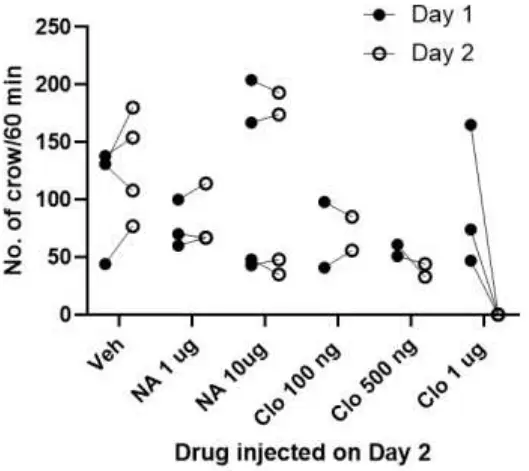
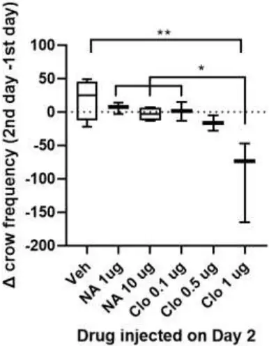
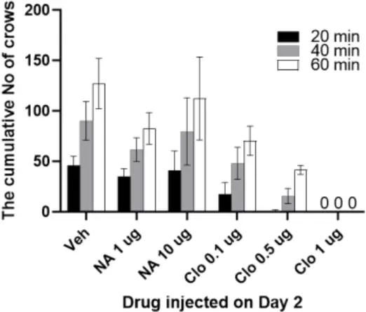
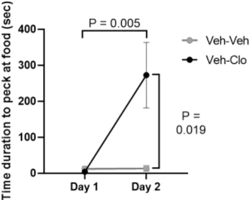
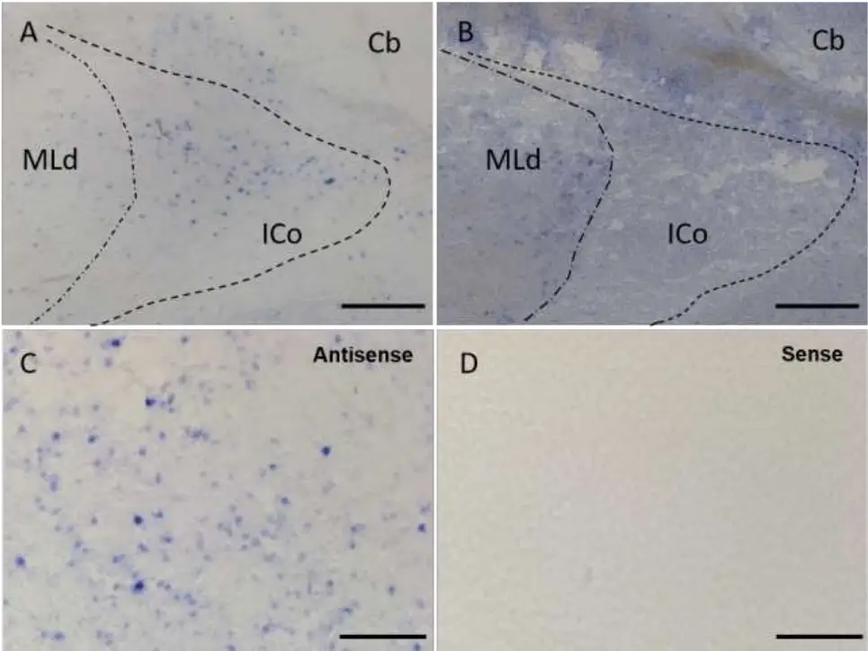
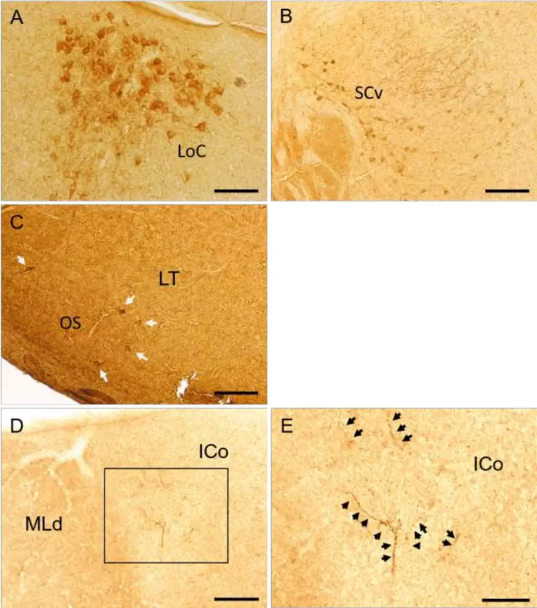
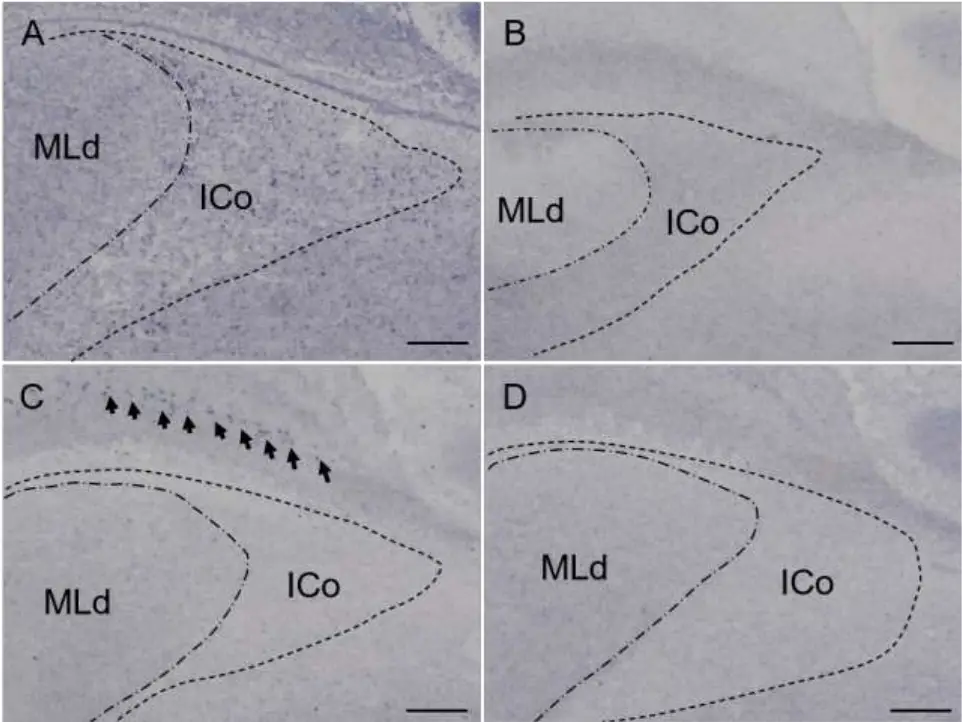

1

2

3

4

5

6

7

8

9

10

11

12

13

14

15

16

17

18

## Noradrenergic alpha-2A receptor activation suppresses courtship vocalization in male Japanese quail.

Yasuko Tobari a,b , Ami Masuzawa a , Norika Harada a , Kenta Suzuki c , Simone L. Meddle d a Department of Animal Science and Biotechnology, School of Veterinary Medicine, Azabu University, Fuchinobe 1-17-71, Chuo-ku, Sagamihara, Kanagawa 252-5201, Japan b Center for Human and Animal Symbiosis Science, Azabu University, Fuchinobe 1-17-71, Chuo-ku, Sagamihara, Kanagawa 252-5201, Japan c Faculty of Health Sciences, Nihon Institute of Medical Science, Iruma-gun, 350-0435, Japan d The Roslin Institute and R(D)SVS, The University of Edinburgh, Easter Bush, Midlothian, EH25 9RG, UK

- Correspondence to: Y. Tobari, Department of Animal Science and Biotechnology, School of Veterinary Medicine, Azabu University, Fuchinobe 1-17-71, Chuo-ku, Sagamihara, Kanagawa 252-5201, Japan E-mail: tobari@azabu-u.ac.jp

Declarations of interest: none

19

20

21

22

23

24

25

26

27

28

29

30

31

32

33

34

35

36

37

## ABSTRACT

Male Japanese quail produce high-frequency crow vocalizations to attract females during the breeding season. The nucleus of intercollicularis (ICo) is the midbrain vocal center in birds and electrical stimulation of the ICo produces calls that include crowing. Noradrenaline plays a significant role in sexual behavior but the contribution of noradrenaline in the control of courtship vocalizations in quail has not been well established. Using dose-dependent intracerebroventricular injection of clonidine, an α2-adrenergic receptorspecific agonist, crowing vocalization was immediately suppressed. At the same time as crow suppression by clonidine there was a reduction of immediate early gene, zenk mRNA, in the ICo; no zenk mRNA expression was detected in the dorsomedial division of the nucleus. Using histochemistry, we determined that the ICo receives noradrenergic innervation and expresses α2A-adrenergic receptor mRNA. Taken together, these data suggest that noradrenaline regulates courtship vocalization in quail, possibly via the alpha2Aadrenergic receptor expressed on ICo neurons.

Keywords; α2-adrenergic receptor, Bird, Courtship vocalization, Food intake, Immediate early gene, Norepinephrine, Nucleus intercollicularis

38

39

40

41

42

43

44

45

46

47

48

49

50

51

52

53

54

55

56

57

58

59

60

61

62

63

64

65

66

67

68

69

70

71

## 1. Introduction

Vocal behavior is commonly used by vertebrates for intraspecific communication. Vocalizations are emitted according to the behavioral context, and under some circumstances, vocalization abruptly stops in respond to a change in situation. Crowing vocalization is one of the most characteristic courtship behaviors exhibited by male Japanese quail (Coturnix japonica), and data from the field suggest that males crow primarily in the absence of females [1]. In captivity, crowing, which can reach 95 dB, consists of two to three syllables [2] and is performed by sexually mature, individually housed males that are at least 32 days old [3]. Playback experiments have shown that females, but not males, exhibit positive phonotaxis to crowing [2]. Crowing behavior is context dependent as when males are in the presence of a female, they instantly stop crowing and actively approach her for copulation [4-7] suggesting that crowing functions to attract females. The presence of a female tends to be sufficient to suppress male crowing in Japanese quail, but to date the neurochemical pathway involved in the suppression of crowing in the brain has not been identified.

The mesencephalic nucleus intercollicularis (ICo) is a crucial component of the vocal control system in birds including Galliforme species [8]. Electrical stimulation of the ICo alone produces a type of calling with some characteristic acoustic features of crowing [9-11]. Perturbation of the neural activity of the ICo results in disruption of ongoing crowing behavior in sexually mature male quail [12] and vocal activity is reduced or even eliminated following bilateral lesions of the ICo in the quail [13] and ring dove (Streptopelia risoria, [14]. Receptor binding experiments in quail show that there is a high density of α2-adrenergic receptors in the ICo [15, 16], but a low concentration of α1-adrenergic receptors [17]. Noradrenaline binds to the α2-adrenergic receptor, which is primarily postsynaptic in the ICo of quail [18]. The existence of sexual dimorphism in the α2-adrenergic receptor density in the quail ICo suggests that noradrenaline is a possible neurochemical factor underlying the sexually dimorphic vocal behavior. The effect of noradrenaline on call vocalizations has previously been investigated in the ring dove and chicken (Gallus gallus) where pharmacological treatments point to an inhibitory action of noradrenaline on calling behavior [19, 20].

In the current study, we tested the hypothesis that brain noradrenaline acts through α2-adrenergic receptors in the ICo to attenuate crowing in adult male quail in breeding condition. Male quail were injected centrally with noradrenaline, clonidine (α2-adrenergic receptor agonist), or vehicle, and the number of crowing vocalizations in a 1 h period immediately following the injections was quantified. We also tested the hypothesis that crowing suppression is an active inhibitory process within the ICo by quantifying immediate early gene (IEG) expression, which is used as a marker of neuronal activation [21]. The expression of zenk (an acronym of zif-268, egr-1, ngfI-a, and krox-24) IEG mRNA in the ICo of male quail centrally injected with clonidine or vehicle was quantified. Finally, to test the hypothesis that noradrenaline directly controls ICo neurons, noradrenergic innervation and expression of the α2-adrenergic receptor mRNA in the ICo of male quail was examined.

72

73

74

75

76

77

78

79

80

81

82

83

84

85

86

87

88

89

90

91

92

93

94

95

96

97

98

99

100

101

102

103

104

105

## 2. Materials and methods

## 2.1. Animals

Twenty-seven male Japanese quail (Coturnix japonica) were obtained from the breeding colony at Azabu University. The ages were over 63 days post haching. All birds were sexually mature, as demonstrated by an enlarged cloacal gland and weighed from 90 to 150 g. They were maintained on a long-day photoperiod (16L:8D light/dark cycle; lights on 06:00) and provided with food and water ad libitum. They were housed in one room in individual wire cages (30 × 40 × 24 cm. Each bird was given a colored leg band for identification and randomly assigned to experimental groups. All birds had visual and auditory contact with other birds of the same sex. All experiments were approved by the Ethics Committee for the Use of Animals of Azabu University, Japan and follow ARRIVE guidelines (https://arriveguidelines.org/arrive-guidelines).

## 2.2. Stereotaxic surgery

Birds were anesthetized with an intramuscular injection of a ketamine (12.5 mg/kg body weight) and xylazine (25 mg/kg) mixture, and once sedated, placed in a stereotaxic apparatus (Narishige, Tokyo, Japan). Intracerebroventricular (ICV) cannulation was performed according to a stereotaxic atlas of the Japanese quail brain [22]. A stainless steel cannula guide sleeve (11 mm, 26 gauge; Plastics One, Akron, OH, USA) was inserted into the third ventricle (3.0 mm anterior, 0 mm lateral from the Y-point, and 7.0 mm deep from the surface of the dura mater). The cannula was anchored to the skull with resin cement (RelyX Unicem 2 Clicker; 3M ESPE, St. Paul, MN, USA). The cannula was kept closed at all times by a dummy wire affixed to a threaded cap. Correct placement of the cannula was confirmed 1 day after surgery by infusing 1 μg of human angiotensin-II (Calbiochem, San Diego, CA, USA) dissolved in 0.9% NaCl. This peptide rapidly stimulates drinking behavior in birds when infused into the third ventricle [23]. Only birds that immediately responded to the angiotensin-II infusion by increasing their water intake were used in the experiment.

## 2.3 Infusion and behavioral analysis

Using a within-subjects design, the effects of noradrenaline and clonidine on crow vocalizations were quantified in 18 Japanese quail, with 1 day between the tests. As the frequency of voluntary crowing during isolation differed among the birds (Fig. 1) the differences in the number of crows emitted by the same individual between days 1 and 2 of the behavioral experiment were examined, to determine the effects of the drugs on crow vocalizations. Birds were randomly assigned to one of six groups that received a central injection of 0.9% NaCl (vehicle), 1 or 10 μg of noradrenaline (norepinephrine bitartrate salt; Sigma-Aldrich, St. Louis, MO, USA), or 100 ng, 500 ng or 1 μg of clonidine (clonidine hydrochloride, Sigma-Aldrich)

106

107

108

109

110

111

112

113

114

115

116

117

118

119

120

121

122

123

124

125

126

127

128

129

130

131

132

133

134

135

136

137

138

139

dissolved in vehicle. The birds were kept in an experimental cage (45 × 45 × 44.5 cm) in a soundproof box (MC-050T; Muromachi Kikai Co., Ltd., Tokyo, Japan) under 16L:8D (lights on 06:00) for at least 6 days before the start of the behavioral experiment. Food and water were provided to all birds ad libitum during the acclimation period and 60-min test periods. On day 1 of the experiment, the birds received infusions of the vehicle alone. The birds were gently held while a dummy wire was removed and the injector cannula, with the end of the tubing opposite to a Hamilton microsyringe, was inserted into the guide sleeve. Each bird was then returned to its experimental cage 1 min after the injection, and quail behavior was recorded by a Logicool HD Pro C920 webcam connected to a Windows PC via USB in addition to a Roland R26 portable recorder (Roland Corporation; 26-bits, sampling frequency: 44.1 kHz) during a 60-min period. On day 2 the birds received infusions of 1 μg of noradrenaline (n = 3), 10 μg of noradrenaline (n = 4), or 100 ng (n = 2), 500 ng (n = 2), or 1 μg of clonidine (n = 3) dissolved in vehicle or vehicle alone (n = 4) at the same time each bird received infusion of vehicle on day 1. After the injection, each bird was returned to its experimental cage. All solutions were injected over 10-20 s in a volume of 2 μl. All behavioral recordings were conducted between 09:00 and 12:00 to avoid any variability caused by diurnal rhythms in vocal behavior. The number of crow vocalizations was counted and the duration of food pecking was quantified. Three birds were selected from each of the vehicle and 1 μg clonidine groups for in situ hybridization and histological analyses based on their behavioral performance.

## 2.4. Immunohistochemistry

Three adult male quail in breeding condition were deeply anesthetized with mixed intramuscular injection of a ketamine (12.5 mg/kg body weight) and xylazine (25 mg/kg), and transcardially perfused with 0.01 M phosphate-buffered saline (PBS) followed by 4% paraformaldehyde. Brains were immediately dissected out of the skull and post-fixed in 4% paraformaldehyde in 0.1 M phosphate buffer, pH 7.4 for 1 day at 4 o C and then transferred into 30% sucrose in 0.1 M phosphate buffer, pH 7.4 solution and kept for 3 days at 4 o C. Brains were then embedded in Tissue-Tek optimal cutting temperature compound (Sakura Finetek, Tokyo, Japan), frozen on powdered dry ice and stored at -80°C until sectioning. Each brain was then sectioned in the frontal plane at 50 μm on a cryostat (Leica Microsystems, Wetzlar, Germany), and every sixth section through the brainstem from each animal was collected into 0.1M PBS. Free-floating sections were rinsed for 5 min in PBS and then incubated for 15 min in PBS containing 0.6% hydrogen peroxide to inhibit endogenous peroxide activity. Next, the sections were rinsed three times for 5 min with 0.3% Triton X-100 in PBS (PBST) and blocked with 5% normal sheep serum in PBST for 2 h at room temperature (RT). The sections were then incubated overnight with rabbit polyclonal antiserum against dopamine-beta-hydroxylase (DBH) purified from the bovine adrenal medulla (Product ID: 22806; ImmunoStar, Hudson, WI, USA) at a dilution of 1:2,000 in PBST and 4°C. DBH is a specific marker for noradrenergic neurons in the brain.

140

141

142

143

144

145

146

147

148

149

150

151

152

153

154

155

156

157

158

159

160

161

162

163

164

165

166

167

168

169

170

171

172

173

The specificity of the antiserum has been described previously [24]. After rinsing in PBST three times for 5 min, the sections were incubated in biotinylated goat anti-rabbit IgG (H+L) ((Product ID: BA-1000; Vector Laboratories, Burlingame, CA, USA) in PBST at a dilution of 1:1,000 for 2 h at RT. The sections were then washed with PBS three times for 5 min and incubated with avidin-biotin complex reagent at a dilution based on the manufacturer's recommendations (Vector Laboratories) for 30 min at RT. After washing in PBS three times for 5 min and rinsing with 0.1 M Tris-HCl buffer (pH 7.6), the sections were stained with 0.02% 3,3diaminobenzidine substrate solution (Dojindo Molecular Technologies, Kumamoto, Japan) for 5 min. After washing in PBS three times for 5 min, the sections were mounted on 3-aminopropyltriethoxysilane-coated slides (Matsunami Glass, Osaka, Japan) and dried overnight at RT. The slide-mounted sections were then dehydrated through a graded ethanol series and coverslipped with Entellan mountant (Merck, Darmstadt, Germany). All sections were viewed under a bright field microscope and images of sections were taken with a Keyence BZ-X710 microscope (Keyence Corp., Osaka, Japan).

## 2.5. In situ hybridization

The cDNA fragments [α2A-adrenergic receptor (GenBank Acc. No. AB820133), α2C-adrenergic receptor (GenBank Acc. No. AB820134), and zenk (GenBank Acc. No LC622525)] were isolated from the adult midbrain of two adult male Japanese quail in breeding condition by reverse transcription-polymerase chain reaction. The following primers were used: [5′-CAACGTCCTGGTCATCATTG-3′ and 5′- ATGACGAAGACCCCAATCAC-3′ for α2A-adrenergic receptor, 5′-CTCTGGTCATGCCTTTCTCC-3′ and 5′-TCCCGGCAAATACCATAGAG-3′ for α2C-adrenergic receptor; and 5′- AAAACCATGCCAGAAACCAG -3′ and 5′- GGCAGCAACAGAGGAAGAAG-3′ for zenk. Each cDNA fragment was inserted into the pCR II-T (Invitrogen, Carlsbad, CA, USA) or p-GEM-t easy vectors (Promega, Madison, WI, USA). The plasmids were digested with the XhoI, SpeI, or NcoI enzymes to release the fragment, and probes were synthesized using SP6 or T7 RNA polymerase (Roche Diagnostics, Rotkreuz, Switzerland) with a digoxigenin (DIG)-labeling mix (Roche Diagnostics). Sense probes corresponding to each antisense probe were also synthesized as controls. Four adult male quail in breeding condition were killed by rapid decapitation for analyses of α2Aand α2C-adrenergic receptor mRNA expression. Six quail (vehicle-injected quail, n = 3; clonidine-injected quail, n = 3) were immediately decapitated (within 5 min after the end of the behavioral test) to quantify zenk mRNA expression in the ICo. Each brain was carefully removed from the skull and embedded in Tissue-Tek optimum cutting temperature compound (Sakura Finetek), frozen on dry ice and stored at -80°C until analyses. Frozen brains were cut into 20-m coronal sections on a cryostat (Leica Microsystems). Every sixth section through the midbrain from each animal was mounted on 3-aminopropyltriethoxysilane-coated slides (Matsunami Glass) and stored at -80°C until use. The sections were post-fixed in 4%

174

175

176

177

178

179

180

181

182

183

184

185

186

187

188

189

190

191

192

193

194

195

196

197

198

199

200

201

202

203

204

205

paraformaldehyde for 10 min and washed in 0.1 M PBS (pH 7.4) three times for 5 min. The slides were then acetylated with 0.25% acetic anhydride in 0.1 M triethanolamine for 10 min and washed in PBS with 1% Triton X-100 (Sigma-Aldrich) for 30 min. The sections were then incubated at RT with hybridization buffer containing 50% formamide (Wako Pure Chemicals, Osaka, Japan), 5× saline sodium citrate, 1× Denhardt's solution (Sigma-Aldrich), 200 g/mL yeast tRNA (Roche Diagnostics), and 500 g/mL DNA (Roche Diagnostics). The sections were hybridized at 72°C overnight in a hybridization buffer with RNA probes. The sections were rinsed in 0.2× saline sodium citrate at 72°C for 2 h and then blocked for 2 h in a solution of 0.1 M Tris (pH 7.5, Pure Chemicals) and 0.15 M NaCl (Pure Chemicals) with 10% sheep serum. The slides were incubated overnight with a 1:5,000 dilution of alkaline phosphatase-conjugated anti-DIG antibody (Roche Diagnostics). After the slides had been washed in in a solution of 0.1 M Tris (pH 7.5) and 0.15 M NaCl with 0.1% Polysorbate 20 (Pure Chemicals) three times for 5 min, alkaline phosphatase activity was detected by incubation with 375 mg/mL nitroblue tetrazolium chloride (Roche Diagnostics) and 188 mg/mL 5-bromo-4-chloro-3-indolyl phosphate (Roche Diagnostics) in a solution of 0.1 M Tris (pH 9.5), 0.1 M NaCl, and 50 mM MgCl2 (Pure Chemicals) at RT overnight. This results in labeled cells expressing a purple-blue color. Brain sections incubated with control sense probes processed in the same way as detailed above showed no specific reactivity. Images of ICo sections were captured with a Keyence BZ-X710 microscope or a LeicaMC170 HD camera attached to a Leica DM500 microscope (Leica Microsystems).

## 2.6. Statistical analyses

Statistical analyses were conducted with Prism 8.0 software (GraphPad Software, La Jolla, CA, USA) or IBM SPSS Statistics v24 (IBM Corp., Armonk, NY, USA). Data were analyzed by a one-way analysis of variance (ANOVA) followed by Tukey's multiple comparison test or a repeated two-way ANOVA followed by Bonferrini's test. P values &lt; 0.05 were considered significant.

## 3. Results

## 3.1. Effects of noradrenaline and clonidine on crow vocalizations

ICV injection of noradrenaline had no effect on male crowing behavior at either dose during the 60-min test period compared to vehicle treated birds (Figs. 1 &amp; 2). In contrast, 0.5 µg of clonidine inhibited crow vocalizations 20 min after injection, and 1 µg of clonidine had the same effect for 60 min (Fig. 3). Clonidine decreased the frequency of crowing in a dose dependent manner (F(5,12) = 5.466, P = 0.0075 by one-way ANOVA, P = 0.0043 vs. vehicle, P = 0.047 vs. 100 ng of clonidine by Tukey's multiple comparison test; Fig. 2).

206

207

208

209

210

211

212

213

214

215

216

217

218

219

220

221

222

223

224

225

226

227

228

229

230

231

232

233

234

235

236

237

238

239

Measures of feeding behavior were analyzed via a two-way repeated measures ANOVA with group (clonidine/vehicle) and day (Day 1/Day 2) as factors and central administration of 1 μg of clonidine increased feeding behavior compared to vehicle administration. (Fig. 4). There was a main effect in the group factor (F(1, 5) = 10.10, P = 0.025) and in the day factor (F(1, 5) = 13.00, P = 0.015). In the interaction analysis between group and day factors, a significant interaction was found (F(1, 5) = 12.76, P = 0.016). A simple main effect test using the Bonferroni method revealed significant differences between the vehicle - injected birds on Day 1 and the clonidine-injected birds on Day 2 (within subject; P = 0.005) and between the vehicle and clonidine-injected on Day 2 (between subject; P = 0.019).

## 3.2. Zenk mRNA expression after ICV clonidine injection

Zenk mRNA expression was detected in the dorsomedial ICo of all the ICV-vehicle injected quail (Fig. 5A) but 1 µg ICV-clonidine completely abolished this expression (Fig. 5B). No signal above background was observed using the zenk sense control probes (Fig. 5C &amp; D).

## 3.3. Noradrenergic innervation of the dorsomedial ICo

We have previously used DBH immunostaining as a noradrenergic marker and described antiserum specificity [24]. The same immunostaining method was applied this study. DBH-immunoreactive cell bodies were observed in the locus coeruleus (LoC; Fig. 6A), nucleus subcoeruleus ventralis (SCv; Fig. 6B), and lateral tegmental field (LT; Fig. 6C), as well the DBH-immunoreactive fibers in the dorsomedial ICo (Fig. 6D), which possessed many varicosities (Fig. 6E).

## 3.4. Expression of α2-adrenergic receptor mRNA in ICo neurons

In situ hybridization identified α2-adrenergic receptor mRNA expression in the ICo of the Japanese quail. cDNAs from the midbrain were cloned for α2A- and α2C-, but not α2B-adrenergic receptor, and as templates to prepare in situ hybridization probes. Intense expression of α2A-adrenergic receptor mRNA was localized in the dorsomedial ICo (Fig. 7A). Signal for α2C-adrenergic receptor mRNA expression were found in the optic tectum, but not in the ICo (Fig. 7C). Controls, in which the sense RNA probes were substituted for the antisense RNA probes, showed no positive mRNA signal in any of the brain sections (Fig. 7B &amp; D).

## 4. Discussion

Centrally administered noradrenaline decreases plasma luteinizing hormone concentrations in adult male quail in breeding condition [23], which in turn possibly reduces blood testosterone concentrations. Crowing in quail is androgen-dependent [25], and we expected to observe an inhibitory effect of noradrenaline on crowing via activation of the hypothalamus-pituitary-gonad axis as well as a direct effect on the α2-

240

241

242

243

244

245

246

247

248

249

250

251

252

253

254

255

256

257

258

259

260

261

262

263

264

265

266

267

268

269

270

271

adrenergic receptors expressing in the ICo but those were not observed. Our results demonstrate for the first time that ICV-administered clonidine, but not noradrenaline, powerfully suppressed crowing in male adult quail in a dose-dependent manner. This finding may be explained by the fact that clonidine diffuses into the ventricles and binds to α2-adrenergic receptors, more potently than noradrenaline. Clonidine has sedative effects, which is mediated by activation of central α2-adrenergic receptors but central administration of clonidine does not reduce all behavioral activity. In the present study, ICV injection of clonidine stimulated feeding behavior of adult male quail and this effect was similar to previous studies conducted using broiler and layer-type chick [26, 27]. An α2-adrenergic receptor antagonist, yohimbine attenuated the clonidine induced food intake [27], indicating that α2-adrenergic receptors are related to the stimulation of feeding in chick. Since stimulation of food intake caused by neuropeptide Y and beta-endorphin was attenuated by co-injection with yohimbine, the receptors also likely mediate the orexigenic effects of neuropeptide Y- and beta-endorphin in layer-type chicks [27]. These suggest that NPYor endorphin-producing neurons form neural circuits that control food intake with noradrenergic neurons acting on α2-adrenergic receptors in the Galliformes species. Activation of neurohormone and neurotransmitter receptors initiate an intracellular signaling cascade that leads to changes in genes transcription. The IEGs are critical signaling intermediates within this cascade and modulate neuronal activities by controlling gene transcription, via the binding of their protein forms to regulatory sites on DNA [21, 28]. Noradrenaline has a documented role in the regulation of IEG expression as lesioning noradrenergic fibers with the noradrenergic neurotoxin N-(2-chloroethyl)-N-ethyl-2bromobenzylamine results in changes in telencephalic and hypothalamic zenk expression in adult birds [29, 30]. The present study demonstrated that zenk mRNA was expressed in the dorsomedial region of the ICo in vehicle-injected males after they emitted crows. In comparison, male crowing was abolished by ICVadministered clonidine and this resulted in reduced zenk mRNA expression in the dorsomedial ICo. The neuronal expression of zenk mRNA in male quail, which emitted high-frequency crows, and their reduction by clonidine, suggests a link between the zenk gene in ICo neurons and the regulation of crowing. The reduction of zenk mRNA expression by clonidine may reflect a direct inhibitory action of clonidine on the dorsomedial ICo neurons through α2-adrenergic receptors to cause complete loss of crowing. To investigate whether noradrenaline directly controls the midbrain vocal nucleus of ICo, the noradrenaline neuronal marker DBH was immunohistologically stained in the male quail brain. DBHimmunoreactive cell bodies were localized in the LoC, SCv, and LT, and DBH-immunoreactive fibers, were localized in the dorsomedial part of the ICo of male quail. A tract-tracing study in pigeons [31] showed that the ICo receives projections from LoC and SCv neurons. Together these findings suggest that ICo

272

273

274

275

276

277

278

279

280

281

282

283

284

285

286

287

288

289

290

291

292

293

294

295

296

297

298

299

300

301

302

303

neurons receive noradrenergic innervation, mainly from the LoC and SCv. Only α2A-adrenergic receptor mRNA was expressed in the dorsomedial region of the ICo and α2C-adrenergic receptor mRNA was expressed in the optic tectum, which is part of the midbrain visual system. These histochemical results support a direct inhibitory effect of noradrenaline on ICo neurons through the α2A-adrenergic receptor. Noradrenaline is thought to play an important role in the behavioral regulation of potential mate cues such as arousal, attention, and goal-directed approach responses [29, 32, 33]. Male quail crow frequently during the breeding season as crowing elicits phonotaxis in female quail [2] but crowing is suppressed in the presences of a female. When male quail view a female there is increased extracellular noradrenaline release in the brain [23]. Therefore, it may be hypothesized that the presence of the female rapidly increases extracellular noradrenaline release in the brain, which acts on ICo neurons via the α2A-adrenergic receptor to inhibit ICo neuronal activity and suppress crowing. However, further research is required to test this hypothesis.

## 5. Conclusion

Together these data suggest that the α2-adrenergic system in the midbrain vocal center suppresses courtship vocalizations in male quail as centrally administered clonidine suppressed male crowing in a dose-dependent manner and diminished zenk mRNA expression in the dorsomedial ICo. We conclude that noradrenaline is likely to be a major factor in the regulation of bird vocalizations as the ICo receives noradrenergic innervation and express α2A-adrenergic receptor mRNA.

## Funding

The present study was supported by Grants-in-Aid for Scientific Research from the Japan Society for the Promotion of Science (KAKENHI, JP16K18585) and Ministry of Education, Culture, Sports, Science and Technology-Supported Program for the Private University Research Branding Project to Y. Tobari. S. L. Meddle acknowledges Roslin Institute Strategic grant funding from the Biotechnology and Biological Sciences Research Council (BBSRC), UK (BB/P013759/1) and a BBSRC Japan Partnering Award (BB/M027805/1).

## CRediT authorship contribution statement

Yasuko Tobari: Conceptualization, Formal analysis, Validation, Writing-original draft, Visualization, Project administration, Funding acquisition. Ami Masuzawa: Formal analysis, Investigation, Visualization. Validation.Norika Harada: Investigation, Visualization. Kenta Suzuki: Formal analysis. Simone L

304

305

306

307

308

309

310

311

312

313

314

315

316

317

318

319

320

321

322

323

324

325

326

327

328

329

330

331

332

333

334

335

336

337

Meddle: Writing-original draft, Funding acquisition.

## Declaration of Competing Interest

The authors declare no conflicts of interest.

## Acknowledgements:

We thank Mr. Yukinori Ebihara and Ms. Chie Ohya for their technical assistance.

## References

- [1] R.E. Moreau, The British status of the quail and some problems of its biology. , Br. Birds 44 (1951) 257-276.
- [2] J.L. Goodson, E. Adkins-Regan, Playback of crows of male Japanese quail elicits female phonotaxis., Condor 99 (1997) 990-993.
- [3] S. Deregnaucourt, S. Saar, M. Gahr, Dynamics of crowing development in the domestic Japanese quail (Coturnix coturnix japonica), Proc Biol Sci 276(1665) (2009) 2153-62.

  10.1098/rspb.2009.0016.

- [4] M. Domjan, S. Nash, Stimulus control of social behaviour in male Japanese quail, Coturnix coturnix japonica, Anim. Behav. 36 (1988) 1006-1015.
- [5] S.L. Meddle, V.M. King, B.K. Follett, J.C. Wingfield, M. Ramenofsky, A. Foidart, J. Balthazart, Copulation activates Fos-like immunoreactivity in the male quail forebrain, Behav.

Brain Res. 85(2) (1997) 143-59.

- [6] T.D. Charlier, G.F. Ball, J. Balthazart, Sexual behavior activates the expression of the immediate early genes c-fos and Zenk (egr-1) in catecholaminergic neurons of male Japanese quail,

Neuroscience 131(1) (2005) 13-30. 10.1016/j.neuroscience.2004.09.068.

- [7] Y. Tobari, Y. Sato, K. Okanoya, Hormonal responses to a potential mate in male birds., Adv. Exp. Med. Biol. 1001 (2017) 137-149.
- [8] J.M. Wild, D. Li, C. Eagleton, Projections of the dorsomedial nucleus of the intercollicular complex (DM) in relation to respiratory-vocal nuclei in the brainstem of pigeon (Columba livia) and zebra finch (Taeniopygia guttata), J. Comp. Neurol. 377(3) (1997) 392-413.

[9] Y. Yazaki, T. Matsushima, K. Aoki, Testosterone modulates stimulation-induced calling

behavior in Japanese quails, J Comp Physiol A 184 (1997) 13-19.

- [10] L.M. Potash, Vocalizations Elicited by Electrical Brain Stimulation in Coturnix coturnix japonica, Behaviour 36(3) (1970) 149-167.
- [11] S.E. Armitage, T.J. Seller, Midbrain regions involved in call production of Japanese quail,

338

339

340

341

342

343

344

345

346

347

348

349

350

351

352

353

354

355

356

357

358

359

360

361

362

363

364

365

366

367

368

369

370

371

Experientia 37(8) (1981) 847-848. 10.1007/BF01985673.

- [12] B. Shaw, Involvement of a midbrain vocal nucleus in the production of both the acoustic and postural components of crowing behavior in Japanese quail, J Comp Physiol A 186(7-8) (2000) 747-757.
- [13] T.J. Seller, Midbrain vocalization centres in birds Trends Neurosci. 4 (1981) 301-303. doi:10.1016/0166-2236(81)90094-1
- [14] J. Cohen, M.-F. Cheng, The role of the midbrain in courtship behavior of the female ring dove (Streptopelia risoria): Evidence from radiofrequency lesion and hormone implant studies, Brain Research 207(2) (1981) 279-301. https://doi.org/10.1016/0006-8993(81)90365-6.
- [15] G.F. Ball, A. Foidart, J. Balthazart, A dorsomedial subdivision within the nucleus intercollicularis identified in the Japanese quail (Coturnix coturnix japonica) by means of alpha 2adrenergic receptor autoradiography and estrogen receptor immunohistochemistry, Cell Tissue Res. 257(1) (1989) 123-8.
- [16] G.F. Ball, B. Nock, B.S. McEwen, J. Balthazart, Distribution of a2-adrenergic receptors in the brain of the Japanese quail as determined by quantitative autoradiography: implications for the control of sexually dimorphic reproductive processes, Brain Res. 491(1) (1989) 68-79.
- [17] J. Balthazart, G.F. Ball, B.S. McEwen, An autoradiographic study of alpha 1-adrenergic receptors in the brain of the Japanese quail (Coturnix coturnix japonica), Cell and Tissue Research 258(3) (1989) 563-8.
- [18] J. Balthazart, G.F. Ball, Effects of the noradrenergic neurotoxin DSP-4 on luteinizing hormone levels, catecholamine concentrations, α2-adrenergic receptor binding, and aromatase activity in the brain of the Japanese quail., Brain Res. 492(1-2) (1989) 163-75.
- [19] John Rossi III, Tony L. Sahley, J. Panksepp, The role of brain norepinephrine in clonidine suppression of isolation-induced distress in the domestic chick., Psychopharmacology 79 (1983) 338 - 342.
- [20] S.R. Barclay, M.F. Cheng, Role of catecholamines in the courship behavior of male ring doves., Pharmacol. Biochem. Behav. 41(4) (1992) 739-747. 10.1016/0091-3057(92)90221-z.
- [21] D.F. Clayton, The Genomic Action Potential, Neurobiol. Learn. Mem. 74(3) (2000) 185-216. https://doi.org/10.1006/nlme.2000.3967.
- [22] J.D. Bayle, F. Ramade, J. Oliver, Stereotaxic topography of the brain of the quail (Coturnix coturnix japonica), J Physiol (Paris) 68(2) (1974) 219-41.
- [23] Y. Tobari, Y.L. Son, T. Ubuka, Y. Hasegawa, K. Tsutsui, A new pathway mediating social effects on the endocrine system: female presence acting via norepinephrine release stimulates gonadotropin-inhibitory hormone in the paraventricular nucleus and suppresses luteinizing hormone

372

373

374

375

376

377

378

379

380

381

382

383

384

385

386

387

388

389

390

391

392

393

394

395

396

397

398

399

400

401

402

403

404

in quail, J Neurosci. 34(29) (2014) 9803-11. 10.1523/JNEUROSCI.3706-13.2014.

[24] Y. Tobari, N. Kansaku, K. Tsutsui, Noradrenergic modulation of gonadotrophin-inhibitory

hormone gene expression in the brain of Japanese quail, J. Neuroendocrinol. 29(8) (2017)

10.1111/jne.12503.

- [25] L. Beani, C. Lupo, F. Dessi-Fulgheri, F. Brigant, G. Campanella, Effect of androgens on structure and rate of crowing in the Japanese quail (Coturnix japonica), Behaviour 137(4) (2000) 417-435. https://doi.org/10.1163/156853900502150.
- [26] T. Bungo, M. Shimojo, Y. Masuda, Y.H. Choi, D.M. Denbow, M. Furuse, Induction of food intake by a noradrenergic system using clonidine and fusaric acid in the neonatal chick, Brain Res. 826(2) (1999) 313-6.

[27] T. Tachibana, K. Sugahara, H. Ueda, M.A. Cline, Role of adrenergic alpha-2-receptors on

feeding behavior in layer-type chicks, Gen Comp Endocrinol 161(3) (2009) 407-11.

10.1016/j.ygcen.2009.02.006.

- [28] W. Tischmeyer, R. Grimm, Activation of immediate early genes and memory formation, Cell. Mol. Life Sci. 55 (1999) 564- 574.

[29] L.V. Riters, B.A. Pawlisch, Evidence that norepinephrine influences responses to male

courtship song and activity within song control regions and the ventromedial nucleus of the

hypothalamus in female European starlings, Brain Res. 1149 (2007) 127-40.

10.1016/j.brainres.2007.02.059.

[30] T.A. Velho, K. Lu, S. Ribeiro, R. Pinaud, D. Vicario, C.V. Mello, Noradrenergic control of

gene expression and long-term neuronal adaptation evoked by learned vocalizations in songbirds,

PLoS One 7(5) (2012) e36276. 10.1371/journal.pone.0036276.

- [31] C.A. Kitt, S.E. Brauth, Telencephalic projections from midbrain and isthmal cell groups in the pigeon. I. Locus coeruleus and subcoeruleus, J. Comp. Neurol. 247 (1986) 69-91.
- [32] G. Aston-Jones, J. Rajkowski, J. Cohen, Locus coeruleus and regulation of behavioral flexibility and attention, Prog. Brain Res. 126 (2000) 165-82. 10.1016/s0079-6123(00)26013-5.
- [33] C.W. Berridge, B.D. Waterhouse, The locus coeruleus-noradrenergic system: modulation of behavioral state and state-dependent cognitive processes, Brain Res. Rev. 42(1) (2003) 33-84. 10.1016/s0165-0173(03)00143-7.

## Figures &amp; Figure Legends 405

406

407

408

409

410

411

412

413

## Figure 1.

Frequency of male crowing during a 60-min test period after intracerebroventricular (ICV) injection of vehicle (Veh), noradrenaline (NA), or clonidine (Clo). Closed circles indicate the number of crow vocalizations performed by quail receiving an ICV injection of vehicle alone on day 1. Open circles indicate the number of crow vocalizations performed by quail receiving an ICV injection of vehicle, noradrenaline, or clonidine on day 2. Values for the same individual are connected by lines.

414

415

416

417

418

419

420

## Figure 2.

Effects of clonidine on the frequency of crowing. Clonidine-injected quail decreased the number of crows on day 2 in a dose-dependent manner compared with the control on day 1. Box plots show the median (line) and 75 th and 25th percentiles (box) with the 95% confidence interval (error bars). NA, noradrenaline; Clo, clonidine; Veh, vehicle. \* P &lt; 0.05, \*\* P &lt; 0.01.

421

422

423

424

425

426

427

## Figure 3.

Cumulative number of crows over a 1 h-period after an intracerebroventricular (ICV) injection of vehicle, noradrenaline or clonidine in male quail. Values are means ± SEM. NA, noradrenaline; Clo, clonidine; Veh, vehicle.

428

429

430

431

432

433

434

## Figure 4.

Effect of clonidine on feeding behavior. Duration of pecking of food by quail that received an intracerebroventricular (ICV) injection of either vehicle (gray circles) or clonidine (black circles) on days 1 and 2. Values are means ± SEM and for the same group are connected by lines. NA, noradrenaline; Clo, clonidine.

435

436

437

438

439

440

441

442

## Figure 5.

Effect of clonidine on zenk mRNA expression in the midbrain vocal center. Representative photomicrographs depicting the effect of vehicle (A) and clonidine (B) on zenk mRNA expression. Hybridization with sense zenk probes served as a negative control for antisense probe specificity in vehicle ICV injected birds (C, D). Scale bars = 500 μm (A &amp; B), 200 μm (C &amp; D). Cb, cerebellum; ICo, nucleus intercollicularis; MLd, nucleus mesencephalicus lateralis pars dorsalis.

443

444

445

446

447

448

449

450

## Figure 6.

Photomicrographs of dopamine beta hydroxylase (DBH)-immunoreactive (ir) cells and fibers. DBH-ir cells in the locus coeruleus (LoC, A), nucleus subcoeruleus ventralis (SCv, B), and lateral tegmental field (LT, C). Low-power photomicrograph of the DBH-ir fibers in the nucleus intercollicularis (ICo, D). Higher magnification photomicrograph of the DBH-ir fibers in the dorsomedial ICo (E). Scale bars = 100 μm (A &amp; D), 200 μm (B &amp; C) and 500 μm (E).

451

452

453

454

455

456

457

Figure 7.

α2A and α2C-adrenergic receptor mRNA expression in the midbrain. Representative α2A- and α2Cadrenergic receptor mRNA expression by in situ hybridization (A, C). Hybridization with sense α2A- and α2C-adrenergic receptor probes served as a negative control for antisense probe specificity (B, D). Scale bars = 500 μm.
