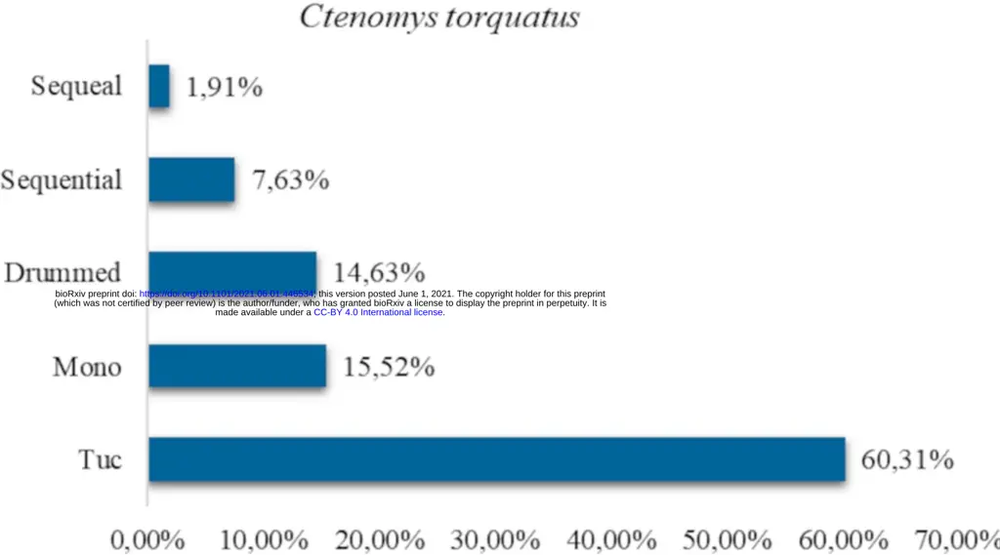
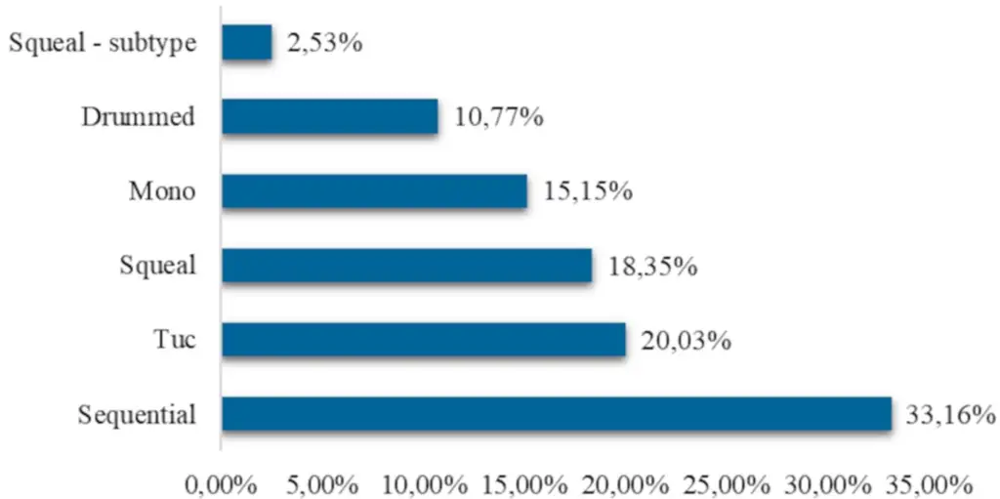
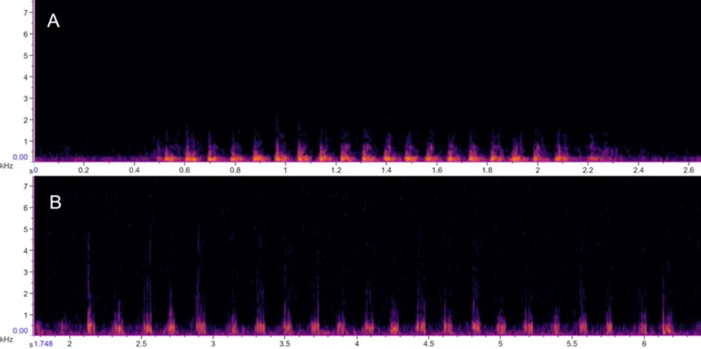
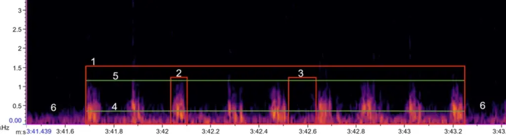

| 1        | Description of the sound diversity of two species of tuco-                                                                         |
| -------- | ---------------------------------------------------------------------------------------------------------------------------------- |
| 2        | tucos (Ctenomys torquatus and Ctenomys lami) in natural                                                                            |
| 3        | environment                                                                                                                        |
| 4        |                                                                                                                                    |
| 5        | Keila C. Zaché¹\*; Lucas Machado Silveira²; Gabriel Francescoli³; Thales Renato Ochotorena                                         |
| 6        | de Freitas²                                                                                                                        |
| 7        |                                                                                                                                    |
| 8 9 10   | ¹ Programa de Pós-Graduação em Ecologia e Evolução, Universidade do Estado do Rio de Janeiro, Rio de Janeiro, RJ, Brazil.          |
| 11 12 13 | ² Programa de Pós-Graduação em Genética e Biologia Molecular, Universidade Federal do Rio Grande do Sul, Porto Alegre, RS, Brazil. |
| 14 15    | ³ Sección Etología, Facultad de Ciencias, Universidad de la República, Montevideo, Uruguay.                                        |
| 16       | \*keilazache@gmail.com                                                                                                             |
| 17       |                                                                                                                                    |
| 18       | Author Contributions                                                                                                               |
| 19       | Conceptualization: Keila C. Zaché, Lucas Machado Silveira, Gabriel Francescoli, Thales                                             |
| 20       | Renato Ochotorena de Freitas                                                                                                       |
| 21       | Data Curation: Keila C. Zaché                                                                                                      |
| 22       | Formal Analysis: Keila C. Zaché                                                                                                    |
| 23       | Investigation: Keila C. Zaché, Lucas Machado Silveira                                                                              |
| 24       | Methodology: Keila C. Zaché                                                                                                        |
| 25       | Writing - Original Draft Preparation: Keila C. Zaché                                                                               |
| 26 27    | Writing - Review & Editing: Keila C. Zaché, Lucas Machado Silveira, Gabriel Francescoli, Thales Renato Ochotorena de Freitas       |

## 28 Abstract

29 Sound signals can travel through long distances, becoming an important communication 30 channel between animals that need to establish contact beyond the visual form. They can then 31 be considered a relevant form of communication between species living in the underground 32 environment. Ctenomys torquatus and Ctenomys lami are solitary subterranean rodents, thus 33 demanding an improvement of the communicative channels, especially in territorial defense 34 actions and meeting potential reproductive partners. This work was aimed to describe the 35 variability of acoustic signals emitted by C. torquatus and C. lami by analyzing the physical36 morphological characteristics of the signals. The study was carried out in two populations, one 37 of each species and was selected 14 individuals of C. torquatus and 15 C. lami. The acoustic 38 signals were recorded in a natural environment, obtaining the sounds straight from the animal 39 tunnels. A total of 1,380 signals were captured and analyzed, 786 from C. torquatus and 594 40 from C. lami. It was possible to characterize 5 different types of signals, emitted by both species. 41 Most of the analyzed sequences presented low frequency, and many of these calls exhibited 42 characteristics of long-range signals. It was verified a sharing of sound signals in both species, 43 as regarding the acoustic parameters as the morphology of the analyzed spectrograms. For the 44 first time, it was possible to have access to sound data emitted by direct subterranean rodents 45 from their tunnels in the natural environment.

46

## 47 Introduction

48

In order to exchange information, animals use different types of communication 49 channels, such as chemical, visual, tactile and auditory signals [1]. According to Freeberg et al. 50 [2] a greater communicative complexity is required of individuals living in more socially 51 complex groups because the diversity of social systems correlates with the number of

52 individuals who relate to each other, the frequency within which interactions occur, the social 53 role of the individuals and the variability in the types of interactions. In heterogeneous 54 communication systems, it is expected to happen a structuring of the acoustic elements, with a 55 functional acting and a high amount of information [2].

56

Because of its plasticity, acoustic communication is considered very efficient [3], 57 allowing in most vertebrates the composition of a sound signal that presents a wide variety of 58 time, intensity and frequency variables, and this diversity may be related to multiple conditions 59 [1]. A signal emitted by an animal may contain information about its social status, motivational 60 status, and also the identity of the emitters, it may change according to behavioral contexts and 61 environmental situations [1,4-7].

62

Subterranean rodents are naturally distributed on all continents, with the except for 63 Australia and Antarctica, and they represent a unique group among mammals because they 64 show different attributes due to their habitat [8,9]. The biotope where subterranean rodents are 65 inserted is composed of a structure that is generally sealed, with a small diameter, much 66 improved, and has a constant microclimate [9,10]. Over time, these characteristics may have 67 acted in the development of the sensory systems of these animals [8,10,11]. In South America, 68 there are two families of fossorial caviomorph rodents represented by Octodontidae and 69 Ctenomyidae [9,12] .

70 From the Ctenomyidae family, the species of the genus Ctenomys went through a 71 process of fast speciation during the Pleistocene [13] showing high variability at the genetic 72 level, expressing a wide degree in the speciation process [12,13]. They occupy a diversity of 73 habitats, from drier fields to forest areas [9]. Most species have a solitary way of life, are 74 typically territorial, structured in small semi-isolated populations with fragmented distribution, 75 and low adult vagility [9,12-16].

76

There is wide use of the plurality of communication channels in these animals. Chemical 77 and tactile signals are closely linked to the construction, use, and marking of burrows [17,18]. 78 Acoustic signals have a fundamental role in inter-individual communication by emitting short 79 or long-range signals, divided into vocal and non-vocal emissions [19,20]. Among the non80 vocal signals are tooth beats and vibrational emissions [17,21]. Studies describe the presence 81 of seismic communications in some subterranean rodents [22], but these emissions have not yet 82 been reported in Ctenomys.

83

Vocal signals may be able to travel long distances and be compatible with underground 84 life because they are required communicative peculiarities in this environment [23,24] since 85 most subterranean animals perform a great part of their vital activities within tunnels [9,16]. 86 One of the functions of long-range signals is the expression of territoriality, communicating the 87 presence of the individual who owns a particular territory [19,20,25]. This type of signal could 88 also act as a regulator of clashes between individuals and be significant in finding potential 89 mates for reproduction [26].

90

About 69 species are described for the genus Ctenomys [27,28], and little is known about 91 the acoustic repertoire of these species. Most sound data were obtained from laboratory work 92 [19,20,25,29,30], and the scarce free-living data are from signals that can be heard and recorded 93 outside their burrows [17,26,31]. There are no studies in the literature on captured vocalizations 94 within the burrows of these animals in a natural environment.

95

Ctenomys' vocalizations were studied in detail in only three species, the talas tuco: 96 Ctenomys talarum [20,29], the Pearson's tuco-tuco: Ctenomys pearsoni [19,26,30,31] and 97 Anillaco tuco-tuco: Ctenomys sp [25,32]. In addition, Francescoli &amp; Quirici [33] showed two 98 possible vocal patterns that could be shared with other species of Ctenomys.

99

The species Ctenomys torquatus Lichtenstein 1830 is widely distributed, inhabiting the 100 Pampa region, from the central region of Rio Grande do Sul to northern Uruguay [34] and the

101 species Ctenomys lami Freitas 2001 is endemic to the state of Rio Grande do Sul, Brazil, 102 occurring in a narrow range of fields in the region known as Coxilha das Lombas [35].

103

C. torquatus and C. lami, the two species focused on this study, live in regions that have 104 suffered the effects of anthropization, transforming their areas of life into large extensions of 105 reforestation, highways, and for C. torquatus, its geographic distribution in Brazil coincides 106 with the activities of coal mining [36]. It is known that propagation of sound may suffer 107 interference from anthropogenic noises, environmental temperature, humidity, and types of 108 vegetation, therefore, the transfer of acoustic signals between individuals of these species may 109 require modifications or even be compromised [1].

110

This work aimed to describe the variability of the main vocal signals emitted in wildlife 111 by C. torquatus and C. lami, belonging to the same monophyletic group, torquatus [37], 112 investigating the physical-morphological characteristics of these emissions. The vocal signals 113 of C. lami have never been reported before, and C. torquatus was only superficially cited in a 114 comparative work with other Ctenomys species [33]. Investigating the variability of the signals 115 used by these animals would allow future comparison with the acoustic signals described for 116 other Ctenomys species. Besides detailing the main sound attributes used by these two species, 117 which would help studies on possible sound impacts caused by exposure and overlap of noises 118 from anthropogenic activities, since sound signals are fundamental for the development and 119 maintenance of these species.

120

## 121 Methods

## 122 Study field

123

The study was conducted in two populations, one of each species, located in different 124 areas in the state of Rio Grande do Sul, Brazil. For the species C. torquatus the selected 125 population was located in an area bordering the Ecological Station of Taim (32° 32'19.4 "S 52°

126 32'19.5" W), near the city of Rio Grande - RS - Brazil. For C. lami, the studied population was 127 the one located inside the Biological Reserve José Lutzenberger Lami (30° 14'09.5 "S 51° 128 05'45.3"W), situated in Porto Alegre - RS - Brazil.

129

The sampling period was ten days for each species. C. torquatus was sampled in June 130 of 2017 (late autumn) and C. lami in October and December of 2017 (mid-spring).

## 131 Burrows Selection

132

The burrows selected were the ones that presented recent activities. Recognition of 133 recent activity occurs through the visualization of fresh sand mounds that are pushed out of the 134 burrows during cleaning and foraging activities [9,37,38]. A minimum spacing of 15 meters 135 was maintained between the selected burrows, considering the direction of the burrow tunnel 136 gallery, to avoid capturing the same animal. After choosing the burrows, the trapping process 137 was carried out.

## 138 Trapping and capture process

139

The purpose of the use of traps was to capture the animals for weighing and sex 140 identification. The capture technique consisted of using Oneida-Victor tramp traps, number 141 zero, denveloped by rubberized material to avoid injuring the captured animal. These traps were 142 introduced into the burrows and signaled with numbered flags, being reviewed every ten 143 minutes. The traps remained in the selected burrows until the animals were captured or for a 144 maximum of 40 minutes.

145

The project was licensed by SISBIO / ICMBIO, number 58477, and was approved by 146 the Animal Ethics Committee of the Federal University of Rio Grande do Sul, number 33289, 147 to conduct the research.

## 148 Identification and selection of animals

149

After capture, the individuals were weighed and visually sexed [37,39-42], after 150 performing these procedures, the animals were returned to the burrow from where they were 151 captured. When the animal was not captured, but the burrow got closed, indicating that there 152 was at least one individual inside the tunnel gallery, this individual was considered as 153 unidentified. All animals had the position of their burrows registered using a GPS (Garmin 154 Vista®).

155

Twenty-four C. torquatus individuals were selected: 3 males, 8 females, and 13 156 unidentified. Of these 24, it was possible to obtain vocalization from 14: 6 females, 2 males, 157 and 6 unidentified. In C. lami 15 animals were selected, 3 females, 1 pup, which was not able 158 to identify the sex, and 11 unidentified individuals. It was possible to obtain sound signals from 159 all individuals.

## 160 Data collection

161

The recordings were made with the aid of a Rode NTG-2 microphone connected to a

170

162 Tascam DR-40 Digital Sound Recorder. To protect the microphone from possible damage 163 caused by the animals, it was developed with the Mechanics Sector of the Institute of Physics 164 of the Federal University of Rio Grande do Sul. This cylindrical apparatus that worked as a 165 microphone protective capsule. A test was performed to verify if the cylindrical apparatus could 166 modify the reception of the signals. For this test recordings were made within a burrow using 167 both the microphone by itself and the microphone coupled with the cylindrical apparatus for 168 subsequent comparison of the captured sounds. No significant change in signal reception was 169 found, according to the sound frequencies captured. The insertion of the microphone into the burrows occurred first with the removal of the 171 sand deposited by the animal at its entrance, then was located in the main tunnel where the 172 microphone was positioned. A minimum period of 24 hours was considered when the animals

173 were captured and returned to their burrows so that the individuals could acclimate before the 174 recording began.

175

A sampling effort of 65 hours of sound data collection for both species was made. For 176 C. torquatus, 39 hours were recorded, and for C. lami were 26 hours. The individual recording 177 time was at least 40 minutes.

## 178 Sonographic analysis

179

The sonographic analysis was performed using Raven Pro software version 1.5 [43]. 180 The spectrographic configurations were set up prioritizing the resolution and the easy detection 181 of vocalizations, as follows: Window: Hann, 312 samples, 3 dB bandwidth-filter: 203 Hz; Time 182 grid: overlap: 50% , hop size: 156 samples; Frequency grid: DFT size: 512 samples, grid 183 spacing: 86.1 Hz.

184

The terminologies adopted in this paper to describe and identify the sound signals were 185 note and phrase [44]. The note is a single sound unit with no interval, although the set of notes 186 with silent intervals between them was called phrase (Fig 1). The acoustic parameters analyzed 187 were: phrase size or note size, number of notes in the signal, dominant frequency, maximum 188 frequency, and energy in the established sound sequences.

189 Fig 1. Spectrogram and acoustic parameters of a C. lami vocalization. The acoustic 190 parameters are represented in red rectangles for (1) a sequential type phrase, (2) a note of 191 sequential phrase and (3) the space between the notes. The green lines are (4) dominant 192 frequency and (5) maximum frequency, on the outside of the marking is (6) background noise.

193

Phrases were manually selected according to the time and frequency limits arranged on 194 the acoustic signals. The phrase length is the duration in seconds of the signal selection. The 195 number of notes was counted visually and manually. The maximum frequency value coincides 196 with the limit value of the phrase on the frequency axis. However, dominant frequency values

197 and energy values were automatically generated according to specific formulas based on the 198 average magnitude within the selected spectrum [45] (Fig 1).

199

## 200 Results

201

From an auditory and visual investigation, it was possible to identify five different types 202 of signals in C. torquatus and C. lami: mono, drummed, tuc, sequential and squeal (Fig 2), and 203 a new nomenclature was made for the signals that not yet had been identified due to the absence 204 of sound data for the species studied. A total of 1,380 signals were recorded and analyzed, 786 205 for C. torquatus, and 594 for C. lami. In C. torquatus the vocalizations were emitted by females, 206 males, and unidentified individuals (Table 1), while in C. lami, the signals were emitted by 207 females and unidentified individuals (Table 2). For all detected signals were measured the mean, 208 standard deviation, and range (minimum and maximum values) of all acoustic parameters 209 analyzed (Table 3).

210 Fig 2. Signal types found in C. torquatus and C. lami populations. Percentage values of 211 signals emitted by species, related from the least frequent to the most frequent signal.

212 Table 1. Total signals emitted by C. torquatus according to the sex of the individuals.

213

214

215

216

217

218

219

220

| Signal | Female | Male | Unidentified |
| ------ | ------ | ---- | ------------ |
| 42     | 14     | 66   | Mono         |
| 51     | 4      | 60   | Drummed      |
| 169    | 57     | 248  | Tuc          |
| 51     | 4      | 5    | Sequential   |
| 6      | 1      | 8    | Squeal       |

## 221 Table 2. Total signals emitted by C. lami according to the sex of the individuals.

| Signal | Female | Unidentified     |
| ------ | ------ | ---------------- |
| 19     | 71     | Mono             |
| 16     | 48     | Drummed          |
| 43     | 76     | Tuc              |
| 62     | 135    | Sequential       |
| 33     | 76     | Squeal           |
| 2      | 13     | Squeal - subtype |

223 Table 3. Measurements (mean, standard deviation, minimum values and maximum values) of the acoustic parameters of the five described 224 signals.

| Signal type      | Species            | Time (seconds) - Signal length | Units - Number of notes | Frequency - kHz - Dominant  | Frequency - kHz - Maximum    | Decibels - dB - Energy                |
| ---------------- | ------------------ | ------------------------------ | ----------------------- | --------------------------- | ---------------------------- | ------------------------------------- |
| Mono             | Ctenomys torquatus | 0.030 (0.024) 0.009 - 0.248    | 1 (0) 1-1               | 0.460 (0.125) 0.172 - 1.034 | 1.544 (0.672) 0.729 - 5.064  | 71.766 (6.577) 55.100 - 87.700        |
| Mono             | Ctenomys lami      | 0.067 (0.033) 0.021 - 0.198    | 1 (0) 1-1               | 0.215 (0.143) 0.086 - 0.689 | 1.167 (0.590) 0.513 - 4.111  | 69.152 (10.948) 53.200 - 103.300      |
| Tuc              | Ctenomys torquatus | 0.273 (0.129) 0.071 - 0.886    | 3.152 (1.612) 2- 12     | 0.220 (0.091) 0.086 - 0.603 | 0.771 (0.591) 0.311 - 5.923  | 73.982 (12.141) 56.000 - 119.200      |
| Tuc              | Ctenomys lami      | 0.347 (0.151) 0.088 - 0.892    | 3.697 (1.482) 2- 12     | 0.219 (0.113) 0.086 - 0.603 | 1.860 (1.503) 0.340 - 7.372  | 88.816 (12.671) 57.100 - 119.100      |
| Drummed          | Ctenomys torquatus | 0.326 (0.203) 0.033 - 0.997    | 2.791 (1.405) 2-8       | 0.458 (0.118) 0.086 - 0.689 | 2.332 (1.951) 0.782 - 16.730 | 77.613 (8.242) 62.500 - 106.000       |
| Drummed          | Ctenomys lami      | 0.377 (0.377) 0.043 - 1.858    | 3.172 (2.272) 2-15      | 0.328 (0.293) 0.293 - 1.809 | 1.597 (1.191) 0.382 - 8.451  | 76.291 (9.325) 57.800 - 107.700       |
|                  | Ctenomys torquatus | 0.125 (0.125) 0.044 - 0.533    | 1.400 (0.632) 1 - 3     | 0.477 (0.172) 0.172 - 0.775 | 1.276 (0.564) 0.778 - 2.659  | 76.893 (8.212) 64.200 - 92.000 Squeal |
|                  | Ctenomys lami      | 0.104 (0.169) 0.022 - 1.344    | 1.275 (0.507) 1 - 3     | 0.416 (0.246) 0.086 - 1.206 | 1.441 (0.763) 0.496 - 4.721  | 71.317 (9.422) 51.800 - 100.800       |
| Squeal - Subtype | Ctenomys lami      | 0.354 (0.376) 0.070 - 1.257    | 2.200 (1.867) 1 - 7     | 0.666 (0.224) 0.086 - 0.948 | 2.212 (0.800) 1.343 - 3.689  | 71.947 (9.520) 58.100 - 93.800        |
| Sequential       | Ctenomys torquatus | 1.904 (1.377) 0.198 - 8.281    | 23.883 (25.104) 2 - 147 | 0.172 (0.155) 0.086 - 0.603 | 0.748 (0.389) 0.333 - 2.154  | 85.152 (8.401) 70.400 - 102.100       |
| Sequential       | Ctenomys lami      | 2.266 (2.452) 0.250 - 19.000   | 15.944 (14.534) 2 - 83  | 0.233 (0.178) 0.086 - 0.861 | 1.424 (1.075) 0.390 - 7.845  | 88.768 (14.580) 64.200 - 133.800      |

225

11

## 226 Description of the identified signal types

## 227 Mono

228 It is a pulsed signal formed by a single low frequency note (Fig 3).

229 Fig 3. Mono signal. Single note spectrogram of the mono signal in C. torquatus (A) and C. 230 lami (B).

231

For C. torquatus it was possible to identify 122 signals (Fig 2) present in 7 individuals, 232 emitted by females, males and unidentified individuals (Table 1). In C. lami, 90 signals (Fig 2) 233 were found in 10 individuals, emitted by females and unidentified individuals (Table 2). The 234 mean values of the acoustic parameters investigated in the mono signal of both species are 235 shown in Table 3.

## 236 Drummed

237

It is a pulsed signal, analogous to a non-vocal sound. Formed by serial notes, with a 238 silence interval between the notes, constituting the drummed phrases (Fig 4).

239 Fig 4. Drummed type signal. Spectrogram of the drummed phrase with 3 notes in C. torquatus 240 (A) and 3 notes in C. lami (B).

241

For C. torquatus, 115 drummed signals (Fig 2) emitted by 9 individuals were identified.

- 242 The phrases ranged from 2 to 8 notes, emitted by females, males, and unidentified (Table 1). In
- 243 C. lami, the drummed signal comprised phrases from 2 to 15 notes, being distinguished 64
- 244 signals (Fig 2) of this type registered for 14 individuals, emitted by females and unidentified

245 individuals (Table 2). The mean values of the acoustic parameters investigated in the drummed

246 signal of both species are shown in Table 3.

## 247 Tuc

248

They are low frequency signals, formed by a set of notes with a short interval of silence 249 separating one note from another, thus forming the tuc phrases (Fig 5). The sign tuc is an 250 onomatopoeia that originated the popular name of the animal: tuco-tuco.

251 Fig 5. Tuc signal. Spectrogram of the tuc phrase with 4 notes in C. torquatus (A) and 3 notes 252 in C. lami (B).

253

In C. torquatus, it was the signal that showed the most incidence, being recognized 474 254 tucs phrases (Fig 2). In only 1 of 14 recorded individuals, it was not possible to identify this 255 signal. The phrases' length ranged from 2 to 12 notes, emitted by females, males, and 256 unidentified individuals (Table 1). For C. lami, 119 tuc phrases were identified (Fig 2). The 257 number of notes in the phrases ranged from 2 to 12 notes. The tuc type signal was not verified 258 in only 1 of the 15 selected individuals, being emitted by females and unidentified individuals 259 (Table 2). The mean values of the acoustic parameters investigated in the tuc signal of both 260 species are shown in Table 3.

## 261 Sequential

262

It is a rhythmic signal, with similar notes in continuity separated by a short silence, 263 constituting the phrases (Fig 6).

264 Fig 6. Sequential type signal. Spectrogram of the sequential phrase with 20 notes in C. 265 torquatus (A) and 22 notes in C. lami (B).

266

For C. torquatus, 60 sequenced phrases (Fig 2) were recognized, emitted by 6 267 individuals, females, males, and unidentified (Table 1). In C. lami, it was the signal that showed 268 the most incidence, totaling 197 phrases (Fig 2) sequenced and expressed by 13 individuals, 269 females, and unidentified (Table 2). The mean values of the acoustic parameters investigated 270 in the sequential signal of both species are shown in Table 3.

## 271 Squeal

272

It is a harmonic signal and can be emitted in single note or in serial form. In serial form 273 the notes are separated by a silence interval, generating the squeal phrases (Fig 7).

274 Fig 7. Squeal type signal. Squeal phrase spectrogram with 1 note in C. torquatus (A) and 2 275 notes in C. lami (B). And the 3 notes squeal subtype (C) identified in C. lami.

276

In C. torquatus, the squeal phrases ranged from 1 to 3 notes, totaling 15 phrases (Fig 2) 277 registered in 7 individuals: females, males, and unidentified (Table 1). For C. lami, 109 squeal 278 phrases were identified (Fig 2), ranging from 1 to 3 notes, emitted by 12 female and unidentified 279 individuals (Table 2). The mean values of the acoustic parameters investigated in the squeal 280 signal of both species are shown in Table 3. A squeal subtype was identified in C. lami (Fig 7 281 C), a signal with a more stressed harmonic. 15 phrases were recognized, emitted by 3 282 individuals: female, and unidentified (Table 2), the phrases presented from 1 to 7 notes. The 283 mean values of the acoustic parameters investigated in the squeal subtype are shown in Table

284 3.

## 285 Discussion

286

It was possible to verify, in both species, a sharing of the investigated sound signals, 287 expressing similarity in both acoustic parameters analyzed and in the spectrographic design 288 (Table 3) (Fig 3, 4, 5, 6, and 7). These analogies may be related to the similarity of environments 289 that these species occupy [34,35] or to the fact that they belong to the same phylogenetic group, 290 Torquatus [37].

291

According to the mean data obtained from the frequency bands used (Table 3), most of 292 the sequences presented low frequency, which is expected for an subterranean animal, due to 293 limiting factors found in the structuring of the environment the animal is inserted [23,24]. The 294 improving of the middle ear cavities of these animals is also associated with hearing low295 frequency signals [46]. In addition, low-frequency signals have been reported for other 296 Ctenomys species such as C. pearsoni, C. talarum, and Anillaco Ctenomys sp. [19,20,25].

297

One of the reasons why C. torquatus and C. lami commonly use low-frequency signals 298 is that high-frequency sounds are very directional in open environments, being relevant in 299 contact or agonistic calls, however, when emitted in an underground environment, they can be

300 promptly dispersed within the tunnels thus impairing communication, especially over long 301 distances [30].

302

Some studies have already been performed to verify the propagation of sounds within 303 the burrows. The propagation of calls of mole rats (Spalax ehrenbergi) at different frequencies 304 was tested. and it was observed that 440 Hz signals propagated more efficiently over short 305 distances within the burrows [47]. Lange et al. [23] evaluated the transmission of sounds with 306 different types of frequencies in Fukomys mechowii and Fukomys kafuensis. Although the 307 burrows had different diameters, the sound propagation was very similar between them. Low308 frequency sounds undergo less attenuated than high- frequency sounds and still had their 309 amplitudes increased, called the "stethoscope" effect [23]. In C. talarum [24], the relationship 310 between the effectiveness of signal propagation and the entrance structure of the burrows was 311 investigated, but in a similar system to natural burrows. The "stethoscope" effect was observed 312 as in F. mechowii e F. kafuensis [23].

313

Sound propagation can be affected by many factors [1], however, in different 314 subterranean species, the acoustic attributes present inside the tunnels are similar, which could 315 have led to a convergent adaptation in the bioacoustics of subterranean rodents [48]. Studies 316 that investigate acoustic communication can act as an auxiliary tool in the interpretation and 317 explanation of general evolutionary concepts.

318

The mono signal was frequently detected in individuals of both species, as a pulsed 319 signal, with a single note and low frequency (Table 3). Single note signals could play a part in 320 a longer vocal phrase. The emitting of only part of the calling could be related to the 321 motivational state of the emitter individual [2,4].

322

The rhythmic patterns of the calling emitted can be related to the information in the 323 signals [17,26]. As a pulsed single note signal generally does not variate in the rhythmic 324 pattern or possibilities of alternating the emission's arrangement, it is a single note phrase.

325 Eventually, this type of signal could not convey information to another individual receiver, but 326 a reference to the emitter itself.

327

The mono signal may act as an echolocation instrument, along with other sensory 328 channels present in these animals [49]. Mechanisms of cognition have been proposed from the 329 correlation with spatial orientation and spatial navigation to rodent sensory systems [50]. It has 330 been observed that Spalax ehrenbergi uses seismic signal reflection to detect objects, which 331 can be considered a way of echolocating [51].

332

Tuco-tucos may use the stethoscope effect of tunnels [23] to amplify the propagation of 333 the sent pulsed signal and use the echoed signal, which would conserve enough energy to be 334 decoded by the transmitter, as a way of locating within the tunnels. There are no reports of 335 echolocation in Ctenomys. As this is a field that had never been addressed, more precise 336 investigations are necessary before confirming the hypothesis.

337

The drummed signal was the one that sounded different. A uniform signal with a noise 338 similar to the touch of two objects. Mechanical sounds, such as teeth chattering, have already 339 been registered in Ctenomys talarum [20]. The chattering of teeth was described as an emission 340 of short and quick notes, recorded during the feeding process and agonistic contexts among 341 males [20].

342

Studies are describing that subterranean rodents can produce signals beyond 343 vocalizations, called seismic signals [21,22,52-57]. These signals can be generated from the 344 behavior of stomping feet [53,57-60] and/or head [22,52,54,61] inside the tunnels as a way to 345 produce noise and use it to communicate. The drummed signal may be the result of this kind of 346 sound production. However, we cannot confirm this assumption since we did not have visual 347 access to the behavior performed by the animals.

348

Depending on the frequency range and the volume used in a call, the sound signals can 349 travel long distances and can be considered one of the main forms of communication between

350 species that live in the underground environment [23,24,46]. In Ctenomys, long range signals 351 have been described as high-volume, low-pitched, and repetitive note signals [19,20,25]. Two 352 patterns for long-range signals have been recognized until this date [33]. In C. torquatus and C. 353 lami, the tuc and sequential signals showed characteristics of long-range signals [19,20,25] 354 (Table 3).

355

The tuc type vocalizations are mostly emitted in isolation and with variable repetition 356 in the number of notes (Table 3). The tuc signal has already been characterized for C. 357 pearsoni, C. talarum and Anillaco Ctenomys sp, named in these species as: S-type - C. 358 pearsoni [19], tuc-tuc - C. talarum [20] and as LRV (long-range vocalizations) in 359 Anillaco Ctenomys sp [25]. Sonically, according to the authors' description, the tuc type signal 360 emitted by C. torquatus and C. lami is similar to the description of these referred signals, but 361 they have distinct morphological and acoustic arrangement characteristics in the spectrographic 362 design. However, the low sound frequency range is shared between species (Table 4).

363 Table 4. Means of dominant frequencies (MDF) of tuc signals and their equivalents.

| Species      | Signal  | MDF   |
| ------------ | ------- | ----- |
| C. torquatus | Tuc     | 0,220 |
| C. lami      | Tuc     | 0,219 |
| C. pearsoni  | S       | 0,243 |
| C. talarum   | Tuc-tuc | 0,257 |

364 MDF = Means of dominant frequencies in kHz.

365

The tuc-equivalent signals in C. talarum, C. pearsoni, and Anillaco Ctenomys sp. are 366 recognized as long-distance signals, which reiterates the character of the tuc as a long-range 367 signal.

368

The sequential type signal may also be characterized as long-distance because it is 369 analogous to the physical description made for long-range signals [33]. The same way it 370 resembles the mating signal emitted by male individuals of C. talarum [20], however in C. 371 torquatus, it was emitted by both sexes (Table 1), and in C. lami it was possible to confirm only 372 the emission by females since all animals captured and identified were females (Table 2). In

373 addition to morphological similarity, they also use an approximate frequency range during 374 emissions (Table 5).

375 Table 5. Means of the dominant frequencies of sequential signals and their equivalents.

376

377

378

379

| Species      | Signal           | MDF   |
| ------------ | ---------------- | ----- |
| C. torquatus | Sequential 0,172 |       |
| C. lami      | Sequential       | 0,233 |
| C. talarum   | Tuc-tuc          | 0,257 |
| C. talarum   | Mating           | 0,400 |

380 MDF = Means of dominant frequencies in kHz.

381

The attributes observed in the tuc and sequential signals suggest that they may present 382 characteristics of territorial and mating signals, as both would need to travel long distances to 383 find the required potential receptors. The variability in the ordering of emitted signals may be 384 related to the motivational state of the emitting individual [2,4], and the information encoded 385 in the sound signals may be associated with the rhythmic pattern of the observed emissions 386 [17,26].

387

In contrast, the squeal signal presented a relatively high-frequency range compared to 388 the values of the other signal types described (Table 3). In many mammals, the emission of 389 high-pitched signals may be related to the calls of pups [4]. Acoustic signals produced by 390 puppies have already been described for C. talarum [29] and C. pearsoni [30]. These puppies's 391 calls show a generally higher frequency range than the other calls and exhibited characteristics 392 of modulated signals [29,30]. The squeal calls of C. lami and C. torquatus also have these 393 attributes (Fig 4). Morphologically, the spectra of squeal phrases are similar to the structure of 394 some signals described for C. pearsoni and C. talarum infants [29,30]. In C. lami, the squeal 395 subtype presents a very prominent modulation and analogous to the care calls of C. 396 talarum and C. pearsoni [29,30].

397

C. lami emitted a considerably larger amount, and greater sound diversity of squeal call 398 than C. torquatus, which may be justified because of recordings were made with C. lami just

399 after the reproductive period of this species [35], reinforcing the assumption that puppies or 400 even juveniles may have emitted squeal phrases.. Though a more detailed investigation of this 401 call is necessary, especially in C. torquatus in the post-reproductive season.

402

In general, the distinction between the characteristics of the signals of C. 403 torquatus and C. lami with the other species already studied, both in spectrographic 404 morphology and in the physical attributes of the acoustic signals investigated in this work, 405 maybe the result of a geographical variation [31,62], speciation events [63-65], ecological 406 factors [66,67], physical characteristics of the environment [1] or the motivational state of the 407 emitters [4]. However, it is necessary to conduct more specific studies focusing on answering 408 these questions. The essence of this work was to describe the acoustic signals in which emission 409 was captured in the field and to understand the physical-morphological attributes of these 410 signals.

411

By this, the characterization of the present type of sound signals used by C. torquatus 412 and C. lami in the field promotes access to the main acoustic parameters used by these animals 413 during the emission of signals. This open new perspectives for in-depth comparative analyzes 414 and studies investigating the influence of anthropogenic noises on the vocal communication of 415 these species.

416 This study was carried out based on the development of an incipient methodology, as 417 bibliographically registered work on a methodology for sound capture of subterranean rodents 418 inside their burrows in a natural environment was not found. Until recent times there was 419 difficult making direct recordings into the tunnels, notably the underground environment 420 presents its difficulties. According to the methodology applied, we have a 421 boundary of reliability that the signals emitted inside the tunnels were fully captured. The 422 methodology used is open to improvement, however it was able to accomplish one of the main

423 purposes of obtaining organic vocalizations of the tuco-tuco interfering as little as possible in 424 the animal and its habitat.

425

## 426 Acknowledgments

427 The authors would like to thank the team at the Estação Ecológica do Taim and the Reserva 428 Biológica do Lami José Lutzenberger for authorizing the sampling, for supporting our work 429 and making the research feasible. We also thank Thamara de Almeida and Ana Maria O. 430 Mastella for sampling assistance in some fieldworks.

431

432

## 433 References

| 434 | 1.  | Bradbury JW, Vehrencamp SL. Principles of Animal Communication. 2nd ed. MA:          |
| --- | --- | ------------------------------------------------------------------------------------ |
| 435 |     | Sinauer. 2011.                                                                       |
| 436 | 2.  | Freeberg TM, Dunbar RIM, Ord TJ. Social complexity as a proximate and ultimate       |
| 437 |     | factor in communicative complexity. Philos Trans R Soc B Biol Sci. 2012; 367: 1785-  |
| 438 |     | 1801.                                                                                |
| 439 | 3.  | Hauser MD. The evolution of communication. MIT press. 1996.                          |
| 440 | 4.  | Morton ES. On the occurrence and significance of motivation-structural rules in some |
| 441 |     | bird and mammal sounds. Am Nat. 1977; 111: 855-869.                                  |
| 442 | 5.  | August P V., Anderson JGT. Mammal Sounds and Motivation-Structural Rules: A Test     |
| 443 |     | of the Hypothesis. J Mammal. 1987; 68: 1-9.                                          |
| 444 | 6.  | Rendall D, Owren MJ. Animal vocal communication: Say what? In: Bekoff M, Allen       |
| 445 |     | C, Burghardt GM, editors. The cognitive animal: Empirical and theoretical            |
| 446 |     | perspectives on animal cognition. MIT press. 2002. pp. 307-313.                      |

- 447 7. Lemasson A, Hausberger M. Acoustic variability and social significance of calls in 448 female Campbell's monkeys (Cercopithecus campbelli campbelli) . J Acoust Soc Am. 449 2011; 129: 3341-3352.
- 450 8. Nevo E. Adaptive convergence and divergence of subterranean mammals. Annu Rev 451 Ecol Syst. 1979; 10: 269-308.
- 452 9. Lacey EA, Patton JL, Cameron GN. Life underground: the biology of subterranean rodents. University of Chicago Press. 2000.

453

- 454 10. Burda H, Šumbera R, Begall S. Microclimate in burrows of subterranean rodents - Revisited. Subterr Rodents News from Undergr. 2007; 21-33.

455

- 456 11. Nevo E, Reig O. Evolution of Subterranean Mammals at the Organismal and Molecular Levels. Wiley-Liss. 1990.

457

- 458 12. Novak RM. Walker's Mammals of the World. 6th ed. The Johns Hopkins University Press.1999.

459

461

462

- 460 13. Reig OA, Busch C, Ortells MO, Contreras JR. An overview of evolution, systematics, population biology, cytogenetics, molecular biology and speciation in Ctenomys. Prog Clin Biol Res. 1990; 335: 71-96.

464

465

- 463 14. Busch C, Malizia AI, Scaglia OA, Reig OA. Spatial Distribution and Attributes of a Population of Ctenomys talarum (Rodentia: Octodontidae). J Mammal. 1989; 70: 204208.
- 466 15. Pearson OP. Biology of the subterranean rodents, Ctenomys, in Peru. Universidad Nacional Mayor de San Marcos. 1959.

467

469

470

- 468 16. Busch C, Antinuchi DC, del Vallle JC, Kittlein MJ, Malizia AI, Vassallo AI, et al. Population Ecology of Subterranean Rodents. Life Undergr Biol Subterr Rodents. 2000; 183-226.
- 471 17. Francescoli G. Sensory capabilities and communication in subterranean rodents. In:

| 472 |     | Lacey EA, Cameron G, Patton JL, editors. Life Underground: The Biology Of             |
| --- | --- | ------------------------------------------------------------------------------------- |
| 473 |     | Subterranean Rodents. University of Chicago Press. 2000. pp. 111-144.                 |
| 474 | 18. | Zenuto RR, Fanjul MS. Olfactory Discrimination of Individual Scents in the            |
| 475 |     | Subterranean Rodent Ctenomys talarum (tuco-tuco). Ethology. 2002; 108: 629-641.       |
| 476 | 19. | Francescoli G. A preliminary report on the acoustic communication in uruguayan        |
| 477 |     | Ctenomys (rodentia, octodontidae): Basic sound types. Bioacoustics. 1999; 10: 203-    |
| 478 |     | 218.                                                                                  |
| 479 | 20. | Schleich C, Busch C. Acoustic signals of a solitary subterranean rodent Ctenomys      |
| 480 |     | talarum (Rodentia: Ctenomyidae): Physical characteristics and behavioural correlates. |
| 481 |     | J Ethol. 2002; 20: 123-131.                                                           |
| 482 | 21. | Francescoli G, Altuna CA. Vibrational Communication in Subterranean Rodents. Evol     |
| 483 |     | Commun Commun An Int Multidiscip J. 1998; 2: 217-231.                                 |
| 484 | 22. | Nevo E, Heth G, Pratt H. Seismic communication in a blind subterranean mammal: A      |
| 485 |     | major somatosensory mechanism in adaptive evolution underground. Proc Natl Acad       |
| 486 |     | Sci U S A. 1991; 88: 1256-1260.                                                       |
| 487 | 23. | Lange S, Burda H, Wegner RE, Dammann P, Begall S, Kawalika M. Living in a             |
| 488 |     | "stethoscope": Burrow-acoustics promote auditory specializations in subterranean      |
| 489 |     | rodents. Naturwissenschaften. 2007; 94: 134-138.                                      |
| 490 | 24. | Schleich CE, Antenucci DC. Sound transmission and burrow characteristics of the       |
| 491 |     | subterranean rodent Ctenomys talarum (Rodentia: Ctenomyidae). Acta Theriol            |
| 492 |     | (Warsz). 2009; 54: 165-170.                                                           |
| 493 | 25. | Amaya JP, Areta JI, Valentinuzzi VS, Zufiaurre E. Form and function of long-range     |
| 494 |     | vocalizations in a Neotropical fossorial rodent: The Anillaco Tuco-Tuco (Ctenomys     |
| 495 |     | sp.). PeerJ. 2016; 4: e2559.                                                          |
| 496 | 26. | Francescoli G. Tuco-tucos' vocalization output varies seasonally (Ctenomys pearsoni;  |

| 497 |     | Rodentia, Ctenomyidae): Implications for reproductive signaling. Acta Ethol. 2011;   |
| --- | --- | ------------------------------------------------------------------------------------ |
| 498 |     | 1-6.                                                                                 |
| 499 | 27. | Freitas TRO. Family Ctenomyidae (Tuco-tucos). In: Wilson DE, Lacher TEJ,             |
| 500 |     | Mittermeier RA, Ruff S, Martínez-Vilalta A, Cavallini P, editors. Handbook of the    |
| 501 |     | Mammals of the World: Lagomorphs and Rodents I. Lynx Edicions. 2016. pp. 499-        |
| 502 |     | 534.                                                                                 |
| 503 | 28. | Bidau CJ. Family Ctenomyidae Lesson, 1842. In: Patton JL, Pardiñas UF, D'Elía G,     |
| 504 |     | editors. Mammals of South America. The University of Chicago Press. 2015. pp. 818-   |
| 505 |     | 877.                                                                                 |
| 506 | 29. | Schleich CE, Busch C. Juvenile vocalizations of Ctenomys talarum (Rodentia:          |
| 507 |     | Octodontidae). Acta Theriol (Warsz). 2002; 47: 25-33.                                |
| 508 | 30. | Francescoli G. Vocal signals from Ctenomys pearsoni pups. Acta Theriol (Warsz).      |
| 509 |     | 2001;46: 327-330.                                                                    |
| 510 | 31. | Francescoli G. Geographic variation in vocal signals of Ctenomys pearsoni. Acta      |
| 511 |     | Theriol (Warsz). 2002; 47: 35-44.                                                    |
| 512 | 32. | Amaya JP, Areta JI. Ontogeny of long-range vocalizations in a Neotropical fossorial  |
| 513 |     | rodent: The Anillaco Tuco-Tuco (Ctenomys sp.). PeerJ. 2018; 6: e4334. doi:           |
| 514 |     | 10.7717/peerj.4334                                                                   |
| 515 | 33. | Francescoli G, Quirici V. Two different vocalization patterns in Ctenomys (Rodentia, |
| 516 |     | Ctenomyidae) territorial signals. Mastozool Neotrop. 2010; 17: 141-145.              |
| 517 | 34. | Freitas TRO. Geographic distribution and conservation of four species of the genus   |
| 518 |     | Ctenomys in southern Brazil. Stud Neotrop Fauna Environ. 1995; 30: 53-59.            |
| 519 | 35. | Freitas TRO. Tuco-tucos (Rodentia, Octodontidae) in southern Brazil: Ctenomys lami   |
| 520 |     | spec. nov. separated from C. minutus Nehring 1887. Stud Neotrop Fauna Environ.       |
| 521 |     | 2001; 36: 1-8.                                                                       |

| 522 | 36. | Da Silva J, Freitas TRO, Heuser V, Marinho JR, Erdtmann B. Genotoxicity               |
| --- | --- | ------------------------------------------------------------------------------------- |
| 523 |     | biomonitoring in coal regions using wild rodent Ctenomys torquatus by Comet assay     |
| 524 |     | and micronucleus test. Environ Mol Mutagen. 2000; 35: 270-278.                        |
| 525 | 37. | Parada A, D'elía G, Bidau CJ, Lessa EP. Species groups and the evolutionary           |
| 526 |     | diversification of tuco-tucos, genus Ctenomys (Rodentia: Ctenomyidae). 2011; 92:      |
| 527 |     | 671-682.                                                                              |
| 528 | 38. | Malizia AI. Population dynamics of the fossorial rodent Ctenomys talarum (Rodentia:   |
| 529 |     | Octodontidae). J Zool. 1998; 244: 545-551.                                            |
| 530 | 39. | Fonseca MBD. Biologia populacional e classificação etária do roedor subterrâneo       |
| 531 |     | Tuco-Tuco Ctenomys minutus Nehring, 1887 (Rodentia, Ctenomyidae) na planície          |
| 532 |     | costeira do Rio Grande do Sul. M.Sc. Thesis, Federal University of Rio Grande do Sul. |
| 533 |     | 2003. Available from: https://lume.ufrgs.br/handle/10183/3403                         |
| 534 | 40. | Malizia AI, Busch C. Reproductive parameters and growth in the fossorial rodent       |
| 535 |     | Ctenomys talarum (rodentia : Octodontidae). Mammalia. 1991; 55: 293-306.              |
| 536 | 41. | Malizia AI, Busch C. Breeding biology of the fossorial rodent Ctenomys talarum        |
| 537 |     | (Rodentia: Octodontidae). J Zool. 2009; 242: 463-471.                                 |
| 538 | 42. | Zenuto RR, Lacey EA, Busch C. DNA fingerprinting reveals polygyny in the              |
| 539 |     | subterranean rodent Ctenomys talarum. Mol Ecol. 1999; 8: 1529-1532.                   |
| 540 | 43. | Bioacoustics Research Program. Raven Pro: Interactive Sound Analysis Software.        |
| 541 |     | Ithaca, NY: The Cornell Lab of Ornithology; 2014. Available from:                     |
| 542 |     | http://birds.cornell.edu/raven                                                        |
| 543 | 44. | Tokumaru RS, Ades C, Monticelli P. Individual differences in infant guinea pig pups   |
| 544 |     | isolation whistles. Bioacoustics. 2004; 14: 197-208.                                  |
| 545 | 45. | Charif RA, Strickman LM, Waack AM. Raven Pro 1.4 User's Manual. Cornell Lab           |
| 546 |     | Ornithol. 2010. Available from: http://ravensoundsoftware.com/wp-                     |

| 547 |     | content/uploads/2017/11/Raven14UsersManual.pdf                                         |
| --- | --- | -------------------------------------------------------------------------------------- |
| 548 | 46. | Francescoli G, Quirici V, Sobrero R. Patterns of variation in the tympanic bulla of    |
| 549 |     | tuco-tucos (Rodentia, Ctenomyidae, Ctenomys). Acta Theriol (Warsz). 2012; 57: 153-     |
| 550 |     | 163.                                                                                   |
| 551 | 47. | Heth G, Frankenberg E, Nevo E. Adaptive optimal sound for vocal communication in       |
| 552 |     | tunnels of a subterranean mammal (Spalax ehrenbergi). Experientia. 1986; 42: 1287-     |
| 553 |     | 1289.                                                                                  |
| 554 | 48. | Schleich C, Francescoli G. Three Decades of Subterranean Acoustic Communication        |
| 555 |     | Studies. 2018; 43-69.                                                                  |
| 556 | 49. | Burda H. Ear and eye in subterranean mole-rats, Fukomys anselli (Bathyergidae) and     |
| 557 |     | Spalax ehrenbergi (Spalacidae): Progressive specialisation or regressive degeneration? |
| 558 |     | Anim Biol. 2006; 56: 475-486.                                                          |
| 559 | 50. | Geva-Sagiv M, Las L, Yovel Y, Ulanovsky N. Spatial cognition in bats and rats: From    |
| 560 |     | sensory acquisition to multiscale maps and navigation. Nat Rev Neurosci. 2015; 16:     |
| 561 |     | 94-108.                                                                                |
| 562 | 51. | Kimchi T, Reshef M, Terkel J. Evidence for the use of reflected self-generated seismic |
| 563 |     | waves for spatial orientation in a blind subterranean mammal. J Exp Biol. 2005; 208:   |
| 564 |     | 647-659.                                                                               |
| 565 | 52. | Heth G, Frankenberg E, Raz A, Nevo E. Vibrational communication in subterranean        |
| 566 |     | mole rats (Spalax ehrenbergi). Behav Ecol Sociobiol. 1987; 21: 31-33.                  |
| 567 | 53. | Bennett NC. Behaviour and social organization in a colony of the Damaraland mole-rat   |
| 568 |     | Cryptomys damarensis. J Zool. 1990; 220: 225-247.                                      |
| 569 | 54. | Heth G, Frankenberg E, Pratt H, Nevo E. Seismic communication in the blind             |
| 570 |     | subterranean mole-rat: patterns of head thumping and of their detection in the Spalax  |
| 571 |     | ehrenbergi superspecies in Israel. J Zool. 1991; 224: 633-638.                         |

| 572 | 55. | Mason MJ, Narins PM. Seismic Signal Use by Fossorial Mammals. Am Zool. 2001;             |
| --- | --- | ---------------------------------------------------------------------------------------- |
| 573 |     | 41: 1171-1184.                                                                           |
| 574 | 56. | Van Sandwyk JHDT, Bennett NC. Do solitary, seismic signalling Cape mole-rats             |
| 575 |     | (Georychus capensis) demonstrate spontaneous or induced ovulation? J Zool. 2005;         |
| 576 |     | 267: 75-80.                                                                              |
| 577 | 57. | Bednářová R, Hrouzková-Knotková E, Burda H, Sedláček F, Šumbera R.                       |
| 578 |     | Vocalizations of the giant mole-rat (Fukomys mechowii), a subterranean rodent with       |
| 579 |     | the richest vocal repertoire. Bioacoustics. 2013; 22: 87-107.                            |
| 580 | 58. | Narins PM, Lewis ER, Jarvis JJUM, O'riain J. The use of seismic signals by fossorial     |
| 581 |     | Southern African mammals: A neuroethological gold mine. Brain Res Bull. 1997; 44:        |
| 582 |     | 641-646.                                                                                 |
| 583 | 59. | Randall JA, Rogovin KA, Shier DM. Antipredator behavior of a social desert rodent:       |
| 584 |     | Footdrumming and alarm calling in the great gerbil, Rhombomys opiums. Behav Ecol         |
| 585 |     | Sociobiol. 2000; 48: 110-118.                                                            |
| 586 | 60. | Randall JA. Evolution and function of drumming as communication in mammals. Am           |
| 587 |     | Zool. 2001; 41: 1143-1156.                                                               |
| 588 | 61. | Rado R, Levi N, Hauser H, Witcher J, Alder N, Intrator N, et al. Seismic signalling as a |
| 589 |     | means of communication in a subterranean mammal. J Perinat Med. 1987; 35: 1249-          |
| 590 |     | 1251.                                                                                    |
| 591 | 62. | Mundinger PC. Microgeographic and macrogeographic variation in the acquired              |
| 592 |     | vocalizations of birds. Acoust Commun birds. 1982.                                       |
| 593 | 63. | Slabbekoorn H, Smith TB. Habitat-dependent song divergence in the little greenbul:       |
| 594 |     | An analysis of environmental selection pressures on acoustic signals. Evolution (N Y).   |
| 595 |     | 2002; 56: 1849-1858.                                                                     |
| 596 | 64. | Toledo LF, Garcia PCA, Lingnau R, Haddad CFB. A new species of Sphaenorhynchus           |

- 597 (Anura; Hylidae) from Brazil. Zootaxa. 2007; 68: 57-68.
- 598 65. Phillips CT, Johnston CE. Evolution of acoustic signals in Cyprinella: Degree of
- 599 similarity in sister species. J Fish Biol. 2009; 74: 120-132.
- 600 66. Naguib M, Hammerschmidt K, Wirth J. Microgeographic variation, habitat effects and
- 601 individual signature cues in calls of chiffchaffs Phylloscopus collybita canarensis.
- 602 Ethology. 2001; 107: 341-355.
- 603 67. Francescoli G. Environmental factors could constrain the use of long-range vocal
- 604 signals in solitary tuco-tucos (Ctenomys; Rodentia, Ctenomyidae) reproduction. J
- 605 Ecoacoustics. 2017; 1: 6. doi: 10.22261/JEA.R7YFP0.

606

## Ctenomys lami

Fig 6

Fig 1

3

2.5

2

1.5

0.5

0.00

ms12.279

100

200

300

400

500

4

3.5

3

2.5

2

1.5

0.00

ms211.319250

300

350

400

450

500

550

600

650

kHz

Fig 3

B

&lt;Hz

A

14-

12

10

8

6

4

2

0.00

s0.501

0.6

0.7

0.8

0.9

1.1

1.2

1.3

7

6

5

4

3

2

1

0.00

s0.568

0.7

0.8

0.9

1.1

1.2

1.3

1.4

1.5

1.6

1.7

kHz

Fig 4

B

kHz

A

5

4.5

4

3.5

3

2.5

2

1.5

1

0.00

s0.825

0.9

1.1

1.2

1.3

1.4

1.5

1.6

1.7

1.8

1.9

2

5

4.5

4

3.5

3

2.5

2

1.5

1

0.00

s0.689 0.8

kHz

Fig 5

B

1.2

1.4

1.6

1.8

2

2.2

2.4

2.6

2.8

kHz

A

1

12

11

10

9

8

7

6

5

4

3

2

0.00

s0.29

0.4

0.5

0.6

0.7

bioRxiv preprint doi:

;

[https://doi.org/10.1101/2021.06.01.446534](https://doi.org/10.1101/2021.06.01.446534)

this version posted June 1, 2021.

The copyright holder for this preprint

(which was not certified by peer review) is the author/funder, who has granted bioRxiv a license to display the preprint in perpetuity. It is

8

7

6

5

4

3

2

1

0.00

s0.32

0.4

made available under a

0.5

[CC-BY 4.0 International license](http://creativecommons.org/licenses/by/4.0/)

0.6

.

0.7

0.8

0.09

1.1

1.2

9

8

7

6

5

4

3

2

1

0.00

s4.087

4.2

4.3

4.4

4.5

4.6

4.7

4.8

4.9

5

kHz

Fig 7

C

kHz

kHz

A

B
