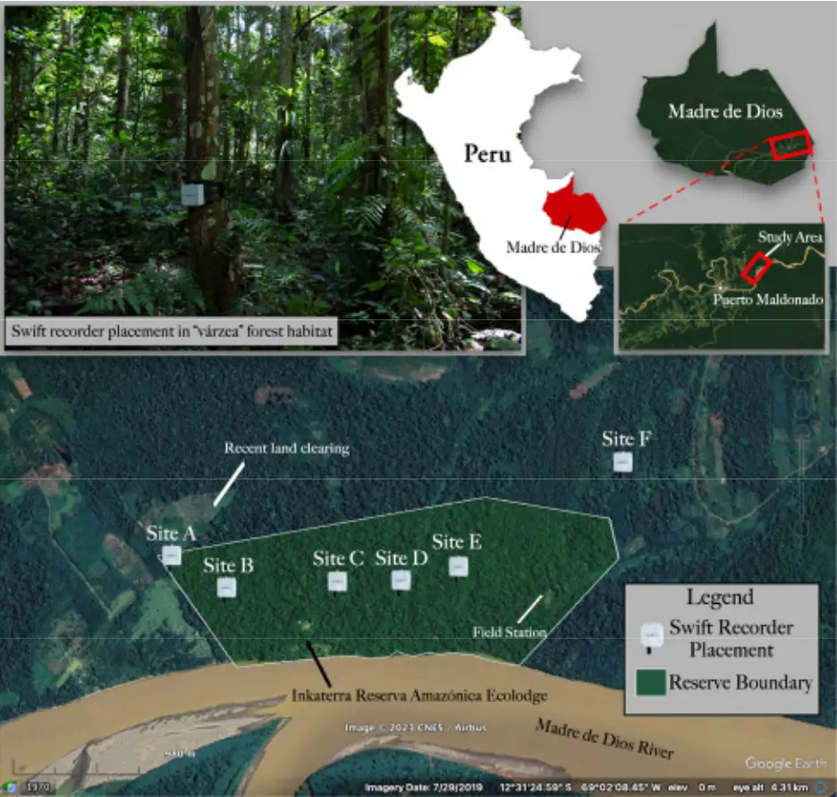
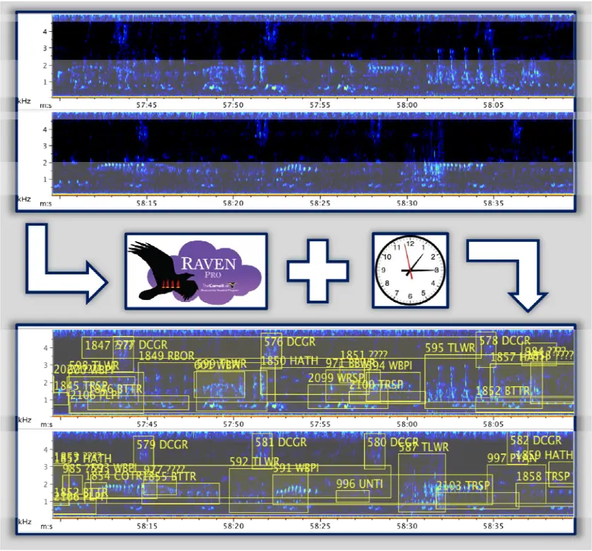
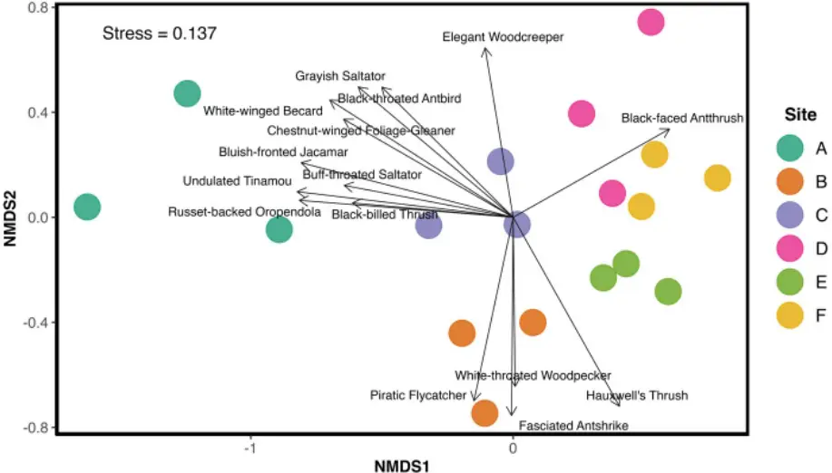
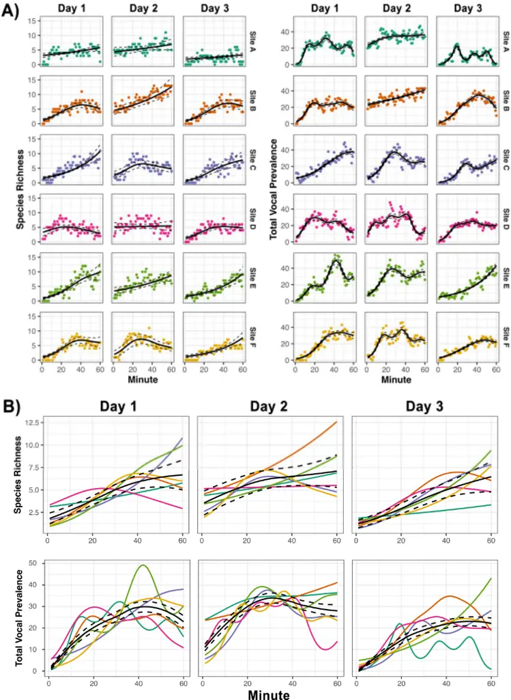
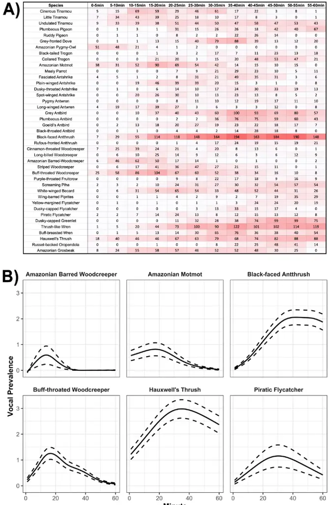
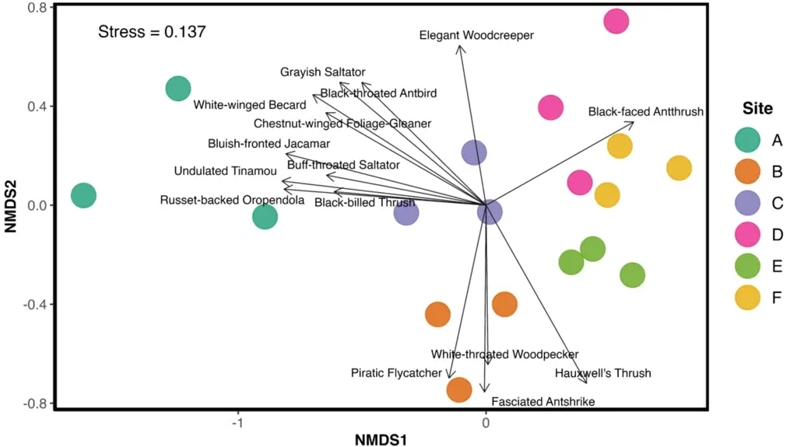
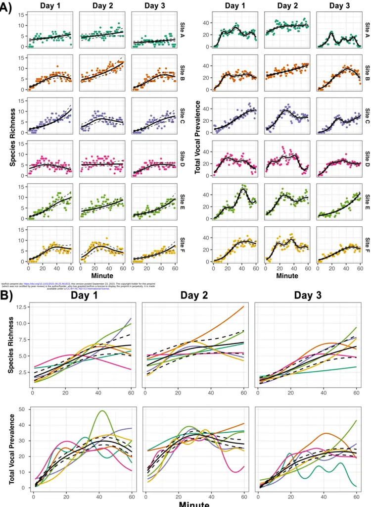
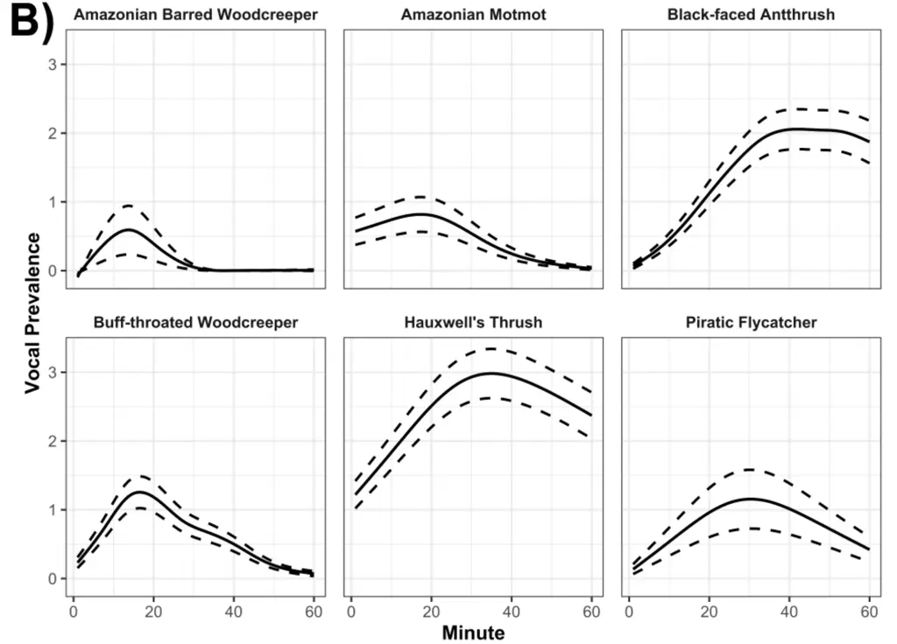

1

2

3

4

5

6

7

8

9

10

11

12

13

14

15

16

17

18

19

20

21

22

23

24

25

26

27

28

29

30

31

32

## Simultaneous passive acoustic monitoring uncovers evidence of potentially overlooked temporal variation in an Amazonian bird community

W. Alexander Hopping 1 , Christopher J. Sayers II 2 , Noe Roger Huaraca-Charca 3 , Holger Klinck 1

1 K. Lisa Yang Center for Conservation Bioacoustics, Cornell Lab of Ornithology, Cornell University, Ithaca, NY, USA 2 Department of Ecology and Evolutionary Biology, University of California, Los Angeles, CA 90095, USA 3 Inkaterra Asociación, Victor Larco Herrera 130, Miraflores, Lima, Peru

Corresponding Author: W. Alexander Hopping 1

K. Lisa Yang Center for Conservation Bioacoustics, Cornell Lab of Ornithology, Cornell University, 159 Sapsucker Woods Road, Ithaca, NY 14850, USA

Email address: wah63@cornell.edu

## Abstract

The vocal activity and detectability of tropical birds are subject to high levels of temporal heterogeneity, but quantifying patterns of diel and day-to-day variation in complex systems is challenging with traditional point count methods. As a result, research concerning stochastic temporal effects on tropical avian assemblages is limited, typically offering only broad conclusions, e.g., overall activity is highest in the first few hours of the morning and some species are active at different times of the day. Passive acoustic monitoring introduces several advantages for studying temporal variation, particularly by enabling simultaneous and continuous data collection across adjacent sites. Here, we employed autonomous recording units to quantify temporal variation in avian vocal activity and observed species richness at an Amazonian reserve in Madre de Dios, Peru-a region featuring some of Earth's richest, most

33

34

35

36

37

38

39

40

41

42

43

44

45

46

47

48

49

50

51

52

53

54

55

56

complex avian assemblages. We manually annotated 18 dawn hour recordings, collected simultaneously from three separate days at the same six sites, which represent various microhabitats and avian community compositions. We documented significant and consistent temporal variation in avian vocal activity levels and observed species richness within the dawn hour and across days. We found that temporal effects were stronger for vocal activity than for observed species richness and that vocal activity patterns over the course of the dawn hour varied on a species-to-species basis. Our results indicate that overlooked temporal variation in Amazonian soundscapes may obfuscate the results of surveys that fail to sufficiently account for temporal variables with simultaneous monitoring. While manual analysis of large volumes of soundscape data remains challenging, such data should be collected as a supplement to traditional surveys whenever possible. Rapidly advancing research concerning the automated processing of acoustic data could lead to more efficient methods for reducing temporal bias and improving the calibration and accuracy of ornithological surveys in the tropics.

Keywords: avian biodiversity, bioacoustics, passive acoustic monitoring, Amazon rainforest, temporal variation.

## Resumen

La actividad vocal y la detectabilidad de las aves tropicales están sujetas a altos niveles de heterogeneidad temporal, pero cuantificar con precisión los patrones de variación diurna y diaria en sistemas complejos es un reto con los métodos tradicionales de conteo por puntos. En consecuencia, la investigación sobre los efectos temporales estocásticos en los conjuntos de aves tropicales es limitada y normalmente sólo ofrece conclusiones generales, como que la actividad

57

58

59

60

61

62

63

64

65

66

67

68

69

70

71

72

73

74

75

76

77

78

79

general es mayor en las primeras horas de la mañana y que algunas especies están activas en distintos momentos del día. El monitoreo acústico pasivo presenta varias ventajas sobre los métodos tradicionales para estudiar la variación temporal, en particular al permitir el recojo simultáneo de datos en lugares adyacentes. En este trabajo empleamos unidades de grabación autónomas para cuantificar la variación temporal en los niveles de actividad vocal de las aves y la riqueza de especies observada en una reserva amazónica en Madre de Dios, Perú, una región que cuenta con algunos de los conjuntos de aves más ricos y complejos del planeta. Anotamos manualmente 18 grabaciones de la hora del amanecer, recogidas simultáneamente en tres días distintos en los mismos seis lugares, que representan una variedad de microhábitats y composiciones de comunidades de aves. Se documentó una variación temporal significativa y consistente en los niveles de actividad vocal de las aves y en la riqueza de especies observada dentro de la hora del amanecer y a lo largo de los días. Descubrimos que los efectos temporales eran mayores en la actividad vocal que en la riqueza de especies observada, y que los patrones de actividad diurna variaban de especie a especie a escala fina. Nuestros resultados indican que la variación temporal que se pasa por alto en los paisajes sonoros amazónicos puede ofuscar los resultados de los estudios que no tienen suficientemente en cuenta las variables temporales con un seguimiento simultáneo. Nuevas investigaciones sobre el tratamiento automatizado de los datos acústicos podrían conducir a métodos más eficaces para reducir el sesgo temporal y mejorar la calibración y precisión de los estudios ornitológicos en los trópicos.

## 1 Introduction

The tropics account for an overwhelming share of Earth's avian diversity, featuring more than 75% of all species and over 90% of terrestrial birds (Barlow et al. 2018). Still, tropical regions

80

81

82

83

84

85

86

87

88

89

90

91

92

93

94

95

96

97

98

99

100

101

102

are underrepresented in ornithological literature relative to temperate regions, even though tropical birds have fundamentally different life history strategies, behavioral ecology, and vocal patterns than temperate birds, requiring separate study (Stutchbury &amp; Morton 2008). The largest intact tropical system on the planet is the Amazon basin (Allan et al. 2017), which is the epicenter of global biodiversity (Antonelli et al. 2018). Like most of the tropics, the Amazon is undergoing rapid ecological change, primarily the result of agricultural expansion (Lapola et al. 2023), exacerbated by the increasing impacts of climate change (Xu et al. 2020). These anthropogenic impacts are significantly outpacing natural processes in Amazonia (Albert et al. 2023), threatening the resilience and stability of the region (Lovejoy &amp; Nobre 2019, Boulton et al. 2022). Despite its importance, however, the Amazon's avifauna remains poorly documented and is subject to flawed baseline species occurrence data and significant knowledge gaps (Lees et al. 2014), which are exacerbated by systemic barriers to researchers from the Global South (Soares et al. 2022). Efforts to increase ornithological survey coverage in the region are complicated by the difficulty of tropical field surveys. Overwhelming avian species richness, including many rare and similar species, challenging logistics, and poor visibility conditions contribute to the unreliability of avian surveys in Amazonia, where upwards of 95% of birds are heard but never seen by a field observer (Robinson et al. 2018).

The vocal activity and detectability of Neotropical birds are subject to high levels of temporal heterogeneity. Possible drivers of this variation include seasonality (Pérez-Granados &amp; Schuchmann 2022), weather and feeding opportunities (Metcalf et al. 2021), foraging strata (Berg et al. 2006), temporal partitioning to avoid signal masking from other birds (Planqué &amp; Slabbekoorn 2008, Luther 2008, Luther 2009, Hart et al. 2021) and vocalizing insects (Hart et al.

103

104

105

106

107

108

109

110

111

112

113

114

115

116

117

118

119

120

121

122

123

124

125

2015, Alvarez-Berríos et al. 2016, Aide et al. 2017, Metcalf et al. 2020), along with a wide range of poorly-understood floristic, geographic, and spatial variables (Menger et al. 2017). Some broad patterns of diel variation in the detectability and vocal activity of tropical birds are well established; for example, birds are most vocally active during the first 2-3 hours after dawn (Lynch 1995, Woltmann 2005). However, the temporal variation of tropical soundscapes is more complex than hour-long intervals can capture (Verner &amp; Ritter 1986, Rodriguez et al. 2014, Metcalf et al. 2021). Many Amazonian species are only aurally detectable within strict temporal niches (Gil &amp; Llusia 2020). These species may only vocalize during a single 5-minute period in the morning, perhaps accompanied by an even shorter bout in the evening (Parker 1991). Some Amazonian species have been shown to sing as infrequently as twice in 50 days (Jirinec et al. 2018). In addition to affecting estimates of total species richness, this fine-scale temporal variation in vocal activity can also influence patterns of observed community composition. Temporal effects on detectability vary by functional or taxonomic group. For example, canopy species are known to reach their activity peak later in the morning than understory species (Blake 1992), and species with high sensitivity to habitat fragmentation may have proportionately higher detection rates in pre-dawn surveys than less sensitive species (Woltmann 2005).

Quantifying the fine-scale patterns of temporal variation in tropical bird communities, both within and across days, is difficult. Non-simultaneous survey methods are subject to a litany of spatial, temporal, and observer biases, and therefore, capturing such granular effects can require infeasibly large sample sizes (Lynch 1995). For example, Esquivel &amp; Peris (2008) found that four visits per point are necessary to account for the temporal variation in bird activity in the Atlantic Forest of Paraguay. This sampling design does not account for possible variation in

126

127

128

129

130

131

132

133

134

135

136

137

138

139

140

141

142

143

144

145

146

147

vocal activity levels between different days, between different observers (Robinson et al. 2018), nor travel time between sites. Additionally, Rodriguez et al. (2014) found that temporal effects on acoustic activity patterns were spatially heterogeneous at adjacent recording sites in French Guiana. Therefore, precise assessments of temporal variation may be required on a per-site basis.

More costly and labor-intensive approaches, for example, using a team of point count technicians to visit multiple points simultaneously, may also introduce observer effects. Amazonian soundscapes include thousands of vocalization types, inducing high rates of falsenegative and false-positive identification errors (Remsen 1994), and it can take months for skilled observers to reach a level of competence attainable in just one to two weeks of field experience in temperate systems (Parker 1991). Observer error rates have been experimentally quantified in relation to aural identification (Simons et al. 2007), visual identification (Hull et al. 2010), and the subjectivity of abundance estimates (Cerqueira et al. 2013). These dynamics are not limited to inexperienced surveyors; established ornithologists can also be subject to nontrivial identification error rates in environments as complex as Amazonia (Lees et al. 2014). Overlooked species tend to reflect non-random subsets of assemblages, and the specific nature of these biases may differ between individual observers, even amongst experts (Blackburn &amp; Gaston 1998). Therefore, standardized surveys that do not produce archivable raw data and seek to uncover subtle spatiotemporal variation in avian vocal activity, observed species richness, and community structure should ideally be conducted by a single observer (Blake &amp; Loiselle 2015, Robinson et al. 2018).

148

149

150

151

152

153

154

155

156

157

158

159

160

161

162

163

164

165

166

167

168

169

Simultaneous passive acoustic monitoring (PAM) conducted with autonomous recording units (ARUs) can eliminate much of the temporal bias in surveys by collecting continuous data from adjacent locations simultaneously (Venier et al. 2012, Tegeler et al. 2012). Such effects are difficult to quantify with traditional surveys, and establishing their presence and magnitude may be useful for improving the calibration of point count studies, even with relatively small volumes of ARU data. PAM can also address observer bias since data collection is independent of technician skill level, and recordings collected simultaneously can be annotated by a single observer, replayed and reanalyzed, archived publicly, and distributed to experts for an independent review of identifications (Rempel et al. 2005, Robinson et al. 2018). PAM has been shown to present a suitable supplement or alternative to point counts, both in Amazonia (Haselmayer &amp; Quinn 2000), and in general (Shonfield &amp; Bayne 2017, Darras et al. 2019, Blake 2021), while providing numerous other advantages (Acevedo &amp; Villanueva-Rivera 2006, Newson et al. 2017, Darras et al. 2018, Jorge et al. 2018, Pillay et al. 2019, Sugai &amp; Llusia 2019).

This study aimed to investigate the hypothesis that Amazonian soundscapes may be subject to overlooked temporal variation in avian vocal activity, both between days and throughout a single dawn hour, which in the absence of simultaneous survey methods, could mask important differences in vocal activity levels, community composition, and observed species richness between sites. We tested this hypothesis by deploying an array of ARUs at a single Amazonian reserve in Madre de Dios, Peru, and manually annotated a subsample of the resulting bioacoustic data. We predicted that stochastic effects of diel and day-to-day variation

170

171

172

173

174

175

176

177

178

179

180

181

182

on vocal activity and observed species richness would be consistent across sites and, therefore, would be possible to control for with simultaneous monitoring.

## 2 Materials &amp; Methods

## 2.1 Study area

We conducted this study at Inkaterra Reserva Amazónica (ITRA) in the Madre de Dios Department of southeastern Peru (12°32'07.8" S, 69°02'58.2" W). This 191-ha private reserve is located at an elevation of approximately 200 m along the Madre de Dios River, directly across from the Reserva Nacional de Tambopata-one of the most biodiverse regions on the planet (Foster et al. 1994) (Fig. 1). The habitat at ITRA primarily consists of várzea floodplain forest, the most endangered forest type in the southwestern Amazon (Phillips et al. 1994), interspersed with seasonally flooded Mauritia palm swamp forest.

183

184

185

186

187

188

189

190

191

192

Figure 1: Swift recorder locations and typical forest habitat at Inkaterra Reserva Amazónica, Madre de Dios, Peru. Recorder locations covered a range of habitats, including edge habitat adjacent to clearings for small-scale agriculture (Site A), forest degraded by selective logging outside of the reserve's boundaries (Site F), mature várzea in the reserve interior (Site C and Site E), and mixed palm swamp (aguajal)-várzea habitat (Site B and Site D).

## 2.2 Acoustic monitoring

We collected acoustic data from 14 January to 2 February 2019, using six ARUs (Swift recorder, K. Lisa Yang Center for Conservation Bioacoustics, Cornell Lab of Ornithology, Cornell

193

194

195

196

197

198

199

200

201

202

203

204

205

206

207

208

209

210

211

212

213

214

215

University, Ithaca, NY, USA). We deployed the ARUs across the entire reserve, at a minimum distance of 350 m from each other and 450 m from the river, to limit spatially overlapping detections (pseudoreplication) and background noise (Ralph et al. 1995, Yip et al. 2017, Darras et al. 2018, Haupert et al. 2022), respectively. Deployment locations were chosen to represent a gradient of intactness and forest habitat type, including edge habitat adjacent to clearings for small-scale agriculture (Site A), forest degraded by selective logging outside of the reserve's boundaries (Site F), mature várzea in the reserve's interior (Site C and Site E), and mixed palm swamp (aguajal)-várzea habitat (Site B and Site D) (Fig. 1). Placed at the height of 1.5 m above the ground to maximize the sound detection space and minimize sound shadows (Darras et al. 2018), the 6 ARUs recorded continuously (mono, WAV format) throughout the deployment period using a sampling rate of 48 kHz (16-bit resolution) and a gain setting of 35 dB. The microphone sensitivity of the Swift was -44 dBV/Pa (+/- 3 dB) and featured a flat frequency response (+/- 3 dB) in the frequency range of the vocalizations of interest. The clipping level of the analog-to-digital (ADC) converter was +/- 0.9 V.

## 2.3 Annotation process

We manually annotated eighteen total dawn hours, from 05:00-06:00 PET (10:00-11:00 UTC), representing six sites on three days, using the Raven Pro Sound Analysis Software (version 1.6; K. Lisa Yang Center for Conservation Bioacoustics, Cornell Lab of Ornithology, Cornell University, Ithaca, NY, USA). Annotations were performed by a single observer, the lead author, to control for observer bias. A local expert, Noe Huaraca-Charca, also annotated a subset of these recordings (n = 4) as a quality control measure. The three days, 16 January (Day 1), 20 January (Day 2), and 31 January (Day 3), 2019, were randomly chosen from a subset of days that

216

217

218

219

220

221

222

223

224

225

226

227

228

229

230

231

232

233

234

235

236

237

238

featured less than 5 min of heavy rain during the dawn hour. The dawn hour was selected because it typically contains the highest level of vocal activity and diversity among Neotropical birds (Berg et al. 2006), including many species that only sing in narrow time windows around first light (Parker 1991, Blake 1992). Additionally, the dawn soundscape in Amazonia features far less anthropogenic activity and insect noise than in other periods, reducing interference with avian species detection (Metcalf et al. 2020). While annotating short, randomly-selected samples spread out over a longer survey period can improve estimates of alpha and gamma diversity (Wimmer et al. 2013, Metcalf et al. 2021), this study was designed to assess temporal variation over the course of a contiguous hour, and annotations were therefore conducted in this format.

Spectrograms were viewed in 60 s increments split over two rows (Hann window, 3 dB bandwidth = 100 Hz, 690 FFT window size, 1024-sample DFT, 95% temporal overlap) (Fig. 2). To reduce bias introduced by improved sound identification knowledge developed throughout the project, the order in which recordings were annotated was determined using a random number generator. Vocalizations were labeled for both species and a handful of broader groups with confusing or indistinguishable calls (e.g., "TRSP" as "trogon species" [Trogonidae sp.]). Background vocalizations, audible but not clearly visible on a spectrogram, were denoted with a '1' and excluded from analysis. To account for inter-specific variation in call volume and frequency, consistency for applying 'background' designation was approached on a speciesspecific basis. In cases where vocalizations from the same species were separated by fewer than 5 s, they were included as part of the same annotation, while annotations were split if the gap between vocalizations exceeded 5 s. An assortment of unlabeled sound clips featuring identified and unidentified species were sent to regional experts for secondary verification. Annotations

239

240

241

242

243

244

245

246

247

248

249

were reviewed repeatedly until unidentified vocalizations made up less than 10% of the total avian vocal activity on a given recording. We made considerable effort to accurately label as many foreground and background vocalizations as possible to improve the value of this dataset for training soundscape-based automated identification algorithms.

Figure 2: The annotation process. Spectrograms showing one minute of sound from Site B, Day 2, before and after manual annotation in Raven Pro 1.6.

## 2.4 Statistical analyses

To assess fine-scale temporal variation in dawn chorus vocal activity within recordings and across sampling sites and days, we subsampled each 60 min recording at 1 min intervals, totaling ng

250

251

252

253

254

255

256

257

258

259

260

261

262

263

264

265

266

267

268

269

270

271

272

1,080 samples across all sites and days. For each 1 min interval, we calculated species richness (SR), vocal prevalence (VP), and total vocal prevalence (TVP). Species richness refers to the number of unique species detected, while vocal prevalence refers to the number of 10 s intervals featuring a vocalization of a given species. Therefore, a single species could attain a maximum VP of 6 per 1 min interval or 360 per hour recording. Total vocal prevalence (TVP)-a proxy for the total avian vocal activity in a soundscape-refers to the sum of VP for all detected taxa in a given subsample. We assessed the relationship between TVP and SR using a Pearson's R correlation analysis.

Certain taxa were excluded from species richness calculations for data quality reasons: parrots (Psittacidae sp.), because they occurred almost exclusively as calling flyovers, as well as Columbiformes (pigeons and doves), and three congeneric tinamou species, Cinereous Tinamou (Crypturellus cinereus), Little Tinamou (C. soui), and Bartlett's Tinamou (C. bartletti), which had overlapping vocalizations and were inconsistently identified with confidence. However, these species were included in calculations of TVP, as were vocalizations that were identified to a broader group but not at the species level (e.g., Trogon sp. [Trogonidae sp.]) (For a full list of species and exclusions for SR and TVP calculations, see Supporting Information Appendix S1).

## 2.4.1 Non-metric multidimensional scaling ordination (NMDS) and ANOVA

We used non-metric multidimensional scaling ordination (NMDS) and two-way repeatedmeasures ANOVA to assess evidence for significant effects of site-specific differences in community composition on SR and TVP. Substituting VP in place of abundance, we calculated NMDS using the "bray" method, referring to Bray-Curtis dissimilarity, and metaMDS function

273

274

275

276

277

278

279

280

281

282

283

284

285

286

287

288

289

290

291

292

293

294

295

from the "vegan" package in R (Okansen et al. 2019). One advantage of using Bray-Curtis dissimilarity is its ability to account for the relative abundances of different species or taxa (Ricotta &amp; Podani 2017). We plotted NMDS ordinations on two axes and ensured that the output met minimum stress requirements (Kruskal 1964). To compare SR and TVP between sites, days, and recordings, two-way repeated-measures ANOVA followed by Tukey's HSD tests for multiple comparisons were conducted in R, with site and day as interacting independent variables and the 1-minute time interval as a blocking variable.

## 2.4.2 Generalized Additive Models (GAMs)

We then constructed a set of Generalized Additive Models (GAMs) fit with Poisson distributions and restricted maximum likelihood estimations to account for the non-linearity of withinrecording response curves for SR, TVP, and species-specific VP within the dawn hour. For both the SR and TVP models, we included a smoothing term for the interaction between time of day and recording to produce individual response curves for each recording, and a nested site-day random effects term to account for pseudoreplication. Similarly, to produce species-specific VP response curves across days and sites, we replicated this random effects structure, but removed the interaction for the time interval smoothing term. As the amount of species present at time step t directly influences the number of species that are likely to be detected at time step t + 1, we accounted for this inherent temporal autocorrelation by fitting both models with a first-order autoregressive covariance structure (AR1; Yang et al. 2012). This decision successfully removed evidence of autocorrelation within model residuals. Because our model structure was biologically informed, we chose to forgo model selection and base inferences and predictions from this structure. We completed all statistical analyses in R (v. 4.2.0; R Core Team 2022)

296

297

298

299

300

301

302

303

304

305

306

307

308

309

310

311

312

313

314

315

316

317

318

using functions from the "tidyverse" (Wickham et al. 2019) and employing the "mgcv" package to construct GAMs (Wood et al. 2016; Wood 2004, 2011, 2017).

## 3 Results

We identified 127 species over the 18 analyzed dawn hours, seven of which were recorded only as background vocalizations; 17,036 individual bounding-box annotations were drawn in Raven Pro 1.6, of which 94.8% were identified to the species or taxon level. Site A had the lowest average species richness per 1 min interval (4.0; 43 total), followed by Site F (4.4; 42 total), Site D (4.8; 49 total), Site C (4.9; 46 total), Site E (5.3; 55 total), and Site B (6.1; 50 total), which was also the most active site by TVP. Aggregating detections across sampling sites, Day 1 featured 57 species, Day 2 featured 78 species, and Day 3 featured 56 species, with average SR values per 1 min interval of 4.79, 6.18, and 3.81, respectively. At individual sites, the percentage of total vocal prevalence (TVP) that was not identified to a species or taxa group ranged from 4.1% (Site E) to 7.1% (Site B) between sites, and from 5.1% (Day 3) to 5.4% (Day 1) between days.

Of the 120 foreground species detected, only two, Black-faced Antthrush (Formicarius analis) and Buff-throated Woodcreeper (Xiphorhynchus guttatus), were detected on all 18 recordings, and six more, Hauxwell's Thrush (Turdus hauxwelli), Little Tinamou (Crypturellus soui), Thrush-like Wren (Camplyothynchs turdinus), Amazonian Motmot (Momotus momota), Plumbeous Pigeon (Patagioenas plumbea), and Screaming Piha (Lipaugus cociferans) were detected on at least 15 recordings. Most species were rare; more than half (n = 66, 55%) were detected on 4 or fewer 1-hr recordings, and roughly a quarter (n = 27, 23%) on only a single recording (Supporting Information Appendix S2). Regarding total vocal prevalence, the most

319

320

321

322

323

324

325

326

327

328

329

330

331

332

333

334

335

336

337

338

339

340

341

abundant species were Hauxwell's Thrush, Black-faced Antthrush, and Thrush-like Wren. TVP was highest at all six sites on 20 January (Day 2) and lowest on 31 January (Day 3) at every site except Site B.

## 3.1 Non-metric multidimensional scaling ordination (NMDS) and ANOVA

Individual sites consistently clustered separately from each other in terms of their species composition, as demonstrated by non-metric multidimensional scaling (NMDS) ordination (Fig. 3). Tukey's HSD tests indicated that a higher percentage of pairwise comparisons between sites were significantly different (p &lt; 0.01) for SR (9/15, 60%) than for TVP (6/15, 40%), and all comparisons between days were significant for both TVP and SR. The rate that recordings from different days exhibited significant pairwise differences (p &lt; 0.01) remained essentially identical whether they came from the same site or from different sites: 44.4% (8/18, same site) versus 42.2% (38/90, different sites) for SR and 55.6% (10/18) versus 56.7% (51/90) for TVP. In general, pairwise comparisons of recordings from different days were more likely to differ significantly (p &lt; 0.01) than recordings from different sites. For SR, 42.6% of recordings from different days (46/108) differed significantly, compared to 35.6% from different sites (48/135). For TVP, 56.5% of recording pairings from different days (61/108) differed significantly, compared to 45.2% from different sites (61/135). TVP and SR were least likely to differ between recordings that came from different sites on the same day; just 22.2% of these pairwise comparisons (10/45) differed significantly (p &lt; 0.01) for each metric. For all Tukey's HSD pairwise comparisons between sites, days, and individual recordings, see Supporting Information Appendix S3.

342

343

344

345

346

347

348

349

350

351

352

353

354

355

Figure 3: Non-metric multidimensional scaling (NMDS) ordination by site using Bray-Curtis dissimilarity, with vocal prevalence in place of abundance. Significantly representative species along the ordination axes (p &lt; 0.02) are shown with vectors. For site information, see Fig. 1.

## 3.2 Generalized Additive Models (GAMs)

SR and TVP models accounted for a substantial amount of variation in dawn chorus vocal activity (R 2 = 0.64 and R 2 = 0.83, respectively, Fig. 4), in which smoothing terms for the interaction between time interval and recording, as well as site-day random intercepts, were often significant (p &lt; 0.05; Supporting Information Appendix S4). The effect of time interval and day was generally stronger than the effect of site in explaining variation in observed SR and TVP, and TVP was strongly correlated with SR (r = 0.85, p &lt; 0.001). We observed that diel variation in avian vocal activity varied by species and taxonomic group, with the VP of different species peaking at different time intervals within the dawn hour (Fig. 5).

356

357

358

359

360

361

Figure 4: Comparisons of (A) species richness and total vocal prevalence detected by time of day across days and sites overlaid with Generalized Additive Model (GAM) prediction curves ± 95% confidence intervals, along with (B) site-specific GAM prediction curves overlaid with dayspecific mean GAM prediction curves ± 95% confidence intervals of species richness and vocal prevalence across days.

362

363

364

365

366

367

368

369

370

371

372

373

374

375

376

377

378

379

380

381

382

383

384

385

## 4 Discussion

We used simultaneous passive acoustic monitoring to quantify temporal variation in the vocal activity level and observed species richness of an Amazonian bird community. In line with our primary hypothesis, the magnitude of this temporal variation is large enough to potentially mask, or even supersede, observed differences in species richness and vocal activity levels between sites and habitat types-complicating the interpretation of point count studies and other nonsimultaneous survey methods that fail to control for temporal variables. While temporal variation in avian activity over the course of the morning is well-documented in the tropics, the limitations of traditional non-simultaneous survey methods mean that point count studies on temporal effects in these systems offer only broad conclusions, typically relating to maximum temporal resolutions of one hour or more (Blake 1992, Lynch 1995, Woltmann 2005, Esquivel &amp; Peris 2008). Fine-scale diel variation in the vocal activity and detectability of Amazonian birds has been referenced anecdotally for decades (Parker 1991). However, thanks to the development of autonomous recording units, which allow for considerably easier repeat sampling than traditional methods, we are beginning to understand more about these effects at higher temporal resolutions (Gil &amp; Llusia 2020, Blake 2021, Metcalf et al. 2021, Pérez-Granados &amp; Schuchmann 2023). While prior temporal effects studies have focused primarily on diel and seasonal temporal variation, to our knowledge, this is the first study to provide evidence that day-to-day temporal variation in the vocal activity and detectability of Amazonian bird communities may be strong enough to obscure statistically significant differences between sites, in the absence of simultaneous data collection.

386

387

388

389

390

391

392

393

394

395

396

397

398

The variable diel patterns in avian vocal activity that we observed between species and taxonomic groups (Fig. 5) mean that visiting two sites with the same overall SR or TVP at different times in the morning could result in considerably different observations of community composition, even when both visits occur within the same hour. This species-to-species diel variation in vocal activity and detectability may partially or entirely explain why the diel variation patterns in SR and TVP that we documented within the dawn hour were spatially heterogeneous. Consistent with the findings of Rodriguez et al. (2014), these patterns varied persite, even between sites in the same general habitat type and superficial condition. Because sites with differing communities should be expected to exhibit differing patterns of diel variation in overall vocal activity, the differing patterns of diel variation in TVP and SR that we documented between sites are plausibly the result of the spatial heterogeneity of avian community composition (Fig. 3).

399

400

401

402

403

404

405

Minute

Figure 5: Species-level diel variation in vocal prevalence within the dawn hour. (A) Diel variation in vocal prevalence by 5 min interval for species with total vocal prevalence &gt; 75 from all sites and days, and (B) model-generated prediction curves ± 95% confidence intervals of species-specific vocal prevalence within the dawn hour for six species (B).

406

407

408

409

410

411

412

413

414

415

416

417

418

419

420

421

422

423

424

425

426

427

428

The spatial heterogeneity that we observed in contiguous lowland forest with superficially similar conditions may have been the result of cryptic habitat diversity. Though sometimes misrepresented as homogenous, Amazonian habitats are highly heterogeneous (Pires &amp; Prance 1985, Tuomisto et al. 1995), and important elements of their structural diversity remain poorly understood (Macía 2011, Borges 2013). Interactions between habitat features and avian community structure in the Amazon are extremely complex and are influenced by variables including soil type (Borges 2013), riverine sediment concentration (Laranjeiras et al. 2021), the condition of surrounding habitat (Latta et al. 2011, Laurence et al. 2011, Woltmann 2012, Laurence et al. 2012, Wolfe et al. 2015, Barlow 2016, Menger et al. 2017, HernándezPalma &amp; Stouffer 2018), the presence of large animals (Redford 1992, Estes et al. 2011), and climate change (Blake &amp; Loiselle 2015, Stouffer et al. 2020). As a result, Amazonian habitat assessments, which generally rely on features discernable by field observers, can be overly simplistic (Milliken et al. 2010), and we avoided incorporating them in our analysis for this reason. The complexity of Amazonian systems increases the importance of controlling for temporal variables, which may obscure these effects.

While this study was not designed to serve as a comprehensive census of the avian community at ITRA, our observations were generally consistent with those documented by previous census efforts in Madre de Dios's várzea forests (Terborgh et al. 1990, Martínez et al. 2023), namely that most species were rare, with a high proportion of TVP contributed by only a few species, and that sites were compositionally heterogeneous. The observation that the site in edge habitat (Site A) had the lowest average species richness per 1-min interval (4.03; 43 total), followed by Site F (4.41; 42 total), in degraded forest outside of the reserve boundaries, is

429

430

431

432

433

434

435

436

437

438

439

440

441

442

443

444

445

446

447

448

449

450

consistent with the results of research focused on edge effects in Amazonia, which are known to pervasively impact Amazonian bird communities (Terborgh et al. 1990, Laurence 2004, Barlow et al. 2006, Broadbent et al. 2008, Laurence et al. 2011, Moura et al. 2016, Luther et al. 2020, Stouffer 2020). This habitat usage pattern differs from observed dynamics in temperate systems, where avian diversity tends to be higher in edge habitats than forest interiors (Baldi 1996, Lindell et al. 2007). Most annotations occurred in the frequency range of 0.5-5 kHz, suggesting possible signal masking from insects, which primarily occur between 4-12 kHz (Hart et al. 2015, Metcalf et al. 2020).

The temporal variation in avian vocal activity levels and observed species richness that we documented between days was greater and more consistent than we expected, generally influencing SR and TVP more than differences between sites. Supporting the idea that temporal effects may overwhelm statistically significant differences between sites, sampling the same site on different days was more than twice as likely to result in significantly differing measures of SR and TVP than sampling different sites on the same day, even though most site-to-site comparisons indicated significant differences in SR or TVP. That temporal variation was strongest for TVP is relevant for point counts because aural detection probability for a field observer is a direct function of VP, which reflects the probability that a species vocalizes during a given 10 s window. Standard duration point counts should have higher rates of false absences on days with lower TVP, even with static species availability, because of the reduction in time windows where species vocalize.

451

452

453

454

455

456

457

458

459

460

461

462

463

464

465

466

467

468

469

470

471

472

473

We found that TVP was a useful metric for quantifying avian vocal activity, and believe that it is worthy of further study and use. TVP is a more stable indicator of overall activity levels than raw call count, total number of annotations, or total annotation length because it is robust to natural differences in vocalization patterns across species. When annotation boxes are split, if the gap between vocalizations exceeds a set time interval (5 s in this study), alternative activity metrics are dependent on the innate vocalization rate of a given species. For example, Hauxwell's Thrush (HATH) and Black-faced Antthrush (BFAT) were two of the most common species in this dataset but feature different vocalization styles. While HATHs often take only short breaks of &lt; 5 s between song bouts in the morning, BFATs sing with gaps between song bouts that are generally greater than 5 s. A HATH singing throughout the morning may only result in a small number of different annotation boxes, but a large total annotation length that incorporates the time in-between song bouts, while a BFAT singing throughout the morning can feature a very high number of total annotations, but will not include the gaps between song phrases because they exceed 5 s in length. In our data, BFAT had a total annotation length of 4,456 seconds across 1,500 individual bounding boxes, while HATH had a total annotation length of 25,308 seconds that constituted just 675 total bounding boxes. Using TVP eliminates this type of artificial species-to-species variability in vocal activity estimates. As a result, TVP can improve comparisons of annotated bioacoustic datasets that employ slightly different annotation protocols and can reduce manual analysis time by eliminating the need to measure the distance between vocalizations. While metrics that require species-level ID are highly contingent on observer skill level, driving inconsistencies in Neotropical bird surveys (Robinson et al. 2018), TVP supports using broader taxonomic groups for challenging identifications, potentially lowering time and experience barriers for researchers. We found that TVP correlated strongly with SR (r = 0.85, p

474

475

476

477

478

479

480

481

482

483

484

485

486

487

488

489

490

491

492

493

494

495

496

&lt; 0.001), meaning that it may be a viable proxy for species richness, even without requiring species IDs, and should be easier to generate with automated approaches than metrics that require species-level IDs. Because TVP essentially represents soundscape abundance, it can also enable the calculation of abundance-based indices like Bray-Curtis dissimilarity and Shannon diversity with acoustic data.

Based on our collective results, we suggest that bioacoustic data should be collected to complement traditional avian surveys whenever possible. In addition to the short-term benefits of quantifying diel and day-to-day temporal variation, even small bioacoustic datasets serve as ecological time capsules (Sugai &amp; Llusia 2019), which are particularly important in an era of rapid global change. ARUs can generate greater data volume than traditional methods without meaningfully increasing field time or cost (Hobson et al. 2002, Acevedo &amp; Villanueva-Rivera 2006, Tegeler et al. 2012). While manually analyzing acoustic data can be time-intensive, limiting its utility, acoustic indices (Jorge et al. 2018, Metcalf et al. 2020) and automated identification programs like BirdNET (Kahl et al. 2021) are continuously improving and could have a transformative effect on global ornithological research (Pérez-Granados 2023). Due to their relative rarity, fully-annotated tropical soundscapes are critical for developing these automated programs, and this dataset has already been used for this purpose (Kahl et al. 2020). Studies focused exclusively on birds can come at the expense of developing knowledge of other groups (Gardner et al. 2008), but bioacoustic data collected for ornithological research often contains vocalizations of non-target taxa and other soundscape elements, enabling more holistic biodiversity research (Newson et al. 2017). To help advance these efforts, we encourage researchers collecting bioacoustic data to make use of open-access repositories like Zenodo

497

498

499

500

501

502

503

504

505

506

507

508

509

510

511

512

513

514

515

516

517

518

519

(European Organization For Nuclear Research &amp; OpenAIRE 2013) to host their datasets, as we have (Hopping et al. 2022).

To conclude, we found that simultaneous passive acoustic monitoring coupled with manual annotation revealed significant diel and day-to-day variation in the vocal activity and observed species richness of an Amazonian bird community, an ecological pattern that would be difficult to ascertain using traditional field methods. The magnitude of this temporal variation was large enough that it could mask meaningful differences between sites if temporal bias is not sufficiently accounted for in study designs. This research provides a case study for using passive acoustic monitoring to quantify temporal variation in tropical ornithological surveys, even with a relatively small sample of sites and days. Future studies could help explain the mechanisms for this variation and improve methods for processing and interpreting large volumes of acoustic data in complex systems.

## Authors' Contributions

W.A.H. and H.K. designed the methodology and secured the funding to conduct the study; W.A.H. and C.J.S. analyzed the data; W.A.H. and N.H.C. collected and annotated the recordings, and W.A.H. led the writing of the manuscript. All authors contributed critically to the drafts and gave final approval for publication. The Spanish abstract was translated by N.H.C.

## Conflict of Interest

The authors declare that there is no conflict of interest.

520

521

522

523

524

525

526

527

528

529

530

531

532

533

534

535

536

537

538

539

540

541

542

## Funding

Funding for equipment was provided by the K. Lisa Yang Center for Conservation Bioacoustics at the Cornell Lab of Ornithology (https://www.birds.cornell.edu/ccb/), with support from Innóvate Perú (https://www.proinnovate.gob.pe/), CORBIDI (http://www.corbidi.org/), and the Inkaterra Association (https://www.inkaterra.com/inkaterra-asociacion-org/en/). Travel expenses were funded by the Cornell Lab of Ornithology (https://www.birds.cornell.edu/home/).

## Acknowledgements

We would like to thank the Inkaterra Association (ITA) staff for providing logistical support and excellent field station facilities, particularly Dennis Osorio and Kevin Jiménez Gonzales, who helped set up recorders. John Fitzpatrick, Fernando Angulo, Will Sweet, Ken Rosenberg, and Alex Wiebe helped identify unknown vocalizations, and Richard Fuller, Ken Rosenberg, Andrew Farnsworth, Connor Wood, and several anonymous reviewers provided helpful comments on the drafts.

## Intellectual Contributions

Our study involved collaboration with multiple Peruvian NGOs, particularly the Inkaterra Association (ITA), in both Lima and Madre de Dios. While in the field, we taught local researchers how to set up and maintain Swift recorders, how to annotate recordings in Raven Pro, and then left 9 recorders with them for their own use. We shared a copy of all collected data and our results with ITA, and one of 'ITA's local researchers (Noe Huaraca-Charca) is a coauthor on this paper.

543

544

545

546

547

548

549

550

551

552

553

554

555

556

557

558

559

560

561

562

563

564

565

566

567

568

569

570

571

572

573

574

575

576

577

578

579

580

581

## Data Availability Statement

All software curated for this research are archived and available at https://github.com/csayers2/Inkaterra-ARU. The raw acoustic data and annotations referenced in

this study can be found at https://zenodo.org/record/7079124 (DOI: 10.5281/zenodo.7079124).

## References

Acevedo, M. A., &amp; Villanueva-Rivera, L. J. (2006). Using Automated Digital Recording Systems as Effective Tools for the Monitoring of Birds and Amphibians. Wildlife Society Bulletin, 34(1), 211-214. https://doi.org/10.2193/0091-7648(2006)34[211:uadrsa]2.0.co;2

Aide, T. M., Hernández-Serna, A., Campos-Cerqueira, M., Acevedo-Charry, O., &amp; Deichmann, J. L. (2017). Species richness (of insects) drives the use of acoustic space in the tropics. Remote Sensing, 9(11), 1-12. https://doi.org/10.3390/rs9111096

Albert, J.S.; Carnaval, A.C.; Flantua, S.G.A.; Lohmann, L.G.; Ribas, C.C.; Riff, D.; Carrillo, J.D.; Fan, Y.; Figueiredo, J.J.P.; Guayasamin, J.M.; et al. (2023). Human impacts outpace natural processes in the Amazon. Science, 379, eabo5003. https://doi.org/10.1126/science.abo5003

Alvarez-Berríos, N., Campos-Cerqueira, M., Hernández-Serna, A., Delgado, C. J. A., RománDañobeytia, F., &amp; Aide, T. M. (2016). Impacts of small-scale gold mining on birds and anurans near the Tambopata Natural Reserve, Peru, assessed using passive acoustic monitoring. Tropical Conservation Science, 9(2), 832-851. https://doi.org/10.1177/194008291600900216

Allan, J. R., Venter, O., &amp; Watson, J. E. M. (2017). Temporally inter-comparable maps of terrestrial wilderness and the Last of the Wild. Scientific Data, 4, 1-8. https://doi.org/10.1038/sdata.2017.187

Antonelli, A., Zizka, A., Carvalho, F. A., Scharn, R., Bacon, C. D., Silvestro, D., &amp; Condamine, F. L. (2018). Amazonia is the primary source of Neotropical biodiversity. Proceedings of the National Academy of Sciences of the United States of America, 115(23), 6034-6039. https://doi.org/10.1073/pnas.1713819115

Baldi, A. (1996). Edge effects in tropical versus temperate forest bird communities: Three alternative hypotheses for the explanation of differences. Acta Zoologica Academiae Scientiarum Hungaricae, 42(3), 163-172.

582

583

584

585

586

587

588

589

590

591

592

593

594

595

596

597

598

599

600

601

602

603

604

605

606

607

608

609

610

611

612

613

614

615

616

617

618

619

620

Barlow, J., Peres, C. A., Henriques, L. M. P., Stouffer, P. C., &amp; Wunderle, J. M. (2006). The responses of understorey birds to forest fragmentation, logging and wildfires: An Amazonian synthesis. Biological Conservation, 128(2), 182-192. https://doi.org/10.1016/j.biocon.2005.09.028

Barlow, J., França, F., Gardner, T. A., Hicks, C. C., Lennox, G. D., Berenguer, E., … Graham, N. A. J. (2018). The future of hyperdiverse tropical ecosystems. Nature, 559(7715), 517526. https://doi.org/10.1038/s41586-018-0301-1

Berg, K. S., Brumfield, R. T., &amp; Apanius, V. (2006). Phylogenetic and ecological determinants of the neotropical dawn chorus. Proceedings of the Royal Society B: Biological Sciences, 273(1589), 999-1005. https://doi.org/10.1098/rspb.2005.3410

Blackburn, T. M., &amp; Gaston, K. J. (1998). Some methodological issues in macroecology. American Naturalist, 151(1), 68-83. https://doi.org/10.1086/286103

Blake, J. G. (1992). Temporal Variation in Point Counts of Birds in a Lowland Wet Forest in Costa Rica. The Condor, 94(1), 265-275. https://doi.org/10.2307/1368816

Blake, J. G. (2021). Acoustic monitors and direct observations provide similar but distinct perspectives on bird assemblages in a lowland forest of eastern Ecuador. PeerJ, (January). https://doi.org/10.7717/peerj.10565

Blake, J. G., &amp; Loiselle, B. A. (2015). Enigmatic declines in bird numbers in lowland forest of eastern Ecuador may be a consequence of climate change. PeerJ, 2015(8), 1-20. https://doi.org/10.7717/peerj.1177

Borges, S. H. (2013). Bird species distribution in a complex Amazonian landscape: Species diversity, compositional variability and biotic-environmental relationships. Studies on Neotropical Fauna and Environment, 48(2), 106-118. https://doi.org/10.1080/01650521.2013.841627

Boulton, C. A., Lenton, T. M., &amp; Boers, N. (2022). Pronounced loss of Amazon rainforest resilience since the early 2000s. Nature Climate Change, 12(3), 271-278. https://doi.org/10.1038/s41558-022-01287-8

Broadbent, E. N., Asner, G. P., Keller, M., Knapp, D. E., Oliveira, P. J. C., &amp; Silva, J. N. (2008). Forest fragmentation and edge effects from deforestation and selective logging in the Brazilian Amazon. Biological Conservation, 141(7), 1745-1757. https://doi.org/10.1016/j.biocon.2008.04.024

Cerqueira, M. C., Cohn-Haft, M., Vargas, C. F., Nader, C. E., Andretti, C. B., Costa, T. V. V., … Ferraz, G. (2013). Rare or elusive? A test of expert knowledge about rarity of Amazon forest birds. Diversity and Distributions, 19(7), 710-721. https://doi.org/10.1111/ddi.12033

621

622

623

624

625

626

627

628

629

630

631

632

633

634

635

636

637

638

639

640

641

642

643

644

645

646

647

648

649

650

651

652

653

654

655

656

657

658

659

660

661

Darras, K., Batáry, P., Furnas, B., Celis-Murillo, A., Van Wilgenburg, S. L., Mulyani, Y. A., &amp; Tscharntke, T. (2018). Comparing the sampling performance of sound recorders versus point counts in bird surveys: A meta-analysis. Journal of Applied Ecology, 55(6), 25752586. https://doi.org/10.1111/1365-2664.13229

Darras, K., Batáry, P., Furnas, B. J., Grass, I., Mulyani, Y. A., &amp; Tscharntke, T. (2019). Autonomous sound recording outperforms human observation for sampling birds: a systematic map and user guide. Ecological Applications, 29(6). https://doi.org/10.1002/eap.1954

Estes, J. A., Terborgh, J., Brashares, J. S., Power, M. E., Berger, J., Bond, W. J., … Wardle, D. A. (2011). Trophic downgrading of planet earth. Science, 333(6040), 301-306. https://doi.org/10.1126/science.1205106

European Organization For Nuclear Research &amp; OpenAIRE. (2013). Zenodo. doi:10.25495/7GXK-RD71

Gardner, T. A., Barlow, J., Araujo, I. S., Ávila-Pires, T. C., Bonaldo, A. B., Costa, J. E., … Peres, C. A. (2008). The cost-effectiveness of biodiversity surveys in tropical forests. Ecology Letters, 11(2), 139-150. https://doi.org/10.1111/j.1461-0248.2007.01133.x

Gil, D., &amp; Llusia, D. (2020). The Bird Dawn Chorus Revisited. https://doi.org/10.1007/978-3030-39200-0\_3

Haddad, N. M., Brudvig, L. A., Clobert, J., Davies, K. F., Gonzalez, A., Holt, R. D., … Townshend, J. R. (2015). Habitat fragmentation and its lasting impact on 'Earth's ecosystems. Science Advances, 1(2), 1-10. https://doi.org/10.1126/sciadv.1500052

Hart, P. J., Hall, R., Ray, W., Beck, A., &amp; Zook, J. (2015). Cicadas impact bird communication in a noisy tropical rainforest. Behavioral Ecology, 26(3), 839-842. https://doi.org/10.1093/beheco/arv018

Hart, P. J., Ibanez, T., Paxton, K., Tredinnick, G., Sebastián-González, E., &amp; Tanimoto-Johnson, A. (2021). Timing Is Everything: Acoustic Niche Partitioning in Two Tropical Wet Forest Bird Communities. Frontiers in Ecology and Evolution, 9(October), 1-10. https://doi.org/10.3389/fevo.2021.753363

Haselmayer, J., &amp; Quinn, J. S. (2000). A comparison of point counts and sound recording as bird survey methods in amazonian southeast Peru. Condor, 102(4), 887-893. https://doi.org/10.2307/1370317

Haupert, S., Sèbe, F., &amp; Sueur, J. (2022). Physics-based model to predict the acoustic detection distance of terrestrial autonomous recording units over the diel cycle and across seasons: Insights from an Alpine and a Neotropical forest. Methods in Ecology and Evolution, 14(2), 614-630. https://doi.org/10.1111/2041-210X.14020

662

663

664

665

666

667

668

669

670

671

672

673

674

675

676

677

678

679

680

681

682

683

684

685

686

687

688

689

690

691

692

693

694

695

696

697

698

699

700

701

702

703

704

Hernández-Palma, A., &amp; Stouffer, P. C. (2018). Matrix and area effects on the nutritional condition of understory birds in Amazonian rainforest fragments. Perspectives in Ecology and Conservation, 16(3), 139-145. https://doi.org/10.1016/j.pecon.2018.06.003

Hobson, K. A., Rempel, R. S., Greenwood, H., Turnbull, B., &amp; Van Wilgenburg, S. L. (2002). Acoustic surveys of birds using electronic recordings: New potential from an omnidirectional microphone system. Wildlife Society Bulletin, 30(3), 709-720.

Hopping, W. A., Kahl, S. &amp; Klinck, H. (2022). A collection of fully-annotated soundscape recordings from the Southwestern Amazon Basin (Version 1) [Data set]. Zenodo. https://doi.org/10.5281/zenodo.7079124

Hull, J. M., Fish, A. M., Keane, J. J., Mori, S. R., Sacks, B. N., &amp; Hull, A. C. (2010). Estimation of Species Identification Error: Implications for Raptor Migration Counts and Trend Estimation. Journal of Wildlife Management, 74(6), 1326-1334. https://doi.org/10.2193/2009-255

Jirinec, V., Elizondo, E. C., Rutt, C. L., &amp; Stouffer, P. C. (2018). Space use, diurnal movement, and roosting of a Variegated Antpitta (Grallaria varia) in central Amazonia. Ornitologia Neotropical, 29(February), 13-20. https://doi.org/10.58843/ornneo.v29i1.325

Jorge, F. C., Machado, C. G., da Cunha Nogueira, S. S., &amp; Nogueira-Filho, S. L. G. (2018). The effectiveness of acoustic indices for forest monitoring in Atlantic rainforest fragments. Ecological Indicators, 91(August 2017), 71-76. https://doi.org/10.1016/j.ecolind.2018.04.001

Kahl, S., Clapp, M., Hopping, W. A., Goëau, H., Glotin, H., Planqué, R., Vellinga,W. P., Joly, A. (2020). Overview of BirdCLEF 2020: Bird sound recognition in complex acoustic environments. In: CLEF task overview 2020, CLEF: Conference and Labs of the Evaluation Forum, Sep. 2020, Thessaloniki, Greece.

Kahl, S., Wood, C. M., Eibl, M., &amp; Klinck, H. (2021). BirdNET: A deep learning solution for avian diversity monitoring. Ecological Informatics, 61(December 2020), 101236. https://doi.org/10.1016/j.ecoinf.2021.101236

Kruskal, J.B. (1964). Non-metric Multidimensional Scaling: A Numerical Method. Psychometrika, 29, 115-129. http://dx.doi.org/10.1007/BF02289694

Lapola D. M., Pinho P., Barlow J., Aragão L. E. O. C., Berenguer E., et al., (2023). The drivers and impacts of Amazon forest degradation. Science, 379(6630), eabp8622. http://dx.doi.org/10.1126/science.abp8622

Laranjeiras, T. O., Naka, L. N., Leite, G. A., Cohn-Haft, M. (2021). Effects of a major Amazonian river confluence on the distribution of floodplain forest avifauna, Journal of Biogeography, 48, 4, (847-860). https://doi.org/10.1111/jbi.14042

705

706

707

708

709

710

711

712

713

714

715

716

717

718

719

720

721

722

723

724

725

726

727

728

729

730

731

732

733

734

735

736

737

738

739

740

741

742

743

744

745

746

747

748

749

Latta, S. C., Tinoco, B. A., Astudillo, P. X., &amp; Graham, C. H. (2011). Patterns and magnitude of temporal change in avian communities in the ecuadorian andes. Condor, 113(1), 24-40. https://doi.org/10.1525/cond.2011.090252

Laurance, S. G. W. (2004). Responses of understory rain forest birds to road edges in central Amazonia. Ecological Applications, 14(5), 1344-1357. https://doi.org/10.1890/03-5194

Laurance, W. F., Camargo, J. L. C., Luizão, R. C. C., Laurance, S. G., Pimm, S. L., Bruna, E. M., … Lovejoy, T. E. (2011). The fate of Amazonian forest fragments: A 32-year investigation. Biological Conservation, 144(1), 56-67. https://doi.org/10.1016/j.biocon.2010.09.021

Laurance, W. F., Useche, D. C., Rendeiro, J., Kalka, M., Bradshaw, C. J. A., Sloan, S. P., … Campbell, M. (2012). Averting biodiversity collapse in tropical forests. Nature, 489, 290294.

Lees, A. C., Naka, L. N., Aleixo, A., Cohn-Haft, M., Piacentini, V. de Q., Santos, M. P. D., &amp; Silveira, L. F. (2014). Conducting rigorous avian inventories: Amazonian case studies and a roadmap for improvement. Revista Brasileira de Ornitologia, 22(2), 107-120.

Lindell, C. A., Riffell, S. K., Kaiser, S. A., Battin, A. L., Smith, M. L., &amp; Sisk, T. D. (2007). Edge Responses of Tropical and Temperate Birds. The Wilson Journal of Ornithology, 119(2), 205-220. https://doi.org/10.1676/05-133.1

Lovejoy, T. E., &amp; Nobre, C. (2019). Amazon tipping point: Last chance for action. Science Advances, 5(12), 4-6. https://doi.org/10.1126/sciadv.aba2949

Luther, D.. (2008). Signaller: Receiver coordination and the timing of communication in Amazonian birds. Biology Letters, 4(6), 651-654. https://doi.org/10.1098/rsbl.2008.0406

Luther, D. (2009). The influence of the acoustic community on songs of birds in a neotropical rain forest. Behavioral Ecology, 20(4), 864-871. https://doi.org/10.1093/beheco/arp074

Luther, D. A., Cooper, W. J., Wolfe, J. D., Bierregaard, R. O., Gonzalez, A., &amp; Lovejoy, T. E. (2020). Tropical forest fragmentation and isolation: Is community decay a random process? Global Ecology and Conservation, 23, e01168. https://doi.org/10.1016/j.gecco.2020.e01168

Lynch, J.F. 1995. Effects of Point Count Duration, Time-of-Day, and Aural Stimuli on Detectability of Migratory and Resident Bird Species in Quintana Roo, Mexico. Ralph, C. John; Sauer, John R.; Droege, Sam, Tech. Ed. 1995. Monit. bird Popul. by point counts. Gen. Tech. Rep. PSW-GTR- 149. Albany, CA U.S. Dep. Agric. For. Serv. Pacific Southwest Res. Stn. p. 1-6 149.

Macía, M. J. (2011). Spatial distribution and floristic composition of trees and lianas in different forest types of an Amazonian rainforest. Plant Ecology, 212(No. 7 (July 2011)), 1159-1177. https://doi.org/10.1007/s11258-011-9895-1

750

751

752

753

754

755

756

757

758

759

760

761

762

763

764

765

766

767

768

769

770

771

772

773

774

775

776

777

778

779

780

781

782

783

784

785

786

787

788

789

790

791

792

793

Martínez, A.E., Ponciano, J.M., Gomez, J.P., Valqui, T., Novoa, J. &amp; Antezana, M. et al. (2023). The structure and organisation of an Amazonian bird community remains little changed after nearly four decades in Manu National Park. Ecology Letters, 26, 335-346. https://doi.org/10.1111/ele.14159

Menger, J., Magnusson, W. E., Anderson, M. J., Schlegel, M., Pe'er, G., &amp; Henle, K. (2017). Environmental characteristics drive variation in Amazonian understorey bird assemblages. PLoS ONE, 12(2), 1-20. https://doi.org/10.1371/journal.pone.0171540

Metcalf, O. C., Barlow, J., Devenish, C., Marsden, S., Berenguer, E., &amp; Lees, A. C. (2020). Acoustic indices perform better when applied at ecologically meaningful time and frequency scales. Methods in Ecology and Evolution, 2020(October), 1-11. https://doi.org/10.1111/2041-210x.13521

Metcalf, O. C., Barlow, J., Marsden, S., Moura, N. G. De, Berenguer, E., Ferreira, J., &amp; Lees, A. C. (2021). Optimizing tropical forest bird surveys using passive acoustic monitoring and high temporal resolution sampling. Remote Sensing in Ecology and Conservation, 1-12. https://doi.org/10.1002/rse2.227

Milliken, W., Zappi, D., Sasaki, D., Hopkins, M., &amp; Pennington, R. T. (2010). Amazon vegetation: How much don't we know and how much does it matter? Kew Bulletin, 65(4), 691-709. https://doi.org/10.1007/s12225-010-9236-x

Moura, N. G., Lees, A. C., Aleixo, A., Barlow, J., Berenguer, E., Ferreira, J., … Gardner, T. A. (2016). Idiosyncratic responses of Amazonian birds to primary forest disturbance. Oecologia, 180(3), 903-916. https://doi.org/10.1007/s00442-015-3495-z

Newson, S. E., Bas, Y., Murray, A., &amp; Gillings, S. (2017). Potential for coupling the monitoring of bush-crickets with established large-scale acoustic monitoring of bats. Methods in Ecology and Evolution, 8(9), 1051-1062. https://doi.org/10.1111/2041-210X.12720

Oksanen, J., Guillaume Blanchet, F., Friendly, M., Kindt, R., Legendre, P., McGlinn, D., Minchin, P. R., O'hara, R. B., Simpson, G. L., Solymos, P., Stevens, M. H. H., Szoecs, E., &amp; Wagner, H. (2019). vegan: Community ecology package. R package version 2.5-6. Retrieved from https:// CRAN.R-project.org/package=vegan

Parker, T. (1991). On the Use of Tape Recorders in Avifaunal Surveys. The Auk: Ornithological Advances, 108(02), 443-444. https://doi.org/10.1093/auk/108.2.443

Pérez-Granados, C. (2023). BirdNET: applications, performance, pitfalls and future opportunities. Ibis. https://doi.org/10.1111/ibi.13193

Pérez-Granados, C., &amp; Schuchmann, K. L. (2022). Diel and seasonal variation of Striped Cuckoo (Tapera naevia) vocalizations revealed using automated signal recognition. Ibis, 165(1), 179-189. https://doi.org/10.1111/ibi.13129

794

795

796

797

798

799

800

801

802

803

804

805

806

807

808

809

810

811

812

813

814

815

816

817

818

819

820

821

822

823

824

825

826

827

828

829

830

831

832

833

834

835

836

837

838

839

Pillay, R., Fletcher, R. J., Sieving, K. E., Udell, B. J., &amp; Bernard, H. (2019). Bioacoustic monitoring reveals shifts in breeding songbird populations and singing behaviour with selective logging in tropical forests. Journal of Applied Ecology, 56(11), 2482-2492. https://doi.org/10.1111/1365-2664.13492

Pires, J.M., Prance, G. 1985. The vegetation types of the Brazilian Amazon. In: Prance GT, Lovejoy TE, editors. Key Environment - Amazonia. New York (NY): Pergamon Press. p. 109-145.

Planqué, R., &amp; Slabbekoorn, H. (2008). Spectral Overlap in Songs and Temporal Avoidance in a Peruvian Bird Assemblage. Ethology, 114(3), 262-271. https://doi.org/10.1111/j.14390310.2007.01461.x

R Core Team. 2022. R: a language and environment for statistical computing. R Foundation for Statistical Computing, Vienna. https://www.R-project.org/

Ralph, C. J., Sauer, J. R., &amp; Droege, S. (1995). Monitoring Bird Populations by Point Counts.

## The Journal of Wildlife Management, 61(4), 1453. https://doi.org/10.2307/3802161

Redford, K. H. (1992). The Empty Forest. BioScience, 42(No. 6 (Jun., 1992)), 412-422. https://doi.org/https://doi.org/10.2307/1311860

Rempel, R. S., Hobson, K. A., Holborn, G., Van Wilgenburg, S. L., &amp; Elliott, J. (2005). Bioacoustic monitoring of forest songbirds: interpreter variability and effects of configuration and digital processing methods in the laboratory. Journal of Field Ornithology, 76(1), 1-11. https://doi.org/10.1648/0273-8570-76.1.1

Remsen, J. V. (1994). Use and Misuse of Bird Lists in Community Ecology and Conservation. The Auk, 111(1), 225-227. https://doi.org/10.2307/4088531

Ricotta, C., &amp; Podani, J. (2017). On some properties of the Bray-Curtis dissimilarity and their ecological meaning. Ecological Complexity, 31, 201-205. https://doi.org/10.1016/j.ecocom.2017.07.003.

Robinson, W. D., Lees, A. C., &amp; Blake, J. G. (2018). Surveying tropical birds is much harder than you think: a primer of best practices. Biotropica, 50(6), 846-849. https://doi.org/10.1111/btp.12608

Rodriguez, A., Gasc, A., Pavoine, S., Grandcolas, P., Gaucher, P., &amp; Sueur, J. (2014). Temporal and spatial variability of animal sound within a neotropical forest. Ecological Informatics, 21, 133-143. https://doi.org/10.1016/j.ecoinf.2013.12.006

Shonfield, J., &amp; Bayne, E. M. (2017). Autonomous recording units in avian ecological research: current use and future applications. Avian Conservation and Ecology, 12(1). https://doi.org/10.5751/ace-00974-120114

840

841

842

843

844

845

846

847

848

849

850

851

852

853

854

855

856

857

858

859

860

861

862

863

864

865

866

867

868

869

870

871

872

873

874

875

876

877

878

879

880

881

Simons, T. R., Alldredge, M. W., Pollock, K. H., &amp; Wettroth, J. M. (2007). Experimental analysis of the auditory detection process on avian point counts. Auk, 124(3), 986-999. https://doi.org/10.1642/0004-8038(2007)124[986:EAOTAD]2.0.CO;2

Soares, L., Cockle, K. L., Inzunza, E. R., Ibarra, J. T., Miño, C. I., Zuluaga, S., … Echeverrygalvis, M. A. (2023). Neotropical ornithology: Reckoning with historical assumptions , removing systemic barriers , and reimagining the future. Ornithological Applications, 125(1), 1-31. http://dx.doi.org/10.32942/osf.io/yu2fx

Simons, T. R., Alldredge, M. W., Pollock, K. H., &amp; Wettroth, J. M. (2007). Experimental analysis of the auditory detection process on avian point counts. Auk, 124(3), 986-999. https://doi.org/10.1642/0004-8038(2007)124[986:EAOTAD]2.0.CO;2

Stouffer, P. C., Jirinec, V., Rutt, C. L., Bierregaard, R. O., Hernández-Palma, A., Johnson, E. I., … Lovejoy, T. E. (2020). Long-term change in the avifauna of undisturbed Amazonian rainforest: ground-foraging birds disappear and the baseline shifts. Ecology Letters. https://doi.org/10.1111/ele.13628

Stutchbury, B. J. M., &amp; Morton, E. S. (2008). Recent advances in the behavioral ecology of tropical birds. Wilson Journal of Ornithology, 120(1), 26-37. https://doi.org/10.1676/07018.1

Sugai, L. S. M., &amp; Llusia, D. (2019). Bioacoustic time capsules: Using acoustic monitoring to document biodiversity. Ecological Indicators, 99(December 2018), 149-152. https://doi.org/10.1016/j.ecolind.2018.12.021

Tegeler, A. K., Morrison, M. L., &amp; Szewczak, J. M. (2012). Using extended-duration audio recordings to survey avian species. Wildlife Society Bulletin, 36(1), 21-29. https://doi.org/10.1002/wsb.112

Terborgh, J., Robinson, S. K., Parker III, T. A., &amp; Munn, C. A. (1990). Structure and Organization of an Amazonian Forest Bird Community. Ecological Monographs, 60(2), 213-238.

Tuomisto, H., Ruokolainen, K., Kalliola, R., Linna, A., Danjoy, W., &amp; Rodriguez, Z. (1995). Dissecting amazonian biodiversity. Science, 269(5220), 63-66. https://doi.org/10.1126/science.269.5220.63

Verner, J. &amp; Ritter, L.V. 1986. Hourly variation in morning point counts of birds. The Auk, 103, 117-124. https://doi.org/10.1093/AUK/103.1.117.

Wickham, H., Averick, M., Bryan, J., et al. 2019. Welcome to the tidyverse. J. Open Source Softw. 4:1686. https://doi.org/10.21105/joss.01686

Wimmer, J., Towsey, M., Roe, P., &amp; Williamson, I. (2013). Sampling environmental acoustic recordings to determine bird species richness. Ecological Applications, 23(6), 1419-1428.

882

883

884

885

886

887

888

889

890

891

892

893

894

895

896

897

898

899

900

901

902

903

904

905

906

907

908

909

910

911

912

913

914

Wolfe, J. D., Stouffer, P. C., Mokross, K., Powell, L. L., &amp; Anciaes, M. M. (2015). Island vs. countryside biogeography: An examination of how Amazonian birds respond to forest clearing and fragmentation. Ecosphere, 6(12), 1-14. https://doi.org/10.1890/ES15-00322.1

Woltmann, S. (2005). Patterns of daily temporal variation in detectability of forest birds in Bolivia. Ornitologia Neotropical, 16(3), 337-346.

Woltmann, S., Kreiser, B. R., &amp; Sherry, T. W. (2012). Fine-scale genetic population structure of an understory rainforest bird in Costa Rica. Conservation Genetics, 13(4), 925-935. https://doi.org/10.1007/s10592-012-0341-2

Wood, S.N. (2004). Stable and Efficient Multiple Smoothing Parameter Estimation for Generalized Additive Models. J. Am. Stat. Assoc. 99: 673-686.

Wood, S.N. (2011). Fast stable restricted maximum likelihood and marginal likelihood estimation of semiparametric generalized linear models. J. R. Stat. Soc. Ser. B Stat. Methodol. 73: 3-36.

Wood, S.N. (2017). Generalized Additive Models: An Introduction with R (2nd edition). Chapman and Hall/CRC.

Wood, S.N., Pya, N. &amp; Säfken, B. (2016). Smoothing Parameter and Model Selection for General Smooth Models. J. Am. Stat. Assoc. 111: 1548-1563.

Venier, L. A., Holmes, S. B., Holborn, G. W., McIlwrick, K. A., &amp; Brown, G. (2012). Evaluation of an automated recording device for monitoring forest birds. Wildlife Society Bulletin, 36(1), 30-39. https://doi.org/10.1002/wsb.88

Verner, J., &amp; Ritter, L. V. (1986). Hourly Variation in Morning Point Counts of Birds. The Auk, (January), 117-124.

Xu, X., Jia, G., Zhang, X., Riley, W. J., &amp; Xue, Y. (2020). Climate regime shift and forest loss amplify fire in Amazonian forests. Global Change Biology, 26(10), 5874-5885. https://doi.org/10.1111/gcb.15279

Yang, L., Qin, G., Zhao, N., Wang, C. &amp; Song, G. (2012). Using a generalized additive model with autoregressive terms to study the effects of daily temperature on mortality. BMC Med. Res. Methodol. 12: 165.

A)

Minute A)

bioRxiv preprint

| was not certified by peer review) is the author/funder, who has granted bioRxiv a license to display the preprint in perpetuity. It is made The copyright holder for this preprint this version posted September 23, 2023. ; https://doi.org/10.1101/2021.09.25.461815 doi: preprint |
| ------------------------------------------------------------------------------------------------------------------------------------------------------------------------------------------------------------------------------------------------------------------------------------ |

