## BirdVox: Machine listening for bird migration monitoring

Vincent Lostanlen 1,2,\* , Aurora Cramer 2 , Justin Salamon 3 , Andrew Farnsworth 4 , Benjamin M. Van Doren 4 , Steve Kelling 4 , Juan Pablo Bello 2

1Nantes Universit´e, ´Ecole Centrale Nantes, CNRS, LS2N, UMR 6004, F-44000

2 New York University

3 Adobe Research

4 Cornell Lab of Ornithology, Cornell University, Ithaca, NY, USA

- vincent.lostanlen@ls2n.fr

## Abstract

The steady decline of avian populations worldwide urgently calls for a cyber-physical system 1 to monitor bird migration at the continental scale. Compared to other sources of information (radar and crowdsourced observations), bioacoustic sensor networks combine low latency with 3 a high taxonomic specificity. However, the scarcity of flight calls in bioacoustic monitoring scenes (below 0.1% of total recording time) requires the automation of audio content analysis. In this article, we address the problem of scaling up the detection and classification of flight calls to a full-season dataset: 6672 hours across nine sensors, yielding around 480 million neural network predictions. Our proposed pipeline, BirdVox, combines multiple machine learning modules to produce per-species flight call counts. We evaluate BirdVox on an annotated subset of the full season (296 hours) and discuss the main sources of estimation error which are inherent to a real-world deployment: mechanical sensor failures, sensitivity to 11 background noise, misdetection, and taxonomic confusion. After developing dedicated solutions to mitigate these sources of error, we demonstrate the usability of BirdVox by reporting a species-specific temporal estimate of flight call activity for the Swainson's Thrush (Catharus ustulatus).

## Introduction

## The role of bioacoustic monitoring in conservation science

2

4

5

6

7

8

9

10

12

13

14

15

16

17

19

20

21

22

23

24

26

The northeast United States has lost 13% of its overall avian migratory biomass between 2007 18 and 2017 [1]. In this respect, the order (Passeriformes) appears as most direly affected: the global populations of American sparrows (Passerellidae) and New World warblers (Parulidae) have both declined by about 30% since 1970; i.e., 1.5 billion missing individuals. A large portion of this decline is attributable to human activity. The three biggest causes to avian mortality in the United States are predation by domestic cats, collisions with buildings, and collisions with vehicles [2]. Beyond these direct threats, global warming accelerates the risk of extinction in the near future: over two thirds of North American birds will become moderately 25 or highly vulnerable to climate change under a 3.0 ◦C scenario [3].

American sparrows and NewWorld warblers are both families that include long-distance migrants, with typical endpoints being Canada and Central America [4]. During migration, birds may alter their routes depending on local weather and availability of foraging resources [5]. For this reason, the number of individuals flying over any given area may vary from one year to the next and cannot be extrapolated from past observations alone. Instead,

27

28

29

30

31

33

34

35

36

37

38

avian conservation science requires tools to monitor bird migration with a low latency of a few 32 minutes at best to a few days at most [6]. The prospect of forecasting the quantity of vulnerable species of birds near hazardous sites (e.g., airports [7], windfarms [8], and dense urban areas [9]) creates an opportunity for preventive measures at the local level, such as the temporary reduction of light pollution [10]. Furthermore, the design of a low-latency and reliable system for bird migration monitoring would benefit civil aviation safety and agricultural planning [11].

At present, the two most widespread methods to monitor bird migration over time are direct human observations and remote sensing by radar [12]. Although these methods are scalable and informative, they exemplify a tradeoff between selection bias and taxonomic uncertainty. On one hand, a citizen science initiative such as eBird provides detailed checklists of all the species a human can see from the ground on a given day. However, the content of these checklists does not necessarily reflect the actual distribution of birds aloft; rather, it favors more conspicuous species, those flying at lower altitudes, those present on the observation site during daytime hours, and those which migrate over more populated areas. This is a form of selection bias, which may be reduced via species distribution modeling but not canceled entirely [13]. Besides, in the context of conservation science, eBird is a powerful tool when applied to species with moderately high abundance but loses in efficiency when monitoring the population of critically endangered species (appearing in almost zero checklists) as well as overabundant species (appearing in almost all checklists).

On the other hand, monitoring bird migration via radar scans leads to an unbiased measurement of the total biomass aloft at the scale of about 1 km 2 . However, this measurement lacks anatomical information which could allow species classification [14]. As a result, when monitoring multiple species of similar body mass yet disparities in conservation status, radar scans alone cannot disambiguate the contribution of each species to the total population in the large-scale migratory flock under study.

These shortcomings motivates the need for a method in addition to weather radar and human observations: the deployment of an acoustic sensor network of autonomous recording units (ARUs) [15-17]. Unlike human observers, an ARU can operate almost anywhere, even the most remote locations, without disturbing the ecological community under study. It can operate 24 hours a day, independently of temperature or sky visibility. Meanwhile, unlike in radar scans, each species of passerine (Passeriformes) distinguishes itself from all others by a unique acoustic signature: its flight call.

39

40

41

42

43

44

45

46

47

48

49

50

51

52

53

54

55

56

57

58

59

60

61

62

63

64

65

67

68

69

70

71

72

73

Flight calls differ from bird songs in terms of their spectrotemporal characteristics: while songs comprise multiple "syllables" and tend to last multiple seconds, a flight call consists of a 66 single acoustic event and lasts between 50 and 150 milliseconds [18]. Such a short time span poses a challenge for identification, be it human or automatic. However, it also presents an opportunity to measure per-species vocal activity not just in terms of presence vs. absence, but in terms of abundance as well (e.g., flight call count over a predefined unit of time). It stems from the above that supplementing human daytime observations and radar scans with acoustic data could, in the near future, improve the reliability of bird migration monitoring; and ultimately evaluate the effectiveness of public policies for avian conservation.

## Computational bioacoustics with deep learning

74

76

78

80

81

Despite the growing interest for bioacoustic analysis in avian ecology, the scalability of ARU 75 deployment is currently hampered by the shortage of human experts that are trained to pinpoint and identify bird vocalizations in continuous audio recordings. Indeed, although manufacturing 77 an ARU and collecting audio data is relatively inexpensive, audio annotation is a slow and tedious task [19]. In this context, closing the discrepancy between the cost of hardware and the 79 cost of human labor is crucial to achieving the long-term goal of enabling the deployment of an acoustic sensor network for bird migration monitoring at the continental scale [20].

82

83

84

85

86

88

89

90

91

92

In order to reduce the annotation overhead involved in bioacoustic monitoring, one promising solution consists in replacing human experts by "machine listening" software. In the ornithological literature, there is a long history of engineering automated or semi-automated bird call detectors, which are initially designed as simple template matching algorithms. These algorithms do not need large computational resources to run, nor large amounts of training data to be parametrized; however, their practical usability is limited to very 87 specific recording conditions, with little or no background noise and a short distance between bird and sensor. In addition, even in the case of a correct detection, they are often unable to distinguish closely related species. As a consequence, human annotation remains the only reliable solution to count bird calls in real-world ARU audio, where the audio signal is polluted by the presence of noise: insects, vehicles, rain, and so forth.

93

94

95

96

98

100

101

102

103

104

105

106

107

The situation changed recently with the introduction of machine learning, and deep learning in particular, to the field of detection and classification of acoustic scenes and events (DCASE). As the past years have witnessed a relative democratization of high-performance computing (HPC), it has become possible to design more ambitious software architectures for species classification of bird songs and calls. Whereas template matching systems are based on 97 a handful of numerical parameters, deep learning systems typically contain 10 6 independent parameters or more. These parameters are not tuned by hand, but instead jointly optimized on 99 some pre-annotated training data in order to maximize classification accuracy. The advantage of this increase in dimensionality lies in the robustness of the resulting system: with machine learning, it is theoretically possible to detect bird calls despite high levels of noise and at a long distance. As a downside, machine learning needs a vast amount of training data in order to avoid statistical overfitting-that is, a large gap in classification accuracy between the subset of audio recordings that is annotated and the complementary subset of test data, which may exhibit a different background noise profile. We refer to [21] for a recent review of the state of the art in computational bioacoustics with deep learning.

## Bioacoustic sensor networks as cyberphysical systems

108

109

110

111

112

114

115

117

118

In full generality, a cyberphysical system (CPS) is a network of multiple hardware elements which interact with a complex physical process via a distributed algorithm, thus producing a monitoring tool which may eventually inform decision-making [22]. A well-known example of a CPS is the "smart grid", an infrastructure in which algorithms monitor and control electrical supply so as to meet constraints of sustainability and reliability. A recent publication 113 has pointed out that the SONYC acoustic sensor network for urban noise monitoring is also a CPS in the sense that machine listening software and microphone hardware constitute its "cyber" and "physical" components respectively [23]. The termCPS has also been employed 116 in the context of acoustic communication between autonomous underwater vehicles [24] and in the SCENA-RBD project for terrestrial monitoring of amphibians [25].

119

120

121

122

123

125

126

127

128

129

130

131

In all the examples listed above, the main challenge facing the deployment of the CPS lies in its multiple spatiotemporal scales of interaction with the data. We point out that bird migration monitoring also fits this definition. From the perspective of bioacoustics, its multiscale temporal extent spans eleven orders of magnitude: the carrier frequency of flight calls belongs to the range 2-10 kHz, hence an oscillation period of the order of 3 · 10-4 seconds; whereas the annual migration cycle has a period of 3 · 10 7 seconds. In between those 124 two extremes, the time span between two flight calls is equal to 10 2 seconds, with high variations depending on location and time of day. It thus follows that flight calls make up for about 0.1% of the ARU's uptime, with the remaining 99.9% being spent in acquiring irrelevant audio data. Likewise, in the spatial domain, North American passerines cover a territory of about 10 13 square meters yet their flight calls can only be heard over an area of about 10 4 square meters [18, 26]. The gap between these orders of magnitude implies that bioacoustic sensor networks for bird migration monitoring cannot realistically seek an exhaustive acquisition of all flight calls from Passeriformes [27]. Although they can provide relevant information about species abundance on their own, their ultimate purpose is to serve a complementary source of information to radar aeroecology and crowdsourced observations [28]. Such need for a multiscale interoperability between heterogeneous modalities of data acquisition is what makes bird migration monitoring a prime example of CPS.

Figure 1. General flowchart of BirdVox, grouped into three blocks. Letter (a) to (f) correspond to subfigures of Figure 2.

132

133

134

135

136

137

139

140

141

142

144

147

148

However, the design of a CPS necessarily incurs practical risks in terms of reliability, and 138 the case of bioacoustic sensor networks is no exception. Indeed, the ARUs, which constitute the physical frontend of the system, are typically made from low-cost parts [29], deployed in extreme weather conditions [30], and under strong constraints of energy supply [31]. On the "cyber" side of the CPS, machine listening remains a fallible technology, with multiple forms of technical bias. Prior research has shown that the error rate of a state-of-the-art deep learning 143 system for species-agnostic flight call detection may be anywhere between 2% and 20% depending on sensor location; and that its recall may vary between 10% and 70% from dusk to 145 dawn [32]. More generally, audio classification models for bioacoustics should be understood 146 as imperfect approximations of the human ear, and their spatiotemporal predictions of vocal activity as inherently uncertain.

149

151

152

153

154

155

156

157

Yet, a search of the existing literature on flight call detection and classification reveals that the approach is rarely posed in its full complexity, but merely as a proof of concept [33-36]. In 150 particular, the machine listening component relies on small-scale data: between 10 2 and 10 4 examples in total. Furthermore, these examples tend to originate from field guides and audio recordings in captivity; yet, a prior publication has shown that the classification accuracy of flight calls is lower on field recordings than on captive recordings, across multiple machine listening methods [37]. The number of recording locations and diversity of background noise conditions at training stage thus tends to be insufficient to reflect a practical deployment, in which unforeseen failures necessarily happen [38].

## Contributions

158

159

161

162

163

164

165

166

In this article, we present BirdVox, a project for bird migration monitoring via machine listening techniques. Compared to previous studies on flight calls, the main novelty of BirdVox 160 resides in its unprecedented scale: nine sensors which span an area of 10 9 m 2 and remain active for 10 2 days, containing 10 5 -10 6 flight calls from 10 2 -10 3 species. The BirdVox project encompasses two contributions: first, a robust machine listening pipeline for the automatic detection and classification of flight calls, named BirdVoxDetect; and secondly, a large-scale evaluation of BirdVoxDetect versus competing methods in real-world conditions of deployment, by way of a new dataset named BirdVox-full-season.

Figure 1 outlines the functioning of BirdVox. The pipeline comprises six stages in total, which are grouped into three blocks: audio signal processing, machine learning, and statistical modeling. The first block involves only engineered transformations and incurs no learning. The second block is data-driven and requires supervised learning on annotated datasets at training time but no further annotation at deployment time. These two blocks form a suite of software tools named "BirdVoxDetect" and "BirdVoxClassify", for flight call detection and species classification respectively.

167

168

169

170

171

172

173

174

176

178

Figure 2 presents the output of some key intermediate stages of BirdVoxDetect; i.e., a full night of bird migration from 6 p.m. to 6 a.m. For the sake of clarity, subfigure numbers from 175 (a) to (f) correspond to arrows in Figure 1. Note that, in this case, the sample input presents temporal regions of audible sensor faults, both at dusk and dawn. The BirdVoxDetect pipeline 177 integrates a sensor fault detector which automatically flags these regions in red in Figure 2. Sample output of BirdVox. Brighter colors in subfigures (a) to (c) denote larger values in the time-frequency domain. Red regions in subfigures (d) to (f) denote time segments where a sensor fault is detected. Every triangle in subfigure (e) represents a flight call, as Every blue lozenge in subfigure (f) represents a flight call from an identifiable species.

Figure 3. Diagram of the full-season dataset and its subsets. Solid and dashed lines denote labeled and unlabeled audio respectively. Black and purple lines denote training and evaluation subsets respectively. Rectangles and ellipses denote full-length acoustic scenes and isolated audio clips respectively.

179

180

182

visualizations (d) to (f), thus preventing potential false positives. Subfigure 2 (f) presents the result of the second block ("machine learning") in the BirdVoxDetect pipeline, which is potentially re-usable beyond BirdVox. This subfigure displays flight call timestamps for seven 181 species of passeriformes in addition to a catch-all row of timestamps (in red) for other species.

183

184

185

186

187

190

The second contribution of our paper is the open release of the largest audio dataset of flight calls to date, named BirdVox-full-season (or full-season for short) 1 . The full-season dataset contains 6671 hours of audio across nine sensors from Tompkins County, NY. Furthermore, an expert (AF of the authors) has annotated two of its subsets: BirdVox-full-season (or full-season for short) and BirdVox-296h (or 296h for short). The former contains 62 hours of continuous audio from one night within the full-season and serves 188 for training of the flight call detector in BirdVoxDetect. The latter contains 150 two-hour audio 189 segments which span the spatiotemporal and acoustical diversity of the full-season.

191

192

193

195

Figure 3 lists all the audio datasets of the BirdVox project. Note that, because BirdVox-296h is disjoint from the training of BirdVoxDetect, thus allowing us to use it as an evaluation benchmark. Once the evaluation is complete, we deploy BirdVoxDetect on the full-season dataset via a massively parallel computing task comprising around 1.6 · 10 9 Fourier 194 transforms and 4.8 · 10 8 neural network predictions.

## Data collection

196

This section presents our procedure of audio acquisition and expert annotation of acoustic 197 events. 198

## Deployment of a bioacoustic sensor network

199

200

201

202

203

204

205

206

209

In 2015, we placed nine bioacoustic sensors in residential areas surrounding the town of Ithaca, NY, USA. All sensors in our deployment setting correspond to the same hardware specification: namely, the Recording and Observing Bird Identification Node (ROBIN) developed by the Cornell Lab of Ornithology. Each ROBIN comprises a Knowles EK23132 microphone element, an analog-to-digital converter, a Raspberry Pi Model B single-board computer, a solid-state memory card, and a battery. The microphone element is omnidirectional and has an approximately flat sensitivity of 53±5 dB between 2 and 10 kHz; that is, the frequency range of flight calls [39]. The microphone element sits at the bottom of a 207 small horn-shaped enclosure oriented upwards. In turn, this enclosure sits inside a hard plastic 208 housing, whose purpose is to reject lateral sound sources, such as insects or car engines 2 .

The analog-to-digital converter encodes the monophonic signal recorded by the microphone into a linear pulse-code modulation sequence at a sample rate of 24 kHz and a

org

1 Data repository of BirdVox-full-season: https://zenodo.org/record/5791744

2 For more information on the design of bioacoustic sensors for bird migration monitoring, visit: http://www.oldbird.

210

211

Figure 4. Map of sensors in the full-season dataset. The map shows the surroundings of Ithaca, NY, USA, over an area of roughly 1.000 km 2 , i.e. 40 km fromWest to East and 25 km from North to South. The area of each orange dot is proportional to the total duration of available audio in the corresponding sensor.

sample depth of 16 bits. The single-board computer streams this sequence under the form of 20-second buffers, which are progressively appended to a lossless audio file in FLAC format. This acquisition procedure is repeated every night from dawn to dusk between August 3 rd , 2015 and December 8 th , 2015. This corresponds to roughly 1,500 hours of audio per sensor, and thus 13,500 hours for the entire sensor network. However, due to intermittent failures of sensing hardware, only 6, 671 hours were successfully retrieved.

212

213

214

215

216

217

218

219

221

222

223

Figure 4 presents the spatial distribution of sensors in Tompkins County, NY, USA. We observe that the availability of audio data varies starkly across sensor locations between 107 and 1,356 hours, with a median of 834 hours. Furthermore, the sensor network does not follow 220 a simple geographical pattern, such as a uniform linear array or a rectangular grid. Indeed, for reasons of privacy and practicality, the sensors were deployed in backyards or on house roofs, pertaining to members of the Cornell Lab of Ornithology (see Acknowledgments section).

## Expert annotation of flight calls

224

225

226

227

228

229

231

233

We divide all recordings in the full-season dataset into two-hour segments. The starting times of these segments are expressed in Coordinated Universal Time (UTC) and range from 6 p.m. to 6 a.m. by increments of two hours. Note that the local time in Ithaca, NY, corresponds to Eastern Standard Time (UTC-05:00) in winter and Eastern Daylight Time (UTC-04:00) in summer. Furthermore, for each nocturnal recording in full-season, we extract the audio segment corresponding to the two hours preceding sunrise. To determine the time of sunrise on 230 any given day, we rely on open data from the weather station of the Ithaca Tompkins Regional Airport (KITH). This operation results in a collection of 3,131 segments, amounting to 6,262 232 hours of audio.

236

237

238

We select 150 segments at random from the aforementioned collection. Among them, 100 234 segments are synchronized with UTC, ranging between 6 p.m. and 6 a.m, while the remaining 235 50 correspond to the two hours preceding sunrise. The reason why we assign a larger relative proportion to the latter is that the density of flight calls is higher at dawn than at dusk or at night [40].

242

245

In 2018 and 2019, an expert ornithologist (AF of the authors) annotated each of these 150 239 segments by means of the Raven Pro sound analysis software 3 . The annotation task consisted 240 in pinpointing and labeling every flight call in the time-frequency domain. It took 570 hours to 241 complete this first round of annotation. A second round of annotation, conducted in 2021, revealed that two segments were not admissible for nocturnal flight call detection because they 243 had mistakenly been extracted after sunrise. After excluding these two segments, we obtained 244 148 segments, corresponding to 296 hours of audio.

246

247

249

250

251

253

254

The annotation files for those 296 hours comprise over 100 distinct sound categories. We filter out categories corresponding to non-animal sounds (e.g., alarm, rain), invertebrate sounds (katydid), non-bird sounds (frog, coyote), and non-passeriforme bird sounds (Caspian 248 Tern, Green Heron). Then, we focus on a list of 14 birds of interest: four American sparrows, one cardinal, two thrushes, and seven NewWorld warblers (see Figure 5). Outside of these four families, we aggregate all flight calls from Passeriformes under a common catch-all category: "other Passeriformes", e.g., American Goldfinch, Baltimore Oriole, Golden-crowned 252 Kinglet. Furthermore, we build catch-all categories for each of the four passerine families of interest. For example, "other American Sparrows" includes eight species, e.g. Field Sparrow.

3 Official website of Raven: https://ravensoundsoftware.com.

Figure 5. Taxonomy of labels in the 296h dataset. The coarse, medium, and fine level of the taxonomy correspond to order, family, and species respectively. Species within the same bracket belong to the same family of the Passeriformes order.

Likewise, "other Cardinals" includes three species, e.g. Indigo Bunting; "other Thrushes" includes four species, e.g. Veery; and "other NewWorld Warblers" includes 16 species, e.g. Magnolia Warbler.

Due to the varying distance between the sensor and the source, some of the flight calls are too faint to be confidently labeled in terms of species, even to an expert ear. However, they may be identifiable at a coarser taxonomic level. In those instances, automatic species classifiers can only be evaluated against the human ground truth up to a certain level of granularity [41]. For this reason, we release three variants of the annotation, respectively denoting order, family, and species.

We name BirdVox-296h (or "296h" for short) the annotated dataset of 150 two-hour segments, as a subset of BirdVox-full-season. For the sake of research reproducibility, we upload a copy of BirdVox-296h to the Zenodo repository of open-access data 4 .

## Per-channel energy normalization (PCEN)

255

256

257

258

259

260

261

262

263

264

265

266

267

269

270

271

272

Let E(t, f ) be the mel-frequency spectrogram of some audio recording, with t and f denoting 268 discrete time and mel frequency respectively. We define a low-pass filter f T with a cutoff frequency equal to T -1 . Per-channel energy normalization (PCEN), originally introduced by [42], applies adaptive gain control and dynamic range compression E by means of the following equation:

<!-- formula-not-decoded -->

where the quantities e, a, d , and r are constants and the notation (x t∗y) denotes a convolution over the time dimension. In practice, we construct f T as a first-order IIR filter whose response to E is of the form

<!-- formula-not-decoded -->

where the constant s is the weight of the associated autoregressive process (AR(1)) and 273 t = 1.5ms is the hop size of the mel-frequency spectrogram. The recursive implementation 274 above is more computationally efficient than FFT-based convolution while having a smaller 275 memory footprint. Proposition IV.1 from [43] gives the following connection between 276 constants T, t, and s: 277

<!-- formula-not-decoded -->

278

280

282

283

In this paper, we set T = 60ms, e = 10-6 , a = 0.8, d = 10, and r = 0.25. A previous publication [32, Figure 4 specifically] has shown empirically that, on the full-night dataset, this 279 choice of parameters Gaussianizes the distributions of normalized spectrogram magnitudes, consistently across sensors. This is in contrast with the original publication on PCEN [42], in 281 which the proposed default parameters are optimized for automatic speech recognition in a noisy indoor environment, but inadequate for flight call detection.

In the rest of this paper, we refer to the output of PCEN by the abbreviation "PCEN-gram". Figure 2b illustrates a sample PCEN-gram.

4 Data repository of BirdVox-296h: https://zenodo.org/record/4603643

284

285

## Median filtering

286

287

288

289

290

291

293

We compute the running median of the PCEN-gram over non-overlapping windows of duration 30 minutes, for each mel-frequency subband f independently. This results in a time-frequency representation in which the time axis is sampled at a rate of two frames per hour. Furthermore, we subsample the mel-frequency axis by a factor of 12, thus reducing the number of subbands f from 120 down to 10. We call "sensor fault features" the resulting time-frequency representation, samples at a rate of two frames per hour. Figure 2c illustrates a 292 sample output of median filtering.

## Sensor fault detection

This section presents the sensor fault detector of our system, i.e., a random forest classifier trained with an active learning paradigm. In the functional diagram of Figure 1, the sensor fault detector corresponds to block (d).

## Random forest classifier

294

295

296

297

298

300

301

302

303

304

We extract sensor fault features on the full-season dataset. This operation results in 12k feature 299 vectors, i.e., one every half-hour segment. We manually label two half-hour segments in the dataset: one in which a sensor fault is present and the other in which no sensor fault is present. With scikit-learn v0.20.1 [44], we train a random forest classifier on the two sensor fault feature vectors corresponding to these two segments. We set the number of ensembled decision trees in the random forest equal to 100.

## Active learning for efficient audio annotation

305

306

307

309

311

312

Because the classifier described above is trained on a tiny dataset (two samples), it does not generalize well to unseen recording conditions. To improve accuracy, it is necessary to refine the decision boundary between classes, and thus label more samples. However, the annotation 308 of sensor faults from bioacoustic recordings is a particularly tedious task. Furthermore, the relatively rare proportion of sensor faults in full-season (estimated between 1% and 5% of the 310 audio data) causes a class imbalance problem, which hampers the statistical generalization of the classifier.

317

We address the issue of annotation efficiency in the sensor fault detection task by adopting 313 an active learning paradigm. Instead of annotating audio segments drawn uniformly at random 314 in full-season, we execute an algorithmwhich iteratively queries the human annotator with the 315 most informative unlabeled sample. Here, the informativeness of a sample is defined according 316 to the prediction confidence of the random forest classifier.

We apply the active learning algorithm of [45], known as "alternate confidence sampling". In fHC = 90% of the iterations, the algorithm queries the human with the unlabeled sample with least confidence, that is, the one closer to the decision boundary of the classifier. Alternatively, in one every ten iteration, the algorithm queries the human with a high-confidence sample: specifically, one sample drawn uniformly at random among the pool of unlabeled samples whose confidence exceeds a fixed probability threshold of THC = 85%.

318

319

320

321

322

323

324

325

328

329

The human annotator labels samples progressively, as queried by the active learning algorithm. Conversely, the random forest classifier is retrained after the labeling of every sample, and thus becomes progressively more discriminative. This human-in-the-loop machine 326 learning procedure is repeated until the classifier reaches a satisfying generalization power. In 327 practice, two annotators (AF and VL of the authors) labeled 100 half-hour segments in full-season.

Figure 6. Calendar of recordings in the full-season dataset, organized by month (x-axis) and by uptime (y-axis). Every red (resp. green) rectangle represents a faulty (resp. non-faulty) recording, as determined by our random forest classifier.

Figure 7. Visualization of sensor fault features with t-SNE. Left column: human expert annotation. Red lozenges (resp. green squares) denote the presence (resp. absence) of a sensor fault in the corresponding audio excerpt. Unlabeled samples are denoted as small black dots. Right column: machine listening prediction by a random forest classifier trained on sensor fault features in dimension ten. Darker shades of red (vs. green) denote a greater predicted probability that a sensor fault is present (resp. absent) in the corresponding audio excerpt.

330

332

333

Figure 6 illustrates the prediction of the sensor fault classifier on the entire full-season dataset, after being trained on these 100 half-hour segments. We observe that sensor faults (in 331 orange) affect all eight of the nine sensors intermittently and tend to span across two or more consecutive nights.

## Qualitative evaluation with t-SNE embedding

We propose to shed light on the active learning process described above by visualizing the performing a t-distributed stochastic neighbor embedding (t-SNE) of the full-season dataset [46]. The t-SNE algorithm learns a nonlinear mapping from a feature space in dimension ten to a embedding space in dimension two. In doing so, t-SNE minimizes the Kullback-Leibler divergence between the joint probability distribution of samples in the feature space and that of samples in the embedding space. Therefore, spatial proximity in the 2-D embedding space denotes acoustical similarity in terms of median PCEN-gram features. We use the implementation of scikit-learn with all parameters set to their default values as of v0.20.1.

334

335

336

337

338

339

340

341

342

343

344

345

346

347

348

351

Figure 7 illustrates the outcome of t-SNE embedding. In the left column, we represent unlabeled samples as black dots and labeled samples in color: green square for positives (i.e., absence of sensor fault) and red squares for negatives (i.e., presence of sensor fault). In the right column, we represent the predictions of the sensor fault detector over all samples, be them labeled or unlabeled: darker shades of red (vs. green) denote a greater predicted probability that a sensor fault is present (resp. absent) in the corresponding audio excerpt. We 349 repeat the display at different stages of the active learning process: initialization (top), with 10 350 labeled samples (center), and with 100 labeled samples (bottom).

352

353

355

356

358

360

We observe in Figure 7c (left) that the distribution of labeled samples is not uniform over the t-SNE map. Instead, it is concentrated on the regions of least confidence of the sensor fault detector: the top-left and bottom-right corners of the scatter plot in our case, appearing in pale 354 green in Figure 7b (right). Moreover, we observe on Figure 7a (right) that the decision boundary of the sensor fault detector appears as a rectilinear color gradient at the initialization. In contrast, we observe on Figures 7b (right) and 7c (right) that the decision boundary becomes 357 progressively sharper and nonlinear as the number of labeled samples increases. These observations provide qualitative evidence that the proposed active learning process accelerates 359 the convergence of the sensor fault detector as a function of training set size.

## Flight call detection

This section presents our deep learning system for species-agnostic avian flight call detection, named BirdVoxDetect. BirdVoxDetect is a convolutional neural network (CNN) taking a PCEN-gram representation as its input. In the functional diagram of Figure 1, BirdVoxDetect corresponds to block (e).

361

362

363

364

365

Figure 8. Functional diagram of the convolutional neural network for flight call detection (BirdVoxDetect). Grey tensors represent intermediate computations and blue regions represent receptive fields of convolutional layers.

## Deep learning architecture

366

369

370

371

373

374

375

376

BirdVoxDetect draws its inspiration from prior research on urban sound classification [47] and 367 species classification from clips of flight calls [48]. It composes three convolutional layers and 368 two fully connected layers. The first (resp. second) convolutional layer consists of 24 (resp. 48) kernels of size 5×5, a rectified linear unit (ReLU) activation function, and a strided max-pooling operator of shape 4×2; that is, 4 time frames and 2 frequency bands. The third convolutional layer consists of 48 kernels of size 5×5, a ReLU, and no pooling. The first fully 372 connected layer contains 64 hidden units, followed by a ReLU. Lastly, the second fully connected layer maps those 64 hidden units to a single output unit, followed by a sigmoid nonlinearity. Figure 8 illustrates the architecture of BirdVoxDetect, as rendered by the NN-SVG online tool [49].

377

378

380

381

The input to BirdVoxDetect is a PCEN-gram excerpt of duration equal to 150.9ms, corresponding to the center portion of the audio clips in BirdVox-222k. This PCEN-gram is encoded as a single-precision real matrix with 120 rows and 104 columns. During training, we 379 apply batch normalization to this matrix (but not to deeper layers), thus bringing its coefficients to null mean and unit variance.

Throughout the development of BirdVoxDetect, we have explored over 100 common variations in hyperparameters: kernel size, layer width, number of layers, mel scale discretization, multiresolution input, choice of nonlinearity, use of dropout, use of batch normalization, and choice of learning rate schedule. Yet, none of these variations improved validation accuracy systematically (see next subsection for details on evaluation). Of course, we do not claim that the architecture presented in the paragraph above is optimal; but our failure to improve it via common hyperparameter variations does suggest that it faithfully represents the accuracy of CNNs-in the sense of a general family of machine learning models-on the flight call detection task.

## Data curation

382

383

384

385

386

387

388

389

390

391

392

394

396

We train BirdVoxDetect on BirdVox-222k (or "222k" for short), a new derivative of the BirdVox-full-night dataset. BirdVox-full-night (or "full-night" for short) comprises 62 hours of 393 audio in total, as recorded on the night of September 23rd, 2017 by six different sensors. In 2017, an expert ornithologist (AF of the authors) spent 102 hours annotating each of these six 395 recordings and found 35k flight calls from passeriformes.

397

398

399

401

404

405

We extract 35k audio clips from full-night, each lasting two seconds and centered around one annotated flight call. We group these 35k audio clips into 352 segments, each of them of size 100, according to their spatiotemporal contiguity in the sensor network. Then, we run a pretrained flight call detector full-night: this detector combines spherical k-means (SKM) and 400 a support vector machine (SVM), and is thus an instance of "shallow learning". We use the false alarms of this detector as a source of challenging negatives for the spatiotemporal region 402 corresponding to each segment. By design, the negative-to-positive ratio varies between 1 and 403 9 depending on the segment, but is always integer. We refer to [40] for more details on full-night and the shallow learning classifier.

406

407

408

410

Furthermore, we count the spatiotemporal temporal distribution of flight calls per sensor location and per two-hour segment within the full night. Following this coarse spatiotemporal estimate, we extract 222k audio clips at random within the time regions containing no flight calls. Combining the 35k positive clips (centered around one flight call) and the 187k negative 409 clips (containing no flight call) yields the 222k dataset. Note that the ratio of positives to negatives in 222k is equal to 187k/35k ≈ 5.3.

411

412

413

414

416

417

We divide 222k into a training set and a validation set, following a 85% / 15% random partition. Contrary to prior research on full-night, we do not perform "leave-one-sensor-out" cross-validation but a simple shuffle split without regard for sensor location. Indeed, in this article, we are not primarily interested in the generalization ability of BirdVoxDetect from one 415 sensor to another but from one night of audio acquisition (full-night) to several months (full-season). The training subset of 222k amounts to 299 segments or 189k samples.

## Data augmentation

418

419

420

421

422

424

We augment the 222k dataset with three kinds of digital audio effects: pitch shifting, time stretching, and the combination of pitch shifting and time stretching. We sample the pitch interval at random from a normal distribution with null mean and half-unit variance, as measured in semitones according to the 12-tone equal temperament. Furthermore, we sample the time stretching factor at random from a log-normal distribution with parameters m =0 and 423 s = 0.05.

425

427

428

429

430

Such a randomization procedure allows to augment any given audio sample more than once. Specifically, we draw ten instances of pitch shifting, ten instances of time stretching, and 426 ten instances of pitch shifting and time streching in combination. This corresponds to 31 versions of each audio sample in total: i.e., one original version and 30 augmentations. After augmenting each of the 189k samples in the training set of BirdVox-222k, we obtain a dataset of 31×189k = 5.9M samples. This dataset represents 633 gigabytes of data on disk.

## Training

We train BirdVoxDetect on the augmented training subset of BirdVox-222k via the Adam algorithm, an improved variant of stochastic gradient descent. We leave the hyperparameters of Adam to their default values: i.e., a learning rate of 10-3 , decay rates of b1 = 0.9 and b2 = 0.999, and a denominator offset of ̂e = 10-7 [50].

431

432

433

434

435

436

438

439

We formulate the flight call detection task as binary classification and choose binary cross-entropy as objective function. Similarly to [40], we regularize this objective function by 437 penalizing the L 2 norm of the synaptic weights in the penultimate layer, with a multiplicative factor set to 10-3 .

440

442

443

445

446

447

448

449

450

To implement the training procedure efficiently, we use the pescador Python package, which offers utility functions for shuffling and streaming heterogeneous data 5 . For each of the 441 299 segments and the 31 augmentations, we construct a "stream": that is, an infinite generator which yields positive and negative samples with equal probability. At the beginning of each epoch, pescador draws one augmentation uniformly at random (out of 31) for each of the 299 444 segments. We then define batches by "multiplexing" the streams corresponding to these 299 segment-augmentation pairs, so that each stream contributes one and only one sample per batch. In this way, we guarantee that the 299 samples in each batch reflect the acoustical diversity of the full-night dataset. We repeat the process 100 times per epoch, thus yielding 29.9k samples per epoch in total. Note that this number roughly corresponds to the number of flight calls in the training set.

On every epoch, we re-draw a new augmentation for each of the 299 available segments and multiplex the corresponding streamers. Thus, different epochs contain the same original audio material but vary stochastically in terms of augmentations. Furthermore, we guarantee that the spatiotemporal density of negatives matches that of positives. We run Adam for 24 hours on a CPU and checkpoint the model with lowest validation loss.

5 Documentation of pescador: https://pescador.readthedocs.io

451

452

453

454

455

Figure 9. Precision-recall curves of BirdVoxDetect for the 296h dataset. Each dot on the curve denotes a different value of the BirdVoxDetect threshold.

## Evaluation

456

457

458

460

After training on 222k, we evaluate BirdVoxDetect on 296h. Note that 222k and 296h arise from the same recording locations but are disjoint in time. Furthermore, the dataset 222k was constructed from a single night of data acquisition whereas 296h is more diverse, as it involves 459 recordings between August and November 2015.

461

462

463

464

465

466

467

469

470

471

472

We run BirdVoxDetect on each of the two-hour segments in 296h according to a hop duration of 50ms, thus producing an event detection function at a rate of 20Hz. We select local peaks in the detection function above some fixed absolute threshold t ∈]0,1[. Then, we compare the set of detected peaks to the human-provided checklist of flight call timestamps. We define matching pairs between detected events and a reference events if their timestamps are within 500ms of each other. We optimize the cardinality of this matching while guaranteeing that each reference peak matches a single detected peak at most, and vice versa. For this purpose, we solve a bipartite graph matching problem via the match events function 468 of the mir eval Python package [51]. This operation yields a number of true positives, false positives, and false negatives. We may convert these integer counts into information retrieval metrics: precision, recall, and F1-score. We repeat the process for sweeping values of the threshold parameter t in to derive a precision-recall curve.

## Results

Figure 11 summarizes out results. First, we evaluate a flight call detection system that does not rely on deep learning, but purely on feature engineering. Under the names of "Tseep" and "Thrush", this system has long remained the standard for detecting sparrows, warblers and thrushes respectively [?]. We re-implement these detectors in Python, with help from the original authors. We obtain an F1-score of 3%. As shown on Figure 11 (curve A), this low F1-score can be explained by a low precision; that is, a large proportion of false positives in comparison with true positives.

Then, we evaluate a version of BirdVoxDetect yet without PCEN nor data augmentation. Instead, we train the network on batch-normalized log-mel-spectrograms from BirdVox-222k. We obtain an F1-score of 5%: see curve B in Figure 11. Artificial data augmentation, as described above, brings the F1-score of the deep convolutional network to 15%: see curve C. Replacing the log-mel-spectrogram representation by a PCEN-gram considerably improves F1-score up to 52%: see curve D. Lastly, implementing a form of context adaptation in the neural network, as proposed in [43], reduces the F1-score to 45%: see curve E. Therefore, we keep model D as our flight call detector of choice and release it publicly under the name of BirdVoxDetect v0.6.

## Species classification

473

474

475

476

477

478

479

480

481

482

483

484

485

486

487

488

489

490

491

493

494

495

496

497

This section presents our deep learning system for multilevel taxonomic avian flight call classification, named BirdVoxClassify. Similarly to BirdVoxDetect, BirdVoxClassify is a CNN 492 taking a 120-band PCEN-gram as its input. Because BirdVoxDetect and BirdVoxClassify share a common input representation, we may pass positive clips from BirdVoxDetect to BirdVoxClassify directly in the PCEN-gram domain instead of the waveform domain, without having to recompute PCEN. In the functional diagram of Figure 1, BirdVoxClassify corresponds to block (f).

## Deep learning architecture

The architecture of our multilevel taxonomic classifier corresponds to a non-hierarcical multitask model (abbreviated Non-H. MT) presented in prior species classification research [52]. Although this prior publication reported that a hierarchically structured classifier (TaxoNet) achieved the best classification performance on its evaluation dataset, we were not able to replicate the results with the new data and now find that the non-hierarchical multitask model performs best.

498

499

500

501

502

503

504

506

507

508

509

The architecture of BirdVoxClassify is similar to that of BirdVoxDetect, as it also composes 505 three convolutional layers and two fully connected layers, with no bias weights for any layer. Before the first layer, we perform batch normalization on the PCEN-gram to stabilize and accelerate training [53]. The three convolutional layers are identical in shape to those of BirdVoxDetect, except that their numbers of kernels per layer are 24, 48, and 48 respectively.

510

511

512

513

515

516

The first fully connected layer contains 64 hidden units, followed by a ReLU. Lastly, the second fully connected layer maps those 64 hidden units to 15 output units followed by a softmax nonlinearity corresponding to 14 species (shown in Figure 5) and an "other" (i.e. out-of-vocabulary) species class. The second fully connected layer also maps its 64 hidden units to 5 output units followed by a softmax nonlinearity corresponding to 4 families (shown 514 in Figure 5) and an "other" family class, and single output unit followed by a sigmoid nonlinearity corresponding to Passeriformes or non-Passeriformes (order-level classification).

517

518

523

We note that there are no guarantees that the outputs of the model are hierarchically consistent; for example, the classifier can simultaneously predict Cardinalidae at the family level and White-throated sparrow at the species level even though white-throated sparrows are 519 not cardinals. Since we do not have any guarantee of hierarchically consistency, we propose a 520 method for selecting candidates which have this guarantee. Hierarchical consistency could be 521 incorporated directly in the model by modeling joint class likelihoods instead of marginal class 522 likelihoods, but we leave this question as future work.

## Hierarchical consistency

524

525

526

527

528

529

530

531

532

534

536

537

A simple method for selecting class candidates from the classifier output probabilities is to select the class with the largest output probability for each level in our taxonomy; however, this does not ensure that these class candidates are hierarchically consistent. In order to improve the robustness of the multilevel taxonomic classifier, we propose a method to ensure (top-down) hierarchical consistency for predictions. We define a procedure that, from a set of output probabilities for each taxon, produces class candidates that are hierarchically consistent. First, we select the class for the coarsest taxon (order, in this case) that has the largest output probability. If this probability is greater than a threshold of 0.5, we select this class as the taxon's candidate and select "other" otherwise. Then, for each subsequent taxon, we select the 533 class with the largest output probability that is also a taxonomic child of the previous taxon's candidate. If this probability is greater than a threshold of 0.5, then we select this class for this 535 taxon's candidate and select "other" otherwise. Once we obtain a candidate for the finest taxon, we complete the collection of class candidates for each taxon.

## Data curation

538

540

541

542

543

To train and validate BirdVoxClassify, we present an updated version of the BirdVox American 539 Northwest Avian Flight Call Classification (BirdVox-ANAFCC, or ANAFCC for short) Dataset [52], which we refer to as ANAFCC-v2 . This dataset aggregates isolated flight calls from different data sources: BirdVox-full-night, CLO-43SD, CLO-SWTH, CLO-WTSP [?], the Macaulay Library [?], Xeno-Canto [?], and Old Bird [?] 6 . An expert ornithologist (AF of

6 Official website of Old Bird, Inc.: https://www.oldbird.org

544

545

547

the authors) verified and re-annotated each clip and aligned each flight call precisely at the center of its corresponding clip. We map the resulting annotations onto our taxonomy as shown in Figure 5. This new version of ANAFCC, v2.0, contains additional flight calls from 546 full-night which did not appear in the initial release, v1.0.

548

549

550

552

553

555

556

557

558

559

In order to better match our heterogenous development set to data found in realistic acoustic monitoring scenarios, we create training and validation subsets by finding a suitable partition of the ANAFCC data sources that is appropriately sized and have species distributions similar to that of the 296h dataset. To do this, we first pose the task of allocating 551 data sources to the validation set as a knapsack problem [54] where we treat individual data sources as items. In the case of full-night we also treat clips from different recording units as separate sources. Each item has a weight corresponding to the number of annotated audio clips 554 from the data source contains. We set the knapsack size according to our desired validation set size and the find the optimal knapsack using the dynamic programming algorithm implemented in Google OR-Tools [55]. We obtain optimal knapsacks for knapsack sizes corresponding to between 15-30% of the total number of examples, giving us a candidate set of appropriately sized validation subsets.

560

562

563

564

Given the data sources of a validation subset, we map all to the corresponding training subset. Finally, from this set of appropriately sized candidate partitions, we select the partition 561 where the species distribution of both subsets are most similar to that of 296h. More precisely, we choose the partition with the lowest average Jensen-Shannon divergence between the species distributions of the split subsets and 296h.

## Training

565

568

569

572

573

574

575

We train the model to minimize a uniformly weighted summation of categorical cross-entropy 566 for the species-level outputs, categorical cross-entropy for the family-level outputs, and binary 567 cross-entropy loss for the order-level output. This multitask training method presented in prior species classification research [52] improves species classification performance over species-only training. We train the models using the Adam optimizer with initial learning rate 570 set to 10-4 . We also apply L 2 regularization on the synaptic weights of the linear layers, using 571 a multiplicative factor of 10-5 for the first linear layer and using a factor of Ck 43 10-5 for each output layer for level k of the taxonomy withCk classes. The output layer regularization factor is chosen so that each synaptic weight for the output layer is the same as in the original method [36].

## Evaluation

To evaluate BirdVoxClassify, we present a new version of the BirdVox 14 Species Dataset (BirdVox-14SD) [52], which we refer to as BirdVox-14SD-v1.1. A derivative of BirdVox-300h, BirdVox-14SD comprises roughly 14k isolated clips of flight calls alongside their human annotations, which are mapped to taxonomy shown in Figure 5. All clips last 500ms and are centered around the annotated flight call. In comparison with the previous version (v1.0), the updated version (v1.1) addresses some edge cases regarding the alignment of clip boundaries.

We evaluate the predictions with and without enforcing hierarchical consistency to understand the impact of our hierarchical consistency procedure. We use F1 score for each class and overall to evaluate classifier performance, as shown in Figure 11.

## Results

576

577

578

579

580

581

582

583

584

585

586

587

With our hierarchical consistency procedure, the classifier achieves an F1 score of 72.82% 588 whereas it achieves an F1 score of 66.71%without our hierarchical consistency procedure. We 589

Figure 10. Confusion matrix of BirdVoxDetect on the 296h dataset. The color of each element indicates the percentage points of ground-truth positive examples that are predicted as each class. The species are ordered (downward and rightward) and grouped (in blue boxes) according to the taxonomy in Figure 5.

Figure 11. Evaluation of hierarchical consistency on the 296h dataset. Species-specific F1-scores are ordered (downward) and grouped (in blue brackets) according to the taxonomy in Figure 5. The row "other" represents the F1-score of out-of-vocabulary samples while the row "overall" corresponds to a micro-averaged F1-score across all training samples in the dataset.

591

also see that for each class, enforcing hierarchical consistency results in matched or improved 590 performance.

Figure shows the 10 confusion matrix between predicted classes and the ground truth in BirdVox-14SD-1.1. We observe that this matrix has a block structure: most of the off-diagonal confusions level correspond to different species of the same taxonomical family.

## Example use case: Swainson's Thrush (Catharus ustulatus)

592

593

594

595

596

597

598

600

601

The sections above have focused on the evaluation of individual components in BirdVox: sensor fault detection, flight call detection, and species classification. It remains to be seen how BirdVox operates once these elements are integrated within a given application. For this purpose, we run the complete BirdVox pipeline on all recordings from the BirdVox-full-season 599 dataset. This dataset contains 6,671 hours of audio; which, given a hop length of t =15ms, translates to

<!-- formula-not-decoded -->

instances of Fast Fourier Transform (FFT). The convolutional neural network in 602 BirdVoxDetect predicts event detection function at a rate of 20Hz, hence a total of 603 6671×3600×20≈4.803 · 10 8 predictions. Furthermore, the number of synapses in the first 604 layer of BirdVoxDetect is equal to 128×104×24 ≈ 2.995×10 5 . Because each synapse is 605 encoded over 32 bits, or four bytes, the throughput of our computation is at least 606

<!-- formula-not-decoded -->

bytes, or 613 terabytes. Lastly, the output contains 6671×3600×20×4 ≈ 1.921 · 10 9 bytes; i.e., around two gigabytes. These numbers demonstrate the need for parallel computing in the 608 analysis of the full-season dataset. For this reason, we use the high-performance computing facility of NewYork University 7 and parallelize execution massively over hundreds of CPU 610 cores. In this way, the computation completes within a few hours.

Figure 13 illustrates the flight call activity for one of the most vocal species in the dataset: Swainson's Thrush (Catharus ustulatus). We express this flight call activity as the average number of flights calls across all non-faulty sensors in the network on a given day. Because sensor faults appear intermittently during the migration season (see 6), this average is not

7 Link: https://sites.google.com/nyu.edu/nyu-hpc

Figure 12. Effect of hierarchical consistency on the confusion matrix. Relative change in class-wise confusion of BirdVoxDetect at the species level for the 296h dataset, without and with hierarchical consistency. Green (resp. red) cells denote a relative decrease (resp. increase) in confusion with respect to the confusion matrix in Figure 11. The species are ordered (downward and rightward) and grouped (in blue boxes) according to the taxonomy in Figure 5.

607

609

611

612

613

614

615

Figure 13. Comparison between machine listening and crowdsourced observations. Top: density of nocturnal flight calls from the Swainson's Thrush (Catharus ustulatus) between midnight and 6 a.m. during the fall 2015 migration season in Tompkins County, NY, USA. Direct estimation from the BirdVox machine listening system on the full-season dataset (6,671 hours from nine sensors). Bottom: frequency of occurence of the Swainson's Thrush among eBird checklists in Tompkins County for the same period.

necessarily taken over the same subset of sensors between one day and the next. With that caveat in mind, we observe some consistent trends: busy migration activity on Sep. 13 th and 14 th , followed by a decrease to almost zero detected flight calls, followed by a large peak on Sep. 23 th . Juxtaposing these trends with a chart of crowdsourced observations on the ground (Figure 13, bottom) confirms that these trends are ecologically meaningful for the months of September.

616

617

618

619

620

621

622

623

624

625

626

627

629

However, we also notice that BirdVox predicts a relatively large flight call activity of Swainson's Thrush in November and even December. Yet, domain-specific knowledge about the migration cycle of this species informs us that such a prediction is spurious, and is the result of mislabeling by the machine listening system. This observation indicates that BirdVox, despite being the current state of the art in flight call detection and classification, does not suffice on its own to monitor bird migration. Instead, it must be paired with radar measurements and/or crowdsourced observations so as to bring value for data-driven research 628 in population ecology and conservation science. We leave this question to future work.

## Conclusion

630

631

632

633

634

635

637

639

640

641

642

643

644

The emerging field of machine listening for bird migration monitoring has the potential to elucidate some long-lasting questions in avian population ecology and inform conservation science efforts. In this paper, we have presented BirdVox, a cyber-physical system which is capable of detecting and classifying over fourteen species of flight calls from an acoustic sensor network on the ground. BirdVox integrates state-of-the-art components in signal processing and machine learning, such as per-channel energy normalization (PCEN) and deep 636 convolutional neural networks (CNN). It also features novel elements such as a sensor fault detector trained with active learning and a rule-based algorithm for "hierarchical consistency" 638 in the classification of living organisms. Our paper has shown that, once all elements are composed, BirdVox produces a daily log of flight call counts that, in the case of the most vocal species (Swainson's Thrush), aligns with observations on the ground. We have released the automatic detector of BirdVox as part of an open-source software library, named BirdVoxDetect. Since this release, a community of flight call enthusiasts has adopted the tool and is currently using it to ease the process of nocturnal bird migration monitoring.

645

646

648

649

651

Beyond the technical aspects of BirdVox, it is worth stressing that the problem of flight call monitoring encompasses eleven orders of magnitude in terms of time scales: from a few microseconds for a digital audio sample up to millions of seconds for a full season. Figure 14 647 illustrates some of these time scales. Meanwhile, prior research on machine listening for the detection and classification of flight calls was carried out over four or five orders of magnitude: that is, up to one to ten seconds of time scale at most. With this paper, we aim to fill this gap in 650 research by providing large-scale open audio datasets with expert annotation:

654

BirdVox-full-season, BirdVox-296h, and BirdVox-14SD-v1.1. In future work, we will evaluate 652 whether pairing machine listening with radar measurements and/or crowdsourced observations 653 benefits the species-specific monitoring of bird migration at the macroscopic scale.

## Figure 14. Timescales of bird migration monitoring with bioacoustic sensor networks.

Blue triangles represent natural time scales, whereas black vertical lines represent our design choices.

## Acknowledgments

655

656

657

658

659

661

662

This work is supported by NSF awards 1633259 and 1633206, the Leon Levy Foundation, a Google faculty award, and an Atlanstic2020 project on "Trainable Acoustic Sensors" (TrAcS). We thank Jessie Barry, Ian Davies, Tom Fredericks, Jeff Gerbracht, Sara Keen, Holger Klinck, Anne Klingensmith, Ray Mack, Peter Marchetto, Ed Moore, Matt Robbins, Ken Rosenberg, and Chris Tessaglia-Hymes for designing autonomous recording units and collecting data. We 660 acknowledge that the land on which the data were collected is the unceded territory of the Cayuga nation, which is part of the Haudenosaunee (Iroquois) confederacy.

## References

1. Rosenberg KV, Dokter AM, Blancher PJ, Sauer JR, Smith AC, Smith PA, et al. Decline of the North American avifauna. Science. 2019;366(6461):120-124.
2. Loss SR, Will T, Marra PP. Direct mortality of birds from anthropogenic causes. Annual Review of Ecology, Evolution, and Systematics. 2015;46:99-120.
3. Bateman BL, Wilsey C, Taylor L, Wu J, LeBaron GS, Langham G. North American birds require mitigation and adaptation to reduce vulnerability to climate change. Conservation Science and Practice. 2020;2(8):e242.
4. Ellwood ER, Gallinat A, Primack RB, Lloyd-Evans TL. Autumn migration of North American landbirds. Studies in Avian Biology. 2015;47(47):193-205.
5. Gordo O. Why are bird migration dates shifting? A review of weather and climate effects on avian migratory phenology. Climate research. 2007;35(1-2):37-58.
6. Van Doren BM, Horton KG. A continental system for forecasting bird migration. Science. 2018;361(6407):1115-1118.
7. DeVault TL, Belant JL, Blackwell BF, Seamans TW. Interspecific variation in wildlife hazards to aircraft: implications for airport wildlife management. Wildlife Society Bulletin. 2011;35(4):394-402.
8. Drewitt AL, Langston RH. Assessing the impacts of wind farms on birds. Ibis. 2006;148:29-42.
9. Blair RB. Land use and avian species diversity along an urban gradient. Ecological Applications. 1996;6(2):506-519.
10. Van Doren BM, Horton KG, Dokter AM, Klinck H, Elbin SB, Farnsworth A. High-intensity urban light installation dramatically alters nocturnal bird migration. Proceedings of the National Academy of Sciences. 2017;114(42):11175-11180.
11. Bauer S, Chapman JW, Reynolds DR, Alves JA, Dokter AM, Menz MM, et al. From agricultural benefits to aviation safety: realizing the potential of continent-wide radar networks. BioScience. 2017;67(10):912-918.
12. Sullivan BL, Aycrigg JL, Barry JH, Bonney RE, Bruns N, Cooper CB, et al. The eBird enterprise: An integrated approach to development and application of citizen science. Biological Conservation. 2014;169:31-40.

13. Callaghan CT, Gawlik DE. Efficacy of eBird data as an aid in conservation planning and monitoring. Journal of Field Ornithology. 2015;86(4):298-304.
14. Dokter AM, Farnsworth A, Fink D, Ruiz-Gutierrez V, Hochachka WM, La Sorte FA, et al. Seasonal abundance and survival of North America's migratory avifauna determined by weather radar. Nature ecology &amp; evolution. 2018;2(10):1603-1609.
15. Blumstein DT, Mennill DJ, Clemins P, Girod L, Yao K, Patricelli G, et al. Acoustic monitoring in terrestrial environments using microphone arrays: applications, technological considerations and prospectus. Journal of Applied Ecology. 2011;48(3):758-767.
16. Laiolo P. The emerging significance of bioacoustics in animal species conservation. Biological Conservation. 2010;143(7):1635-1645.
17. Shonfield J, Bayne E. Autonomous recording units in avian ecological research: current use and future applications. Avian Conservation and Ecology. 2017;12(1):42-54.
18. Farnsworth A. Flight calls and their value for future ornithological studies and conservation research. The Auk. 2005;122(3):733-746.
19. Cartwright M, Dove G, M´endez M´endez AE, Bello JP, Nov O. Crowdsourcing multi-label audio annotation tasks with citizen scientists. In: Proceedings of the 2019 CHI Conference on Human Factors in Computing Systems; 2019. p. 1-11.
20. Sumitani S, Suzuki R, Matsubayashi S, Arita T, Nakadai K, Okuno HG. Fine-scale observations of spatio-spectro-temporal dynamics of bird vocalizations using robot audition techniques. Remote Sensing in Ecology and Conservation. 2021;7(1):18-35.
21. Stowell D. Computational bioacoustics with deep learning: a review and roadmap. PeerJ. 2022;10:e13152.
22. Khaitan SK, McCalley JD. Design techniques and applications of cyberphysical systems: A survey. IEEE Systems Journal. 2014;9(2):350-365.
23. Bello JP, Silva C, Nov O, DuBois RL, Arora A, Salamon J, et al. SONYC: A system for monitoring, analyzing, and mitigating urban noise pollution. Communications of the ACM. 2019;62(2):68-77.
24. Yan J, Yang X, Luo X, Chen C. Energy-efficient data collection over AUV-assisted underwater acoustic sensor network. IEEE Systems Journal. 2018;12(4):3519-3530.
25. Monedero ´I, Barbancho J, M´arquez R, Beltr´an JF. Cyber-Physical System for Environmental Monitoring Based on Deep Learning. Sensors. 2021;21(11):3655.
26. Gayk ZG, Mennill DJ. Pinpointing the position of flying songbirds with a wireless microphone array: three-dimensional triangulation of warblers on the wing. Bioacoustics. 2020;29(4):375-386.
27. Pamula H, Pocha A, Klaczynski M. Deep Learning Methods for Acoustic Monitoring of Birds Migrating at Night. In: Forum Acusticum; 2020. p. 2761-2764.
28. Salamon J, Bello JP, Farnsworth A, Robbins M, Keen S, Klinck H, et al. Towards the automatic classification of avian flight calls for bioacoustic monitoring. PLOS One. 2016;11(11).
29. Mydlarz C, Salamon J, Bello JP. The implementation of low-cost urban acoustic monitoring devices. Applied Acoustics. 2017;117:207-218.

30. Stinchcomb TR, Brinkman TJ, Betchkal D. Extensive aircraft activity impacts subsistence areas: acoustic evidence from Arctic Alaska. Environmental Research Letters. 2020;15(11):115005.
31. Lostanlen V, Bernabeau A, B´echennec JL, Briday M, Faucou S, Lagrange M. Energy Efficiency is Not Enough: Towards a Batteryless Internet of Sounds. In: Proceedings of the International Workshop on the Internet of Sounds (IWIS); 2021.
32. Lostanlen V, Salamon J, Farnsworth A, Kelling S, Bello JP. Robust sound event detection in bioacoustic sensor networks. PLOS ONE. 2019;14(10):e0214168.
33. Marcarini M, Williamson GA, de Sisternes Garcia L. Comparison of methods for automated recognition of avian nocturnal flight calls. In: Proceedings of the International Conference on Acoustics, Speech, and Signal Processing (ICASSP). IEEE; 2008. p. 2029--2032.
34. Bardeli R, Wolff D, Kurth F, Koch M, Tauchert KH, Frommolt KH. Detecting bird sounds in a complex acoustic environment and application to bioacoustic monitoring. Pattern Recognition Letters. 2010;31(12):1524-1534.
35. Lin C, Hsiung W, Liu M. Avian species identification in noisy environment using scaled time-frequency representation. In: 2016 39th International Conference on Telecommunications and Signal Processing (TSP). IEEE; 2016. p. 319-322.
36. Salamon J, Bello JP, Farnsworth A, Kelling S. Fusing shallow and deep learning for bioacoustic bird species classification. In: Proceedings of the International Conference on Acoustics, Speech, and Signal Processing (ICASSP). IEEE; 2017. p. 141-145.
37. Keen S, Ross JC, Griffiths ET, Lanzone M, Farnsworth A. A comparison of similarity-based approaches in the classification of flight calls of four species of North American wood-warblers (Parulidae). Ecological Informatics. 2014;21:25-33.
38. Beery S, Van Horn G, Perona P. Recognition in terra incognita. In: Proceedings of the European conference on computer vision (ECCV); 2018. p. 456-473.
39. Electronics K. EK-23132-000x specification sheet; 2006. https://www.mouser.fr/datasheet/2/218/ek 23132 000-2526949.pdf.
40. Lostanlen V, Salamon J, Farnsworth A, Kelling S, Bello JP. BirdVox-full-night: a dataset and benchmark for avian flight call detection. In: Proceedings of the Conference on Acoustics, Speech, and Signal Processing (ICASSP). IEEE; 2017. p. 266-270.
41. Cartwright M, Mendez AEM, Cramer J, Lostanlen V, Dove G, Wu HH, et al.. SONYC Urban Sound Tagging (SONYC-UST): A multilabel dataset from an urban acoustic sensor network; 2019.
42. Wang Y, Getreuer P, Hughes T, Lyon RF, Saurous RA. Trainable frontend for robust and far-field keyword spotting. In: Proceedings of the International Conference on Acoustics, Speech, and Signal Processing (ICASSP). IEEE; 2017. p. 5670-5674.
43. Lostanlen V, Salamon J, Cartwright M, McFee B, Farnsworth A, Kelling S, et al. Per-Channel Energy Normalization: Why and How. Signal Processing Letters. 2019;26(1):39-43. doi:10.1109/LSP.2018.2878620.
44. Grisel O, Mueller A, Lars, Gramfort A, Louppe G, Prettenhofer P, et al.. scikit-learn 0.20.3; 2019. Available from: https://doi.org/10.5281/zenodo.2582066.

45. Wang Y, Mendez AEM, Cartwright M, Bello JP. Active Learning for Efficient Audio Annotation and Classification with a Large Amount of Unlabeled Data. In: Proceedings of the IEEE International Conference on Acoustics, Speech and Signal Processing (ICASSP). IEEE; 2019. p. 880-884.
46. Van der Maaten L, Hinton G. Visualizing data using t-SNE. Journal of Machine Learning Research. 2008;9(11).
47. Salamon J, Jacoby C, Bello JP. A Dataset and Taxonomy for Urban Sound Research. In: International Conference on Multimedia. Association for Computing Machinery; 2014. p. 1041-1044.
48. Salamon J, Bello JP. Deep convolutional neural networks and data augmentation for environmental sound classification. Signal Processing Letters. 2017;24(3):279-283.
49. LeNail A. NN-SVG: Publication-ready neural network architecture schematics. Journal of Open Source Software. 2019;4(33):747.
50. Kingma D, Ba J. Adam: AMethod for Stochastic Optimization. In: Proceedings of the International Conference on Learning Representations (ICLR); 2015. p. 1-15.
51. Raffel C, McFee B, Humphrey EJ, Salamon J, Nieto O, Liang D, et al. mir eval: a transparent implementation of common MIRmetrics. In: Procedings of the Conference of the International Society for Music Information Retrieval (ISMIR); 2014. p. 367-372.
52. Cramer J, Lostanlen V, Farnsworth A, Salamon J, Bello JP. Chirping Up the Right Tree: Incorporating Biological Taxonomies into Deep Bioacoustic Classifiers. In: Proceedings of the IEEE International Conference on Acoustics, Speech and Signal Processing (ICASSP); 2020. p. 901-905.
53. Ioffe S, Szegedy C. Batch Normalization: Accelerating Deep Network Training by Reducing Internal Covariate Shift. In: Bach F, Blei D, editors. Proceedings of the 32nd International Conference on Machine Learning. vol. 37 of Proceedings of Machine Learning Research. Lille, France: PMLR; 2015. p. 448-456.
54. Martello S. Knapsack problems: algorithms and computer implementations. Wiley-Interscience Series in Discrete Mathematics and Optimization. 1990;.
55. Perron L, Furnon V. OR-Tools; 2019. Available from: https://developers.google.com/optimization/.

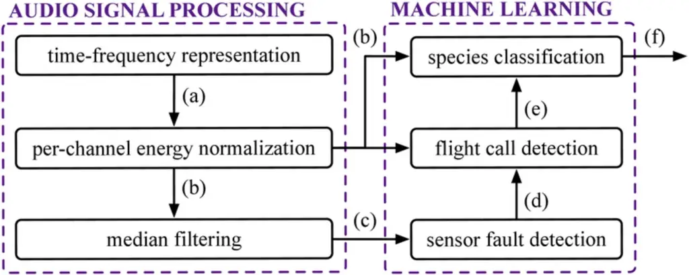

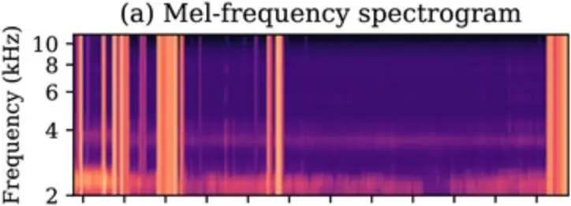

(b) Per-channel energy normalization bioRxiv preprint doi:

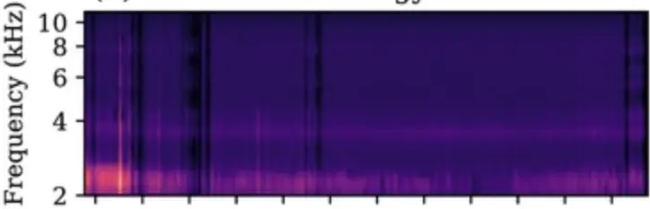

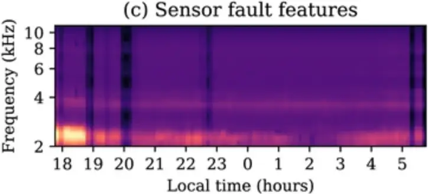

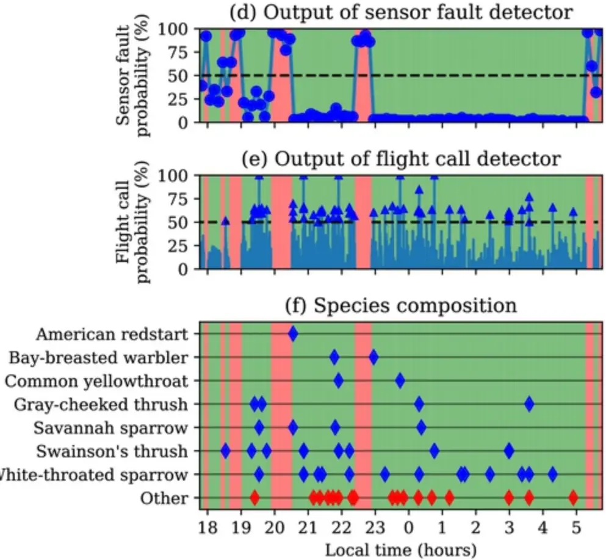

full season

;

[https://doi.org/10.1101/2022.05.31.494155](https://doi.org/10.1101/2022.05.31.494155)

this version posted May 31, 2022.

The copyright holder for this preprint (which

was not certified by peer review) is the author/funder, who has granted bioRxiv a license to display the preprint in perpetuity. It is made

available under a CC-BY 4.0 International license

sensors

2h

2h

2h

.

unlabeled

full

night

222k

2h

296h

iexternal ANAFCC

14SD

2h

2h

2h

2h

2h

2h

2h

2h

task:

detection

task:

classification

time

834

Meckienburg-Road Roat Lansing

1036

Cayuga

Heights

Ithaca East Ithaca

292

1079

anby-Road on-Road den-Road

1356

1119

Map tiles by Stamen Design, CC BY 3.0 - Map data (C) OpenStreetMap contributors

710

thaca-Rd

Taughannotk-Boulerard Freeville-Road-

139

Forttand-Road-

Virgi-Road ArDiH-as

107

-State-Route Passerines (Passeriformes)

| American Sparrows (Passerellidae) | Cardinals (Cardinalidae) | Thrushes (Turdidae) | New World Warblers (Parulidae) |
| --------------------------------- | ------------------------ | ------------------- | ------------------------------ |
| American Tree Sparrow             | Rose-breasted Grosbeak   | Gray-cheeked Thrush | American Redstart              |
| Chipping Sparrow                  |                          | Swainson's Thrush   | Bay-breasted Warbler           |
| Savannah Sparrow                  |                          |                     | Black-throated Blue Warbler    |
| White-throated Sparrow            |                          |                     | Canada Warbler                 |
|                                   |                          |                     | Common Yellowthroat            |
|                                   |                          |                     | Mourning Warbler               |
|                                   |                          |                     | Ovenbird                       |

42°32' N, 76° 10' W

42°29' N, 76° 23' W-

42°29' N, 76° 35' W-

42°28' N, 76° 28' W

42°28' N, 76° 26' W

42°25' N, 76° 31'W-

42°23' N, 76° 29' W

42°22' N, 76° 22' W -

42°21' N, 76° 18' W - August September October November

## (a) with 2 labeled samples

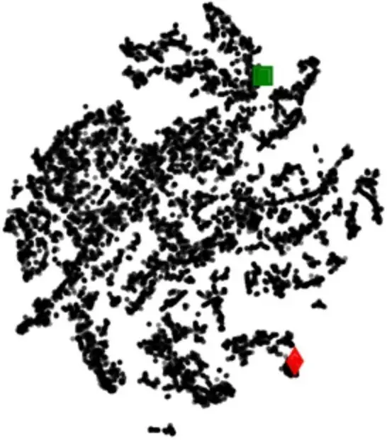

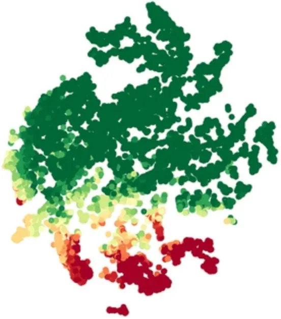

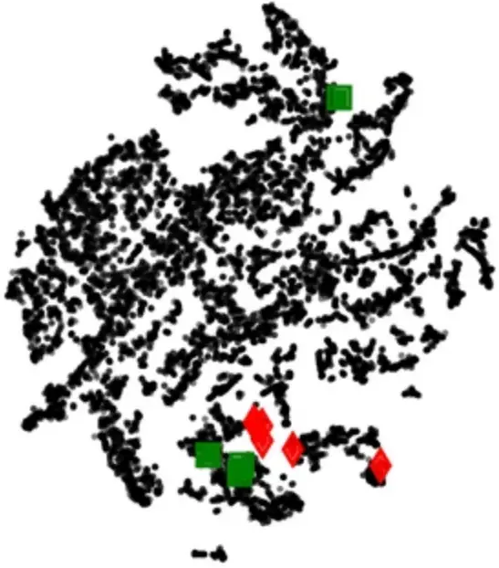

. CC-BY 4.0 International license available under a was not certified by peer review) is the author/funder, who has granted bioRxiv a license to display the preprint in perpetuity. It is made The copyright holder for this preprint (which this version posted May 31, 2022. ; https://doi.org/10.1101/2022.05.31.494155 doi: bioRxiv preprint

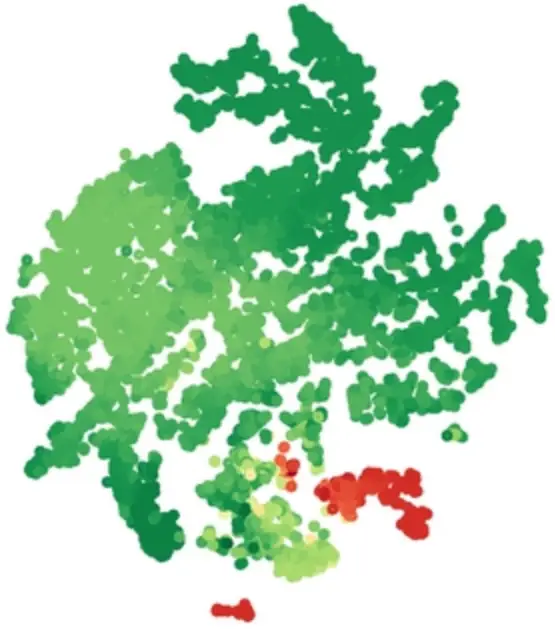

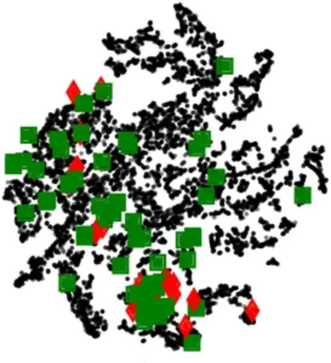

(c) with 100 labeled samples

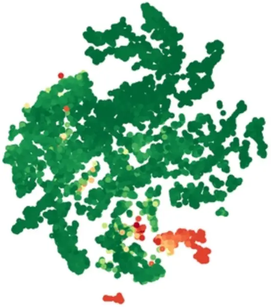

Precision

100

bioRxiv preprint doi:

;

[https://doi.org/10.1101/2022.05.31.494155](https://doi.org/10.1101/2022.05.31.494155)

this version posted May 31, 2022.

The copyright holder for this preprint (which

was not certified by peer review) is the author/funder, who has granted bioRxiv a license to display the preprint in perpetuity. It is made

available under a CC-BY 4.0 International license

45%

.

E

15%

3%

0

20

40

60

80

100

Recall (%)

80

60

40

20

0

B. Convolutional network

C. (B) + data augmentation

D. (C) + PCEN

E. (D) + context adaptation

52%

5%

B

. CC-BY 4.0 International license available under a was not certified by peer review) is the author/funder, who has granted bioRxiv a license to display the preprint in perpetuity. It is made The copyright holder for this preprint (which this version posted May 31, 2022. ; https://doi.org/10.1101/2022.05.31.494155 doi: bioRxiv preprint

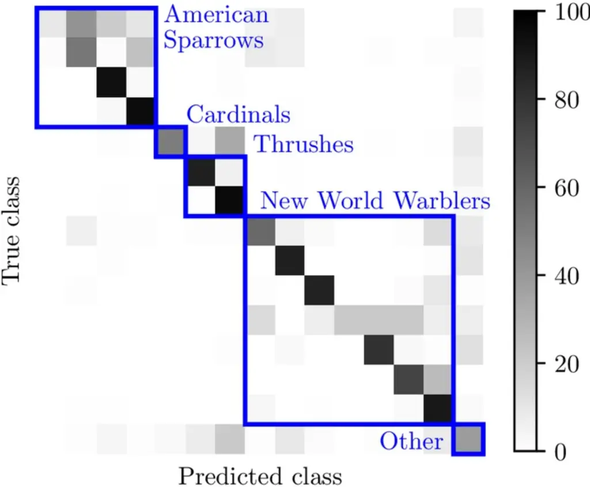

100

. CC-BY 4.0 International license available under a was not certified by peer review) is the author/funder, who has granted bioRxiv a license to display the preprint in perpetuity. It is made The copyright holder for this preprint (which this version posted May 31, 2022. ; https://doi.org/10.1101/2022.05.31.494155 doi: bioRxiv preprint w/ HC BirdVoxClassify w/o HC

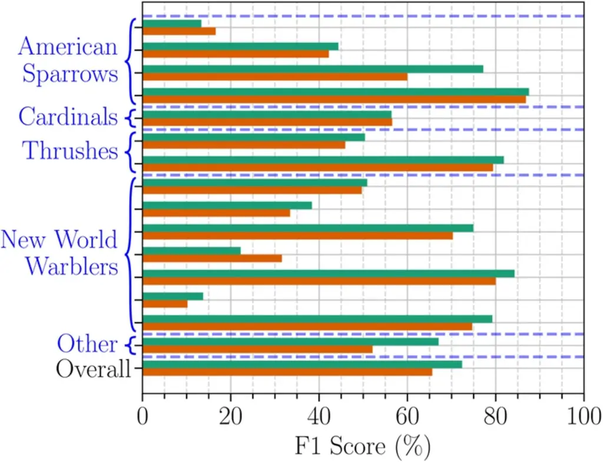

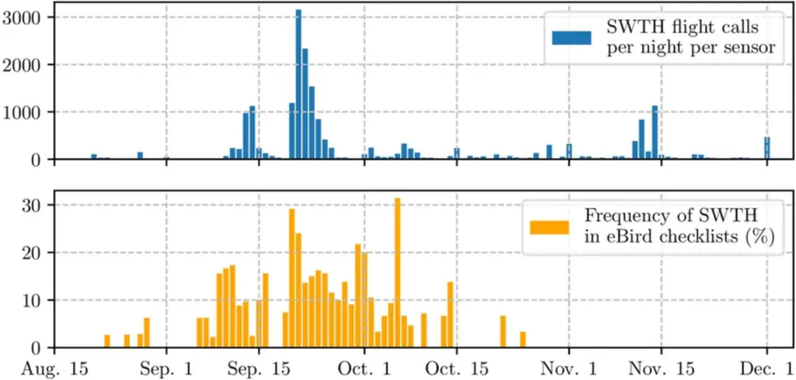

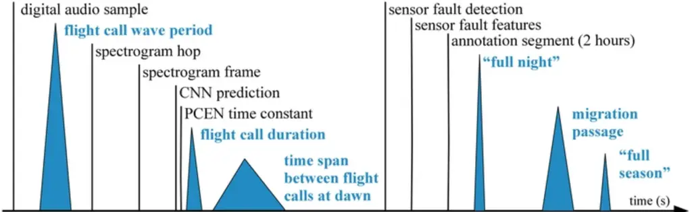

Figure 8

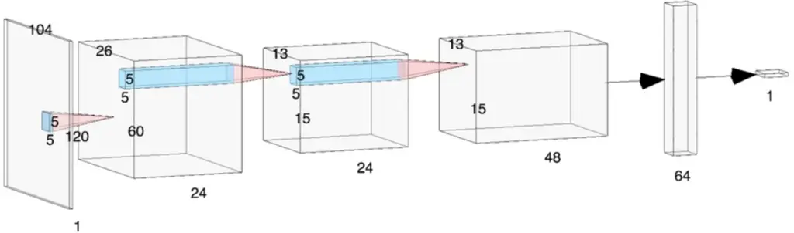

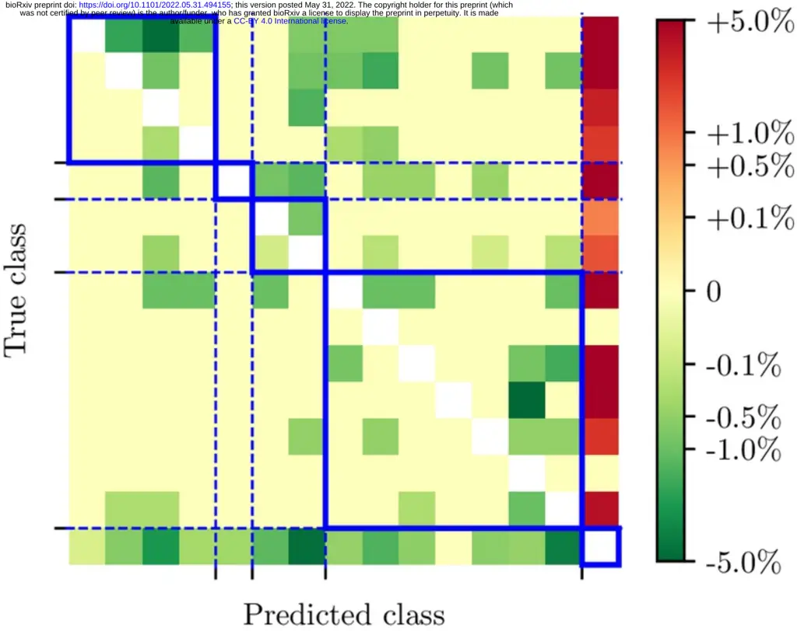
