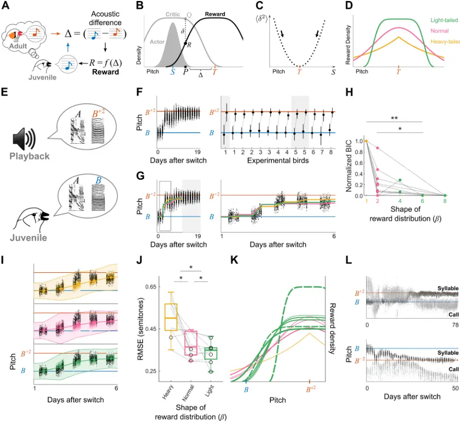
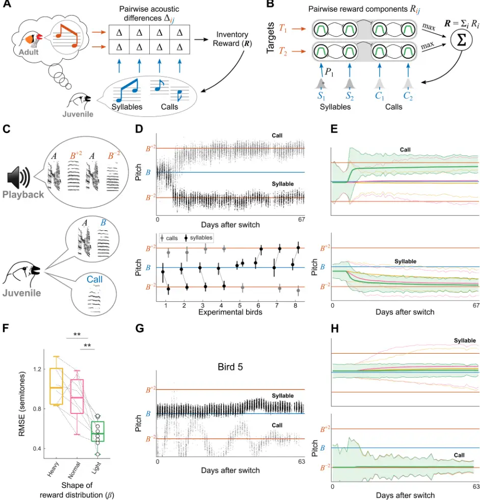
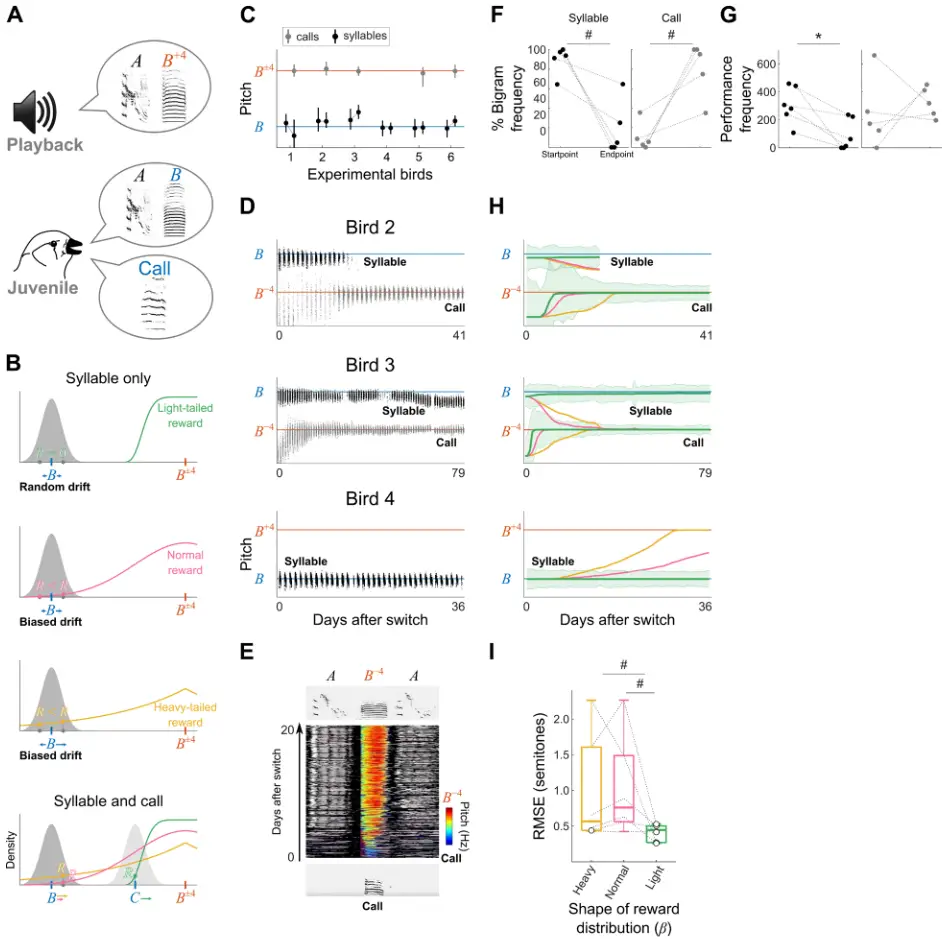
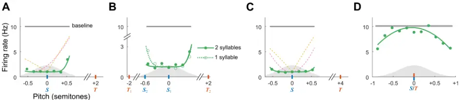
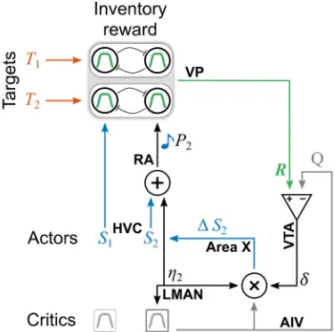
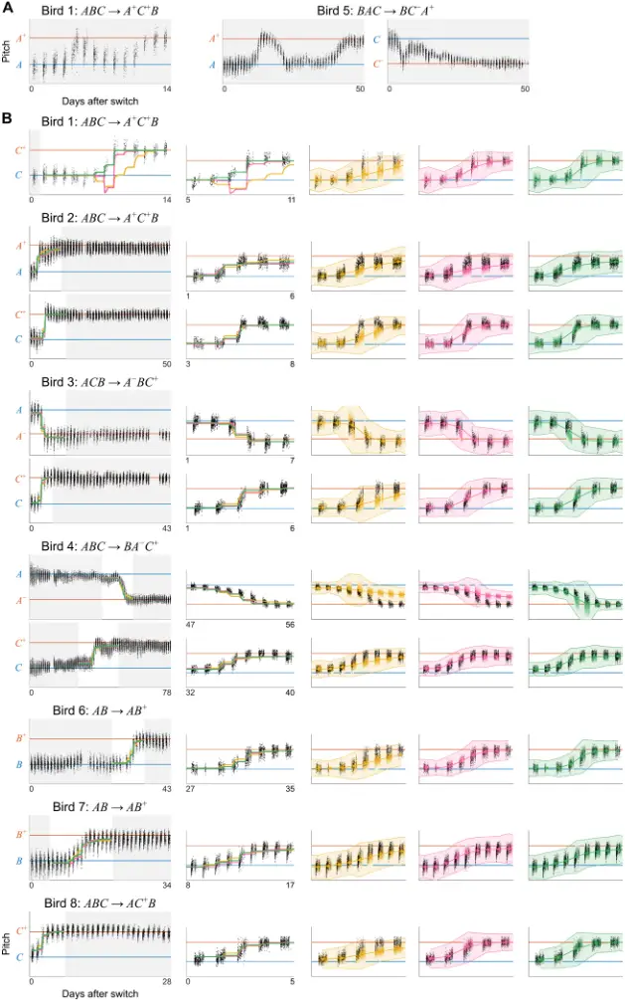
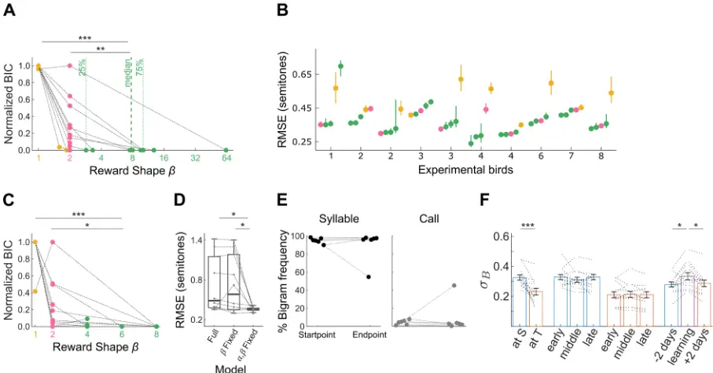
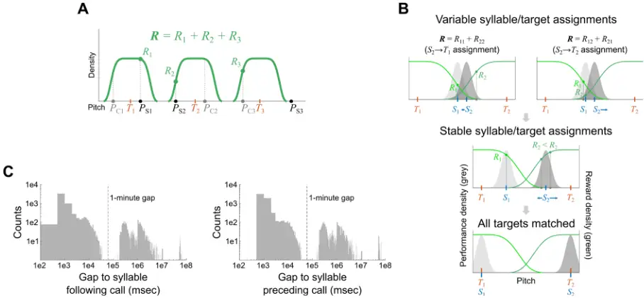
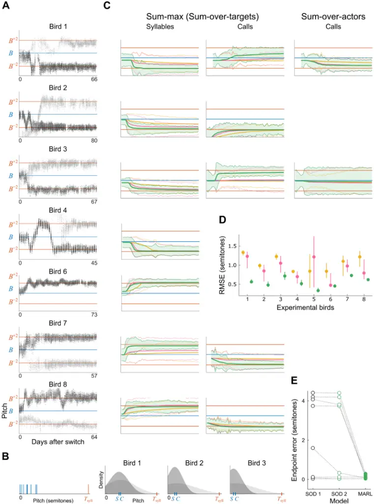
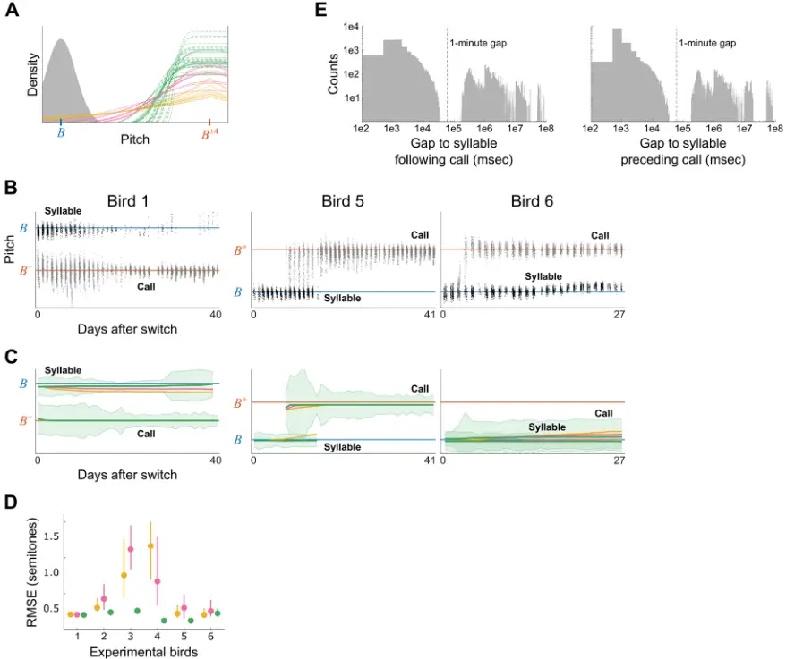

1

2

3

4

5

6

7

8

9

10

11

12

13

14

15

16

17

18

19

20

21

22

23

24

25

26

27

28

29

30

31

32

33

34

35

36

37

38

39

40

41

## Learning the sound inventory of a complex vocal skill via an intrinsic reward

Hazem Toutounji, 1, _ Anja T. Zai, 2,3 Ofer Tchernichovski, 4 Richard H.R. Hahnloser, 2,3,6 and Dina Lipkind 5,6, _ 1 Department of Psychology, University of Sheffield, Sheffield, S1 2LT, United Kingdom 2 Institute of Neuroinformatics, University of Zurich / ETH Zurich, Zurich CH-8057, Switzerland 3 Neuroscience Center Zurich (ZNZ), Zurich CH-8057, Switzerland 4 Department of Psychology, Hunter College, The City University of New York, New York, NY 10065, USA 5 Department of Biology, York College, The City University of New York, New York, NY 11451, USA 6 Senior author \*Correspondence: h.toutounji@sheffield.ac.uk (H.T.), dlipkind@york.cuny.edu (D.L.)

## Summary

Reinforcement learning (RL) is thought to underlie the acquisition of vocal skills like birdsong and speech, where sounding like one's "tutor" is rewarding. Yet, we find that the standard actor-critic RL model of birdsong learning fails to account for juvenile zebra finches' efficient learning of an inventory of multiple syllables. But when we replace a single actor with multiple independent actors that jointly maximize a common intrinsic reward, then birds' empirical learning trajectories are accurately reproduced. Importantly, the influence of each actor (syllable) on the magnitude of global reward is competitively determined by its acoustic similarity to target syllables. This leads to each actor matching the target it is closest to, and occasionally, to the competitive exclusion of an actor from the learning process (i.e., the learned song). We propose that a competitive-cooperative multi-actor (MARL) algorithm is key for the efficient learning of the action inventory of a complex skill.

## Introduction

Animal behavior provides a unique opportunity for understanding evolutionary solutions to complex learning problems. One prime example is learning the inventory of components for combinatorial vocal skills such as speech sounds or birdsong syllables. In both humans and songbirds, the acquisition of vocal skills is thought to be subserved by a reinforcement learning (RL) mechanism 1-3 , as evidenced by dopamine signaling 4-8 . Dopaminergic neurons signal reward prediction error (RPE) by increasing or decreasing their firing rate when an appetitive outcome is respectively better or worse than expected 912 . Similarly, in adult songbirds, dopaminergic projections to the basal ganglia signal whether aversive singing outcomes imposed by distorted auditory feedback are better or worse than expected 8 . Such error signal coding is at the heart of many hypothesized RL mechanisms of developmental birdsong learning 7,13,14 .

The goal of reinforcement learning is to maximize rewards, but internally motivated processes such as speech or birdsong learning readily occur in the absence of external rewards. Learning must therefore rely on intrinsically generated reward signals that are contingent on the similarity between current and target performance. It is not known what kind of RL mechanism, and which form of intrinsic reward drive the acquisition of an inventory of sounds necessary for performing combinatorial vocal sequences.

Here we attempt to infer the intrinsic reward underlying the learning of a syllable inventory in zebra finches. We assess inventory learning in terms of pitch, which zebra finches readily imitate 15,16 . Zebra finches possess vocal combinatorial ability 17 , despite typically singing a fixed syllable sequence. Juveniles

42

43

44

45

46

47

48

49

50

51

52

53

54

55

56

57

58

59

60

61

62

63

64

65

66

67

68

69

70

71

72

73

74

75

76

77

78

79

80

81

82

83

84

85

86

87

learn the syllable inventory of their target song (a memorized song of an adult 18 ) independently of syllable order, using a highly efficient "greedy" strategy 16 . Namely, they make the minimal necessary changes to the sounds in their own vocal repertoire to match the syllables in the target song. This suggests a dedicated reward computation for syllable inventory learning that is not contingent on sequential order. Our goal is to determine the functional form of the reward - namely, how it is contingent on the pitch similarity between the syllables a bird performs and the syllables in its target song.

We develop a multi-actor reinforcement learning (MARL) model where independent RL actors control the performance of distinct syllables. Akin to multi-agent learning systems 19 , actors maximize a common intrinsic reward by nullifying an RPE 8 . We implement the greedy and order-independent learning observed in zebra finches by competitive-cooperative interactions among actors: 1. actors compete over target syllables leading to each target being matched by the most similar actor; 2. actors cooperate to maximize reward that increases in proportion to the number of matched targets. Such interactions require a reward function that takes all possible pairwise actor-target comparisons into account.

We test our model against several computationally simpler alternatives on the task of simulating the empirical learning trajectories 16 of juvenile male zebra finches that are experimentally induced to learn new syllables. We find excellent agreement with data for a competitive-cooperative reward model that acts over short distances (between actors and targets) in pitch space. The model successfully predicts a competitive hierarchy between syllables and calls in an experimental test where we incite birds to exclude an existing syllable from a song and replace it with a call. We conclude by presenting the predictions of our model for the responses of dopaminergic projections to the songbird basal ganglia during the learning of a vocal inventory.

## Results

## Vocal imitation of a single syllable best agrees with a light-tailed distribution of intrinsic reward

We started with a simple one-syllable learning problem - a juvenile bird learns to adjust the pitch of a single syllable to resemble a target syllable sung by an adult "tutor" (Figure 1A). We modeled the learning system as an RL agent consisting of an actor and a critic. This agent attempts to maximize an intrinsically generated reward 𝑅𝑅 that is inversely related to pitch difference Δ between the bird's syllable and the target. The actor is a motor program that samples variable syllable instances from an underlying performance distribution parameterized by its mean 𝑆𝑆 (Figure 1B). After each instance, an intrinsic reward 𝑅𝑅 is generated from a reward distribution that is centered on a perfect imitation of the target syllable 𝑇𝑇. The actor is associated with a critic that expects maximal reward for renditions near the actor's mean performance; the critic computes the expected reward or quality 𝑄𝑄 from a distribution with the same functional form as the reward but centered at 𝑆𝑆. The actor learns by computing the difference between the received reward 𝑅𝑅 and the quality 𝑄𝑄. This difference 𝛿𝛿 = 𝑅𝑅 -𝑄𝑄 is the RPE thought to be encoded by dopaminergic neurons 8,20 . Learning is driven by minimization of the square RPE (Figure 1C). Each syllable instance leads to an update Δ𝑆𝑆 of the actor's mean performance 𝑆𝑆 according to a simple iterative rule (equation 7; Materials and Methods). This update brings the quality 𝑄𝑄 of the instance closer to the actual reward 𝑅𝑅 and makes 𝑆𝑆 more similar to the target 𝑇𝑇 (see Materials and Methods). Syllable instances in the vicinity of 𝑆𝑆 almost always result in a negative RPE. That is because the critic expects maximal reward near 𝑆𝑆, whereas the actual reward is maximal only when 𝑆𝑆 matches 𝑇𝑇. However, the RPE is larger (less negative) for instances on the target side of 𝑆𝑆 than instances on the opposite side, which is what shifts 𝑆𝑆 towards 𝑇𝑇. By construction, the RPE is zero and learning stops when 𝑆𝑆 coincides with 𝑇𝑇.

88

89

90

91

92

93

94

95

96

97

98

99

100

101

102

103

104

105

106

107

108

109

110

111

112

113

114

115

116

117

118

119

120

121

122

123

124

125

126

127

We estimated the shape of the performance distributions of zebra finch syllables from published data 16 , and found them to be Gaussian (see Materials and Methods). To estimate the distribution of the putative intrinsic reward 𝑅𝑅 as a function of pitch difference Δ, we examined a continuum of hypothetical reward distributions 𝑅𝑅(Δ), which we modeled as a generalized normal distribution 24 with two unknown parameters: the shape 𝛽𝛽 and scale 𝜍𝜍 (Figure 1D; see Materials and Methods). The scale parameter 𝜍𝜍 determines the standard deviation, and consequently the width of the distribution. The shape parameter 𝛽𝛽 produces a normal distribution for 𝛽𝛽 = 2 as a special case. Smaller values (𝛽𝛽 &lt; 2) correspond to heavy-tailed distributions, and larger values (𝛽𝛽 &gt; 2) correspond to light-tailed distributions. Heavy-tailed reward distributions exert long-range influence over syllables at a large pitch difference from the target. Light-tailed distributions exert short-range influence, rewarding only syllables that are relatively similar to the target. While previous studies have proposed either short 21 or infinite range 3 of differences from a target that can affect syllable performance, the actual range is unknown. We inferred the model parameters 𝛽𝛽 and 𝜍𝜍 by fitting our actor-critic model to actual learning trajectories from syllable-matching experiments (part of which were previously published 16 ). Juvenile males were trained with artificial song tutors 16 to shift the pitch of a syllable by two semitones to match a syllable in a tutor's song (Figure 1E), or to shift two syllables towards two different targets (in the latter case, we treated the syllables' learning trajectories as independent of each other). This task was accurately accomplished (Figure 1F) regardless of whether the pitch was shifted up or down, which agrees with our assumption that the intrinsic reward distribution is symmetrical (13 syllables in 8 birds; 3 syllables were excluded from further analysis due to oscillating trajectories; Figure S1) 16 . Because we were interested in whether reward functions are qualitatively sub- or super-Gaussian, we evaluated fit quality as a function of 𝛽𝛽 by fixing 𝛽𝛽 to distinct values and inferring 𝜍𝜍 via maximum likelihood estimation, or MLE (Figures 1G and S1B; see Materials and Methods). In 8 out of 10 trajectories on which model parameters were inferred, light-tailed reward distributions (𝛽𝛽 = 4, 6, or 8) resulted in better fits (i.e., lower Bayesian Information Criterion, or BIC, scores) than normal (𝛽𝛽 = 2) and heavy-tailed (𝛽𝛽 = 1) distributions (Benjamini-Hochberg corrected Wilcoxon signedrank test on non-normalized BICs; Figures 1H and S1B). We obtained similar results when we estimated the 𝛽𝛽 jointly with other model parameters (Figure S2A). BIC scores alone, however, are insensitive to overfitted models that fail to generalize to unseen data. Therefore, we also performed a bootstrap analysis by simulating multiple learning trajectories for each ML estimate of 𝛽𝛽 (Figures 1I and S1B). Light-tailed reward distributions resulted in improved goodness-of-fit (i.e., smaller Root-Mean-Square Error, or RMSE), between empirical and simulated trajectories in 6 out of 10 cases (Figures 1J and S2B); in 4 of 10 cases in which the light-tailed model was not the best, the decrease in goodness-of-fit was small compared to heavy-tailed and normal models (Figure 1K). These results suggest that a light-tailed reward distribution guides the shift in syllable performance towards a match with a target. Namely, a syllable instance triggers a non-zero intrinsic reward only if it is sufficiently similar to a target syllable. This solution is a special case of the multi-syllable inventory learning problem that we turn our attention to next.

128

129

130

131

132

133

134

135

136

137

138

139

140

141

142

143

144

Figure 1: Vocal imitation of a single syllable best agrees with a light-tailed distribution of intrinsic reward

A. A juvenile male zebra finch adjusts the performance of a syllable (blue) to acoustically match its target - an adult "tutor's" syllable (orange); learning maximizes an intrinsic reward 𝑅𝑅 that is inversely related to pitch difference Δ between the juvenile's syllable and the target. B. An actor-critic model for learning a syllable: the actor is a motor program that generates syllable instances 𝑃𝑃 from a distribution with mean 𝑆𝑆. The critic estimates an expected reward 𝑄𝑄 for each instance and compares that to the intrinsic reward 𝑅𝑅, resulting in a reward prediction error (RPE) 𝛿𝛿 = 𝑅𝑅 -𝑄𝑄. We assume that 𝑄𝑄 and 𝑅𝑅 have identical distributions, with 𝑅𝑅 being maximal at a perfect imitation of the target (Δ = 0), and 𝑄𝑄 being maximal at the motor program mean 𝑆𝑆. C. The motor program mean 𝑆𝑆 is updated to minimize the mean squared RPE 𝛿𝛿, which is at its minimum when 𝑆𝑆 equals 𝑇𝑇 (see Eqs. 6 and 7 in Materials and Methods). D. Hypothetical intrinsic reward distributions modelled as a generalized normal distribution. The shape parameter beta determines whether a distribution is light-tailed (𝛽𝛽 &gt; 2; green), heavytailed (𝛽𝛽 &lt; 2; yellow) or normal (𝛽𝛽 = 2; magenta). E. A syllable-matching experiment: a bird that has learned a two-syllable song 𝐴𝐴𝐴𝐴 is induced to learn a new song, 𝐴𝐴𝐵𝐵±2 , where the pitch of syllable 𝐵𝐵±2 is two semitones above or below that of 𝐵𝐵 (an 𝐴𝐴𝐴𝐴 → 𝐴𝐴𝐵𝐵+2 experiment is shown). F. Left, learning trajectory of an experimental bird trained with the task in E, showing the median pitch of consecutive instances of syllable 𝐵𝐵 after the presentation of the new tutor song (day 0); blue and orange lines represent the pitch of syllables 𝐵𝐵 and 𝐵𝐵+2, respectively. Right,

145

146

147

148

149

150

151

152

153

154

155

156

157

158

159

160

161

162

163

164

165

166

167

168

169

170

171

172

173

174

175

176

177

178

179

180

181

182

183

184

185

186

187

188

189

190

191

learning outcomes in all experimental birds trained with 2-semitone pitch shifting tasks, showing pitch distributions (median and 95% confidence interval, CI) at the start point and end point of learning for each shifted syllable, connected by dotted lines (13 syllables in n = 8 birds; orange line, the absolute pitch difference between 𝐵𝐵 and 𝐵𝐵±2). Grey shading denotes 3 syllables excluded from parameter estimation due to lack of convergence (see Figure S1A). G. Left, inferred mean pitch shifting trajectories fitted with MLE to the learning trajectory of the experimental bird in F left, assuming reward distributions with different values of 𝛽𝛽 (colors as in D). Right, zoom-in on the learning part of the trajectory (see Figure S1B). H. Bayesian Information Criterion (BIC) for each syllable trajectory, assuming reward distributions with different shapes (values of 𝛽𝛽; dashed lines connect same-syllable data; n = 10). BIC scores for each syllable are normalized such that 1 corresponds to the worst and 0 to the best fit. Light-tailed reward improves BIC scores compared to heavy-tailed and normal reward (\*=p&lt;0.05, \*\*=p&lt;0.01; Benjamini-Hochberg corrected Wilcoxon signed-rank test; cf. Figure S2). I. Observed (black) and bootstrapped (color) pitch trajectories of the pitch-shifted syllable shown in F left. Shaded area represents median ± 50% CI of simulated trajectories. Colors as in D. Color gradient represents bootstrap density. J. Root-mean-square error (RMSE) between observed and bootstrapped learning trajectories (dashed lines connect same-syllable data; open circles represent the RMSE of the best reward model per syllable). Light-tailed reward improves goodness-of-fit compared to heavy-tailed and normal reward (p &lt; 0.05, Benjamini-Hochberg corrected Wilcoxon signed-rank test; see Figure S2). K. Best (smallest RMSE) reward distribution for each empirical learning trajectory (colors as in D; solid green: 𝛽𝛽 = 4, dashed green: 𝛽𝛽 = 6). Thicker lines represent larger improvement by the best model compared to the second best. L. Two examples of a syllable that shifted to match a target although a call was initially closer.

## Imitation of a multi-syllable inventory best agrees with light-tailed reward distributions combined in a hierarchical sum-max operation

As a first step in modeling the learning of a multi-syllable inventory, we investigated the respective roles of syllables and calls in learning. Birds use both syllables and calls in their vocal repertoire to match syllables in their target song 16,17,22 , but previous findings 16 suggest that calls are only used in cases where there are more targets than syllables in a bird's song. We reinspected previously published data, and indeed found that when there is an equal number of syllables and targets, birds used syllables to match targets even when there were acoustically closer calls in their repertoire (figure 1L). We therefore decided to model inventory learning as a hierarchical process that prioritizes syllables over calls: a call that is similar to a target will be ignored when a less similar syllable is also present within reward range. Next, we set up to extend our reward model for learning a single target (Figure 1B-C) to the parallel learning of multiple targets (taking into account both syllables and calls in the bird's repertoire, Figure 2A). For that purpose, we used the inferred reward distribution contingent on the pairwise pitch difference between a syllable and a target (Figure 1G-K) as a functional component (or a basis function); we defined a global inventory reward 𝑹𝑹 as a function of all reward components 𝑅𝑅𝑖𝑖𝑖𝑖 associated with pairing target 𝑖𝑖 with syllable (or call) 𝑗𝑗 (Figure 2B). Importantly, this approach allowed us to generalize the model from single to multiple targets without introducing any new model parameters. The global reward function 𝑹𝑹 must reproduce the context-independent and greedy syllable learning trajectories observed in zebra finches. Context-independence with respect to target positions can be achieved via the sum operation due to its associative property (a sum does not depend on the order in which the summands are added, i.e., it is permutation insensitive). Greedy matching of targets by syllables can be achieved by the maximum operation (which ignores all values smaller than the maximum). Accordingly, we constructed the inventory reward 𝑹𝑹 as a sum-max operation over pairwise reward components 𝑅𝑅𝑖𝑖𝑖𝑖 (Figure 2B): namely, it is a sum 𝑹𝑹 = ∑ 𝑅𝑅𝑖𝑖 𝑖𝑖 of partial rewards, where the partial reward 𝑅𝑅𝑖𝑖 = 𝑚𝑚𝑚𝑚𝑥𝑥𝑗𝑗𝑅𝑅𝑖𝑖𝑖𝑖 associated with target 𝑖𝑖 is given by the maximal pairwise reward that can be obtained for that target, i.e., it is computed with respect to the most acoustically similar vocalization. To implement the prioritization of syllables over calls, the maximum operation in our model is a hierarchical two-stage process: in a first stage, the maximum is taken over syllables, and if no syllable is within the

192

193

194

195

196

197

198

199

200

201

202

203

204

205

206

207

208

209

210

211

212

213

214

215

216

217

218

219

220

221

222

223

224

225

226

227

228

229

230

231

232

233

234

235

236

237

238

reward range, then in a second stage, the maximum is taken over calls (see Materials and Methods and Figure S3A). Note that such a two-stage maximum operation can naturally emerge from a light-tailed reward component because the latter approximates a decision-making process driven by reward being either inside or outside some range. In contrast, normal and heavy-tailed models are less binary in nature and so an explicit decision-making step would be required to implement a prioritization of syllables over calls. The inventory reward 𝑹𝑹 is delivered to a group of actors (each as in Figure 1B), one actor per vocalization type (syllable or call; Figure 2B). Actors produce vocalizations independently of each other, and each learns to adjust its mean performance based on the identical reward 𝑹𝑹 they receive. We assume that reward 𝑹𝑹 is delivered after each syllable or call instance (rather than at the end of a song) and that partial rewards 𝑅𝑅𝑖𝑖 are computed with respect to the syllable or call instance just performed and the means 𝑆𝑆 (i.e., motor memories) of the other syllables and calls in the bird's current inventory (see Materials and Methods and Figure S3B). Upon production of an instance, an actor learns from the RPE which is defined as the difference between the inventory reward 𝑹𝑹 and an expected reward 𝑄𝑄 computed by this actor's critic (see Eq. 11 in Materials and Methods). By construction, the RPE is zero and learning stops when each target is matched by an actor's mean. To test our model, we used data of a published set of multi-syllable learning experiments 16 , where juvenile males were induced to learn two new targets, both of which resembled a single syllable in their current song (i.e., were pitch-shifted by two semitones up and down from that syllable, Figure 2C). Birds predominantly shifted the pitch of the syllable to match one of the new targets and recruited a call to match the other target (7 of n = 8 birds, Figures 2D and S4A). Consistent with a prioritization of syllables over calls, the song syllable shifted towards the target to which it was more similar (Figures S4A and S4B, left), while the call shifted to the other target, even when it was more similar to the target matched by the syllable (3 out of 8 cases, Figures S4A and S4B, right; these findings were not published in Lipkind et al., 2017 16 ). We compared simulated and empirical learning trajectories (as in Figure 1I), in terms of both learning endpoint and trajectory shape. We compared simulated learning trajectories generated by light-tailed, normal, and heavy-tailed variants of the model (with model parameters as inferred in Figure 1, except for the performance distributions' initial means and daily variances which we estimated in each bird separately). The light-tailed model was significantly better at matching the empirical trajectories (Figures 2E-2F, S4C, left and middle, and S4D), including the replication of a failure of a bird to match one of the targets (Figures 2G-H). In that bird, the performance distribution of the song syllable is relatively narrow, and consequently lies outside the range of light-tailed reward distributions but is within the ranges of normal and heavy-tailed distributions. Therefore, only the light-tailed distribution correctly predicts the failed shifting of the syllable in this bird (Figure 2H, top). The light-tailed variant of our sum-max MARL model produces good fits with empirical data, but a summax reward is computationally intense, requiring all possible pairwise similarity evaluations at each step. We tested two alternative reward models to see if simpler reward computations can provide comparable results. First, we tested a sequential-order-dependent (SOD) model, previously proposed by Fiete and colleagues 3 (see Materials and Methods). In the SOD model, the reward delivered after each vocalization instance is a function of the similarity between that instance and the temporally aligned target (rather than of all possible pairwise similarities). In addition, target syllables have an infinite range of influence - i.e., they can attract even very dissimilar vocalizations. This is achieved via a binarized reward with an adaptive threshold that guarantees equal numbers of rewarded and unrewarded

instances at any pitch distance from a target 3 . In contrast to the sum-max model, which made the

239

240

241

242

243

244

245

246

247

248

249

250

251

252

253

254

255

256

257

258

259

260

261

262

263

264

265

correct (empirically observed) assignment of syllables to targets in 8 out of 8 cases, the SOD model succeeded in 3 cases only (Figure S4E, SOD 1 model). The context-dependent evaluation algorithm in the SOD model led to an incorrect assignment of temporally aligned targets in 4 cases where birds shifted a syllable to a misaligned target, while the binarized reward computation did not predict the observed failure of one bird (Figure 2G) to shift a syllable to a target. In total, the SOD model resulted in a large simulation error in 5 out of 8 birds, compared to near zero simulation error with the sum-max model. We also tested a variant of the SOD model with a light-tailed reward computation (SOD 2 model; see Materials and Methods), which correctly predicted the case of failed shifting, but did not predict the matching of misaligned targets, resulting in very large errors in 4 out of 8 birds (Figure S4E).

Next, we tested a reward model, which like the sum-max MARL model, is context-independent and competitive, but where instead of actors competing over targets, the targets are competing over actors (a sum-over-actors MARL model). Instead of selecting the most acoustically similar actor for each target, we select the most acoustically similar target for each actor, then sum the reward contributions of the winning targets, so that each actor ends up matching the target that is most similar to it. This model is computationally simpler than the sum-max model, since each step involves only the pairwise comparisons between a given actor and each of the targets, rather than all possible comparisons. However, the sum-over-actors model would not ensure that all targets are matched in cases where a target is not closest to any syllable or call. We therefore tested model predictions in two cases where the syllable and the call start-points were closer to the same target and were both within the reward range of both targets (Birds 1 and 3, Figure S4C, right). We ran simulations of the sum-over-actors model using heavy-tailed, normal, and light-tailed reward components as before. In each case, the sum-overactors model predicted that the call and syllable will match the same target, contrary to the empirical data. In summary, a sum-max MARL reward model with light-tailed components significantly outperformed computationally simpler models in reproducing empirical multi-syllable learning trajectories.

266

267

268

269

270

271

272

273

274

275

276

277

B

Figure 2: Imitation of a multi-syllable inventory best agrees with light-tailed reward distributions combined in a hierarchical sum-max operation

A. Learning a multi-syllable inventory, driven by a putative intrinsic scalar inventory reward 𝑹𝑹, which depends on the pairwise pitch differences Δ𝑖𝑖𝑖𝑖 between the learner's vocalizations (syllables and calls) and the targets provided by a tutor. B. A hypothesized computation of inventory reward 𝑹𝑹 from pairwise light-tailed reward components 𝑅𝑅𝑖𝑖𝑖𝑖 (circles) that are contingent on syllable-target (or call-target) pitch differences. The reward 𝑹𝑹 is the sum of partial rewards 𝑅𝑅𝑖𝑖 computed for each target 𝑇𝑇𝑖𝑖 via a hierarchical max operation over pairwise reward components. Inhibition (curved lines) among pairwise reward components leads to competition among actors and inhibition from syllables onto calls leads to prioritization of syllables over calls. C. Example of a multi-syllable matching experiment, in which a bird that has learned a two-syllable song 𝐴𝐴𝐴𝐴 is induced to learn a new song with two new

278

279

280

281

282

283

284

285

286

287

288

289

290

291

292

293

294

295

296

297

298

299

300

301

302

303

304

305

306

307

308

309

310

311

312

313

314

315

316

317

318

319

320

321

322

323

324

325

target syllables 𝐵𝐵+2 and 𝐵𝐵-2, with pitch two semitones above and below that of 𝐵𝐵, respectively. The bird's repertoire includes song syllables and calls. D. Top, pitch trajectory in one experimental bird trained with the task in C (notation as in Figure 1F): the bird matched one target by shifting the pitch of song syllable 𝐵𝐵 (black), and the other target by shifting the pitch of a call (grey). Bottom, results across experimental birds (n = 8), showing pitch distributions at start point and endpoint of learning as in Figure 1E (see also Figure S4A). 7 out of 8 birds matched one target with a song syllable (black circles), and the other target with a call (grey circles). Bird 5 matched only 𝐵𝐵with a call but did not shift syllable 𝐵𝐵 to 𝐵𝐵+. E. Bootstrapped pitch-trajectory distributions of the call (top) and syllable (bottom) of the experimental bird shown in D top. Median ± 50% CI are shown for the light-tailed (shaded), normal and heavy-tailed reward models (colors as in Figure 1D; also see Figure S4B). F. Root-mean-square error (RMSE) between experimental and bootstrapped syllable learning trajectories. Notation as in Figure 1I. Light-tailed rewards improve goodness-of-fit compared to heavy-tailed and normal rewards (p&lt;0.01, Benjamini-Hochberg corrected Wilcoxon signed-rank test, see also Figure S4D). G. Pitch trajectories of song syllable 𝐵𝐵 and call in an experimental bird that failed to match one of the targets (bird 5 in D bottom). H. Same as E for the bird shown in G (top: syllable; bottom: call). Only the light-tailed reward model predicts the failure to shift song syllable 𝐵𝐵 towards a target.

## Light-tailed sum-max intrinsic reward predicts the exclusion of a syllable from a song and its replacement with a call

The case of a bird failing to match a target (Figure 2G) raises an interesting question: what happens when there is a target that does not have any syllables in its reward range, and a syllable that is not within the reward range of any target? In such a case, our model predicts that the syllable would not shift from its mean (and in effect be dropped from the learning process), and that a nearby call could shift to the unoccupied target (since there are no syllables in that target's reward range). We reinspected the data of the bird shown in Figure 2G to search for a call performed in the acoustic vicinity of the unmatched target but found that no such call was present. Nevertheless, the possibility of a song syllable being left out in favor of a call triggered our interest and we decided to further investigate this

prediction of our model. We presented juvenile male zebra finches (n = 6) with a learning task in which one syllable in the target song is shifted up or down by 4 semitones with respect to a syllable in the bird's current song (𝐴𝐴𝐴𝐴 → 𝐴𝐴𝐵𝐵±4 ; Figure 3A). In this experimental situation, there is a single off-target syllable in the bird's song, 𝐵𝐵, and a single unmatched target in the tutor song, 𝐵𝐵±4 , but the two are separated by a relatively large pitch difference. A hierarchical sum-max reward computation based on light-tailed components predicts that song syllable 𝐵𝐵 is outside the reward range of the target syllable 𝐵𝐵±4 (Figure S5A) and therefore, that it will not shift to match the target. Consequently, if the bird's repertoire happens to contain a call 𝐶𝐶 that is within the reward range of the target, the call will shift to match it instead. In contrast, normal and heavy-tailed versions of the model predict that song syllable 𝐵𝐵 is within the reward range of a 4semitone-shifted target, and therefore will shift to match it, even if there is an acoustically closer call in the bird's repertoire (Figure 3B), since syllables are prioritized over calls. None of the six experimental birds shifted song syllable 𝐵𝐵 towards target 𝐵𝐵±4 (Figures 3C-D and S5B). In 5 out of 6 birds, 𝐵𝐵±4 was instead matched by a call (or another sound originally performed outside of the song motif), which was initially acoustically closer to the target (e.g., Figure 3D, birds 2 and 3). In all 5 cases, the call was fully or partially incorporated into the song motif (Figure 3E), replacing song syllable 𝐵𝐵. This was evident from an increase in the frequency of transitions between the call and motif syllables, and a concurrent decrease in the frequency of transitions between song syllable B and other motif syllables (Figure 3F; cf. Figure S2E). In addition, the performance rate of syllable B decreased (Figure 3G), with two of the birds stopping performing syllable 𝐵𝐵 altogether (bird 2, Figure 3D, and bird 5, Figure S5B). We conclude that syllable 𝐵𝐵 was functionally dropped from the song motif, and its function was

326

327

328

329

330

331

332

333

334

335

336

337

338

339

340

341

342

343

344

transferred to a call. In the single case where no call shifted to match target 𝐵𝐵±4 , the bird continued performing syllable 𝐵𝐵 at the original pitch (bird 4, Figure 3D). We tested how well a light-tailed sum-max model fits empirical learning trajectories, compared to normal and heavy-tailed models, by simulating learning trajectories of both syllables and calls (Figures 3H-I and S5C-D). All simulations used previously estimated parameters (Figure 1), without further adjustments to the new data except for the performance distributions' initial mean pitches and daily variances which we estimated in each bird separately. The light-tailed model was superior to normal and heavy-tailed model variants, returning smaller errors between simulated and empirical learning trajectories in 5 out of 6 birds (Figure 3I), and replicating the failure of the bird that did not have a call at the acoustic vicinity of the 𝐵𝐵±4 target to accomplish the learning task (bird 4, Figure 3H). In summary, the experimental outcomes support the predictions of a light-tailed sum-max reward computation with prioritization of syllables over calls. These results demonstrate a surprising feature of vocal learning in zebra finches, which is a direct consequence of a competitive and light-tailed reward computation: an intrinsic reward is not necessarily contingent on all syllables a bird is performing, but only on those syllables that are sufficiently similar to at least one syllable in the target song. Syllables that are too dissimilar to contribute to the reward computation end up being dropped (fully or partially) from the song motif. These findings underscore a considerable modularity and flexibility of zebra finches' developing songs and raise the interesting question of the adaptive value of such modular vocal development in birds' complex natural social environment.

. CC-BY-NC-ND 4.0 International license available under a (which was not certified by peer review) is the author/funder, who has granted bioRxiv a license to display the preprint in perpetuity. It is made The copyright holder for this preprint this version posted June 13, 2023. ; https://doi.org/10.1101/2022.09.27.509691 doi: bioRxiv preprint

345

346

347

348

349

350

351

352

353

354

355

356

357

358

Figure 3: Light-tailed sum-max intrinsic reward predicts the exclusion of a syllable from a song and its replacement with a call

A. A syllable-matching experiment testing the prediction of a syllable being excluded from the song: a bird that has learned a two-syllable song 𝐴𝐴𝐴𝐴 is induced to learn a new song 𝐴𝐴𝐵𝐵±4 where the target 𝐵𝐵±4 is 4 semitones above or below the song syllable 𝐵𝐵 (an 𝐴𝐴𝐴𝐴 → 𝐴𝐴𝐵𝐵+4 experiment is shown). The bird's repertoire includes song syllables and calls. B. Predictions of light-tailed, normal, and heavy-tailed versions of a MARL sum-max reward model for the experiment in A. Performance distribution of song syllable 𝐵𝐵 (grey) and reward distributions centered on the target 𝐵𝐵±4 (colors as in Figure 1D) are shown. In a model based on light-tailed reward components, syllable 𝐵𝐵 will not shift towards the target even if it is the most acoustically similar element to 𝐵𝐵±4 (top), because it is outside of the reward range. If a call in the bird's repertoire is acoustically closer to 𝐵𝐵±4 (bottom, light grey), that call will shift to match the target. In contrast, normal and heavy-tailed versions of the model predict that syllable 𝐵𝐵 will shift to match 𝐵𝐵±4 in any case, even if there is an acoustically closer call (middle and bottom). C. Results across experimental birds (n = 6) trained with the task in A. Notation as in Figure 2D. D. Learning trajectories of three

359

360

361

362

363

364

365

366

367

368

369

370

371

372

373

374

375

376

377

378

379

380

381

382

383

384

385

386

387

388

389

390

391

392

393

394

395

396

397

398

399

400

401

402

403

404

405

experimental birds; from top to bottom: Bird 2 matched target 𝐵𝐵-4 with a call and stopped performing syllable 𝐵𝐵; Bird 3 matched target 𝐵𝐵-4 with a call and did not shift the pitch of syllable B; Bird 4 did not shift the pitch of syllable B, and did not recruit a call to match target 𝐵𝐵+4 (see also Figure S5B). E. Stack plot of consecutive instances of a call that shifted to match the target 𝐵𝐵-4 in bird 2 (D). Colors, pitch in call instances; greyscale, Wiener entropy in neighboring syllables. Sonograms show examples of the call performance at experiment start (bottom) and end (top). The call, initially performed outside the song motif (bottom), was incorporated into the song (top). F. Left, performance frequency of bigrams containing song syllable 𝐵𝐵 and other motif syllables (% of total bigrams) at experimental startpoint and endpoint across birds. Right, same as left for the call that shifted to match target 𝐵𝐵±4 in 5 of the 6 experimental birds. Syllable-containing bigrams decreased from start to endpoint of learning, while call-containing bigrams increased, indicating that the call was incorporated into the song motif while syllable 𝐵𝐵 was dropped out (p = 0.0625, Wilcoxon signed-rank test). G. Performance frequencies of syllable 𝐵𝐵 (left) and the call (right) that shifted to match target 𝐵𝐵±4 (3-day average of total syllables performed) at the start and endpoint across birds. Syllable performance decreased significantly (p = 0.0312, Wilcoxon signed-rank test) while call performance increased in 3 out of 5 birds. H. Bootstrapped pitch-trajectory distributions of the syllable (top) and call (bottom; 2 out of 3 birds) of the three birds shown in C. Colors as in Figure 2E. The shaded area represents the median ± 50% CI (see also Figure S5C). Note that under normal and heavy-tailed models, the syllable and the call can converge to the same target, which is possible when two actors are within the reward range of a single and common target (also see Discussion). I. Root-mean-square error (RMSE) between experimental and bootstrapped syllable learning trajectories. Open circles represent the RMSE of the best reward model per bird. Light-tailed reward shows a tendency to improve goodness-of-fit compared to heavy-tailed and normal rewards (#: 0.05 &lt; p &lt; 0.1, Benjamini-Hochberg corrected Wilcoxon signed-rank test).

## Predicted tuning of error-encoding dopaminergic VTA neurons during the learning of a syllable inventory

The intrinsic inventory reward in our model is fed into a computation of the RPE 𝛿𝛿, which tracks deviations from expected reward (Figure 1B and Materials and Methods). Assuming that 𝛿𝛿 is proportional to the putative firing rate of dopaminergic neurons projecting into the avian song system, our model provides predictions for dopaminergic firing in juvenile birds learning a multi-syllable inventory (Figure 4). We present our model's predictions in a juvenile bird at the onset of learning in each of our three experimental scenarios: Learning a single target syllable shifted by 2 semitones from a syllable in the bird's song (Figure 1D), leaning two different 2-semitone-shifted targets (Figure 2C), and learning a 4-semitone-shifted target (Figure 3A). In the case of learning a single 2-semitone-shifted target (Figure 4A), the light-tailed reward model predicts selective tuning of VTA neurons to pitch values at the target-adjacent tail of the performance distribution (i.e., target selectivity) so that syllable pitch is driven in the direction of higher firing rate, i.e., smaller deviation from the target. However, target selectivity is restricted to a small range of pitch values at the tail, where the performance distribution overlaps with the light-tailed reward distribution. This means that VTA tuning is mostly insensitive to variations in pitch difference Δ between syllable and target pitch. This is consistent with reports of weak sensitivity of VTA response to the magnitude of negative RPEs upon external reinforcement 8,23,24 , which comes here as a direct consequence of the intrinsic light-tailed reward. The heavy-tailed and normal reward models also predict target selectivity of VTA neuron responses but fail to account for insensitivity to variations in Δ. In the case of learning two different 2-semitone-shifted targets (Figure 4B), VTA tuning is expected to depend not only on the performance distribution of the currently sung syllable, but also on the distributions of other syllables (or calls) in a bird's repertoire: The absence of competing syllables (i.e., of syllables that are within the reward range of one of the targets) would result in a symmetric VTA tuning (although in practice, a syllable would always be slightly closer to one of the targets, resulting in a slight

406

407

408

409

410

411

412

413

414

415

416

417

418

419

420

421

422

423

424

425

426

427

428

429

430

431

432

433

434

435

436

437

438

439

440

441

442

443

asymmetry). In contrast, a competing syllable proximal to one target would break this symmetry, rendering the VTA neuron more selective to the other target.

In the case of a 4-semitone target (Figure 4C), the light-tailed reward model (in contrast to the heavytailed and normal reward models) predicts lack of target selectivity due to the reward being practically zero. This would lead to the syllable pitch drifting randomly around its mean (Figures 3B-D). Note that the zero-reward implies that the RPE 𝛿𝛿 ≈ -𝑄𝑄, which means the firing rate increases slightly with increased distance from the mean.

Finally, when a syllable matches a target (Figure 4D), i.e., in adult birds that have learned their song, the model predicts a flat pitch tuning curve due to absence of RPE. In reality, however, small pitch fluctuations 25 are predicted to lead to the emergence of inverted-U tuning because the intrinsic reward decreases away from the target.

In summary, our model predicts that the syllable-related (or call-related) tuning of VTA neurons depends dynamically on the pitch difference between the vocalization and the target it is closest to. This leads to both asymmetric (Figures 4A-B) and symmetric (Figures 4B-D) tuning curves in dopaminergic neurons, and the symmetric curves can be either concave (Figure 4C) or convex (Figure 4D). Inverted-U and asymmetric tuning curves as in Figures 4A and 4D have been reported in adult birds 20 , but our predictions on tuning in juveniles including the dependence on multiple proximal syllables and calls (Figure 4B) remain to be explored.

Figure 4: Predicted tuning of error-encoding dopaminergic VTA neurons during the learning of a syllable inventory

A. Predicted VTA tuning as a function of pitch in the case of a target (𝑇𝑇, orange) shifted by 2 semitones with respect to a song syllable (𝑆𝑆, blue). Green, theoretical (solid line) and simulated (filled circles) VTA tuning predicted by a light-tailed reward. Dashed lines, theoretical VTA tuning predicted by the heavy-tailed reward (yellow) and normal reward (magenta). B. Predicted VTA tuning in the case of two targets (𝑇𝑇1 and 𝑇𝑇2). When a single syllable 𝑆𝑆1 is at a distance of 2 semitones from both targets, VTA tuning is symmetrical (dotted line, empty circles). The presence of a second syllable 𝑆𝑆2 between 𝑆𝑆1 and 𝑇𝑇1 breaks this symmetry, resulting in the VTA neuron firing more following instances of 𝑆𝑆1in the vicinity of 𝑇𝑇2, than instances in the vicinity of 𝑇𝑇1. C. Same as A for a 4-semitoneshifted target. VTA-neuron simulations in A-C are based on 2000 pitch values drawn from a normal performance distribution (grey shading) with a typical standard deviation at the onset of learning (𝜎𝜎𝐵𝐵 = 0.35 semitones). Firing rates, averaged in bins of size 0.5𝜎𝜎𝐵𝐵, are in the range 1 to 10 Hz, where the higher end corresponds to the ontarget, baseline firing rate. The hypothetical neuron emits Poisson spikes at a rate that scales linearly with RPE within a 150 msec window, beginning 50 msec after syllable onset. Baseline shows mean ± SEM. D. Predicted VTA tuning when a syllable matches a target, but the mean syllable pitch continues to drift slowly around the target due to circadian variations. The simulated VTA tuning (circles) predicted by a light-tailed reward is well fitted by a parabola (green line). Absence of pitch drift would result in a flat tuning (gray line). Simulation details as in A-C.

444

445

446

447

448

449

450

451

452

453

454

455

456

457

458

459

460

461

462

463

464

465

466

467

468

469

470

471

472

473

474

475

476

477

478

479

480

481

482

483

484

## Discussion

Our work shows that an inventory of actions underlying a combinatorial behavior - birdsong - can be learned by a set of independent RL actors in a self-reinforced manner from an intrinsic scalar reward. By fitting alternative RL models to empirical developmental trajectories, we were able to infer and test the properties of this intrinsic reward, rejecting sequential-order-dependent models in favor of a greedy and context-independent model. This latter model assumes independence on three separate levels: among actors in the action system, among critics in the value system (see Materials and Methods), and among reward components in the reward system. We believe that the independence and modularity among actors, critics, and partial rewards promotes the expansiveness and flexibility of inventory learning, making it easily scalable. Adding a target to the inventory turns into the simple problem of computing its associated reward and summing it up with the other partial rewards. The same goes for the removal of a target, which translates into elimination of that partial reward from the computation. The flexible goals this architecture supports may be an evolutionary adaptation for coping with changing targets in a dynamic environment and could explain the ability of juvenile zebra finches to combine syllables from multiple tutors under natural breeding conditions 26 . Computationally, however, a greedy and context-independent sum-max reward seems dauntingly complex; especially in comparison to previous actor-critic models 2,3 , which assumed that syllables are learned within the sequential context of the song motif rather than independently of it (but see Troyer and Doupe, 2000 27 ). In principle, a sum-max reward circuit (Figure 2B) needs to perform all possible pairwise comparisons at each time step - a total of 𝑁𝑁×𝑀𝑀 maximum operations per song motif, each over a set of 𝑁𝑁 terms (for 𝑀𝑀 targets and 𝑁𝑁 syllables/calls). Although this seems like a daunting number for large inventories, the computation is quite manageable in practice, since among these 𝑁𝑁2 ×𝑀𝑀 terms only at most 2𝑁𝑁×𝑀𝑀 are distinct - the 𝑁𝑁×𝑀𝑀 terms comparing the targets with currently sung syllable instances and the 𝑁𝑁×𝑀𝑀 terms comparing the targets with the means 𝑆𝑆𝑗𝑗 (and 𝐶𝐶𝑗𝑗) of the motor programs for syllables and calls not currently sung. Furthermore, since the pairwise comparisons are subserved by light-tailed reward distributions, the seemingly many terms in the inventory reward computation may further boil down to only a few nonzero ones associated with proximal syllable-target pairs. Thus, lighttailed reward distributions may promote efficiency. In terms of neural architecture, a sum-max reward circuit can be implemented by a matrix-like network of 𝑁𝑁 𝑥𝑥 𝑀𝑀 pairwise comparator neurons (each neuron corresponding to one pairwise reward component, Figure 2B). These neurons would have light tailed tuning curves, meaning that they would be tuned to small mismatches between a syllable and a target, but would be unresponsive to large mismatches. Biophysically, each pairwise comparator neuron would represent information about a target syllable 𝑇𝑇𝑖𝑖 and the mean of a motor program 𝑆𝑆𝑗𝑗 (or 𝐶𝐶𝑗𝑗) either in terms of its neural activity, the synaptic inputs it receives, or the strength of its synapses. In addition, comparators would receive auditory input 𝑃𝑃𝑗𝑗 corresponding to feedback from a syllable instance just sung, which would replace the representation of the syllable's mean performance 𝑆𝑆𝑗𝑗. To implement the sum-max computation, the comparator neurons could be arranged in parallel winner-take-all modules, each of which computes a max operation with respect to a target via inhibitory synapses, followed by an output summation to obtain the inventory reward 𝑹𝑹 (Figure 2B). All these computations are feasible with neural networks.

. CC-BY-NC-ND 4.0 International license available under a (which was not certified by peer review) is the author/funder, who has granted bioRxiv a license to display the preprint in perpetuity. It is made The copyright holder for this preprint this version posted June 13, 2023. ; https://doi.org/10.1101/2022.09.27.509691 doi: bioRxiv preprint

485

486

487

488

489

490

491

492

493

494

495

496

497

498

499

500

501

502

503

504

505

506

507

508

509

510

511

512

513

514

515

516

Figure 5: Potential mapping of the MARL model for inventory learning onto the songbird brain

Signals in our model (𝑆𝑆, 𝑃𝑃, 𝜂𝜂, 𝑹𝑹, 𝑄𝑄, 𝛿𝛿) are depicted as arrows and are labelled by the hypothesized brain areas (bold) where such signals can be found (implying the signals are computed in that area or upstream).

Where would this putative sum-max reward network, and the actors and critics that learn from it, reside in the songbird brain (Figure 5)? The comparator network computing the inventory reward 𝑹𝑹 and the critics which compute the expected reward 𝑄𝑄 for each actor must reside upstream of VTA where the difference between these two signals (the RPE 𝛿𝛿) is computed 8 . Candidate sites for the inventory reward network are the ventral pallidum (VP) and its afferents, given that VP input to VTA is of positive valence 28 and therefore acts like the inventory reward 𝑹𝑹 on 𝛿𝛿 (although another study found mixed signals in VP 29 ). The critics would be located in the ventral intermediate arcopallium (AIV) and its afferents, given that AIV input to VTA 30 is of negative valence 28 and so acts like 𝑄𝑄 on 𝛿𝛿. Both the VP and the AIV should in such a case receive auditory feedback from the syllable or call instance just sung 𝑃𝑃𝑗𝑗, since this input is necessary for the computation of both 𝑹𝑹 and 𝑄𝑄. This assumption would agree with observations that neurons in VP and AIV are highly sensitive to distorted auditory feedback during singing 31 .

Since the premotor nucleus HVC controls the learned components of song, the lateral magnocellular nucleus of the anterior nidopallium (LMAN) is involved in vocal exploration, and both project to the robust nucleus of the arcopallium (RA), we suggest that the actors are distributed across HVC, LMAN, and RA. HVC would generate 𝑆𝑆, i.e., stable motor memories of each syllable or call 32 . The individual syllable/call instances 𝑃𝑃 performed by RA would be the sum of two components: 𝑆𝑆 (or 𝐶𝐶 for calls) plus a more variable component 𝜂𝜂 from LMAN 33 . This latter signal would be relayed as an efference copy to the dopaminergic recipient Area X where the learning itself could take place, in agreement both with a previous hypothesis 33 and corroborating anatomical evidence 34 . The update Δ𝑆𝑆 computed in Area X would be consolidated in RA and HVC in a process that we do not explicitly model 35 .

The experimental paradigm and the model presented here contain some simplifications that could be broadened in future studies: First, we studied pitch - mainly because of our ability to selectively manipulate this acoustic feature. It remains to be seen how this approach generalizes to other sound features. Presumably, the pairwise reward components, as well as the critics, would need to be tuned to acoustic features other than pitch. Secondly, we made the simplifying assumption that the reward components and the critics have an identically shaped tuning to pitch differences. This convenient simplification may be relaxed in a more powerful version of the model, in which critics acquire their

517

518

519

520

521

522

523

524

525

526

527

528

529

530

531

532

533

534

535

536

537

538

539

540

541

542

543

544

545

546

547

548

549

550

551

552

553

554

555

556

557

tuning curves via function approximation methods. Thirdly, we currently treat syllables as the basic, or smallest, units of learning, but in fact zebra finches can selectively adjust individual sub-syllabic elements towards increased target match 22 . This calls for tutoring experiments targeting the process of learning sub-syllabic notes, and a corresponding update of an intrinsic reward model to include the evaluation of sub-syllabic structure. Fourth, despite the maximum operation we used, the greediness our model implements is not strict (as in a soft winner-take-all) and two actors can in principle converge to the same target when no other target is around (for example, Figure 3G, middle). This possibility in our model arises from the stepwise updates Δ𝑆𝑆 of performance means, when two roughly equidistant means are pulled to the same target in an alternating manner. Although a light-tailed model makes this scenario rare by limiting the pitch range in which it can occur, such violation of greediness remains to be tested in future experiments. Our findings suggest that the evolutionary driving force that has shaped birds' learning strategy may have been efficiency - to be able to reach a set of targets while minimizing both the total amount of vocal change and the computational load. Given its efficiency and flexibility, the learning algorithm we discovered in songbirds may have evolved in other learned combinatorial behaviors, including the learning of speech sound inventories of human languages.

## Author Contributions:

Conceptualization, H.T., A.T.Z., O.T., R.H.R.H., and D.L.; Methodology, H.T., A.T.Z., R.H.R.H., and D.L.; Software, H.T.; Formal Analysis, H.T.; Investigation, H.T., and D.L.; Resources, O.T., R.H.R.H., and D.L.; Data Curation, H.T., and D.L.; Writing - Original Draft, H.T., R.H.R.H., and D.L.; Writing - Review &amp; Editing, H.T., A.T.Z., O.T., R.H.R.H., and D.L.; Visualization, H.T., R.H.R.H., and D.L.; Supervision, R.H.R.H.; Project Administration, R.H.R.H., and D.L.; Funding Acquisition, H.T., O.T., R.H.R.H., and D.L.

## References:

1.

- Sutton, R.S., and Barto, A.G. Reinforcement learning : an introduction.

2. Doya, K., and Sejnowski, T.J. (2002). A Computational Model of Avian Song Learning. The New Cognitive Neurosciences, 469-482.

3.

4.

- Fiete, I.R., Fee, M.S., and Seung, H.S. (2007). Model of birdsong learning based on gradient estimation by dynamic perturbation of neural conductances. J Neurophysiol 98, 20382057. 10.1152/jn.01311.2006.
- Simonyan, K., Horwitz, B., and Jarvis, E.D. (2012). Dopamine regulation of human speech and bird song: A critical review. Brain Lang 122, 142-150. 10.1016/j.bandl.2011.12.009.

5. Hisey, E., Kearney, M.G., Mooney, R., and Carolina, N. (2018). Externally Reinforced Forms of Motor Learning. 21, 589-597. 10.1038/s41593-018-0092-6.A.
6. Hoffmann, L.A., Saravanan, V., Wood, A.N., He, L., and Sober, S.J. (2016). Dopaminergic contributions to vocal learning. Journal of Neuroscience 36, 2176-2189. 10.1523/JNEUROSCI.3883-15.2016.

7.

- Xiao, L., Chattree, G., Oscos, F.G., Cao, M., Wanat, M.J., and Roberts, T.F. (2018). A Basal Ganglia Circuit Sufficient to Guide Birdsong Learning. Neuron 98, 208-221.e5. 10.1016/j.neuron.2018.02.020.

8. Gadagkar, V., Puzerey, P.A., Chen, R., Baird-Daniel, E., Farhang, A.R., and Goldberg, J.H. Dopamine neurons encode performance error in singing birds.

16

558

559

560

561

562

563

564

565

566

567

568

569

570

571

572

573

574

575

576

577

578

579

580

581

582

583

584

585

586

587

588

589

590

591

592

593

594

595

596

597

| 9.  | Day, J.J., Roitman, M.F., Wightman, R.M., and Carelli, R.M. (2007). Associative learning mediates dynamic shifts in dopamine signaling in the nucleus accumbens. Nat Neurosci 10, 1020-1028. 10.1038/nn1923.                                                                                                                                                 |
| --- | ------------------------------------------------------------------------------------------------------------------------------------------------------------------------------------------------------------------------------------------------------------------------------------------------------------------------------------------------------------ |
| 10. | Schultz, W., Dayan, P., and Read Montague, P. (1990). A Neural Substrate of Prediction and Reward.                                                                                                                                                                                                                                                           |
| 11. | Cohen, J., Haesler, S., L, V., BB, L., and Uchida, N. (2012). Neuron-type specific signals for reward and punishment in the ventral tegmental area. Nature 482, 85-88.                                                                                                                                                                                       |
| 12. | D'Ardenne, K., McClure, S.M., Nystrom, L.E., and Cohen, J.D. (2008). BOLD Responses Reflecting Dopaminergic Signals in the Human Ventral Tegmental Area. Science (1979) 319, 1264-1267. 10.1126/science.1150605.                                                                                                                                             |
| 13. | Hisey, E., Kearney, M.G., and Mooney, R. (2018). A common neural circuit mechanism for internally guided and externally reinforced forms of motor learning. Nat Neurosci 21, 589-597. 10.1038/s41593-018-0092-6.                                                                                                                                             |
| 14. | Xiao, L., and Roberts, T.F. (2021). What Is the Role of Thalamostriatal Circuits in Learning Vocal Sequences? Front Neural Circuits 15. 10.3389/fncir.2021.724858.                                                                                                                                                                                           |
| 15. | Tchernichovski, O., Mitra, P.P., Lints, T., and Nottebohm, F. Dynamics of the Vocal Imitation Process: How a Zebra Finch Learns Its Song.                                                                                                                                                                                                                    |
| 16. | Lipkind, D., Zai, A.T., Hanuschkin, A., Marcus, G.F., Tchernichovski, O., and Hahnloser, R.H.R. (2017). Songbirds work around computational complexity by learning song vocabulary independently of sequence. Nat Commun 8. 10.1038/s41467-017-01436-0.                                                                                                      |
| 17. | Lipkind, D., Marcus, G.F., Bemis, D.K., Sasahara, K., Jacoby, N., Takahasi, M., Suzuki, K., Feher, O., Ravbar, P., Okanoya, K., et al. (2013). Stepwise acquisition of vocal combinatorial capacity in songbirds and human infants. Nature 498, 104-108. 10.1038/nature12173.                                                                                |
| 18. | Funabiki, Y., and Konishi, M. (2003). Long memory in song learning by zebra finches. J Neurosci 23, 6928-6935.                                                                                                                                                                                                                                               |
| 19. | Schilling, M., Konen, K., Ohl, F.W., and Korthals, T. (2020). Decentralized deep reinforcement learning for a distributed and adaptive locomotion controller of a hexapod robot. In IEEE International Conference on Intelligent Robots and Systems (Institute of Electrical and Electronics Engineers Inc.), pp. 5335-5342. 10.1109/IROS45743.2020.9341754. |
| 20. | Duffy, A., Latimer, K.W., Goldberg, J.H., Fairhall, A.L., and Gadagkar, V. (2022). Dopamine neurons evaluate natural fluctuations in performance quality. Cell Rep 38. 10.1016/j.celrep.2022.110574.                                                                                                                                                         |
| 21. | Sober, S.J., and Brainard, M.S. (2012). Vocal learning is constrained by the statistics of sensorimotor experience. Proc Natl Acad Sci U S A 109, 21099-21103. 10.1073/pnas.1213622109.                                                                                                                                                                      |
| 22. | Ravbar, P., Lipkind, D., Parra, L.C., and Tchernichovski, O. (2012). Vocal exploration is locally regulated during song learning. Journal of Neuroscience 32, 3422-3432. 10.1523/JNEUROSCI.3740-11.2012.                                                                                                                                                     |

598

599

600

601

602

603

604

605

606

607

608

609

610

611

612

613

614

615

616

617

618

619

620

621

622

623

624

625

626

627

628

629

630

631

632

633

634

635

| 23. | Bayer, H.M., and Glimcher, P.W. Midbrain Dopamine Neurons Encode a Quantitative Reward Prediction Error Signal.                                                                                                                                                           |
| --- | ------------------------------------------------------------------------------------------------------------------------------------------------------------------------------------------------------------------------------------------------------------------------- |
| 24. | Fiorillo, C.D. (2015). Discrete Coding of Reward Probability and Uncertainty by Dopamine Neurons Discrete Coding of Reward Probability and Uncertainty by Dopamine Neurons. 10.1126/science.1077349.                                                                      |
| 25. | Wood, W.E., Osseward, P.J., Roseberry, T.K., and Perkel, D.J. (2013). A Daily Oscillation in the Fundamental Frequency and Amplitude of Harmonic Syllables of Zebra Finch Song. PLoS One 8, e82327. 10.1371/journal.pone.0082327.                                         |
| 26. | Williams, H. (1990). Models for song learning in the zebra finch: fathers or others? Anim Behav. 10.1016/S0003-3472(05)80386-0.                                                                                                                                           |
| 27. | Troyer, T.W., and Doupe, A.J. (2000). An associational model of birdsong sensorimotor learning I. Efference copy and the learning of song syllables. J Neurophysiol 84, 1224- 1239.                                                                                       |
| 28. | Kearney, M.G., Warren, T.L., Hisey, E., Qi, J., and Mooney, R. (2019). Discrete Evaluative and Premotor Circuits Enable Vocal Learning in Songbirds. Neuron 104, 559-575.e6. 10.1016/j.neuron.2019.07.025.                                                                |
| 29. | Chen, R., Puzerey, P.A., Roeser, A.C., Riccelli, T.E., Podury, A., Maher, K., Farhang, A.R., and Goldberg, J.H. (2019). Songbird Ventral Pallidum Sends Diverse Performance Error Signals to Dopaminergic Midbrain. Neuron 103, 266-276.e4. 10.1016/j.neuron.2019.04.038. |
| 30. | Mandelblat-Cerf, Y., Las, L., Denissenko, N., and Fee, M. (2014). A role for descending auditory cortical projections in songbird vocal learning. Elife 2014, 1-23. 10.7554/eLife.02152.001.                                                                              |
| 31. | Keller, G.B., and Hahnloser, R.H.R. (2009). Neural processing of auditory feedback during vocal practice in a songbird. Nature 457, 187-190. 10.1038/nature07467.                                                                                                         |
| 32. | Aronov, D., Andalman, A.S., and Fee, M.S. A Specialized Forebrain Circuit for Vocal Babbling in the Juvenile Songbird.                                                                                                                                                    |
| 33. | Fee, M.S., and Goldberg, J.H. (2011). A hypothesis for basal ganglia-dependent reinforcement learning in the songbird. Neuroscience 198, 152-170. 10.1016/j.neuroscience.2011.09.069.                                                                                     |
| 34. | Kornfeld, J., Januszewski, M., Schubert, P., Jain, V., Denk, W., and Fee, M.S. (2020). An anatomical substrate of credit assignment in reinforcement learning. bioRxiv. 10.1101/2020.02.18.954354.                                                                        |
| 35. | Tachibana, R.O., Lee, D., Kai, K., and Kojima, S. (2022). Performance-Dependent Consolidation of Learned Vocal Changes in Adult Songbirds. The Journal of Neuroscience 42, 1974-1986. 10.1523/JNEUROSCI.1942-21.2021.                                                     |
| 36. | Tchernichovski, O., and Mitra, P.P. (2004). Sound analysis Pro user manual.                                                                                                                                                                                               |
| 37. | Zann, R.A. (1996). The Zebra Finch, A Synthesis of Field and Laboratory Studies (Oxford University Press).                                                                                                                                                                |

636

637

638

639

640

641

642

643

644

645

646

647

648

649

650

651

652

653

654

655

656

657

658

659

660

661

662

663

664

665

666

667

668

669

670

671

38. Benjamini, Y., and Y, H. (1995). Controlling the Falso Discovery Rate: A practical and powerful approach to multiple testing. Journal of the Royal Statistical Society. Series B 57, 289-300.
39. Nadarajah, S. (2005). A generalized normal distribution. J Appl Stat 32, 685-694.
40. van Hasselt, H. (2012). Reinforcement learning in continuous state and action spaces. In Adaptation, Learning, and Optimization 10.1007/978-3-642-27645-3_7.
41. Schwartz, A. (1993). A Reinforcement Learning Method for Maximizing Undiscounted Rewards. In Machine Learning Proceedings 1993 (Elsevier), pp. 298-305. 10.1016/B978-155860-307-3.50045-9.
42. Bennett, D., Niv, Y., and Langdon, A.J. (2021). Value-free reinforcement learning: policy optimization as a minimal model of operant behavior. Curr Opin Behav Sci 41, 114-121. 10.1016/j.cobeha.2021.04.020.
43. Duffy, A., Abe, E., Perkel, D.J., and Fairhall, A.L. (2019). Variation in sequence dynamics improves maintenance of stereotyped behavior in an example from bird song. Proc Natl Acad Sci U S A 116, 9592-9597. 10.1073/pnas.1815910116.
44. Troyer, T.W., and Doupe, A.J. (2000). An associational model of birdsong sensorimotor learning II. Temporal hierarchies and the learning of song sequence. J Neurophysiol 84, 1224-1239.
45. Kornfeld, 2, Januszewski, M., 3, Schubert, P., Jain, V., 4, Denk, W., and 2, An anatomical substrate of credit assignment in reinforcement learning. 10.1101/2020.02.18.954354.
46. Schwartz, G. (1978). Estimating the dimension of a model. The Annals of Statistics 6, 461464.
47. Tumer, E.C., and Brainard, M.S. (2007). Performance variability enables adaptive plasticity of "crystallized" adult birdsong. Nature 450, 1240-1244. 10.1038/nature06390.

## Materials and Methods

1. Experimental design

Animal care and experimental procedures were conducted in accordance with the guidelines of the US National Institutes of Health and have been reviewed and approved by the Institutional Animal Care and Use Committee of Hunter College. Part of the experimental data presented here (all 2-semitone learning experiments except for two new birds) was previously published 16 and used here to infer and test model parameters. Male zebra finches were bred at Hunter College and reared in the absence of adult males between days 7-30 post hatch. Afterwards, birds were kept singly in sound attenuation chambers, and continuously recorded. From day 33-39 until day 43, birds were passively exposed to 20 playbacks per day of a tutor song (source), occurring at random with 0.005 probability per second. On day 43, each bird was trained to press a key

672

673

674

675

676

677

678

679

680

681

682

683

684

685

686

687

688

689

690

691

692

693

694

695

696

697

698

699

700

701

to hear song playbacks, with a daily quota of 20. Once birds learned the source song, we switched to playbacks of a different tutor song (target). Learning of the source was assessed by quantifying the percent similarity (Sound Analysis Pro 36 ) between the bird's song motifs and the source model motif in 10 randomly chosen song bouts per day. We considered the source song as being learned when the similarity to the model was at least 70%. Since the sensitive period for song learning in zebra finches ends around day 90-100 post hatch, we included only birds that learned the source before day 71 in the experiments. Recording and training were done using Sound Analysis Pro 36 and continued until birds reached adulthood (day 99-158 post hatch). At these ages, males are sexually mature, and perform a crystalized song motif that remains unchanged for the remainder of their lives 37 .

Source and target song models were synthetically composed of natural syllables. Harmonic syllables in

the source songs were pitch-shifted by 2 or 4 semitones in the target songs using GOLDWAVE (v. 5.68, www.goldwave.com). Each playback of a model included two motif renditions. To control for model-specific effects, we varied baseline pitch, and pitch shift direction across experimental birds.

## 2. Data analysis

We performed song feature calculation and clustering of syllables and calls using Sound Analysis Pro 36 (see Lipkind et. al., 2017 16 ). All other analyses were performed in MATLAB (Mathworks Inc). Unless mentioned otherwise, significance levels were adjusted using the Benjamini-Hochberg procedure 38 to correct for multiple comparisons.

Calculating median pitch of syllable instances: We used the following procedure to prepare pitch traces for statistical analysis and model fitting. Following syllable clustering, median pitch values of syllable instances 𝑃𝑃 were converted from hertz to semitones using the formula:

<!-- formula-not-decoded -->

where 𝑇𝑇0 is the source pitch (i.e., the pitch of the syllable in the source song that we manipulated in the target song). The semitone scale allows us to express our results in a common reference frame in which the source pitch is zero. In order to minimize biasing effects of clustering errors on model fits, we excluded renditions with pitch more than 3 median absolute deviations from the daily median pitch (leading to elimination of less than 0.2% of data points).

Detrending daily pitch distributions: Some analyses required day-wise detrending of pitch values to factor out the effects of learning and circadian patterns. We performed day-wise detrending by subtracting a 30-rendition pitch running average within each day from that day's pitch values (analysis

702

703

704

705

706

707

708

709

710

711

712

713

714

715

716

717

718

719

720

721

722

723

724

725

726

727

728

729

730

was robust to window sizes of 50, 75, and 100 instances). This detrending procedure was used for calculating daily and sub-daily pitch standard deviations (see Figure S2F).

Characterizing daily pitch distributions: We first restricted the distribution analysis to stable days: we assessed pitch stability across consecutive day pairs (i.e., days with no learning or no random drift) by comparing medians of pitch distributions (uncorrected Mann-Whitney U test; 𝛼𝛼 = 0.001). On the set of stable day pairs, we found pitch distribution to be nearly always Gaussian: The daily distributions (with more than 10 instances) of stable pitch were normally distributed on 730/778 days = 94% (uncorrected Kolmogorov-Smirnov test on standardized distributions; 𝑝𝑝 &gt; 0.05). The same was true when we tested on all days, not just the stable ones, after day-wise detrending (uncorrected Kolmogorov-Smirnov test on standardized distributions 𝑝𝑝 &gt; 0.05 in 1214/1276 days = 95%). This justifies our choice of the normal performance distribution for the actors in our RL model (see below).

## 3. Reinforcement learning model

Our RL model consists of three components: actors that are responsible for generating vocalization (syllable and call) instances, an intrinsic reward 𝑹𝑹, and a critic that estimate the expected reward 𝑄𝑄 of an instance. We first describe the model of a single actor-critic pair suitable for learning a single target syllable.

## 3.1 Single-actor model

At time 𝑡𝑡, the actor generates a syllable/call instance with pitch 𝑃𝑃(𝑡𝑡) = 𝑆𝑆(𝑡𝑡) + 𝜂𝜂(𝑡𝑡), where 𝜂𝜂 is drawn from a normal distribution,

<!-- formula-not-decoded -->

𝑆𝑆(𝑡𝑡) is the mean performed pitch and 𝜎𝜎𝐵𝐵 (𝑡𝑡) is the (time-dependent) standard deviation that sets the extent of behavioral variability. The syllable instance is followed by an intrinsically generated reward signal 𝑅𝑅(𝑡𝑡) ≔ 𝑅𝑅(𝑃𝑃(𝑡𝑡), 𝑇𝑇) that depends on both the produced pitch 𝑃𝑃(𝑡𝑡) and the target pitch 𝑇𝑇. We assume that 𝑅𝑅(𝑡𝑡) is symmetric around 𝑇𝑇 and is a decreasing function of the absolute pitch difference Δ(𝑡𝑡) ≔ |𝑃𝑃(𝑡𝑡) -𝑇𝑇|. Because the functional form of 𝑅𝑅(𝑡𝑡) is a priori unknown, we introduce a family of hypothetical intrinsic reward functions, i.e., we model reward as a generalized normal distribution 39 ,

<!-- formula-not-decoded -->

The parameter 𝛽𝛽 sets the shape of the reward distribution around the target: larger values of 𝛽𝛽 correspond to distributions with lighter tails with the reward density concentrating more around the mean. Special cases of this family of distributions are normal and Laplace distributions given by 𝛽𝛽 = 2

- and 𝛽𝛽 = 1, respectively. The positive scale parameter 𝜍𝜍 controls the width of the reward distribution. The 731
- reward standard deviation 𝜎𝜎𝑅𝑅 depends on both 𝛽𝛽 and 𝜍𝜍, 𝜎𝜎𝑅𝑅 = �Γ(3/𝛽𝛽)/Γ(1/𝛽𝛽)𝜍𝜍. 732
- Learning is driven by the bird's attempt to maximize reward via minimizing the square discrepancy 733
- 𝛿𝛿 2 (𝑡𝑡) between actual reward 𝑅𝑅(𝑡𝑡) and expected reward 𝐸𝐸�𝑅𝑅(𝑡𝑡)|𝑃𝑃(𝑡𝑡)�, 734

<!-- formula-not-decoded -->

- The variable 𝛿𝛿(𝑡𝑡) is also referred to as the reward prediction error (RPE), which is commonly assumed to 735
- be related to the firing rate of dopaminergic neurons. To estimate the expected reward 736
- 𝐸𝐸�𝑅𝑅(𝑡𝑡)|𝑃𝑃(𝑡𝑡)� associated with a vocalization 𝑃𝑃(𝑡𝑡), we introduce a parametric function 𝑄𝑄(𝑡𝑡) ≔ 737
- 𝐸𝐸�𝑅𝑅(𝑡𝑡)|𝑃𝑃(𝑡𝑡)�, referred to as the critic. We give the critic the same functional form as the reward 738
- distribution 𝑅𝑅(𝑡𝑡), but we center its peak on the average pitch 𝑆𝑆(𝑡𝑡) instead of the target 𝑇𝑇, 739

<!-- formula-not-decoded -->

740

- Our assumption that 𝑅𝑅 and 𝑄𝑄 have the same functional form is plausible because presumably both 𝑅𝑅 and 741
- 𝑄𝑄 are computed by neural circuits that have co-evolved to support song learning. 742

743

- We derive the learning rule by minimizing the mean-square error 12 〈𝛿𝛿 2 (𝑡𝑡)〉𝑡𝑡 using stochastic gradient 744
- descent, which is the conventional approach to continuous-action RL 40 : 745

<!-- formula-not-decoded -->

<!-- formula-not-decoded -->

746

- where 𝛼𝛼 &gt; 0 is the learning rate. 747
- Inserting Eq. 5 into Eq. 6 leads to the following Rescorla-Wagner-type iterative update rule for the mean 748
- pitch 𝑆𝑆(𝑡𝑡): 749

<!-- formula-not-decoded -->

- According to this rule, updates of 𝑆𝑆(𝑡𝑡) mostly point in the opposite direction of 𝑃𝑃(𝑡𝑡) (𝛿𝛿 is rarely positive) 750
- and are proportional in magnitude to the RPE 𝛿𝛿(𝑡𝑡), which biases the drift of 𝑆𝑆 towards 𝑇𝑇. During 751

752

753

754

755

756

757

758

759

760

761

762

763

764

765

766

767

768

769

770

771

772

773

774

775

776

777

778

779

780

781

learning, as the RPE converges toward zero, 𝑄𝑄 approaches 𝑅𝑅, and the syllable's mean pitch 𝑆𝑆(𝑡𝑡) approaches the target pitch 𝑇𝑇. It is important to note that although, by construction, the goal of our model is to minimize the square RPE (𝛿𝛿 model), an RPE is not needed in principle. Instead, we could have chosen the goal of directly maximizing the intrinsic reward (as in policy-gradient learning 41,42 ) Such a model would be simpler in fact, as it would not require a critic for computing an expected reward, which would free up resources. Under an 𝑅𝑅 model, assuming that dopaminergic responses in VTA encode 𝑅𝑅 instead of 𝛿𝛿, the experimental predictions would be high firing rates in VTA neurons of adult birds with an accomplished song (i.e., triggering maximal reward) and light-tailed singing-related pitch tuning curves (i.e., response tuning curves with the same shape as a light-tailed reward component). However, the rather low average song-related firing rate (13 Hz) of Area X-projecting VTA (VTAX) neurons observed in adults 43 does not strongly support this view, suggesting instead that dopaminergic neurons encode a difference signal, as predicted by a 𝛿𝛿 model. Neither is the tendency of VTA neurons to display inverted-U tuning curves centered on a single auditory feature 20 in unequivocally strong support for the R-Learning model; in fact, we found a similar behavior under the 𝛿𝛿 model when we let the mean pitch of an actor slowly drifts around its target, which also led to bell-shaped tuning (Figure 4D). In summary, it is currently not possible to unequivocally arbitrate between the 𝛿𝛿 and R-Learning models, the R-Learning model may be simpler but the 𝛿𝛿 model may map better onto known firing properties.

## 3.2 Multiple-actor model

Next, we consider the case of many actors that learn to produce a multi-syllable inventory. We introduce an independent actor for each of the juvenile's vocalization types. Actor 𝑗𝑗 (𝑗𝑗 = 1,…, 𝑁𝑁) randomly produces vocalizations (a syllable or a call) drawn from a normal distribution with mean pitch 𝑆𝑆𝑗𝑗 and standard deviation 𝜎𝜎𝐵𝐵,𝑗𝑗(𝑡𝑡). The 𝑁𝑁 actors compete to fill 𝑀𝑀 targets of pitch 𝑇𝑇𝑖𝑖 (𝑖𝑖 = 1,…,𝑀𝑀). The actors learn from a common scalar inventory reward 𝑹𝑹, which agrees with RPE being signaled by a single neuromodulator, i.e., dopamine. Our model must reflect the observation that birds make the minimal changes necessary to match the target inventory, i.e., vocalization assignments are greedy and independent of sequential context. To satisfy the latter constraint of independence, we write the inventory reward 𝑹𝑹 as a sum (which is insensitive to permutations) of partial rewards,

. CC-BY-NC-ND 4.0 International license available under a (which was not certified by peer review) is the author/funder, who has granted bioRxiv a license to display the preprint in perpetuity. It is made The copyright holder for this preprint this version posted June 13, 2023. ; https://doi.org/10.1101/2022.09.27.509691 doi: bioRxiv preprint

<!-- formula-not-decoded -->

The partial reward 𝑅𝑅𝑖𝑖(𝑡𝑡) associated with target 𝑖𝑖 must reflect the maximum across individual actortarget pairwise comparisons. Naively, to implement a competition between actors over a target, we could choose a simple maximum operation across all actors 1 , since only one actor can score the partial reward associated with a given target, namely the one that produced the acoustically closest instance among all vocalization types in the inventory. However, to account for the prioritization of syllables over calls illustrated in Figures 1L and S4B, we define the partial reward 𝑅𝑅𝑖𝑖 for target 𝑖𝑖 as the syllable-specific partial reward,

<!-- formula-not-decoded -->

if the latter is positive (i.e., larger than some infinitesimal value 𝜖𝜖), else we define it as the call-specific partial reward,

<!-- formula-not-decoded -->

<!-- formula-not-decoded -->

where 𝜖𝜖 = max�𝑅𝑅𝑖𝑖𝑖𝑖�/1000 is a small number (see Figure S3A). According to this definition of partial reward, a distant syllable within the reward range of a target will win over a closer call, replicating the finding in Figures 1L and S4B.

We are left with needing to define 𝑅𝑅𝑖𝑖𝑖𝑖 (𝑡𝑡), the pairwise reward primitives and relate them to the estimated reward density 𝑅𝑅(𝑃𝑃; 𝑇𝑇) of the single-actor model from the previous Section. The bottleneck to consider is that we can compute the maximum operations in Eq. (9) only after all arguments are known. To avoid the need of having to wait until all calls and syllables in the inventory have been produced, e.g., at the end of a song motif, we formulate a model in which rewards and error signals are computed upon production of every syllable and call instance with minimal requirement on short-term memory (see Section Motivation for Instantaneous Reward).

1 We could define 𝑅𝑅𝑖𝑖 (𝑡𝑡) = max 𝑗𝑗 𝑅𝑅𝑖𝑖𝑖𝑖�𝑡𝑡𝑗𝑗�, where 𝑅𝑅𝑖𝑖𝑖𝑖(𝑡𝑡𝑗𝑗) is the partial reward associated with target 𝑇𝑇𝑖𝑖 and 𝑡𝑡𝑗𝑗 ≤ 𝑡𝑡 is the last time at which actor 𝑗𝑗 produced a vocalization.

782

783

784

785

786

787

788

789

790

791

792

793

794

795

796

797

798

799

800

801

802

803

as follows:

We assume that the reward primitive 𝑅𝑅𝑖𝑖𝑖𝑖 (𝑡𝑡) associated with the 𝑖𝑖'th target and the 𝑗𝑗'th actor depends on 804 the vocalization instance 𝑃𝑃𝑗𝑗 (𝑡𝑡) just performed and the syllable motor means 𝑆𝑆𝑗𝑗 (𝑡𝑡) (𝐶𝐶𝑗𝑗 (𝑡𝑡) for calls) of non805 performed vocalizations, 806

<!-- formula-not-decoded -->

Only syllables and calls that were recently performed contribute to 𝑹𝑹, which is encapsulated by the time window 𝜏𝜏 = 1 min, corresponding roughly to the average duration of a singing-and-calling period (see the distributions of call-song intervals in Figures S3C and S5E).

Note that context-independent inventory learning as we propose it here is also offered in the model of Troyer and Doupe 44 , where song performance is evaluated in parallel modules, one for each target syllable; however, these modules are combined via rich synaptic weights and so the overall evaluation in their model is far from being scalar in nature as the dopamine signal we model.

## 3.3 Critics

For each actor 𝑗𝑗, we introduce a critic that tracks the expected reward 𝑄𝑄𝑗𝑗 (𝑡𝑡) ≔ 𝐸𝐸 �𝑅𝑅(𝑡𝑡)|𝑃𝑃𝑗𝑗 (𝑡𝑡)� associated with each syllable/call instance performed by that actor. The quality function 𝑄𝑄𝑗𝑗 (𝑡𝑡) = 𝑄𝑄�𝑃𝑃𝑗𝑗 (𝑡𝑡); 𝑆𝑆𝑗𝑗 (𝑡𝑡), 𝛽𝛽, 𝜍𝜍� of the critic takes the same form as in Eq. 5. The parameters 𝛽𝛽 and 𝜍𝜍 are common to all critics, but each critic has a distinct mean pitch parameter 𝑆𝑆𝑗𝑗 (𝑡𝑡) (𝐶𝐶𝑗𝑗 (𝑡𝑡) for calls) that it inherits from the actor it is paired with. When actor 𝑗𝑗 produces a vocalization, only critic 𝑗𝑗 produces a non-zero expected reward. All other critics produce an output of zero: 𝑄𝑄𝑘𝑘≠𝑗𝑗 (𝑡𝑡) = 0. It follows that the total expected reward 𝑄𝑄(𝑡𝑡) of a vocalization is simply the summed output of all critics, 𝑄𝑄(𝑡𝑡) = ∑ 𝑄𝑄𝑘𝑘 (𝑡𝑡) 𝑘𝑘 .

## 3.4 Gradient descent learning rule

Given the intrinsic reward 𝑹𝑹(𝑡𝑡) in Eq. 8 and the expected reward 𝑄𝑄(𝑡𝑡) as above, we define the RPE again as 𝛿𝛿(𝑡𝑡) = 𝑹𝑹(𝑡𝑡) -𝑄𝑄(𝑡𝑡) and minimize the mean square of that error, 12 〈𝛿𝛿 2 (𝑡𝑡)〉𝑡𝑡, in a stepwise manner using stochastic gradient descent. We obtain an iterative update for the mean 𝑆𝑆𝑗𝑗 of an actor that is analogous to Eq. 7,

<!-- formula-not-decoded -->

Thanks to the term 𝑄𝑄𝑗𝑗 (𝑡𝑡), we see that only the mean of the actor that generated a vocalization is

updated, whereas all other actors are left unchanged.

Equation 11 is in essence a Hebbian-like learning rule that multiplicatively combines 3 terms: an RPE 𝛿𝛿 that is common to all actors and evaluates whether the performance is better or worse than expected, a

807

808

809

810

811

812

813

814

815

816

817

818

819

820

821

822

823

824

825

826

827

828

829

830

831

832

833

834

835

836

837

838

839

840

841

842

843

844

845

846

847

848

849

850

851

852

853

854

855

856

857

858

859

860

861

862

critic 𝑄𝑄𝑗𝑗 that restricts the update to the actor responsible for producing the vocalization, and an efference copy 𝜂𝜂𝑗𝑗 = 𝑃𝑃𝑗𝑗 - 𝑆𝑆𝑗𝑗 that provides information about whether the pitch of the current vocal instance was above or below its mean. Such a triplet learning rule as in Eq. 11 has been predicted to exist in the basal ganglia of songbirds, and recent data provides anatomical support for its existence 45 . According to this line of work, there is convergence of three types of signals onto medium spiny neurons (MSN) in Area X of the songbird basal ganglia: an error signal (like 𝛿𝛿) that stems from VTA, a timing signal (like 𝑄𝑄𝑗𝑗) from HVC that restricts learning to the right time in the song, and an efference copy signal (like 𝜂𝜂𝑗𝑗) from the lateral magnocellular nucleus of the nidopallium (LMAN) that provides information about the current exploration (see Figure 5). These signals emerge naturally from our multi-actor model trained to minimize square RPE, providing anatomical support for our approach.

## 3.5 Illustration of dynamic assignment

The competitive-cooperative reward computation in Eq. 8 and Eq. 9 entails dynamic assignments between vocalizations and targets, which we illustrate with a specific example. When multiple syllables are in the "reward range" of more than one target (Figure S3B, top), syllable-target assignments may initially vary from instance to instance, sometimes leading to an update of a motor program's mean towards one target, and sometimes towards another. However, even small asymmetries in the reward magnitudes across different syllable-target pairings will lead to cooperative convergence of assignments that maximize inventory reward (Figure S3B, middle), and eventually to all targets being matched (Figure S3B, bottom). This dynamic process is reminiscent of a musical chairs game, in which pairings between players and chairs are not predetermined, but are resolved in a competitive-cooperative manner, eventually resulting in each chair being occupied by a single player.

## 4. Model Inference and Evaluation

We infer model parameters from experimental birds induced to shift the pitch of a syllable toward a target that differs by 2 semitones upwards or downwards (Figure 1; Eq. 7). We included experimental birds that were trained to shift the pitch of two different syllables towards two different targets separated by at least 6 semitones (birds shifted each of the source syllables to match a target without competitive interactions among the syllables). Overall, the data included 13 syllables from 8 birds. We excluded 3 out of 13 syllables that showed transient switching back to the source pitch after crossing the midpoint between source and target (see Figure S1A). Since were specifically interested in the part of a trajectory containing the learned shift toward the target, we extracted from each experimental dataset

863

864

865

866

867

868

869

870

871

872

873

874

875

876

877

878

879

880

881

882

883

884

885

886

887

888

889

890

891

the learning subset of pitch values 𝑷𝑷𝑳𝑳 = {𝑃𝑃(1), 𝑃𝑃(2),… , 𝑃𝑃(𝑡𝑡),… , 𝑃𝑃(𝐿𝐿)} from 𝐷𝐷 days. These days contain the shift (identified from the day at which the pitch crossed the midpoint between source and target syllable), in addition to (at most) 3 consecutive days of stable pitch immediately before and after the shift (we worked with pitch data from fewer than 3 consecutive days either when the bird started shifting on day two post switch or when the experiment was stopped early such that stable pitch data was not available for 3 full days after the switch).

Model parameters are estimated from 𝑷𝑷𝑳𝑳 as follows. Juvenile birds in artificial tutoring experiments often show small deviations from a perfect imitation of the target song in addition to random daily on 𝑡𝑡 = 1 and end at 𝑇𝑇 on 𝑡𝑡 = 𝐿𝐿, leading us to add the start and end pitch values 𝑇𝑇0 ′and 𝑇𝑇′ as free model parameters. Data analysis also shows that pitch variance 𝜎𝜎𝐵𝐵 (𝑡𝑡) changes over days but is stable within a day (Figure S2F). We thus include an additional set of parameters 𝝈𝝈𝐵𝐵 = �𝜎𝜎𝐵𝐵,1,…, 𝜎𝜎𝐵𝐵,𝐷𝐷�, where

fluctuations in pitch. Therefore, the mean pitch 𝑆𝑆(𝑡𝑡) of a syllable (Eq. 7) does not necessarily begin at 𝑇𝑇0 𝐷𝐷 is the number of experimental days over which the dataset 𝑷𝑷𝑳𝑳 was collected, as described above. Birds display a variable latency between the switch to target song playback and the onset of pitch modification. In our model, this corresponds to a step-change in the mean of the reward distribution from 𝑇𝑇0 ′ (where 𝛿𝛿 = 0) toward 𝑇𝑇′ (where 𝛿𝛿 ≠ 0), initiating pitch modification. We therefore add an integer parameter 𝑐𝑐 that defines the step-change index at which the pitch target in the model changes

from 𝑇𝑇0 ′ to 𝑇𝑇′.

We infer all model parameters 𝜽𝜽 = {𝛼𝛼, 𝛽𝛽, 𝑐𝑐, 𝝈𝝈𝐵𝐵, 𝜎𝜎𝑅𝑅, 𝑇𝑇0 ′, 𝑇𝑇′} including the shape 𝛽𝛽 and standard deviation 𝜎𝜎𝑅𝑅 (or a subset of those parameters; see below) using maximum likelihood estimation:

<!-- formula-not-decoded -->

where ℒ𝜽𝜽 (𝑷𝑷𝑳𝑳 ) defines the log-likelihood that 𝜽𝜽 generates data 𝑷𝑷𝑳𝑳, and 𝑆𝑆(𝑡𝑡; 𝜽𝜽) is the motor mean as a function of 𝜽𝜽 (see Eq. 7). The log-likelihood is maximized through nonlinear constrained optimization using MATLAB's active set algorithm (fmincon). Parameters {𝛼𝛼, 𝛽𝛽, 𝝈𝝈𝐵𝐵, 𝜎𝜎𝑅𝑅} are constrained within the interval [0, +∞), while 𝑇𝑇0 ′ and 𝑇𝑇′ are constrained to within 0.5 semitones from the true source and target pitch, 𝑇𝑇0 and 𝑇𝑇, respectively. The step-change index 1 ≤ 𝑐𝑐 ≤ 𝐿𝐿 is rounded to the closest integer after parameter inference. To avoid convergence to a local maximum, we start the maximization routine from different initial points along a grid in parameter space (except 𝝈𝝈𝐵𝐵 which were initialized from daywise detrended data; see above). Note that 𝜎𝜎𝑅𝑅 is estimated from syllables only. Determining the standard deviation of the reward distribution of calls remains an outstanding problem.

892

893

894

895

896

897

898

899

900

901

902

903

904

905

906

907

908

909

910

911

912

913

914

915

916

917

918

919

920

We considered multiple model variants. We refer to the model containing the complete set of parameters 𝜽𝜽 as the full model. We also inferred the parameters of two constrained models where either the reward shape 𝛽𝛽 alone or both 𝛽𝛽 and the learning rate 𝛼𝛼 were fixed (i.e., we infer 𝜽𝜽 = {𝛼𝛼, 𝑐𝑐, 𝝈𝝈𝐵𝐵, 𝜎𝜎𝑅𝑅, 𝑇𝑇0 ′, 𝑇𝑇′} or 𝜽𝜽 = {𝑐𝑐, 𝝈𝝈𝐵𝐵, 𝜎𝜎𝑅𝑅, 𝑇𝑇0 ′, 𝑇𝑇′}, respectively). In the latter case, we set 𝛼𝛼 to 0.975, the median estimated value in the full model. When fixing 𝛽𝛽, we used a range of values corresponding to heavy-tailed (𝛽𝛽 = 1), normal (𝛽𝛽 = 2), and light-tailed (𝛽𝛽 = 4, 6, 8).

Assessing the goodness-of-fit using the Bayesian Information Criterion 46 showed comparable results across different model variants (Figures S2A, S2C and 1H).

We further evaluated the models' goodness-of-fit by simulating 500 pitch trajectories given the inferred model parameters and computing the root-mean-square-error (RMSE) between simulated and real data. This resulted in a distribution of RMSEs, DRMSE, per syllable that allows us to assess a model's ability to generalize. To do so, we summarized the central tendencies of those distributions using Tukey's trimean,

<!-- formula-not-decoded -->

and compared model performance across different parameter settings over the entire set of syllables used for inferring parameters.

We found that the simplest model where both 𝛼𝛼 and 𝛽𝛽 were fixed significantly outperformed the more complex models (see Figure S2D), suggesting that BIC does not capture well the model's ability to generalize. We therefore used the simplest model and its inferred reward standard deviation parameters (ten 𝜎𝜎𝑅𝑅 values, corresponding to the 10 syllables in the training set in Figure 1) in all testing simulations (Figures 2 and 3, 2-semitone shift toward two potential targets and 4-semitone shift toward one target; 100 simulations per 𝜎𝜎𝑅𝑅 value, amounting to 1000 simulations per bird in total). In these simulations, we specified other model parameters from the data directly, using the procedures described above. In case a syllable did not shift towards a target (e.g., Figures 2G and 3D), 𝑐𝑐 was set to the time at which another vocalization in the bird's repertoire (usually a call) started shifting toward the target. In the one case where no vocalization in the bird's repertoire shifted toward the target (see Figure 3D, bird 4), 𝑐𝑐 was set to its median value over the rest of the experimental dataset. After simulations, we used Tukey's trimean described above, Eq. 13, to compare model performance for different reward shapes across each experimental dataset (Figures 1J, 2F and 3H).

921

922

923

924

925

926

927

928

929

930

931

932

933

934

935

936

937

938

939

940

941

942

943

944

945

946

947

948

949

950

951

952

## 5. Motivation for instantaneous reward

In a naive MARL version where all reward primitives are based on produced pitch, 𝑅𝑅𝑖𝑖𝑖𝑖 = 𝑅𝑅�𝑃𝑃𝑗𝑗; 𝑇𝑇𝑖𝑖�, inventory reward can only be computed after all syllables and calls have been produced, e.g., at the end of a song motif. Such a model would thus require birds to maintain recent syllable and call instances in short-term memory. However, it is unclear whether the brain would choose such a cumulative strategy of computing reward rather than making an instantaneous estimate available after each syllable and call instance. A fine temporal signaling of inventory reward agrees with highly phasic dopaminergic responses, which can occur in the middle of a motif right after an aversive external stimulus or after the omission of a stimulus 8 . Also, dopaminergic activity seems to be roughly uniformly distributed during singing and there are no reports of its accumulation at motif endings, further suggesting a tight temporal correspondence between syllables and intrinsic rewards. Instantaneous reward signalling is also supported by studies involving experimental interference with birds' auditory feedback in a manner contingent on syllable pitch, showing that interference must be closely time-locked to syllable performance to drive behavioral changes 47 .

## 6. Null models

As null hypotheses, we first adapted the model proposed by Fiete and colleagues 3 , where each actor 𝑗𝑗 is assigned to the target 𝑇𝑇𝑗𝑗 in a sequential-order-dependent (SOD) manner (i.e., where vocalization 𝑃𝑃𝑗𝑗(𝑡𝑡) is temporally aligned to 𝑇𝑇𝑗𝑗 in the target song; see Figure S4E). In the SOD null model, reward at each vocalization instance is a function of the similarity between that instance and the temporally aligned target only, 𝑹𝑹 = 𝑅𝑅𝑗𝑗𝑗𝑗 = 𝑅𝑅�𝑃𝑃𝑗𝑗, 𝑇𝑇𝑗𝑗�. Reward in one instantiation (SOD 1) is binarized as in the original model 3 , where 𝑅𝑅 = 1 when the absolute error �𝑃𝑃𝑗𝑗 -𝑇𝑇𝑗𝑗� is below a similarity threshold. The similarity threshold is adaptive (using an exponential moving average of reward history) to assure that the actor is rewarded half the time. We give the critic the same functional form as the actor (Eq. 2), to assure that 𝑄𝑄𝑗𝑗 (𝑡𝑡) is centered at the mean 𝑆𝑆𝑗𝑗 (𝑡𝑡) and is a differentiable function of the mean, enabling the derivation of a learning rule with stochastic gradient descent (as in Eq. 6). A second instantiation (SOD 2) uses the same light-tailed reward distributions as in the MARL model. Another sum-max model (sum-over-actors model) consists of multiple actors as in the sum-max MARL model, but rather than actors competing over a target, targets compete over an actor by defining each partial reward associated with actor 𝑗𝑗 as a maximum across pairwise comparisons between actor 𝑗𝑗 and

all the targets. This is followed by a sum over the partial rewards for all actors (see Figure S4C, right).

953

954

955

956

957

958

959

960

961

962

963

964

965

966

## 7. Alternative sum-max MARL model variants

Our findings based on the inventory reward model in Eq. 9 and Eq. 10 are robust to changes in model variant and model parameters. A priori, many models can signal inventory reward after every produced syllable. In another model variant we simulated, the partial reward 𝑅𝑅𝑖𝑖𝑖𝑖 (𝑡𝑡) associated with Target 𝑇𝑇𝑖𝑖 did not depend on the motor means 𝑆𝑆𝑗𝑗 (𝑡𝑡) but instead it depended on the instance memories 𝑃𝑃𝑗𝑗 (𝑡𝑡) of syllables and calls that were last performed within 𝜏𝜏. Results were qualitatively unchanged under this instance-memory model, for both shorter and longer windows (from 𝜏𝜏 = 2 seconds to 𝜏𝜏 = 2 hours). Finally, note that instead of minimizing the square RPE in Eq. 6 and Eq. 11, it would also be possible to maximize reward via gradient descent (in which case no critic 𝑄𝑄 would be needed). Although such a model variant sounds appealing due to its simplicity and would be worthwhile further studying, we have chosen to simulate a variant based on minimization of RPE due to its hypothesized role underlying dopaminergic signaling.

## Supplementary Figures

. CC-BY-NC-ND 4.0 International license available under a (which was not certified by peer review) is the author/funder, who has granted bioRxiv a license to display the preprint in perpetuity. It is made The copyright holder for this preprint this version posted June 13, 2023. ; https://doi.org/10.1101/2022.09.27.509691 doi: bioRxiv preprint

967

968

969

970

971

972

973

974

975

976

Figure S1: Observed, inferred, and bootstrapped pitch trajectories for all experimental birds tutored on imitation tasks requiring the matching of a target syllable shifted by 2 semitones.

A. Syllable learning trajectories of birds trained with single-syllable learning tasks (Figure 1E, bottom), that were excluded from parameter estimation. Observed median pitch of consecutive syllable instances after the presentation of a new tutor song (day 0). B. Observed, inferred, and bootstrapped pitch trajectories for all syllables included in parameter estimation. From left to right: observed median pitch of consecutive renditions of the pitchshifted syllables (black) after the presentation of the new tutor song (day 0), in addition to inferred mean pitch trajectories for different values of 𝛽𝛽 (yellow, 𝛽𝛽 &lt; 2; magenta, 𝛽𝛽 = 2; green, 𝛽𝛽 &gt; 2); zoom-in on the learning part of each pitch trajectory; Observed (black) and bootstrapped (color) pitch trajectories with shaded area

representing median ± 50% CI of simulated trajectories for different values of 𝛽𝛽. Color gradient represents 977 bootstrap density. 978

979

980

981

982

983

984

985

986

987

988

989

990

991

992

993

994

995

996

997

998

999

1000

1001

1002

1003

1004

1005

1006

1007

Figure S2: Model inference.

A. Bayesian Information Criterion (BIC) for each fitted syllable (connected lines, n = 10) and shape (value of 𝛽𝛽). Shape is either fixed to 1 (heavy-tailed; yellow), 1 (normal; magenta), or inferred with maximum likelihood (full model, also learning rate 𝛼𝛼 is inferred: 8/10 light-tailed 𝛽𝛽 &gt; 2; green; 2/8 heavy-tailed 𝛽𝛽 &lt; 2). BIC values for each syllable are normalized such that 1 corresponds to the worst and 0 to the best fit. Light-tailed reward improves data likelihood compared to heavy-tailed and normal reward (p &lt; 0.001 and p &lt; 0.01, Benjamini-Hochberg corrected Wilcoxon signed-rank test on non-normalized BICs). B. RMSE distribution (median and 50% confidence interval) between observed and bootstrapped learning trajectories for all 5 shape parameter values, 𝛽𝛽 ∈ {1,2,4,6,8}. The distributions are sorted for each experimental bird from the best model to the left (smallest RMSE) to the worst model to the right. Note that the best two (three) models are light-tailed 80% (73%) of the time, more than the 60% expected by chance. Besides, in 6 syllables, the best and second-best models are light-tailed, twice as expected by chance, and in 3 syllables, the three-best models are all light-tailed, three times as expected by chance. These are further indications supporting Figures 1G and 1I that the imitation of a single syllable is driven by a light-tailed intrinsic reward. C. Similar to Figure 1G with the value of 𝛽𝛽 fixed but learning rate 𝛼𝛼 inferred with maximum likelihood. D. Root-mean-square error (RMSE) between observed and bootstrapped learning trajectories (dashed lines connect same-bird data) comparing the full model where both 𝛼𝛼 and 𝛽𝛽 were inferred to simpler models where either 𝛽𝛽 alone or both 𝛼𝛼 and 𝛽𝛽 were fixed. The latter, simpler model improves goodness-of-fit (p &lt; 0.05, Benjamini-Hochberg corrected Wilcoxon signed-rank test) and is therefore used in all later simulations. E. Left, performance frequency of bigrams containing a shifted song syllable and other motif syllables (% of total bigrams) at experimental start point and end point across birds. Right, same as left for a call. In 5 out of 6 cases, call-containing bigrams did not change their performance frequencies. F. Pitch variance analysis justifying the inclusion of daily variance values as additional model parameters: Pitch variance changes over days, decreasing significantly within the last 3 days (at T; orange), compared to the first 3 days (at S; blue) of the experiment (p &lt; 0.001, Benjamini-Hochberg corrected Wilcoxon signed-rank test). However, it remains stable within the same day (early vs. middle vs. late; Benjamini-Hochberg corrected Wilcoxon signed-rank test p &gt; 0.05). Pitch variance increases significantly at the day where the largest pitch shift occurs (learning; purple) compared to two days before and after (p &lt; 0.05, Benjamini-Hochberg corrected Wilcoxon signed-rank test). This may point to a pitch exploration strategy adapted by juvenile birds to learn the new target.

Model

. CC-BY-NC-ND 4.0 International license available under a (which was not certified by peer review) is the author/funder, who has granted bioRxiv a license to display the preprint in perpetuity. It is made The copyright holder for this preprint this version posted June 13, 2023. ; https://doi.org/10.1101/2022.09.27.509691 doi: bioRxiv preprint

1008

1009

1010

1011

1012

1013

1014

1015

1016

1017

1018

1019

1020

1021

1022

1023

1024

1025

1026

1027

1028

1029

## Figure S3:

A. A hierarchical sum-max reward computation based on light-tailed primitives. A hypothetical example with three target syllables (𝑇𝑇1, 𝑇𝑇2, 𝑇𝑇3), three song syllables (𝑆𝑆1, 𝑆𝑆2, 𝑆𝑆3), and three calls (𝐶𝐶1, 𝐶𝐶2, 𝐶𝐶3) in a bird's vocal repertoire (𝑃𝑃; pitch). The global reward 𝑹𝑹 is a sum over partial rewards (𝑅𝑅1, 𝑅𝑅2, 𝑅𝑅3), computed with respect to the most similar syllable within the reward range of each target. If no syllable is within reward range (as is the case with 𝑇𝑇3) the partial reward is computed with respect to the most similar call. B. Dynamic syllable-target assignments. A hypothetical situation demonstrating dynamic syllable-target assignments during syllable inventory learning: top, two agents (𝑆𝑆1 and 𝑆𝑆2) with overlapping performance distributions (light and dark grey) are within the reward range of two target syllables (𝑇𝑇1 and 𝑇𝑇2, light and dark green). Assignments between syllables and targets are dynamically determined by the syllable instance just performed (grey circle), and the performance-distribution mean of the other syllable 𝑆𝑆1. For example, the 𝑆𝑆2 instance depicted on the top left panel would lead to 𝑆𝑆1 determining the partial reward associated with target 𝑇𝑇1 (𝑅𝑅1 = 𝑅𝑅11); and 𝑆𝑆2 determining the partial reward associated with target 𝑇𝑇2 (𝑅𝑅2 = 𝑅𝑅22), which in conjunction with Eq. 10 result in an update of 𝑆𝑆2 towards 𝑇𝑇1 (𝑆𝑆2 → 𝑇𝑇1 assignment); the 𝑆𝑆2 instance depicted on the right panel will lead to opposite syllable-target assignment (𝑆𝑆2 → 𝑇𝑇2). Since 𝑆𝑆2 instances that lead to 𝑆𝑆2 → 𝑇𝑇2 assignment and, similarly, 𝑆𝑆1 instances that lead to 𝑆𝑆1 → 𝑇𝑇1 assignment will result in a larger inventory reward, and larger mean updates (blue arrows) than instances that lead to 𝑆𝑆1 → 𝑇𝑇2 and 𝑆𝑆2 → 𝑇𝑇1 assignments, this dynamical process will lead to a consistent shift of 𝑆𝑆1 towards 𝑇𝑇1, and of 𝑆𝑆2 towards 𝑇𝑇2 (middle), and eventually to a match of the complete target vocabulary (bottom). See Figure 2. C. Distributions of call-song intervals for bird 3 demonstrating that the average duration of a singing-and-calling period is roughly 1 minute.

1030

1031

1032

1033

1034

1035

1036

1037

1038

## Figure S4.

A. Observed pitch trajectories for all birds except bird 5 (shown in Figure 2G) that were tutored on an imitation task requiring the matching of two target syllables 𝐵𝐵+2 and 𝐵𝐵-2 (notation as in Figure 2D, top). C. Left, when induced to learn two new targets, 7 out of 8 birds shifted a song syllable towards the target 𝑇𝑇𝑠𝑠𝑠𝑠𝑠𝑠𝑠𝑠 it was closer to at the first day after shift (blue lines). Right, in 3 out of 3 birds where both a syllable 𝑆𝑆 and a call 𝐶𝐶 means (blue lines) where nearer the same target but the call was closer, the syllable always won - the syllable matched its closest target, even when a call was closer to that target. Performance distributions are shown in gray (dark for 𝑆𝑆 and light for 𝐶𝐶). C. Bootstrapped syllable (left) and call (middle) pitch trajectories for the experimental birds shown in A

using the sum-max (i.e., sum-over-targets) MARL model. Note that in bird 2, while the call is assigned to the target 1039 syllable 𝐵𝐵+2, simulations violated musical chairs, since the call is outside the reward range of that target. Right, 1040 bootstrapped call pitch trajectories for birds 1 and 3 using the sum-over-actors MARL model. In these two birds, 1041 both the syllable and the call are closer to the same target syllable 𝐵𝐵-2, resulting in violation of musical chairs not 1042 seen in the data and the sum-max MARL simulations. D. RMSE distribution (median and 50% confidence interval) 1043 between observed and bootstrapped learning trajectories for heavy-tailed (yellow), normal (magenta), and light1044 tailed (green) reward distributions, for each experimental bird. E. Comparison in the endpoint simulation error 1045 between the sum-max MARL model with light-tailed reward (filled green circles) and two sequential-order1046 dependent (SOD) models, which follows the song learning approach proposed by Fiete and colleagues 8 . SOD 1 1047 (open black circles) uses a long-range binarized reward, while SOD 2 (open green circles) uses the same light-tailed 1048 reward distributions as in the sum-max MARL model. 1049

1050

1051

1052

1053

1054

1055

1056

1057

1058

1059

## Figure S5.

A. Reward distributions as estimated in Figure 1 and used in all subsequent simulations (n = 10 for each 𝛽𝛽 value; solid green: 𝛽𝛽 = 4, dashed green: 𝛽𝛽 = 6, dotted green: 𝛽𝛽 = 8). Grey, typical performance distribution of syllable B. For the 𝐵𝐵±4 target, performance density is outside the light-tailed reward range but within the normal and heavy-tailed reward range (i.e., performance density overlaps with the normal and heavy-tailed reward distributions, but not with the light-tailed distributions). B-C. Observed (B) and bootstrapped (C) syllable and call pitch trajectories for 3 birds tutored on an imitation task requiring the matching of one target syllable that was shifted up or down by 4 semitones. Additional 3 birds are show in Figure 3. D. RMSE distribution (median and 50% confidence interval) between observed and bootstrapped learning trajectories for heavy-tailed, normal, and light-

. CC-BY-NC-ND 4.0 International license available under a (which was not certified by peer review) is the author/funder, who has granted bioRxiv a license to display the preprint in perpetuity. It is made The copyright holder for this preprint this version posted June 13, 2023. ; https://doi.org/10.1101/2022.09.27.509691 doi: bioRxiv preprint

tailed reward distributions, for each experimental bird. E. Distributions of call-song intervals for bird 3 1060 demonstrating that the average duration of a singing-and-calling period is roughly 1 minute. 1061
