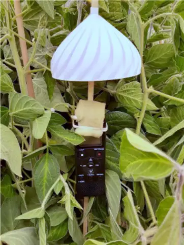
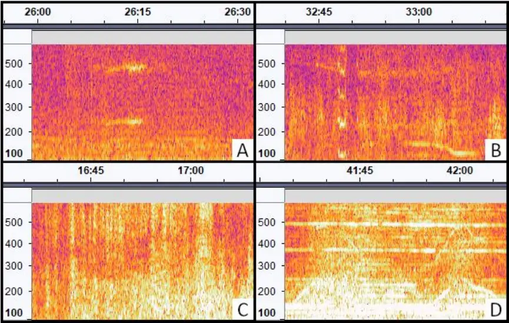
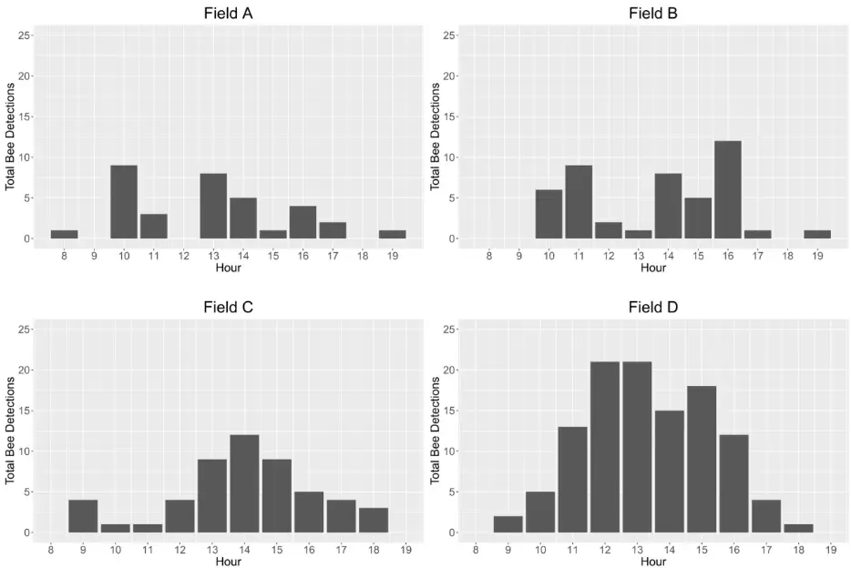
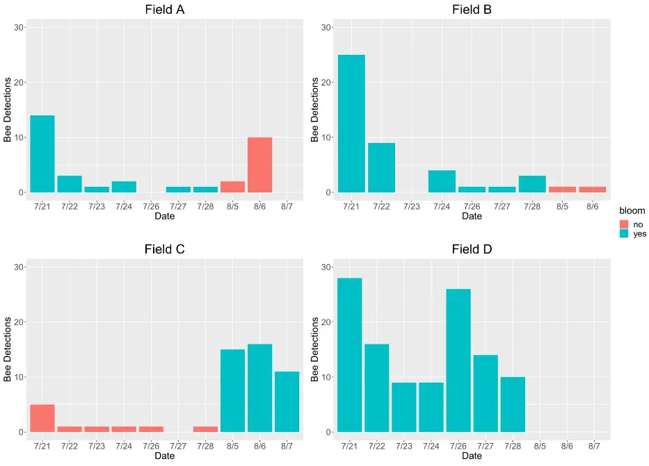

1

2

3

4

5

6

7

8

9

10

11

12

13

14

15

16

17

18

19

20

21

22

23

24

25

26

27

28

29

30

31

## Measuring factors affecting honey bee attraction to soybeans using bioacoustics monitoring

Karlan C. Forrester 1 , Chia-Hua Lin 1 , Reed M. Johnson 1,2 1 Department of Entomology, The Ohio State University, Columbus, OH 43210 2 Corresponding Author Email: johnson.5005@osu.edu

Keywords: honey bees, soybeans, bioacoustics, monitoring, pollination, automation Wordcount: 5,312

## Abstract

Soybean is an important agricultural crop around the world, and previous studies suggest that honey bees can be a component for optimizing soybean production through pollination. Determining when bees are present in soybean fields is critical for assessing pollination activity and identifying periods when bees are absent so that bee-toxic pesticides may be applied. There are currently several methods for detecting pollinator activity, but these existing methods have substantial limitations, including the bias of pan trappings against large bees and the limited duration of observation possible using manual techniques. This study aimed to develop a new method for detecting honey bees in soybean fields using bioacoustics monitoring. Microphones were placed in soybean fields to record the audible wingbeats of foraging bees. Foraging activity was identified using the wingbeat frequency of honey bees (234±13.9 Hz) through a combination of algorithmic and manual approaches. A total of 243 honey bees were detected over ten days of recording in four soybean fields. Bee activity was significantly greater in blooming fields than in non-blooming fields. Temperature had no significant effect on bee activity, but bee activity differed significantly between soybean varieties, suggesting that soybean attractiveness to honey bees is heavily dependent on varietal characteristics. Refinement of bioacoustics methods, particularly through incorporation of machine learning, could provide a practical tool for measuring activity of honey bees and other flying insects in soybeans as well as other crops and ecosystems.

32

33

34

35

36

37

38

39

40

41

42

43

44

45

46

47

48

49

50

51

52

53

54

55

56

57

58

59

60

61

62

## Introduction

## Honey Bees and Soybean Production

Soybean (Glycine max (L.) Merr.) is a growing agricultural crop around the world and has become the number one agricultural export of the United States. In 2020, 17.6% of agricultural export value in the United States was attributed to soybeans (USDA FAS 2021). The United States exported $25.7 billion worth of soybeans grown for oil, animal feed, industrial products, and human consumption (USDA FAS 2021), an increase of $7.0 billion from the previous year (USDA FAS 2020). In 2021, soybeans covered 87.6 million acres of agricultural land in the United States, an increase of 5% from the previous year (NASS, USDA 2021). Soybeans are also a major crop in Ohio. Of the 9.1 million acres of principal crops planted in Ohio during 2021, 4.8 million acres (52%) were soybeans. This accounted for 5% of the nation's annual soybean production (NASS, USDA 2021).

The growing soybean industry is faced with the continued need to optimize resource input and maximize yield output, and many studies suggest that honey bees (Apis mellifera Linn.) can be a component for optimizing soybean production through pollination. Soybeans are self-fertile angiosperms that often exhibit cleistogamy, meaning that self-fertilization occurs within closed flowers (Benitez et al 2010). Because of this, early publications purported that soybeans are not attractive pollinator plants and are rarely visited by honey bees (Lent 1934, Milum 1940). However, more recent studies have shown that honey bees frequently forage in soybean fields, and cross-pollination by pollinators contributes additional benefits to soybean fruiting. Soybean yield is positively correlated with honey bee visitation, with yield increases ranging from 5.7% to 81% across studies, likely due to differences in experimental methods, soybean varieties, and variables such as time and location (Blettler et al 2018, Chiari et al 2005a, Erickson 1975a, Erickson et al 1978, Esquivel et al 2021, Issa et al 1984, Jaycox 1970, Juliano 1976, Kettle &amp; Taylor 1979, Levenson et al 2022, Milfont et al 2013, Monasterolo et al 2015, Santos et al 1993, Toledo et al 2011, Vila et al 1992). Chiari et al (2005a) demonstrated that pollination by honey bees and pollination by wild pollinators both increased soybean yield. Milfont et al (2013) demonstrated a yield increase of 11% when open-pollinated soybeans were supplemented with

63

64

65

66

67

68

69

70

71

72

73

74

75

76

77

78

79

80

81

82

83

84

85

86

87

88

89

90

91

92

93

nearby honey bee colonies. Soybean yield also may benefit from the presence of nearby pollinator habitat (Levenson et al 2022). Together, these studies suggest that optimal soybean production can be achieved through the combined pollination activity of wild pollinators and managed honey bees. Milfont et al (2013) estimated that honey bee pollination of soybeans could be contributing $59.70 to $110.50 of profits per hectare, representing a contribution of $6.1-17.4 billion to the global economy.

Honey bee pollination can have multiple effects on soybean fruiting that may lead to increased yields. Pollination has been shown to increase hybridization (Abrams et al 1978, Chiang &amp; Kiang 1987, Cutler 1934, Jaycox 1970, Sim &amp; Choi 1993), number of pods (Chiari et al 2005a, Cunningham-Minnick et al 2019, Erickson et al 1978, Juliano 1976, Moreti et al 1998, Pinzauti &amp; Frediani 1980), number of seeds (Blettler et al 2018, Cunningham-Minnick et al 2019, Moreti et al 1998, Pinzauti &amp; Frediani 1980), pod weight (Juliano 1976, Toledo et al 2011), fruiting rate (BeaudelaineKengni et al 2015, Sim &amp; Choi 1993, Tchuenguem &amp; Dounia 2014), healthy seed (BeaudelaineKengni et al 2015, Tchuenguem &amp; Dounia 2014), and seeds per pod (BeaudelaineKengni et al 2015, Issa et al 1984, Milfront et al 2013, Moreti et al 1998, Pinzauti &amp; Frediani 1980, Tchuenguem &amp; Dounia 2014). Pollination has also been shown to decrease seed abortion (Erickson et al 1978, Monasterolo et al 2015) and flower abortion (Chiari et al 2005b, Monasterolo et al 2015).

Some of the earliest studies on the relationship between honey bee pollination and soybean yield reported that yield benefits differ by variety, likely due to variation in bloom characteristics and their resulting attractiveness to honey bees (Erickson 1975a, Issa et al 1984). Differences between soybean varieties include flower color (ranging from white to violet), growth habit (determinate or indeterminate), maturity group (time from planting to maturity), frequency of cleistogamy, flower size, flower fragrance, number of flowers, nectar volume, and nectar sugar concentration (Benitez et al 2010, Erickson 1975b, Stowe &amp; Vann 2022). In addition to phenotypic variation across soybean varieties, soybeans produce nectar of varying quality and quantity depending on environmental factors, including temperature (Robacker et al 1983), time of day (Blettler et al 2016, Severson &amp; Erickson 1984), soil macronutrients (Robacker et al 1983), and soil microbiota (BeaudelaineKengni et al 2015).

94

95

96

97

98

99

100

101

102

103

104

105

106

107

108

109

110

111

112

113

114

115

116

117

118

119

120

121

122

123

124

Variations in soybean bloom characteristics are correlated with attractiveness to honey bees. Sugar concentrations above 25% and low rates of cleistogamy are generally most attractive to honey bees (Erickson 1975b), whereas flower color has little impact on honey bee foraging (Chiang &amp; Kiang 1987, Jaycox 1970, Mason 1979, Severson &amp; Erickson 1984). Attractiveness also changes over time, with most studies observing peak honey bee activity in soybeans around midday (BeaudelaineKengni et al 2015, Blettler et al 2016, Chiari et al 2005a, Issa et al 1984, Jaycox 1970, Santos et al 1993, Toledo et al 2011). This is likely due to changes in floral nectar quality and quantity throughout the day, with sugar concentration increasing and nectar volume decreasing as the day progresses (Severson &amp; Erickson 1984). Honey bee foraging also peaks in the middle of the month-long blooming period when flower production is at its maximum (Blettler et al 2016).

## Detecting Honey Bee Activity

Because soybeans are capable of self-pollination - and possibly as a consequence of early studies purporting that honey bees are poor pollinators of soybeans - honey bees are often disregarded as a factor of production, which opens the door for potentially bee-toxic insecticides to be applied during soybean bloom (Jaycox 1970, Milfont et al 2013). Many soybean insecticides applied during bloom are highly toxic to bees and carry cautionary language to protect bees on the pesticide label. While there have been reports that pyrethroid insecticides repel bees from areas where they have been applied (Rieth &amp; Levin 1988), the pyrethroids cypermethrin and lambda-cyhalothrin were not found to deter honey bee foraging when applied to blooming soybeans (Fagúndez et al 2016). Pesticides are picked up by foraging honey bees and cause lethal and sub-lethal effects in the colony, creating a major risk for foraging colonies and reducing long-term viability of pollination and its associated benefits (Reichelderfer &amp; Caron 1979, Santos et al 2013). This both raises legal concerns and prevents growers from fully implementing honey bee pollination into integrated pest and pollinator management (IPPM) frameworks. The conditions for pesticide application in soybeans must be reassessed within the context of honey bee activity to support the long-term sustainability of soybean production.

125

126

127

128

129

130

131

132

133

134

135

136

137

138

139

140

141

142

143

144

145

146

147

148

149

150

151

152

153

154

In order to assess how environmental variables and soybean varieties can predict honey bee foraging in soybeans, we must first be able to detect foraging honey bees across time. There are several existing methods for detecting pollinator activity, mainly through the use of pan traps, visual observation, and manual collection (Portman et al 2020). Pan traps are brightly colored bowls filled with soapy water that are used as a passive sampling method. Pollinators are attracted to the bright colors, then become trapped in the liquid. Manual collection methods include targeted netting and sweep netting, and visual observation provides a nonlethal method of insect detection. Pan traps, visual observation, and netting have all previously been used to assess honey bee activity in soybean fields, with visual observation being the most common method (Supplemental Table 1).

Existing methods for bee detection have drawbacks that make them ineffective for accurate large-scale detection of honey bees in crops. Pan traps tend to favor smaller bees, such as those belonging to the family Halictidae, over larger bees such as honey bees (Portman et al 2020). Visual observation and netting techniques are time and labor intensive, and these methods are more susceptible to collector bias (Portman et al 2020, Westphal et al 2008). In addition, detection methods such as trapping are fatal to the target organisms. A novel method is necessary for accurate bee detection, particularly in large cropping systems like soybean.

Bioacoustics is a branch of science that focuses on sound production by living organisms, and bioacoustics monitoring is a relatively new method for detection and identification of species through audio recording and analysis. Deep learning approaches to bioacoustics monitoring are currently being developed for detection and identification of mosquitoes that vector malaria (Hassall et al 2021, Khalighifar et al 2022, Kim et al 2021, Kiskin et al 2020a, Kiskin et al 2020b, Vasconcelos et al 2019, Vasconcelos et al 2020). Bioacoustics monitoring has also been combined with machine learning to automate analysis of birdcall recordings and increase bird monitoring efficiency through the use of the deep neural network BirdNET (Kahl et al 2021, Toenies &amp; Rich 2021, Wood et al 2021). A study by Zhang et al (2017) proposed the use of wingbeat spectrum imaging for insect identification using convolutional neural networks. Similar methods could be used for in-field detection and identification of any insect with a distinct and

155

156

157

158

159

160

161

162

163

164

165

166

167

168

169

170

171

172

173

174

175

176

177

178

179

180

181

182

183

184

185

detectable wingbeat, and honey bees fulfill these criteria by producing an audible wingbeat frequency of 234±13.9 Hz (Clark et al 2017).

The goal of this study was to develop an effective and efficient bioacoustics method for detecting honey bee activity in soybean fields. To accomplish this, we made audio recordings in soybean fields around the blooming period and used a combination of automated and manual techniques to identify honey bee activity.

## Methods

Study Area This study was completed in four soybean fields near Apple Creek, Ohio (Supplemental Figure 1). Fields A and B were planted with the soybean variety Synergy 9720, field C was planted with Synergy 9727, and field D was planted with Synergy 9723 (Supplemental Table 2). Data was collected over ten days on July 21-24, July 26-28, and August 5-7, 2021, except for field B which yielded no data on August 7 due to a microphone malfunction. For this study, a field was considered to be in bloom during growth stages R2 and R3, and audio was recorded during stage R3. Fields A, B, and D were in bloom July 21-24 and July 26-28, while only field C was in bloom August 5-7. All four fields were located in predominantly agricultural areas and were surrounded by corn fields, wheat fields, alfalfa fields, additional soybean fields, deciduous forestland, and major and minor roads. An apiary with approximately ten colonies was located 25 meters east of field B, but the locations of other managed apiaries or feral colonies established in wooded areas were not known.

Data Collection Audio recorders (Sony model ICD-PX370) were attached to 0.635 x 91.44 cm (0.25 x 36 inch) square wooden stakes and protected from wind and rain with high-density foam and 3D-printed white plastic rain covers (https://www.thingiverse.com/thing:5380356, Figure 1). The recorders were programmed to record audio at the highest microphone sensitivity setting and a bitrate of 48 kbps (mono). A recorder was placed in each field 35 meters from an easily accessible field edge. The recorders were left to continuously record environmental audio for three-day periods,

186

187

188

189

190

191

192

193

194

195

196

197

198

199

200

201

202

203

204

205

then retrieved for battery replacement. The location of each recorder was marked with a colored flag on top of a stake to aid in retrieval. In blooming fields, the recorders were placed at the same height as the highest blooming nodes beneath the leaf canopy. If the field was not in bloom, the recorders were placed at the same height as the highest non-blooming nodes beneath the leaf canopy. Each recorders' radius of detection for bee wingbeats was approximately one meter.

Figure 1. Audio recorder in soybeans.

Audio Processing Audio files were downloaded from audio recorders in MP3 format, downsampled to 16kHz and converted to WAV files using FFMPEG (Tomar 2006), then split into one-hour segments using the AudioSegment module in the pydub library (v.0.25.1, Robert 2018) using Python (v.3.9.7). Hours of audio recorded before sunrise or after sunset were removed from analysis. Potential bee detections were identified based on a range of audio frequencies corresponding with the second harmonic of the honey bee wingbeat frequency (370-570 Hz) with a duration of 1 sec. and a threshold of 0.0001 using the "find_rois_cwt" function in the scikit-maad soundscape analysis package in Python (Ulloa et al 2021). Possible bee detections were output as a CSV file for manual audio assessment.

206

207

208

209

210

211

212

213

214

215

216

217

218

219

220

221

222

223

## Manual Audio Assessment

Automated honey bee detections were loaded as labels overlayed on a spectrogram of one hour audio sequences and the source of each detected sound was manually identified using Audacity® (v.3.1.3, Audacity Team 2022). Audio assessment was completed by listening to the areas of interest and identifying the source of each detection event in a manually curated label file (Supplemental Table 3). Visual assessment of spectrograms in the areas of interest augmented audio assessment (Figure 2). The spectrograms were adjusted to show recorded frequencies in the 100-600 Hz range, which included the target frequency for honey bee wingbeats (234±13.9 Hz) and its second harmonic (468±27.8 Hz). Gain was set to 35 dB and spectrograms were displayed using Mel scaling to more clearly distinguish target frequencies from background noise. A total of 403 hours of audio recordings were manually assessed.

Figure 2. Spectrograms of potential bee activity. The x-axis shows time (mm:ss) and the y-axis shows frequency (Hz). Screenshots modified from Audacity® (Audacity Team 2022). A) Honey bee wingbeats (230-250 Hz) with second harmonic (460-500 Hz). B) Non-honey bee insect wingbeats (105-125 Hz) with second, third, and fourth harmonics. C) Air traffic. D) Agricultural equipment operating in a neighboring field.

224

225

226

227

228

229

230

231

232

233

234

235

236

237

238

239

240

241

242

243

244

245

246

247

248

249

250

251

Statistical Analysis Due to non-normal distribution, a Kruskal-Wallis one-way analysis of variance and Dunn's test were used to determine significant differences in the number of bee detections between soybean varieties, between fields, and between blooming and non-blooming soybeans. Weather data for the ten recording dates were obtained from the Ohio State University CFAES Weather System Wooster Station (OSU CFAES 2022), and the correlation between average daily temperature and the number of bee detections was determined using a linear regression analysis and Pearson's correlation coefficient. All statistical analyses were completed using R statistical software (v.4.0.3, R Core Team 2022) and visualized with the ggplot2 package (Wickham 2016).

## Results

The automated audio assessment identified a total of 11,638 potential bee detections over the ten days of recording (Supplemental Table 4). Of those detections, 10,307 were produced by vehicles, 130 were produced by insects other than honey bees, and 243 were produced by honey bees. Most bee activity occurred between 10 AM and 5 PM Eastern Daylight Time, with the greatest activity occurring between 1 PM and 4 PM (Figure 3). Field A had the least amount of recorded bee activity with only 34 bee detections. Fields B and C yielded 52 and 45 bee detections, respectively. Field D yielded 112 bee detections, more than twice the bee activity of any other field. July 21 was the most active day for bees in all three fields blooming at that time (Figure 4). Bee activity was significantly greater in blooming fields than in non-blooming fields (p = 0.001, N = 39, df = 1). Bee activity also differed significantly between soybean varieties (p = 0.004, N = 39, df = 2), with less activity in variety 9720 than in varieties 9723 and 9727, and between fields (p = 0.010, N = 39, df = 3), with less bee activity in fields A and B than in fields C and D. There was no significant correlation between bee detections and average daily temperature (p = 0.107, N = 24, df = 22).

. CC-BY-NC 4.0 International license available under a (which was not certified by peer review) is the author/funder, who has granted bioRxiv a license to display the preprint in perpetuity. It is made The copyright holder for this preprint this version posted November 5, 2022. ; https://doi.org/10.1101/2022.11.04.512777 doi: bioRxiv preprint

252

253

254

255

Figure 3. Bee detections per hour across the four study fields pooled over the 10 days of recording (July 21-24, July 26-28, and August 5-7, 2021).

256

257

258

259

260

261

262

263

264

265

266

267

268

269

270

271

Figure 4. Daily bee detections in each field across all recording dates. No recording was made in field B on August 7.

## Discussion

These results demonstrate that bioacoustics monitoring is a viable method for detecting honey bees and other insects in soybean fields. Comparison of detections during bloom and non-bloom showed that there was more bee activity in each field when it was blooming than when it was not blooming. There were significant differences in bee detections between soybean varieties, with less bee activity in both fields that contained variety 9720.

There was no significant correlation between bee detections and average daily temperature. Although a study by Robacker et al (1983) found that nectar production in soybeans increased with temperature, a different study by Severson and Erickson (1984) found that temperature had no significant effect on nectar production. It is possible that temperature did not impact nectar

272

273

274

275

276

277

278

279

280

281

282

283

284

285

286

287

288

289

290

291

292

293

294

295

296

297

298

299

300

301

302

production in the soybean varieties used in this study and thus had no significant effect on honey bee activity.

It was noted that bee detections in field A exceeded the expected bee activity for non-blooming fields on August 6, with a total of 10 bee detections. Upon reassessment of the data, it was discovered that 7 of those 10 bee detections occurred in the span of 25 seconds and were likely produced by the same bee. If this is the case, only four bees were detected in field A on this date, which more closely aligns with the number of bee detections on other dates and in other fields during non-bloom. This was the only instance of an individual bee exceeding 3 detections, and most bees were detected only once.

The recorders picked up a wide array of non-bee activity such as traffic, birds, cicadas, and agricultural equipment. By targeting the second harmonic of honey bee wingbeats, the scikitmaad soundscape analysis package was able to exclude cicadas, most birds, and other general noises from detection output. Vehicular noise occupied a similar frequency range to honey bee wingbeats, but the spectrograms produced for vehicular audio were visually distinct from the spectrograms produced for honey bee wingbeats. Despite the high occurrence of traffic detections and the proximity of some fields to major and minor roads, bee activity was still detectable, with only 7 of the 243 manually assessed bee detections overlapping with traffic detections. The only noise source that confounded bee detection was the use of agricultural equipment near fields A and C during periods of July 21, field C during periods of July 22, fields C and D during periods of July 27, fields B and D during periods of July 28, and fields C and D during periods of August 5. Bees could not be detected when agricultural equipment was present due to the sustained duration and intensity of the noise overlapping with bee wingbeat frequencies. However, agricultural equipment was only present for one or two hours on a given day, and enough bees were detected on days when agricultural equipment was present to yield usable data.

This method also proved to be much more time and labor efficient than other methods. It took approximately 8 hours to set up and retrieve the microphones across all recording periods and 34 hours to manually assess the audio data. Altogether, a total of 42 hours was needed to collect and

303

304

305

306

307

308

309

310

311

312

313

314

315

316

317

318

319

320

321

322

323

324

325

326

327

328

329

330

331

332

333

analyze 403 hours of audio recordings. This method also allowed data to be collected in four fields simultaneously, was nonlethal, and was not susceptible to observer bias. Refinement of this method using machine learning for bee detection could further reduce the amount of time and labor required for manual audio analysis.

These results provide a general picture of when honey bees are most active in soybean fields, and conclusions can be made about when to make pesticide applications. Bee activity greatly decreases after 5 PM in blooming fields, and bees are rarely present in non-blooming fields. Based on these data, pesticide applicators can minimize honey bee exposure to harmful insecticides by only spraying soybean fields when bees are not actively foraging a) before and after the blooming period or b) after 5 PM during the blooming period.

A novel methodology such as audio detection could be used to develop a better IPPM framework for soybean growers that takes honey bee activity into account. Tracking honey bee activity in soybeans across the hours of the day has already been proposed as a means for reducing honey bee exposure to harmful pesticides (Blettler et al 2016), but this has not been utilized at a commercial scale due to the practical challenges presented by current honey bee detection methods. Bioacoustics monitoring could provide an efficient, effective, and accessible method for determining when honey bees are present in blooming soybean fields, allowing pesticide applicators to better follow pesticide label guidelines and mitigate pesticide exposure. Research to refine this audio detection technology for future implementation in precision agriculture, including the use of advanced machine learning to assist with data analysis and interpretation, is ongoing.

## Acknowledgements

This work was supported by the Agriculture and Food Research Initiative of the US Department of Agriculture's National Institute of Food and Agriculture under Grant 2019-67013-29297; and the Ohio Agricultural Research and Development Center's North Central Soybean Research Program under Grants OHO01412 and OHO01355-MRF.

334

335

336

337

338

339

340

341

342

343

344

345

346

347

348

349

350

351

352

353

354

355

356

357

358

359

360

361

362

363

364

365

366

367

368

369

## Data Availability Statement

The data that support the findings of this study are openly available in Ag Data Commons at https://doi.org/10.15482/USDA.ADC/1528082.

## Declaration of Conflicting Interests

The authors report there are no competing interests to declare.

## Bibliography

Abrams, R.I.; Edwards, C.R.; Harris, T. (1978). Yields and Cross-pollination of Soybeans as Affected by Honey Bees and Alfalfa Leafcutting Bees. American Bee Journal. 118(8):555-560. Audacity Team. (2022). Audacity®: Free Audio Editor and Recorder. Version 3.1.3. Available from: http://audacityteam.org/ [1] BeaudelaineKengni, S.; Fohouo, F-N.T.; Ngakou, A. (2015). Impact of the foraging activity of Apis mellifera adansonii Latreille (Hymenoptera: Apidae) and Bradyrhizobium fertilizer on pollination and yield components of Glycine max L. (Fabaceae) in the field. International Journal of Biological Research. 3(2):64-71. Benitez, E.P.; Khan, N.A.; Matsumura, H.; Abe, J.; Takahashi, R. (2010). Varietal Differences and Morphology of Cleistogamy in Soybean. Crop Science. 50(1):185-190. Blettler, D.C.; Fagúndez, G.A.; Chemez, D.M. (2016). A study of the foraging schedule of honeybees on soy crops as an agronomical tool to mitigate the effects of agrochemicals. Scientia Interfluvius. 7(2):14-28. Blettler, D.C.; Fagúndez, G.A.; Caviglia, O.P. (2018). Contribution of honeybees to soybean yield. Apidologie. 49:101-111. Chiang, Y.C. and Kiang, Y.T. (1987). Geometric position of genotypes, honeybee foraging patterns and outcrossing in soybean. Botanical Bulletin of Academia Sineca. 28(1):1-11. Chiari, W.C.; Toledo, V.A.A.; Ruvolo-Takasusuki, M.C.C.; Oliveira, A.J.B.; Sakaguti, E.S.; Attencia, V.M.; Costa, F.M.; Mitsui, M.H. (2005a). Pollination of Soybean (Glycine max L. Merril) by Honeybees (Apis mellifera L.). Brazillian Archives of Biology and Technology. 48(1):31-36. Chiari, W.C.; Toledo, V.A.A.; Ruvolo-Takasusuki, M.C.C.; Attencia, V.M.; Costa, F.M.; Kotaka, C.S.; Sakaguti, E.S.; Magalhães, H.R. (2005b). Floral Biology and behavior of Africanized Honeybees Apis mellifera in Soybean (Glycine max L. Merril). Brazilian Archives of Biology and Technology. 48(3):367-378.

370

371

372

373

374

375

376

377

378

379

380

381

382

383

384

385

386

387

388

389

390

391

392

393

394

395

396

397

398

399

400

401

402

403

404

405

406

407

408

409

Clark, C.J.; Mountcastle, A.M.; Mistick, E.; Elias, D.O. (2017). Resonance frequencies of honeybee (Apis mellifera) wings. Journal of Experimental Biology. 220:2697-2700. Cunningham-Minnick, M.J.; Peters, V.E.; Crist, T.O. (2019). Nesting habitat enhancement for wild bees within soybean fields increases crop production. Apidologie. 50:833-844. Cutler, G.H. (1934). A simple method for making soybean hybrids. Journal of the American Society of Agronomy. 26(3):252-254. Erickson, E.H. (1975a). Effects of Honey Bees on Yield of Three Soybean Cultivars. Crop Science Society of America. 15:84-86. Erickson, E.H. (1975b). Variability of Floral Characteristics Influences Honey Bee Visitation to Soybean Blossoms. Crop Science. 15(6):767-771. Erickson, E.H.; Berger, G.A.; Shannons, J.G.; Robins, J.M. (1978). Honey Bee Pollination Increases Soybean Yields in the Mississippi Delta Region of Arkansas and Missouri. Journal of Economic Entomology. 71(4):601-603. Esquivel, I.L.; Parys, K.A.; Brewer, M.J. (2021). Pollination by Non-Apis Bees and Potential Benefits in Self-Pollinating Crops. Annals of the Entomological Society of America. 114(2):257-266. Fagúndez, G.A.; Blettler, D.C.; Krumrick, C.G.; Bertos, M.A.; Trujillo, C.G. (2016). Do agrochemicals used during soybean flowering affect the visits of Apis mellifera L.? Spanish Journal of Agricultural Research. 14(1). Google Earth Pro 7.3. (2022). Wayne County, OH, United States. 40.768247, -81.844195. Maxar Technologies, State of Ohio/OSIP, USDA/FPAC/GEO. Hassall, K.L.; Dye, A.; Potamitis, I.; Bell, J.R. (2021). Resolving the identification of weakflying insects during flight: a coupling between rigorous data processing and biology. Agricultural and Forest Entomology. 23(4):489-505. Issa, M.R.C.; Velocci, M.E.P.; Gonçalves, L.S.; Soares, A.E.E. (1984). Ensaio de polinização em soja (Glicine max) por abelhas Apis mellifera L. Anais do 5° Congresso Brasileiro de Apicultura e III Congresso Latino-Ibero-Americano de Apicultura: 23 a 27 de julho de 1980, Viçosa, MG. 241-254. Jaycox, E.R. (1970). Ecological relationships between honey bees and soybeans. American Bee Journal. 110:306-307, 343-345, 383-385. Juliano, C.J. (1976). Polinização entomófila na soja. Anais do 4° Congresso Brasileiro de Apicultura. 4:235-239. Kahl, S.; Wood, C.M.; Eibl, M.; Klinck, H. (2021). BirdNET: A deep learning solution for avian diversity monitoring. Ecological Informatics. 61:101236. Kettle, W.D. and Taylor, O.R. (1979). Ecological Interactions of Honey Bees and Soybeans. Journal of the Kansas Entomological Society. 52(3):549. Khalighifar, A.; Jimenez-Garcia, D.; Campbell, L.P.; Ahadji-Dabla, K.M.; Aboagye-Antwi, F.; Ibarra-Juarez, L.A.; Peterson, A.T. (2021). Application of Deep Learning to CommunityScience-Based Mosquito Monitoring and Detection of Novel Species. Journal of Medical Entomology. 59(1):355-362.

410

411

412

413

414

415

416

417

418

419

420

421

422

423

424

425

426

427

428

429

430

431

432

433

434

435

436

437

438

439

440

441

442

443

444

445

446

447

Kim, D.; DeBriere, T.J.; Cherukumalli, S.; White, G.S.; Burkett-Cadena, N.D. (2021). Infrared sensors permit rapid recording of wingbeat frequency and bioacoustics species identification of mosquitoes. Scientific Reports. 11(1):10042. Kiskin, I.; Cobb, A.D.; Wang, L.; Roberts, S. (2020a). Humbug Zooniverse: A crowd-sourced acoustic mosquito dataset. 2020 IEEE International Conference on Acoustics, Speech, and Signal Processing. p.916-920. Kiskin, I.; Zilli, D.; Li, Y.; Sinka, M.; Willis, K.; Roberts, S. (2020b). Bioacoustic detection with wavelet-conditioned convolutional neural networks. Neural Computing &amp; Applications. 32(4):915-927. Lent, C.J. (1934). Do Bees Gather Honey from Soy Beans? American Bee Journal. 74:340. Levenson, H.K.; Sharp. A.E.; Tarpy, D.R. (2022). Evaluating the impact of increased pollinator habitat on bee visitation and yield metrics in soybean crops. Agriculture, Ecosystems and Environment. 331:107901. Mason, C.E. (1979). Honey bee foraging activity on soybeans in Delaware. Proceedings of the Fourth International Symposium on Pollination, Maryland, 1978. 117-122. Milfont, M.O.; Rocha, E.E.M.; Lima, A.O.N.; Freitas, B.M. (2013). Higher soybean production using honeybee and wild pollinators, a sustainable alternative to pesticides and autopollination. Environmental Chemistry Letters. 11:335-341. Milum, V.G. (1940). Bees and soybeans. American Bee Journal. 80:22. Monasterolo, M.; Musicante, M.L.; Valladares, G.R.; Salvo, A. (2015). Soybean crops may benefit from forest pollinators. Agriculture, Ecosysytems and Environment. 202:217-222. Moreti, A.C.C.C.; da Silva, E.C.A.; Alves, M.L.T.M.F.; da Silva, R.M.B. (1998). Observações sobre a polinização entomófila da cultura de soja (Glycine max Merril). Boletim da Indústria Animal. 55(1):91-94. NASS, USDA. (2021). 2021 Acreage Report. OSU CFAES. (2022). The Ohio State University CFAES Weather System, Wooster Station. Available at: https://weather.cfaes.osu.edu/stationinfo.asp?id=1 Pinzauti, M. and Frediani, D. (1980). The importance of honeybee pollination in soya bean production. L'Apicoltore Moderno. 71(5):155-160. Portman, Z.M.; Bruninga-Socolar, B.; Cariveau, D.P. (2020). The State of Bee Monitoring in the United States: A Call to Refocus Away from Bowl Traps and Towards More Effective Methods. Annals of the Entomological Society of America. 113(5):337-342. R Core Team. (2022). R: A language and environment for statistical computing. R Foundation for Statistical Computing, Vienna, Austria. http://www.R-project.org. Reichelderfer, K.H. and Caron, D.M. (1979). Honey Bees and Soybean Production. American Bee Journal. 119(2):107-109. Rieth, J.P. and Levin, M.D. (1988). The repellent effect of two pyrethroid insecticides on the honey bee. Physiological Entomology. 13:233-218.

448

449

450

451

452

453

454

455

456

457

458

459

460

461

462

463

464

465

466

467

468

469

470

471

472

473

474

475

476

477

478

479

480

481

482

483

484

485

486

Robacker, D.C.; Flottum, P.K.; Sammataro, D.; Erickson, E.H. (1983). Effects of climatic and edaphic factors on soybean flowers and on the subsequent attractiveness of the plants to honey bees. Field Crops Research. 6(4):267-278. Robert, J. (2018). Pydub. GitHub. Available at: http://pydub.com/ Santos, E.; Mendoza, Y.; Vera M.; Carrasco-Letelier, L.; Díaz, S.; Invernizzi, C. (2013). Increase in Soybean (Glycine max) Production Using Honey Bees (Apis mellifera). AgrocienciaUruguay. 17(1):81-90. Severson, D.W. and Erickson, E.H. (1984). Quantitative and Qualitative Variation in Floral Nectar of Soybean Cultivars in Southeastern Missouri. Environmental Entomology. 13(4):1091-1096. Sheppard, W.S.; Jaycox, E.R.; Parise, S.G. (1979). Selection and management of honey bees for pollination of soybeans. Maryland Agricultural Experiment Station Special Miscellaneous Publication. 1:123-130. Sim, Y-G. and Choi, Y-E. (1993). Influence of Honeybees Pollination on Soybean Yield and Yield Components. Korean Journal of Applied Entomology. 32(3):271-278). St. Clair, A.L.; Dolezal, A.G.; O'Neal, M.E.; Toth, A.L. (2020). Pan Traps for Tracking Honey Bee Activity-Density: A Case Study in Soybeans. Insects. 11(6):366. Stowe, K.D. and Vann, R. (2022). North Carolina Soybean Production Guide. NC State Extension Publications. Tchuenguem, F.F-N. and Dounia. (2014). Foraging and pollination behavior of Apis mellifera adansonii Latreille (Hymenoptera: Apidae) on Glycine max L. (Fabaceae) flowers at Maroua. Journal of Research in Biology. 4(1):1209-1219. Toenies, M. and Rich, L.N. (2021). Advancing bird survey efforts through novel recorder technology and automated species identification. California Fish and Game. 107(2):56-70. Toledo, V.A.A.; Malerbo-Souza, D.T.; Filho, J.C.S.; Pinto, A.Y.; Ruvolo-Takasusuki, M.C.C.; Chambó, E.D. (2011). Biodiversity of pollinators and their effect on soybeans grains (Mon Soy 3329 var) production. Revista Varia Scientia Agrároas. 2(1):123-130. Tomar, S. (2006). Converting video formats with FFmpeg. Linux Journal. Available at: https://dl.acm.org/doi/fullHtml/10.5555/1134782.1134792 Ulloa, J.S.; Haupert, S.; Latorre, J.F.; Aubin, T.; Sueur, J. (2021). scikit-maad: An open-source and modular toolbox for quantitative soundscape analysis in Python. Methods in Ecology and Evolution. 12:2334-2340. USDA FAS. (2020). 2019 United States Agricultural Export Yearbook. USDA FAS. (2021). 2020 United States Agricultural Export Yearbook. Vasconcelos, D.; Nunes, N.; Ribeiro, M.; Prandi, C.; Rogers, A. (2019). LOCOMOBIS: a lowcost acoustic-based sensing system to monitor and classify mosquitoes. 2019 16 th Annual Consumer Communications &amp; Networking Conference. Vasconcelos, D.; Nunes, N.J.; Gomes, J. (2020). An annotated dataset of bioacoustics sensing and features of mosquitoes. Scientific Data. 7(1):382.

487

488

489

490

491

492

493

494

495

496

497

498

499

500

501

502

503

504

505

Vila, V.P.V.; Martinho, M.R.; Sediyama, A.; Freire, J.A.H. (1992). Effect of Africanized bees Apis mellifera in the hybridization and productivity of soybeans Glycine max Merill. XXXIIe Congres International D'apiculture: Rio de Janeiro, Bresil, 22-28 octobre 1989. 414-415. Westphal, C.; Bommarco, R.; Carre, G.; Lamborn, E.; Morison, N.; Petanidou, T.; Potts, S.G.; Roberts, S.P.M.; Szentgyorgyi, H.; Tscheulin, T.; Vaissiere, B.E.; Woyciechowski, M.; Biesmeijer, J.C.; Kunin, W.E.; Settele, J.; Steffan-Dewenter, I. (2008). Measuring bee diversity in different European habitats and biogeographical regions. Ecological Monographs. 78(4):653-671. Wickham, H. (2016). ggplot2: Elegant Graphics for Data Analysis. Springer-Verlag New York. ISBN 978-3-319-24277-4. https://ggplot2.tidyverse.org. Wood, C.M.; Kahl, S.; Chaon, P.; Peery, M.Z.; Klinck, H. (2021). Survey coverage, recording duration and community composition affect observed species richness in passive acoustic surveys. Methods in Ecology and Evolution. 12(5):885-896. Zhang, C.S.; Wang, P.Y.; Guo, H.; Fan, G.J.; Chen, K.; Kamarainen, J.K. (2017). Turning wingbeat sounds into spectrum images for acoustic insect classification. Electronics Letters. 53(25):1674-1675.

[1] Audacity® software is copyright © 1999-2022 Audacity Team. The name Audacity® is a registered trademark.
