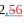
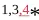
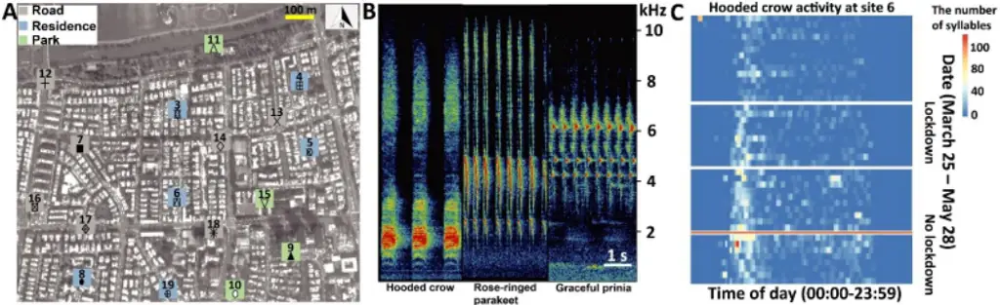
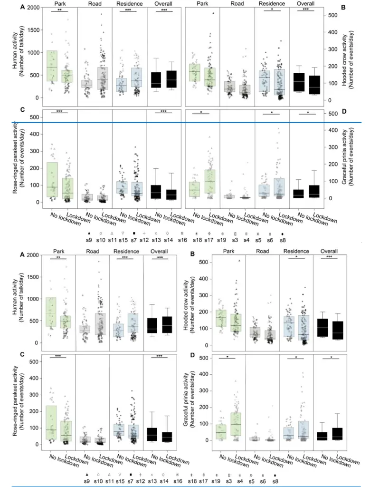
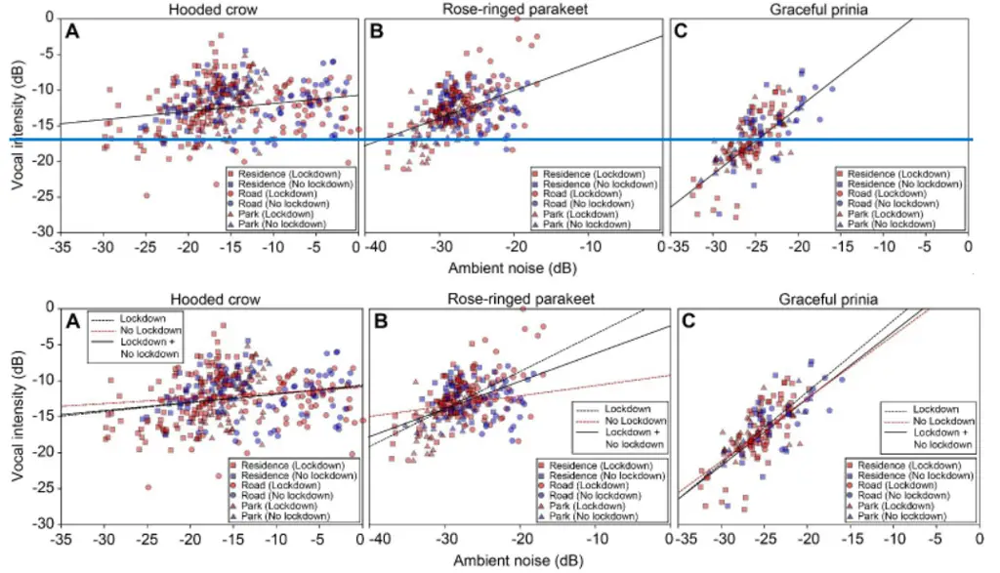
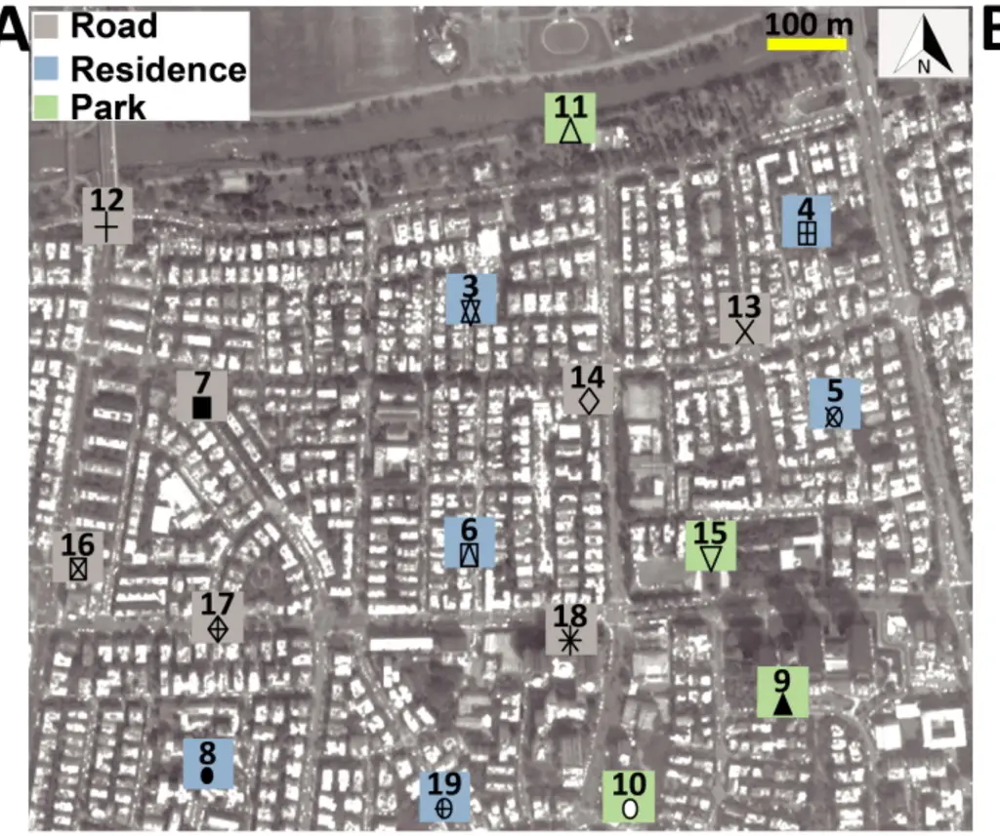
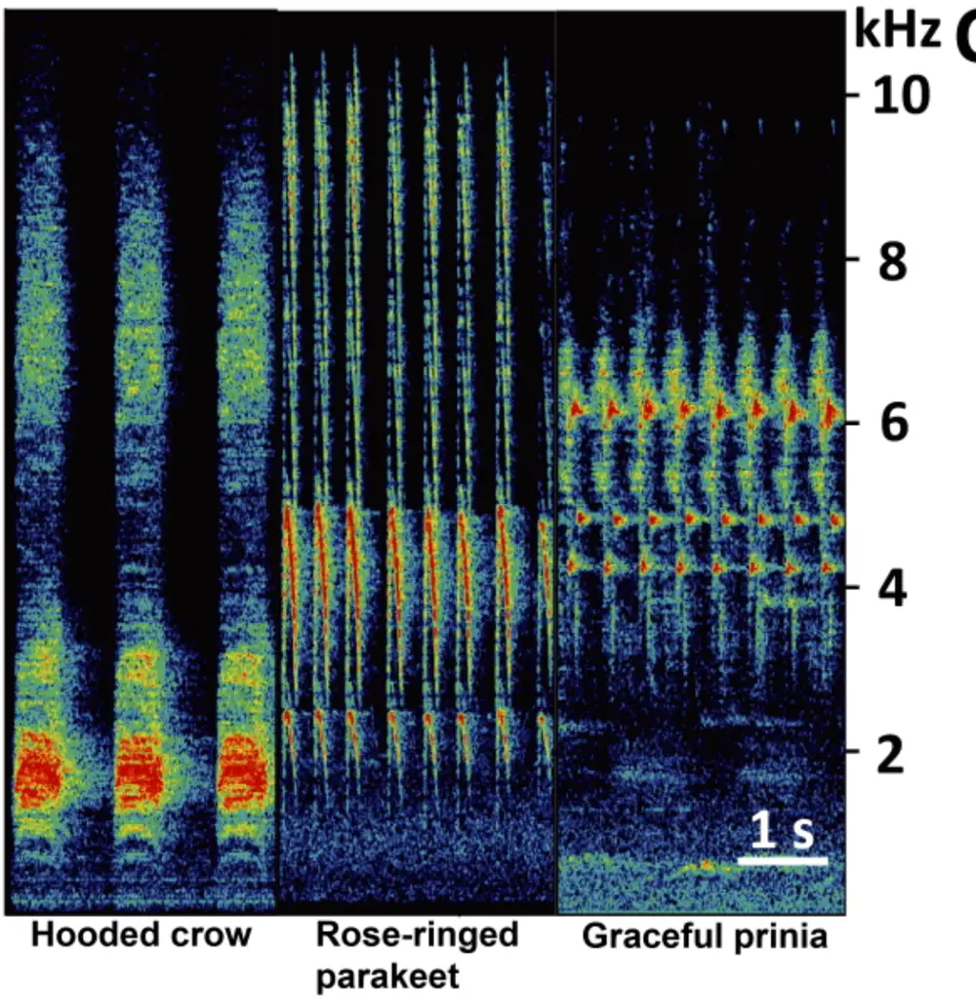
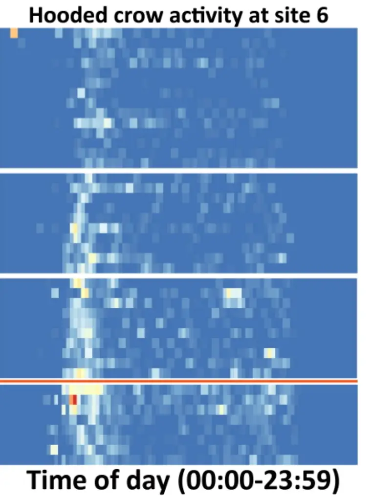

## Species and habitat specific changes in bird activity in an urban environment during Covid 19 lockdown

Congnan Sun 2,56 , Yoel Hassin 1 , Arjan Boonman 1 , Assaf Shwartz 4 Shwartz 5 , Yossi Yovel 1,3,4 \*

1 Faculty of Life Sciences, Tel Aviv University, Tel Aviv, Israe; 2 College of Life Sciences, Hebei Normal University, Shijiazhuang, China; 3 The Steinhardt Museum of Natural History, National Research Center for Biodiversity Studies, Tel-Aviv University, Tel Aviv, Israel; 3 Sagol 4 Sagol School of Neuroscience, Tel Aviv University, Tel Aviv, Israel; 4 Faculty 5 Faculty of Architecture and Town Planning, Technion, Israel Institute of Technology, Haifa, Israel.;

56 Hebei Collaborative Innovation Center for Eco-Environment, Hebei Normal University, Shijiazhuang, China.

mail: yossiyovel@gmail.com - For correspondence: E \*

## Species and habitat specific changes in bird activity in an urban environment during Covid 19 lockdown

1

2

## Abstract

3

Covid-19 lockdowns provided ecologists with a rare opportunity to examine how animals behave when humans are 4 absent. Indeed many, sometimes contradicting, studies reported various effects of lockdowns on animal activity, 5 especially in urban areas and other human-dominated habitats. We explored how Covid-19 lockdowns in Israel have 6 influenced bird activity in an urban environment by using continuous acoustic recordings to monitor three common bird 7 species that differ in their level of adaptation to the urban ecosystem: (1) the hooded crow, an urban exploiter, which 8 depends heavily on anthropogenic resources; (2) the rose-ringed parakeet, an invasive alien species that has adapted to 9 exploit human resources; and (3) the graceful prinia, an urban adapter, which is relatively shy of humans and can be 10 found urban habitats with shrubs and prairies. Acoustic recordings provided continuous monitoring of bird activity 11 without an effect of the observer on the animal. We performed dense sampling of a 1.3 square km area in northern Tel- 12 Aviv by placing 17 recorders for more than a month in different micro-habitats within this region including roads, 13 residential areas and urban parks. We monitored both lockdown and no-lockdown periods. We portray a complex 14 dynamic system where the activity of specific bird species depended on many environmental parameters and decreases 15 or increases in a habitat-dependent manner during lockdown. Specifically, urban exploiter species decreased their 16 activity in most urban habitats during lockdown, while human adapter species increased their activity during lockdown 17 especially in parks where humans were absent. Our results also demonstrate the value of different habitats within urban 18 environments for animal activity, specifically highlighting the importance of urban parks. These species- and habitat- 19 specific changes in activity might explain the contradicting results reported by others who have not performed a habitat 20 specific analysis.

21

22

## Introduction

23

39

51

Covid 19 lockdowns provided a unique opportunity to examine the effects of humans on wildlife presence and activity 24 (Rutz et al., 2020). The public media was full of reports on animals that have supposedly taken over areas that are most 25 of the time occupied by human activity. Several studies reported animals expanding their behavior to day-time (Manenti 26 et al., 2020), or venturing deeper into urban areas during the COVID-19 lockdowns (Vardi et al., 2021). Several studies 27 reported an increase in avian abundances in urban habitats (Schrimpf et al., 2021), while other studies casted doubts on 28 these reports (Vardi et al., 2021; Gordo et al., 2021). These discrepancies in the responses of species to the lockdowns 29 could have stem from the fact that species may differ in their levels of adaptation to human activity (Lowry et al., 2013). 30 Furthermore, most studies were performed in large scale with widely spread sampling points, and focused on specific 31 urban habitats such as large green spaces which represent only a small fraction of the diverse urban landscape (Shwartz 32 et al., 2014). There is therefore a need to fine-scale studies to explore how species with different levels of adaptation to 33 human activity were affected by the lockdowns across habitats neighboring one-another. Such research can help to 34 advance advancing the understanding of the effect of humans on wildlife presence and activity. Moreover, most previous 35 studies have relied on human (citizen) sporadic reports, which can be biased as they were also affected by changes in 36 human activity (Vardi et al., 2021), or on observer-based surveys, which may affect bird activity (Browning et al., 2017). 37 Using passive acoustic recordings, as we did, holds an interesting opportunity to tackle some of these issues and allows 38 for more objective disturbance-free monitoring of wildlife activity (Browning et al., 2017). Acoustic monitoring has been on the rise as a useful method for assessing insect (Penone et al., 2013), bat (López- 40 Bosch et al., 2022) and bird (Pérez-Granados et al., 2021) diversity. This methodology has several clear advantages: it 41 is continuous and does not require the observer to be present and thus the animals are not affected by the measurement 42 itself (Shonfield &amp; Bayne 2017; Gibb et al., 2019). Acoustic recordings are cost-effective, especially with the 43 development of modern cheap recorders, and they are efficient in dense environments where the animals cannot be 44 easily detected such as dense forests or urban environments. An additional advantage is that the data collected using 45 acoustic recordings can be reanalyzed and reinterpreted as new questions arise, or when looking for new species (Borker 46 et al., 2014; Pérez-Granados &amp; Schuchmann 2020). These recordings can also be used to monitor human activity, which 47 allowsallowing to evaluate the impact of local human disturbance on species (Buxton et al., 2018). Finally, they allow 48 estimating ambient noise levels (Alfaro-Rojas et al., 2020), as well as changes in the acoustics of the vocalizations, 49 which can indicate adaptations of animal communication (de Framond et al., 2022). Thus, acoustic recordings provide 50 an excellent opportunity to monitor various species across urban habitat in a standardized manner. In this study we aimed to examine the effects of the Covid 19 lockdown on the activity of species that represent 52 different levels of adaption to humans and exploitation of the urban resources across different types of urban habitats in 53 Tel-Aviv, Israel. Research exploring biodiversity response to urbanization has classified species into three main groups 54 regarding their level of adaptation to human activity and their ability to exploit anthropogenic resources (Blair 1996; 55 Kark et al. 2007): (1) urban avoiders, species that are particularly sensitive to human induced changes and reach their 56 highest densities in natural environments outside the urban area; (2) urban adapters, species that thrive in urban green 57 spaces, as they have adapted to exploit green urban resources (e.g., ornamental vegetation); and (3) urban exploiters, 58 species that adapted to exploit the resources provided by humans in the urban environment and therefore reach high 59 densities in the most built and developed environments. These species together with non-native invasive alien species 60 that have also adapted to exploit various anthropogenic human green and grey resources often replace a wider range of 61

63

75

88

95

native species in a process that was describe as the biotic homogenization (Lockwood &amp; McKinney 2002; Crooks et al., 62 2004). Building on previous studies that were conducted in Israel and classified common bird species to these three groups 64 (Kark et al., 2007; Colleony &amp; Shwartz 2020), we selected three widespread and common urban species that vary in 65 their level of adaptation to human activity. The hooded crow (Corvus corone cornix) is a native urban exploiter that 66 heavily depends on anthropogenic resources for foraging and breeding and can be found in all types of urban habitats 67 (Kark et al., 2007). The rose-ringed parakeet (Psittacula krameri) is a non-native urban adaptor that thrives in Israel and 68 elsewhere due to its ability to adapt and exploit different types of human resources (e.g., ornamental plants for feeding 69 and infrastructure of breeding; White et al., 2019). The Graceful prinia (Prinia gracilis) is an insectivorous species that 70 is relatively shy of humans and can be found in various green spaces where there are shrubs and prairies that represent 71 its main habitat. The first two species can be considered as urban exploiters or synanthropic species that thrive in urban 72 areas, and their population is increasing in Israel, while the third one represents an urban adaptor with a population that 73 is currently decreasing in Tel-Aviv and across the country (Colléony &amp; Shwartz 2020). All birds were within their 74 breeding season during both the lockdown and non-lockdown periods (Methods). We performed our study around the first lockdown period in Israel (March-May 2020). We selected common 76 vocalizations emitted by each species usually in intra-specific contexts (see Methods). To reduce the effect of ambient 77 noise on our findings, we focused on loud vocalizations that were high above the noise level. The exact bird detection 78 range of our method is hard to estimate accurately (because it depends on many parameters such as the building coverage) 79 but we estimate it to be ~50 m. In light of the complex mosaic of urban habitats, we compared activity in three micro- 80 habitats within cities, namely, in parks, roads and residential areas. We performed our monitoring at 17 sites all within 81 the urban environment of central Tel-Aviv on average ~200 m apart from each other. Thus, our sampling was much 82 denser than most previous studies allowing us to examine changes over fine spatial scales. The region we monitored 83 included residential areas with small parks scattered within them and with small-medium sized roads connecting them. 84 Buildings in this region are usually surrounded by small gardens, which will typically have some fruit and other trees. 85 The north-most sector of the region includes a large open habitat on the bank of the Yarkon river (the Yarkon Park), 86 recognized as an important bird resource in Tel-Aviv and servicing as green corridor connecting the city to more natural 87 environments around it (Figure 1A; Shwartz et al., 2008). We quantified birds' presence and found changes in bird activity during the lockdown period that were species and 89 habitat specific. We found that human following (exploiter) species probably moved their activity to residential areas 90 during the lockdown, in contrast to a human aversive species (an adapter) that seemingly increased its activity in all 91 habitats in the absence of humans. Other environmental factors, such as ambient temperature, also influenced bird 92 activity, but the effect of the lockdown was central even after controlling for these variables. Our results thus 93 demonstrate the importance of micro-habitats within the urban environment and highlight the complexity of nature's 94 response to a dramatic shift in human activity.

96

parakeet

97

Figure 1. Study system, vocal characters, and vocal activities. (A) The seventeen sampling sites (Grey square: road; 98 Blue square: residence; Green square: Park). The total activity for each species at each location is shown in bars for the 99 lockdown (red) and no-lockdown (blue) periods. Different sampling sites are represented by different symbols. (B) 100 Spectrograms of vocalizations with Hooded crow, Rose-ringed parakeet, and Graceful prinia. (C) An example of a heat- 101 map indicating the activity of Hooded crow at site 11 monitored continuously between March 31 - May 28 (without the 102 dates between April 9 - April 23, May 4 - May 6, May 17 - May 20, depicted by white gaps). The x-axis depicts the 103 time of day (not normalized to sunrise). The y-axis is the date. The red horizontal line separates lockdown from no 104 lockdown periods. The figure also suggests an overall seasonal increase in activity, but our models suggest a lockdown 105 effect on top of this seasonal effect.

106

107

## Results

108

We analyzed 388,080 audio recordings accounting for a total duration of 3,234 hours from 17 sites (Figure 1A). In total 109 we detected 52,080 files with 72,824 syllables of Hooded crows, 33,654 files with 73,445 syllables of Rose-ringed 110 parakeets and 21,800 files with 117,982 syllables of Graceful prinias. The distribution of the audio recordings along the 111 sampling periods can be found in Table S3-S5 in Supplementary material 1. A detailed summary of the activity of each 112 species at each site can be found in Supplementary materials 2-3-4 (and in Figure 1A). We used these vocalizations to 113 assess birds' spatio-temporal activity. We referred to the total number of events (i.e., files) detected per species as its 114 total daily activity. We also estimated daily activity variability by calculating the coefficient of variance of number of 115 daily events. Dynamic illustrations of the changes in bird activity are presented in Supplementary movies 1-3. In 116 additionAs expected, human activity significantly increased in residential areas by 49% during the lockdown and 117 significantly decreased in parks by 31% as visiting parks was forbidden as expected (Figure 2A; Table S6 in 118 Supplementary material 5).

119

120

## Bird activity

121

When analyzing the activity of all species together, we found that the bird species and site type (park, road, residential) 122 had a significant effect on activity, and moreover, that the interaction between the lockdown status and the species was 123 also significant (Table 1). Below, we thus analyze the effect of the lockdown status on each species of bird separately. 124 However, a few general patterns were observed from the analysis of all species together. Bird activity (number of daily 125 events) was overall always highest in parks (62% more than near roads and 53% more than in residential areas, Table 126 1). Bird activity significantly decreased with an increase in ambient noise levels (Table 1). The average effect size was 127 a reduction of 6% in activity per 1 dB of noise. As expected, ambient noise levels during the lockdown were significantly 128

133

141

154

161

lower than during the non-lockdown period by an average of ca. 1.5 dB for crows, 1.7 dB for parakeets, and 1.7 dB for 129 Prinia (LMM: -1.5 &lt; estimate &lt; -1.3, -7.5 &lt; t &lt; -5.2, P &lt; 0.0001; the noise was estimated for each species in its call's 130 peak frequency, Figure S1 in Supplementary material 5), but this reduction in noise was not enough to explain changes 131 in bird activity during the lockdown (Table 1). The overall bird activity also significantly increased with an increase in 132 temperature (by 5% per degree, Table 1). We also examined the variability of the activity for all species together. Note that a reduction in the coefficient of 134 variance per day means that activity is more constant, or less variable during the day. Overall, the coefficient of variance 135 showed opposite patterns in comparison with the activity, that is, whenever we observed more activity, we observed 136 less variability and vice versa. When analyzing all species together, we found that the activity in roads and residential 137 areas was significantly more variable than in parks (Table 1 and Table S7 in Supplementary material 5). Moreover, the 138 variability significantly increased with an increase in noise, it increased during the lockdown periods, and it significantly 139 decreased with an increase in temperature (Table 1 and Table S7 in Supplementary material 5). As with the total activity, 140 the patterns were species and site specific, as analyzed and detailed below. Given the differences between species and site type, we analyzed the effect of the above-mentioned parameters on 142 activity and activity variability of each species. Hooded crow activity significantly decreased (by ~48%) during the 143 lockdown period (Figure 2B and Figure 1C), but the effect of the lockdown was not apparent at all site types (Table 1 144 for the full list of model parameters, and Table S7 in Supplementary material 5 for the model selection results). Post- 145 hoc analysis revealed that while hooded crow activity decreased at all site types during the lockdown, the decrease was 146 only significant in residential areas (by ~39%), and marginally significant in parks (Figure 2B; see Table S8 in 147 Supplementary material 5 for full details). Hooded crows seemed to get used to the lockdown as activity increased along 148 the lockdown period (GLMM: lockdown-countdown interaction, P &lt; 0.001; Table 1). Note that our statistical models 149 already take many of the lockdown ambient parameters into account including noise and human activity, so the 150 significance we observe for the lockdown status might be due to additional lockdown related parameters (see discussion). 151 In terms of their variability of activity, crows generally followed the opposite patterns with the variability behaving 152 oppositely to the activity, and showing more variability with an increase in noise levels (Table 1 and Table S7 in 153 Supplementary material 5). Similar to Hooded crows, the activity of rose-ringed parakeets decreased during the lockdown in all site types, but 155 this decrease was only significant in parks (by ~90%, see Figure 2C and Table S8 in Supplementary material 5). Parakeet 156 activity also significantly increased with an increase in temperature (Table 1, Table S8 in Supplementary material 5). In 157 terms of variability of activity, parakeets exhibited a significant decrease in variability during lockdown periods in 158 residential areas and in parks, and no significant change near roads (Table S8 in Supplementary material 5). Parakeets 159 exhibited more activity variability with an increase in ambient noise (Table 1, Table S7 in Supplementary material 5) 160 and exhibited less variability with an increase in temperature (Table 1, Table S7 in Supplementary material 5). Graceful prinias showed opposite patterns from both previous species exhibiting a significant increase in activity 162 during the lockdown periods when examining all sites together (Table 1). When examining the site types separately, 163 Prinia activity increased significantly during the lockdown in parks (by ~12%) and the increase in prinia activity in 164 residential areas was marginally significantly (by ~7%), while there was no change near roads (Figure 2D; Table S8 in 165 Supplementary material 5). Prinia activity decreased significantly with an increase in noise levels (Table 1) and 166 significantly increased with an increase in temperature (Table 1). The increase during lockdown (vs. no lockdown) could 167 not be explained as a result of seasonality because overall, prinia activity increased over time and the no-lockdown 168

period was later in the season than the lockdown period. Prinia activity variability did not change significantly during 169 lockdown periods (LMM: P = 0.552; Table 1). Prinia showed less variability with an increase in temperature (LMM: P 170 &lt; 0.001; Table 1). When examining each site type separately, activity variability did not change in residential sites and 171 in roads but significantly decreased in parks (Table S8 in Supplementary material 5).

172

173

174

Figure 2. Activity of birds. Boxplots show the activity of (A) Human activity, (B) Hooded crow, (C) Rose-ringed 175 parakeet, and (D) Graceful prinia for each site category during no lockdown and during lockdown. Green box plot: park; 176

Grey box plot: road; Blue box plot: residence; Black box plot: overall. Note that human activity was assessed based on 177 human speech so the increase observed during lockdowns in roads represents pedestrian and not car activity. Box plot 178 lower and upper box boundaries show the 25th and 75th percentiles, respectively, with the median inside. The lower 179 and upper error lines depict the 10th and 90th percentiles, respectively. Outliers of the data are shown as black dots. 180 Different sampling sites represented by different symbols. \*P &lt; 0.05, **P &lt; 0.01, \***P &lt; 0.001.

181

182

193

200

We ran two models to control for the effect of our uneven sampling of the lockdown and no-lockdown periods: (1) 183 We randomly selected five 10-day periods within the lockdown period and compared them to the no-lockdown period 184 (where we also sample 10 days). This analysis revealed very similar results to the ones described above (for all five sub- 185 samples) suggesting that our results were not an artifact of the imbalanced sampling (Figure S2-S6 in Supplementary 186 material 5); This approach was chosen over taking the last 10 days of the lockdown period, because towards the end of 187 the lockdown, its enforcement was loosened and people gradually returned to their normal (pre-lockdown) behavior. (2) 188 we performed a permutation test where we permuted the lockdown status of each day (while maintaining the number of 189 lockdown and no-lockdown days constant). We performed 1,000 permutations and ran the GLMM model for each of 190 the permuted data-sets (the GLMM was identical to the one presented in Table 1). We found that the estimate of the 191 effect of lockdown was highest for the original data - higher than in all 1,000 permutations, suggesting that there was 192 an additional effect of the lockdown on top of potential other effects such as the changes in noise and temperature. To assess the relative importance of the various parameters which contributed to the best explanatory model, we 194 used the parameters of the best model (site category, ambient noise, human activity, temperature and lockdown status) 195 and ran a discriminant function analysis (DFA) aiming to classify the level of bird activity (see Methods). The DFA's 196 managed to significantly classify bird activity for all three species (62.7% for Hooded crows, 80.7% for Rose-ringed 197 parakeets and 82.5% for Gracefull prinias (binomial test: P &lt; 0.001 and see Table S9 for the full details)). Analyzing 198 the result showed that the first discriminant function explained a great majority of the variance and that it was affected 199 (almost equally) by all for five parameters in a species-specific manner (see Table S9).

201

## Bird acoustics

202

In light of several studies that have reported changes in bird vocal acoustics during COVID-19 lockdowns, we also 203 tested this for the three species we studied, examining call intensity and peak frequency (the most intense frequency) 204 for the recorded syllables (Table 2). All species seemed to produce louder vocalizations as ambient noise level increased. 205 However, because they increased call intensity to a lesser degree than the additional noise, we conclude suggest that this 206 apparent increase was probably an artifact of the additional noise in the recordings rather than a real increase in source 207 level. Specifically, we measured an increase of 0.35dB/noise dB for crows, 0.47dB/noise dB for parakeets, and 208 0.84dB/noise dB for prinias (Figure 3, note that all slopes are &lt;=1; LMM: all P &lt; 0.0001 for all species; Table 2). We 209 did not find any significant change in call frequency due to the lockdown (the vocalizations of rose-ringed parakeet had 210 significantly lower peak frequencies during lockdown, but the difference was negligible: ~4 Hz, Table 2).

211

212

213

214

Figure 3. Vocal intensity as a function of ambient noise (normalized to maximum) for (A) Hooded crows. (B) Rose- 215 ringed parakeets and (C) Graceful prinia. The lines depict the linear regression fit. Red colors and blue colors represent 216 data collected during no lockdown and during lockdown, respectively (each point represents the average over one day). 217 Square: Residences; Circle: Roads; Triangle: Parks. The lines represent regression lines (solid line: Lockdown and No 218 lockdown together; black dashed line: Lockdown; red black dashed line: No lockdown). The equations of the linear fits: 219 y = 0.124x - 10.554 (Hooded crow; Lockdown); y = 0.075x - 10.877 (Hooded crow; No lockdown); y = 0.521x + 1.705 220 (Rose-ringed parakeet; Lockdown); y = 0.143x - 9.204 (Rose-ringed parakeet; No lockdown); y = 0.993x + 8.354 221 (Graceful prinia; Lockdown); y = 0.876x + 5.110 (Graceful prinia; No lockdown).

222

223

## Discussion

224

Animal activity during Covid-19 lockdowns has drawn much public attention with a popular notion that many species 225 have reclaimed cities during lockdowns (Díaz &amp; Møller 2023; Warrington et al., 2022; Behera et al., 2022). Several 226 reports however demonstrated that these claims may have been exaggerated, and that species different responded 227 differently to the sudden changes in human activity (Vardi et al., 2021). Yet, fine empirical evidence on how species 228 activity changed during lockdown is scarce and knowledge is important to further understand how wildlife respond to 229 human activity (Montgomrey et al., 2021). Our fine-scale continuous acoustic monitoring of bird activity during 230 lockdown and no-lockdown periods in various urban environments reveals a complex picture. On the one hand, 231 synanthropic urban exploiter bird species such as the crows and parakeets, reduced their activity at all urban habitats. 232 On the other hand, a non-synanthropic urban adapter songbird, which typically sings from within vegetation, the 233 Graceful Prinia, showed almost opposite patterns, increasing its singing activity during lockdown both in parks and in 234 residential areas. Our main conclusion is thus that responses vary between species with different levels of adaptation to 235 humans but that they might depend on the specific habitat and also rely on many additional ambient parameters.

236

As expected, bird activity was correlated with several ambient factors such as temperature and noise (independently 237 of the lockdown state). However, the changes in activity which we report for the lockdown period seem to be additional 238

248

271

to changes in noise or temperature as these were accounted for in the models (but note that we used linear models and 239 thus might have not fully accounted for them). Human presence (assessed by detecting human speech) could also not 240 fully explain the shifts we observed in bird activity. Indeed, the activity of all species significantly correlated with human 241 presence, but the presence of humans did not fully explain bird activity shifts. For instance, Crows and Parakeets 242 decreased their activity in both parks and residential areas, even though human activity decreased in the former and 243 increased in the latter. It is likely that additional factors that were altered by the lockdown such as the specific type of 244 human activity (e.g., jogging and littering vs. walking) affected the birds' decision of activity. We also note that although 245 we defined the lockdown as a binary state based on the official restrictions imposed by the government, in reality, 246 humans gradually ignored parts of the restrictions in a non-binary manner. Thus, the last days of the lockdown period 247 might have been more similar to the no-lockdown periods, weakening our results. We used bird vocalizations as a proxy for activity. This method has been validated by many other recent studies 249 where bird vocal activity was found to be positively correlated with the abundance of birds (see a Review in Pérez- 250 Granados &amp; Traba 2021 and also Ducrettet et al., 2020; Pérez-Granados et al., 2021; Szymański et al., 2021). Using 251 vocalizations to estimate activity is advantageous for many reasons as it allows collecting vast data over large spatio- 252 temporal scales, but it also has its limitations. One challenge is distinguishing between changes in bird presence and 253 changes in vocalizing, e.g., birds might be more or less vocal due to human activity without changing their position. We 254 tried to rely on vocalizations that are used for intra-specific communication, but we could not assure that these 255 vocalizations were not sometimes emitted towards predators such as humans. For parakeets, the great majority of 256 vocalizations are used for communication between conspecifics (mostly in flight) and this is thus a good approximation 257 for their presence and activity (Pruett-Jones et al., 2021). For crows, some of the vocalizations might be uttered during 258 interactions with humans and thus, our results might be partially affected by the fact that there were less humans around 259 during lockdown. Still, we argue that most crow vocalizations are directed towards conspecifics (Palestrini &amp; Rolando 260 1996) and thus acoustic monitoring is a good way to assess their presence and activity. Moreover, crow activity 261 decreased in both parks and residential areas even though human activity showed opposite patterns in these sites. The 262 vocalizations of prinia were territorial male songs, typically uttered towards conspecifics, so the increase we observed 263 during lockdown, strongly suggests an increase in activity, even when accounting for the potential seasonal increase by 264 adding temperature to the models. Bird activity is thus probably correlated with bird abundance, but we cannot determine 265 for sure whether bird numbers changed during lockdown or whether the birds only changed their activity (i.e., interacted 266 more and thus called more). Naturally, further studies are required to accurately connect changes in vocalization with 267 changes in presence and activity. In addition to our analysis of the lockdown's effect, our results also clearly demonstrate 268 the advantage of parks as safe havens for birds inside the urban environment - bird activity was always highest in parks 269 regardless of lockdown condition (see Table 1). Interestingly, residential areas which in the Tel-Aviv area are 270 characterized by many trees also revealed much bird activity, in some sites - not significantly less than in parks. Unlike some previous studies (e.g., Slabbekoorn &amp; Peet 2003; Brumm 2004, Derryberry et al., 2020) we did not 272 find a significant change in bird vocal acoustics during the lockdown periods. Specifically, we observed an increase in 273 vocalization amplitudes that was less than the increase in ambient noise. An increase in noise (at the same frequency 274 band as the vocalization) will (by definition) increase the measured amplitudes of the vocalization making it impossible 275 to detect a real increase in vocal intensity, unless the increase is larger than the increase in noise. Birds thus might have 276 increased vocal intensity (minutely), but this could not have been detected using our method. Other studies that 277

## Materials and methods Study site, species and period

controlled for the recording distance (e.g., Derryberry et al., 2020) did find a change in intensity but this should not have 278 affected our results regarding the frequency. Various decisions must be made when using acoustic monitoring, such as when two adjacent recordings represent 280 different individuals. We considered any recording of one of the three focal species within a file as one event thus 281 ignoring the number of vocalizations within the file, however, we also tested a model which used the number of syllables 282 (and not the number of files) as the explained variable, and this did not change the essence of the results (see Figure S7 283 and Table S9S10-S11 S12 in Supplementary material 5). The distribution of the birds' syllables along the sampling 284 periods can be found in Table S12S13-S14 S15 in Supplementary material 6. Notably, when using visual surveying, this 285 problem also exists because usually individuals cannot be distinguished and thus an individual bird appearing twice in 286 the images (or binoculars) might be counted as two birds. Another potential concern is that changes in ambient noise 287 might influence the detection rates and thus the results. Increased noise levels might make it difficult to detect weak 288 vocalizations and as a result imply a wrong reduction in activity. Because we used vocalizations that are far above the 289 noise level of our recording system (see for example Figure 1B) the small changes observed in ambient noise could not 290 explain our results. This also reduced the risk that our results were caused by a change in bird distribution in the area 291 around the microphone (e.g., the birds were close or farther from the microphones). Moreover, if our findings were a 292 result of birds escaping the presence of humans, we would have expected to see a large effect of human activity in the 293 models, which was not the case. Finally, for some bird species, acoustic monitoring could also allow to distinguish 294 between various behaviors, but we did not apply this approach here. Importantly, we find both an increase and a decrease 295 in activity (depending on site type and species) so our results cannot be explained by the unidirectional change in noise 296 (i.e., the decrease in noise during lockdown). Another potential bias in our experiment was seasonality - the lockdown stretched over almost two months during 298 which spring shifted to summer and temperature increased by an average of three degrees. To control for this, we added 299 temperature (which is a proxy of seasonality) to the models. We also tested a model where the five days with extremely 300 high temperatures were removed but the results did not change (see Table S16-S17 in Supplementary material 5). We 301 also included the day since the beginning of the period (lockdown or not) to the model which could also account for 302 seasonal effects. Moreover, in many cases we found a decrease in activity during the later no-lockdown period, 303 excluding the possibility that all our results could be explained by a seasonal effect. Our results picture a complex and dynamic urban ecological system where animal activity depends on species and 305 site, as well as on environmental parameters and heterospecific (e.g., human) activity. We moreover demonstrate that 306 bird activity patterns can differ on a local scale only hundreds of meters apart. This complexity might explain the 307 contradicting effects of lockdown reported by others (Gordo et al., 2021; Estela et al., 2021; Schrimpf et al., 2021; 308 Manenti et al., 2020). It points towards the importance of monitoring activity in fine-scale across geographical and 309 environmental landscapes and of including environmental parameters in statistical models. Accurate and automated 310 long-term methods to estimate bio-diversity done in parallel to environmental measurements are going to be essential 311 for monitoring future effects of global changes.

279

297

304

312

313

314

315

The study was conducted at 17 different sites in Tel-Aviv, Israel (Figure 1A and Supplementary Materials 2, 3, 4). The 316 sites represent three different common habitats in this area: small parks, residential areas, and roads. They were 317

323

337

randomly selected so that they are evenly distributed within the region of the study. We sampled four parks (sites 9, 10, 318 11, 15), seven roads (sites 7, 12, 13, 14, 16, 17, 18) and six residential sites (sites 3, 4, 5, 6, 8, 19). The A device placed 319 in a fifth park was stolen. We focused on three bird species that are common in this urban environment, i.e., Hooded 320 crow, Rose-ringed parakeet and Graceful prinia. The vocalizations of these species are loud, highly repeatable and 321 stereotypic (Figure 1B), making them rather easy for automatic recognition based on template matching (see next 322 paragraphsection). Spreading over a two-month period, the first lockdown in which we performed our recordings had different levels 324 of severity. In the beginning, the restrictions were strictly enforced with traffic on the roads decreasing almost to zero 325 and with severe limitations imposed on human activity including a curfew preventing people from moving more than 326 100 m from home. Use of the parks was also not allowed and accordingly, they were empty. Over time though, the 327 enforcement was loosened, and human activity gradually returned to normal until the official removal of the lockdown. 328 Using acoustic monitoring and automatic identification of three bird species, we compared bird and human activity 329 during lockdown to a short period immediately after lockdown assuming that changes in activity between these adjacent 330 time periods might be attributed to the lockdown (rather than to other environmental factors). We also account for 331 seasonality by including environmental parameters (e.g., ambient temperature) in our models. It is important to note 332 that all recordings were made during the breeding season of the three species. We would like to note that in terms of 333 breeding, all birds were within the same state during both the lockdown and the non-lockdown periods. Parakeets and 334 crows have a long breeding season Feb-end of June with one cycle. They will stay around the nest throughout this season 335 and especially in the peak of the season March-May. Prinias start slightly later at the beginning of March with 2-3 cycles 336 till end of June.

## Acoustic survey

338

At each site, we installed one recording device, Audiomoth (Hill et al., 2017), on a tree trunk or a hedge at 2-4 m above 339 the ground. We set the recorders to record 30 seconds every 2 minutes (30 second of recording, 1.5 min of pause) 340 continuously during day and night with a sampling frequency of 192 kHz. Recording was performed in 4 time-bouts 341 during spring 2020, the peak of birds breeding season. Three of the sampling periods were during the lockdown: 342 25.3.2020-9.4.2020 (15 days), 24.4.2020-3.5.2020 (10 days) and 7.5.2020-16.5.2020 (10 days) and one sampling period 343 was immediately after the removal of the lockdown 21.5.2020-30.5.2020 (10 days). We only sampled 10 days after the 344 lockdown to minimize seasonal changes. We also controlled for the uneven lockdown/no lockdown sampling periods 345 by randomly choosing five sub-samples of 10 lockdown days each, and comparing them to the no-lockdown period. 346 This sampling generated an audio dataset of 388,080 files (30 seconds each). Detailed sampling times for each site are 347 provided in Table S1-S2 in Supplementary material 1.

## Automatic acoustic identification and bird activity

348

349

Because we only focused on birds (whose call frequencies remain below 10 kHz), to ease file handling, all audio files 350 were first resampled to 22.05 kHz before further analysis (following low-pass-filtering to avoid aliasing). We also high- 351 pass filtered the files with a cutoff at 1 kHz to minimize the interference of low frequency noise (this was not applied 352 when estimating ambient noise). For each species, we selected a very common syllable (Figure 1B) which is typically 353 used for conspecific communication, mostly serving as alarm or attachment calls in C. corone and P. krameri and as 354 territorial songs in P. gracilis. To build an automatic identifier, we first manually selected 138 syllables of C. corone 355 cornix, 173 syllables of P. krameri and 140 syllables of P. gracilis from a worldwide citizen science database of bird 356 recordings (xeno-canto; http://www.xeno-canto.org/). These syllables were used as acoustic templates. We then used 357

366

373

spectrogram image cross-correlation to automatically classify sound recordings using Avisoft SASLab Pro 5.1 (R. 358 Specht, Avisoft Bioacoustics, Glienicke, Germany). Spectrogram image cross-correlations is a method for measuring 359 maximum similarity between the spectrograms of the template and the recordings at different time shifts. The output 360 similarity index is a value ranging from 0 to 1. The higher the similarity index, the higher the similarity between template 361 and audio (with 1 meaning that the two spectrograms are identical), and hence the higher the probability that the bird 362 vocalization occurs in the recording. We set the identification threshold to 0.5, and then we manually scrutinized all 363 files with vocalizations above this threshold to make sure that no calls were missed. This high threshold also ensured 364 that we only used high Signal-to-Noise-Ration vocalizations as very weak vocalizations did not correlate with our high- 365 quality templates. We referred to each file (30 seconds long) as an 'event'. That is, if we detected a vocalization of one of the three 367 focal species within the file - we considered this as one occurrence of that species. The daily number of events was then 368 used as a proxy for activity in our models (below). Hence, we used three variables to quantify bird activity: (1) The daily 369 number of audio files, which included bird vocalizations of a specific species, was used as a proxy for the daily activity 370 of this species and (2) the daily coefficient of variance (the standard deviation divided by the mean) of the number of 371 audio files estimated in 30 min bins as a proxy of activity variability. (3) We also tested another model in which we 372 used the total number of syllables per file (and not a binary 0/1 value) as the measurement of bird activity.

## Vocalization analysis

374

Because our results showed that the ambient noise levels during no lockdown were higher than during lockdown (see 375 Results section), we further investigated whether birds modified their vocalizations to mitigate noise interference. We 376 measured two acoustic parameters: (1) To assess changes in calling intensity, we estimated the root mean square (RMS) 377 sound pressure computed over a window defined by a threshold of 20 dB below the peak of the vocalization and (2) To 378 estimate changes in song pitch, we estimated the peak frequency of the vocalizations, i.e., the frequency with maximum 379 amplitude (kHz). Both parameters were estimated from spectrograms computed with the following parameters: Fast 380 Fourier transform with a 512 window; a Hamming window and a 75% overlap between windows, resulting in a temporal 381 resolution of 5.8 ms and a frequency resolution: 43 Hz. Vocalizations were analyzed using Avisoft SASLab Pro 5.1.

## Environmental data

382

383

We estimated two environmental parameters in the study area: (1) the ambient temperature, (2) the ambient noise 384 level. The environment temperature was obtained from the Israel Meteorological service (https://ims.gov.il/en). The 385 temperature was recorded every 10 min. The average temperature of each day was used for the analysis. To estimate 386 ambient noise, we used the average daily sound power as a proxy for ambient noise (at each site). For each bird species, 387 we assessed the noise at the peak-frequency of its vocalization, thus estimating the relevant noise for the species (i.e., 388 Hooded crow: 1,600 Hz; Rose-ringed parakeet: 4,000 Hz; Graceful prinia: 5,000 Hz). We also examined another noise 389 parameter where the noise was estimated as the power under 1kHz for all species but this did not alter the results (see 390 Table S18-S19 in Supplementary material 5).

## Human activity

391

392

To quantify human activity, we ran a random forest classifier implemented using the "TreeBagger" Matlab function. 393 Firstly, we randomly chose a set of 5,960 one second samples from the recording data (taken from all sites). In each 394 site, samples were taken over a 24 hour period from a random day (from both lockdown and no lockdown periods). 395 Second, the content of each of these 5,960 samples was identified by listening and identifying the presence of human 396 speech sounds. In total, there were 1,294 speech samples and 4,666 samples without speech. Third, the 5,960 samples 397

were divided into a "training" set (80% of the samples) and a "test" set (20% of the samples). The balanced accuracy of 398 the classifier was 75%. Notably, this is far above chance, but more importantly, the accuracy was the same for lockdown 399 and non-lockdown periods so that the comparison between them was fair (and this was our main interest). Finally, we 400 ran the classifier on all recordings and counted the number of speech sounds per 30 sec as a proxy for human activity. 401 Note that this method assesses human pedestrian (and not car) activity while the noise measurement (previous section) 402 refers to car noise.

## Discriminant Function Analysis

403

404

DFA analysis was run in SPSS v20.0 (SPSS Inc., Chicago, IL, U.S.A.) using a leave-one-out-cross-validation procedure. 405 Activity was normalized across sites to a range between 0-1 and we defined 5 levels of activity 0-0.2, 0.2-0.4, 0.4-0.6, 406 0.6-0.8 and 0.8-1.0 The success of the DFA was determined with a binomial test comparing the DFA's classification 407 performance to a random classification (i.e., chance level of 20%). The prior probabilities of the DFA classes were 408 adjusted to be equal.

## Statistics

409

410

419

423

428

435

To assess the effects of different predictor factors on activity, we run generalized linear mixed models (GLMM) with a 411 Poisson distribution using the function 'glmer' in the R package 'lmerTest' (Kuznetsova et al., 2017). We tested the 412 following predictors: the lockdown status (yes/no), ambient temperature, ambient noise, bird species (removed when 413 analyzing each species separately), site category (road, park, residential), human activity and the following interactions: 414 the lockdown status and bird species (removed when analyzing each species separately), the lockdown status and site 415 category, the lockdown status and the count-down (the count-down variable represented the days from the beginning of 416 each lockdown phase to account for temporal dependencies and to represent accumulated effects), the lockdown status 417 and noise. Bird activity was used as the response variable, and the sampling site and sampling time were used as random 418 effects. In order to check the differences in activity between the no lockdown and lockdown periods for the specific bird- 420 site combinations, we performed Post-hocs using the 'emmeans' function from the emmeans package (Lenth et al., 421 2020). The effect size per parameter (e.g., temperature) was estimated in % by an exponentiation of the coefficient and 422 examining the effect of a change of a single unit in the relevant parameter (e.g., one degree). To assess the effects of predictor factors on activity variability, we used linear mixed models (LMM), using the 424 function 'lmer' in the R package 'lmerTest' (Kuznetsova et al., 2017). The predictors and random variables were the 425 same as for the GLMM. To assure a normal distribution of the residuals prior to fitting the LMM, the activity variability 426 for Graceful prinia was ln transformed while the following parameters were Box-Cox transformed activity variability 427 (of all species together, Hooded crow and Rose-ringed parakeet), the peak frequency and the ambient noise level. For all models, to select the best model, we used the Akaike information criterion corrected for small sample size 429 (AICc) using the function 'dredge' in the R package 'MuMIn' (Bartoń 2015). The model with the lowest AICc value 430 indicates the best-fitting model. Differences among AIC values were calculated as follows: Δi = AICi - AICmin. 431 Furthermore, ΔAICc &gt; 2 between the first and the second best models is considered the gold standard for model selection 432 (Burnham &amp; Anderson 2002); therefore, multimodel inference was performed if AIC differences were ≤ 2, using the 433 model.avg function in the package 'MuMIn' (Bartoń 2022). When several models were fit the data equally (AIC 434 differences of less than 2) we report the average effect size of these models. We ran several additional models in which the explained parameter was not bird activity. To examine changes in 436 ambient noise between the no lockdown and lockdown periods, an LMM was used with ambient noise as the explained 437

variable, lockdown status and site category as fixed factors, and the specific sites as a random effect. To explore changes 438 in vocal amplitude and peak frequency between the no lockdown and lockdown periods for each bird species, we created 439 an LMM using either vocal amplitude or peak frequency as the explained variable, the lockdown status and noise levels 440 as the independent variables, and sampling site and sampling time as random effects. To assess changes in human 441 activity between the no lockdown and lockdown periods, we ran a GLMM with the lockdown status, the site category 442 and their interactions as explanatory fixed factors, and the sampling site and sampling time as random effects. For all 443 models, the level for statistical significance was set at α &lt; 0.05. All statistical tests were conducted in R v. 4.1.2 (R Core 444 Development Team 2021).

445

446

## Data availability

447

The datasets supporting this article have been uploaded as part of the electronic supplementary material. See 448 supplementary material 7, 8.

449

450

451

## Funding

452

The study was partially funded by the Israeli Ministry of Science, Grant number: 3-17988. Congnan Sun was funded by 453 the China scholarship council: 201906620060.

454

455

## Acknowledgements

456

We acknowledge Jiang TL, Feng J, Lucas JR, Li DM for valuable advices and comments on the manuscript. We thank 457 Zhang CM for her assistance with acoustic analysis.

458

459

## Competing interests

460

The authors state no conflict of interest.

461

## Author contributions

462

463

Congnan Sun, data analysis, Funding acquisition, Validation, Visualization, Methodology, Writing - original draft; Yoel 464 Hassin, data acquisition, data analysis; Arjan Boonman, data analysis; Assaf Shwartz, Writing - review and editing. 465 Yossi Yovel, Conceptualization, Resources, Supervision, Funding acquisition, Validation, Investigation, Methodology, 466 Project administration, Writing - original draft, Writing - review and editing

467

468

Table 1. Effects of predictor variables on birds' activity based on generalized and general linear mixed models (GLMM and LMM). Estimates were calculated in % per day for the following units: Temperature - per degree, Noise - per dB, Human activity - per 1 talking event, Lockdown related parameter - per existence of the lockdown (yes/no).

| Species     | Dependent variable | Predictors                               | Estimate | z       | p       | 95% CI            | Percent |
| ----------- | ------------------ | ---------------------------------------- | -------- | ------- | ------- | ----------------- | ------- |
|             | Activity-          | (Intercept)                              | 7.850    | 22.541  | < 0.001 | -                 | -       |
| All species | Number of          | Bird_species                             | -0.623   | -84.742 | < 0.001 | -                 | 46.367  |
|             | events/day         | Lockdown_status                          | -0.404   | -2.623  | 0.009   | -                 | 33.236  |
|             |                    | Human_activity                           | -0.00001 | -0.539  | 0.590   | -                 | 0.001   |
|             |                    | Noise                                    | -0.062   | -20.625 | < 0.001 | -                 | 6.012   |
|             |                    | Temperature                              | 0.045    | 4.194   | < 0.001 | -                 | 4.649   |
|             |                    | Site_category_residence                  | -0.739   | -2.764  | 0.006   | -                 | 53.286  |
|             |                    | Site_category_road                       | -0.923   | -3.558  | < 0.001 | -                 | 62.075  |
|             |                    | Lockdown_status\*Count_down              | 0.008    | 3.820   | < 0.001 | -                 | 0.835   |
|             |                    | Lockdown_status\*Site_category_residence | -0.072   | -3.435  | 0.001   | -                 | 7.294   |
|             |                    | Lockdown_status\*Site_category_road      | 0.094    | 4.074   | < 0.001 | -                 | 10.447  |
|             |                    | Lockdown_status\*Noise                   | -0.007   | -2.723  | 0.006   | -                 | 0.746   |
|             |                    | Lockdown_status\*Human_activity          | 0.0003   | 14.074  | < 0.001 | -                 | 0.032   |
|             |                    | Bird_species\*Lockdown_status            | 0.253    | 29.155  | < 0.001 | -                 | 31.379  |
|             | Activity #         | (Intercept)                              | -0.963   | 5.975   | < 0.001 | -1.282, -0.618    | -       |
|             | Variability-       | Bird_species                             | 0.208    | 16.877  | < 0.001 | 0.184, 0.233      | -       |
|             | CV of the          | Lockdown_status                          | 0.565    | 4.238   | < 0.001 | 0.269, 0.839      | -       |
|             | number of          | Noise                                    | 0.025    | 8.554   | < 0.001 | 0.0198, 0.030     | -       |
|             | events/day         | Site_category_residence                  | 0.170    | 2.403   | 0.016   | 0.030, 0.310      | -       |
|             |                    | Site_category_road                       | 0.224    | 3.238   | 0.001   | 0.089, 0.361      | -       |
|             |                    | Human_activity                           | -0.00004 | 1.150   | 0.250   | -0.0001, 0.00003  | -       |
|             |                    | Temperature                              | -0.010   | 3.394   | 0.001   | -0.016, -0.004    | -       |
|             |                    | Bird_species\*Lockdown_status            | -0.057   | 3.888   | < 0.001 | -0.086, -0.028    | -       |
|             |                    | Count_down\*Lockdown_status              | -0.001   | 1.503   | 0.133   | -0.003, 0.0004    | -       |
|             |                    | Lockdown_status\*Noise                   | -0.008   | 3.157   | 0.002   | -0.013, -0.003    | -       |
|             |                    | Lockdown_status\*Human_activity          | -0.00005 | 1.308   | 0.191   | -0.00018, 0.00003 | -       |
|             |                    | Lockdown_status\*Site_category_residence | 0.023    | 0.641   | 0.522   | -0.048, 0.098     | -       |
|             |                    | Lockdown_status\*Site_category_road      | 0.036    | 0.995   | 0.320   | -0.042, 0.106     | -       |
| Hooded      | - Activity #       | (Intercept)                              | 7.475    | 20.026  | < 0.001 | 6.743, 8.206      | -       |
| crow        | Number of          | Lockdown_status                          | -0.647   | 4.508   | < 0.001 | -0.928, -0.366    | 47.639  |
|             | events/day         | Noise                                    | -0.045   | 12.324  | < 0.001 | -0.052, -0.038    | 4.400   |
|             |                    | Site_category_residence                  | -0.790   | 2.374   | 0.018   | -1.443, -0.1386   | 54.616  |
|             |                    | Site_category_road                       | -0.738   | 2.284   | 0.022   | -1.372, -0.105    | 52.193  |
|             |                    | Human_activity                           | -0.0001  | 3.376   | 0.001   | -0.0002, -0.00004 | 0.010   |
|             |                    | Count_down\*Lockdown_status              | 0.017    | 6.542   | < 0.001 | 0.012, 0.022      | 1.749   |
|             |                    | Lockdown_status\*Site_category_residence | -0.064   | 2.288   | 0.022   | -0.119, -0.009    | 6.385   |

|             |              | Lockdown_status\*Site_category_road                               | 0.221        | 7.606         | < 0.001         | 0.164, 0.278                | 25.722       |
| ----------- | ------------ | ----------------------------------------------------------------- | ------------ | ------------- | --------------- | --------------------------- | ------------ |
|             |              | Lockdown_status\*Human_activity                                   | 0.0004       | 10.456        | < 0.001         | 0.0003, 0.0004              | 0.042        |
|             |              | Lockdown_status\*Noise                                            | -0.002       | 0.682         | 0.495           | -0.009, 0.0056              | 0.212        |
|             |              | Temperature                                                       | -0.009       | 0.645         | 0.519           | -0.037, 0.019               | 0.959        |
|             | Activity #   | (Intercept)                                                       | -1.447       | 7.373         | < 0.001         | -1.827, -1.023              | -            |
|             | ariability-  | Lockdown_status                                                   | 0.889        | 5.473         | < 0.001         | 0.534, 1.217                | -            |
|             | CV of the    | Noise                                                             | 0.033        | 9.604         | < 0.001         | 0.026, 0.040                | -            |
|             | number of    | Site_category_residence                                           | 0.293        | 2.958         | 0.003           | 0.095, 0.486                | -            |
|             | events/day   | Site_category_road                                                | 0.236        | 2.479         | 0.013           | 0.048, 0.423                | -            |
|             |              | Human_activity                                                    | 0.00004      | 0.999         | 0.318           | -0.00005, 0.0001            | -            |
|             |              | Lockdown_status\*Noise                                            | -0.015       | 4.618         | < 0.001         | -0.021, -0.008              | -            |
|             |              | Lockdown_status\*Human_activity                                   | -0.0001      | 2.959         | 0.003           | -0.0002, -0.00005           | -            |
|             |              | Temperature                                                       | -0.003       | 1.074         | 0.283           | -0.010, 0.003               | -            |
|             |              | Count_down\*Lockdown_status                                       | -0.001       | 1.032         | 0.302           | -0.003, 0.001               | -            |
|             |              | Lockdown_status\*Site_category_residence                          | 0.045        | 1.000         | 0.317           | -0.0414, 0.141              | -            |
|             |              | Lockdown_status\*Site_category_road                               | -0.009       | 0.204         | 0.838           | -0.095, 0.082               | -            |
| Rose-ringed | - Activity # | (Intercept)                                                       | 6.320        | 11.848        | < 0.001         | 5.272, 7.373                | -            |
| parakeet    | Number of    | Lockdown_status                                                   | -0.106       | 0.379         | 0.704           | -0.656, 0.443               | 10.058       |
|             | events/day   | Noise                                                             | -0.061       | 10.900        | < 0.001         | -0.072, -0.050              | 5.918        |
|             |              | Site_category_residence                                           |              |               | 0.240           | -1.314, 0.329               | 38.921       |
|             |              |                                                                   | -0.493       | 1.175         | 0.003           | -1.999, -0.403              | 69.911       |
|             |              | Site_category_road                                                | -1.201       | 2.949         |                 |                             |              |
|             |              | Human_activity                                                    | -0.0003      | 6.891         | < 0.001         | -0.0004, -0.0002            | 0.030        |
|             |              | Temperature                                                       | 0.060        | 3.990         | < 0.001 0.001   | 0.031, 0.089                | 6.307        |
|             |              | Lockdown_status\*Noise                                            | -0.016       | 3.268         |                 | -0.026, -0.006              | 1.635 52.396 |
|             |              | Lockdown_status\*Site_category_residence                          | 0.408        | 9.968         | < 0.001         | 0.328, 0.488                |              |
|             |              | Lockdown_status*Site_category_road Lockdown_status*Human_activity | 0.574 0.001  | 13.488 15.304 | < 0.001 < 0.001 | 0.491, 0.658 0.0006, 0.0008 | 81.412 0.106 |
|             |              | Count_down\*Lockdown_status                                       |              |               | 0.217           | -0.002, 0.011               | 0.429        |
|             | Activity #   | (Intercept)                                                       | 0.004 -0.460 | 1.234 3.225   | 0.001           | -0.751, -0.178              | -            |
|             | ariability-  | Lockdown_status                                                   | 0.249        | 2.775         | 0.006           | 0.065, 0.442                | -            |
|             | CV of the    | Noise                                                             | 0.020        | 8.303         | < 0.001         | 0.015, 0.025                | -            |
|             | number of    | Site_category_residence                                           | 0.090        | 1.054         | 0.292           | -0.078, 0.256               | -            |
|             | events/day   | Site_category_road                                                | 0.196        | 2.376         | 0.018           | 0.032, 0.357                | -            |
|             |              | Human_activity                                                    | 0.00001      | 0.419         | 0.675           | -0.00005, 0.00007           | -            |
|             |              | Temperature                                                       | -0.007       | 2.331         | 0.020           | -0.012, -0.001              | -            |
|             |              | Count_down\*Lockdown_status                                       | -0.003       | 4.333         | < 0.001         | -0.005, -0.002              | -            |
|             |              | Lockdown_status\*Site_category_residence                          | -0.051       | 1.818         | 0.069           | -0.105, 0.005               | -            |
|             |              | Lockdown_status\*Site_category_road                               | -0.109       | 3.915         | < 0.001         | -0.164, -0.053              | -            |
|             |              | Lockdown_status\*Human_activity                                   | -0.0001      | 3.108         | 0.002           | -0.0002, -0.00004           | -            |
|             |              | Lockdown_status\*Noise                                            | -0.002       | 0.866         |                 | -0.008,                     | -            |
|             |              |                                                                   |              |               | 0.387           | 0.0033                      |              |

| Graceful | Activity-   | (Intercept)                              | 3.314    | 2.245   | 0.025   | -               | -      |
| -------- | ----------- | ---------------------------------------- | -------- | ------- | ------- | --------------- | ------ |
| prinia   | Number of   | Lockdown_status                          | -0.352   | -0.595  | 0.552   | -               | 29.672 |
|          | events/day  | Human_activity                           | 0.00017  | 2.367   | 0.018   | -               | 0.017  |
|          |             | Noise                                    | -0.165   | -17.114 | < 0.001 | -               | 15.211 |
|          |             | Temperature                              | 0.365    | 6.533   | < 0.001 | -               | 44.051 |
|          |             | Site_category_residence                  | -1.012   | -1.440  | 0.150   | -               | 64.287 |
|          |             | Site_category_road                       | -1.484   | -2.164  | 0.030   | -               | 78.874 |
|          |             | Lockdown_status\*Count_down              | -0.104   | -14.979 | < 0.001 | -               | 10.174 |
|          |             | Lockdown_status\*Site_category_residence | -0.062   | -1.159  | 0.247   | -               | 6.252  |
|          |             | Lockdown_status\*Site_category_road      | -1.203   | -13.290 | < 0.001 | -               | 73.469 |
|          |             | Lockdown_status\*Noise                   | 0.066    | 7.072   | < 0.001 | -               | 7.232  |
|          |             | Lockdown_status\*Human_activity          | 0.003    | 3.513   | < 0.001 | -               | 0.300  |
|          | Activity #  | (Intercept)                              | 0.920    | 1.496   | 0.135   | -0.284, 2.100   | -      |
|          | ariability- | Lockdown_status                          | -0.194   | 0.655   | 0.513   | -0.782, 0.425   | -      |
|          | CV of the   | Noise                                    | 0.018    | 1.823   | 0.068   | -0.002, 0.038   | -      |
|          | number of   | Site_category_residence                  | 0.210    | 0.946   | 0.344   | -0.227, 0.643   | -      |
|          | events/day  | Site_category_road                       | 0.556    | 2.452   | 0.014   | 0.117, 1.009    | -      |
|          |             | Temperature                              | -0.031   | 2.592   | 0.010   | -0.054, -0.007  | -      |
|          |             | Count_down\*Lockdown_status              | 0.005    | 1.578   | 0.115   | -0.001, 0.011   | -      |
|          |             | Lockdown_status\*Site_category_residence | 0.172    | 1.461   | 0.144   | -0.058, 0.406   | -      |
|          |             | Lockdown_status\*Site_category_road      | 0.274    | 2.089   | 0.037   | 0.0163, 0.532   | -      |
|          |             | Lockdown_status\*Noise                   | -0.005   | 0.403   | 0.687   | -0.029, 0.020   | -      |
|          |             | Human_activity                           | -0.00004 | 0.437   | 0.662   | -0.0003, 0.0002 | -      |
|          |             | Lockdown_status\*Human_activity          | 0.00007  | 0.394   | 0.694   | -0.0003, 0.0004 | -      |

CV: coefficient of variance. \*: Interaction effect. 95% confidence intervals of the parameters that did not overlap zero are indicated in bold. #: model average.

Table 2. Effects of predictor variables on the root mean square (RMS) and peak frequency in three bird species based on the linear mixed models (LMM).

| Species              | Dependent variable | Predictors      | Estimate  | t       | p        |
| -------------------- | ------------------ | --------------- | --------- | ------- | -------- |
| Hooded crow          | RMS                | Lockdown_status | 064 . 0   | 148 . 0 | 883 . 0  |
|                      |                    | Noise           | 0.354     | 7.054   | < 0.0001 |
|                      | Peak frequency     | Lockdown_status | -5.99E-04 | -0.601  | 0.552    |
|                      |                    | Noise           | 9.17E-05  | 0.728   | 0.468    |
| Rose-ringed parakeet | RMS                | Lockdown_status | .065 1    | .290 3  | .001 0   |
|                      |                    | Noise           | .470 0    | .772 7  | < 0.0001 |
|                      | Peak frequency     | Lockdown_status | 3.93E-03  | 3.235   | 0.001    |
|                      |                    | Noise           | 1.34E-04  | 0.783   | 0.435    |
| Graceful prinia      | RMS                | Lockdown_status | 208 . 0   | 475 . 0 | 635 . 0  |
|                      |                    | Noise           | 844 . 0   | 449 . 9 | < 0.0001 |
|                      | Peak frequency     | Lockdown_status | 1.31E-04  | 0.083   | 0.935    |
|                      |                    | Noise           | 2.40E-03  | 0.928   | 0.357    |

## References

Alfaro-Rojas D, Portuguez-Brenes I, Perdomo-Velázquez H, Vargas -Masís R. Environmental noise in urban and periurban green areas of a micro basin in Heredia, Costa Rica. Cuadernos de Investigación UNED, 2020, 12(2): 419-432. Bartoń K. MuMIn: Multi-model inference. 2017, http://R-Forge.R-project.org/projects/mumin/. Behera AK, Kumar PR, Priya MM, Ramesh T, Kalle R. The impacts of COVID-19 lockdown on wildlife in Deccan Plateau, India. Science of the Total Environment, 2022, 822: 153268. Blair RB. Land use and avian species diversity along an urban gradient. 1996, Ecological Applications, 6: 506-519. Borker AL, McKown MW, Ackerman JT, EaglesSmith CA, Tershy BR, Croll DA. Vocal activity as a low cost and scalable index of seabird colony size. Conservation Biology, 2014, 28: 1100-1108. Browning E, Gibb R, Glover-Kapfer P, Jones KE. Passive acoustic monitoring in ecology and conservation. 2017, WWF Conservation Technology Series, 1(2): 1-75. Brumm H. 2004. The impact of environmental noise on song amplitude in a territorial bird. Journal of Animal Ecology, 2004, 73: 434-440. Burnham KP, Anderson DR. Model selection and multimodel inference: a practical information-theoretic approach, 2nd edn. 2002, Springer, New York. Buxton RT, Lendrum PE, Crooks KR, Wittemyer G. Pairing camera traps and acoustic recorders to monitor the ecological impact of human disturbance. Global Ecology and Conservation, 2018, 16: e00493. Colléony A, Shwartz A. When the winners are the losers: Invasive alien bird species outcompete the native winners in the biotic homogenization process. Biological Conservation, 2020, 241: 108314. Crooks KR, Suarez AV, Bolger DT. Avian assemblages along a gradient of urbanization in a highly fragmented landscape. Biological Conservation, 2004, 115(3): 451-462. Derryberry EP, Phillips JN, Derryberry GE, Blum MJ, Luther AD. Singing in a silent spring: Birds respond to a halfcentury soundscape reversion during the COVID-19 shutdown. Science, 2020, 370(6516): 575-579. Díaz M, Møller A P. Lockdown effects on fear revealed direct and indirect effects of human presence on perceived predation risk. Science of The Total Environment, 2023, 872: 162122. Ducrettet M, Forget P M, Ulloa J S, Yguel B, Gaucher P, Princé K, Haupert S, Sueur J. Monitoring canopy bird activity in disturbed landscapes with automatic recorders: A case study in the tropics. Biological Conservation, 2020, 245: 108574. Estela FA, Sanchez-Sarria CE, Arbelaez-Cortes E, Ocampo D, Garcia-Arroyo M, Perlaza-Gamboa A, Wagner-Wagner CM, MacGregor-Fors Ian. Changes in the nocturnal activity of birds during the COVID-19 pandemic lockdown in a neotropical city. Animal Biodiversity and Conservation, 2021, 44: 1. de Framond L, Brumm H. Long-term effects of noise pollution on the avian dawn chorus: a natural experiment facilitated by the closure of an international airport. Proceedings of the Royal Society B, 2022, 289(1982): 20220906. Gibb R, Browning E, Glover-Kapfer P, Jones KE. Emerging opportunities and challenges for passive acoustics in ecological assessment and monitoring. Methods in Ecology and Evolution, 2019, 10: 169-185. Gordo O, Brotons L, Herrando S, Gargallo G. Rapid behavioural response of urban birds to COVID-19 lockdown. Proceedings of the Royal Society B, 2021, 288(1946): 20202513. Hill AP, Prince P, Covarrubias EP, Doncaster PC, Snaddon JL, Rogers A. 2018. AudioMoth: evaluation of a smart open acoustic device for monitoring biodiversity and the environment. Methods in Ecology and Evolution, 2018, 9: 1199-1211. Kark S, Iwaniuk A, Schalimtzek A, Banker E. Living in the city: can anyone become an 'urban exploiter'?. Journal of Biogeography, 2007, 34(4): 638-651. Kuznetsova A, Brockhoff PB, Christensen RHB. "lmerTest Package: Tests in Linear Mixed Effects Models." Journal of Statistical Software, 2017, 82(13): 1-26. Lenth RV. Least-squares means: the R package lsmeans. Journal of Statistical Software, 2016, 69(1): 1-33. Lowry H, Lill A, Wong BBM. Behavioural responses of wildlife to urban environments. Biological Reviews, 2013, 88(3): 537-549.

- López-Bosch D, Rocha R, López-Baucells A, Wang YP, Si XF, Ding P, Gibson L, Palmeirim AF. Passive acoustic monitoring reveals the role of habitat affinity in sensitivity of sub-tropical East Asian bats to fragmentation. Remote
- Sensing in Ecology and Conservation, 2022, 8(2): 208-221. Manenti R, Mori E, Di Canio V, Mercurio S, Picone M, Caffi M, Brambilla M, Ficetoal GF, Rubolini D. The good, the bad and the ugly of COVID-19 lockdown effects on wildlife conservation: Insights from the first European locked down country. Biological Conservation, 2020, 249: 108728. McKinney ML, Lockwood JL. Biotic homogenization: A sequential and selective process. In Biotic Homogenization; Springer: Boston, MA, USA, 2001, pp. 1-17. Montgomery RA, Raupp J, Parkhurst M. Animal behavioral responses to the COVID-19 quietus. Trends in Ecology &amp; Evolution, 2021, 36(3): 184-186. Palestrini C, Rolando A. Differential calls by Carrion and Hooded Crows (Corvus corone corone and C. c. cornix) in the Alpine hybrid zone. Bird Study, 1996, 43(3): 364-370. Penone C, Le Viol I, Pellissier V, Julien JF, Bas Y, Kerbiriou C. Use of large-scale acoustic monitoring to assess anthropogenic pressures on orthoptera communities. Conservation Biology, 2013, 27(5): 979-987. Pérez-Granados C, Barrero A, Traba J, Bustillo-de LRD, Reverter M, Gómez-Catasús J. Assessment of cue counting for estimating bird density using passive acoustic monitoring: recommendations for estimating a reliable cue rate. Avian Conservation and Ecology, 2021, 16(1). Pérez-Granados C, Schuchmann KL. Monitoring the annual vocal activity of two enigmatic nocturnal Neotropical birds: the Common Potoo (Nyctibius griseus) and the Great Potoo (Nyctibius grandis). Journal of Ornithology, 2020, 161(4): 1129-1141. Pérez-Granados C, Traba J. Estimating bird density using passive acoustic monitoring: a review of methods and suggestions for further research. Ibis, 2021, 163(3): 765-783. Pruett-Jones, S. 2021. In Naturalized Parrots of the World: Distribution. Princeton University Press: Princeton, NJ, USA. R Core Team. 2021. R: a language and environment for statistical computing. R Foundation for Statistical Computing, Vienna, Austria. [online] URL: https://www.R-project.org. Rutz C, Loretto MC, Bates AE, Davidson SC, Duarte CM, Jetz W, Johnson M, Kato A, Kays R, Mueller T, Primack RB, Ropert-Coudert Y, Tucker MA, Wikelski M, Cagnacci F. COVID-19 lockdown allows researchers to quantify the effects of human activity on wildlife. Nature Ecology and Evolution, 2020, 4(9): 1156-1159. Schrimpf MB, Des Brisay PG, Johnston A, Smith AC, Sánchez-Jasso J, Robinson BG, Warrington MH, Mahony NA, Horn AG, Strimas-Mackey M, Fahrig L, Koper N. Reduced human activity during COVID-19 alters avian land use across North America. Science Advances, 2021, 7(39): eabf5073. Shonfield J &amp; Bayne EM. Autonomous recording units in avian ecological research: current use and future applications. Avian Conservation and Ecology, 2017, 12: 14. Shwartz A, Shirley S, Kark S. How do habitat variability and management regime shape the spatial heterogeneity of birds within a large Mediterranean urban park?. Landscape and Urban Planning, 2008, 84(3-4): 219-229. Shwartz A, Turbé A, Julliard R, et al. Outstanding challenges for urban conservation research and action. Global Environmental Change, 2014, 28: 39-49. Slabbekoorn H, Peet M. Birds sing at a higher pitch in urban noise. Nature, 2003, 424(6946): 267-267. Szymański P, Olszowiak K, Wheeldon A, et al. Passive acoustic monitoring gives new insight into year-round duetting behaviour of a tropical songbird. Ecological Indicators, 2021, 122: 107271. Vardi R, Berger-Tal O, Roll U. iNaturalist insights illuminate COVID-19 effects on large mammals in urban centers. Biological Conservation, 2021, 254: 108953. Warrington MH, Schrimpf MB, Des Brisay P, Taylor ME, Koper N. Avian behaviour changes in response to human activity during the COVID-19 lockdown in the United Kingdom. Proceedings of the Royal Society B, 2022, 289(1983): 20212740.
- White R L, Strubbe D, Dallimer M, Davies ZG, Davis AJS, Edelaar P, Groombridge J, Jackson HA, Menchetti M, Mori E, Nikolov BP, Pârâu LG, Pečnikar ŽF, Pett TJ, Reino L, Tollington S, Turbé A, Shwartz A. Assessing the ecological and societal impacts of alien parrots in Europe using a transparent and inclusive evidence-mapping scheme. NeoBiota, 2019, 48: 45-69.

## Supplemental materials Supplementary material 1--

Table S1. The sampling time and lockdown status for each site Table S2. The latitude and longitude of the sampling site Table S3. The sampling time and daily number of audio files including crow's vocalizations for each site Table S4. The sampling times and daily number of audio files including parakeet's vocalizations for each site Table S5. The sampling times and daily number of audio files including prinia's vocalizations for each site

Supplementary material 2--The activity of hooded crow at 17 sites in central Tel-Aviv

Supplementary material 3--The activity of rose-ringed parakeet at 17 sites in central Tel-Aviv

Supplementary material 4--The activity of graceful prinia at 17 sites in central Tel-Aviv

## Supplementary material 5--

Figure S1. The ambient noise level (dB) between no lockdown period and lockdown period Figure S2-S6. Activity of birds. Boxplots show the activity of (A) Human activity, (B) Hooded crow, (C) Rose-ringed parakeet, and (D) Graceful prinia for each site category during no lockdown and during lockdown. Green box plot: park; Grey box plot: road; Blue box plot: residence; Black box plot: overall. Note that human activity was assessed based on human speech so the increase observed during lockdowns in roads represents pedestrian and not car activity. Box plot lower and upper box boundaries show the 25th and 75th percentiles, respectively, with the median inside. The lower and upper error lines depict the 10th and 90th percentiles, respectively. Outliers of the data are shown as black dots. \*P &lt; 0.05, **P &lt; 0.01, \***P &lt; 0.001. Figure S7. Activity of birds. Boxplots show the activity of (A) all species, (B) Hooded crow, (C) Rose-ringed parakeet, and (D) Graceful prinia for each site category during no lockdown and during lockdown. Green box plot: park; Grey box plot: road; Blue box plot: residence; Black box plot: overall. Box plot lower and upper box boundaries show the 25th and 75th percentiles, respectively, with the median inside. The lower and upper error lines depict the 10th and 90th percentiles, respectively. Outliers of the data are shown as black dots. Asterisks indicate significant differences between no lockdown and lockdown periods. \*P &lt; 0.05, **P &lt; 0.01, \***P &lt; 0.001. Activity is defined as the daily number of syllables of bird vocalizations per day. Different sampling sites represented by different symbols. Figure S8. The exampless of different types of noise. (A)-(C) Car noise; (D) Motorcycle noise. Oscillograms (above), power spectrum (left) and spectrograms (below). Table S6. Results from generalized linear mixed models (GLMM) comparing the differences in human activity between no lockdown period and lockdown period for all sites and for each site. Table S7. Akaike's information criterion (AICc) model comparison results for activity and activity variability in all species and each bird species. Table S8. Results from post hoc tests comparing the differences in activity and activity variability between no lockdown period and lockdown period in all species for each site. Estimates were calculated in % per day for the following units: Temp - per degree, Noise - per dB, Human activity - per 1 talking event, Lockdown related parameter - per existence of the lockdown (yes/no).

## Table S9. Assessment of model fit of the discriminant function analyses on the parameters of the best model in three bird species.

Table S9S10. Akaike's information criterion (AICc) model comparison results for activity and activity variability in all species and each bird species. Table 10S11. Effects of predictor variables on birds' activity based on generalized and general linear mixed models (GLMM and LMM). Estimates were calculated in % per day for the following units: Temperature - per degree, Noise - per dB, Human activity - per 1 talking event, Lockdown related parameter - per existence of the lockdown (yes/no). Table S11S12. Results from post hoc tests comparing the differences in activity and activity variability between no lockdown period and lockdown period in all species for each site. Estimates were calculated in % per day for the following units: Temp - per degree, Noise - per dB, Human activity - per 1 Human_activitying event, Lockdown related parameter - per existence of the lockdown (yes/no). Table S16. Effects of predictor variables on birds' activity based on generalized and general linear mixed models (GLMM and LMM). Estimates were calculated in % per day for the following units: Temperature - per degree, Noise - per dB, Human activity - per 1 talking event, Lockdown related parameter - per existence of the lockdown (yes/no). Table S17. Akaike's information criterion (AICc) model comparison results for activity and activity variability in all species and each bird species. Table S18. Effects of predictor variables on birds' activity based on generalized and general linear mixed models (GLMM and LMM). Estimates were calculated in % per day for the following units: Temperature - per degree, Noise - per dB, Human activity - per 1 talking event, Lockdown related parameter - per existence of the lockdown (yes/no). Table S19. Akaike's information criterion (AICc) model comparison results for activity and activity variability in all species and each bird species.

## Supplementary material 6--

Table S12S13. The sampling time and daily number of syllables including crow's vocalizations for each site Table S13S14. The sampling times and daily number of syllables including parakeet's vocalizations for each site

Table S14S15. The sampling times and daily number of syllables including prinia's vocalizations for each site Supplementary material 7--The activity datasets supporting this article Supplementary material 8--The acoustic datasets supporting this article Supplementary movie S1--Dynamic illustrations of the changes in crow's activity Supplementary movie S2--Dynamic illustrations of the changes in parakeet's activity Supplementary movie S3--Dynamic illustrations of the changes in prinia's activity

B

kHzC

The number

of syllables

Date

100

80

40

0

Lockdown

No lockdown

(March 25 – May 28)

Human activity

Rose-ringed parakeet activity A 2000

1500

1000

bioRxiv preprint doi:

△

△

0

△

△

0

△

6

0

X

O

;

[https://doi.org/10.1101/2023.06.03.543542](https://doi.org/10.1101/2023.06.03.543542)

this version posted November 17, 2023.

×

×

The copyright holder for this

preprint (which was not certified by peer review) is the author/funder. All rights reserved. No reuse allowed without permission.

500

0

500

400

300

200

100

0

鱼

C

(Number of events/day)

e

△

△△

△

A

△

O

金

Lockdown

No lockdown s9

▲

44

△

A

Lockdown

Hooded crow activity

B

(Number of events/day)

Graceful prinia activity

D

events/day)

Lockdown

△∇△

△

△

▲

v△

No lockdown

500

400

300

200

100

0

500

400

300

200

100

0

X

-

80

Lockdown

No lockdown

×

××

Lockdown

No lockdown

△

∇

十

---

Park Road Residence Overall

\*\*

---

---

---

No lockdown

X

(Number of

米

④

θ

☆

田

α

s10 s11 s15 s7 s12 s13 s14

s16

s18 s17 s19

s3

s4

s5

×

x x

丰

Lockdown

No lockdown

s6

s8

△

△

△

△

△

△△△

08

Park Road Residence Overall

▲

- ***

-

-

Lockdown

No lockdown

- ++

④

④

④

e

Lockdown

No lockdown Vocal intensity (dB)

0

-5

-10

-15

-20

-25

-30

-35

-30

Lockdown

Lockdown +

Hooded crow Rose-ringed parakeet

No Lockdown

No lockdown

-25

-20

Residence (Lockdown)

Road (Lockdown)

Residence (No lockdown)

Lockdown

Lockdown +

No Lockdown

No lockdown No Lockdown Lockdown Lockdown +

No lockdown

Residence (Lockdown)

Road (Lockdown)

Residence (No lockdown)

Residence (No lockdown)

Road (No lockdown)

Park (No lockdown)

Road (No lockdown)

Park (No lockdown)

Residence (Lockdown)

Road (Lockdown)

Park (Lockdown)

Park (Lockdown)

Park (Lockdown)

Road (No lockdown)

Park (No lockdown)

-15

-10

-5

0-40

-30

-20

-10

0-35

-30

-25

-20

-15

-10

-5

0

Ambient noise (dB)

A

B

C

Graceful prinia
