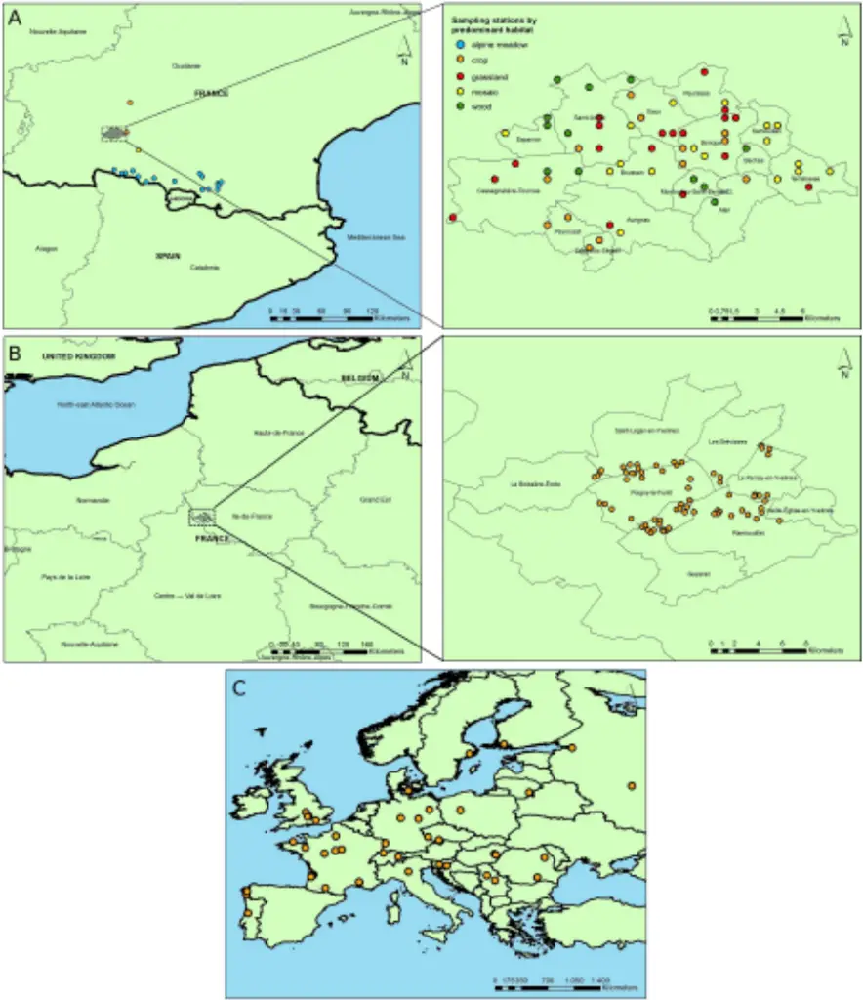
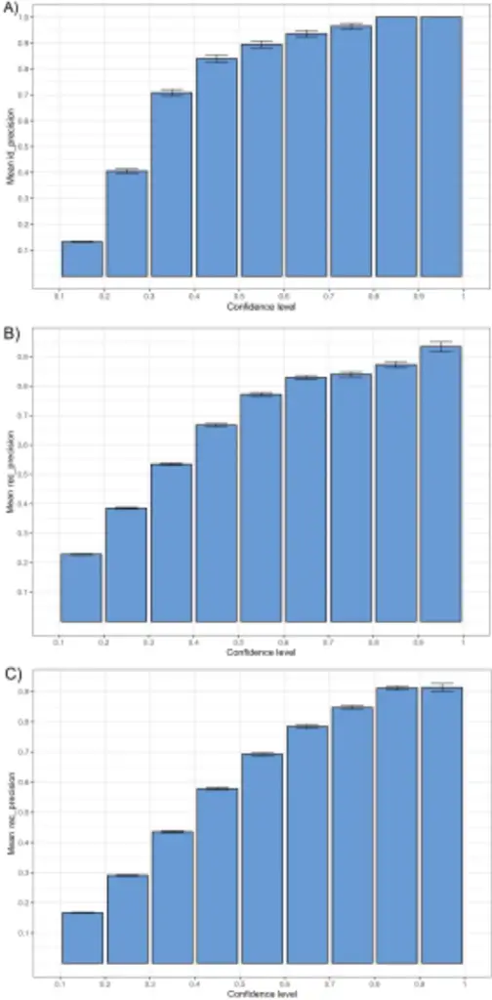
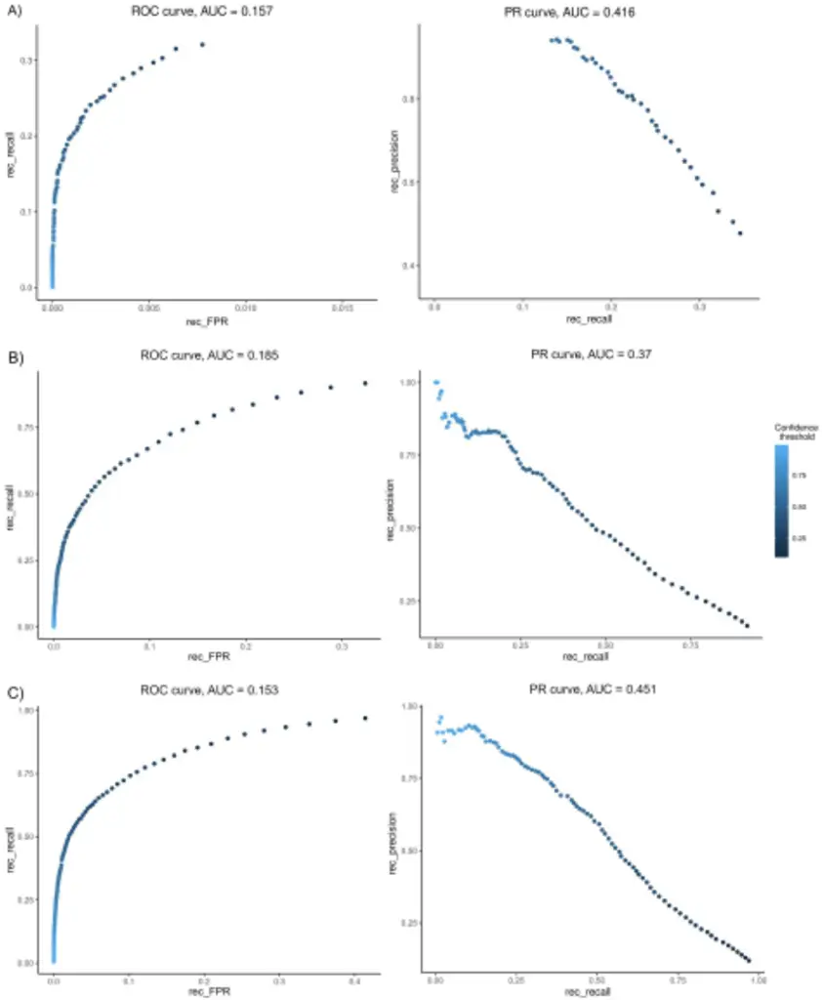
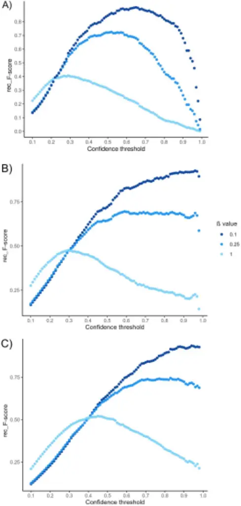
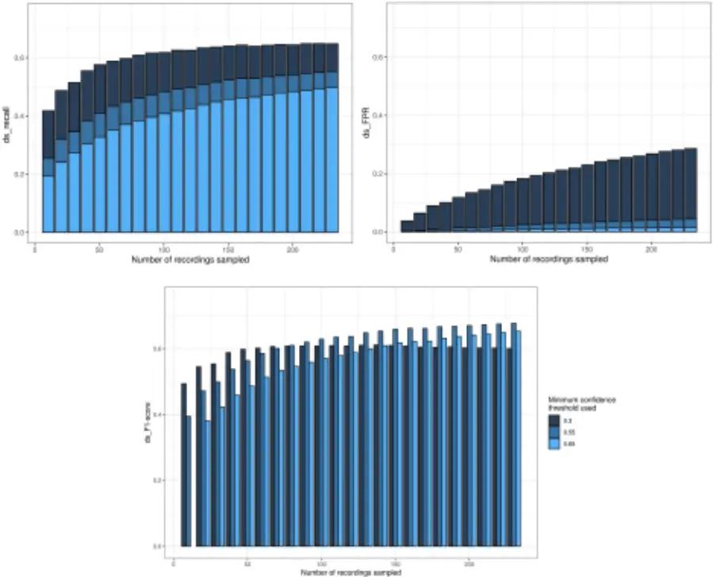
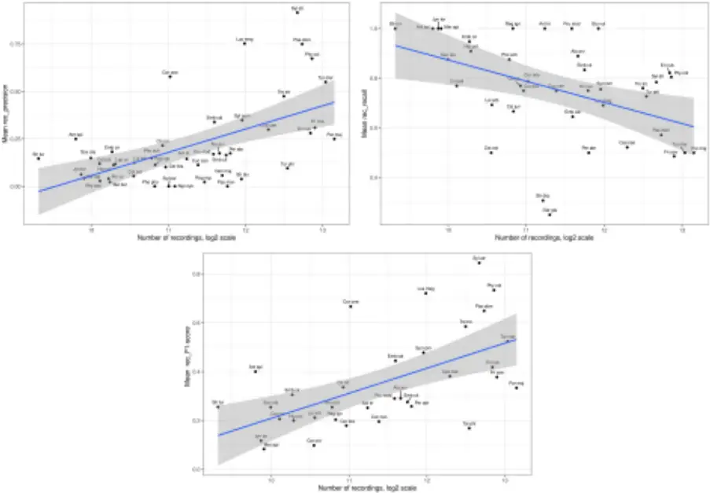

## Assessing the potential of BirdNET to infer European bird communities from large-scale ecoacoustic data 1 2

David Funosas 1,2* , Luc Barbaro 2,3,4 , Laura Schillé 5 , Arnaud Elger 1,2 , Bastien Castagneyrol 5 , Maxime Cauchoix 1,2,6 1 Laboratoire Écologie Fonctionnelle et Environnement, Université de Toulouse, CNRS, INPT, UPS, Toulouse, France 2 LTSER Zone Atelier 'Pyrénées Garonne' , ZA PYGAR, Auzeville-Tolosane, France 3 Dynafor, INRAE-INPT, University of Toulouse, Castanet-Tolosan, France 4 CESCO, Museum national d'Histoire naturelle, CNRS, Sorbonne University, Paris, France 5 University of Bordeaux, INRAE, BIOGECO, Cestas, France 6 Station d'Écologie Théorique et Expérimentale, SETE, CNRS, Moulis, France *Corresponding author: davidfunosas@gmail.com 3 4 5 6 7 8 9 10 11

12

13

## Abstract

1. Passive acoustic monitoring has become increasingly popular as a practical and cost-effective way of obtaining highly reliable acoustic data in ecological research projects. Increased ease of collecting these data means that, currently, the main bottleneck in ecoacoustic monitoring projects is often the time required for the manual analysis of passively collected recordings. In this study we evaluate the potential and current limitations of BirdNET-Analyzer v2.4, the most advanced and generic deep learning algorithm for bird recognition to date, as a tool to assess bird community composition through the automated analysis of large-scale ecoacoustic data. 14 15 16 17 18 19 20

2. To this end, we study 3 acoustic datasets comprising a total of 629 environmental soundscapes collected in 194 different sites spread across a 19° latitude span in Europe. We analyze these recordings both with BirdNET and by manual listening by local expert birders, and we then compare the results obtained through the two methods to evaluate the performance of the algorithm both at the level of each single vocalization and for entire recording sequences (1, 5 or 10 min). 3. Our analyses reveal that BirdNET identifications can be highly reliable if a sufficiently high minimum confidence threshold is used. However, the current recall of the algorithm is markedly low when the minimum confidence threshold is adjusted to ensure high levels of precision. Thus, we found that F1-scores remain moderate (&lt;0.5) for all datasets and confidence thresholds studied. We therefore estimate that acoustic datasets of extended duration are currently necessary for BirdNET to provide a reliable and minimally comprehensive picture of the target bird community. Our results also suggest that BirdNET performance is not significantly influenced by the type of recorder used or the habitat recorded but is modulated by the volume of species-specific acoustic data available online. 4. We conclude that a judicious use of AI-based IDs provided by BirdNET can represent a novel and powerful method to assist in the assessment of bird community composition through the automated analysis of large-scale ecoacoustic data. Finally, we provide best use recommendations to ensure optimal results from the algorithm for the ecological study of bird communities. 21 22 23 24 25 26 27 28 29 30 31 32 33 34 35 36 37 38 39 40 41

- KEYWORDS 42

automated species identification; bird communities; BirdNET; confidence threshold; Passive Acoustic Monitoring; precision and recall; soundscape 43 44 45 46

47

48

49

50

51

52

53

54

55

56

57

58

59

60

61

62

63

64

65

66

67

68

1. INTRODUCTION

In recent years, passive acoustic monitoring (PAM) based on autonomous recording units (ARUs) has become an increasingly popular option for monitoring avian populations and communities (Shonfield &amp; Bayne, 2017). Compared to active acoustic monitoring (AAM) methods such as point counts or active searches, ARUs could provide a more cost-effective way of obtaining data (Melo et al., 2021; Darras et al., 2018) and a higher degree of standardization in the data collection process (Darras et al. 2019). Moreover, ARUs offer the possibility of listening to distant, noisy or dubious animal sounds multiple times, potentially facilitating their identification (Sugai et al., 2019). At the same time, ARUs make it possible to collect substantial amounts of ecoacoustic data in a non-invasive way for local wildlife. ARUs can be especially useful for biodiversity monitoring projects in hard-to-reach areas, where difficult access conditions might hinder frequent data collection through AAM methods, and might improve the detectability of species whose vocal activity patterns do not coincide with the dates and times at which active monitoring is usually conducted (Sebastián-González et al., 2018). This greater facility to collect ecoacoustic data at regular time intervals in a standardized way makes it possible to study the variations in vocal activity patterns of one or more species along a given time gradient (e.g., time of day, week of the year) (Gasc et al., 2013; Towsey et al., 2014). Additionally, the analysis of soundscape variation across time and space allows to study potential correlations between the presence of anthropogenic sounds and the acoustic activity of sound-producing animals (Blumstein et al., 2011). This means that PAM could serve as a reliable way to obtain complementary information to cover the gaps left by traditional monitoring methods (Bradfer-Lawrence et al., 2023). Indeed, recent studies suggest that the combined use of PAM and AAM may provide a more accurate picture of the presence and abundance of target species than the use of only one of the two methods (Bobay et al., 2018; Shaw et al., 2021).

69

70

71

72

73

74

75

76

77

78

79

80

81

82

83

84

85

86

87

88

89

90

91

92

The increased ease of obtaining large amounts of ecoacoustic data through PAM means that, currently, the main bottleneck in ecoacoustic monitoring is often the time required for the analysis of passively collected data (Symes et al., 2022). Manual analysis of recordings by experts requires time-intensive dedication and therefore severely limits the amount of data that can be processed. Thus, the automated analysis of recordings could represent a potential solution to the current disparity between the efforts required to obtain data through PAM and the efforts necessary to manually analyze these data. In recent years, deep learning techniques have allowed for significant advances in the development of different tools for the automated recognition of biological sounds (Stowell, 2021). However, this field is still in a developing phase, and the use of these algorithms often results in significant numbers of false positives or false negatives, thus requiring subsequent manual validation (Knight et al., 2017). Hence, the development of ecoacoustic data processing algorithms that can reliably identify the species recorded without manual supervision could allow for a substantial transformation of the methods through which biodiversity monitoring projects are conducted (Liu et al., 2022). In this study we evaluate BirdNET-Analyzer v2.4, a deep neural network algorithm developed by the Cornell Lab of Ornithology which is capable of identifying 6512 bird species worldwide based on their sounds. BirdNET, in addition to detecting and identifying bird sounds present in a given recording, assigns a confidence score between 0 and 1 to each identification (Kahl et al., 2021), thus providing information about the reliability of its results. If considered sufficiently reliable, BirdNET could partially or even fully automate the analysis of ample amounts of ecoacoustic data that can already be efficiently obtained with ARUs (Stowell, 2021; Borowiec et al., 2022). Moreover, the recently released BirdNET App (Wood et al., 2022) might further contribute to the collection of ornithological data by helping nonexperts identify bird vocalizations heard on the field. Several recent studies have tested the potential and limitations of BirdNET as a tool to assess bird community composition through the automated analysis of environmental soundscapes (Kahl et al.,

93

94

95

96

97

98

99

100

101

102

103

104

105

106

107

108

109

110

111

112

113

114

2021; Arif et al., 2020; Brüggemann et al., 2021; Tolkova et al., 2021; Sethi et al., 2021; Toenies &amp; Rich, 2021; Cole et al., 2022; Höchst et al., 2022; Malamut, 2022). However, as highlighted in a recent review of these previous studies (Pérez-Granados, 2023), multiple analyses of potential relevance are still lacking. More concretely, the impact of (i) the number of species vocalizing simultaneously, (ii) the recording environment (i.e., the soundscape or acoustic habitat type), (iii) the type of recorder employed, (iv) the volume of species-specific acoustic data available online, and (v) the input values for the overlap and detection sensitivity parameters of the algorithm on BirdNET performance remains to be evaluated. Moreover, the review suggests that BirdNET performance should be studied not only at the entire recording level but also at the level of each single identification/vocalization. Last but not least, BirdNET detection capacity (i.e., recall rate) across a large range of European soundscapes has yet to be investigated. To fill this knowledge gap we analyze, both automatically with BirdNET and manually by expert birders, 629 environmental soundscapes collected in 194 different sites spread across a 19° latitude gradient in Europe (Fig. 1). We then compare the identifications obtained with BirdNET against those made by experts in order to assess the performance of the algorithm in terms of precision and recall (see subsection 2.4.1). Subsequently, we examine how to optimize the existing trade-off between these two metrics and how different features of the acoustic dataset analyzed might influence BirdNET performance. Finally, we provide best use recommendations to ensure optimal results from the algorithm for the ecological study of bird communities.

2. METHODS

## 2.1.Study area and soundscape collection

115

116

117

118

119

120

121

122

123

124

125

126

127

128

129

130

131

132

133

134

135

136

137

The environmental soundscapes analyzed in this study originated from three independent acoustic datasets (Table 1, Appendix S1). Our first dataset, hereafter referred to as ZA-Pygar, consists of a total of 237 1-minute recordings collected from 2019 to 2022 in 79 different sampling sites in the French region of Occitanie (Barbaro et al., 2022). More precisely, the region sampled is part of the Zone Atelier Pyrénées Garonne (Ouin et al., 2021), considered a long-term socio-ecological research site by French research institute CNRS since 2017. Out of the 79 sampling sites from which recordings were obtained, 60 are found in the Aurignac canton, 16 are found either in alpine meadows or at the edge between alpine meadows and subalpine forests at altitudes between 1400 and 2100 m in the Ariège department, and the remaining 3 are found in lowland agricultural areas in South-West Occitanie (Fig. 1a). Our second dataset, hereafter referred to as Rambouillet, consists of a total of 204 5-minute recordings collected during the COVID-19 lockdown of 2020 in 68 different sampling sites in the public forest of Rambouillet (Fig. 1b). This lowland sub-Atlantic broadleaf forest, covering 220 km² , is located in SouthWest Île-de-France (France), about 70 km from Paris (Barbaro et al., 2023). Finally, our third dataset, hereafter referred to as TreeBodyguards, was inherited from a pan-European citizen science project and consists of a total of 188 10-minute recordings collected in 47 different sampling sites from 17 European countries ranging from Spain to North-West Russia (Fig. 1c) (Valdés-Correcher et al., 2021).

## 2.2.Manual bird identification by experts

Bird vocalizations have been identified by expert birders in the three datasets. In the ZA-Pygar dataset, all bird sounds found within the first minute of each of the 237 recordings were manually identified and annotated by a single trained birder (DF) by drawing time-frequency bounding boxes around every single vocalization on recording spectrograms (Appendix S2, Fig. S1). In the two other datasets, a list of species present in each recording was generated after the listening, the specific vocalization times of each

138

139

140

141

142

143

144

145

146

147

148

149

150

151

152

153

154

155

156

157

158

159

160

species remaining unknown. In the Rambouillet dataset, each 5-minute recording selected was manually listened to once, all species detected being listed regardless of their total vocalization time by a single trained birder (LB). As for the TreeBodyguards dataset, given its wide geographical range, we distributed the recordings among 21 expert birders (see Acknowledgements), each of them manually listening to and identifying bird sounds from between 4 (one site) to 52 recordings (13 sites).

## 2.3. BirdNET-assisted analysis of recordings

The BirdNET version chosen for this study is BirdNET-Analyzer v2.4, the most recent release of the algorithm at the time of publication. BirdNET takes as input not only a sound file but also its approximate recording date (in the form of week of the year) and geographic coordinates (Appendix S3). It then splits the input recording into 3-second segments and provides a list of species detected in each segment along with a confidence score assigned to each identification, with values ranging from 0 to 1. By default there is no overlap between consecutive prediction segments, i.e., each segment begins where the previous segment ends, but BirdNET offers the possibility of allowing a certain degree of overlap (Fig. S2). In this study we initially performed the same analyses with allowed overlaps of 0 s, 1 s and 2 s between consecutive segments, and the solidly higher performances obtained with the latter option on the ZA-Pygar dataset (Table 2) made us choose it as the input value to evaluate BirdNET with in all datasets. A detection sensitivity input value of 1.5 was chosen for the analysis of the three datasets for the same reason.

## 2.4.Comparing BirdNET and expert identifications

We compared the results obtained with BirdNET against the identifications made by the expert birders in order to evaluate the performance of the algorithm. BirdNET results corresponding to the ZA-Pygar dataset could be analyzed at a higher level of detail than those obtained for the other two datasets, since

161

162

163

164

165

166

167

168

169

170

171

172

173

174

175

176

177

178

179

180

181

182

183

its temporally annotated identifications make it possible to know the specific vocalization times of each species. For our evaluation we defined 4 possible categories -True Positives (TP), False Positives (FP), True Negatives (TN) and False Negatives (FN)- for each species and acoustic sample, the categorization criteria being slightly variable among the three acoustic datasets analyzed (Table S1). Based on the categorization described, we calculated the precision, the recall and the False Positive Rate (FPR) of the algorithm for each minimum confidence threshold studied, going from 0.10 to 0.99 with a step of 0.01 (e.g., a minimum confidence threshold of 0.5 implies that all BirdNET identifications with confidence levels lower than 0.5 were filtered out). Precision is a measure of the reliability of BirdNET identifications, i.e., it estimates the probability that a given BirdNET identification will be correct, and is calculated by dividing the number of species correctly detected by the total number of species detected by the algorithm in the acoustic sample analyzed. Recall estimates the probability that a species present in the acoustic sample will be correctly detected by BirdNET, and is calculated by dividing the number of species correctly detected by the total number of species actually present in the acoustic sample analyzed. Finally, FPR estimates the probability that a species absent from the acoustic sample will be detected by BirdNET, and is calculated by dividing the number of species mistakenly detected by the total number of species absent from the acoustic sample analyzed (only considering those featuring in the species lists generated following the procedure explained in Appendix S3). The specific formulas used are the following: · Precision = TP / (TP + FP) · Recall = TP / (TP + FN) · FPR = FP / (FP + TN)

Different conclusions can be drawn from these metrics at different levels of analysis. In the ZA-Pygar dataset, measuring precision at the identification level and recall at the vocalization level can allow us to

184

185

186

187

188

189

190

191

192

193

194

195

196

197

198

199

200

201

202

203

204

205

206

estimate what percentage of BirdNET identifications will be correct and what percentage of bird vocalizations will be correctly detected by BirdNET, thus providing us with a fine-grained picture of BirdNET performance. However, since the total vocalization time of any given species varies significantly across different recordings, evaluating BirdNET based on the correctness of each individual identification could result in a small number of recordings with long vocalization times having a disproportionate weight over a greater number of recordings with shorter vocalization times. Thus, calculating precision and recall at the recording level can be an appropriate way of homogenizing the weight of each recording in the final results. Finally, calculating precision and recall at the level of the whole acoustic dataset can inform us about the reliability and exhaustiveness of BirdNET results when using them to provide us with a broad picture of the composition of a bird community recorded over multiple hours or days. We therefore calculated precision, recall and FPR at all three different levels of analysis: (i) at the identification/vocalization level (only for the ZA-Pygar dataset), (ii) at the recording level and (iii) at the dataset level. The metrics calculated at the first level will be referred to as ID \_precision, ID \_ recall and ID \_ FPR, the metrics calculated at the second level will be referred to as rec \_precision, rec \_ recall and rec \_ FPR and the metrics calculated at the third level will be referred to as ds \_precision, ds \_ recall and ds \_ FPR (Table 3). It is important to note that, since our categorization criteria imply that one correct identification can override any number of incorrect identifications of the same species within the same acoustic sample, the values obtained for these metrics will be highly influenced by the level of analysis chosen. Longer acoustic samples provide more opportunities for BirdNET to detect a given species, either correctly or incorrectly, but the asymmetric weight given to correct identifications over incorrect ones implies that the number of TPs will scale more rapidly with time than the number of FPs. This results in a bias towards more positive results when longer acoustic samples are used.

207

208

209

210

211

212

213

214

215

216

217

218

219

220

221

222

223

224

225

226

227

228

229

Once calculated, we used these values to plot the Receiver Operating Characteristic (ROC) and PrecisionRecall (PR) curves, both with an estimation of the Area Under the Curve (AUC) (Davis &amp; Goadrich, 2006). The ROC curve consists in plotting recall against FPR for each minimum confidence threshold studied in order to show the trade-off between the two metrics: as the minimum confidence score required to accept BirdNET identifications increases, the number of FPs will decrease, but so will the number of TPs. The PR curve, on the other hand, plots precision against recall for each minimum confidence threshold used, showing the trade-off between these two metrics as well. The AUC is, in both cases, a measure of the predictive power of the algorithm with a range of possible values going from 0 to 1, higher values being indicative of a higher predictive power. Another metric that we used to evaluate the performance of the algorithm for each minimum confidence threshold studied is the F-score. The F-score measures the overall predictive power of the algorithm by considering both precision and recall scores, the weight assigned to each variable depending on the β coefficient: F-score = (β² + 1) _ precision _ recall / (β² \* precision + recall) An F-score with β = 1 assigns the same importance to precision and recall, whereas an F-score with β &gt; 1 weighs recall more heavily than precision, and vice versa for β &lt; 1. We performed F-score analyses using three different β values: β = 1 as a standard value to facilitate the comparison of our results with those of other studies, β = 0.25 to reflect a clear prioritization of precision over recall and β = 0.1 to reflect an even more marked asymmetry between the importance assigned to these two metrics. We chose such asymmetrical coefficients because we estimate that ensuring high precision levels is paramount in most biodiversity research projects, i.e., it is usually considered preferable not to detect present species rather than mistakenly detecting non-present ones (Tolkova et al., 2021).

## 2.5.Factors influencing BirdNET performance

230

231

232

233

234

235

236

237

238

239

240

241

242

243

244

245

246

247

248

249

250

251

252

253

Using only the Za-Pygar dataset, we further analyzed how BirdNET performance might be influenced by factors related to the acoustic dataset analyzed (total duration recorded, habitat recorded, passive recorder used, preponderance of biophony over anthropophony and geophony (Bradfer-Lawrence et al., 2023; see Appendix S6), and number of species vocalizing at the same time) as well as the number of recordings available online for each species as a proxy for the size of the training dataset used by BirdNET. To estimate the influence of the size of the dataset (i.e., total recording duration) analyzed on birdNET performance, we calculated recall and FPR at the dataset level (ds \_ recall and ds \_ FPR) for 23 different subset sizes going from 10 to 230 recordings using a step increase of 10. For each subset size, we performed 200 random selections of recordings from the whole set of 237 recordings making up the ZAPygar dataset and then averaged out their results (i.e., we generated 200 random subsets of 10 recordings and then averaged out the ds \_ recall and ds \_ FPR corresponding to each of these subsets; likewise for all other subset sizes until 230). This number of random selections proved to be sufficient for results to be solidly consistent across multiple iterations of the same analysis. As for the variability of the predictive power of BirdNET across species, we distinguished between two different types of causal factors: (i) factors related to the difficulty inherent in identifying certain vocalizations, such as some acoustic patterns being easier to identify than others, or bird species with vocalizations highly similar to those of other species being harder to identify than species with more idiosyncratic sounds, and (ii) the size and quality of the acoustic data available for each species on the online platforms used as sources of data for the training of the algorithm. The first type of factor being considered out of scope for this study, we analyzed the influence of species-specific data availability on BirdNET performance. Even though we do not have direct access to the training datasets used by BirdNET, we know that the Xeno-canto platform (Xeno-canto, 2023) and the Macaulay Library of Natural Sounds (Macaulay, 2023) were used as sources of audio data for this purpose (Kahl et al., 2021). Thus,

254

255

256

257

258

259

260

261

262

263

264

265

266

267

268

269

270

271

272

273

274

275

we used the total number of foreground recordings available on both platforms for each species analyzed as a rough proxy for the species-specific availability of recordings during the training phase of the algorithm. More specifically, we examined the correlation between the number of recordings available on these platforms and BirdNET precision, recall and F1-scores across species. This allowed us to roughly estimate the explanatory power of species-specific recording availability over the variability of BirdNET performance across species. Species detected fewer than 10 times were filtered out from the analysis, their sample sizes being too low for results to be minimally reliable. Finally, it is important to note that, unless explicitly specified, all Fig.Figs and statistical results correspond to the analysis of recordings with BirdNET-Analyzer v2.4, using a detection sensitivity of 1.5 and an overlap window of 2 s between consecutive prediction segments.

3. RESULTS
4. 3.1.Optimizing BirdNET parameters

Our evaluation of BirdNET performance under different input parameter configurations suggests that 1s overlap windows improve AUC scores on both ROC and PR curves with respect to the default 0-second overlap, and that 2s overlaps improve these scores even further (Table 2). This improvement seems to arise from the fact that high degrees of overlap facilitate the capture of a substantial part of a given bird vocalization within a single prediction segment (Fig. S1). Since longer vocalization times within a given prediction segment are predictive of higher ID \_ recall levels (Fig. S3; Spearman, rs = 0.956 and p &lt; .001), an increase in overlap between consecutive prediction segments should correspondingly result in higher recall scores. Likewise, the predictive power of BirdNET as measured by the ROC and PR AUC scores seems to improve along with higher values of the detection sensitivity parameter (Table 2), suggesting

276

277

278

279

280

281

282

283

284

285

286

287

288

289

290

291

292

293

294

295

296

297

298

that a detection sensitivity of 1.5 (from a range of possible values going from 0.5 to 1.5) might be the optimal value for overall performance.

## 3.2.Assessing BirdNET performance

We found the confidence scores provided by the algorithm to be positively correlated with the actual probability that the corresponding identification is correct (Figs 2 and S4; Kruskal-Wallis, H(1) = 5977.7 with low confidence scores are filtered out, thus retaining only the most reliable ones. In accordance with this premise, the ROC and PR curves in Fig. 3 reveal a clear trade-off between the precision and recall of the algorithm, as well as between recall and FPR: the higher the minimum confidence score required to accept BirdNET identifications, the higher the precision and the lower the FPR will be. Nonetheless, improvements in these two metrics have to be weighed against the lower recall associated with a higher level of selectiveness. Average precision scores by species improve considerably by setting higher minimum confidence thresholds (Fig. S5), recall scores by species following the opposite trend

and p &lt; .001). This means that a minimum confidence threshold can be established so that identifications (Fig. S6). When analyzing BirdNET results at the recording level for the ZA-Pygar dataset, we found that the optimal minimum confidence thresholds for maximizing global F-scores for β-values of 1, 0.25 and 0.1 are 0.3, 0.55 and 0.65, respectively (Fig. 4). The results obtained for each of these thresholds show that, as the minimum confidence score required to accept BirdNET identifications becomes stricter, both TPs and FPs decrease while FNs rise sharply (Fig. S7). This causes both the number of species correctly detected and the number of species mistakenly detected to vary considerably depending on the minimum confidence threshold used. While a minimum confidence threshold of 0.3 allows for a ds \_ recall of 0.65 (i.e., the correct detection of 65% of the species present in the dataset), a threshold of 0.55

299

300

301

302

303

304

305

306

307

308

309

310

311

312

313

314

315

316

317

318

319

320

321

reduces this Fig. to 0.55 and a threshold of 0.65 reduces it further to 0.5. On the other hand, ds \_ FPR (i.e., the proportion of species absent from the dataset that are mistakenly detected by the algorithm) varies even more strongly along with the confidence threshold used, with respective values of 0.41, 0.07 and 0.03. In absolute terms, this translates into 48, 41 and 37 species correctly dectected and 85, 15 and 6 species mistakenly detected, respectively. It is important to note that a non-negligible number of species present in the recordings have only been manually detected a small number of times (Fig. S8). Hence, we deem the estimated predictive power of the algorithm for these species to be highly unreliable. The difference between Figs S7a and S7d suggests that limiting the analysis to species detected -either by BirdNET or by the expert birder- in a minimum of 10 recordings, while filtering out less common species, results in a substantially higher overall performance of the algorithm. More specifically, when analyzing the ZA-Pygar dataset with a confidence threshold of 0.3, this filtering procedure improves rec \_precision from 0.59 to 0.71 without compromising rec \_ recall, which actually remains stable at 0.32. The results obtained after applying this filter (Fig. S7d) also suggest that the variability in BirdNET predictive power across species is not as pronounced as what we might infer from Fig. S7a, since the low number of data points available for many species leads to more variable outcomes. Overall, our analyses yielded highly consistent results across the three datasets studied, with maximal F1-scores (corresponding to minimum confidence thresholds between 0.3 and 0.45) ranging from 0.4 to 0.52 at the recording level (Table 1). This roughly means that, in the best case, we can expect two errors (FP or FN) for each correct BirdNET prediction. BirdNET performance is lower (maximal F1-score of 0.33 for a minimum confidence threshold of 0.4) when results are analyzed at the identification/vocalization level (i.e., 1 correct prediction for every 3 errors).

## 3.3.Factors influencing BirdNET performance

322

323

324

325

326

327

328

329

330

331

332

333

334

335

336

337

338

339

340

341

342

343

344

345

\_

\_

In order to properly isolate the variables of interest and ensure that the heterogenous identification procedures and recording durations used in the three datasets do not have a confounding effect, only recordings from the ZA-Pygar dataset are included in the following analyses. Regarding the influence of sample size on BirdNET performance, there appears to be a positive linear correlation between ds \_ F1-scores and the logarithm of the number of recordings sampled (Fig. 5; linear regression, adjusted R² = .539, p &lt; .001). The same seems to be true for ds \_ TPR (adjusted R² = .376, p &lt; .001) and ds \_ recall (adjusted R² = .095, p &lt; .001) as well, in all cases after controlling for the minimum confidence threshold used. As can be observed in Fig. 5, ds \_ FPR shows a pronounced decrease when higher confidence scores are required. ds \_ recall, while following the same trend, shows differences of more moderate proportions as a response to increased minimum confidence thresholds. This suggests that a given global recall target can be reached either by setting a low enough minimum confidence threshold or by setting a high minimum confidence threshold and procuring a large enough acoustic dataset, the latter approach resulting in substantially lower ds \_ FPR values. Other analyses performed suggest that the number of different bird species vocalizing simultaneously seems to have a significant influence on ID \_precision (Fig. S9; Spearman, rs = 0.122 and p &lt; .001) but not on ID \_ recall and ID \_ F1-scores (Spearman, rs = -0.051 and p = .285 for ID \_ recall, rs = 0.017 and p = 0.72 for ID \_ F1-score). In contrast, neither the recorder used nor the predominant habitat sampled seem to affect BirdNET performance (Fig. S10), since neither rec \_precision, rec \_ recall nor rec \_ F1-scores show significant differences across different habitats (Kruskal-Wallis, H4 = 1.11 and p = .775 for rec \_precision, H4 = 0.79 and p = .852 for rec \_ recall and H4 = 1.24 and p = .744 for rec \_ F1 \_ score) or recorders (KruskalWallis, H3 = 4.08 and p = .130 for rec \_precision, H3 = 8.92 and p = 0.116 for rec \_ recall and H3 = 2.04 and p = 0.36 for rec \_ F1 \_ score). Finally, the number of foreground recordings available on Xeno-canto and the Macaulay Library for each species studied appears to have a significant influence on species-specific rec \_precision, rec recall and rec F1-scores. More concretely, the logarithm of the number of recordings

346

347

348

349

350

351

352

353

354

355

356

357

358

359

360

361

362

363

364

365

366

367

\_

available seems to correlate positively with rec \_precision and rec \_ F1-score but negatively with rec \_ recall (Fig. 6; Spearman, rs = 0.506 and p &lt; .001 for rec \_precision, rs = -0.484 and p = .002 for rec \_ recall and rs = 0.599 and p &lt; .001 for rec F1-score).

4. DISCUSSION

Even with its current limitations, BirdNET appears as a promising tool to assist in the assessment of bird community composition through the automated processing of large-scale ecoacoustic data. Our analyses reveal that BirdNET can provide us with reasonably high levels of precision or recall, at least in the regions studied, but the inevitable trade-off between these two metrics prevents satisfactory results for both at the same time (maximal F1-score &lt;0.5). Admittedly, the current recall of the algorithm when adjusted to ensure high levels of precision is markedly low. Despite BirdNET still having considerable room for improvement in both precision and recall scores, it is important to note that identifications by field observers are not exempt from errors either. Recent studies suggest that acoustic identifications by highly experienced birders present precision scores no higher than 0.94 and recall scores no higher than 0.89 (Farmer et al., 2012; Campbell &amp; Francis, 2011), implying that BirdNET identifications with exceptionally high confidence scores might prove to be as accurate or more as those made by reasonably experienced birders. Regarding precision scores in particular, our results are in line with previous studies (Sethi et al., 2021; Cole et al., 2022) showing that BirdNET identifications can be highly reliable, especially for common species (Fig. 6), provided that a sufficiently high minimum confidence threshold is used (Fig. S5). Conveniently, confidence scores assigned to each identification by the algorithm show a high degree of correspondence with the actual probability that the identification in question is correct (Fig. 2). This

368

369

370

371

372

373

374

375

376

377

378

379

380

381

382

383

384

385

386

387

388

389

390

391

makes it possible to reliably adjust the precision of the identifications to the specific requirements of each research project using BirdNET. Our results further suggest that BirdNET precision scores can be improved not only by raising the minimum confidence threshold used, but also by filtering out species not having reached a minimum number of BirdNET detections across the whole dataset (Fig. S5). We found, however, that species such as garden warblers (Sylvia borin) and Western Bonelli's Warblers (Phylloscopus bonelli) were identified by BirdNET on a high number of occasions, always incorrectly, and exceeded our minimum occurrence frequency threshold (Fig. S7d). Non-negligible numbers of FPs for other non-present species suggest caution around their identifications as well. On the positive side, these misidentifications seem to be effectively filtered out by establishing strict enough minimum confidence thresholds (Fig. S7c). It is important to note, though, that background sounds can vary considerably between different locations and times of the year, so the list of problematic species can turn out to be substantially different in other spatio-temporal contexts. We therefore recommend that, prior to its use, a preliminary assessment of BirdNET be conducted with soundscapes from the target study site. This would allow researchers to preemptively identify the species appearing most often as FPs and to pay special attention to identifications of these species when examining BirdNET results. Another possible method to reduce FPs, as suggested by a recent study (Toenies &amp; Rich, 2021), would be to filter out BirdNET identifications of diurnal species when analyzing nocturnal recordings, thus effectively preventing most dog barks and frog croaks from being misclassified as diurnal waterbird calls. Our results also make it clear that BirdNET performance shows a high degree of variability across different species (Figs S5, S6, S7). However, these results do not provide information on the degree to which this variability is due to (i) cross-species differences in the amount or quality of recordings available to train the algorithm with, (ii) the inherent difficulty in identifying vocalizations with certain acoustic patterns, or (iii) the identification difficulty arising from two or more species emitting highly

392

393

394

395

396

397

398

399

400

401

402

403

404

405

406

407

408

409

410

411

412

413

414

415

similar sounds. Assuming that the first obstacle is the most tractable among the three mentioned, the higher the percentage of cross-species variation in BirdNET performance that is explained by recording availability, the more optimistic we should be regarding the improvement of the performance of the algorithm over time. In this regard, our results suggesting that 19% of the variance in F1-scores between species can be explained by online recording availability (Fig. 6) provide ground for optimism about the future reliability of BirdNET. More concretely, this could mean that the diagnostic capacity of BirdNET for less common species could be considerably improved by enlarging the pool of available acoustic data for these species. We presume that a higher availability of acoustic data could facilitate BirdNET performance through two different mechanisms: (i) by enabling BirdNET to enlarge the size of its training dataset, and (ii) by improving the quality of the recordings comprising its training dataset. Acoustic quality scores are included in the metadata of recordings on Xeno-canto and the Macaulay Library, and higher-quality recordings were prioritized in the selection of training data for the BirdNET algorithm (Kahl et al., 2021). Hence, we would expect the average acoustic quality to be higher in the training datasets of species with larger pools of available recordings to choose from. Insomuch as both higher-quality recordings and larger training datasets could facilitate a better adjustment of the algorithm to the target bird vocalizations, these factors could provide a plausible explanation to the positive correlation observed between species-specific acoustic data availability and BirdNET predictive power. We further found a significant linear correlation between the logarithm of the recording time analyzed and the proportion of recorded species having been correctly detected by BirdNET (Fig. 5). A possible explanation to this correlation would be that the short total vocalization time recorded for the least frequent species often results in no correct detections of these species by BirdNET. Thus, insofar as longer recording times contain a greater number of vocalizations per species in expectation, we should expect larger acoustic datasets to provide more chances for the algorithm to correctly detect less

416

417

418

419

420

421

422

423

424

425

426

427

428

429

430

431

432

433

434

435

436

437

438

439

frequent species. We therefore hypothesize that a sufficiently high number of recording hours analyzed could partially compensate for the low recall scores obtained when high minimum confidence thresholds are used. Hence, were the necessary conditions to be met, BirdNET might prove successful in capturing most bird species present in a study site while also ensuring a relatively low number of FPs. These results, in line with recent findings (Toenies &amp; Rich, 2021; Cole et al., 2022; Wood et al., 2021), are encouraging with respect to the potential of BirdNET to reliably and comprehensively describe bird communities in research projects with large amounts of ecoacoustic data at their disposal. Our results also show that the predominance of biophony over anthropophony and geophony in recordings, as measured by NDSI (Kasten et al., 2012), appears to be positively correlated with recall scores (see Appendix S6, Fig. S11). We propose three possible hypotheses explaining this correlation: (i) anthropogenic and geological sounds might hinder the performance of the algorithm by concealing or blurring bird vocalizations, (ii) BirdNET might have mostly been trained with recordings with relatively low levels of background noise, thus being less well calibrated to identify bird vocalizations in noisy recordings, and (iii) high NDSI scores can be indicative of high-volume bird vocalizations, which might to be easier to identify than low-volume bird vocalizations (Pérez Granados, 2023). If the second hypothesis were correct, we consider it plausible that the application of a noise reduction filter to recordings prior to their analysis with BirdNET could result in an enhanced performance of the algorithm. Overall, the results of this study may provide valuable information for research groups considering the possibility of using BirdNET for the automated analysis of passively-collected environmental soundscapes. However, these results provide an overview of the current potential of BirdNET in a very specific context, and therefore cannot be reliably extrapolated to other regions with different habitats, levels of anthropogenic pressure or bird community compositions. Care must also be taken when extrapolating our results to other areas with similar but geographically distant bird communities, as bird songs and calls can present subtle variations across different regions (Slabbekoorn &amp; Smith, 2002).

440

441

442

443

444

445

446

447

448

449

450

451

452

453

454

455

456

457

458

459

460

Another point that should be borne in mind is that this study starts from the fundamental assumption that all our expert identifications are correct, which is why we used them as the reference to compare BirdNET against. As already mentioned, even highly experienced birders seem to fall short of infallibility (Farmer et al., 2012; Campbell &amp; Francis, 2011), so the possibility that some of the expert identifications included in this study are incorrect cannot be entirely ruled out. As a concluding note, in light of the improvement detected between the recall scores of BirdNET-Analyzer v2.4 and those of older versions of the algorithm -BirdNET-Lite and BirdNET-Analyzer v2.1 to 2.3- that we previously tested with the same data, we consider it plausible that future releases will be capable of identifying bird vocalizations even more reliably and exhaustively. Thus, our results should not be assumed to accurately estimate the performance of future versions of BirdNET, but they should rather be interpreted as a lower bound for their potential.

## Author contributions

Based on an initial idea by MC, he and DF conceived the study, with inputs from LS, BC and LB. LS and BC gathered the TreeBodyguards dataset and LB recorded the ZA-Pygar and Rambouillet datasets. DF performed manual and automated bird identifications and manual annotated recordings for the ZAPygar dataset. LB performed manual bird identifications for the Rambouillet dataset. DF and LS performed the computations and data analyses, with inputs from MC and BC. DF wrote the first draft of the manuscript and all authors contributed to shape the final version.

## Acknowledgements

461

462

463

464

465

466

467

468

469

470

471

472

473

474

475

476

477

478

479

480

481

482

We thank Arndt Hampe, Maarten de Groot, Thomas Boivin, Vojtech Lanta, Lyudmila Pukinskaya, Frédéric Archaux, Thomas Perot, Márton Molnár, Nickolay Sedikhin, Valentin Moser, Elina Mäntylä, Jan Grünwald, Karthik Thrikkadeeri, Anders Mårell, Mona C Bjørn, Becky Thomas, Andreas Prinzing and Lucian Grosu for manual bird identifications of the TreeBodyguards European dataset. We are grateful to Michel Beal, Jean-Luc Témoin , Valérie Delage and Laurent Tillon from Office National des Forêts for their help while recording the Rambouillet dataset. We also thank Thierry Feuillet, Amandine Gasc, Jérémy Froidevaux, Kevin Darras, Yves Bas, Elena Valdés-Correcher, Thomas Delattre for helpful advice and support. We are also indebted to the CESAB Acoucene working group for fruitful discussions.

## Funding information

This work has received financial support from the French government through the National Agency for Research as part of the Future Investment Program integrated into France 2030 (Terra Forma project, ANR-21-ESRE-0014 and PSI-BIOM project operated by ADEME), from the SpatialTreeP project (ANR-21CE03-0002) and from INRAE Métaprogramme Biosefair (PARMENIDE project).

## Data availability statement

The code used for the analyses performed in this study, as well as both BirdNET and manual identifications/annotations for the three acoustic datasets studied, can be found in the following GitHub repository: https://github.com/dfpl1/BirdNET \_ study\_ Occitanie \_ 2023/. The raw acoustic data analyzed is available upon request.

## Conflict of interest statement

- All authors declare that they have no conflicts of interest to disclose. 483

484

- References 485
- [Arif, M., Hedley, R., &amp; Bayne, E. (2020). Testing the Accuracy of a birdNET, Automatic bird song Classifier. Education 486](https://doi.org/10.1002/ece3.9491)
- and Research Archive, University of Alberta. https://doi.org/10.7939/r3-6khb-kz18 487
- Barbaro, L., Froidevaux, J. S. P., Valdés-Correcher, E., Calatayud, F., Tillon, L., &amp; Sourdril, A. (2023). COVID-19 488
- shutdown revealed higher acoustic diversity and vocal activity of flagship birds in old-growth than in production 489
- forests. Science of The Total Environment, 901, 166328. https://doi.org/10.1016/j.scitotenv.2023.166328 490
- Barbaro, L., Sourdril, A., Froidevaux, J. S. P., Cauchoix, M., Calatayud, F., Deconchat, M., &amp; Gasc, A. (2022). Linking 491
- acoustic diversity to compositional and configurational heterogeneity in mosaic landscapes. Landscape Ecology, 492
- 37(4), 1125-1143. https://doi.org/10.1007/s10980-021-01391-8 493
- Blumstein, D. T., Mennill, D. J., Clemins, P., Girod, L., Yao, K., Patricelli, G., Deppe, J. L., Krakauer, A. H., Clark, C., 494
- Cortopassi, K. A., Hanser, S. F., McCowan, B., Ali, A. M., &amp; Kirschel, A. N. G. (2011). Acoustic monitoring in terrestrial 495
- environments using microphone arrays: Applications, technological considerations and prospectus. Journal of 496
- Applied Ecology, 48(3), 758-767. https://doi.org/10.1111/j.1365-2664.2011.01993.x 497
- Bobay, L. R., Taillie, P. J., &amp; Moorman, C. E. (2018). Use of autonomous recording units increased detection of a 498
- secretive marsh bird. Journal of Field Ornithology, 89(4), 384-392. https://doi.org/10.1111/jofo.12274 499
- Borowiec, M. L., Dikow, R. B., Frandsen, P. B., McKeeken, A., Valentini, G., &amp; White, A. E. (2022). Deep learning as a 500
- tool for ecology and evolution. Methods in Ecology and Evolution, 13(8), 1640-1660. https://doi.org/10.1111/2041501
- 210X.13901 502
- Bradfer-Lawrence, T., Desjonqueres, C., Eldridge, A., Johnston, A., &amp; Metcalf, O. (2023). Using acoustic indices in 503
- ecology: Guidance on study design, analyses and interpretation. Methods in Ecology and Evolution, 14(9), 2192504

2204. https://doi.org/10.1111/2041-210X.14194 505

- Brüggemann, L., Schütz, B., &amp; Aschenbruck, N. (2021). Ornithology meets the IoT: Automatic Bird Identification, 506
- Census, and Localization. 2021 IEEE 7th World Forum on Internet of Things (WF-IoT), 765-770. 507
- https://doi.org/10.1109/WF-IoT51360.2021.9595401 508
- Campbell, M., &amp; Francis, C. M. (2011). Using Stereo-Microphones to Evaluate Observer Variation in North American 509
- Breeding Bird Survey Point Counts. The Auk, 128(2), 303-312. https://doi.org/10.1525/auk.2011.10005 510
- Darras, K., Batáry, P., Furnas, B. J., Celis-Murillo, A., Van Wilgenburg, S. L., Mulyani, Y. A., &amp; Tscharntke, T. (2018). 511
- Comparing the sampling performance of sound recorders versus point counts in bird surveys: A meta-analysis. 512
- Journal of Applied Ecology, 55(6), 2575-2586. https://doi.org/10.1111/1365-2664.13229 513
- Darras, K., Batáry, P., Furnas, B. J., Grass, I., Mulyani, Y. A., &amp; Tscharntke, T. (2019). Autonomous sound recording 514
- outperforms human observation for sampling birds: A systematic map and user guide. Ecological Applications, 515
- [29(6), e01954. https://doi.org/10.1002/eap.1954 516](https://doi.org/10.1002/eap.1954)
- Cole, J. S., Michel, N. L., Emerson, S. A., &amp; Siegel, R. B. (2022). Automated bird sound classifications of long-duration 517
- recordings produce occupancy model outputs similar to manually annotated data. Ornithological Applications, 518
- 124(2), duac003. https://doi.org/10.1093/ornithapp/duac003 519
- Davis, J., &amp; Goadrich, M. (2006). The relationship between Precision-Recall and ROC curves. Proceedings of the 23rd 520
- International Conference on Machine Learning, 233-240. https://doi.org/10.1145/1143844.1143874 521
- Farmer, R. G., Leonard, M. L., &amp; Horn, A. G. (2012). Observer Effects and Avian-Call-Count Survey Quality: Rare522
- Species Biases and Overconfidence. The Auk, 129(1), 76-86. https://doi.org/10.1525/auk.2012.11129 523
- Gasc, A., Sueur, J., Pavoine, S., Pellens, R., &amp; Grandcolas, P. (2013). Biodiversity Sampling Using a Global Acoustic 524
- Approach: Contrasting Sites with Microendemics in New Caledonia. PLOS ONE, 8(5), e65311. 525
- https://doi.org/10.1371/journal.pone.0065311 526
- Gaüzère, P., Barbaro, L., Calatayud, F., Princé, K., Devictor, V., Raison, L., Sirami, C., &amp; Balent, G. (2020). Long-term 527
- effects of combined land-use and climate changes on local bird communities in mosaic agricultural landscapes. 528
- Agriculture, Ecosystems &amp; Environment, 289, 106722. https://doi.org/10.1016/j.agee.2019.106722 529

- Höchst, J., Bellafkir, H., Lampe, P., Vogelbacher, M., Mühling, M., Schneider, D., Lindner, K., Rösner, S., Schabo, D. 530
- G., Farwig, N., &amp; Freisleben, B. (2022). Bird@Edge: Bird Species Recognition at the Edge. In M. -A. Koulali &amp; M. 531
- Mezini (Eds.), Networked Systems (Vol. 13464, pp. 69-86). Springer International Publishing. 532
- https://doi.org/10.1007/978-3-031-17436-0 \_ 6 533
- Kahl, S., Wood, C. M., Eibl, M., &amp; Klinck, H. (2021). BirdNET: A deep learning solution for avian diversity monitoring. 534
- Ecological Informatics, 61, 101236. https://doi.org/10.1016/j.ecoinf.2021.101236 535
- Kasten, E. P., Gage, S. H., Fox, J., &amp; Joo, W. (2012). The remote environmental assessment laboratory's acoustic 536
- library: An archive for studying soundscape ecology. Ecological Informatics, 12, 50-67. 537
- https://doi.org/10.1016/j.ecoinf.2012.08.001 538
- Knight, E., Hannah, K., Foley, G., Scott, C., Brigham, R., &amp; Bayne, E. (2017). Recommendations for acoustic 539
- recognizer performance assessment with application to five common automated signal recognition programs. 540
- Avian Conservation and Ecology, 12(2). https://doi.org/10.5751/ACE-01114-120214 541
- Liu, M., Sun, Q., Brewer, D. E., Gehring, T. M., &amp; Eickholt, J. (2022). An Ornithologist's Guide for Including Machine 542
- Learning in a Workflow to Identify a Secretive Focal Species from Recorded Audio. Remote Sensing, 14(15), Article 543

15. https://doi.org/10.3390/rs14153816 544

- Macaulay (2023). The World's Premier Scientific Archive of Natural History Audio, Video, and Photographs. 545
- https://www.macaulaylibrary. org/about/ 546
- Malamut, E. J. (2022). Using Autonomous Recording Units and Image Processing to Investigate Patterns in Avian 547
- Singing Activity and Nesting Phenology [UCLA]. https://escholarship.org/uc/item/92p9z0gp 548
- Melo, I., Llusia, D., Bastos, R. P., &amp; Signorelli, L. (2021). Active or passive acoustic monitoring? Assessing methods to 549
- track anuran communities in tropical savanna wetlands. Ecological Indicators, 132, 108305. 550
- https://doi.org/10.1016/j.ecolind.2021.108305 551
- Ouin, A., Andrieu, E., Vialatte, A., Balent, G., Barbaro, L., Blanco, J., Ceschia, E., Clement, F., Fauvel, M., Gallai, N., 552
- Hewison, A. J. M., Jean-François, D., Kephaliacos, C., Macary, F., Probst, A., Probst, J. -L., Ryschawy, J., Sheeren, D., 553

- Sourdril, A., … Sirami, C. (2021). Chapter Two-Building a shared vision of the future for multifunctional agricultural 554
- landscapes. Lessons from a long term socio-ecological research site in south-western France. In D. A. Bohan, A. J. 555
- Dumbrell, &amp; A. J. Vanbergen (Eds.), Advances in Ecological Research (Vol. 65, pp. 57-106). Academic Press. 556
- [https://doi.org/10.1016/bs.aecr.2021.05.001 557](https://doi.org/10.1016/bs.aecr.2021.05.001)
- Pérez Granados, C. (2023). A First Assessment of Birdnet Performance at Varying Distances: A Playback Experiment. 558
- 70, 257-269. https://doi.org/10.13157/arla.70.2.2023.sc1 559
- Pérez-Granados, C. (2023). BirdNET: Applications, performance, pitfalls and future opportunities. Ibis, 165(3), 1068560

1075. https://doi.org/10.1111/ibi.13193 561

- Ross, S. R. P. -J., Friedman, N. R., Yoshimura, M., Yoshida, T., Donohue, I., &amp; Economo, E. P. (2021). Utility of acoustic 562
- indices for ecological monitoring in complex sonic environments. Ecological Indicators, 121, 107114. 563
- https://doi.org/10.1016/j.ecolind.2020.107114 564
- Sebastián-González, E., Camp, R., Tanimoto, A., de Oliveira, P., Lima, B., Marques, T., &amp; Hart, P. (2018). Density 565
- estimation of sound-producing terrestrial animals using single automatic acoustic recorders and distance sampling. 566
- Avian Conservation and Ecology, 13(2). https://doi.org/10.5751/ACE-01224-130207 567
- Sethi, S. S., Fossøy, F., Cretois, B., &amp; Rosten, C. M. (2021). Management relevant applications of acoustic monitoring 568
- for Norwegian nature - The Sound of Norway. In 31. Norsk institutt for naturforskning (NINA). 569
- https://brage.nina.no/nina-xmlui/handle/11250/2832294 570
- Shaw, T., Hedes, R., Sandstrom, A., Ruete, A., Hiron, M., Hedblom, M., Eggers, S., &amp; Mikusiński, G. (2021). Hybrid 571
- bioacoustic and ecoacoustic analyses provide new links between bird assemblages and habitat quality in a winter 572
- boreal forest. Environmental and Sustainability Indicators, 11, 100141. https://doi.org/10.1016/j.indic.2021.100141 573
- Shonfield, J., &amp; Bayne, E. (2017). Autonomous recording units in avian ecological research: Current use and future 574
- applications. Avian Conservation and Ecology, 12, 14. https://doi.org/10.5751/ACE-00974-120114 575
- Slabbekoorn, H., &amp; Smith, T. B. (2002). Bird song, ecology and speciation. Philosophical Transactions of the Royal 576
- Society of London. Series B: Biological Sciences, 357(1420), 493-503. https://doi.org/10.1098/rstb.2001.1056 577

- Stowell, D. (2021). Computational bioacoustics with deep learning: A review and roadmap (arXiv:2112.06725). 578
- arXiv. https://doi.org/10.48550/arXiv.2112.06725 579
- Sugai, L. S. M., Desjonquères, C., Silva, T. S. F., &amp; Llusia, D. (2020). A roadmap for survey designs in terrestrial 580
- acoustic monitoring. Remote Sensing in Ecology and Conservation, 6(3), 220-235. https://doi.org/10.1002/rse2.131 581
- Sugai, L. S. M., Silva, T. S. F., Ribeiro, J. W., Jr, &amp; Llusia, D. (2019). Terrestrial Passive Acoustic Monitoring: Review 582
- and Perspectives. BioScience, 69(1), 15-25. https://doi.org/10.1093/biosci/biy147 583
- Symes, L. B., Kittelberger, K. D., Stone, S. M., Holmes, R. T., Jones, J. S., Castaneda Ruvalcaba, I. P., Webster, M. S., &amp; 584
- Ayres, M. P. (2022). Analytical approaches for evaluating passive acoustic monitoring data: A case study of avian 585
- vocalizations. Ecology and Evolution, 12(4), e8797. https://doi.org/10.1002/ece3.8797 586
- Toenies, M., &amp; Rich, L. (2021). Advancing bird survey efforts through novel recorder technology and automated 587
- species identification. California Fish and Wildlife Journal, 107, 56-70. https://doi.org/10.51492/cfwj.107.5 588
- Tolkova, I., Chu, B., Hedman, M., Kahl, S., &amp; Klinck, H. (2021). Parsing Birdsong with Deep Audio Embeddings 589
- (arXiv:2108.09203). arXiv. https://doi.org/10.48550/arXiv.2108.09203 590
- Towsey, M., Zhang, L., Cottman-Fields, M., Wimmer, J., Zhang, J., &amp; Roe, P. (2014). Visualization of Long-duration 591
- Acoustic Recordings of the Environment. Procedia Computer Science, 29, 703-712. 592
- https://doi.org/10.1016/j.procs.2014.05.063 593
- Valdés-Correcher, E., Moreira, X., Augusto, L., Barbaro, L., Bouget, C., Bouriaud, O., Branco, M., Centenaro, G., 594
- Csóka, G., Damestoy, T., Dobrosavljević, J., Duduman, M. -L., Dulaurent, A. -M., Eötvös, C. B., Faticov, M., Ferrante, 595
- M., Fürjes-Mikó, Á., Galmán, A., Gossner, M. M., … Castagneyrol, B. (2021). Search for top-down and bottom-up 596
- drivers of latitudinal trends in insect herbivory in oak trees in Europe. Global Ecology and Biogeography, 30(3), 651597

665. https://doi.org/10.1111/geb.13244 598

- Wood, C. M., Kahl, S., Chaon, P., Peery, M. Z., &amp; Klinck, H. (2021). Survey coverage, recording duration and 599
- community composition affect observed species richness in passive acoustic surveys. Methods in Ecology and 600
- Evolution, 12(5), 885-896. https://doi.org/10.1111/2041-210X.13571 601

Wood, C. M., Kahl, S., Rahaman, A., &amp; Klinck, H. (2022). The machine learning-powered BirdNET App reduces barriers to global bird research by enabling citizen science participation. PLoS Biology, 20(6), e3001670. https://doi.org/10.1371/journal.pbio.3001670 602 603 604

605

606

## LIST OF FIGURES AND TABLES 607

| Dataset Name                           | ZA-Pygar                               | Rambouillet                            | TreeBodyguards                         |
| -------------------------------------- | -------------------------------------- | -------------------------------------- | -------------------------------------- |
| Number of sites                        | 79                                     | 68                                     | 47                                     |
| Number of recordings                   | 237                                    | 204                                    | 188                                    |
| Recording duration                     | 1 min                                  | 5 min                                  | 10 min                                 |
| Unit of identification                 | Bird vocalization                      | Bird presence in the recording         | Bird presence in the recording         |
| Number of species                      | 74                                     | 44                                     | 86                                     |
| Number of identifications              | 4101¹                                  | 2004                                   | 1630                                   |
| BirdNET results at the recording level | BirdNET results at the recording level | BirdNET results at the recording level | BirdNET results at the recording level |
| Maximal F1-score                       | 0.401                                  | 0.477                                  | 0.521                                  |
| Optimal confidence threshold²          | 0.3                                    | 0.3                                    | 0.45                                   |
| Precision with optimal conf. threshold | 0.59                                   | 0.684                                  | 0.592                                  |

Xeno-canto (2023). Sharing Bird Sounds from Around the World. https://www.xeno-canto.org/about/xeno-canto

608

609

610

611

| Recall with optimal conf. threshold         | 0.30                                        | 0.312                                       | 0.506                                       |
| ------------------------------------------- | ------------------------------------------- | ------------------------------------------- | ------------------------------------------- |
| PR AUC                                      | 0.416                                       | 0.37                                        | 0.451                                       |
| ROC AUC                                     | 0.157                                       | 0.185                                       | 0.153                                       |
| BirdNET results at the identification level | BirdNET results at the identification level | BirdNET results at the identification level | BirdNET results at the identification level |
| Maximal F1-score                            | 0.339                                       | -                                           | -                                           |
| Optimal confidence threshold²               | 0.4                                         | -                                           | -                                           |
| Precision with optimal conf. threshold      | 0.584                                       | -                                           | -                                           |
| Recall with optimal conf. threshold         | 0.238                                       | -                                           | -                                           |
| PR AUC                                      | 0.432                                       | -                                           | -                                           |
| ROC AUC                                     | 0.054                                       | -                                           | -                                           |

Table 1: Global description of the three datasets studied along with multiple indicators of BirdNET performance for each dataset.

¹3340 songs, 754 calls and 7 drummings

²Confidence threshold with the highest F1-score 612

613

614

615

616

617

618

619

620

621

Table 2: Area Under the Curve (AUC) scores for both Receiver Operating Characteristic (ROC) and Precision-Recall (PR) curves depending on the detection sensitivity used and the levels of overlap allowed between consecutive prediction segments by BirdNET. The ID \_, rec \_ and ds \_ prefixes correspond to precision, recall and FPR being calculated at the vocalization/identification level, recording level and dataset level, respectively. Best results are shown in bold and worst in italics. Only results from the ZA-Pygar dataset are included.

| Overlap | Detection sensitivity | ID \_ PR AUC | ID \_ ROC AUC | rec \_ PR AUC | rec \_ ROC AUC | ds \_ PR AUC | ds \_ ROC AUC |
| ------- | --------------------- | ------------ | ------------- | ------------- | -------------- | ------------ | ------------- |
| 0s      | 0.5                   | 0.312        | 0.011         | 0.177         | 0.049          | 0.255        | 0.084         |
| 0s      | 1.0                   | 0.384        | 0.012         | 0.316         | 0.051          | 0.360        | 0.076         |
| 0s      | 1.5                   | 0.382        | 0.023         | 0.420         | 0.136          | 0.449        | 0.130         |
| 1s      | 0.5                   | 0.374        | 0.014         | 0.213         | 0.051          | 0.363        | 0.038         |
| 1s      | 1.0                   | 0.408        | 0.018         | 0.336         | 0.060          | 0.409        | 0.062         |
| 1s      | 1.5                   | 0.388        | 0.031         | 0.423         | 0.143          | 0.428        | 0.148         |
| 2s      | 0.5                   | 0.363        | 0.036         | 0.246         | 0.058          | 0.354        | 0.057         |
| 2s      | 1.0                   | 0.428        | 0.036         | 0.380         | 0.062          | 0.445        | 0.058         |
| 2s      | 1.5                   | 0.432        | 0.054         | 0.416         | 0.157          | 0.446        | 0.152         |

| Metric          | Acoustic sample                      | Description                                                                                                                |
| --------------- | ------------------------------------ | -------------------------------------------------------------------------------------------------------------------------- |
| ID \_precision¹ | BirdNET identification               | Proportion of BirdNET identifications that are correct (match in time and species with an annotation by an expert).        |
| ID \_ recall¹   | Manually annotated bird vocalization | Proportion of manually annotated bird vocalizations that have been correctly identified by BirdNET                         |
| ID \_ FPR¹      | BirdNET prediction segment           | Number of species mistakenly detected by BirdNET as a fraction of all species actually absent from the prediction segment² |
| rec \_precision | Entire recording³                    | Proportion of species detected by BirdNET that are actually present in the recording                                       |
| rec \_ recall   | Entire recording³                    | Proportion of species present in the recording that have been correctly detected by BirdNET                                |
| rec \_ FPR      | Entire recording³                    | Number of species mistakenly detected by BirdNET as a fraction of all species actually absent from the recording²          |
| ds \_precision  | Acoustic dataset                     | Proportion of species detected by BirdNET that are actually present in the acoustic dataset                                |
| ds \_ recall    | Acoustic dataset                     | Proportion of species present in the acoustic dataset that have been correctly detected by BirdNET                         |

623

- Table 3: Description of the different metrics used to evaluate BirdNET performance. 624
- ¹Only calculated for the ZA-Pygar dataset 625
- ²Only considering those featuring in the species lists generated following the procedure described in 626
- Appendix S3 627
- ³Corresponding to 1 minute in the ZA-Pygar dataset, 5 minutes in the Rambouillet dataset and 10 628
- minutes in the TreeBodyguards dataset 629

| ds \_ FPR | Acoustic | Number of species mistakenly detected by BirdNET as a     |
| --------- | -------- | --------------------------------------------------------- |
|           | dataset  | fraction of all species actually absent from the acoustic |
|           |          | dataset²                                                  |

630

Fig. 1: Maps showing (a) the 79 sampling stations in the ZA-Pygar dataset, (b) the 68 sampling stations in the Rambouillet dataset, and (c) the 47 sampling stations in the TreeBodyguards dataset. The predominant habitat in each station is only specified for the ZA-Pygar dataset. 631 632 633

634

635

636

637

A)

Fig. 2: Mean precision, along with the standard error bar, of BirdNET identifications for different ranges of confidence scores. Results correspond to (A) ID \_precision in the ZA-Pygar dataset, (B) rec \_precision in the Rambouillet dataset, and (C) rec \_precision in the TreeBodyguards dataset.

638

639

640

641

Fig. 3: Receiver Operating Characteristic (left) and Precision-Recall (right) curves of BirdNET-Analyzer. The three plots correspond to results obtained at the recording level for the (A) ZA-Pygar, (B) Rambouillet and (C) TreeBodyguards datasets.

642

643

644

645

Fig. 4: F-score curves of BirdNET-Analyzer for β values of 0.1, 0.25 and 1. The three plots correspond to results obtained at the recording level for the (A) ZA-Pygar, (B) Rambouillet and (C) TreeBodyguards datasets.

646

647

648

649

650

Fig. 5: Dataset performance depending on the number of recordings included in the analysis. ds \_ recall (top-left), ds \_ FPR (top-right) and ds \_ F1 scores (bottom) are shown for virtual datasets of increasing size depending on the minimum confidence threshold required to validate BirdNET identifications. Only recordings from the ZA-Pygar dataset are included.

651

652

653

654

655

656

657

658

659

Fig. 6: Relationship between BirdNET performance and the number of foreground recordings available for each species on the Xeno-canto and Macaulay Library platforms. More specifically, the mean rec \_precision (top-left), rec \_ recall (top-right) and rec \_ F1 (bottom) scores obtained for each species are plotted against the base-2 logarithm of the number of recordings available online for the species in question. Only species having been detected 10 or more times by BirdNET are included in the precision analysis, only species with at least 30 s of (manually annotated) total vocalization time are included in the recall analysis and only species meeting both criteria are included in the F1-score analysis. The minimum confidence threshold used is 0.1, and only recordings from the ZA-Pygar dataset are included.

