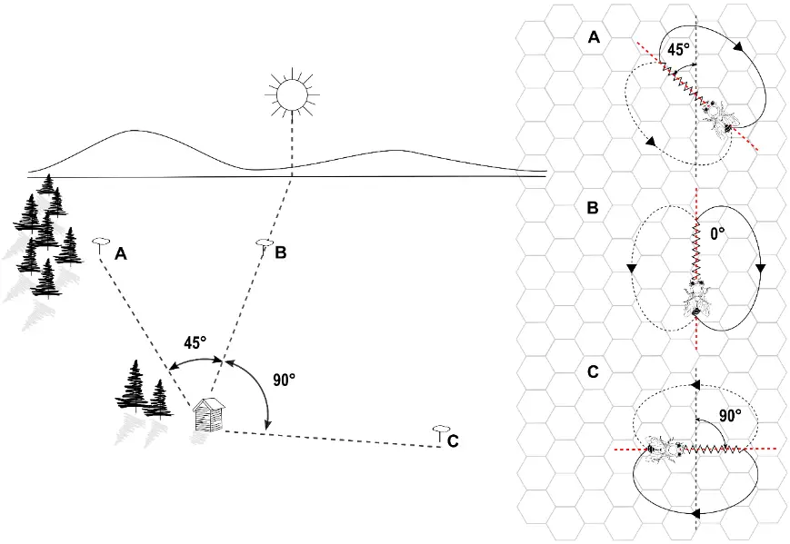
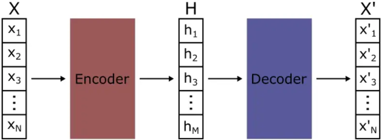
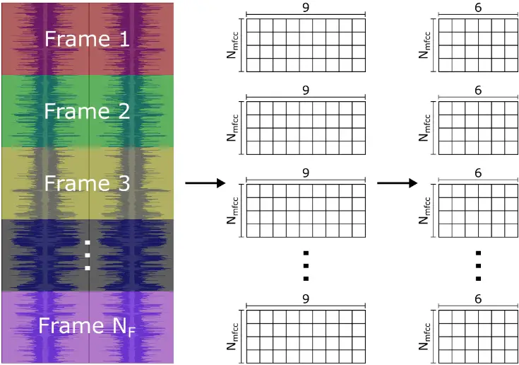
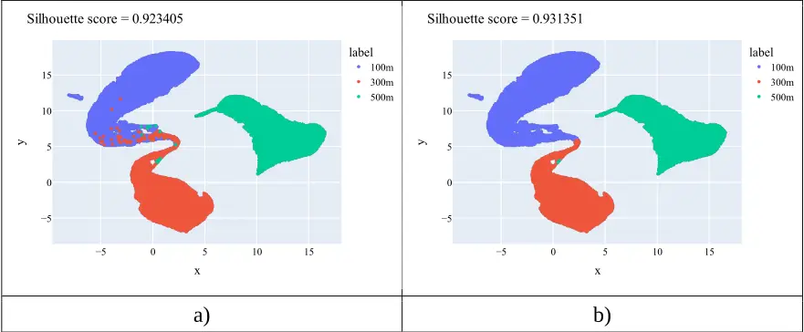
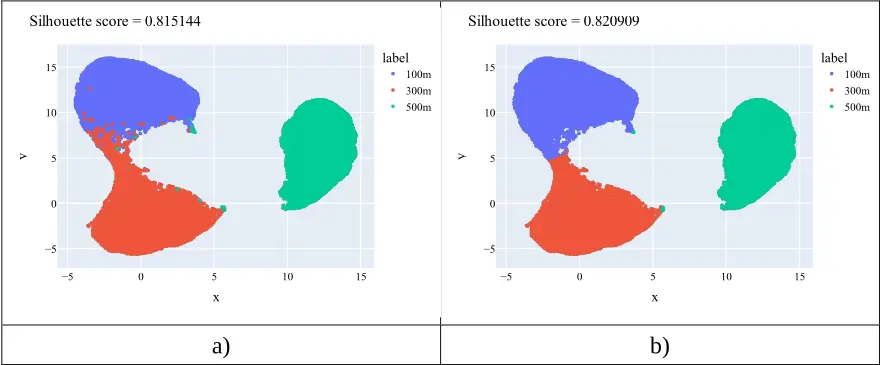
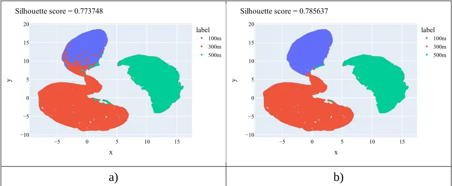
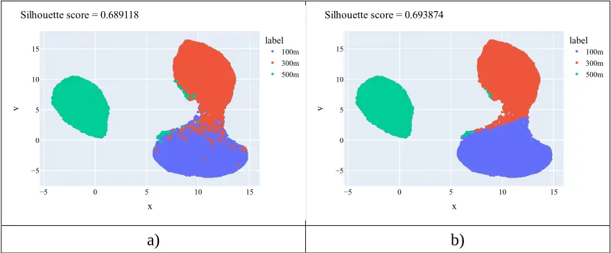
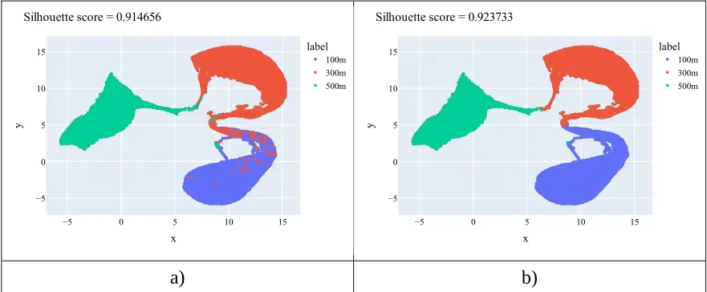
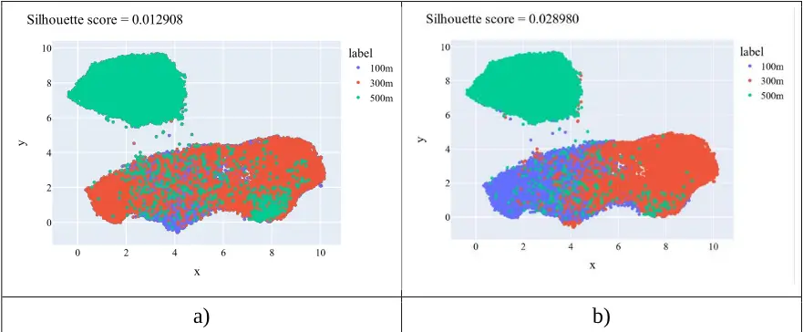
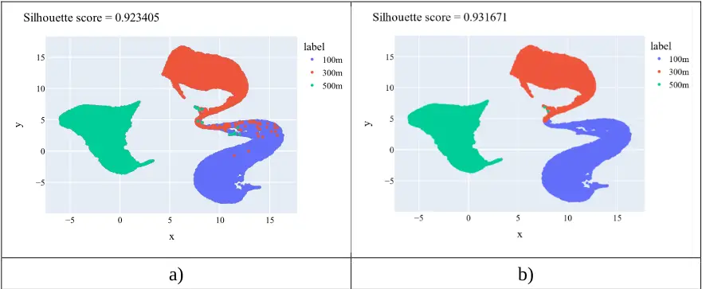

## Identifying foraging spatial cues in 1 beehive sound activity using machine 2 learning methods 3

4

5

6

7

8

9

10

11

12

13

14

15

16

17

18

20

19

21

23

22

24

26

25

David Bocanegra 1 , Jorge Galvez 1 , Nayan Di 2,3 , Fanglin Liu 2 , Fernando Wario 1,4

- 1 Department of Electronics, Universidad de Guadalajara, Guadalajara, 44430 Jalisco, Mexico
- 2 Anhui Institute of Optics and Fine Mechanics, Hefei Institutes of Physical Science,
- Chinese Academy of Science, 350 Shushanhu Road, Hefei, 230031, Anhui, China
- 3 Life Sciences and Medicine College, University of Science &amp; Technology of China, 96 Jinzhai Road, Hefei, 230026, Anhui, China
- 4 Institute of Cognitive Sciences and Technologies, CNR, Via Gian Domenico Romagnosi 18a, 00196, Rome, Italy

## ABSTRACT

The beehive sound, a continuous signal produced by bees within the hive, has been found to correlate with different behavioral states of the colony, like being queenless and swarming.

- We investigated the possibility of identifying foraging spatial cues in this signal. We
- recorded a colony's sound while foraging from food sources located at three different
- distances from the hive, one at a time. The recordings were split into frames to obtain six
- statistics of their Mel Frequency Cepstral Coefficients. Then, we evaluated different
- autoencoding networks to obtain a latent space that allowed frames from different foraging
- distances to be easily differentiable. The high accuracy, silhouette score, and F1 score shown
- in the obtained latent spaces strongly support our approach for identifying foraging spatial

cues in beehive sound activity.

1

2

3

4

5

6

7

8

9

10

11

12

13

14

15

16

17

18

19

20

21

22

23

24

25

26

27

28

29

30

31

32

33

34

35

## 1 INTRODUCTION

The honey bee waggle dance is one of the prime examples of abstract communication in the animal world. Worker bees use it to communicate to their nest mates the location of resources such as nectar, pollen, and water. Foragers who return from a valuable food source move in a stereotypical pattern on the honeycomb surface, and some of the bees that closely follow their movements are recruited to the source location (von Frisch, 1965).

During the waggle dance, the dancer vigorously shakes her abdomen while moving forward in what is known as the waggle phase of the dance. At the end of each waggle phase, the dancer circles back to the starting point, alternating right and left, tracing a trajectory that resembles the number eight. Each dance may consist of dozens of waggle-return phases, with the number of cycles and the overall duration of the dance correlating with the source profitability (Seeley et al., 1991, 2000).

To the human observer, the waggle phase of the dance can be interpreted as a vector encoding the polar coordinates to the food source (see Figure 1). As demonstrated by Karl von Frisch, the dancer's body orientation relative to the hive vertical during the waggle phase reflects the direction of the food source relative to the sun's azimuth in the field. Complementary, the duration of the waggle phase correlates with the distance to the food source (Gould et al., 1970; Riley et al., 2005; von Frisch, 1965).

The repeated cycles of waggle and return phases endow the waggle dance with valuable redundancy, although always limited to the same communication channel. Several studies indicate that along with the visual cues, pheromones, substrate vibrations, and airborne sounds (Kirchner, 1993; Michelsen et al., 1989; Tautz, 1996; Thom et al., 2007) also play a role in the waggle dance, specifically in attracting and recruiting followers. During the waggle phase of the dance, bees emit an airborne pulsed sound at the frequency of 250-300 Hz (Michelsen et al., 1986; Wenner, 1964), a signal that could function as an additional communication channel for redundancy in the waggle dance.

Recording the visual components of the waggle dance can be fairly unintrusive thanks to the observation hive, which provides visual access to virtually all activity happening on the comb surface, allowing the development of automatic techniques for the study of dance communication (Bozek et al., 2021; Schürch et al., 2016; Wario et al., 2015, 2017). In contrast, recording a dancer's sound and pheromone emissions, due to their nature and the high population density on the comb surface, is a complex task that usually requires operating an open hive (Thom et al., 2007; Wenner, 1964), which, in turn, may disturb the colony and introduce high noise levels to the data.

1



- Figure 1. Correlation between waggle dance parameters and locations on the field. On the 2 left side, three food sources in the field located at A) 45° counterclockwise, B) 0°, and C) 3 90° clockwise relative to the solar azimuth. On the right side, the representation of food 4 sources A, B, and C through waggle dance paths on the surface of a vertical comb. Figure 5 available under CC BY 4.0 from (Wario et al., 2017). 6

7

- Given this challenging scenario, the study of pheromones and sound signals is usually 8
- conducted at the colony level. The "beehive sound", or "colony noise" is the collective 9
- buzzing and vibrating sound produced by the activity of honey bees within the hive. 10
- Characterized as a series of low-frequency vibrations and higher-frequency buzzing noises, 11
- the beehive sound has been proven to strongly correlate with the colony size, activity level, 12

13

14

15

17

16

18

20

19

- and environmental conditions (Kirchner, 1993; Sharif et al., 2020; Terenzi et al., 2020; Yu et al., 2022).
- Audio-based classification models have already been applied to beehive sound to detect key
- statuses of the colony, such as being queenless (Cejrowski et al., 2018; Howard et al., 2023),
- swarming (Ferrari et al., 2008), and the presence of diseases or pests (Robles-Guerrero et
- al., 2017). A variety of classification approaches have been proposed for this task, including
- Principal Component Analysis (PCA), Support Vector Machines (SVM), Linear
- Discriminant Analysis (LDA), Convolutional Neural Networks (CNN) (Nolasco &amp;

- Benetos, 2018; Qandour et al., 2014; Rybin et al., 2017), and Random Forest (Robles1
- Guerrero et al., 2017). 2
- Classification models do not operate directly on the audio amplitude time series but rather 3
- on acoustic feature sets. Three feature sets have proved to work for the classification of 4
- beehive audios, namely low-level signal features, including Zero-Crossing Rate, Bandwidth, 5
- Spectral Centroid, and Signal Energy (Qandour et al., 2014), Mel Frequency Cepstral 6 Coefficients (MFCC) (Nolasco &amp; Benetos, 2018; Robles-Guerrero et al., 2017), and 7 soundscape indices (Mammides et al., 2017; Sharif et al., 2020). 8

9

10

11

12

13

14

15

16

17

18

19

20

21

22

23

24

25

26

27

28

29

30

31

32

33

34

35

36

37

In this work, we propose the use of a classification model to explore the presence of foraging spatial cues in the beehive sound. The success of the classification model relies on a proper combination of features and classification methodology. Inspired by the work of Scarpiniti et al. (Scarpiniti et al., 2021a), where an audio classifier for environmental sound is successfully applied in the challenging scenario of construction sites, we also decided to use a statistically optimized set of features obtained from Mel-frequency cepstral coefficients (MFCCs) (Robles-Guerrero et al., 2017). As a classifier, we use an artificial neural network which is first pre-trained as an autoencoder. The pre-training process helps to initialize the classifier's parameters in more promising areas of the parameters space, which after finetuning results in better generalization (Erhan et al., 2010).

The positive results for identifying the foraging spatial cues in beehive sound validate the use of autoencoding networks in combination with MFCC's statistical features as a methodology for classifying sound signals. To the best of our knowledge, this is the first time that foraging spatial cues have been successfully identified in beehive sound activity, calling for further studies in this direction that could improve our understanding of sound as a means of communication in honey bee colonies.

## 2 MATERIALS AND METHODS

## 2.1 Audio data

The experiments were conducted at the Sericulture and Apiculture Research Institute of Yunnan Academy of Agricultural Sciences in Mengzi City, Yunnan Province, China (23.52ºN, 103.39ºE) between November 2020 and January 2021. The colony of the species Apis Cerana resided in a typical wood beehive with a 10-month-old queen, was healthy and without any signs of attack by pests, emerging diseases, or viruses. At the beginning of the first week, foragers from the colony were trained to collect sugar water from an artificial feeder 100 m from the hive entrance. After 7 days of foragers visiting the feeder, the beehive sound is recorded at the time of the highest affluence with a microphone located inside the beehive at 15 cm from the floor. The process was repeated in the following weeks with the feeder located in the same direction at 300 m, and 500 m from the hive.

The microphone used for the audio recording was a PCK200 from Takstar, with a frequency 38 response of 30 Hz to 20 kHz and a sensitivity of -36dB±3dBV. The microphone was 39

- connected to a digital sound card UM2 from Behringer and processed using the software
- Audacity at a sampling frequency of 44,100 Hz and a bit rate of 1,411 kbps in mono. Finally,
- the audio files were saved in the WAV format, with each file covering over 40 minutes of

Table 1. Information on the audio recordings for the three experiments considered in the study.

| File name | Distance to food source (meters) | Duration (minutes) | File size (MB) |
| --------- | -------------------------------- | ------------------ | -------------- |
| 100m.wav  | 100                              | 40:21              | 407.4          |
| 300m.wav  | 300                              | 42:41              | 430.9          |
| 500m.wav  | 500                              | 41:25              | 418.1          |

## 2.2 Autoencoders

Autoencoders (Rumelhart &amp; McClelland, 1987) are a type of neural networks trained in an

- unsupervised manner to reconstruct their input data. An autoencoder consists of two
- subsystems, an encoder and a decoder. The encoder works as a function 𝑓 that maps an input
- 𝑋 ∈ ℝ𝑁 to an encoded representation (called latent representation) 𝐻 ∈ ℝ𝑀 (Equation
- (1)), while the decoder operates as a function 𝑔 that generates an approximation 𝑋′ ∈ ℝ𝑁 of the input 𝑋 from the representation 𝐻 generated by the encoder (Equation
- (2)). To find a proper set of functions [𝑓, 𝑔], the autoencoder is trained using a loss function, like the Mean Squared Error (MSE), that measures the difference between the reconstructed data 𝑋′ and the input data 𝑋. Figure 2 shows a graphical representation of an autoencoder.

<!-- formula-not-decoded -->

<!-- formula-not-decoded -->

1 2 3 beehive sound activity (see Table 1). 4

5

6

7

8

9

10

12

11

13

14

15

16

17

18

1

Figure 2. Graphical representation of an autoencoder. First, the input vector X of dimension N is mapped by the encoder to a vector H of dimension M, then the vector H is mapped by the decoder to a vector X' of dimension N that approximates the input vector X.



- Vanilla autoencoders consist of an input layer, an output layer of size equal to the input size, 2
- and a hidden layer whose output is the latent representation of the data. When the hidden 3
- layer's size equals or exceeds the input size, the autoencoder is called overcomplete. On the 4
- other hand, when the hidden layer's size is smaller than the input size, the autoencoder is 5
- called undercomplete. Furthermore, when an autoencoder has more than one hidden layer, 6
- i.e., the encoder and decoder are deep neural networks, the autoencoder is called deep 7
- autoencoder. 8
- Several variations of autoencoders have been proposed to prevent these from learning the 9
- identity function (especially in overcomplete autoencoders). Sparse autoencoders, for 10
- example, are vanilla autoencoders that use L1 regularization or the KL-divergence as a 11
- regularization term in the loss function to promote the sparsity of the model. Denoising 12
- autoencoders (Vincent et al., 2008) add noise to the input data and are trained to reconstruct 13
- and remove the noise of the data. Contractive autoencoders (Rifai et al., 2011) are trained to 14
- be robust to small variations in the input data by adding a penalty to the loss function. 15
- Usually, the penalty is the Frobenius Norm of the Jacobian matrix of the encoder activations 16
- for the input data. 17

18

19

20

21

23

## 2.3 Methodology

To classify the beehive sound signals, the audio files are divided into frames and a cluster analysis is performed over encoded representations of their acoustic features. The process

- preceding the cluster analysis is divided into two phases. In the first phase (called "feature
- extraction process"), the audios are divided into frames from which their MFCC-based
- features are extracted following the procedure proposed in (Scarpiniti et al., 2021b). In the 24
- second phase (called "feature encoding process"), the resulting dataset is split into a training 25
- and a test set at an 80:20 ratio. Then, the training set is used to train an artificial neural 26
- network model, first in an unsupervised manner as an autoencoder and then in a supervised 27
- manner as a classifier to learn a new representation of the audio frames. The feature 28

22

- extraction and feature encoding processes are discussed in more detail in the section 2.4. 1
- Each data point is labeled according to the audio file from which it is extracted; thus, 3 2
- classes are considered in this paper, namely "100m", "300m" and "500m". The feature 3
- encoding process was conducted multiple times using different models with different depths 4
- and numbers of parameters to analyze how such properties affect the quality of the latent
- representation. Once the feature encoding process is completed, the test set is used to
- evaluate the features generated by the models using three metrics: Silhouette score, F1-score, and Accuracy.

The Silhouette score is a widely used metric that measures the quality of the clusters in terms of consistency; hence, it was used to evaluate the quality of the features generated. The Silhouette score for a data point (in this case a data point is an audio frame) is given by Equation (3):

<!-- formula-not-decoded -->

6

5

7

8 9

10

11

12

13

14

15

- Where 𝑎 is the mean distance between a data point and all other data points that belong to 16
- the same cluster (intra-cluster distance) and 𝑏 is the mean distance between a data point and 17
- all other data points that belong to the neighboring cluster (the nearest cluster from which 18
- the data point is not a member). To calculate the Silhouette score of the whole test set, the 19
- mean of the Silhouette score over each one of the data points in the test set is used. 20

21

- Accuracy and F1-score are metrics widely used to evaluate a classifier's performance. 22
- Accuracy is a straightforward metric defined as the ratio of the correctly classified data 23
- points to the total number of points classified. The F1-score (Equation (4)), on the other 24
- hand, is defined as the harmonic mean of Precision and Recall. These two metrics are defined 25
- for binary classification tasks and are calculated following Equations (5) and (6), where TP 26
- is the number of true positives i.e., the number of data points correctly classified as belonging 27
- to the positive class, FP is the number of false positives i.e., the number of data points 28
- misclassified as belonging to the positive class, and FN is the number of false negatives i.e., 29
- the number of data points misclassified as belonging to the negative class. For multiclass 30
- classification tasks (such as the one tackled in the present paper), these metrics are calculated 31
- for each one of the classes, treating each one of them as the positive class and the rest as the 32
- negative class. Then, the results obtained are aggregated by adding them or averaging them. 33
- These metrics reach their best value at 1 and worst value at 0. 34

35

<!-- formula-not-decoded -->

<!-- formula-not-decoded -->

1

2

3

10

11

12

<!-- formula-not-decoded -->

- To further assess the quality of the features generated following the approach proposed in

(Scarpiniti et al., 2021b), we also applied the K-means algorithm (MacQueen, 1967) in the raw feature space of the dataset (i.e., using the features obtained through the feature 4 extraction process without the encoding process) and computed the Silhouette score values 5 for the resulting clusters. To visually analyze the features generated, the Uniform Manifold 6 Approximation and Projection (UMAP) algorithm (McInnes et al., 2018) was used to reduce 7 their dimensionality, transforming them from their 𝐻𝑠-dimensional space to a two8 dimensional space. The UMAP is a fast and efficient general-purpose algorithm used for 9 dimensional reduction based on manifold learning that has already been used to visualize and analyze features in machine learning-related works (Di et al., 2023; Mohammadimanesh et al., 2019; Zhang et al., 2021).

13

14

15

16

17

18

19

20

21

22

23

24

25

26

27

28

29

30

31

32

33

34

35

36

## 2.4 Data features

As mentioned in the previous section, the process preceding the cluster analysis is divided into two phases, the Feature extraction process and the Feature encoding process. In the first phase, the audio clips are divided into frames from which six statistics of their MFCCs are extracted. In the second phase, an Artificial Neural Network (ANN) is used to encode the MFCCs' statistical data into a more meaningful representation of lower dimensionality. Although MFCC features-based approaches have already been used in beekeeping-related works (Di et al., 2023; Ribeiro et al., 2021; Soares et al., 2022; Terenzi et al., 2019; Zgank, 2018, 2022), the use of autoencoders for the analysis of sound signals in this research field remains mostly unexplored, with few exceptions (Cejrowski &amp; Szymański, 2022; Davidson et al., 2020). To the best of our knowledge, MFCC feature-based approaches and autoencoders have not been used together in beekeeping-related works. It is important to emphasize that the main goal of the current paper is not to test the performance of the proposed approach against others on audio classification, but rather to determine through a cluster analysis whether the beehive sound contains spatial cues of the colony's foraging sites.

## 2.4.1 Feature extraction process

Following the feature extraction process proposed in (Scarpiniti et al., 2021b), each audio clip is first divided into 𝑁𝐹 frames, following the Equation (7), where 𝐶𝐷 is the clip duration and 𝑆𝐹 is the frame size.

<!-- formula-not-decoded -->

- Since the sampling frequency for our audio clips is the same as that of the audio recordings 1
- analyzed in (Scarpiniti et al., 2021b) (𝐹𝑆 = 44,100𝐻𝑧), all parameters for the feature 2
- extraction process were set the same. Hence, the frame size 𝑆𝐹 = 100𝑚𝑠, which for our 3
- audio clips resulted in the number of frames reported in Table 2. In case the audio clip cannot 4
- be divided into equal size frames, the sample padding technique proposed in (Nguyen &amp; 5
- Pernkopf, 2020) is used, filling the missing samples in the frames that need to be expanded 6 with random samples taken from the same frame. 7

8

9

10

12

Table 2. Number of frames obtained for each class. After the feature extraction process, each frame is converted into a single data point with 384 features.

| Class | Frames - Data points |
| ----- | -------------------- |
| 100m  | 24,219               |
| 300m  | 25,616               |
| 500m  | 24,853               |
| Total | 74,688               |

- Each audio frame is further divided into smaller chunks from which a vector of 64 MFCCs
- is obtained. Considering a window size and a hop size of 𝑆𝑊 = 2,048 and 𝑆𝐻 = 512
- respectively, and that each frame contains 4,410 samples, 9 vectors of 64 MFCCs are
- generated per frame. The first four statistical moments and the maximum and minimum of 13
- each MFCC are computed. As a result, each frame corresponds to a data point formed by a 14
- set of 64 × 6 = 384 statistical features. Figure 3 shows a graphical representation of the 15
- feature extraction procedure. 16

17

11

1

2

3

Figure 3. Graphical representation of the procedure followed to extract the features from the audio files. From left to right, first, the file is divided into 𝑁𝐹⁡𝑓𝑟𝑎𝑚𝑒𝑠, then the 9 vectors of MFCCs are calculated for each frame. Finally, the maximum value, minimum value, and the first four statistical momentums are calculated for each MFCC, resulting in the 384 statistical features that represent each frame.



## 2.4.2 Feature encoding process

- In the feature encoding process, an ANN encodes the MFCCs' statistical data into a new 4
- representation of lower dimensionality. The dataset obtained during the feature extraction 5
- process is divided into a training and a test set at a ratio of 80:20. As can be seen in Table 2, 6
- the three classes have a similar number of data points, which results in a balanced dataset 7
- that provides more confidence about the metrics used to evaluate the models. 8
- The encoding process is divided into two stages, the pre-training stage, and the fine-tuning 9
- stage. In the pre-training stage, the training set is used to train a deep autoencoder in an 10
- unsupervised manner to reconstruct the MFCCs' statistical data. After that, the decoder is 11
- detached from the pre-trained autoencoder, and a classification layer is added at the end of 12
- the encoder. Then, the resulting classifier is fine-tuned in a supervised manner on the same 13
- training set used in the pre-training stage. 14
- It has been shown that pretraining classifiers as autoencoders allows them to learn a 15
- compressed and meaningful representation of data (Lopez Pinaya et al., 2020; Tschannen et 16
- al., 2018). This is a very convenient property for our classification problem, given that the 17
- MFCC-based features alone were not informative enough to observe any relevant differences 18
- between frames from different classes. Furthermore, as has been shown in (Erhan et al., 19
- 2010), unsupervised pre-training not only helps to initialize the model parameters in more 20

- promising areas within the parameter space but also helps to capture dependencies between 1
- parameters, resulting in better generalization which is also robust to random initialization. 2
- For this work, we considered three classes, one for each audio clip and distance to the hive. 3
- Hence each data point was labelled either 100m, 300m, or 500m. Additionally, the feature 4
- extraction procedure was conducted multiple times using different autoencoders with 5
- different depths and numbers of parameters to analyze how such properties affect the quality 6
- of the latent representation obtained. 7

8

## 3 RESULTS 9

- A group of 16 models were evaluated to find a suitable topology for the autoencoder10
- classifier network. The configurations tested are listed in Table 3, where the column to the 11
- left shows the ID number of the model, the column at the center the configuration of each 12
- model during the pretraining phase (i.e. as an autoencoder), and the column to the right the 13
- final shape of the model after the pre-training, where the decoder is detached and a classifier 14
- layer is attached to it. Each element in the lists corresponds to a network layer, with the 15
- numbers being the number of neurons in that layer; "dropout" and "norm" indicate either a 16

18

17

19

20

21

- dropout layer or a batch normalization layer respectively, and 𝐻𝑠 is the embedding size,
- which for each model ID took the values of 8, 16, 32 and 64. Models 1 and 2 differ solely on the dropout layer, and so do Models 3 and 4.
- Three metrics were computed to evaluate the performance of the candidate models, namely 22
- Silhouette, F1-score, and Accuracy (see section 2.3). Since each model in its final form can 23
- be divided into encoder and classifier, the Silhouette score was used to evaluate the encoders, 24
- while the F1-score and Accuracy metrics were used to evaluate the classifiers. Additionally, 25

Table 3. Structure of the models tested to encode the MFCC-based features. The "Model ID" column shows the number ID of the models, and the "Shape" columns show the layer configuration of the models, both as autoencoders and classifiers. Here "dropout" and "norm" indicate either a dropout or a batch normalization layer. 𝐻𝑠 is the embedding size with four possible values: 8, 16, 32, and 64. Hence, each model ID represents 4 different configurations.

| Model ID | Pre-training shape                                                   | Final shape                                |
| -------- | -------------------------------------------------------------------- | ------------------------------------------ |
| 1        | [384, 384, dropout, 192, 192, norm, 𝐻𝑠, 192, 192, dropout, 384, 384] | [384, 384, dropout, 192, 192, norm, 𝐻𝑠, 3] |
| 2        | [384, 384, 192, 192, norm, 𝐻𝑠, 192, 192, 384, 384]                   | [384, 384, 192, 192, norm, 𝐻𝑠, 3]          |
| 3        | [384, dropout, 192, norm, 𝐻𝑠, 192, dropout, 384]                     | [384, dropout, 192, norm, 𝐻𝑠, 3]           |
| 4        | [384, 192, norm, 𝐻𝑠, 192, 384]                                       | [384, 192, norm, 𝐻𝑠, 3]                    |

1

2 3

4

the F1-score and Accuracy metrics further validate the quality of the encoded features, since high-quality features ease the classification.

## 3.1 Performance of autoencoder-classifier models

- The performance metrics for the experiments run on the 16 proposed models are shown in 5
- Table 4 to Table 7. First, the models were trained using the training set. Then they were fed 6
- with the test set to compute the Silhouette score, F1-score, and Accuracy. Each experiment 7
- consisted of 30 instances per model to reduce the probability of spurious results. The values 8
- shown are the mean over the results obtained from the 30 instances of each model. 9

11

13

12

14

15

16

- Additionally, to validate the effect of pre-training the models as autoencoders, a network 10
- with the same "final shape" as Model 1 (the model with the highest Silhouette score) was
- also included in the study. Following the notation used in Table 3, this network had shape

[384, 384, dropout, 192, 192, norm, 𝐻𝑠, 3] and will be referred to as "Model 5". This model

did not go through the pre-training stage as an autoencoder, and its performance metrics are

shown in Table 8.

Table 4. Silhouette score, F1-score, and Accuracy of the outcomes of Model 1 when the embedding size was set to 8, 16, 32, and 64.

| Model 1 - 𝑯𝒔     | Model 1 - 8 | Model 1 - 16 | Model 1 - 32 | Model 1 - 64 |
| ---------------- | ----------- | ------------ | ------------ | ------------ |
| Silhouette score | 0.927252    | 0.89967      | 0.840720     | 0.767208     |
| F1-score         | 0.989135    | 0.98932      | 0.990225     | 0.989970     |
| Accuracy         | 0.989135    | 0.98932      | 0.990226     | 0.989972     |

Table 5. Silhouette score, F1-score, and Accuracy of the outcomes of Model 2 when the embedding size was set to 8, 16, 32, and 64.

| Model 2 - 𝑯𝒔     | Model 2 - 8 | Model 2 - 16 | Model 2 - 32 | Model 2 - 64 |
| ---------------- | ----------- | ------------ | ------------ | ------------ |
| Silhouette score | 0.819736    | 0.80023      | 0.747045     | 0.677263     |
| F1-score         | 0.987631    | 0.990966     | 0.991257     | 0.991196     |
| Accuracy         | 0.988225    | 0.990967     | 0.991259     | 0.991197     |

Table 6. Silhouette score, F1-score, and Accuracy of the outcomes of Model 3 when the embedding size was set to 8, 16, 32, and 64.

| Model 3 - 𝑯𝒔     | Model 3 - 8 | Model 3 - 16 | Model 3 - 32 | Model 3 - 64 |
| ---------------- | ----------- | ------------ | ------------ | ------------ |
| Silhouette score | 0.782154    | 0.742183     | 0.686134     | 0.622511     |
| F1-score         | 0.983291    | 0.984986     | 0.985387     | 0.985008     |
| Accuracy         | 0.983286    | 0.984989     | 0.985393     | 0.985016     |

1

2

3

- Figure 4 to Figure 8 show the feature space generated by the evaluated models. The features 4
- plotted were taken from an instance of the model type with the highest Silhouette score value 5
- (e.g., Figure 4 shows the features generated by an instance of Model 1 with 𝐻𝑠 = 8). Each 6
- figure displays the ground truth classification of the data and the classification learned by 7
- the model along with the corresponding Silhouette score (notice that the Silhouette scores 8
- differ from those reported in the tables since the latter are average values over 30 instances). 9

Figure 4. Feature space generated by Model 1. a) Shows the ground truth classification. b) Shows the classification given by the instance of the Model 1 which performance was closer to the average.



Table 7. Silhouette score, F1-score, and Accuracy of the outcomes of Model 4 when the embedding size was set to 8, 16, 32, and 64.

| Model 4 - 𝑯𝒔     | Model 4 - 8 | Model 4 - 16 | Model 4 - 32 | Model 4 - 64 |
| ---------------- | ----------- | ------------ | ------------ | ------------ |
| Silhouette score | 0.690155    | 0.667827     | 0.608412     | 0.551401     |
| F1-score         | 0.986511    | 0.988620     | 0.988950     | 0.990300     |
| Accuracy         | 0.986638    | 0.988644     | 0.989182     | 0.990300     |

Table 8. Silhouette score, F1-score, and Accuracy of the outcomes of Model 5 when the embedding size was set to 8, 16, 32, and 64.

| Model 5 - 𝑯𝒔     | Model 5 - 8 | Model 5 - 16 | Model 5 - 32 | Model 5 - 64 |
| ---------------- | ----------- | ------------ | ------------ | ------------ |
| Silhouette score | 0.916805    | 0.879652     | 0.823654     | 0.777524     |
| F1-score         | 0.988831    | 0.989006     | 0.989400     | 0.989862     |
| Accuracy         | 0.988829    | 0.989008     | 0.989403     | 0.989865     |

1

2

Figure 5. Feature space generated by Model 2. a) Shows the ground truth classification. b) Shows the classification given by the instance of the Model 2 which performance was closer to the average.



Figure 6. Feature space generated by Model 3. a) Shows the ground truth classification. b) Shows the classification given by the instance of the Model 3 which performance was closer to the average.



1

2

- The classifications achieved by the models do not differ greatly from the ground truth 3
- classification, which is also reflected in the high Accuracy and F1-score. Models 1 and 3 4
- obtained higher Silhouette scores than their versions without dropout (Models 2 and 4), 5
- evidencing that the dropout technique played a crucial role in learning richer features. 6
- Similarly, deeper models obtained better representations of the audio frames, as denoted by 7
- the higher Silhouette scores obtained by Models 1 and 2 compared to their shallow versions, 8
- Models 3 and 4 respectively. Furthermore, the feature spaces generated by Models 1 and 5 9

Figure 7. Feature space generated by Model 4. a) Shows the ground truth classification. b) Shows the classification given by the instance of the Model 4 which performance was closer to the average.



Figure 8. Feature space generated by Model 5. a) Shows the ground truth classification. b) Shows the classification given by the instance of the Model 5 which performance was closer to the average.



- obtained the highest Silhouette scores in both class distributions, indicating the importance 1
- of both, the network structure and the pre-training stage, to obtain descriptive features that 2
- ease the audio classification. 3
- Visually, Model 1 assigned features to the data points corresponding to audio 500m such that 4
- the corresponding cluster is completely isolated from the other two, while clusters formed 5
- by the data points of audios 100m and 300m show an area of intersection. By contrast, in the 6
- feature space generated by Model 5, the data points corresponding to audio 500m do not 7
- form an isolated cluster, instead, it has an area of intersection with the cluster formed by the 8
- data points corresponding to audio 300m. Besides, just like with Model 1 clusters formed by 9

points from audios 100m and 300m have an intersection area, indicating that both are

10

- somehow related. 11

12

13

14

15

16

17

18

19

20

21

22

## 3.2 Performance of k-means clustering

- To further validate the encoding process, we performed two experiments using the K-means

algorithm to define the three clusters. In the first experiment, we applied the K-means algorithm to the raw feature space. Figure 9 shows the cluster assignations obtained by the K-means algorithm, the ground truth clusters, and their corresponding Silhouette score values on the raw feature space. From a visual analysis, it is evident that the clusters are not well-defined in the raw feature space, with data points of the three classes grouped in what could be interpreted as a single cluster, and only some of the 500m class data points isolated in a second cluster. This visual analysis is supported by the meager value of the Silhouette scores, proving that the raw features do not describe the data well enough to distinguish

- between the different classes. 23

24

Figure 9. (a) Shows the ground truth labels on the raw feature space. (b) Shows the clusters identified by the K-means algorithm on the raw feature space.



- In the second experiment, we used the latent space generated by the instance of Model 1 1
- with 𝐻𝑠 = 8 (the configuration with the highest Silhouette score). Figure 10 shows the 2
- cluster assignations obtained by the K-means algorithm, the ground truth clusters, and their 3
- corresponding Silhouette score values on this feature space. It is worth mentioning that, 4
- unlike the experiments with the autoencoder-classifier models, where the reported results 5
- only considered the test set, here we used the totality of the available data points (training 6
- and test set), hence the UMAP plot differs from the presented in Figure 4. 7

8

9

10

Figure 10. (a) and (b) show the ground truth labels on the feature space generated by Model 1 with Hs=8 and the clusters identified by the K-means algorithm, respectively.



- From a visual analysis, it is clear that clusters in Figure 10 are better defined than those
- shown in Figure 9, which also results in significantly higher Silhouette scores, proving that 11
- the feature space generated by the autoencoder enhances the differences between classes. In 12
- further analysis of the feature space generated by Model 1, we can observe a well-defined 13
- cluster containing exclusively 500m data points. The clusters of classes 100m and 300m 14
- show a small overlapping, which can be interpreted as a certain resemblance between audios 15
- from these two classes. It is important to remember that the UMAP plots are projections of 16
- high-dimensional spaces into a 2-dimensional space. Hence, what appears as evident 17
- overlapping and intersection in the plots, might not be such in the original space.

## 4 DISCUSSION

- Our results indicate sizable differences in the beehive sound of a colony when foraging from

18

19

20

21

- food sources located at different distances from the hive. Some of these differences are 22
- already visible in the feature space of the MFCC's statistical features (see Figure 9), where 23
- most data points from the 500m class are isolated from those of classes 300m and 100m. 24
- However, the use of autoencoding networks greatly improved the quality of the feature 25

- space, resulting in better-defined clusters, including the separation of points corresponding 1
- to the classes 100m and 300m, previously grouped in a unique cluster in the raw feature 2
- space. 3
- Interestingly, all evaluated models obtained the highest Silhouette score when the embedding 4
- size 𝐻𝑠 was set to 8 (see Table 4 to Table 7) and not with a higher value. Also, for all models, 5
- the Silhouette score decreased as 𝐻𝑠 increased, reaching the lowest value when 𝐻𝑠 was set 6
- to 64. Nevertheless, the Silhouette score does not greatly affect the classifiers' performance. 7
- As can be seen in Table 9, the average values of all the F1-scores and Accuracy were barely 8
- under 0.99 with small standard deviations, indicating a homogeneous performance of all 9

models as classifiers. It is also worth noting that the highest values Accuracy and F1-score

values were not reached with the lowest 𝐻𝑠. The disagreement between the Silhouette scores

and the clustering metrics suggests that the Silhouette score might not be the best choice

when working with high-dimensional spaces.

Table 9. Mean and STD of the F1-scores and Accuracy obtained by Models 1, 2, 3, and 4

|      | F1-score | Accuracy |
| ---- | -------- | -------- |
| Mean | 0.988297 | 0.988359 |
| SD   | 0.004515 | 0.003918 |

We also explored the effect of pre-training the models as autoencoders and then fine-tuned them as classifiers, obtaining slightly better results. Also, as the metrics indicate, deeper models overperformed their shallower counterparts, as was the case for models with and without a dropout layer.

In summary, using deep neural networks to analyze audio recordings of beehive sound

during foraging activity, we have found a correlation between audio descriptors and the

- distance to the foraging sources for the first time. Although additional studies need to be

10

12

11

13

14

15

16

17

18

19

20

22

21

23

- conducted in this direction, these findings could be of great significance to further 24
- understand the different means of communication in honey bee colonies. Furthermore, the 25
- use of MFCC's statistical features and autoencoders has proven to be a powerful tool for 26
- analyzing sound signals that could find applications beyond the scope of this study. 27

1

2

3

4

5

6

7

8

9

10

11

12

13

14

15

16

17

18

19

20

21

22

23

24

25

26

27

28

29

30

32

33

## ACKNOWLEDGEMENTS

The authors would like to express our gratitude to the Sericulture and Apiculture Research Institute of Yunnan Academy of Agricultural Sciences for providing the space and the colony to carry out the experiments and to their staff members Zhang Xuewen, Hu Zongwen, Zhao Hongmu, Miao Chunhui, Huang Xinqiu, and Zhou Chuntao for their valuable help.

## AUTHOR CONTRIBUTIONS

```
Conceptualization: N.D., F.L., and F.W.; methodology: N.D. and F.L.; software: D.B.; resources, supervision: F.L.; project administration: F.L. and F.W.; data curation: N.D., D.B., J.G., and F.W.; writing: D.B., J.G., F.L., N.D., and F.W.; visualization: D.B.
```

## REFERENCES

- Bozek, K., Hebert, L., Portugal, Y., &amp; Stephens, G. J. (2021). Markerless tracking of an entire honey bee colony. Nature Communications, 12(1). https://doi.org/10.1038/s41467-021-21769-1
- Cejrowski, T., &amp; Szymański, J. (2022). Detection of anomalies in bee colony using transitioning state and contrastive autoencoders. Computers and Electronics in Agriculture, 200, 107207. https://doi.org/10.1016/j.compag.2022.107207
- Cejrowski, T., Szymański, J., Mora, H., &amp; Gil, D. (2018). Detection of the Bee Queen Presence Using Sound Analysis. Lecture Notes in Computer Science (Including Subseries Lecture Notes in Artificial Intelligence and Lecture Notes in Bioinformatics), 10752 LNAI, 297-306. https://doi.org/10.1007/978-3-31975420-8\_28
- Davidson, P., Steininger, M., Lautenschlager, F., Kobs, K., Krause, A., &amp; Hotho, A. (2020). Anomaly Detection in Beehives using Deep Recurrent Autoencoders. Proceedings of the 9th International Conference on Sensor Networks, 142-149. https://doi.org/10.5220/0009161201420149
- Di, N., Sharif, M. Z., Hu, Z., Xue, R., &amp; Yu, B. (2023). Applicability of VGGish embedding in bee colony monitoring : comparison with MFCC in colony sound classification. PeerJ, 1-19. https://doi.org/10.7717/peerj.14696
- Erhan, D., Bengio, Y., Courville, A., Manzagol, P.-A., Vincent, P., &amp; Bengio, S. (2010). 31 Why Does Unsupervised Pre-training Help Deep Learning? J. Mach. Learn. Res., 11, 625-660.

34

35

- Ferrari, S., Silva, M., Guarino, M., &amp; Berckmans, D. (2008). Monitoring of swarming sounds in bee hives for early detection of the swarming period. Computers and

1

2

3

4

5

6

7

8

9

10

11

12

13

14

15

16

17

18

19

20

21

22

23

24

25

26

27

28

29

30

31

32

33

34

35

- Electronics in Agriculture, 64(1), 72-77. https://doi.org/10.1016/j.compag.2008.05.010 Gould, J. L., Henerey, M., &amp; MacLeod, M. C. (1970). Communication of Direction by the Honey Bee. Science, 169(3945), 544-554. https://doi.org/10.1126/science.169.3945.544 Howard, D., Duran, O., Hunter, G., &amp; Stebel, K. (2023, October 9). Signal Processing the Acoustics of Honeybees (Apis Mellifera) to Identify the Queenless State in Hives. Spring Conference Acoustics 2013. https://doi.org/10.25144/16341 Kirchner, W. H. (1993). Acoustical communication in honeybees. Apidologie, 24(3), 297-307. https://doi.org/10.1051/apido:19930309 Lopez Pinaya, W. H., Vieira, S., Garcia-Dias, R., &amp; Mechelli, A. (2020). Autoencoders. In Machine Learning (pp. 193-208). Elsevier. https://doi.org/10.1016/B978-0-12815739-8.00011-0 MacQueen, J. B. (1967). Some Methods for Classification and Analysis of MultiVariate Observations. In L. M. Le Cam &amp; J. Neyman (Eds.), Proc. of the fifth Berkeley Symposium on Mathematical Statistics and Probability (Vol. 1, pp. 281-297). University of California Press. Mammides, C., Goodale, E., Dayananda, S. K., Kang, L., &amp; Chen, J. (2017). Do acoustic indices correlate with bird diversity? Insights from two biodiverse regions in Yunnan Province, south China. Ecological Indicators, 82, 470-477. https://doi.org/10.1016/j.ecolind.2017.07.017 McInnes, L., Healy, J., Saul, N., &amp; Großberger, L. (2018). UMAP: Uniform Manifold Approximation and Projection. Journal of Open Source Software, 3(29), 861. https://doi.org/10.21105/joss.00861 Michelsen, A., Andersen, B. B., Kirchner, W. H., &amp; Lindauer, M. (1989). Honeybees can be recruited by a mechanical model of a dancing bee. Naturwissenschaften, 76(6), 277-280. https://doi.org/10.1007/BF00368642 Michelsen, A., Kirchner, W. H., &amp; Lindauer, M. (1986). Sound and vibrational signals in the dance language of the honeybee, Apis mellifera. Behavioral Ecology and Sociobiology, 18(3), 207-212. https://doi.org/10.1007/BF00290824 Mohammadimanesh, F., Salehi, B., Mahdianpari, M., Gill, E., &amp; Molinier, M. (2019). A new fully convolutional neural network for semantic segmentation of polarimetric SAR imagery in complex land cover ecosystem. ISPRS Journal of Photogrammetry and Remote Sensing, 151, 223-236. https://doi.org/10.1016/j.isprsjprs.2019.03.015

1

2

3

4

5

6

7

8

9

10

11

12

13

14

15

16

17

18

19

20

21

22

23

24

25

26

27

28

29

30

31

32

33

34

35

36

- Nguyen, T., &amp; Pernkopf, F. (2020). Lung Sound Classification Using Snapshot Ensemble of Convolutional Neural Networks. Proceedings of the Annual International Conference of the IEEE Engineering in Medicine and Biology Society, EMBS, 2020-July, 760-763. https://doi.org/10.1109/EMBC44109.2020.9176076 Nolasco, I., &amp; Benetos, E. (2018). To bee or not to bee: Investigating machine learning approaches for beehive sound recognition. November. http://arxiv.org/abs/1811.06016 Qandour, A., Ahmad, I., Habibi, D., &amp; Leppard, M. (2014). Remote beehive monitoring using acoustic signals. Acoustics Australia, 42(3), 204-209. https://doi.org/10.1007/s40857-015-0016-5 Ribeiro, A. P., da Silva, N. F. F., Mesquita, F. N., Araújo, P. de C. S., Rosa, T. C., &amp; Mesquita-Neto, J. N. (2021). Machine learning approach for automatic recognition of tomato-pollinating bees based on their buzzing-sounds. PLOS Computational Biology, 17(9), e1009426. https://doi.org/10.1371/journal.pcbi.1009426 Rifai, S., Vincent, P., Muller, X., Glorot, X., &amp; Bengio, Y. (2011). Contractive autoencoders: explicit invariance during feature extraction. Proceedings of the 28th International Conference on International Conference on Machine Learning, 833-840. Riley, J. R., Greggers, U., Smith, A. D., Reynolds, D. R., &amp; Menzel, R. (2005). The flight paths of honeybees recruited by the waggle dance. Nature, 435(7039), 205-207. https://doi.org/10.1038/nature03526 Robles-Guerrero, A., Saucedo-Anaya, T., González-Ramırez, E., &amp; Galván-Tejada, C. E. (2017). Frequency Analysis of Honey Bee Buzz for Automatic Recognition of Health Status: A Preliminary Study. Research in Computing Science, 142(2017), 89-98. Rumelhart, D. E., &amp; McClelland, J. L. (1987). Learning Internal Representations by Error Propagation. In Parallel Distributed Processing: Explorations in the Microstructure of Cognition: Foundations (pp. 318-362). MIT Press. Rybin, V. G., Butusov, D. N., Karimov, T. I., Belkin, D. A., &amp; Kozak, M. N. (2017). Embedded data acquisition system for beehive monitoring. 2017 IEEE II International Conference on Control in Technical Systems (CTS), 387-390. https://doi.org/10.1109/CTSYS.2017.8109576 Scarpiniti, M., Colasante, F., Di Tanna, S., Ciancia, M., Lee, Y. C., &amp; Uncini, A. (2021a). Deep Belief Network based audio classification for construction sites

- monitoring. Expert Systems with Applications, 177(January), 114839. 1 https://doi.org/10.1016/j.eswa.2021.114839 2 Scarpiniti, M., Colasante, F., Di Tanna, S., Ciancia, M., Lee, Y. C., &amp; Uncini, A. (2021b). 3 Deep Belief Network based audio classification for construction sites 4 monitoring. Expert Systems with Applications, 177(January), 114839. 5 https://doi.org/10.1016/j.eswa.2021.114839 6 Schürch, R., Ratnieks, F. L. W., Samuelson, E. E. W., &amp; Couvillon, M. J. (2016). Dancing 7 to her own beat: honey bee foragers communicate via individually calibrated 8 waggle dances. The Journal of Experimental Biology, 219(Pt 9), 1287-1289. 9 https://doi.org/10.1242/jeb.134874 10 Seeley, T. D., Camazine, S., &amp; Sneyd, J. (1991). Collective decision-making in honey 11 bees: how colonies choose among nectar sources. Behavioral Ecology and 12 Sociobiology, 28, 277-290. https://doi.org/10.1007/BF00175101 13 Seeley, T. D., Mikheyev, A. S., &amp; Pagano, G. J. (2000). Dancing bees tune both duration 14 and rate of waggle-run production in relation to nectar-source profitability. 15 Journal of Comparative Physiology - A Sensory, Neural, and Behavioral 16 Physiology, 186(9), 813-819. https://doi.org/10.1007/s003590000134 17 Sharif, M. Z., Wario, F., Di, N., Xue, R., &amp; Liu, F. (2020). Soundscape Indices : New 18 Features for Classifying Beehive Audio Samples. Sociobiology, 67(4), 566-571. 19 https://doi.org/10.13102/sociobiology.v67i4.5860 20 Soares, B. S., Luz, J. S., de Macêdo, V. F., Silva, R. R. V. e, de Araújo, F. H. D., &amp; 21 Magalhães, D. M. V. (2022). MFCC-based descriptor for bee queen presence 22 detection. Expert Systems with Applications, 201, 117104. 23 https://doi.org/10.1016/j.eswa.2022.117104 24 Tautz, J. (1996). Honeybee Waggle Dance: Recruitment Success Depends on the 25 Dance Floor. Journal of Experimental Biology, 199(6), 1375-1381. 26 https://doi.org/10.1242/jeb.199.6.1375 27 Terenzi, A., Cecchi, S., Orcioni, S., &amp; Piazza, F. (2019). Features Extraction Applied to 28 the Analysis of the Sounds Emitted by Honey Bees in a Beehive. 2019 11th 29 International Symposium on Image and Signal Processing and Analysis (ISPA), 30 03-08. https://doi.org/10.1109/ISPA.2019.8868934 31 Terenzi, A., Cecchi, S., &amp; Spinsante, S. (2020). On the importance of the sound 32 emitted by honey bee hives. Veterinary Sciences, 7(4), 1-14. 33 https://doi.org/10.3390/vetsci7040168 34

- Thom, C., Gilley, D. C., Hooper, J., &amp; Esch, H. E. (2007). The scent of the waggle 1 dance. PLoS Biology, 5(9), 1862-1867. 2
- https://doi.org/10.1371/journal.pbio.0050228 3
- Tschannen, M., Bachem, O., &amp; Lucic, M. (2018). Recent Advances in Autoencoder4 Based Representation Learning. 5
- Vincent, P., Larochelle, H., Bengio, Y., &amp; Manzagol, P.-A. (2008). Extracting and 6 Composing Robust Features with Denoising Autoencoders. Proceedings of the 7 25th International Conference on Machine Learning, 1096-1103. 8

9

10

11

12

13

14

15

16

17

18

19

20

21

22

23

24

25

26

27

28

29

30

31

32

33

34

35

36

- von Frisch, K. (1965). Tanzsprache und Orientierung der Bienen. Springer. http://www.amazon.de/Tanzsprache-Orientierung-Bienen-KarlFrisch/dp/3642949177
- Wario, F., Wild, B., Couvillon, M. J., Rojas, R., &amp; Landgraf, T. (2015). Automatic methods for long-term tracking and the detection and decoding of communication dances in honeybees. Frontiers in Ecology and Evolution, 3(September), 1-14. https://doi.org/10.3389/fevo.2015.00103
- Wario, F., Wild, B., Rojas, R., &amp; Landgraf, T. (2017). Automatic detection and decoding of honey bee waggle dances. PLoS ONE, 12(12), 1-16. https://doi.org/10.1371/journal.pone.0188626
- Wenner, A. M. (1964). Sound Communication in Honeybees. Scientific American, 210(4), 116-122. https://doi.org/10.1038/scientificamerican0464-116
- Yu, B., Huang, · Xinqiu, Muhammad, ·, Sharif, Z., Jiang, X., Di, N., &amp; Liu, F. (2022). A matter of the beehive sound: Can honey bees alert the pollution out of their hives? Environmental Science and Pollution Research, 1, 1-11. https://doi.org/10.1007/S11356-022-23322-Z
- Zgank, A. (2018). Acoustic monitoring and classification of bee swarm activity using MFCC feature extraction and HMM acoustic modeling. 2018 ELEKTRO, 1-4. https://doi.org/10.1109/ELEKTRO.2018.8398253
- Zgank, A. (2022). Reduced MFCC Feature Extraction Dimension for Acoustic Classification of Bee Swarm Activity. 2022 ELEKTRO (ELEKTRO), 1-4. https://doi.org/10.1109/ELEKTRO53996.2022.9803441
- Zhang, P., Zhang, B., Zhang, T., Chen, D., Wang, Y., &amp; Wen, F. (2021). Prototypical Pseudo Label Denoising and Target Structure Learning for Domain Adaptive Semantic Segmentation. 2021 IEEE/CVF Conference on Computer Vision and Pattern Recognition (CVPR), 12409-12419. https://doi.org/10.1109/CVPR46437.2021.01223
