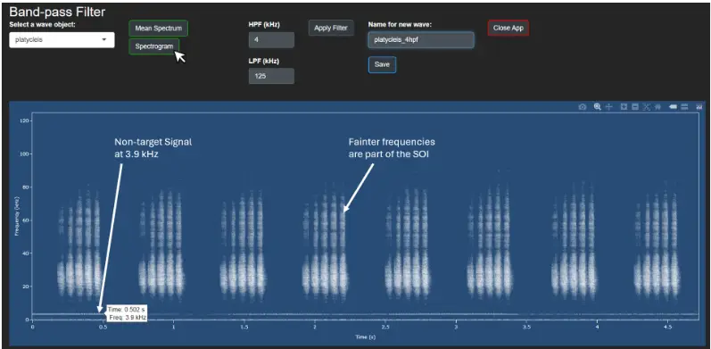
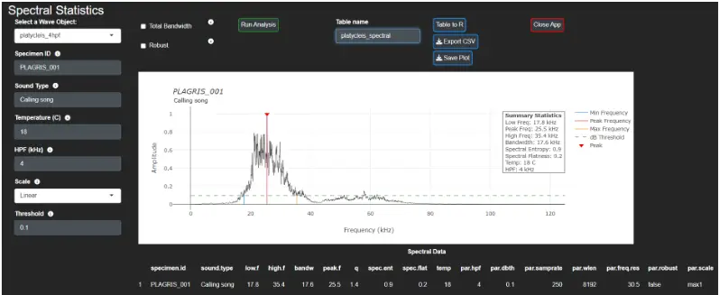
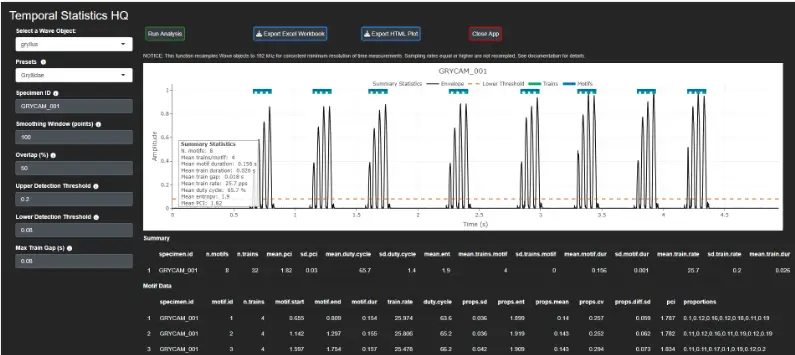
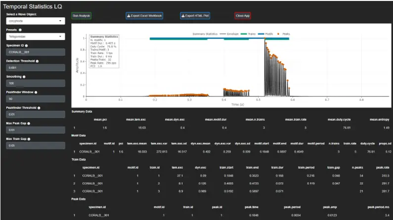
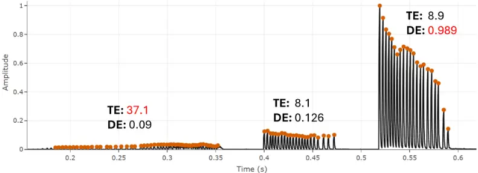
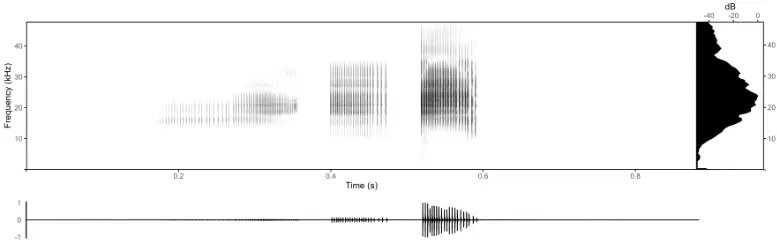
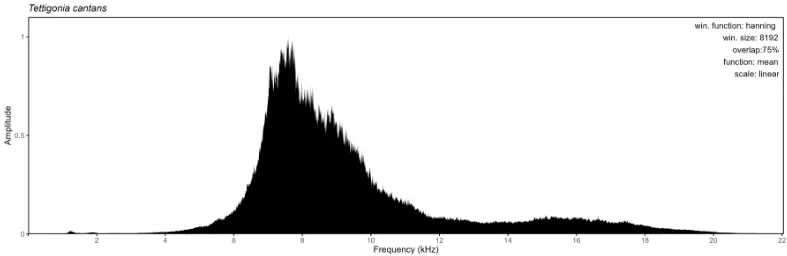
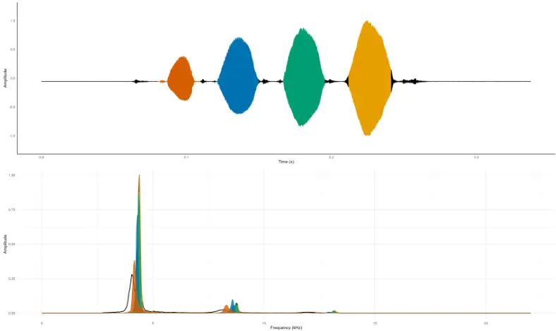
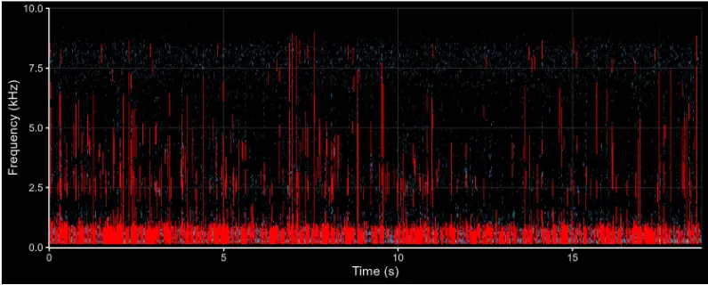

## APP L I CAT I ONS

## Rthoptera: Standardised Insect Bioacoustics in R

## Francisco Rivas 1,2 | Cesare Brizio 3 | FilippoM. Buzzetti 4 | Bryan Pijanowski 1

1 Center for Global Soundscapes and Department of Forestry and Natural

Resources, Purdue University, West Lafayette, Indiana, United States

2 Museo Bioacústico, Concepción, Chile

3 World Biodiversity Association Museo Civico di Storia Naturale di Verona, Verona, Italy

- 4 Fondazione Museo Civico di Rovereto, Sezione Zoologia, Rovereto, Italy

## Correspondence

Francisco Rivas, Department of Forestry and Natural Resources, Purdue University, West Lafayette, Indiana, United States 47907, USA Email: frivasfu@purdue.edu

## Present address

† Department of Forestry and Natural Resources, Purdue University, West Lafayette, Indiana 47907, United States

1. Crickets were the first study subjects at the dawn of bioacoustics, yet, almost 100 years later, freely available and robust analysis tools and protocols are still needed.
2. We introduce Rthoptera, a new open-source R package for the analysis of insect acoustic signals, offering accurate graphics and standardised temporal and spectral measurements through a streamlined workflow. Our package delivers results in a fraction of the time typically required by multi-software methods. Most of the functions have interactive versions (Shiny applications), facilitating their adoption by researchers with any level of technical expertise.
3. New acoustic metrics are introduced: Spectral Excursion, Pattern Complexity Index, Temporal Excursion, Dy-

1

2

3

4

5

6

7

8

9

10

11

12

namic Excursion, and Broadband Activity Index.

4. Accompanied by an appropriate recording protocol, our tool can become the backbone of a standard analysis protocol for comparative insect bioacoustics.

## K E YWO R D S

Orthoptera, acoustics, R-package, interactive plots, automated measurements.

- Source code and supplemental materials are accessible through Github: https://github.com/naturewaves.and Zen22
- odo: DOI: 10.5281/zenodo.14037977. 23

14

15

16

17

18

19

20

21

24

25

26

27

28

29

30

31

32

33

34

35

36

37

38

39

40

41

42

43

44

45

46

47

48

## 1 | INTRODUCTION

The current rate of species loss is outpacing our ability to track biodiversity change, highlighting the need for improved monitoring systems (O'Connor et al., 2020). Echoing the way in which satellite remote sensing revolutionised vegetation monitoring in remote areas (Huete, 2012), autonomous sound recorders are helping researchers track soniferous fauna at the community and ecosystem scales (Buxton et al., 2018). The study of animal sounds has followed two main frameworks. The soundscape ecology/ecoacoustics framework emphasizes large-scale patterns of biological acoustic activity over time and over ecological and disturbance gradients (Pijanowski et al., 2011; Pijanowski and Fuenzalida, 2024). Bioacoustic approaches usually focus on individual species to develop acoustic descriptions of species-specific signals, use them as keys to identify the species in new data, which are then manually annotated (Sugai et al., 2019) to finally be used in training automated detectors with the help of pattern matching algorithms (Hafner and Katz, 2018) and neural networks (Pijanowski et al., 2024). Although automatic identification of sounds has seen tremendous progress in birds (Kahl et al., 2021) and bats (Roemer et al., 2021), its development in insects is lagged. In the Global South, the required acoustic keys are not always available due to lack of bioacoustic training and/or insufficient resources to support the intensive field work required to record and collect voucher specimens before describing their acoustic signals (Riede, 2018). Due to these factors, basic insect bioacoustics is still a developing field in much of this region. This presents both challenges and opportunities for researchers in understudied areas, while also emphasising the need to cultivate a new community of practice. Such a community would accelerate the advancement of these promising tools, which have diverse applications ranging from agricultural pest monitoring (Mankin et al., 2000, 2011, 2021; Njoroge et al., 2017) to the use of sound-producing insects as proxies to monitor terrestrial and freshwater (Greenhalgh et al., 2021; Linke et al., 2018) ecosystems affected by climate change and habitat loss (Riede and Balakrishnan, 2024). Bioacousticians often use a multi-software approach to obtain measurements and generate graphs, resulting in time-consuming and tedious workflows. While free versions of bioacoustic software exist, they are typically optimised for analysing frequency-modulated signals, such as those produced by mammals and birds (Charif et al., 2010), and many tools are limited due to their proprietary nature. A popular alternative is open-source software like R (Ihaka and Gentleman, 1996; Decan et al., 2015), although it requires some programming

49

50

51

52

53

54

55

56

57

58

59

60

61

62

63

64

65

66

67

68

69

70

71

4

skills. This caveat can be addressed by converting functions into a graphical user interface (GUI) using open source packages for web application development, such as Shiny (Jia et al., 2022). Here, we introduce a novel Shiny-powered package designed to facilitate both the extraction of taxonomically relevant spectral and temporal statistics and the production of standardised graphs commonly used in insect bioacoustics. Leveraging classic R packages for bioacoustics, Rthoptera allows researchers to interactively import, preprocess, and analyse insect sounds with fast extraction of both "classic" and novel acoustic metrics. Our workflow is semi-automated, minimising human bias, and returning results in a fraction of the time required by conventional methods using a multi-software approach. In addition to traditional static plots for printed publications, Rthoptera produces interactive plots in HTML format. The main goals of our work are 1) encouraging the production of high-quality analyses by researchers without requiring extensive expertise in R or bioacoustics and 2) providing reproducible, standardised, and interactive methods for producing graphs and measurements of insect acoustic signals. The latest version of Rthoptera can be freely downloaded and installed directly from R or RStudio interface using:

install.packages("remotes") remotes::install_github("naturewaves/Rthoptera")

## 2 | PACKAGE DEVELOPMENT AND FEATURES

In this manuscript, the names of regular R functions are presented in monospaced font followed by parentheses (e.g., function_name()), Shiny apps are displayed in monospaced font without parentheses (e.g., app_name), and R packages are italicized (e.g., packageName). After consolidating the main processing, visualisation and data analysis techniques used by researchers, we built upon routines from seewave (Sueur et al., 2008) to create new plotting and analysis functions. Static plots are generated using ggplot2 (Wickham, 2016), while interactive plots use plotly (Inc., 2015). After developing the functions, we used OpenAI ChatGPT-4 (OpenAI, 2024) as an assistant for coding the Shiny applications (Chang et al., 2024) and for developing the documentation and formal testing. Each code chunk generated in this way was manually analysed and debugged. Along with regular R functions for analysis and plotting, Rthoptera offers 16 Shiny interactive applications. Each of these apps can be invoked with a call to the launchApp()

function. The package was tested manually and programmatically with usethis (Wickham et al., 2024) and devtools 72 (Wickham et al., 2022), reaching 98% coverage, while operating system tests for Windows, MacOS, and Linux where 73 successfully completed with rhub (Csárdi and Salmon, 2024). A summary of the functions and applications can be 74 found in Table 1. 75

TABLE 1 Summary of the functions in Rthoptera. \*Available only as app. Apps should be called through the launch_app() function.

| FUNCTION             | APP   | WORKFLOW      | DESCRIPTION                                         | OUTPUT |
| -------------------- | ----- | ------------- | --------------------------------------------------- | ------ |
| import_wave          | yes\* | preprocessing | Browse and import Waves into R.                     | Wave   |
| trim                 | yes\* | preprocessing | Select and trimWaves.                               | Wave   |
| bandpass_filter      | yes\* | preprocessing | VisualizeWave and apply HPF and/or LPF.             | Wave   |
| downsample           | yes\* | preprocessing | VisualizeWave and reduce sampling rate.             | Wave   |
| merge_waves          | yes\* | preprocessing | Merge several Waves horizontally (in time).         | Wave   |
| broadband_activity() | no    | analysis      | Extracts "click" statistics. Potentially useful for | PNG,   |
|                      |       |               | pest monitoring.                                    | CSV    |
| temporal_stats_lq()  | yes   | analysis      | Extracts temporal statistics. Optimized for         | HTML,  |
|                      |       |               | broadband sounds.                                   | CSV    |
| temporal_stats_hq()  | yes   | analysis      | Extracts temporal statistics. Optimized for         | HTML,  |
|                      |       |               | narrowband sounds.                                  | CSV    |
| spectrogram_ggplot() | yes   | plotting      | Generates a standardized spectrogram                | PNG    |
|                      |       |               | (automatic window length).                          |        |
| spectrogram_plotly() | no    | plotting      | Generates an interactive spectrogram.               | HTML   |
| oscillogram_ggplot() | yes   | plotting      | Generates a static oscillogram plot.                | PNG    |
| oscillogram_plotly() | no    | plotting      | Generates an interactive oscillogram.               | HTML   |
| spectrum_ggplot()    | yes   | plotting      | Generates a static spectrum plot.                   | PNG    |
| spectrum_plotly()    | no    | plotting      | Generates an interactive spectrum plot.             | HTML   |

Continued on next page

TABLE 1 Summary of the functions in Rthoptera (continued).

| FUNCTION              | APP   | WORKFLOW | DESCRIPTION                                                                        | OUTPUT    |
| --------------------- | ----- | -------- | ---------------------------------------------------------------------------------- | --------- |
| multiplot_ggplot()    | yes   | plotting | Generates an aligned, static spectrogram + mean power spectrum + oscillogram plot. | PNG       |
| multi_meanspectra     | yes\* | plotting | Generates a color-coded oscillogram and corresponding mean power spectra.          | PNG, HTML |
| spectrum              | yes\* | plotting | Generates a static power spectrum (mean, sd, etc.)                                 | PNG       |
| oscillogram_zoom      | yes\* | plotting | Generates a stack of up to 3 zoomed oscillograms.                                  | PNG       |
| colorcode_oscillogram | yes\* | plotting | Generates a color-coded oscillogram from interactive selections.                   | PNG       |
| multi_oscillogram     | yes\* | plotting | Generates a stack with oscillograms from different recordings.                     | PNG       |

## 2.1 | Demo Data 76

- The companion package RthopteraSounds includes a small dataset of insect recordings made using diverse equipment 77
- and settings. These samples are used in the vignettes to illustrate the use of the apps and functions in Rthoptera. 78
- Additional recordings are used in the supplemental material to present a comparison with a "manual" methodology. 79
- These recordings were selected and plotted by authors 2 and 3 based on the manual measurements in Adobe Audition 80
- (Adobe Inc., 2024) and manual processing of screenshots with a generic image editor (Microsoft Corporation, 2024). 81
- The same files where parsed in Rthoptera to obtain graphs and measurements which were then compared to the 82
- traditional approach. Example recordings in this dataset are available in a companion package which can be installed 83
- using: 84

85

86

87

88

89

90

91

92

93

94

95

96

97

98

99

100

101

102

103

104

105

7

remotes::install_github("naturewaves/RthopteraSounds")

## 2.2 | Analysis formats

Insect acoustic signals are usually measured and visualised in three basic analysis formats:

- Oscillogram: Awaveformrepresenting changes in the amplitude (energy) of a sound over time, fluctuating around zero. Researchers often use an oscillogram of the entire calling song along with a zoomed-in portion of one of the smaller structures to illustrate the temporal patterns. All temporal measurements in Rthoptera are calculated on the envelope of the waveform, which is extracted with the env() function from seewave.
- MeanPower Spectrum: Avector representing thedistributionof power along the frequency axis, often illustrated as a frequency versus amplitude plot, from which all spectral measurements in Rthoptera are derived. While other software allows visualising the mean spectrum of single time frames (i.e., "instantaneous spectrum"), our package avoids this approach by design. Instead, we consider the complete Wave object, providing a more representative profile of the signal that can be reliably referenced to the corresponding spectrogram and oscillogram plots.
- Spectrogram: A colour-coded (or grey-scale) plot derived from a matrix representing the intensity of sounds across frequency (rows) and time (columns), which is the result of a Short-Time Fourier Transform (STFT) applied to the Wave object. Also referred to as a "sonogram" . This plot is often used for visualisation purposes and to calculate some spectral acoustic indices (Sueur et al., 2014). Extracting "manual" , "point" measurements (e.g., peak frequency, start and end of sounds, etc.) directly from the spectrogram is not recommended due to the loss of time resolution intrinsic in the STFT.

## 2.3 | Terminology for temporal units

Nomenclature inconsistencies in the literature motivated Baker and Chesmore (2020) to develop a standardisation of the bioacoustic terminology for insects. Some of these inconsistencies are still difficult to resolve, mainly because

8

there is no clear categorisation to distinguish between terms linked to behaviours (e.g., hemisyllable, syllable) and 106 those purely acoustic (e.g., pulse train). Considering that researchers may utilise our package for diverse purposes, we 107 opted for using a neutral terminology, leaving the "translation" of the appropriate terms up to their best judgement: 108

- Peak. The temporal_stats_lq() function identifies individual peaks in the envelope, usually corresponding to 109 "tooth impacts" . See Baker and Chesmore (2020) for details. 110
- Train. A set of consecutive peaks, which can be translated as "pulse" or "syllable" , depending on the taxon or 111 sound unit under study. For authoritative definitions of those terms and the underlying physiology, see Bennet112 Clark and Bailey (2002); Gerhardt and Huber (2002); Walker and Carlysle (1975); Huber et al. (1989); Otte (1992). 113 "Train" is used in both temporal statistics functions. 114
- Motif. Any of the aggregations of trains, including "dyplosyllable" "echeme" "trill" , etc.). This term is used in both
- , , 115 temporal statistics functions. The correct translation will depend on the taxon and grouping parameter values. 116

## 3 | PREPROCESSING 117

- Although high signal-to-noise ratio (SNR) recordings can be achieved under controlled conditions, noise is a common

118 issue in field recordings, requiring preprocessing of the sound files before analysis. Rthoptera offers a set of interactive 119 functions (Shiny apps) to perform the most common audio preprocessing tasks in bioacoustics. 120

121

## 3.1 | Import

- While importing audio files into memory traditionally involves typing at least two commands into the console or using 122

the file menu including readWave (Ligges et al., 2023), the import_wave app allows the user to browse the computer 123 drives and import audio with the added convenience of listing only sound files (WAVE, WAC or MP3). 124

## 125

126

127

128

129

130

131

132

133

## 134

## 3.2 | Downsample

When a signal of interest (SOI) occurring within the audible range (e.g., &lt; 18 kHz) is recorded with ultrasonic equipment at a very high sampling rate (e.g. 250 kHz), much of the higher portion of the spectrum is irrelevant for analysis or plotting. In such cases, and unless the researcher is interested in very faint ultrasonic frequencies (Brizio, 2023), it is convenient to downsample the audio file to improve computational performance. The downsample() allows one to inspect an interactive mean power spectrum to evaluate the distance between the maximum frequency of interest (MaxFOI) and the Nyquist frequency (i.e., the maximum recorded frequency, equivalent to half the sampling frequency) before deciding to downsample. Depending on the recording bandwidth, available downsampling values ("new Nyquist") are constrained to 48, 96 and 125 kHz.

## 3.3 | Band-pass filter

The band_pass_filter() allows the user to visually inspect an interactive spectrogram and mean power spectrum 135 of a selected Wave object to assess the frequency range of the signal of interest (SOI) and identify the presence and 136 range of non-target sounds (e.g., low-frequency noise and/or non-target higher-frequency signals) before applying a 137 proper combination of high-pass- (HPF) and low-pass filter (LPF), as needed. 138

FIGURE 1 The band_pass_filter(), spectrogram view. The continuous signal around 3.9 kHz is the song of a different species. Since this is not part of the SOI, a 4 kHz HPF is needed. We can also see that the fainter frequencies between ≈ 40 and ≈ 80 kHz are part of the SOI, so no LPF is required.

## 3.4 | Trim 139

- The trim() facilitates storing selections of a Wave in the R environment by assigning a new name to create a separate 140
- object or reassigning the original name to overwrite it. This app can also be used to extract individual sound types 141
- (e.g., 'opening strokes') that can be later merged into a single wave for separate analysis. 142

## 3.5 | Merge 143

- The merge_waves() allows users to select several Wave objects from the R environment and merge them into a new 144
- object, which can also be exported as a WAVE file. This is useful when one wants to obtain a representative measure 145
- of one element type such as the "opening stroke" (or opening hemisyllable), or the "closing stroke" . 146

147

## 148

## 4 | ANALYSIS

## 4.1 | Spectral Statistics

The spectral_stats() (Figure 2) performs automatic calculations of several acoustic features in the frequency spec149 trum. The function returns an interactive plot and a table with the results and the parameters used for the analysis. 150 Although the plot is intended mainly to monitor the measurements and assist in parameter selection, we encourage 151 researchers to download the HTML file and make it available as supplemental material for the readers to explore. The 152 measurements returned in the table include: 153

154

- Peak Frequency: The frequency with maximum amplitude value. Also known as "carrier frequency" .
- Low Frequency: The first frequency below the selected amplitude threshold to the left of the peak frequency 155 (assuming that the frequency is on the x-axis). 156
- High Frequency: The first frequency below the selected amplitude threshold to the right of the peak frequency 157 (assuming that the frequency is on the x-axis). 158

159

160

161

162

- Spectral Excursion: The length of the spectral contour along the frequency axis between the LowFrequency and the High Frequency.
- Spectral Entropy: The Shannon entropy of the spectrum, calculated with sh() function from seewave.
- Spectral Flatness: The spectral flatness of the Wave, calculated with the sfm() function from seewave.
- Quality Factor: The Quality Factor (Q) is defined as the peak frequency divided by the bandwidth and it was 163 incorporated experimentally in Rthoptera. In rigour, the Q factor is equivalent to that described in the classic 164 literature only when the threshold is set at -3dB or -10 dB. See Bennet-Clark (1999) for advice on its use and 165 interpretation. 166

FIGURE 2 The spectral_stats() returns quick, automatic spectral measurements.

For publication-grade static plotting of the power spectrum, Rthoptera provides two dedicated applications: 167 spectrum_plot() for a single spectrum and multi_meanspectra() for overlayed mean spectra from multiple se168 lections. 169

170

## 4.2 | Temporal Statistics

Accounting for the diversity of sound production in insects, Rthoptera offers two functions to extract temporal statis171 tics from insect sound recordings. For practical reasons, we distinguish between two call types in insects, High-Quality 172 Factor (HQ) and Low-Quality Factor (LQ) following Montealegre-Z and Morris (1999). HQ calls have a tonal, "musical" 173 quality, producing a narrow band usually accompanied by one or several harmonics of varying intensity. HQ calls are 174 produced by most field crickets, ground crickets, and tree crickets. For these signals, it is appropriate to use a cutoff 175 amplitude threshold to find the start and end of each sound, which is the approach used by the temporal_stats_hq() 176 (Figure 3) function. In contrast, LQ calls have a wide-band frequency profile, with a harsh, "noisy" timbre, common in 177 most katydids, bush crickets, grasshoppers, and coleopterans. The temporal_stats_lq() function (Figure 4) uses a 178 'peakfinder' procedure to detect short local maxima along the waveform, allowing for the accurate measurement of 179 transient (LQ) sounds and trains that are too faint compared to the loudest parts of the call and therefore are harder to 180

- 181

capture with the amplitude threshold approach. See Table 2 for guidance on the use of temporal statistics functions

- for each of the main soniferous taxonomic groups. 182

FIGURE 3 texttttemporal \_ stats \_ hq() calculates automatic temporal measurements, including the novel Pattern Complexity Index. This function is optimised for tonal calls, like this example of Gryllus campestris.

FIGURE 4 temporal_stats_lq() detects local peaks (tooth impacts), accurately measuring "transient" . This example showcases a single song of Coryphoda albidicollis.

183

184

185

186

187

TABLE 2 Suitability of each temporal statistics function for six taxonomic groups known to produce sounds. \* Although the function is not optimised for this taxon, it can still be used if appropriate parameters are chosen. Check the vignettes for guidance on this topic.

| Function            | Tettigoniidae | Gryllidae | Acrididae | Coleoptera | Cicadidae | Other Hemiptera |
| ------------------- | ------------- | --------- | --------- | ---------- | --------- | --------------- |
| temporal_stats_lq() | YES           | NO\*      | YES       | YES        | NO\*      | YES             |
| temporal_stats_hq() | NO\*          | YES       | NO\*      | NO\*       | YES\*     | NO\*            |

Rthoptera introduces three novel temporal metrics: the Pattern Complexity Index (PCI), Temporal Excursion (TE), and Dynamic Excursion (DE). The PCI aims to characterise the temporal structure of a motif (e.g., an echeme, a calling song, etc.) with a metric that is robust to the natural variability caused by temperature differences during recording. To achieve this, we take the proportions of the duration of trains and gaps across the motif and then calculate PCI as follows:

<!-- formula-not-decoded -->

where H is the Shannon entropy of the proportions, CV is the coefficient of variation of the proportions, n is the 188 number of trains in the motif and d is the duration of the motif. The resulting PCI is rounded to three decimal places. 189 TE measures the variability in 'acceleration' within each train by taking the absolute differences between consecutive 190 peak periods in the train and adding them together. Consequently, a train containing regularly-spaced peaks will 191 return a low TE value. TE is calculated as follows: 192

<!-- formula-not-decoded -->

where Pi represents the i -th peak period, in milliseconds, and n is the total number of peaks for a given train. Missing 193

194

195

196

197

198

values are ignored in the summation. Along with PCI, measures of dispersion in TE across trains could help characterise overall temporal complexity of the motif. Similarly, the Dynamic Excursion captures the variability in amplitude of peaks within a train by taking the absolute differences between consecutive peak amplitudes in a train and adding them together. In species emitting sound in both wing strokes, the closing hemisyllable generally yields a higher DE value than the opening one. DE is calculated as follows:

<!-- formula-not-decoded -->

where Ai represents the amplitude of the i -th peak relative to the maximum amplitude in the analysed Wave, and n 199 is the total number of peaks for a given train. Missing values are ignored in the summation. Figure 5, shows that 200 the first train (hemisyllable) is the faintest in the motif, with the lower DE value and the highest TE value, conveying 201 potentially relevant information about the identity of the signaller. Furthermore, TE and DE values could be useful 202 for automatic train classification in some species, expediting batch analysis in future deployments of the package and 203 complementing taxonomic studies. 204

FIGURE 5 Temporal and Dynamic Excursion indices values of a Coryphoda albidicollis obtained with the temporal_stats_lq(). Extreme values for each index are highlighted in red.

Both temporal statistics applications return a set of tables, including summary, motif data, train data, and the

206

parameters used for the analysis, which can be downloaded as a single Excel Workbook. TE and DE are reported in

- \_ 207

the "Train Data" table from the temporal_stats_lq() function and app.

- The summary table consists of the following metrics: 208

209

- Number of motifs: The total number of motifs (e.g., 'echemes') detected in the recording.
- Number of trains: The total number of trains (e.g., 'hemisyllables') detected in the recording. The following metrics 210 are reported as mean and standard deviation values calculated across motifs in the Wave object: 211

212

213

214

215

216

217

218

219

220

221

- PCI: The Pattern Complexity Index value.
- Duty Cycle: Ameasure of the ratio between the above-threshold duration and the total duration of the motif.
- Entropy: The ShannonEntropy calculatedover the proportions of trains and gapswithin themotif. Only themean is reported.
- Trains per Motif: The number of trains in each motif.
- Motif duration: The duration of the motifs.
- Train rate: The mean number of trains per second within a motif.
- Train duration: The mean duration of trains in seconds.
- Train period: The mean period of trains. This is calculated as the distance from the start of the train to the start of the next train in seconds.
- Gap duration: The mean duration of gaps in seconds. 222

223

## 5 | PLOTTING

Rthoptera offers a suite of apps designed for standardised plotting, tailored to meet the needs of researchers in insect 224 bioacoustics. These apps provide tools for generating the most commonly utilised graph types in the field, including 225 oscillograms, power spectra, and spectrograms. The standardised approach of the functions facilitates consistency 226 and reproducibility across studies. All colour-coding functions use colourblind-safe palettes, ensuring accessibility and 227

- clarity in visualizations for all users. 228

229

230

231

232

233

234

235

236

237

238

239

240

241

242

243

244

245

246

247

- Power Spectrum. Two apps are available for this plot type:
- spectrum_plot(). This app generates a customizable Power Spectrum plot (Figure 7) with 'mean' , 'median' , 'var' (variance), and 'sd' (standard deviation) functions available to summarize the spectrum. The user can also change the orientation of the axes and limit the frequency range.
- multi_meanspectra(). This app allows to select different sections from an oscillogram and add them to a Mean Power Spectra Plot, where each selection is automatically colour-coded and added upon the previous one. This allows to visually assess the spectral profile of smaller units in a calling song. The multi_meanspectra_ggplot app produces a static version (Figure 8) of the mean power spectra, which is better suited for printed publications.
- Oscillogram. This essential plot in insect bioacoustics can be generated in three different forms in the package:
- oscillogram_zoom. This app allows the user to stack two zoomed waveforms below the main (e.g., a calling song) oscillogram.
- oscillogram_interactive(). This function creates an interactive oscillogram which can be saved in HTML format, which can be made available in online repositories for free user exploration.
- multioscillo. This app allows to stack oscillograms of different Wave objects, facilitating visual comparison between species or different calls of a single species. The user can choose between showing the x-axis or replace it with a scale bar.
- colorcode_oscillogram. This app allows to colour-code selections of a spectrogram. An example use for this functionality is to highlight different individuals (e.g., male and female duet) in a recording.
- Spectrogram. Spectrograms (or 'sonograms') are frequently used in bioacoustics ofmost taxa. In insects, however, 248 researchers often struggle to find the optimal parameters which would yield a clear image with an acceptable 249 trade-off between spectral and temporal resolutions. The spectrogram() solves this by automatically selecting 250

251

252

253

254

255

256

257

258

259

a window length (WL) accounting for the sampling rate and duration of the Wave as follows:

<!-- formula-not-decoded -->

where SR is the sample rate, D is the duration of the Wave object, and k is a constant (20 × 10 -4 ). Additionally, the app includes a "noise floor" parameter, which clips the cells below this threshold (in dB Full Scale) to remove background noise. Optionally, a flipped Mean Power Spectrum can be added on the right side of the spectrogram, sharing the Y-axis. The Power Spectrum can be plotted in dB or linear scale, both with reference to the local peak amplitude.

- Multiple plot. It is often convenient to plot all the features of a Wave simultaneously. The multiplot() (Figure 6) generates a standard spectrogram with a mean power spectrum (the same spectrogram described above) and adds an oscillogram on the bottom (sharing the x-axis), all in one click if the default parameters are used.

FIGURE 6 Standard "multiplot" of a single calling song of Coryphoda albidicollis obtained with one click using the default parameters in textttmultiplot().

FIGURE 7 MeanPower Spectrumof a singlecalling songof Tettigoniacantans obtainedwith thespectrum_plot(). Including the parameters in the plot is optional and can be toggled off from a checkbox in the app.

FIGURE 8 Output of the multi_meanspectra_static(). Individual pulse selections from Gryllus campestris are depicted.

260

261

262

263

264

265

266

267

268

## 6 | POTENTIAL FOR PEST MONITORING

The broadband_activity() function creates a noise-reduced spectrogram and detects "clicks" (i.e, broadband, transient noises), extracting summary statistics including number of clicks, click height, and click centroid (kHz). The Broadband Activity Index (BBAI) corresponds to the proportion of elements in the spectrogram matrix (or cells in the spectrogram) which are classified as part of a click. Originally developed for analysing soundscape recordings to detect noise sources, it has potential for monitoring non-stridulating insect pests in stored food and wood, which incidental sound patterns and challenging recording conditions result in audio files that are not suitable for the other analytical approaches presented in this manuscript. Figure 9 shows an example of click detection with BBAI for a recording of Maize Weevil Sitophilus zeamais adults feeding on maize.

FIGURE 9 Plot obtainedwith the broadband_activity() function froma recording of Sitophilus zeamais feeding on maize. The "clicks" produced by the feeding activity are highlighted in red, while background noise is in light blue.

## 7 | DISCUSSION 269

Insects are important indicators of ecosystem health and agricultural safety, with many species producing sound in 270 terrestrial and aquatic (Aiken, 1985) habitats. Although acoustic monitoring has improved greatly in the last decades, 271 automatic detection for insect species is lagged due to lack of baseline data. As a contribution to this effort, the 272

273

274

275

276

277

278

279

280

Rthoptera, package offers an expedite and standardised workflow for insect bioacoustic analysis, facilitating the description of new bioacoustic types as well as the redescription of older ones by leveraging new techniques. These descriptions are the first step in a broader acoustics-based conservation endeavour, contributing to monitoring and conservation of habitats, communities, and species, and pest control. Our new approach for signal delimitation in broadband stridulations and the new metrics for temporal and dynamic variability can enrich the bioacoustics toolbox by considering dimensions that are otherwise overlooked. We hope that our package encourages researchers with any degree of expertise to conduct novel bioacoustics research. Our team is open to contributions to expand the capabilities of the package by suggesting new functions and fixes through the Issues section of the GitHub website.

281

282

283

284

285

286

287

## AUTHOR CONTRIBUTIONS

Author 1 conceived the package, developed the code, and wrote the manuscript. Author 2 co-designed the functionalities of the shiny applications, performed rigorous tests against various bioacoustic samples of his authorship, and contributed significantly to the manuscript. Author 3 provided expert feedback at each stage of development. Author 4 provided consistent guidance and funding throughout the process. All co-authors provided detailed reviews of the manuscript and approved its final version.

## ACKNOWLEDGEMENTS

We thank Klaus Riede, Baudewijn Odé, and Laurel Symes for their useful feedback in the early stages of development 288 and Richard Mankin for facilitating his recording of Sitophilus zeamais. Author 1 was supported by National Aero289 nautics and Space Administration (NASA, USA) Award: 80NSSC21K1146, and the National Agency for Research and 290 Development (ANID, Chile) Scholarship ID: 72210036. We dedicate this paper to the memory of Gianni Pavan, whose 291 legacy inspired our work. 292

## CONFLICT OF INTEREST 293

- The authors declare no conflict of interest. 294

## DATA ACCESSIBILITY 295

The source code, vignettes and data used for demonstrations can be found on GitHub: https://github.com/naturewaves/ 296 Rthoptera and the package's website https://naturewaves.github.io/Rthoptera/. 297

298

299

300

301

302

303

304

305

306

307

308

309

310

311

312

313

314

315

316

317

318

319

320

321

## REFERENCES

- Adobe Inc. (2024) Adobe Audition. URL: https://www.adobe.com/products/audition.html. Version CC 2024, accessed October 2024.
- Aiken, R. (1985) Sound production by aquatic insects. Biological reviews, 60, 163-211.
- Baker, E. and Chesmore, D. (2020) Standardisation of bioacoustic terminology for insects. Biodiversity Data Journal, 8.
- Bennet-Clark, H. (1999) Which qs to choose: questions of quality in bioacoustics? Bioacoustics, 9, 351-359.
- Bennet-Clark, H. and Bailey, W. J. (2002) Ticking of the clockwork cricket: the role of the escapement mechanism. Journal of experimental Biology, 205, 613-625.
- Brizio, C. (2023) Hidden, relevant high-frequency bioacoustic features revealed by extreme amplification of digital 16-bit pcm high-resolution field recordings. Biodiversity Journal, 14, 303-314. URL: https://doi.org/10.31396/Biodiv.Jour.2023. 14.2.303.314.
- Buxton, R. T., Lendrum, P. E., Crooks, K. R. and Wittemyer, G. (2018) Pairing camera traps and acoustic recorders to monitor the ecological impact of human disturbance. Global Ecology and conservation, 16, e00493.
- Chang, W., Cheng, J., Allaire, J., Sievert, C., Schloerke, B., Xie, Y., Allen, J., McPherson, J., Dipert, A. and Borges, B. (2024) shiny: Web Application Framework for R. URL: https://github.com/rstudio/shiny. R package version 1.9.1.9000.
- Charif, R., Waack, A. and Strickmen, L. (2010) Raven Pro 1.4 User's Manual.
- Csárdi, G. and Salmon, M. (2024) rhub: Tools for R Package Developers. URL: https://github.com/r-hub/rhub. R package version 2.0.0, https://r-hub.github.io/rhub/.
- Decan, A., Mens, T., Claes, M. and Grosjean, P. (2015) On the development and distribution of r packages: An empirical analysis of the r ecosystem. In Proceedings of the 2015 european conference on software architecture workshops, 1-6.
- Gerhardt, H. C. and Huber, F. (2002) Acoustic communication in insects and anurans: common problems and diverse solutions. University of Chicago Press.
- Greenhalgh, J. A., Stone, H. J., Fisher, T. and Sayer, C. D. (2021) Ecoacoustics as a novel tool for assessing pond restoration success: Results of a pilot study. Aquatic Conservation: Marine and Freshwater Ecosystems, 31, 2017-2028.
- Hafner, S. and Katz, J. (2018) monitor: Acoustic template detection in r. R package version, 1. 322

- Huber, F., Moore, T. E. and Loher, W. (1989) Cricket behavior and neurobiology. Cornell University Press. 323
- Huete, A. R. (2012) Vegetation indices, remote sensing and forest monitoring. Geography Compass, 6, 513-532. 324
- Ihaka, R. and Gentleman, R. (1996) R: a language for data analysis and graphics. Journal of computational and graphical statistics, 325
- 326
- 5, 299-314.
- Inc., P. T. (2015) Collaborative data science. URL: https://plot.ly. 327
- Jia, L., Yao, W., Jiang, Y., Li, Y., Wang, Z., Li, H., Huang, F., Li, J., Chen, T. and Zhang, H. (2022) Development of interactive 328 biological web applications with r/shiny. Briefings in bioinformatics, 23, bbab415. 329
- Kahl, S., Wood, C. M., Eibl, M. and Klinck, H. (2021) Birdnet: A deep learning solution for avian diversity monitoring. Ecological
- 330 Informatics, 61, 101236. 331

332

Ligges, U., Krey, S., Mersmann, O. and Schnackenberg, S. (2023) tuneR: Analysis of Music and Speech. URL: https://CRAN.R-

- project.org/package=tuneR. 333
- Linke, S., Gifford, T., Desjonquères, C., Tonolla, D., Aubin, T., Barclay, L., Karaconstantis, C., Kennard, M. J., Rybak, F. and Sueur, 334
- J. (2018) Freshwater ecoacoustics as a tool for continuous ecosystemmonitoring. Frontiers in Ecology and the Environment, 335
- 16, 231-238. 336
- Mankin, R., Brandhorst-Hubbard, J., Flanders, K., Zhang, M., Crocker, R., Lapointe, S., McCoy, C., Fisher, J. and Weaver, D. 337
- (2000) Eavesdropping on insects hidden in soil and interior structures of plants. Journal of economic entomology, 93, 338
- 1173-1182. 339
- Mankin, R., Hagstrum, D., Guo, M., Eliopoulos, P. and Njoroge, A. (2021) Automated applications of acoustics for stored 340 product insect detection, monitoring, and management. Insects, 12, 259. 341
- Mankin, R. W., Hagstrum, D. W., Smith, M. T., Roda, A. and Kairo, M. T. (2011) Perspective and promise: a century of insect
- 342 acoustic detection and monitoring. American Entomologist, 57, 30-44. 343
- Microsoft Corporation (2024) Microsoft Paint. URL: https://www.microsoft.com/en-us/windows/paint. Version included 344 with Windows 10, accessed October 2024. 345
- Montealegre-Z, F. and Morris, G. K. (1999) Songs and systematics of some tettigoniidae from colombia and ecuador i. pseu346
- dophyllinae (orthoptera). Journal of Orthoptera Research, 163-236. 347

348

349

- Njoroge, A., Mankin, R., Smith, B. and Baributsa, D. (2017) Effects of hermetic storage on adult sitophilus oryzae l.(coleoptera: Curculionidae) acoustic activity patterns and mortality. Journal of economic entomology, 110, 2707-2715.
- O'Connor, B., Bojinski, S., Röösli, C. and Schaepman, M. E. (2020) Monitoring global changes in biodiversity and climate 350 essential as ecological crisis intensifies. Ecological Informatics, 55, 101033. 351
- OpenAI (2024) Chatgpt-4. URL: https://www.openai.com/chatgpt. 352
- Otte, D. (1992) Evolution of cricket songs. Journal of orthoptera research, 25-49. 353
- Pijanowski, B. C. and Fuenzalida, F. R. (2024) Soundscapes and vibroscapes. In Encyclopedia of Biodiversity (ed. S. A. Levin), 354
- 408-431. Elsevier, 3rd edn. 355
- Pijanowski, B. C., Fuenzalida, F. R., Banerjee, S., Minghim, R., Lima, S. L., Bowers-Sword, R., Guzman, S. R., Revuelta-Acosta, J., 356
- Adeniji, A. E., Grimes, S. E., Sarker, S. K., Hossain, M. R., Anika, T. T. and Savage, D. (2024) Soundscape analytics: A new 357
- frontier of knowledge discovery in soundscape data. Current Landscape Ecology Reports, 9, 88-107. 358
- Pijanowski, B. C., Villanueva-Rivera, L. J., Dumyahn, S. L., Farina, A., Krause, B. L., Napoletano, B. M., Gage, S. H. and Pieretti, 359
- N. (2011) Soundscape ecology: the science of sound in the landscape. BioScience, 61, 203-216. 360
- Riede, K. (2018) Acoustic profiling of orthoptera. Journal of Orthoptera Research, 27, 203-215. 361
- Riede, K. and Balakrishnan, R. (2024) Acoustic monitoring for tropical insect conservation. bioRxiv, 2024-07. 362
- Roemer, C., Julien, J. -F., Ahoudji, P. P., Chassot, J. -M., Genta, M., Colombo, R., Botto, G., Negreira, C. A., Djossa, B. A., Ing, R. K. 363
- et al. (2021) An automatic classifier of bat sonotypes around the world. Methods in Ecology and Evolution, 12, 2432-2444. 364
- Sueur, J., Aubin, T. and Simonis, C. (2008) Seewave, a free modular tool for sound analysis and synthesis. Bioacoustics, 18, 365
- 213-226. 366
- Sueur, J., Farina, A., Gasc, A., Pieretti, N. and Pavoine, S. (2014) Acoustic indices for biodiversity assessment and landscape 367
- investigation. Acta Acustica united with Acustica, 100, 772-781. 368
- Sugai, L. S. M., Silva, T. S. F., Ribeiro Jr, J. W. and Llusia, D. (2019) Terrestrial passive acoustic monitoring: review and perspec369
- tives. BioScience, 69, 15-25. 370
- Walker, T. J. and Carlysle, T. C. (1975) Stridulatory file teeth in crickets: taxonomic and acoustic implications (orthoptera: 371
- Gryllidae). International Journal of Insect Morphology and Embryology, 4, 151-158. 372

373

Wickham, H. (2016) ggplot2: Elegant Graphics for Data Analysis. Springer-Verlag New York. URL: https://ggplot2.tidyverse.

- org. 374
- Wickham, H., Bryan, J., Barrett, M. and Teucher, A. (2024) usethis: Automate Package and Project Setup. URL: https://usethis. 375
- r-lib.org. R package version 3.0.0, https://github.com/r-lib/usethis. 376
- Wickham, H., Hester, J., Chang, W. and Bryan, J. (2022) devtools: Tools to Make Developing R Packages Easier. Https://devtools.r377
- lib.org/, https://github.com/r-lib/devtools. 378
