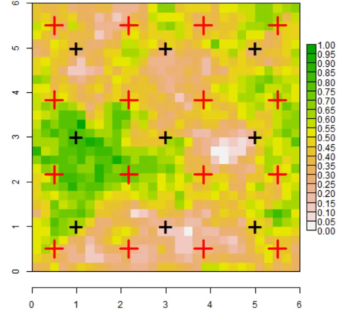
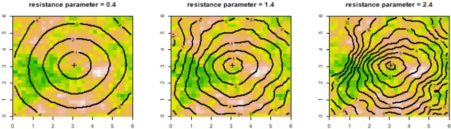
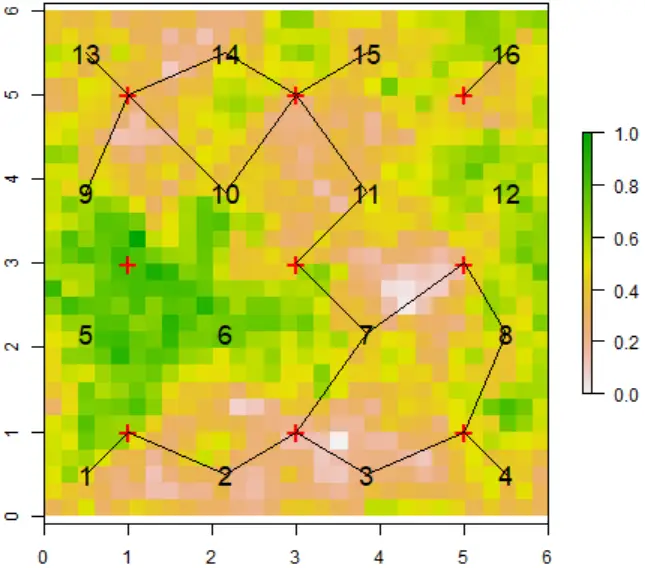
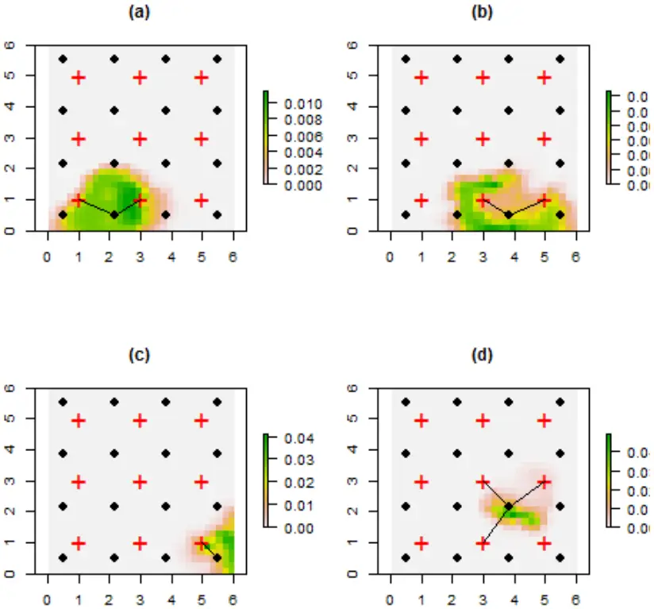

## Modeling sound attenuation in heterogeneous environments for improved bioacoustic sampling of wildlife populations

## J. Andrew Royle

USGS Patuxent Wildlife Research Center Laurel, MD 20708

email: aroyle at usgs.gov

January 13, 2018

Abstract Acoustic sampling methods are becoming increasingly important in biological 1 monitoring. Sound attenuation is one of the most important dynamics affecting the utility 2 of bioacoustic data as it directly affects the probability of detection of individuals from 3 bioacoustic arrays and especially the localization of acoustic signals necessary in telemetry 4 studies. Therefore, models of sound attenuation are necessary to make efficient use of 5 bioacoustic data in ecological monitoring and assessment applications. Models of 6 attenuation in widespread use are based on Euclidean distance between source and sensor, 7 which is justified under spherical attenuation of sound waves in homogeneous 8 environments. In some applications there are efforts to evaluate the detection range of 9 sensors in response to local environmental characteristics at the sensor or at sentinel source 10 locations with known environmental characteristics. However, attenuation is a function of 11 the total environment between source and sensor, not just their locations. In this paper I 12 develop a model of signal attenuation based on a non-Euclidean cost-weighted distance 13 metric which contains resistance parameters that relate to environmental heterogeneity in 14 the vicinity of an array. Importantly, these parameters can be estimated by maximum 15 likelihood using experimental data from an array of fixed sources, thus allowing 16

investigators who use bioacoustic methods to devise explicit models of sound attenuation 17 in situ. In addition, drawing on analogy with classes of models known as spatial 18 capture-recapture, I show that parameters of the non-Euclidean model of attenuation can 19 be estimated when source locations are unknown. Thus, the models can be applied to real 20 field studies which require localization of signals in heterogeneous environments. 21 Key words: acoustic monitoring, bioacoustics, distance sampling, sound attenuation, 22 spatial capture-recapture, telemetry, least-cost path models 23

24

Running title. Modeling sound attenuation

## 1 Introduction 25

Acoustic sampling technology has emerged as an important method for the study of vocal 26 species such as birds, anurans, marine mammals, many species of fish, and primates, or 27 for species to which acoustic transponders can be implanted or affixed to. As a result, 28 the deployment of automated acoustic recording devices has proliferated rapidly in both 29 terrestrial (Blumstein et al. 2011; Digby et al. 2016; Brauer et al. 2016; Measey et al. 2017) 30 and aquatic (Marques et al. 2009; Kessel et al. 2013; Marques et al. 2013; Cooke et al. 31 2016; Crossin et al. 2017) systems. 32

Bioacoustic technology is broadly relevant to the study of spatial ecology of animal popu33 lations. Two specific uses which are the focus of this paper are the application of bioacoustics 34 to density estimation using variations of spatial capture-recapture (SCR) methods (Efford 35 et al. 2009; Marques et al. 2013; Stevenson et al. 2015; Kidney et al. 2016) and its use 36 in acoustic telemetry (Heupel et al. 2006) for the study of movement and resource selec37 tion. Acoustic telemetry has become widely used in aquatic environments to study fish, sea 38 turtles, and marine mammals. Use of acoustic data for either SCR or telemetry requires 39 localization of the observed signals obtained from acoustic data. This is essentially statisti40

cal triangulation which can be done when signals are obtained from an array of bioacoustic 41 sensors so that potentially multiple detections of the same signal are possible (Janik et al. 42 2000; McGregor et al. 1997; Bower and Clark 2005; Blumstein et al. 2011). The precision of 43 source localization improves with the number of sensors in the array and the density of the 44 array. Localization has been recognized as being analogous to inference about the activity 45 center in SCR methods, and therefore SCR has been adapted to accommodate data obtained 46 by acoustic sampling methods (Dawson and Efford 2009; Efford et al. 2009; Borchers et al. 47 2015; Stevenson et al. 2015; Kidney et al. 2016). 48

49

50

51

52

53

54

55

56

57

58

59

60

61

62

63

64

65

66

Localization of acoustic sources requires explicit models for sound attenuation, i.e., the energy loss of sound propagation through a medium. In general, attenuation depends on the properties of the medium (Wiley and Richards 1982), and this often is characterized experimentally by engineers to satisfy design objectives of acoustic systems. However, to date, applications of bioacoustic methods in ecology have used simplistic models of spherical attenuation, in which amplitude decays according to a power law with rate proportional to the inverse of Euclidean distance1 . In practice, sound attenuation is strongly affected by the structure of the environment between the source origin and the receiver (Singh et al. 2009; Kessel et al. 2013; Rek and Kwiatkowska 2016; Selby et al. 2016). When the environment is highly heterogeneous Euclidean distance models may be inadequate. For example in bird monitoring problems there may be substantial variability in vegetation density or height in the vicinity of a sensor or array of sensors. In acoustic telemetry studies, the attenuation of the signal can depend on depth, substrate, surface conditions and many other factors (Selby et al. 2016). This has led to considerable recent attention to the problem of "range testing" to determine effective detection range given environmental heterogeneity for acoustic telemetry applications (Marques et al. 2009; Kessel et al. 2013; Selby et al. 2016). For example, Selby et al. (2016) model attenuation as a function of source and sensor specific covariates (e.g., depth). However, attenuation of signals depends on the total environment between the

[1 e.g., see https://en.wikipedia.org/wiki/Acoustic_attenuation accessed 12/20/2016.](https://en.wikipedia.org/wiki/Acoustic_attenuation)

67

68

69

70

71

72

73

74

75

76

77

78

79

80

signal and the source and therefore more general models of attenuation are needed.

Ideally, the end use of bioacoustic data in monitoring and assessment of biological populations should integrate explicit models of sound attenuation with parameters that are themselves estimated in situ along with biological parameters of interest such as density, position of sources, occupancy, or other ecological state variables. In this paper I suggest flexible classes of models for modeling attenuation in heterogeneous environments using cost-weighted distance in which effective distance is defined by a cost function that involves spatially explicit structure describing a heterogeneous landscape. This non-Euclidean distance model is widely used in least-cost path model analysis (Adriaensen et al. 2003) of landscape connectivity. Inference under this model has been formalized in the context of spatial capture-recapture studies (Royle et al. 2013; Sutherland et al. 2015; Fuller et al. 2016) as a model to describe movements of individuals about their home range, and also as a model for dispersal of individuals (Graves et al. 2014).

## 2 Data structure and model

Consider an idealized acoustic sampling array shown in Figure 1, which suppose is a 600 m 81 x 600 m block of forest for which lidar measurements are available and aggregated to 20 m2 82 resolution showing a standardized form of average vertical vegetation density at each point 83 (color-coded in Fig. 1). Within this landscape an array of 9 bioacoustic sensors is situated 84 in a regular grid, and among the sensor array are located 16 experimental sources producing 85 vocalizations that may or may not be detected at each sensor. In practice one might imagine 86 more attenuation between a source and sensor when dense habitat (green) predominates and 87 less attenuation in open habitats such as gaps in the forest canopy (white). 88

The data from a field experiment of this sort are power or signal strength measurements, Sij, at each sensor having location xj, from each source i = 1, 2, . . . , n (n = 16 in this case) having location si. The model for these observations can be formulated in terms of other signal characteristics such as time of arrival (Stevenson et al. 2015) but here for clarity I adhere to a formulation in terms of signal strength alone, although the basic ideas are the same. Following Efford et al. (2009) assume a transformation of signal strength that declines with distance d from the source, and assume the transformation produces a normally distributed variable such that attenuation is well approximated by the model

Figure 1: Idealized system showing an array of 9 sensors and an array of 16 experimental sources (e.g., speakers producing vocalizations of a species). Habitat structure is illustrated here as a standardize variable of vegetation density with high vertical density (green) representing dense vegetation and low vertical density (white) representing open areas.



<!-- formula-not-decoded -->

where ϵij ∼ Normal(0, σ2 ) is noise. When the signal strength takes on positive values then the 89 log-transformation would normally be satisfactory, and furthermore this is the natural scale 90 when power is measured in decibels (dB). Sounds are detected when S exceeds a threshold 91 c (Dawson and Efford 2009) which is somewhat arbitrary but should be set above the mean 92 level of ambient noise of the system so that detections are certain to be real. The signal 93 to noise ratio can be directly characterized from observed data (Dawson and Efford 2009). 94 For an experimental setting where the acoustic sources are known and only detection and 95 signal strength at each receiver are random variables, the observed data are (yij, Sij) where 96 yij = 1 if a signal from source i was detected at receiver j and yij = 0 if the signal was not 97 detected, and Sij &gt; c is the observed signal strength (transformed as noted above). Thus, 98 the probability of detection is pij = Pr(Sij &gt; c) which can be computed from the normal 99 cumulative distribution function. When the observed signal strength is ≤ c it is regarded as 100 a missing value with probability 1 - pij . 101

102

103

104

105

106

107

108

Equation 1 is a basic model of sound attenuation where the attenuation of sound intensity is governed by a single parameter α1, and relates only to the Euclidean distance between source and sensor, d(xj, si). Importantly, the form of this attenuation model is stationary (does not vary in space) and isotropic (it's two-dimensional contours are circular and symmetric). Intuitively, then, this model for signal strength is probably only suitable for homogeneous environments. In what follows I propose to generalize this model by allowing for the distance d(x, s) to be both nonstationary and anisotropic using a non-Euclidean distance metric that, in general, depends not only on the locations of sources and sensors 109 but also on the composition of the landscape between them. 110

## 2.1 Cost-weighted distance models 111

An intuitively appealing model for sound attenuation in heterogeneous environments is the cost-weighted distance (CWD) model in which attenuation is governed not by Euclidean distance but by a cost-weighted distance metric which depends on the habitat structure in the vicinity of the sensor. The cost-weighted distance can be computed for a path P = {(v1, v2), (v2, v3), . . . , (vm, vm+1)} consisting of m segments between any two points v1 and vm+1 on the landscape and it is defined by

<!-- formula-not-decoded -->

where cost(vg, vg+1) is a parametric function describing the cost of movement between pixels vg and vg+1, which must be prescribed (see below) and dist(vg, vg+1) is the Euclidean distance between pixels. The cost-weighted distance then is the sum over all pixels along a given path connecting v1 and vm+1. The least-cost path (LCP) (Adriaenson et al. 2003) is the path which has minimum CWD among all possible paths connecting the points v1 and vm+1. In practice the cost-weighted distance between any two points and the least-cost path can be computed using the R package gdistance (van Etten 2017). Either the cost-weighted distance between points or the least-cost path can serve as an effective distance metric in models of sound attenuation, where parameter(s) of the cost function are estimated explicitly from data (see below).

The relevance of this distance metric to inference about sound attenuation arises when the cost function is parameterized in terms of the landscape structure. For example, if a covariate z(v) exists then one sensible function describing the cost of passing from pixel vg

112

113

114

115

116

117

118

119

120

121

122

123

124

125

126

127

128

129

130

131

132

133

134

135

136

137

138

to pixel vg+1 is

<!-- formula-not-decoded -->

The parameter α2 represents the resistance of the covariate z(v) (higher values incur higher cost of transmission and vice versa), and it should be estimated from observed data on signal strength or time of arrival. I provide an estimation framework based on maximum likelihood below. To acknowledge this new distance metric in the model for sound attenuation, and that it depends on an unknown parameter α2, express the model as

<!-- formula-not-decoded -->

In general attenuation is frequency dependent (Wiley and Richards 1982) and thus parameters α1 and α2 should depend on species.

Obviously any number of covariates can be included in the cost function Eq. 3. Note that if α2 = 0 then the cost of transmission between any two pixels on the landscape is 1.0, and the cost-weighted distance reduces to Euclidean distance. As a practical matter we should scale any covariate z(v) to be in [0, 1] so that α2 can be any real number. Negative numbers imply that increasing values of the covariate facilitate sound transmission and positive values imply that increasing values of the covariate impede sound transmission. The cost-weighted distance is conveniently computed in the R package gdistance using the accCost function, and the least-cost path between any two points can be computed using the function costDistance.

To see the effect of cost weighted distance on "effective distance" Fig. 2 shows contours of effective distance (in this case the least-cost path) for different values of the resistance parameter from Eq. 3. These effective distance contours become closer together in areas of density vegetation (green) as the resistance parameter α2 increases. The basis of this as a model for sound attenuation is clear: individuals vocalizing from a location with high densities of vegetation (or other structure) between that location and the sensor should produce reduced signal strength and lowered detection probability due to sound deflection, absorption and other mechanisms. In what follows I describe the model formally and demonstrate 139 that the actual parameters governing attenuation of the sound can be explicitly estimated 140 from experimental data on such an array. 141

142

143

144

145

146

147

148

In practice, this model could be applied in situations where relatively fine scale habitat structure data are available. For example, in a study of birds on a landscape it might be possible to obtain such data from auxiliary surveys of vegetation structure but most likely fine-scale remotely sensed data from aerial imagery, lidar or similar platforms would be ideal for this purpose. In aquatic environments attenuation is most affected by depth and sub-surface structure and in most studies of aquatic systems detailed data exist for these attributes (and others).

Figure 2: Effective distance to a sensor (shown by +) placed at (3,3) under the leastcost path model with parameter α2 = 0.4 (left), α2 = 1.4 (center) and α2 = 2.4 (right). As resistance increases, effective distance contours get closer together in response to dense structure (green).



## 3 Likelihood Analysis 149

The cost-weighted distance metric described above is amenable to direct likelihood analysis from data on observed signal strength at fixed locations and with fixed sources (e.g., as in Fig. 1). The observed data from an experiment are the detection/signal strength pairs (yij, Sij) for each source and each sensor. Recall that signal strength is truncated at some value c chosen to reflect a reasonable threshold below which signals cannot be distinguished from ambient noise. Conditional on the J known source locations xj, the likelihood for the data from source location si is

<!-- formula-not-decoded -->

where f(Sij ; σ, α0, α1, α2) is the normal probability density with mean α0 +α1dcwd(xj , si; α2) 150 and variance σ2 and the probability of detection pij = Pr(Sij &gt; c) which depends on the 151 parameters of the normal distribution model for Sij in Eq. 4. The likelihood can be optimized 152 numerically using standard methods such as implemented in the R functions nlm or optim 153 (see Appendix A). 154

155

156

157

158

159

160

161

162

163

164

165

166

167

168

169

## 3.1 Unknown source locations

The parameters of the attenuation model can be estimated from data obtained when the sources are unknown. Of course this would be the case in any real field application of bioacoustics where animal sounds are measured. Indeed, this is precisely the situation addressed in spatial capture-recapture applications such as considered by Efford et al. (2009) and others. In this case, we have to regard the source location as a latent variable and remove it from the conditional-on-s likelihood (Eq. 5) by integrating over the planar state space (or 3-dimensional state-space in the context of aquatic systems) in the vicinity of the sensor array. One twist to the situation where the sources are unknown is the potential exists that some of the sources were not detected at all. Therefore, the likelihood has to be constructed either conditional on the event that an individual source was detected at least once (Borchers and Efford 2008) or else the possibility of n0 unobserved all-zero encounter histories must be accounted for, where n0 is then an additional parameter to be estimated (equivalently N = n0 + nobs). Indeed, n0 is the key parameter of interest in spatial capture-recapture applications. See Efford et al. (2009) for details on the likelihood construction. I provide an implementation in R of the likelihood in terms of n0 in Appendix A. 170

## 3.2 Computing the posterior distribution of a source 171

Bayes' rule can be used to calculate the posterior distribution of an unobserved source given the pattern of detections, y, on the sensor array and the signal strengths, S. Note that the likelihood given in Eq. 5 is the joint distribution of the detection/non-detection data yi and the signal strengths Si conditional on the source location si, say Pr(yi, Si|si). Let Pr(s) denote the prior distribution for s, then the posterior distribution of si is

<!-- formula-not-decoded -->

These probability distributions depend on the model parameters as in the likelihood given above but I omit that dependence to be concise. A standard assumption in spatial capturerecapture is to assume no a priori information about the location of a source so that Pr(s) = constant (Efford et al. 2009) in which case the posterior distribution is just standardized by the integral of the likelihood over the region in the vicinity of the sensor array. More generally, source density gradients can be accommodated by modeling explicit covariate effects in Pr(s). For example, suppose the sound sources are birds and they are likely to be using habitat preferentially, even the same habitat which is affecting sound attenuation, then we might assume

<!-- formula-not-decoded -->

where z(v) is the measured habitat structure for any location v and θ is a parameter to be 172 estimated. 173

R code for computing the posterior distribution of detected sources is given in Appendix 174 A and I show an example in the following section. 175

## 3.3 Data acquisition 176

177

178

179

180

181

182

183

184

185

The model as specified here assumes that unique vocalizations can be identified and reconciled among the detectors. For example this is easily true in an experimental setting when a sound is played, in which case the sensors at which it is detected can be noted directly. Over a period of time, each individual source can be played sequentially or even replicated multiple times. In field settings when the source location is unknown then a specific source encounter history has to be reconciled in a sense manually. But in practice can be done unambiguously in many practical settings if the density of sources is not too high (Dawson and Efford 2009). In the field (sampling real birds), an individual might make many calls during a particular time interval and these are treated as distinct sources.

## 4 Illustration 186

Using the experimental sensor array shown in Fig. 1 I simulated some data under the model for log-signal strength with α0 = 0, α1 = 1.0 and σ = 0.50. Therefore,

<!-- formula-not-decoded -->

I used a threshold of detection of c = -3. Moreover, the least-cost path distance model of attenuation was used with α2 = 2.0 to model attenuation through the heterogeneous habitat shown in Fig. 1. These parameter settings produce an average of 20.8 total captures of 13.8 individuals on the array of 9 sensors. A particular realization is shown in Fig. 3 which shows the pattern of detections of the 16 sources. In particular, lines are connected between each source and the sensor(s) at which it was detected. Three of the sources were not detected at all, 6 were detected once, 6 were detected twice, and one source three times. The MLEs for the model parameters for this single realization are ˆα0 = -0.155, ˆα1 = 0.699, ˆα2 = 2.676 and ˆσ = 0.417. In general, a very high level of precision is possible for this relatively low level

187

188

189

190

191

192

193

194

195

of detections in an experimental setting when the source locations are known. For example, 196 100 realizations of this situation produce an MLE of α2 having mean 1.96 (recall truth = 197 2.0) and standard error 0.398. The R script for simulating data and fitting the model is 198 given in Appendix A. 199

Figure 3: A single realization of a bioacoustic experiment to measure non-Euclidean attenuation in the form of the least-cost path model. For this simulated realization, detection frequencies of the 16 sources as follows: (1, 2, 2, 1, 0, 0, 3, 2, 1, 2, 2, 0, 1, 2, 1, 1). Each source is connected to the sensors at which it was detected.



Maximum likelihood estimation for this experimental system is much less effective when 200 the source locations s are unknown, in which case the MLEs can be considerably biased (see 201 Appendix A). Instead, a much larger array is required, or a denser population of sources 202 is needed in order to generate sufficient encounters. This is consistent with what is known 203

in spatial capture-recapture studies; see for example Efford and Fewster (2013), Sun et al. 204 (2014) and chapter 10 in Royle et al. (2014)). Nevertheless, it is possible to localize the 205 unknown sources using the general likelihood formulation based on the marginal likelihood. 206 For the same simulated data set shown in Fig. 3 I produced the estimated posterior distri207 bution of the unknown source location of 4 sources (Fig. 4) captured between 1 and 3 times 208 each. We see that the estimated posterior distributions are in the vicinity of the true source 209 locations, modified by the observed encounter history (the data set is generated using the 210 random number seed noted in Appendix A). 211

212

213

214

215

216

217

218

219

220

221

222

223

224

225

226

227

228

## 5 Discussion

With the rapid and expanding adoption of acoustic monitoring technology, the ability to understand sound attenuation along environmental gradients will become increasingly important (Kessel et al. 2013). In this paper I suggested a flexible framework for modeling sound attenuation in heterogeneous environments. This framework has two direct applications. First, it can lead to improved inferences about source locations ("localization") which is important in many applications, especially acoustic telemetry. Second, it allows investigators to better understand how bioacoustic methods work under field conditions in heterogeneous environments by enabling in situ inference about factors that influence attenuation from field data. The method is sufficiently flexible that it can be used with acoustic telemetry data, as well as encounter history data used in acoustic SCR applications (Efford et al. 2009; Stevenson et al. 2015; Kidney et al. 2016). I formulated the model here in terms of "signal strength" data (e.g., sound intensity measured in decibels) but the idea applies directly when time of arrival data are available. For such data, the localization model also involves a distance function (Stevenson et al. 2015) which might be replaced by cost-weighted or least-cost path distance with parameters to be estimated. In addition, the basic ideas apply directly to classical distance sampling methods (Buckland et al. 2001),

×

×

×

Figure 4: Estimated localizations of 4 unknown sources characterized by the estimated posterior distribution of the source location obtained by plugging-in the MLEs obtained by maximizing the likelihood for the observed detection/non-detection and signal strength data. Because these are posterior distributions the sum over all pixels equals 1.0. For each of the 4 sources shown here the true location of the source is connected to the sensors at which it was detected by lines.



×

229

230

231

232

233

234

235

236

237

238

239

240

241

242

243

244

245

246

247

248

249

250

251

252

253

254

255

where the Euclidean distance metric in the distance sampling likelihood can be replaced by cost-weighted distance. In the case of distance sampling, in most applications, the model would provide a description of visual obstruction and not wave attenuation.

The ability to develop explicit models of sound attenuation has important sampling design implications. In heterogeneous environments, the detection range of sensors depends on environmental characteristics (Kessel et al. 2013; Selby et al. 2016) and thus this critical parameter is both nonstationary and anisotropic. Therefore, the optimal spacing of sensors in an array must be variable in response to the underlying environmental heterogeneity. The problem of array design is analogous to the design of camera trap studies (e.g., Royle et al. 2014; ch. 10), where arrays can be constructed so as to maximize the probability of detection, optimize criteria based on the variance of estimators of parameters of interest, or maximize the precision of the localization. Using the non-Euclidean model of effective distance suggested in this paper, one could obtain estimates of the parameter α2 from an experimental or observational study and then use that estimate to improve the design of bioacoustic monitoring arrays. In practice, having multiple sensors in a given experimental array, with known source locations, such as shown in Fig. 1, is not necessary. One could obtain suitable estimates of model parameters with a single sensor and replicated source emissions. However, in field applications of localization or density estimation (such as Dawson and Efford 2009) multiple sensors are required. In general, estimation of model parameters is challenging when source locations are unknown and effective estimation might require a a large array of sensors and a large sample size of detections. As such, in practice, one might first consider experimental analysis of sound attenuation models with known sources in order to obtain precise estimates of parameters of the effective distance model which may then be treated as fixed in subsequent analyses focused on localization or density estimation.

An obvious extension of the framework proposed here is to consider alternative nonEuclidean distance metrics. For example, one obvious alternative is to substitute resistance distance (McRae 1996) in place of cost weighted distance. Resistance distance is based on

256

257

258

259

260

261

262

263

264

265

266

267

268

269

270

271

272

273

274

275

276

an analogy between discrete landscapes (characterized by a raster of pixels) and electrical circuits. Resistance distance between two nodes is the effective resistance between them, which depends on the resistance between each node and the number of pathways in the circuit. I think both cost weighted distance (or least-cost path) and resistance distance offer useful descriptions of sound attenuation in heterogeneous landscapes.

One limitation of the proposed approach is that the cost-weighted distance model underlying least-cost path is a phenomenological model. It describes the phenomenon of attenuation in response to measurable covariates but does not explicitly embody elements of sound dynamics such as reverberation, absorption and reflection. Rather, it models their total effect as measured by the apparent relative distance between points as measured by observed signal strength and pattern of detections. This may not be a severe limitation in biological applications of acoustic monitoring where interest is usually in the end use of the data for detection, localization or similar objectives and not directly in the processes contributing to sound dynamics of a particular system.

Application of any non-Euclidean effective distance model depends on the availability of environmental or habitat information at a suitable scale to be relevant to sound dynamics. While small scale habitat data are not always collected in field studies using acoustic sampling or distance sampling, it seems likely that such data will be collected more frequently in the future with the increasing availability of lidar technology (Zolkos et al. 2013, He et al. 2015) and other remote sensing platforms such as drones (Martin et al. 2012, Christie et al. 2016).

## Acknowledgments

The author thanks Cathleen Balantic, Danielle Rappaport, Andrew MacLaren and Suresh 277 Sethi for helpful comments and suggestions on this manuscript. Any use of trade, product, 278 or firm names is for descriptive purposes only and does not imply endorsement by the U.S. 279 Government. 280

## Literature Cited 281

- Adriaensen, F., J.P. Chardon, G. De Blust, E. Swinnen, S. Villalba, H. Gulinck, and E. 282 Matthysen. 2003. The application of least-costmodelling as a functional landscape model. 283 Landscape and Urban Planning 64:233-247. 284
- Blumstein, D.T., D.J. Mennill, P. Clemins, L. Girod, K. Yao, G. Patricelli, et al. 2011. 285 Acoustic monitoring in terrestrial environments using microphone arrays: applications, 286 technological considerations and prospectus. Journal of Applied Ecology 48:758767. 287
- Borchers, D.L., and M.G. Efford. 2008. Spatially explicit maximum likelihood methods for 288 capture-recapture studies. Biometrics 64:377-385. 289
- Borchers, D.L., B.C. Stevenson, D. Kidney, L. Thomas, and T.A. Marques. 2015. A unifying 290 model for capturerecapture and distance sampling surveys of wildlife populations. Journal 291 of the American Statistical Association 110:195-204. 292
- Bower, J.L., and C.W. Clark. 2005. A field test of the accuracy of a passive acoustic location 293 system. Bioacoustics 15:1-14. 294
- Brauer, C.L., T.M. Donovan, R.M. Mickey, J. Katz, and B.R. Mitchell. 2016. A comparison 295 of acoustic monitoring methods for common anurans of the northeastern United States. 296 Wildlife Society Bulletin 40:140-149. 297
- Buckland, S.T., D.R. Anderson, K.P. Burnham, J.L. Laake, D.L. Borchers, and L. Thomas. 298 2001. Introduction to distance sampling estimating abundance of biological populations. 299
- Christie, K.S., S.L. Gilbert, C.L. Brown, M. Hatfield, and L. Hanson. 2016. Unmanned 300 aircraft systems in wildlife research: current and future applications of a transformative 301 technology. Frontiers in Ecology and the Environment 14:241-251. 302
- Cooke, S.J., E.G. Martins, D.P. Struthers, L.F. Gutowsky, M. Power, S.E. Doka, J.M. 303 Dettmers, D.A. Crook, M.C. Lucas, C.M. Holbrook, and C.C. Krueger. 2016. A mov304

- ing targetincorporating knowledge of the spatial ecology of fish into the assessment and 305 management of freshwater fish populations. Environmental monitoring and assessment 306 2016:188-239. 307
- Crossin, G.T., M.R. Heupel, C.M. Holbrook, N.E. Hussey, S.K. LowerreBarbieri, V.M.
- 308 Nguyen, G.D. Raby, and S.J. Cooke. 2017. Acoustic telemetry and fisheries manage309 ment. Ecological Applications 27:1031-1049. 310
- Dawson, D.K., and M.G. Efford. 2009. Bird population density estimated from acoustic 311 signals. Journal of Applied Ecology 46:1201-1209. 312
- Digby, A., M. Towsey, B.D. Bell, and P.D. Teal. 2013. A practical comparison of manual 313 and autonomous methods for acoustic monitoring. Methods in Ecology and Evolution 314 4:675-683. 315
- Efford, M. G., D.K. Dawson, and D.L. Borchers. 2009. Population density estimated from 316 locations of individuals on a passive detector array. Ecology 90:2676-2682. 317
- Efford M.G., and R.M. Fewster. 2013. Estimating population size by spatially explicit 318 capturerecapture. Oikos 122:918-28. 319
- Fuller, A.K., C.S. Sutherland, J.A. Royle, and M.P. Hare. 2015. Estimating population 320 density and connectivity of American mink using spatial capture-recapture. Ecological 321 Applications 26:1125-1135. 322
- Graves, T.A., R.B. Chandler, J.A. Royle, P. Beier, and K.C. Kendall. 2014. Estimating 323 landscape resistance to dispersal. Landscape Ecology 29:1201-1211. 324
- He, K.S., B.A. Bradley, A.F. Cord, D. Rocchini, M.-N. Tuanmu, S.Schmidtlein, W. Turner, 325 M. Wegmann, N. Pettorelli. 2015. Will remote sensing shape the next generation of 326 species distribution models? Remote Sens Ecol Conserv 1:418. 327
- Heupel, M.R., J.M. Semmens, and A.J. Hobday. 2006. Automated acoustic tracking of 328

- aquatic animals: scales, design and deployment of listening station arrays. Marine and 329 Freshwater Research 57:1-13. 330
- Janik, V.M., S.M. Parijs, and P.M. Thompson. 2000. A two-dimensional acoustic localiza331 tion system for marine mammals. Marine Mammal Science 16:437-447. 332
- Kessel, S.T., S.J. Cooke, M.R. Heupel, N.E. Hussey, C.A. Simpfendorfer, S. Vagle, and A.T. 333 Fisk. 2014. A review of detection range testing in aquatic passive acoustic telemetry 334 studies. Reviews in Fish Biology and Fisheries 24:199-218. 335
- Kidney, D., B.M. Rawson, D.L. Borchers, B.C. Stevenson, T.A. Marques, and L. Thomas. 336 2016. An efficient acoustic density estimation method with human detectors applied to 337 gibbons in Cambodia. PLOS ONE 11:p.e0155066. 338
- Marques, T.A., L. Thomas, J. Ward, N. DiMarzio, and P.L. Tyack. 2009. Estimat339 ing cetacean population density using fixed passive acoustic sensors: an example with 340 Blainvilles beaked whales. Journal of the Acoustic Society of America 125:1982-1994. 341
- Marques, T.A., L. Thomas, S.W. Martin, D.K. Mellinger, J.A. Ward, D.J. Moretti, D. Harris 342 and P.L. Tyack. 2013. Estimating animal population density using passive acoustics. 343 Biological Reviews 88:287-309. 344
- Martin, J., H.H. Edwards, M.A. Burgess, H.F. Percival, D.E. Fagan, B.E. Gardner, J.G. 345 Ortega-Ortiz, P.G. Ifju, B.S. Evers, and T.J. Rambo. 2012. Estimating distribution of 346 hidden objects with drones: From tennis balls to manatees. PLoS One 7, p.e38882. 347
- McGregor, P.K., T. Dabelsteen, C.W. Clark, J.L. Bower, and J. Holland. 1997. Accuracy 348 of a passive acoustic location system: empirical studies in terrestrial habitats. Ethology 349 Ecology &amp; Evolution 9:269-286. 350
- McRae, B.H. 2006. Isolation by resistance. Evolution 60:1551-1561. 351
- Measey, G.J., B.C. Stevenson, T. Scott, R. Altwegg, and D.L. Borchers. 2017. Counting 352

- chirps: acoustic monitoring of cryptic frogs. Journal of Applied Ecology 54:894-902. 353
- Rek, P. and K. Kwiatkowska. 2016. Habitat complexity and the structure of vocalizations: a 354 test of the acoustic adaptation hypothesis in three rail species (Rallidae). Ibis 158:416-427. 355
- Royle, J.A., R.B. Chandler, R. Sollmann, and B. Gardner. 2014. Spatial Capture-Recapture. 356 AcademicPress/Elsevier. 612 pages. 357
- Royle, J.A., R.B. Chandler, K.D. Gazenski, and T.A. Graves. 2013. Spatial capture358 recapture models for jointly estimating population density and landscape connectivity. 359 Ecology 94:287-294. 360
- Selby, T.H., K.M. Hart, I. Fujisaki, B.J. Smith, C.J. Pollock, Z. HillisStarr, I. Lundgren, 361 and M.K. Oli. 2016. Can you hear me now? Rangetesting a submerged passive acoustic 362 receiver array in a Caribbean coral reef habitat. Ecology and Evolution 6:4823-4835. 363
- Singh, L., N.J. Downey, M.J. Roberts, D.M. Webber, M.J. Smale, M.A. Van den Berg, 364 R.T. Harding, D.C. Engelbrecht, and B.M. Blows. 2009. Design and calibration of an 365 acoustic telemetry system subject to upwelling events. African Journal of Marine Science 366 31:355-364. 367
- Stevenson, B.C., D.L. Borchers, R. Altwegg, R.J. Swift, D.M. Gillespie, and G.J. Measey. 368 2015. A general framework for animal density estimation from acoustic detections across 369 a fixed microphone array. Methods in Ecology and Evolution 6:38-48. 370
- Sun, C.C., A.K. Fuller, and J.A. Royle. 2014. Trap configuration and spacing influences 371 parameter estimates in spatial capture-recapture models. PLOS ONE 9, e88025. 372
- Sutherland, C., A.K. Fuller, and J.A. Royle. 2015. Modelling non-Euclidean movement and 373 landscape connectivity in highly structured ecological networks. Methods in Ecology and 374 Evolution 6:69-177. 375
- van Etten, J. 2017. R Package gdistance: Distances and Routes on Geographical Grids. 376

- Journal of Statistical Software 76:1-21. 377
- Zolkos, S.G., S.J. Goetz, and R. Dubayah. 2013. A meta-analysis of terrestrial aboveground 378

biomass estimation using lidar remote sensing. Remote Sensing of Environment 128:289-

- 379 298. 380

Wiley, R.H. and D.G. Richards. 1982. Adaptations for acoustic communication in birds: 381

- sound transmission and signal detection. Acoustic Communication in Birds 1:131-181. 382

383

## Appendix A

```
# This block of code simulates a habitat landscape in the vicinity of a sensor array 384 385 B = 3 386 lambda = B/3 # correlation range for habitat map 387 library(raster) 388 library(scrbook) 389 set.seed(1234) 390 # raster grid 391 delta <- (2 * B - 0)/30 392 grx <- seq(delta/2, 2 * B - delta/2, delta) 393 gr <- expand.grid(grx, grx, KEEP.OUT.ATTRS = FALSE) 394 395 V <- exp(-e2dist(gr, gr)/lambda) 396 x <- t(chol(V)) %*% rnorm(900) 397 398 # png("system.png") 399 op <- par(mar = c(3, 3, 3, 6)) 400 on.exit(par(op)) 401 habrast<-rasterFromXYZ(cbind(as.matrix(gr), x)) 402 # Standardize the covariate to be in [0,1] 403 vv<- values(habrast) 404 vv<- vv-min(vv) 405 vv<- vv/max(vv) 406 values(habrast) <- vv 407 image(habrast, col=rev(terrain.colors(20)), asp = 1, bty = "n") 408 409 rect(0, 0, 2 * B, 2 * B) 410 # Define array of sensors 411
```

```
sensors<- as.matrix(expand.grid(seq(1,5,2),seq(1,5,2))) 412 points(sensors, pch = "+", cex = 3) 413 image.scale(vv, col=rev(terrain.colors(20)) ) 414 415 # Define some sources (speakers playing recorded calls) 416 X<- as.matrix(expand.grid(seq(0.5, 5.5,,4), seq(0.5, 5.5,,4) ) ) 417 points(X,pch=3, cex=3,col="red", lwd=3) 418 # dev.off() 419 420 421 # Define some parameter values for the signal strength model. Supposes a suitable 422 # transformation of signal strength is normal 423 alpha0<- -2 424 # thinking about alpha1 being related to the range parameter of a half-normal in order t 425 alpha1<- -(1/(2*1*1)) 426 D<- e2dist(X, sensors) 427 S<- matrix(NA,nrow=nrow(D),ncol=ncol(D)) 428 for(i in 1:nrow(S)){ 429 S[i,]<- rnorm(ncol(D),alpha0 + alpha1*D, 0.5) # sigma = 0.5 here 430 } 431 # Detection occurs if signal strength > - 3 . Threshold is arbitary, more or less. 432 y<- (S> -3) 433 y 434 sum(y) 435 436 vv<- values(habrast) 437 vv<- vv-min(vv) 438 vv<- vv/max(vv) 439 values(habrast)<- vv 440 plot(habrast) 441 image(habrast, col=rev(terrain.colors(20))) 442 image.scale(values(habrast), col=rev(terrain.colors(20))) 443 title("Vegetation density") 444 points(3.1,3.1, pch = "+", cex = 2) 445 gr<-coordinates(habrast) ###################### 446 447 # 448 # Next block of code computes the effective distance matrix for some value 449 # of alpha2 which is specified in the for loop initation. This is done 450 # so that the Figure in the manuscript can be produced if a vector of 451 # values is specified 452 # 453 library(gdistance) 454
```

```
#png("3rasters.png",width=720,height=240) 455 par(mfrow=c(1,3) ) 456 # pick values of alpha2 here to evaluate the effective distance. I'm using 2 but the 457 # figure from the manuscript uses c(0.4, 1.4, 2.4) 458 for(alpha2 in c( 2) ){ 459 cost<- exp( alpha2*habrast ) # lots of attenuation through dense cover 460 tr1<-transition(cost,transitionFunction=function(x) 1/mean(x),directions=16) 461 tr1CorrC <-geoCorrection(tr1,type="c",multpl=FALSE,scl=FALSE) 462 dcost <-costDistance(tr1CorrC, X, sensors) 463 dcost.rast<- costDistance(tr1CorrC, as.matrix(gr), sensors) 464 # could use accCost for EACH sensor location and then pull out the 465 # values needed.... This is a bit tedious so just use least-cost path. 466 # r1<- accCost(tr1CorrC, sensors[1,]) 467 # incell<- rep(NA,nrow(sensors)) 468 # for(j in 1:nrow(sensors)){ 469 # dd<- e2dist(sensors,coordinates(r1)) 470 # dd2<- apply(dd,1,min) 471 # incell[j]<- (1:ncol(dd))[dd[j,]==dd2[j]] 472 #} 473 r<- cost 474 values(r)<- dcost.rast[,5] # column 5 corresponds to the center sensor 475 image(habrast, col=rev(terrain.colors(20)),xlab=" ",ylab=" ") 476 title(paste("resistance parameter = ",theta,sep=""),cex=6) 477 478 points(3.1,3.1, pch = "+", cex = 2) 479 contour(r, levels= c(1, 2, 3, 4, 5, 6, 7, 8, 9, 10), add=TRUE, lwd=2) 480 } 481 482 #dev.off() 483 484 # Example of simulating the attenuated signal 485 D<- dcost 486 # D<- e2dist(X,sensors) # Could use Euclidean distance here 487 alpha0<- -0.5 488 alpha1<- 1 489 Sh<- matrix(NA,nrow=nrow(D),ncol=ncol(D)) 490 for(i in 1:nrow(Sh)){ 491 Sh[i,]<- rnorm(ncol(D),alpha0 - alpha1*D[i,], 0.5) 492 } 493 cut<- -3 494 y<- (Sh> cut) 495 Sh[y==0]<-NA 496 497
```

```
apply(y,1,sum) 498 y<- as.numeric(y) 499 500 501 # This is the likelihood for fixed sources, uses fixed distance matrix 502 # not estimated 503 lik<-function(parms, D){ 504 alpha0<- parms[1] 505 alpha1<- (parms[2]) 506 sigma<- exp(parms[3]) 507 508 ES<- alpha0 - alpha1*D 509 gamma <- ( cut - ES )/sigma 510 511 phi <- pnorm(gamma, 0, 1) 512 p <- 1-phi 513 dn <- dnorm(Sh, ES, sigma) 514 515 ll1<- -1*sum(log(apply((p^y)*(1-p)^(1-y),1,prod))) -1*( sum(log(dn[y==1])) ) 516 ll1 517 } 518 # obtain the MLEs 519 tmp<-nlm(lik,c(alpha0, alpha1, -1),D=dcost, hessian=TRUE) 520 c(tmp$estimate[1], (tmp$estimate[2]),exp(tmp$estimate[3]) ) 521 522 523 524 # This function computes the likelihood for fixed sources assuming the 525 # resistance parameter is a parameter to be estimated... 526 527 likknownS<-function(parms,ymat){ 528 alpha0<- parms[1] 529 alpha1<- parms[2] 530 alpha2<- parms[3] 531 sigma<- exp(parms[4]) 532 533 cost<- exp( alpha2*habrast ) # lots of attenuation through dense cover 534 tr1<-transition(cost,transitionFunction=function(x) 1/mean(x),directions=16) 535 tr1CorrC <-geoCorrection(tr1,type="c",multpl=FALSE,scl=FALSE) 536 dcost <-costDistance(tr1CorrC, X, sensors) 537 538 D<- dcost 539 ES<- alpha0 - alpha1*D 540
```

```
gamma <- ( cut - ES )/sigma 541 542 phi <- pnorm(gamma, 0, 1) 543 p <- 1-phi 544 dn <- dnorm(Sh, ES, sigma) 545 ll1<- -1*sum(log(apply((p^ymat)*((1-p)^(1-ymat)),1,prod))) -1*( sum(log(dn[ymat==1])) ) 546 return(ll1) 547 } 548 549 550 # Simulation code. Change "nsims" to do more than 1. 551 552 simout<- NULL 553 nsims<- 1 554 set.seed(123) 555 556 for(sim in 1:nsims){ 557 558 # Simulate a data set using the cost distance specified above 559 D<- dcost 560 alpha0<- 0 561 alpha1<- 1 562 nreps<- 3 # In an experimental setting we would do multiple replicates from each senso 563 cut<- -3 564 ymat<- Sh<- array(NA,dim=c(nreps, nrow(D),ncol(D))) 565 for(r in 1:nreps){ 566 for(i in 1:nrow(D)){ 567 Sh[r,i,]<- rnorm(ncol(D),alpha0 - alpha1*D[i,], 0.5) 568 ymat[r,i,]<- as.numeric(Sh[r,i,]>cut) 569 } 570 } 571 # Just keep 1 rep for the illustration. Likelihood is not set up for replicates 572 Sh<- Sh[1,,] 573 ymat<- ymat[1,,] 574 575 # Plot the detection data from 1 realization of the experimental setting 576 #png("1realization.png",width=480,height=480) 577 do<- 1:nrow(ymat) 578 prast<- habrast 579 plot(prast) 580 points(sensors, pch = "+", cex = 2,col="red") 581 points(X, pch= " ") 582 text(X, as.character(do),cex=1.5) 583
```

. CC-BY 4.0 International license a certified by peer review) is the author/funder, who has granted bioRxiv a license to display the preprint in perpetuity. It is made available under The copyright holder for this preprint (which was not this version posted January 13, 2018. ; https://doi.org/10.1101/239079 doi: bioRxiv preprint

```
for(i in do){ 584 a<- ymat[i,] 585 if(sum(a)==0) next 586 b<- matrix(sensors[a==1,],ncol=2,byrow=FALSE) 587 for(j in 1:nrow(b)){ 588 lines(rbind(X[i,],b[j,])) 589 } 590 } 591 #dev.off() 592 593 594 # Obtain the MLE of the known-s model 595 596 tmp<-nlm(likknownS,c(0,1,2,0),hessian=TRUE,ymat=ymat) 597 parms1<- c(tmp$estimate[1],tmp$estimate[2],tmp$estimate[3],exp(tmp$estimate[4]) ) 598 names(parms1)<- c("alpha0","alpha1","alpha2","sigma") 599 (parms1) 600 601 # Fit the model with s not known 602 603 # First discard the all-zero data from the sources that were not detected 604 ncap<- apply(ymat,1,sum) 605 rownames(ymat)<- 1:nrow(ymat) 606 ymat<- ymat[ncap>0,] 607 Sh<- Sh[ncap>0,] 608 Sh[ymat==0]<- NA 609 gr<-coordinates(habrast) 610 gr<- as.matrix(gr) 611 612 # Should be defined outside of the simulation loop 613 lik<-function(parms,ymat, gr, compute.post=FALSE){ 614 alpha0<- parms[1] 615 alpha1<- parms[2] 616 alpha2<- parms[3] 617 sigma<- exp(parms[4]) 618 N<- nrow(ymat) + exp(parms[5]) 619 620 cost<- exp( alpha2*habrast ) # lots of attenuation through dense cover 621 tr1<-transition(cost,transitionFunction=function(x) 1/mean(x),directions=16) 622 tr1CorrC <-geoCorrection(tr1,type="c",multpl=FALSE,scl=FALSE) 623 dcost <-costDistance(tr1CorrC, gr, sensors) 624 625 ymat<- rbind(ymat, rep(0,ncol(ymat))) 626
```

```
post<- matrix(NA,nrow=nrow(ymat),ncol=nrow(gr)) 627 Sh<- rbind(Sh, rep(NA,ncol(ymat))) 628 nind<- nrow(ymat)-1 629 D<- dcost 630 ES<- alpha0 - alpha1*D 631 gamma <- ( cut - ES )/sigma 632 phi <- pnorm(gamma, 0, 1) 633 p <- 1-phi 634 635 lik1<- lik2<-rep(NA,nrow(ymat)) 636 for(i in 1:nrow(ymat)){ 637 lik.gr<- ( ( t(p)^ymat[i,] )*( t(1-p)^(1-ymat[i,]) ) ) 638 lik.gr<- apply(lik.gr,2,prod) # joint likelihood for each grid pixel 639 lik1[i]<- mean(lik.gr) 640 log.dn<-dnorm(matrix(Sh[i,],nrow=nrow(gr),ncol=ncol(Sh),byrow=TRUE), ES, sigma,log=T 641 dn<- exp(rowSums(log.dn, na.rm=TRUE)) 642 post[i,]<- lik.gr+dn 643 lik2[i]<- mean(dn) 644 } 645 if(!compute.post){ 646 nv<- c( rep(1,nind), N-nind) 647 ll<- -1*(lgamma(N) - lgamma(N-nind) + sum(nv*log(lik1)) + sum(nv*log(lik2)) ) 648 return(ll) 649 } 650 if(compute.post){ 651 post<-post/rowSums(post) 652 return(post) 653 } 654 655 } 656 657 # Fit the unknown sources model 658 gr<- coordinates(habrast) 659 tmp<-nlm(lik,c(0,1,2,-1,-1),hessian=TRUE,ymat=ymat,gr=gr) 660 661 parms2<- c(tmp$estimate[1],tmp$estimate[2],tmp$estimate[3],exp(tmp$estimate[4]), 662 exp(tmp$estimate[5]) ) 663 names(parms2)<- c("alpha0","alpha1","alpha2","sigma","n0") 664 parms2 665 666 simout<- rbind(simout, c(nind=sum(ncap>0),totcap=sum(ncap),parms1,parms2)) 667 } 668 669
```

```
# 670 # Compute the posterior distribution using the MLEs 671 # 672 gr<- coordinates(habrast) 673 post<-lik(tmp$estimate,ymat=ymat,gr=gr,compute.post=TRUE) 674 675 #### png("posts.png",width=480,height=480) 676 par(mfrow=c(2,2)) 677 do<- 2:5 # I will plot the posterior distribution for sources in rows 2-5 of ymat 678 source.ids<- as.numeric(dimnames(ymat)[[1]][do]) 679 #prast<-rasterFromXYZ(cbind(gr,post[2,])) 680 # note: wrong order of coordinates 681 prast<- habrast 682 m<- 1 683 for(i in do){ 684 prast<- habrast 685 values(prast)<- post[i,] 686 plot(prast) 687 points(sensors, pch = "+", cex = 2,col="red") 688 points(X,pch=20,cex=2) 689 a<- ymat[i,] 690 if(sum(a)==0) next 691 b<- matrix(sensors[a==1,],ncol=2,byrow=FALSE) 692 693 for(j in 1:nrow(b)){ 694 lines(rbind(X[source.ids[m],],b[j,])) 695 } 696 697 title( c("(a)","(b)","(c)","(d)")[m] ) 698 m<- m+1 699 700 } 701 #### dev.off() 702 703
```
