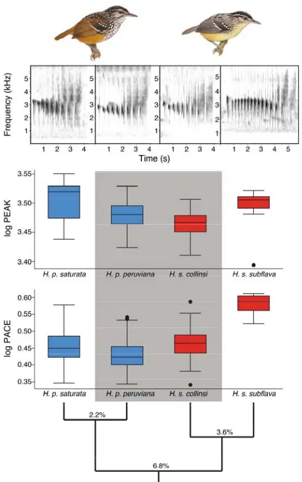
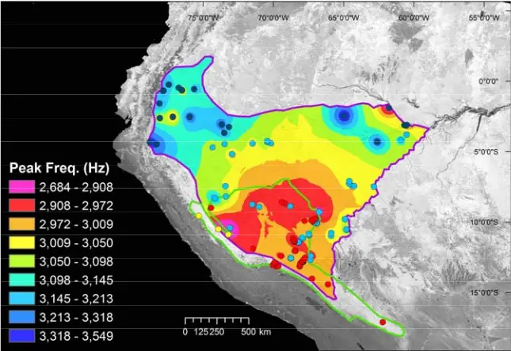
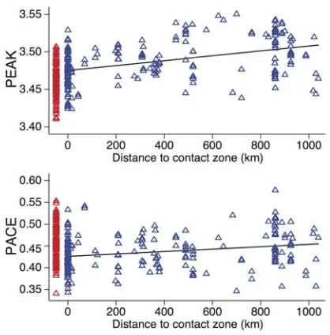

- Range-wide spatial mapping reveals 1 convergent character displacement 2 of bird song 3

4

5

6

7

8

9

10

11

12

13

14

15

16

17

18

19

20

Alexander N. G. Kirschel 1,2 , Nathalie Seddon 2 , and Joseph A. Tobias 2,3

1 University of Cyprus, Department of Biological Sciences, PO Box 20537, Nicosia 1678, Cyprus. 2 Edward Grey Institute, Department of Zoology, University of Oxford, South Parks Road, Oxford OX1 3PS, UK. 3 Department of Life Sciences, Imperial College London, Silwood Park, Buckhurst Road, Ascot, Berkshire, SL5 7PY, UK.

Corresponding author: kirschel@ucy.ac.cy

21

22

23

24

25

26

27

28

29

30

31

32

33

34

35

36

37

38

39

40

41

42

43

44

## Abstract

A long-held view in evolutionary biology is that character displacement generates divergent phenotypes in closely related coexisting species to avoid the costs of hybridisation or ecological competition, whereas an alternative possibility is that signals of dominance or aggression may instead converge to facilitate coexistence among ecological competitors. Although this counter-intuitive process⎯termed convergent agonistic character displacement⎯is supported by recent theoretical and empirical studies, the extent to which it drives spatial patterns of trait evolution at continental scales remains unclear. By modeling variation in song structure of two ecologically similar species of Hypocnemis antbird across western Amazonia, we show that their territorial signals converge such that trait similarity peaks in the sympatric zone, where intense interspecific territoriality between these taxa has previously been demonstrated. We also use remote sensing data to show that signal convergence is not explained by environmental gradients and is thus unlikely to evolve by sensory drive (i.e. acoustic adaptation to the sound transmission properties of habitats). Our results suggest that agonistic character displacement driven by interspecific competition can generate spatial patterns opposite to those predicted by classic character displacement theory, and highlight the potential role of social selection in shaping geographical variation in signal phenotypes of ecological competitors.

Keywords: animal communication, Amazonia, interspecific competition, phenotypic evolution, signal convergence, social selection

45

46

47

48

49

50

51

52

53

54

55

56

57

58

59

60

61

62

63

64

65

66

67

68

69

70

71

72

73

74

75

76

77

## Introduction

Classical evolutionary theory suggests that mating signals of closely related species diverge when populations interact in geographical contact (sympatry) to reduce the costs of maladaptive hybridisation or reproductive interference (Dobzhansky 1951, Butlin 1987, Servedio and Noor 2003, Groning and Hochkirch 2008, Pfennig and Pfennig 2009). This concept, widely referred to as reproductive character displacement (RCD) (Butlin 1987, Gerhardt 1994, Pfennig and Pfennig 2009), is thought to explain patterns of divergence in both signals and signal recognition systems, particularly in anurans (Gerhardt 1994, Pfennig and Pfennig 2005, Lemmon 2009), and birds (Saetre et al. 1997, Kirschel et al. 2009). An alternative hypothesis, first suggested by West-Eberhard (West-Eberhard 1983), is that agonistic signals functioning in social competition may also diverge to reduce the costs of misdirected interspecific aggression⎯a process now termed agonistic character displacement (ACD) (Grether et al. 2009, Grether et al. 2013, Grether et al. 2017). Standard forms of both RCD and ACD predict signal divergence in sympatry, making them difficult to disentangle through observational studies (Kirschel et al. 2009, Tobias et al. 2011, Tobias et al. 2014) and thus their relative contribution to patterns of trait evolution is often unclear (Grether et al. 2009, Grether et al. 2013, Grether et al. 2017). RCD is by definition exclusively divergent, whereas a key discriminating feature of ACD is that, under certain conditions, social signals of competing species may theoretically converge to mediate interspecific territoriality and facilitate competitor recognition (Cody 1969, Grether et al. 2009, Tobias and Seddon 2009, Laiolo 2012, Grether et al. 2017). Evidence for convergent ACD has been accumulating over recent years. For example, theoretical studies have concluded that socially mediated signal convergence among ecological competitors is plausible (Scheffer and van Nes 2006, Grether et al. 2009), while empirical studies have reported community-wide or interspecific patterns consistent with this hypothesis (Laiolo 2012, Tobias et al. 2014, Tobias et al. 2014, Leighton et al. 2018). Nonetheless, demonstrating that species interactions drive convergence in social signals remains challenging because similar effects can be produced by (i) hybridization, (ii) heterospecific copying of learned signals, and (iii) ecological adaptation to shared habitats (Slabbekoorn and Smith 2002, Seddon 2005, Kirschel

78

79

80

81

82

83

84

85

86

87

88

89

90

91

92

93

94

95

96

97

98

99

100

101

102

103

104

105

106

107

108

109

110

et al. 2009, Kirschel et al. 2009, Tobias et al. 2010), all of which can increase signal similarity between sympatric taxa (Tobias et al. 2010). One way of accounting for these factors is to assess whether convergence can reverse the classic spatial pattern associated with character displacement⎯i.e. a gradient of increasing trait similarity from allopatry to sympatry (Servedio 2004)⎯while controlling for underlying environmental variation (Goldberg and Lande 2006). However, few studies have adopted this approach, partly because it is difficult to map variation of signal traits in relation to habitat at continental scales (Smith et al. 2013). To address this issue, we analysed the acoustic structure of song in two species of antbird⎯Peruvian warbling-antbird (Hypocnemis peruviana) and yellow-breasted warbling-antbird (H. subflava)⎯which appear to use convergent songs to defend interspecific territories where their ranges overlap in Western Amazonia (Tobias and Seddon 2009, Tobias et al. 2011). Despite their similar songs, these non-sister taxa are separated by 6.8% sequence divergence in mitochondrial DNA (Tobias et al. 2008), and experiments in captivity have demonstrated that females can discriminate between individuals and species with high accuracy on the basis of song (Seddon and Tobias 2010). Accordingly, they rarely if ever hybridise (Tobias and Seddon 2009). Moreover, Hypocnemis antbirds are tracheophone suboscine passerines, a group for which a range of observational and experimental evidence suggests that songs are genetically determined (innate) (Seddon and Tobias 2006, Tobias et al. 2010, Tobias et al. 2012, Tobias et al. 2014, Touchton et al. 2014). Accordingly, the advantage of the Hypocnemis system is that song convergence is unlikely to be caused by either hybridization or heterospecific copying, two factors which may explain similar patterns of variation reported in oscine passerines (songbirds with learned songs) (Grether et al. 2009, Laiolo 2012, Reif et al. 2015). Previous work has shown that H. peruviana responds more aggressively to playback of H. subflava territorial song in sympatry than allopatry (Tobias and Seddon 2009). However, the extent to which this behaviour reflects spatial convergence in song was not clear because the findings were based on observations from just three sites, one in sympatry and one for each species in allopatry, reporting no consistent pattern of divergence or convergence in acoustic traits (Tobias and Seddon 2009). In addition, previous comparisons between sympatry and allopatry did not take into account the role of environmental factors such as vegetation

111

112

113

114

115

116

117

118

119

120

121

122

123

124

125

126

127

128

129

130

131

132

133

134

135

136

137

138

139

140

141

142

143

144

density, which can influence song evolution by acoustic adaptation to the sound transmission properties of the signaling environment (Seddon 2005, Kirschel et al. 2009, Tobias et al. 2010). We conducted field surveys and compiled sound files from public and private archives to estimate song variation over the entire range of H. peruviana and H. subflava, sampling widely within both sympatric and allopatric zones. This approach included all known subspecies, some of which are allopatric and others partially sympatric. We first compared songs of the different subspecies to assess whether patterns of signal variation were predicted by geographical contact between taxa. We then focused on the taxon with the widest range and deepest sampling (H. peruviana) to assess whether its song converges from allopatry towards the contact zone, where it interacts with H. subflava. Finally, to control for patterns of convergence attributable to acoustic adaptation, we incorporated environmental data from remote sensing into spatial models of signal variation.

## Material and methods (a) Study system

All Hypocnemis antbirds inhabit dense forest in the Amazon basin and foothills of the Andes (Isler et al. 2007, Tobias et al. 2008). The ranges of H. peruviana and H. subflava overlap in Southwest Peru, West Brazil, and North Bolivia, with the region of sympatry spanning i11100 km at its widest point and covering over 150,000 km 2 (Tobias and Seddon 2009). They sing at similar heights above ground, and occupy similar foraging niches, including near-identical foraging techniques, diet, and biometric traits (Tobias et al. 2008, Tobias and Seddon 2009). Both species compete for territories in ecotonal or successional vegetation, although otherwise they are partially segregated into two core habitats-H. peruviana mainly in terra firme forest; H. subflava mainly in Guadua bamboo (Tobias and Seddon 2009)-which are distributed in a complex mosaic throughout the contact zone (Smith and Nelson 2011). H. peruviana and H. subflava are highly divergent in terms of plumage signals (Tobias and Seddon 2009), but some of their acoustic signals are very similar (figure 1). In particular, both species use a multi-note sex-specific song that mediates matechoice and territorial defence in both sexes and is given either as solos or male-led duets (Seddon and Tobias 2006, Tobias and Seddon 2009). We focus on the male

145

146

147

148

149

150

151

152

153

154

155

156

157

158

159

160

161

162

163

164

165

166

167

168

169

170

171

172

173

174

175

176

177

178

song because females sing less frequently, and often overlapping with male songs (Tobias and Seddon 2009), making it difficult to collate a large sample of unmasked high-quality sound files for analysis.

## (b) Song sampling and analysis

We obtained song recordings of all four subspecies (H. p. peruviana, H. p. saturata, H. s. subflava, H. s. collinsi) from a total of 86 different localities distributed throughout their geographical ranges (30 sympatric sites; 58 allopatric sites). We recorded 193 individuals during fieldwork in Brazil, Bolivia, Ecuador and Peru between 2001 and 2011. Field recordings were made using a Marantz PMD 661 or Sound Devices 722 portable recorder with a Sennheiser microphone (MKH 8050 or ME67-K3U). Additional recordings were compiled from global sound archives, including xeno-canto (http://xeno-canto.org; 2 recordings) and Macaulay Library (http://macaulaylibrary.org; 18 recordings), as well as private collections (141 recordings; see electronic supplementary material for a discussion of sampling methods and limitations, and a complete list of recording localities [table S1]). All files were saved as 44.1 kHz wav files. We measured song structure using RAVEN PRO 1.4 (Cornell Lab of Ornithology, Ithaca, NY), sampling at least six high quality songs per individual where possible. The final dataset contained ~40,000 measurements from 1661 songs of 355 individuals, with a mean (± SD) of 4.8 ± 2.2 songs sampled per individual, and 4.1 ± 5.5 individuals sampled per site. We processed these songs using the MatLab signal processing toolbox (Mathworks, Natick, MA), automatically extracting a total of 22 spectral and temporal acoustic measures for analysis (table S3; see electronic supplementary material for a full description of song analyses). In addition to analyses performed using all 22 acoustic measures, we followed previous studies of species with similar songs (Kirschel et al. 2009, Tobias et al. 2014, Nwankwo et al. 2018) by performing separate analyses on two of those measures, mean note peak frequency (hereafter, peak frequency) and overall song pace (hereafter, pace). Peak frequency was generated by calculating peak frequencies for each note of the song, and then taking the average across the entire song. Pace was calculated by dividing the number of notes minus 1, by the song duration minus mean note duration (see (Kirschel et al. 2009), table S3).

179

180

181

182

183

184

185

186

187

188

189

190

191

192

193

194

195

196

197

198

199

200

201

202

203

204

205

206

207

208

209

210

211

212

## (c) Quantifying environmental gradients

Previous studies based on a Geographic Information Systems (GIS) approach have shown that remotely sensed environmental data can predict both Amazonian tree species composition and song structure in rainforest understorey birds (Saatchi et al. 2008, Kirschel et al. 2009, Kirschel et al. 2011). This makes sense because GIS vegetation indices relate to canopy structure, which is known to regulate illumination, and thus vegetation growth and leaf density, in the understorey (Jennings et al. 1999). In accordance with the sensory drive hypothesis, the vegetation structure and density of the understorey has been shown to affect signal transmission in Amazonian birds (Tobias et al. 2010). We used an established set of GIS methods (Saatchi et al. 2008, Kirschel et al. 2009, Kirschel et al. 2011) to quantify environmental variation across the geographic ranges of our study taxa. Specifically, we estimated elevation using Global Multi-resolution Terrain Elevation Data 2010 (https://topotools.cr.usgs.gov/gmted\_viewer/), at a spatial resolution of 30 arcseconds (Root Mean Square Error range: 24-42 m), and estimated climate using bioclimatic variables (annual mean temperature [BIO01] and annual precipitation [BIO12]) from the WorldClim Database (Hijmans et al. 2005). Both elevation and climate data were obtained at a 1-km 2 resolution. To estimate habitat structure, we extracted two variables remotely sensing from the Moderate Resolution Imaging Spectroradiometer (MODIS; http://modis.gsfc.nasa.gov) at a resolution of 250 m: (i) Vegetation Continuous Field (VCF) (Hansen et al. 2002) for 2010 and (ii) Enhanced Vegetation Index (EVI) collected in August-September 2011. These time periods were chosen because of their relevance to the time of greatest fieldwork effort (see electronic supplementary material for further details and vegetation rasters [figure S1, S2]). The VCF product (https://modis.gsfc.nasa.gov/data/dataprod/mod44.php) represents percent tree cover, a relevant environmental variable in terms of signal transmission because it is theoretically related to habitat density, and has previously been shown to predict variation in song pitch of tropical forest birds (Kirschel et al. 2009, Kirschel et al. 2011). EVI is a composite property of leaf area, chlorophyll and canopy structure, considered more sensitive, at least in high biomass regions such as rainforest, to variation in canopy structure (Huete et al. 2002), which is typically saturated in MODIS' other vegetation index, the normalized difference vegetation index (NDVI) (Phillips et al. 2008). To address cloud contamination⎯a problem

213

214

215

216

217

218

219

220

221

222

223

224

225

226

227

228

229

230

231

232

233

234

235

236

237

238

239

240

241

242

243

244

245

with most remotely sensed data (Thomassen et al. 2010)⎯we substituted in the mean 5x5 grid values for 125 points for the EVI and VCF measures. As we are interested in song convergence towards the contact zone, and the extent to which isolation-by-distance (Wright 1943) explains patterns of variation in allopatry, we correlated song variation to a linear measure of distance from the contact zone. This linear measurement is appropriate for our study because of the reasonably continuous nature of Amazonian rainforest within the global distribution of H. peruviana. We predicted that songs would show a gradual pattern of divergence or convergence from the zone of sympatry because of the effects of gene flow and isolation by distance (Tobias and Seddon 2009). We calculated the distance of H. peruviana recording localities from the closest edge of the contact zone using the near table function in ArcGIS 10.1 (Environmental Systems Research Institute 2011, Redlands, CA); all sympatric sites were given a zero value.

## (d) Spatial mapping of song structure

We plotted GPS coordinates of all recording sites, and categorized each site as either allopatric or sympatric with reference to published maps of the contact zone (Isler et al. 2007, Tobias and Seddon 2009). We then mapped the structure of H. peruviana song in relation to the structure of H. subflava songs in the contact zone. Specifically, we used the Inverse Distance Weighting function in ArcGIS 10.1 to map values for peak frequency and pace across the entire range of H. peruviana in western Amazonia (see electronic supplementary material for further details).

## (e) Statistical analyses

We conducted a principal components analysis (PCA) with varimax rotation on the correlation matrices of individual mean values (log-transformed) of the 22 acoustic traits extracted from song. This reduced the dimensionality of the song dataset and allowed us to quantify how the overall structure of songs varied within and between species and subspecies. The PCA generated seven principal components (PCs) with eigenvalues &gt;1, which accounted for 85% of the variance in the song data. For factor loadings, see table S4. We compared song differences between the four subspecies using analysis of variance (ANOVA) and Tukey's HSD post hoc tests on PC scores extracted from

246

247

248

249

250

251

252

253

254

255

256

257

258

259

260

261

262

263

264

265

266

267

268

269

270

271

272

273

274

275

276

277

278

279

song features using STATA 11 (StataCorp 2009). Our aim was to test whether Hypocnemis subspecies had more similar songs when they overlapped in geographical range (H. p. peruviana versus H. s. collinsi) in comparison with nonoverlapping ranges (H. p. saturata versus H. s. subflava). Although the geographical ranges of H. p. peruviana and H. s. collinsi are only partially overlapping, we are focusing on innate acoustic signaling traits, and thus we expect that unimpeded gene flow from sympatry to allopatry obscures the classic stepped pattern of variation associated with character displacement (Tobias and Seddon 2009). To examine this effect, and to determine the effect of sympatry with H. subflava on the song of H. peruviana, we ran generalized linear mixed models (GLMM) with Gaussian distribution and identity link function implemented in the lme4 (Bates et al. 2015) R Package. In these models, the dependent variable was one of nine aspects of song structure (averaged for each of the 198 individuals of H. peruviana included in the analysis; table S3). To control for environmental gradients, we included five geographical, climatic and habitat variables (see above) along with distance to contact zone as fixed factors in the GLMM. We also included recording site as a random effect to account for variation in sampling across sites. To account for multiple comparisons on seven PCs and further analyses of peak frequency and pace, we calculated false discovery rates based on those nine comparisons (Benjamini and Hochberg 1995, Verhoeven et al. 2005). Best models were selected based on the lowest corrected Akaike Information Criterion (AICc) score.

## Results

The overall taxonomic pattern of song variation was consistent with convergent character displacement, with the acoustic structure of H. peruviana and H. subflava songs being more similar in sympatric taxa than in allopatric taxa (figure 1, S3-S5). Specifically, we found that sympatric lineages H. p. peruviana and H. s. collinsi differed significantly in only two of seven PCs extracted from song features, as well as in pace (P = 0.012), while allopatric lineages H. p. saturata and H. s. subflava differed in six out of seven PCs and pace (P &lt; 0.0001). Strikingly, within one species, songs of H. s. collinsi were much more similar to songs of a heterospecific lineage in sympatry (H. p. peruviana) than to a conspecific lineage in allopatry (H. s. subflava), from which it also differed in six out of seven PCs, and both peak frequency (P = 0.0005) and pace (P &lt; 0.0001). Song differences between H. p.

280

281

282

283

284

285

286

287

288

289

290

291

292

293

294

295

296

297

298

299

peruviana and H. p. saturata are smaller than within H. subflava (also differing in two out of seven PCs, and in peak frequency; P = 0.0005), consistent with their shallower genetic divergence (table 1, figure 1, S3-S5, ANOVA results: table S5). Nevertheless, by modelling song structure in H. peruviana across its range, we found evidence that songs became gradually more similar to those of H. subflava in peak frequency (figure 2), as well as in some temporal features, towards the zone of sympatry.

Table 1 Comparison of song structure in Hypocnemis lineages, showing greater signal similarity of sympatric taxa compared to allopatric taxa

| Subspecies comparison | Seq. div. | Geographic relationship | PC1     | PC2    | PC3     | PC4     | PC5     | PC6    | PC7     |
| --------------------- | --------- | ----------------------- | ------- | ------ | ------- | ------- | ------- | ------ | ------- |
| H. p. saturata vs.    | 2.2%      | Allopatric              | 1.29    | 5.28   | 5.03    | 1.49    | 0.22    | 3.65   | 3.39    |
| H. p. peruviana       |           |                         | ns      | 0.002  | 0.003   | ns      | ns      | 0.05   | 0.08    |
| H. p. peruviana       | 6.8%      | Sympatric               | 0.30    | 2.72   | 2.69    | 5.06    | 2.22    | 5.78   | 1.63    |
| vs. H. s. collinsi    |           |                         | ns      | ns     | ns      | 0.003   | ns      | 0.0003 | ns      |
| H. s. collinsi vs.    | 3.6%      | Allopatric              | 5.52    | 3.25   | 12.76   | 10.04   | 6.52    | 5.40   | 7.00    |
| H. s. subflava        |           |                         | 0.0007  | 0.1    | <0.0001 | <0.0001 | <0.0001 | 0.001  | <0.0001 |
| H. p. saturata vs.    | 6.8%      | Allopatric              | 7.11    | 5.82   | 10.43   | 13.62   | 4.52    | 4.03   | 1.98    |
| H. s. subflava        |           |                         | <0.0001 | 0.0003 | <0.0001 | <0.0001 | 0.009   | 0.024  | ns      |

Honest Statistical Difference (HSD) statistics and associated p-values from Tukey HSD posthoc tests (following ANOVA) on pairwise comparisons of subspecies' songs described by the seven principal components (PCs) extracted from song features (table S4). Seq. div. = Sequence divergence (Tobias et al. 2008). Bold denotes significant differences at P &lt; 0.05 after calculating false discovery rates (see methods). Sympatric H. p. peruviana and H. s. collinsi differ significantly in only two PCs, whereas allopatric H. p. saturata and H. s. subflava with the same genetic distance differ significantly in six PCs.

300

301

302

303

304

305

306

307

308

309

310

311

312

Figure 1. Songs of sympatric H. p. peruviana and H. s. collinsi (grey) are more similar in peak frequency and pace than predicted from their genetic distance (% mtDNA sequence divergence). Songs of H. s. collinsi are broadly similar to those of H. p. peruviana (sympatric), but differ significantly in both peak frequency and pace from conspecific H. s. subflava (allopatric). Levels of significance following FDR correction: \* P &lt; 0.05, ** P &lt; 0.01, \*** P &lt; 0.001, ns = not significant. Spectrograms show representative songs of (left to right) H. p. saturata, H. p. peruviana, H. s. collinsi, and H. s. subflava. Songs of peruviana and collinsi were both recorded in the contact zone. Illustrations are reproduced with the permission of Lynx Edicions (del Hoyo 2018).

313

314

315

316

317

318

319

320

321

322

323

324

325

326

327

328

329

330

331

332

333

334

335

336

337

338

339

340

341

342

343

We found a significant effect of distance from the contact zone on four PCs. Two of these showed a pattern of convergence: PC6 (GLMM: z = 3.26, P = 0.001) and PC7 (z = 4.27, P &lt; 0.0001; table S3). PC6 is associated with mean minimum and peak frequencies; PC7 is associated with the mean and variance in note peak time, a measure of the temporal patterning of notes (Tobias et al. 2014). In other words, the songs of H. peruviana became more similar to those of H. subflava in pitch and aspects of temporal structure as they approached the contact zone. By contrast, an opposing pattern of divergence towards the contact zone was found in both PC2 (z = 2.95, P = 0.003) and PC3 (z = 2.96, P = 0.003). PC2 is associated with mean and variance in bandwidth and mean maximum frequency; PC3 is associated positively with song pace, and pace of first tercile, and negatively with mean and variance in internote intervals. The remaining PCs showed no pattern of convergence or divergence in H. peruviana song towards the contact zone (table S6; all results after correcting for false discovery rates (Benjamini and Hochberg 1995, Benjamini and Hochberg 2000, Verhoeven et al. 2005)). Furthermore, we found a significant pattern of convergence towards the contact zone in peak frequency (figure 2, 3a), but no significant effect on pace (figure 3b, S6, table S6).

Incorporating five environmental variables obtained from remote sensing data (table S2) into GLMMs, and after correcting for false discovery rates (table S7), we only found weak relationships between environment and song. Specifically, we found a negative correlation between annual mean temperature and PC7 (z = -2.91, P = 0.004), and a positive correlation between elevation and the pace-related PC3 (z = 3.54, P &lt; 0.001. Our overall models include these effects, indicating that overall patterns of song convergence towards the contact zone are not explained by correlations with environmental variables linked to vegetation density. This result is consistent with direct observations at field sites suggesting that vegetation structure of rainforest habitat occupied by H. peruviana is roughly similar across its geographical range in Western Amazonia.

344

345

346

347

348

349

350

351

352

353

354

355

356

357

358

Figure 2. Spatial distribution of peak frequency of the songs of H. peruviana, revealing convergence towards the contact zone with H. subflava. Shown are the ranges of H. peruviana (purple outline), and H. subflava (green outline), and their extensive region of overlap. In the song frequency legend, red represents the frequency bandwidth that includes H. s. collinsi mean peak frequency of 2916 Hz (mean H. s. subflava frequency was 3112 Hz). Frequencies become more different from H. s. collinsi as colours diverge along a gradient from pink (lowest peak frequency) to dark blue (highest peak frequency) with greater distance from the contact zone. The most similar peak frequencies (red) are within the contact zone and immediately adjacent areas. The background image illustrates EVI for August 2011. Dots indicate recording localities for H. p. peruviana (cyan), H. p. saturata (blue), H. s. subflava (yellow), and H. s. collinsi (red).

359

360

361

362

363

364

365

366

367

368

369

370

371

372

373

374

375

376

377

378

379

380

Figure 3. Convergence in song pitch towards the contact zone between H. peruviana and H. s. collinsi. Shown is log mean peak frequency (a) and log mean pace (b) for each individual of H. peruviana (blue) and H. s. collinsi (red), plotted against distance from the contact zone, with sympatric individuals illustrated at zero distance.

## Discussion

Our spatial analyses show that key aspects of the territorial songs of two antbird species converge over large geographical scales from allopatry to sympatry, and also suggest that this pattern arises independently of underlying environmental gradients. In addition, the details of the Hypocnemis system allow us to reject two further hypotheses for spatial convergence: heterospecific song copying and hybridisation in sympatry (Tobias and Seddon 2009, Tobias et al. 2012). Evidence for spatial convergence is consistent with evidence of variation among taxa given that H. s. collinsi songs are more similar to those of H. p. peruviana in sympatry than they are to the songs of allopatric conspecifics (H. s. subflava). This finding contrasts with the dominant view that song variation largely reflects phylogeny (Price and Lanyon 2002, Farnsworth and Lovette 2008, Nwankwo et al. 2018), and suggests that interspecific interactions have driven convergent signal evolution in some Hypocnemis antbird lineages.

381

382

383

384

385

386

387

388

389

390

391

392

393

394

395

396

397

398

399

400

401

402

403

404

405

406

407

408

409

410

411

412

413

414

We found some evidence that different aspects of song design diverged towards the contact zone, potentially reflecting divergent selection on particular song traits. However, this spatial pattern is subtle and has not resulted in any significant differences in these songs traits between sympatric subspecies (H. p. peruviana and H. s. collinsi). Thus, the strongest and most consistent spatial and taxonomic pattern we detected was song convergence in both our study species. This pattern is opposite to the predictions of standard character displacement theory (Servedio 2004, Pfennig and Pfennig 2009), but consistent with theoretical models of convergent ACD mediated by social competition (Cody 1969, Grether et al. 2009, Grether et al. 2017). One aspect of our results that deviates from the predictions of convergent ACD is that signal convergence appears to be asymmetric, with song characters in sympatry sometimes non-intermediate between the allopatric means (figure 1) or occasionally overshooting the respective mean trait in heterospecifics (figure 3). Only one trait (PC1) shows the symmetrical pattern of meeting in the middle when lineages interact. It is not clear why asymmetric convergence arises. It may be because of asymmetries in competitive ability, or simply because characters involved in social competition evolve rapidly (West-Eberhard 1983) and at different rates across lineages. Signal design may also be shaped by interactions with further species, perhaps through signal partitioning to minimise interference (Chek et al. 2003). However, previous community-wide analyses in the sympatric zone found no evidence of partitioning across 307 bird species (Tobias et al. 2014). Moreover, playback experiments in their contact zone indicate that neither H. p. peruviana nor H. s. collinsi respond to the (highly divergent) song of their closest sympatric relative (Drymophila devillei) (Tobias and Seddon 2009). Although minor asymmetries in trait variation remain unexplained in this system, key traits are nonetheless more similar in sympatry than allopatry, and thus both spatial and taxonomic analyses provide more support for convergent ACD than divergent RCD. Classic examples of song divergence in sympatry are widely reported (Kirschel et al. 2009, Lemmon 2009, Grant and Grant 2010) and intuitively plausible given that divergent signals are thought to reduce the costs of competitive or reproductive interference (Groning and Hochkirch 2008). Why might divergent selection be outweighed by convergence in Hypocnemis? Like most birdsongs (Collins 2004), Hypocnemis songs function in both mate attraction and territory

415

416

417

418

419

420

421

422

423

424

425

426

427

428

429

430

431

432

433

434

435

436

437

438

439

440

441

442

443

444

445

446

447

448

defence (Tobias et al. 2011), yet interference costs appear to be circumvented in this case by secondary adaptations, including divergent visual signals and finely tuned receiver perception (Tobias and Seddon 2009, Seddon and Tobias 2010). In particular, previous experiments have shown that females of both species can easily differentiate between conspecific and heterospecific male songs, suggesting that accurate mate recognition can accommodate convergent ACD in song characters (Seddon and Tobias 2010). It seems likely that selection for mate recognition targets particular components of song structure in Hypocnemis, perhaps explaining why some acoustic characters of H. peruviana and H. subflava appear divergent, or at least non-convergent, in sympatry. In H. peruviana, our data reveal that convergence is gradual from allopatry towards the contact zone, rather than a rapid step in characters at the boundary between allopatry and sympatry. We suspect that patterns of gradual signal convergence extending beyond the contact zone may be commonplace for two reasons. First, geographical ranges fluctuate, and thus the boundary between sympatry and allopatry may shift over time, blurring any abrupt spatial step in signal traits or their underlying genes. Second, signal traits under selection in the contact zone may be transferred into allopatric populations in the absence of barriers to gene flow, producing a gradient of song characters. A possible alternative explanation for spatial gradients in song is that they are driven by an underlying environmental gradient coupled with acoustic adaptation (e.g., Slabbekoorn and Smith 2002, Seddon 2005, Kirschel et al. 2009, Kirschel et al. 2011). Because we sampled songs from numerous localities, and often from digital sound archives, we were not able to directly estimate variation in sound transmission or vegetation density, both of which have been shown to shape acoustic signal structure (Wiley and Richards 1982, Slabbekoorn and Smith 2002, Kirschel et al. 2009, Tobias et al. 2010, Kirschel et al. 2011). Instead, we estimated environmental conditions using remote sensing data, representing variation in vegetation density, elevation and climate. Although there are limitations to remote sensing data because of the relative coarseness of sampling, the variables we selected are widely used to control for environmental variation in studies of signal evolution (Kirschel et al. 2009, Kirschel et al. 2009, Kirschel et al. 2011, Smith et al. 2013). Moreover, the levels of environmental variation we detected accurately reflect the fact that the global range of H. peruviana is almost entirely restricted to

449

450

451

452

453

454

455

456

457

458

459

460

461

462

463

464

465

466

467

468

469

470

471

472

473

474

475

476

477

478

479

480

481

482

lowland tropical rainforest with little variation in topography or vegetation density (Isler et al. 2007, Tobias and Seddon 2009). Our analyses therefore suggest that convergence in song traits does not arise through ecological selection exerted by the signal transmission properties of the environment, but rather by a socially mediated mechanism such as ACD. Convergent ACD may be more frequent in diverse communities, including tropical rainforests, where interspecific territoriality is widespread (Robinson and Terborgh 1995), and many species coexist with similar ecological and signalling traits (Robinson and Terborgh 1995, Tobias et al. 2014). Regardless of whether species in hyper-diverse communities have assembled through ecological sorting of existing phenotypes (Pigot et al. 2016), or instead converged in ecological characters towards peaks in the adaptive landscape (Scheffer and van Nes 2006), their coexistence may be facilitated by competitor recognition (Grether et al. 2009, Grether et al. 2017). From this perspective, convergent ACD may provide further insight into the mechanisms explaining patterns of species coexistence and the build-up of tropical diversity in vertebrate systems. Divergent forms of character displacement, including both RCD and ACD, have traditionally been thought to play an important role in driving phenotypic divergence and explaining signal variation across geographic space (Brown and Wilson 1956, Schluter et al. 1985, Kirschel et al. 2009). While these patterns may indeed be widespread, the allopatry-to-sympatry gradients explored in this study provide new evidence that ACD can also shape signal phenotypes the opposite way by driving broad-scale convergence towards regions of coexistence between ecological competitors. Our results add weight to previous theoretical and localscale evidence for convergent ACD (Cody 1969, Grether et al. 2009, Tobias and Seddon 2009, Grether et al. 2017), and highlight its role in shaping geographical variation of animal signals at continental scales.

Acknowledgements. We are grateful to numerous field ornithologists for contributing songs to this study, particularly M and P Isler and G Budney (Macaulay Library, Cornell). We also thank A Aleixo, R Amable, M Bianchini, E Guilherme, A Jameson, A Lees, P Long, H MacGregor, B Nelson, E Nishikawa, G Olah, B Poje, D Romo, T Valqui, N Yavit, plus the staff at Amazon Conservation Association, Los Amigos Research Station (CICRA), Amazon Research Conservation Center,

483

484

485

486

487

488

489

490

491

492

493

494

495

496

497

498

499

500

501

502

503

504

505

506

507

508

509

510

511

512

513

514

515

516

517

518

519

520

521

522

523

524

525

526

527

528

Heath River Wildlife Center, Tiputini Biodiversity Station, and Rainforest Expeditions for assistance with data collection, logistics and analyses. This research was supported by an FP7 Marie Curie International Incoming Fellowship (ANGK), a Royal Society University Research Fellowship (NS), and a John Fell award (JAT).

## References

Bates, D., M. Mächler, B. Bolker and S. Walker (2015). "Fitting linear mixed-effects models using lme4." J Stat Softw 67(1). Benjamini, Y. and Y. Hochberg (1995). "Controlling the false discovery rate: A practical and powerful approach to multiple testing." J R Stat Soc Series B Methodol 57(1): 289-300. Benjamini, Y. and Y. Hochberg (2000). "On the adaptive control of the false discovery fate in multiple testing with independent statistics." Journal of Educational and Behavioral Statistics 25(1): 60-83. Brown, W. L. and E. O. Wilson (1956). "Character displacement." Systematic Zoology 5(2): 49-64. Butlin, R. (1987). "Speciation by reinforcement." Trends in Ecology &amp; Evolution 2(1): 8-13. Chek, A. A., J. P. Bogart and S. C. Lougheed (2003). "Mating signal partitioning in multi-species assemblages: a null model test using frogs." Ecology Letters 6(3): 235247. Cody, M. L. (1969). "Convergent characteristics in sympatric species - a possible relation to interspecific competition and aggression." Condor 71(3): 223-239. Collins, S. (2004). Vocal fighting and flirting: the functions of birdsong. Nature's Music. P. A. Marler, &amp; H. Slabbekoorn. Cambridge, MA, Academic Press: 39-79. del Hoyo, J., Elliott, A., Sargatal, J., Christie, D.A. &amp; Kirwan, G. (2018). "Handbook of the Birds of the World Alive." Retrieved 12/09/2018, 2018. Dobzhansky, T. (1951). Genetics and the origin of species. New York ; London, Columbia University Press. Farnsworth, A. and I. J. Lovette (2008). "Phylogenetic and ecological effects on interspecific variation in structurally simple avian vocalizations." Biological Journal of the Linnean Society 94(1): 155-173. Gerhardt, H. C. (1994). "Reproductive character displacement of female mate choice in the gray treefrog, Hyla chrysoscelis." Animal Behaviour 47(4): 959-969.

529

530

531

532

533

534

535

536

537

538

539

540

541

542

543

544

545

546

547

548

549

550

551

552

553

554

555

556

557

558

559

560

561

562

563

564

565

566

567

568

569

570

571

572

573

574

575

576

577

578

Goldberg, E. E. and R. Lande (2006). "Ecological and reproductive character

displacement on an environmental gradient." Evolution 60(7): 1344-1357. Grant, B. R. and P. R. Grant (2010). "Songs of Darwin's finches diverge when a new species enters the community." Proceedings of the National Academy of Sciences of the United States of America 107(47): 20156-20163. Grether, G. F., C. N. Anderson, J. P. Drury, A. N. G. Kirschel, N. Losin, K. Okamoto and K. S. Peiman (2013). "The evolutionary consequences of interspecific aggression." Year in Evolutionary Biology 1289: 48-68. Grether, G. F., N. Losin, C. N. Anderson and K. Okamoto (2009). "The role of interspecific interference competition in character displacement and the evolution of competitor recognition." Biological Reviews 84(4): 617-635. Grether, G. F., K. S. Peiman, J. A. Tobias and B. W. Robinson (2017). "Causes and consequences of behavioral interference between species." Trends in Ecology &amp; Evolution 32(10): 760-772. Groning, J. and A. Hochkirch (2008). "Reproductive interference between animal species." Quarterly Review of Biology 83(3): 257-282. Hansen, M. C., R. S. DeFries, J. R. G. Townshend, R. Sohlberg, C. Dimiceli and M. Carroll (2002). "Towards an operational MODIS continuous field of percent tree cover algorithm: examples using AVHRR and MODIS data." Remote Sensing of Environment 83(1-2): 303-319. Hijmans, R. J., S. E. Cameron, J. L. Parra, P. G. Jones and A. Jarvis (2005). "Very high resolution interpolated climate surfaces for global land areas." International Journal of Climatology 25(15): 1965-1978. Huete, A., K. Didan, T. Miura, E. P. Rodriguez, X. Gao and L. G. Ferreira (2002). "Overview of the radiometric and biophysical performance of the MODIS vegetation indices." Remote Sensing of Environment 83(1-2): 195-213. Isler, M. L., P. R. Isler and B. M. Whitney (2007). "Species limits in antbirds (Thamnophilidae): The Warbling Antbird (Hypocnemis cantator) complex." Auk 124(1): 11-28. Jennings, S. B., N. D. Brown and D. Sheil (1999). "Assessing forest canopies and understorey illumination: canopy closure, canopy cover and other measures." Forestry 72(1): 59-73. Kirschel, A. N. G., D. T. Blumstein, R. E. Cohen, W. Buermann, T. B. Smith and H. Slabbekoorn (2009). "Birdsong tuned to the environment: Green hylia song varies with elevation, tree cover, and noise." Behavioral Ecology 20(5): 1089-1095. Kirschel, A. N. G., D. T. Blumstein and T. B. Smith (2009). "Character displacement of song and morphology in African tinkerbirds." Proceedings of the National Academy of Sciences of the United States of America 106(20): 8256-8261.

579

580

581

582

583

584

585

586

587

588

589

590

591

592

593

594

595

596

597

598

599

600

601

602

603

604

605

606

607

608

609

610

611

612

613

614

615

616

617

618

619

620

621

622

623

624

625

626

627

Kirschel, A. N. G., H. Slabbekoorn, D. T. Blumstein, R. E. Cohen, S. R. de Kort, W. Buermann and T. B. Smith (2011). "Testing alternative hypotheses for evolutionary diversification in an African songbird: Rainforest refugia versus ecological

gradients." Evolution 65(11): 3162-3174. Laiolo, P. (2012). "Interspecific interactions drive cultural co-evolution and acoustic convergence in syntopic species." Journal of Animal Ecology 81(3): 594-604. Leighton, G. M., A. C. Lees and E. T. Miller (2018). "The hairy-downy game revisited: an empirical test of the interspecific social dominance mimicry hypothesis." Animal Behaviour 137: 141-148. Lemmon, E. M. (2009). "Diversification of conspecific signals in sympatry: Geographic overlap drives multidimensional reproductive character displacement in frogs." Evolution 63(5): 1155-1170. Nwankwo, E. C., C. T. Pallari, L. Hadjioannou, A. Ioannou, R. K. Mulwa and A. N. G. Kirschel (2018). "Rapid song divergence leads to discordance between genetic distance and phenotypic characters important in reproductive isolation." Ecology and Evolution 8(1): 716-731. Pfennig, K. S. and D. W. Pfennig (2005). "Character displacement as the "best of a bad situation": Fitness trade-offs resulting from selection to minimize resource and mate competition." Evolution 59(10): 2200-2208. Pfennig, K. S. and D. W. Pfennig (2009). "Character displacement: ecological and reproductive responses to a common evolutionary problem." Quarterly Review of Biology 84(3): 253-276. Phillips, L. B., A. J. Hansen and C. H. Flather (2008). "Evaluating the species energy relationship with the newest measures of ecosystem energy: NDVI versus MODIS primary production." Remote Sensing of Environment 112(9): 3538-3549. Pigot, A. L., C. H. Trisos and J. A. Tobias (2016). "Functional traits reveal the expansion and packing of ecological niche space underlying an elevational diversity gradient in passerine birds." Proc. R. Soc. Lond. B 283(1822). Price, J. J. and S. M. Lanyon (2002). "Reconstructing the evolution of complex bird song in the oropendolas." Evolution 56(7): 1514-1529. Reif, J., M. Jiran, R. Reifova, J. Vokurkova, P. T. Dolata, A. Petrusek and T. Petruskova (2015). "Interspecific territoriality in two songbird species: potential role of song convergence in male aggressive interactions." Animal Behaviour 104: 131136. Robinson, S. K. and J. Terborgh (1995). "Interspecific aggression and habitat selection by Amazonian birds." J Anim Ecol 64(1).

628

629

630

631

632

633

634

635

636

637

638

639

640

641

642

643

644

645

646

647

648

649

650

651

652

653

654

655

656

657

658

659

660

661

662

663

664

665

666

667

668

669

670

671

672

673

674

675

676

677

Saatchi, S., W. Buermann, H. ter Steege, S. Mori and T. B. Smith (2008). "Modeling distribution of Amazonian tree species and diversity using remote sensing

measurements." Remote Sensing of Environment 112(5): 2000-2017. Saetre, G. P., T. Moum, S. Bures, M. Kral, M. Adamjan and J. Moreno (1997). "A sexually selected character displacement in flycatchers reinforces premating isolation." Nature 387(6633): 589-592. Scheffer, M. and E. H. van Nes (2006). "Self-organized similarity, the evolutionary emergence of groups of similar species." Proceedings of the National Academy of Sciences of the United States of America 103(16): 6230-6235. Schluter, D., T. D. Price and P. R. Grant (1985). "Ecological character displacement in Darwin's finches." Science 227(4690): 1056-1059. Seddon, N. (2005). "Ecological adaptation and species recognition drives vocal evolution in neotropical suboscine birds." Evolution 59(1): 200-215. Seddon, N. and J. A. Tobias (2006). "Duets defend mates in a suboscine passerine, the warbling antbird (Hypocnemis cantator)." Behavioral Ecology 17(1): 73-83. Seddon, N. and J. A. Tobias (2010). "Character displacement from the receiver's perspective: species and mate recognition despite convergent signals in suboscine birds." Proc. R. Soc. Lond. B 277(1693): 2475-2483. Servedio, M. R. (2004). "The what and why of research on reinforcement." Plos Biology 2(12): 2032-2035. Servedio, M. R. and M. A. F. Noor (2003). "The role of reinforcement in speciation: Theory and data." Annual Review of Ecology Evolution and Systematics 34: 339364. Slabbekoorn, H. and T. B. Smith (2002). "Habitat-dependent song divergence in the little greenbul: An analysis of environmental selection pressures on acoustic signals." Evolution 56(9): 1849-1858. Smith, M. and B. W. Nelson (2011). "Fire favours expansion of bamboo-dominated forests in the south-west Amazon." Journal of Tropical Ecology 27: 59-64. Smith, T. B., R. J. Harrigan, A. N. G. Kirschel, W. Buermann, S. Saatchi, D. T. Blumstein, S. R. de Kort and H. Slabbekoorn (2013). "Predicting bird song from space." Evolutionary Applications 6(6): 865-874. Thomassen, H. A., Z. A. Cheviron, A. H. Freedman, R. J. Harrigan, R. K. Wayne and T. B. Smith (2010). "Spatial modelling and landscape-level approaches for visualizing intra-specific variation." Molecular Ecology 19(17): 3532-3548. Tobias, J. A., J. Aben, R. T. Brumfield, E. P. Derryberry, W. Halfwerk, H. Slabbekoorn and N. Seddon (2010). "Song divergence by sensory drive in Amazonian birds." Evolution 64(10): 2820-2839.

678

679

680

681

682

683

684

685

686

687

688

689

690

691

692

693

694

695

696

697

698

699

700

701

702

703

704

705

706

707

708

709

710

711

712

713

714

715

716

717

718

719

720

721

722

723

724

Tobias, J. A., J. M. Bates, S. J. Hackett and N. Seddon (2008). "Comment on the latitudinal gradient in recent speciation and extinction rates of birds and mammals." Science 319(5865): 901. Tobias, J. A., J. D. Brawn, R. T. Brumfield, E. P. Derryberry, A. N. G. Kirschel and N. Seddon (2012). "The importance of neotropical suboscine birds as study systems in ecology and evolution." Ornitologia Neotropical 23: 259-272. Tobias, J. A., C. K. Cornwallis, E. P. Derryberry, S. Claramunt, R. T. Brumfield and N. Seddon (2014). "Species coexistence and the dynamics of phenotypic evolution in adaptive radiation." Nature 506(7488): 359-363. Tobias, J. A., V. Gamarra-Toledo, D. Garcia-Olaechea, P. C. Pulgarin and N. Seddon (2011). "Year-round resource defence and the evolution of male and female song in suboscine birds: social armaments are mutual ornaments." J Evol Biol 24(10): 2118-2138. Tobias, J. A., R. Planque, D. L. Cram and N. Seddon (2014). "Species interactions and the structure of complex communication networks." P Natl Acad Sci USA 111(3): 1020-1025. Tobias, J. A. and N. Seddon (2009). "Signal design and perception in Hypocnemis antbirds: Evidence for convergent evolution via social selection." Evolution 63(12): 3168-3189. Tobias, J. A. and N. Seddon (2009). "Signal jamming mediates sexual conflict in a duetting bird." Current Biology 19(7): 577-582. Touchton, J. M., N. Seddon and J. A. Tobias (2014). "Captive rearing experiments confirm song development without learning in a tracheophone suboscine bird." PLoS ONE 9(4). Verhoeven, K. J. F., K. L. Simonsen and L. M. McIntyre (2005). "Implementing false discovery rate control: increasing your power." Oikos 108(3): 643-647. West-Eberhard, M. J. (1983). "Sexual selection, social competition, and speciation." Quarterly Review of Biology 58(2): 155-183. Wiley, R. H. and D. G. Richards (1982). Adaptations for acoustic communication in birds: sound transmission and signal detection. Acoustic communication in birds. D. E. Kroodsma and E. H. Miller. New York, Academic Press. 1: 131-181. Wright, S. (1943). "Isolation by distance." Genetics 28(2): 114-138.
