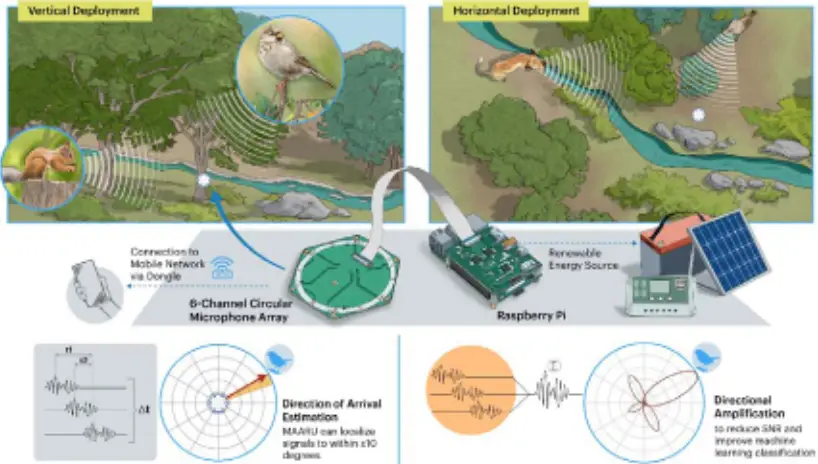
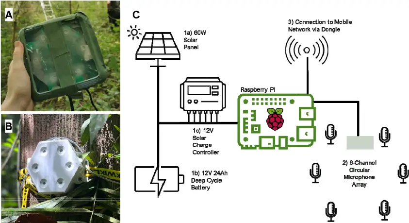
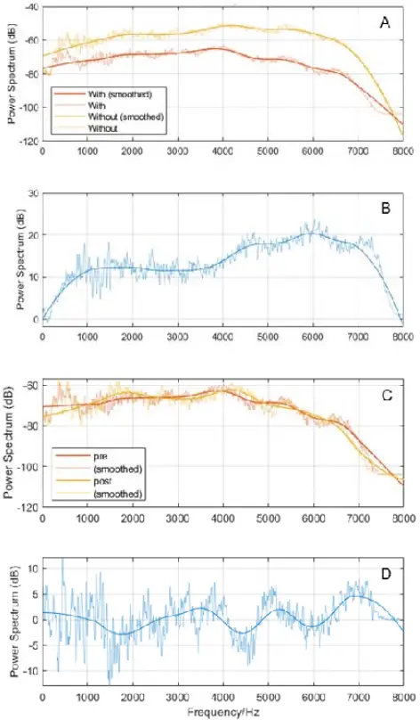
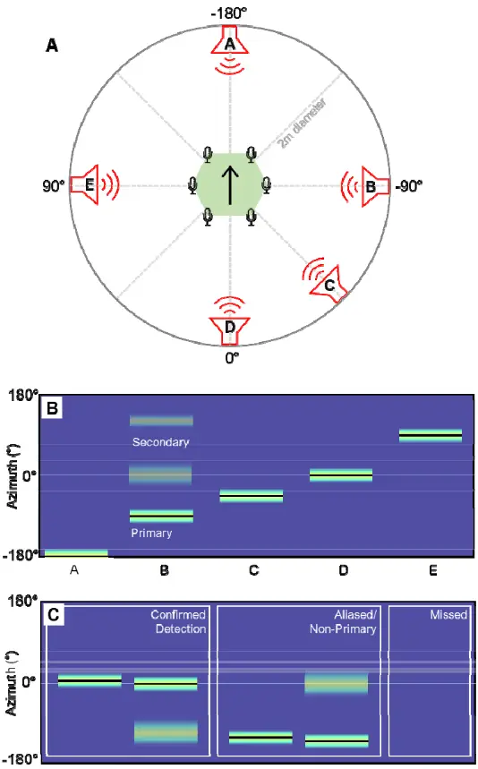
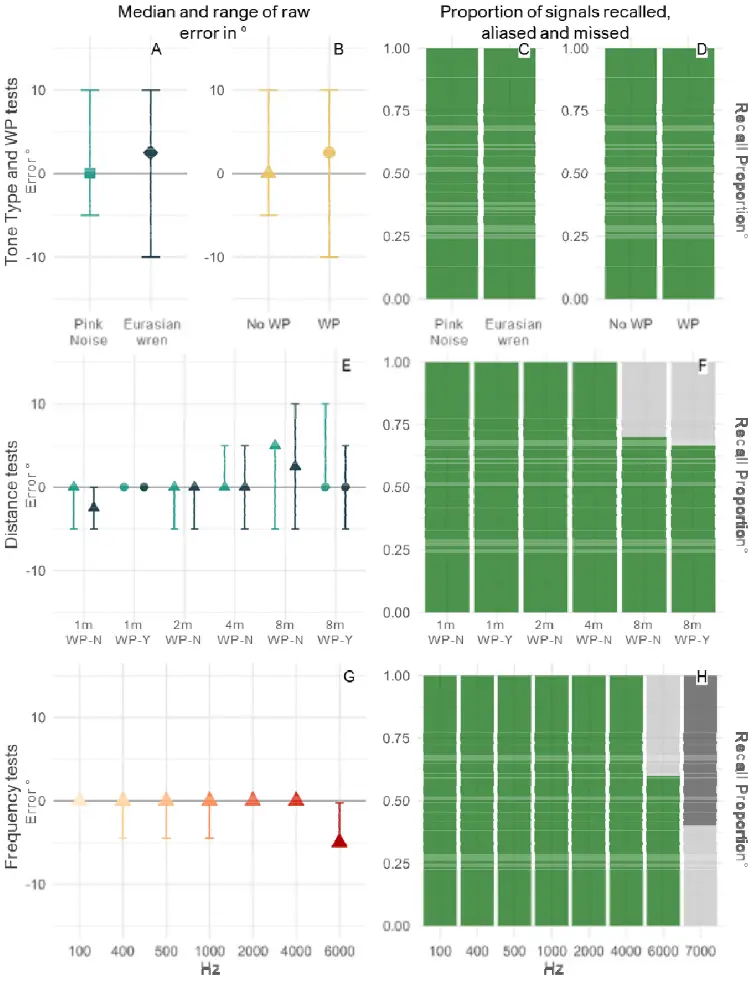
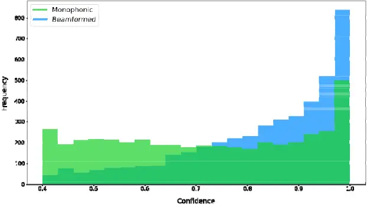
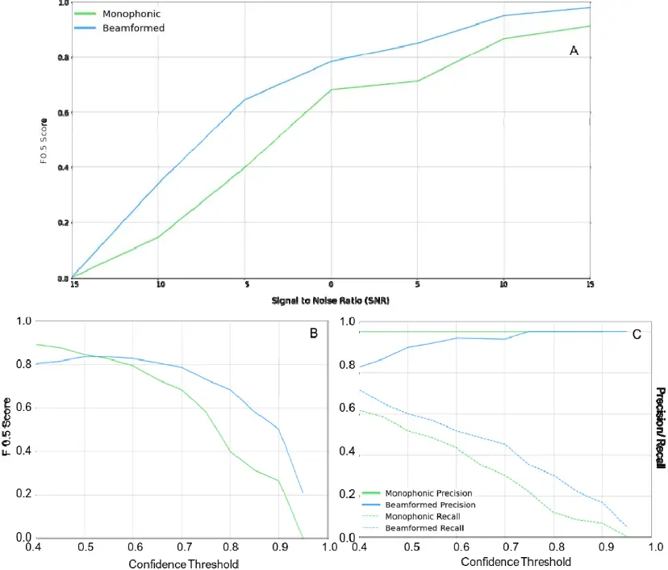

## MAARU: Multichannel Acoustic Autonomous Recording Unit for 1 spatial ecosystem monitoring. 2

## 1. ABSTRACT 3

4

1 - Acoustic localisation, which relies on simultaneous multi-microphone recording, adds spatial 5 information to recorded audio and has been used in ecosystem monitoring to count individuals to 6 improve abundance estimates, locate illegal activities such as logging/poaching, and monitor 7 behaviour such as habitat use or species interactions. Studies have shown many advantages of 8 acoustic localisation, but uptake remains limited as the equipment is often expensive, inaccessible, or 9 only suitable for short-term deployments. 10

2- Here, we present a low-cost, open-source, 6-channel recorder built entirely from commercially 11 available components which can be integrated into a solar-powered, networked system. The MAARU 12 (Multichannel Acoustic Autonomous Recording Unit) works in long-term autonomous, passive, and 13 ad-hoc deployments. We introduce MAARU's hardware and software and present the results of lab 14 and field tests investigating the device's durability, localisation accuracy, and other applications. 15

3- MAARU provides multichannel data with similar costs and power demands to equivalent 16 omnidirectional recorders. MAARU devices have been deployed in the UK and Brazil, where we have 17 shown MAARUs can accurately localise pure tones up to 6kHz and 65dB bird calls as far as 8m away 18 (±10° range, 100% and &gt;60% of signals respectively), louder calls may have even further detection 19 radii. We also show how beamforming can be used on MAARU devices to improve species ID 20 confidence scores by 20%+ and recall by 10%+ when using the BirdNET automated bird identification 21 algorithms. 22

4- MAARU is an accessible, low-cost option for those looking to explore spatial soundscape ecology 23 accurately and easily. Ultimately, the added directional element of the multichannel recording 24 provided by MAARU allows for a new type of exploration into sonic environments. 25

26

27

28

2. INTRODUCTION 29

Passive Acoustic Monitoring (PAM) is the use of Autonomous Recording Units (ARUs) to study 30 ecosystem acoustics. PAM is cheaper and more scalable to large-scale, high-resolution wildlife 31 surveys than human field data collectors (Darras et al., 2019), with reduced environmental impacts 32 (Costello et al., 2016). Multi-microphone recording can add a new dimension of data from soundscape 33 recording through acoustic localisation. Acoustic localisation uses slight differences in acoustic 34 signals recorded from multiple points simultaneously to triangulate either a signal's position 35 (hyperbolic localisation) or direction of arrival (DOA) relative to the unit (Rhinehart et al., 2020). 36 Reviews of DOA estimation and acoustic localisation in an ecosystem monitoring context (Blumstein 37 et al., 2011; Rhinehart et al., 2020) identify eight key purposes: assessing the positions and 38 movements of individuals, studying interactions, identifying individual identities, sub-setting (and 39 beamforming) sounds for more detailed analysis, calculating species abundance, and inferring habitat 40 usage/territory. Additionally, acoustic localisation has been used to locate illegal logging and poaching 41 (Andrei, 2015; Wijers et al., 2021). However, uptake of existing multichannel recorders remains limited 42 as these devices are often non- or semi-autonomous, require specialist/discontinued equipment, lack 43 full 360° localisation, or lack necessary hardware/ software for extended deployment in the field 44 (Supplementary 1 - Bruggemann et al., 2021; Smith et al., 2021; Suzuki et al., 2017; Wijers set al., 45 2019). 46 47 and built from low-cost, off-the-shelf components. We demonstrate successful lab and field tests of 48 MAARU and explain the software and hardware adaptations necessary for multichannel recording. 49

Here we present an autonomous, self-powered and networkable recorder capable of DOA estimation Our device presents an accessible new option for autonomous multichannel acoustic recording. 50

51

52

53

54

55

3. DESCRIPTION

MAARU extends an existing omnidirectional (single-channel) Raspberry-Pi based, autonomous acoustic recorder (Sethi et al., 2018). We have modified this platform to incorporate multichannel recording for acoustic localisation by modifying: 1) the core recorder hardware, 2) onboard software, and 3) device weatherproofing.

## 2.1 Core Recorder Hardware 56

MAARU centres on a Raspberry Pi, a multichannel microphone array (Circular 6-Microphone Seeed 57 Studio ReSpeaker array), a (renewable) power system and networking via a 3G/4G/LTE USB dongle 58 (Figure 1). However, MAARU devices are also suitable for non-autonomous deployment with manual 59 battery replacement and data download. The core MAARU set-up (Raspberry Pi and microphone 60 array) weighs &lt;1kg and measures 15x15x13cm with enclosure. The autonomous set-up weighs 61 62

63

64

65

66

67

68

69

70

71

- 72

73

74

75

- ~12kg, with the largest component, the solar panel, measuring 84x58x15cm (Supplementary 3).

Figure 1 photographs of the MAARU recorder in the A) basic enclosure, and B) 3D Printed enclosure. C) Schematic of the MAARU uses a Raspberry Pi with the following attachments: 1) a renewable power source, (a) a 60W solar panel, b) a 12V 24Ah deep cycle battery, and c) a 12V solar charge controller. 2) A ReSpeaker 6-Mic circular array connected via the ReSpeaker multichannel interface. 3) a mobile dongle with a pre-paid mobile network sim card.

The ReSpeaker array uses six small (3.76 x 2.95 x 1.1mm), omnidirectional, Micro-ElectroMechanical System (MEMS) microphones, fixed in a circular array on a PCB, which attaches to the Raspberry Pi via a Seeed Studio Multichannel HAT. We mediate clock drift (which is usually between 1 and 10 seconds a day Thode et al., 2006)) by managing all microphones with the same internal clock (sound card), ensuring the highly accurate and consistent synchronisation required for localisation (Mennill et al., 2012).

We found that MAARU uses 5W during simultaneous recording and upload, statistically not different 76 to a single microphone recorder (Supplementary.4). A 5W device requires a minimum 120Wh per 77 day. MAARU's powering needs can be tailored to their environments (mains power, wind, non78 recharging battery deployment). Powering equipment should have sufficient specification to generate 79 more than the minimum allowance as given specifications are based on 100% efficiency which is not 80 representative of real-world deployments. 81 One MAARU recorder generates 192kB of (16kHz, 16-bit, 6-channel) data per second (1536kb), 82 reducing to approximately 96kB (768kb) after FLAC compression. For data upload to keep up with 83 recording volume, the minimum required upload speed is therefore 0.768Mbps. Like the powering 84 system, network connectivity can be tailored to the need and availability of connection. MAARU 85 devices can be manual data download or autonomous data upload. For our autonomous 86 deployments, we used a 3G/4G/LTE dongle. However, other connection types, such as Ethernet, and 87 Wi-Fi Adaptors, could be used instead if appropriate with only small modifications to the setup 88 required. 89

- 2.2 Device Software 90

Like the omnidirectional recorder that Sethi et al. (2018) developed, the MAARU software records, 91 optionally compresses, and transmits acoustic data on a user-defined schedule while receiving 92 updates and sending log information daily. For MAARU, we developed this code base by adding a 93 multichannel sound card, rolling back package versions for compatibility, freezing the Linux kernel 94 version, adding a kill switch, and switching to lossless compression. 95 The microphones are set to record 16-bit at 16kHz, and generate bulky WAV files, and while lossy 96 compression is acceptable for audible range omnidirectional recording (Heath et al., 2021), DOA 97 estimation requires a much finer-scale comparison between signals. We, therefore, use the open98 source Free Lossless Audio Compression (FLAC) format to reduce file sizes for upload while 99 preserving the original signal. 100 Full details of software amendments, the open-source code, and step-by-step set-up instructions are 101 102

103

available at https://[Author name - removed for peer review].github.io/MAARU/.

## 2.2 Weatherproofing 104

- In our deployments, we kept power storage components (the battery and the solar charge controller) 105
- separate from the microphone array and the Raspberry Pi to avoid interference. The power storage 106
- components were deployed in drybag. To weatherproof the microphone array and the Raspberry Pi 107
- we trialled two enclosure types: a modified 450ml plastic container, and a custom 3D printed 108
- enclosure (figure 1A and 1B). In both cases, the microphone holes are covered by ePTFE Acoustic 109
- Vents, which block water droplets without significantly affecting acoustic transmission (Supplementary 110
- 3b). 111

## 2.2.1 Impact on Sound Quality 112

- We used the MATLAB digital signal processing (DSP) toolbox (MATLAB, 2010) to compare 113
- recordings of a fixed-position 50-20,000Hz sinus-logarithmic sweep for multiple devices, with and 114
- without weatherproofing. Weatherproofing caused an average loss in the acoustic signal amplitude of 115
- &lt;20dB (Figure 2 A, B). 116

## 2.2.2 Durability 117

- We have tested MAARU devices in four field trials/ experiments (Table 1). All devices remained 118
- watertight throughout deployments. Our longest deployment was a 6-months in Ancient Semi-Natural 119
- Woodland (ASNW) and Plantation on Ancient Woodland Site (PAWS) in the UK. 120
- Table 1 outlines all the field deployments and experiments completed on MAARU recorders. 121

| Trial                              | Num. Recorder s | Location                    | Duration                                 | Type of Deployment                   | Deployment aim                                      |
| ---------------------------------- | --------------- | --------------------------- | ---------------------------------------- | ------------------------------------ | --------------------------------------------------- |
| Suburban Pre- Trial                | 4               | London/ Kent, UK            | 2 months                                 | Fully Autonomous charging and upload | Test core functionality and basic weatherproofing   |
| Temperate forest field trials      | 4               | London/ Kent, UK            | 6 months                                 | Fully Autonomous charging and upload | Test long-term durability and basic weatherproofing |
| Temperate forest Field Experiments | 2               | Ascot, UK                   | 2 x 1 weeklong deployments               | Non- Autonomous                      | Field test 3D printed weatherproofing               |
| Rainforest Field Experiments.      | 4               | Manicoré, Brazillian Amazon | Single day deployments, week and 1 month | Non- Autonomous                      | Test 3D printed weatherproofing Explore beamforming |

123

124

125

126

127

128

129

130

131

132

133

134

135

136

137

138

139

140

141

142

143

144

145

146

147

148

In the Temperate Forest field trials, one recorder suffered an unrecoverable short circuit after a solar panel fell in a storm, and another failed after three months due to rodent damage on the power cable but ran as normal when re-powered. We have altered set-up instructions accordingly to recommend armoured cables and stronger straps. Data was retrieved successfully from all recorders in real-time until they failed. All recorders uploaded 24h data continuously in open-air pre-trials. However, partial panel coverage in the continuous UK trials led to data loss in autumn and winter, as daily sunlight could not compensate for power usage. We therefore advise further over-provisioning further for UK deployments. Despite this, 1700+ hours (550+ GB) of 6-channel audio were retrieved from the Temperate Forest field trials alone. Unfortunately, a kernel update mid-deployment caused a malfunction in the audio recording pipelines on-device, rendering some recordings unusable. We have since mitigated this problem by freezing the kernel. All four devices are once-again in working and currently being used in other experiments. Post 6-month deployment, the devices were again tested with a 50-20,000Hz sinus-logarithmic sweep finding a ±5dB SPL difference in frequency response (Figure 2 C, D).

149

150

151

152

153

154

155

156

157

158

159

160

161

162

163

164

165

166

167

168

169

170

Figure 2 A) Power spectra of sinus-logarithmic sweep signals (sweeps) recorded from devices without weatherproofing (orange) and with (yellow line); B) the difference in the spectra in A; C) Sweeps recorded from devices pre- and post-6-month deployment in the field. D) the difference between the spectra in C.

171

172

173

174

175

176

177

178

179

180

181

182

183

184

185

186

187

188

189

190

191

192

193

194

195

196

197

## 4. PROOF OF CONCEPT

## 3.1 Direction of Arrival (DOA) Estimation

Direction of Arrival (DOA) estimation is the prediction of the direction (azimuth) from which a sound originates relative to a device. Using a 2D array such as MAARU, this direction is represented by angles on a 2D plane between -180° and +180°, as illustrated in Figure 3A. The accuracy of MAARUs DOA estimation was tested in playback experiments, whereby test tones (pink noise, Eurasian Wren song (Karel, H. 2020), or single frequency tones) were played at 15-second intervals at five azimuths (-180°, -90°, -45°, 0°, and +90°) around a central MAARU device (figure 3A). We used HARKBird to estimate DOA (Suzuki et al., 2017), accessible at https://github.com/HARKBird-project/HARKBird. HARKBird adapts HARK software for robot audition: HARK (Honda Research Institute Japan Audition for Robots with Kyoto University) (Nakadai et al., 2017), which performs sound source localisation. HARK operates based on a transfer function (created using HARKTool5) and generates MUSIC (Multiple SIgnal Classification, Schmidt, 1979) power spectra for each time point. This spectrum is a one-dimensional vector quantifying the power of the MUSIC algorithm across all potential azimuths, which can be imagined as the likelihood a sound came from each possible azimuth. HARKBird is an intuitive user interface overlaying HARK with additional functionality for ecological applications. In our experiments, we set the resolution of the transfer function to 5 degrees (i.e., 72 possible azimuths). In our configuration for each timepoint, HARKBird calculates the MUSIC power at all 72 possible directions, then, based on the given power thresholds, determines when a signal is present and the direction it has come from (Figures 3B and 3C). We then experimentally optimised MUSIC power threshold settings for each specific test (Supplementary 5) to account for irregularities in amplitude. From HARKBird output figures, we determined whether a signal had been "detected", "aliased/ nonprimary", or "missed" by inspecting the MUSIC matrix and determining the nature of detections

(Figures 3B and 3C). Spatially aliased signals occur when microphones are too far apart, or sampling

198

199

200

201

202

203

204

205

206

207

208

209

210

211

212

213

214

215

216

217

218

219

220

221

222

223

224

225

frequency is too low. Spatial aliasing can mean high-frequency signals return high MUSIC powers at multiple (inaccurate) points around the device, resulting in inaccurate DOA estimation.

Figure 3 shows our DOA localisation test's basic set-up and example outputs. A) an overhead schematic. B) an example direction likelihood matrix where all signals are localised correctly. For each time point, the lightness of pixels gives the MUSIC score (likelihood) that a sound is coming from a given direction (azimuth). The black line indicates the angles at which HARKBird determines there is a signal. Here, signals A-E are localised to the correct azimuth in order. Note: multiple positions can

have high music scores and not count as a detection. C) illustrates the labels used to classify 226 detections where the true azimuth is 0°. 227

228

229

230

231

232

233

The DOA estimation accuracy of MAARU was compared in four experiments (Table 2). Tests were conducted on weatherproofed (WP-Y) and un-weatherproofed (WP-N) devices at 1m unless otherwise stated. For all tests, we determined the azimuth error in °, proportion of signals with confirmed detections (figure 4).

Table 2 describes the localisation tests completed on MAARU as per protocol in Figure 4

| Experiment      | Groups                                                      | Origin                            | Test Location            | Pre/ Post 6- month deployment |
| --------------- | ----------------------------------------------------------- | --------------------------------- | ------------------------ | ----------------------------- |
| Test Signal     | Pink noise Eurasian Wren                                    | Generated in Audacity. Xeno-Canto | Lab                      | Pre                           |
| Weatherproofing | Weatherproofed (WP- Y) Un-weatherproofed (WP-N)             | Na                                | Lab                      | Pre                           |
| Distance        | 1m, 2m, 4m, 8m                                              | Na                                | Field - Temperate forest | Post                          |
| Frequency       | 100Hz, 400Hz, 500Hz, 1000Hz, 2000Hz, 4000Hz, 6000Hz, 7000Hz | Generated in Audacity.            | Lab                      | Post                          |

234

235

236

237

238

239

Figure 4 shows the outputs of all DOA localisation tests, as described in Figure 3. The left column shows the median and range of raw errors (differences between the True and Predicted azimuths). The right column shows recall/ detection rates (green, light grey and dark grey for detected, nonprimary, and missed, respectively). The first row shows the results from lab tests at 1m, the second row shows the results from field distance tests, and the third row shows pure tone lab tests at 1m.

Across all tests, all confirmed detections were accurately localised to within ±10°, with the median 240 error mostly being 0°, and not increasing to more than 5° (Figure 5). Recall remained at 100% for all 241 signals except at 8m, 6kHz, and 7kHz (66.7-70%, 60% and 0% respectively). The only test in which 242 no signals were detected accurately was the 7kHz single-frequency test (Figure 5 J). This loss of 243 accurate detection may be due to spatial aliasing, however more investigation and modelling of the 244 array is needed. 245

## 3.2 Beamforming for more accurate machine learning classification 246

Beamforming is the manipulation of time delays between recorded signals to amplify sounds that 247 come from target directions. ODAS (Open embedded Audition System (Grondin et al., 2022)) is a 248 robot audition platform, like HARK, which can be used for localisation and beamforming. Here, we 249 used ODAS' delay-and-sum beamformer to test whether audio beamformed to the known direction of 250 251

origin could improve BirdNET classification over omnidirectional audio.

BirdNET is a deep neural network (DNN) that has been trained on 230,000+ labelled recordings (Kahl 252 et al., 2021). The BirdNET takes in audio clips and returns bird species predictions with associated 253 confidence values between 0 and 1. BirdNET is widely used within the bioacoustics community and 254 has been used to classify over 140 million audio recordings (BirdNET, 2023). 255

256

## 3.2.1. Improvement in confidence levels

We tested 55.1 hours of acoustic data from Manicoré (Brazillian Amazon) and 79 hours of data from 257 Ascot (UK), both 16-bit, 16kHz. Beamformed signals were extracted for four directions relative to the 258 recorder (0° azimuth, +45° Elevation; 0° azimuth, -45° Elevation; +45° Azimuth, 0° Elevation; -45° 259 260

For the confidence analysis, we only included species with that had been detected over 30 times in 261 both monophonic and beamformed recordings (n=14). Descriptive analysis showed that the mean 262 confidence using beamforming was higher than that of monophonic recordings (Figure 5, 0.83, SD= 263 0.15; 0.71, SD=0.19). The median confidence for beamforming was also higher than monophonic 264 recordings (0.872 to 0.718 respectively). Wilcoxon signed rank test analysis showed that this 265 266

Azimuth, 0° Elevation). difference was significant (W = 8457060.0, z = 44.64, p &lt; 0.001).

267

268

269

270

271

272

273

274

275

276

277

278

279

280

281

282

283

284

285

286

Figure 5 shows a histogram of confidence distributions across all detections for both monophonic and beamformed recordings. Beamformed recordings result in higher BirdNET confidence scores than monophonic recordings.

## 3.2.2 Improvements in Precision and Recall

We further tested whether beamforming could increase the precision and recall of BirdNET classifications using a 31-speaker array in a soundproofed lab (Le Penru, et al., 2023). In the test, 30 speakers played cricket noises at increasing amplitudes, whilst one would play Eurasian Blackcap or Carolina Wren. The amplitude of cricket noises was increased to create a gradient of Signal-to-Noise Ratio (SNR) from -15 (crickets louder than bird call) to +15 (bird call louder than crickets) in 5dB steps where both call types were as loud as each other at 0. The precision, recall and F0.5 of BirdNET classifications were calculated (Figure 6A, Supplementary 5).

At SNR=0, the beamformed recall was greater than monophonic recall (mean improvement of 0.11, SD=0.04), but precision was higher for monophonic recordings until a confidence threshold of 0.7, where subsequent thresholds yielded a precision of 1 for both (Figure 6C). Monophonic recordings yielded a better F0.5-score until a confidence threshold of 0.55, beyond which beamformed recordings provided a better score (Figure 6B). Overall, the mean improvement in F0.5-score after beamforming was 0.10, SD =0.12. Using a fixed confidence threshold of 0.7, beamformed recordings yielded a better F0.5-score at all SNRs, with the largest improvement at -5 dB (+0.25 score) (Figure 6A). Overall, the mean improvement in F0.5-score after beamforming was 0.12 (SD=0.08).

287

288

289

290

291

292

293

294

10

Figure 6 shows the response of BirdNET to beamformed and monophonic recordings. In A), beamformed recordings consistently achieve a higher F0.5 than monophonic recordings at a constant confidence interval of 0.7. In B), F0.5 for beamformed recordings surpasses monophonic recording beyond a confidence interval of 0.6. C) monophonic precision is consistently 1.0. However, by a confidence interval of 0.75, these values have equalised and beamformed recordings have consistently higher recall across all confidence thresholds.

## 4. DISCUSSION 295

MAARU was designed to solve many commonly cited reasons for the lack of uptake of spatial 296 acoustics in sound ecology (Table 3). MAARU combines state-of-the-art hardware and robot audition 297 software to create a platform for enhanced ecosystem listening. MAARU recorders are capable of 298 recording up to 48kHz, however localisation on this array works only for low-frequency audible-range 299 signals (&lt; 6kHz), so we recommend configuring HARKBird to localise signals &lt;6kHz for 16kHz 300 recording. MAARU and HARKBird are compatible up to 48kHz so it may be that this range increases 301 with increased sample rates, although further testing is needed. Prospective users of MAARU should 302 examine the general frequency ranges of the species they are hoping to monitor and determine 303 whether any part of their call falls into the MAARU working range at different frequencies, which 304 includes a broad reach of animal groups. High audible range and ultrasonic calling individuals will not 305 be localised effectively with this recorder. Recall of a 65dB signal fell to 70% at 8m, however all 306 animals call at different amplitudes so it would not be meaningful to advise a distance cutoff, however, 307 we suggest using a high MUSIC threshold to avoid incorrectly localising weaker signals. 308

Table 3 describes the key aims and the degree to which they have been achieved with the MAARU 309 recorder. 310

| Aim                   | Outcome                                                                                                                                                                                                     |
| --------------------- | ----------------------------------------------------------------------------------------------------------------------------------------------------------------------------------------------------------- |
| Low cost              | MAARU combines autonomous PAM with usable multichannel recording for £206, only £26 more than its omnidirectional predecessor. Powering is an additional cost that can be tailored to the field area.       |
| Accessible            | All components could be sourced online at the time of writing. The basic MAARU can be built with a power drill and screwdriver.                                                                             |
| Accurate              | All signals could be localised to a high degree of precision (±10°)\*                                                                                                                                       |
| Durable               | All devices remained watertight throughout deployments in temperate and tropical ecosystems. The early failure of the two devices has been addressed.                                                       |
| Customisable          | MAARU is a modular recording unit which can be altered to suit powering and network capabilities.                                                                                                           |
| Useful for ecologists | We have shown successful ports to ODAS, HARKBird and BirdNET. Audio from MAARUs can be used to accurately localise signals\* Beamformed MAARU audio increases BirdNET classification confidence and recall. |
| Low maintenance       | Autonomous MAARU recorders can be left in the field indefinitely. The core MAARU devices have the same set-up and maintenance burden as popular omnidirectional devices.                                    |

311

312

313

314

315

316

\*with signal components within loudness and frequency restrictions.

MAARU recorders have been demonstrated here for use in 2D localisation. However, networked MAARU recorders time-sync after every upload, making them equipped for inter-device/ array synchronisation. Theoretically, two or more MAARU recorders can be used to triangulate a location of origin and determine a calling position of an individual rather than a direction - however, this remains an open opportunity for future work.

## 5. CONCLUSION 317

318

319

320

321

322

323

324

325

For acoustic localisation to gain traction in ecosystem monitoring, equipment is needed that is widely available, inexpensive, self-synchronising and low maintenance (Rhinehart et al., 2020). Here we present a device that fulfils these conditions whilst also being suitable for indefinite autonomous deployment, with capacity for analysis in almost real-time. Localisation of signals in the field can describe patterns that single-channel acoustic ARUs alone cannot, we can track more precisely the movement, interaction, and relation to the habitat of individuals. These considerations provide a more complete understanding of individual responses to environmental stressors and could therefore facilitate more strategies for protecting at-risk organisms and environments.

326

327

328

329

330

331

332

333

334

335

336

337

338

339

340

341

342

343

344

345

346

347

348

349

350

## 6. DATA ACCESSIBILITY

[Removed for peer review]

7. REFERENCEs

Andrei, V. (2015). Considerations on Developing a Chainsaw Intrusion Detection and Localization System for Preventing Unauthorized Logging. Journal of Electrical and Electronic Engineering, 3(6), 202. https://doi.org/10.11648/j.jeee.20150306.15

Araya-Salas, M., Smith-Vidaurre, G., &amp; Webster, M. (2019). Assessing the effect of sound file compression and background noise on measures of acoustic signal structure. Bioacoustics, 28(1), 57-73. https://doi.org/10.1080/09524622.2017.1396498

BirdNET. (2023, September 19). Retrieved from BirdNET Live Submissions Map: https://birdnet.cornell.edu/map

Blumstein, D. T., Mennill, D. J., Clemins, P., Girod, L., Yao, K., Patricelli, G., Deppe, J. L., Krakauer, A. H., Clark, C., Cortopassi, K. A., Hanser, S. F., Mccowan, B., Ali, A. M., &amp; Kirschel, A. N. G. (2011). Acoustic monitoring in terrestrial environments using microphone arrays: Applications, technological considerations and prospectus. Journal of Applied Ecology, 48(3), 758-767. https://doi.org/10.1111/j.1365-2664.2011.01993.x

Bruggemann, L., Schutz, B., &amp; Aschenbruck, N. (2021). Ornithology meets the IoT: Automatic Bird Identification, Census, and Localization. 7th IEEE World Forum on Internet of Things, WF-IoT 2021, 765-770. https://doi.org/10.1109/WF-IoT51360.2021.9595401

Costello, M. J., Beard, K. H., Corlett, R. T., Cumming, G. S., Devictor, V., Loyola, R., Maas, B., MillerRushing, A. J., Pakeman, R., &amp; Primack, R. B. (2016). Field work ethics in biological research. Biological Conservation, 203, 268-271. https://doi.org/10.1016/j.biocon.2016.10.008

Darras, K., Batáry, P., Furnas, B. J., Grass, I., Mulyani, Y. A., &amp; Tscharntke, T. (2019). Autonomous

19

351

352

353

354

355

356

357

358

359

360

361

362

363

364

365

366

367

368

369

370

371

372

373

374

375

376

sound recording outperforms human observation for sampling birds: a systematic map and user guide. Ecological Applications, 29(6). https://doi.org/10.1002/eap.1954

Grondin, F., Létourneau, D., Godin, C., Lauzon, J. S., Vincent, J., Michaud, S., Faucher, S., &amp; Michaud, F. (2022). ODAS: Open embeddeD Audition System. Frontiers in Robotics and AI, 9(May), 1-9. https://doi.org/10.3389/frobt.2022.854444

Heath, B. E., Sethi, S. S., Orme, C. D. L., Ewers, R. M., &amp; Picinali, L. (2021). How index selection, compression, and recording schedule impact the description of ecological soundscapes. Ecology and Evolution, 11(19), 13206-13217. https://doi.org/10.1002/ece3.8042

Kahl, S., Wood, C. M., Eibl, M., &amp; Klinck, H. (2021). BirdNET: A deep learning solution for avian diversity monitoring. Ecological Informatics, 61(January), 101236. https://doi.org/10.1016/j.ecoinf.2021.101236

Le Penru, N. P., Borrelli, A., Heath, B. E., Ewers, R. M., Sethi, S. S., &amp; Picinali, L. (2023). Development and validation of a test platform for spatial ecoacoustic technologies. Forum Acousticum 2023. Turin.

MATLAB. (2010). version 7.10.0 (R2010a). MathWorks Inc.

Mennill, D. J., Battiston, M., Wilson, D. R., Foote, J. R., &amp; Doucet, S. M. (2012). Field test of an affordable, portable, wireless microphone array for spatial monitoring of animal ecology and behaviour. Methods in Ecology and Evolution, 3(4), 704-712. https://doi.org/10.1111/j.2041210X.2012.00209.x

Nakadai, K., Okuno, H. G., &amp; Mizumoto, T. (2017). Development, deployment and applications of robot audition open source software HARK. Journal of Robotics and Mechatronics, 29(1), 1625. https://doi.org/10.20965/jrm.2017.p0016

Rhinehart, T. A., Chronister, L. M., Devlin, T., &amp; Kitzes, J. (2020). Acoustic localization of terrestrial wildlife: Current practices and future opportunities. Ecology and Evolution, 10(13), 6794-6818. https://doi.org/10.1002/ece3.6216

Sethi, S. S., Ewers, R. M., Jones, N. S., Orme, C. D. L., &amp; Picinali, L. (2018). Robust, real-time and

377

378

379

380

381

382

383

384

385

386

387

388

389

390

391

392

393

autonomous monitoring of ecosystems with an open, low-cost, networked device. Methods in Ecology and Evolution, 9(12), 2383-2387. https://doi.org/10.1111/2041-210X.13089

Smith, B. R., Root-Gutteridge, H., Butkiewicz, H., Dassow, A., Fontaine, A. C., Markham, A., Owens, J., Schindler, L., Wijers, M., &amp; Kershenbaum, A. (2022). Acoustic localisation of wildlife with lowcost equipment: Lower sensitivity, but no loss of precision. Wildlife Research, 49(4), 372-381. https://doi.org/10.1071/WR21089

Suzuki, R., Matsubayashi, S., Hedley, R. W., Nakadai, K., &amp; Okuno, H. G. (2017). Harkbird: Exploring acoustic interactions in bird communities using a microphone array. Journal of Robotics and Mechatronics, 29(1), 213-223. https://doi.org/10.20965/jrm.2017.p0213

Thode, A. M., Gerstoft, P., Burgess, W. C., Sabra, K. G., Guerra, M., Stokes, M. D., Noad, M., &amp; Cato, D. H. (2006). A portable matched-field processing system using passive acoustic time synchronization. IEEE Journal of Oceanic Engineering, 31(3), 696-710. https://doi.org/10.1109/JOE.2006.880431

Wijers, M., Loveridge, A., Macdonald, D. W., &amp; Markham, A. (2021). CARACAL: a versatile passive acoustic monitoring tool for wildlife research and conservation. Bioacoustics, 30(1), 41-57. https://doi.org/10.1080/09524622.2019.1685408
