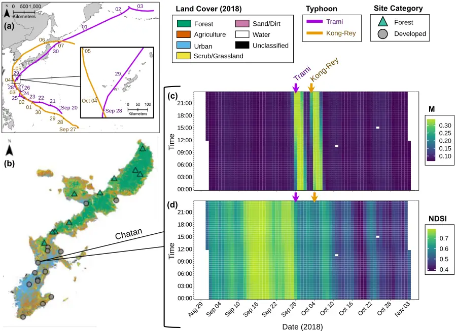
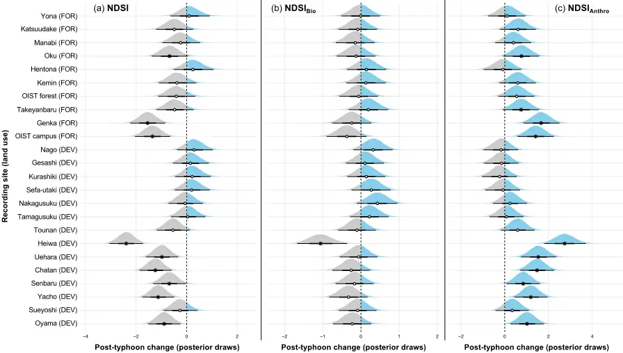
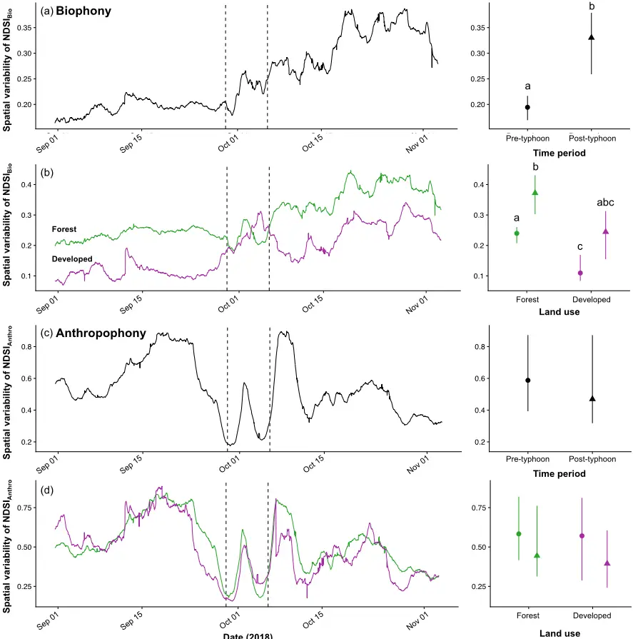
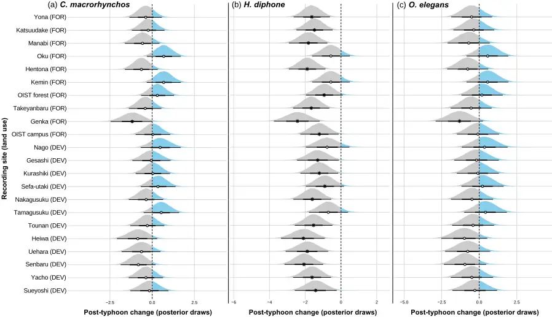
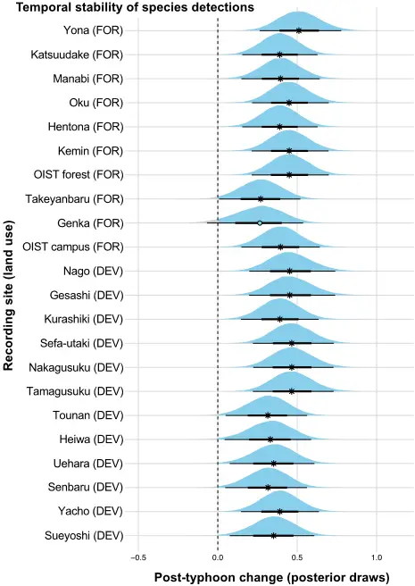
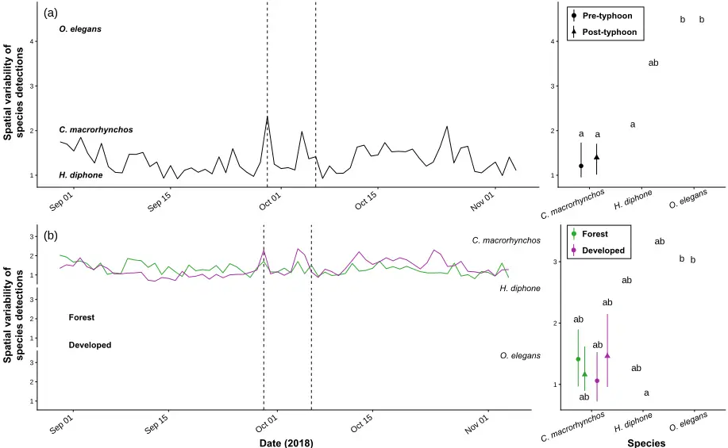

1

2

3

4

5

6

7

8

9

10

11

12

13

14

15

16

17

18

19

20

21

22

23

24

25

26

27

28

29

30

31

32

33

## Habitat degradation homogenizes ecological responses to typhoons across a subtropical island

Samuel R.P-J. Ross 1,2\* , Nicholas R. Friedman 3,4 , David W. Armitage 1 , Kenneth L. Dudley 3 , Takuma Yoshida 5 , Masashi Yoshimura 5 , Evan P. Economo 6 , Ian Donohue 2

1 Integrative Community Ecology Unit, Okinawa Institute of Science and Technology Graduate University, Tancha, Onna-son, Okinawa, Japan. 2 Zoology, School of Natural Sciences, Trinity College Dublin, Dublin, Ireland. 3 Environmental Informatics Section, Okinawa Institute of Science and Technology Graduate University, Tancha, Onna-son, Okinawa, Japan. 4 Centre for Taxonomy and Morphology, Leibniz Institute for the Analysis of Biodiversity Change, Hamburg, Germany. 5 Environmental Science Section, Okinawa Institute of Science and Technology Graduate University, Tancha, Onna-son, Okinawa, Japan. 6 Biodiversity &amp; Biocomplexity Unit, Okinawa Institute of Science and Technology Graduate University, Tancha, Onna-son, Okinawa, Japan.

\*Correspondence: Samuel RP-J Ross, Integrative Community Ecology Unit, Okinawa Institute of Science and Technology Graduate University, Okinawa, Japan. E: s.ross.res@outlook.com

CRediT Author Contribution Statement | SRP-JR: Conceptualisation, Methodology, Software, Validation, Formal analysis, Investigation, Writing - Original Draft, Visualisation, Funding Acquisition; NRF: Conceptualisation, Software, Resources, Data Curation, Writing - Reviewing &amp; Editing, Project Administration; DWA: Methodology, Software, Formal Analysis, Writing - Reviewing &amp; Editing; KLD: Software, Validation, Resources, Data Curation, Visualisation, Project Administration; TY: Resources, Data Curation, Project Administration; MY: Resources, Data Curation, Project Administration; EPE: Resources, Data Curation, Writing - Reviewing &amp; Editing, Project Administration, Funding Acquisition; ID: Conceptualisation, Methodology, Writing - Original Draft.

Running title: Typhoon-induced spatial ecological divergence Key words: Soundscape, passive acoustic monitoring, extreme weather event, ecological stability, spatial variability, disturbance, acoustic indices, Okinawa

34

35

36

37

38

39

40

41

42

43

44

45

46

47

48

49

50

51

52

53

54

55

56

57

58

59

60

61

62

63

64

65

66

67

## Abstract

Climate change is increasing the frequency, intensity, and duration of extreme weather events across the globe. Understanding the capacity for ecological communities to withstand and recover from such events is critical. Typhoons are extreme weather events that are expected to broadly homogenise ecosystems through structural damage to vegetation and longer-term effects of salinization. Given their unpredictable nature, monitoring ecological responses to typhoons is challenging, particularly for mobile animals such as birds. Here, we report spatially variable ecological responses to typhoons across terrestrial landscapes. Using a high temporal resolution passive acoustic monitoring network across 24 sites on the subtropical island of Okinawa, Japan, we found that typhoons elicit divergent ecological responses among Okinawa's pristine forests, as indicated by increased spatial variability of biological sound production (biophony) among forested sites. However, no such post-typhoon shift in variability was observed among developed urban or agricultural sites. This indicates that natural forests have a diversity of pathways through which communities can respond to typhoons, whereas land use development produces communities more constrained in their disturbance responses. That is, spatial insurance effects among forest communities may provide resilience to typhoons at the landscape scale, but this spatial insurance was diminished by habitat degradation through land use development. Though site-level typhoon impacts on soundscapes and bird detections were not particularly strong, we nevertheless revealed spatial heterogeneity in typhoon responses, owing to the data resolution afforded to us by monitoring at scale (high temporal resolution, broad spatial extent). Our findings underscore the importance of natural forests in insuring ecosystems against disturbance, and demonstrate the potential of landscape-scale acoustic sensor networks for documenting the understudied ecological impacts of unpredictable extreme weather events.

## Introduction

Climate change is increasing both the frequency and destructive potential of extreme weather events such as typhoons (Bhatia et al., 2019; Emanuel, 2005; Kossin et al., 2020; Li &amp; Chakraborty, 2020). Typhoons bring exceptional winds and rainfall and can cause structural damage to terrestrial habitats through wind-damage (Everham &amp; Brokaw, 1996), flooding (Gardner et al., 1991), and salinization by sea spray, particularly on islands (Elliott &amp; Nino, 1960; Kerr, 2000). These destructive forces can impact the mortality, composition, and dynamics of trees (Lin et al., 2020; Morimoto et al., 2021), birds (Cely, 1991; Chevalier et al., 2019; Seki, 2005), bacteria (Ares et al., 2020), invertebrates (Azuma et al., 1997; Willig &amp; Camilo, 1991), and other animals (Donihue et al., 2018; Pavelka et al., 2007; Testard et al., 2021).

68

69

70

71

72

73

74

75

76

77

78

79

80

81

82

83

84

85

86

87

88

89

90

91

92

93

94

95

96

97

98

99

100

101

Land cover may affect exposure to-and hence the ecological consequences of-extreme weather events (Laurance, 1998). Several studies suggest that primary forest with a mix of vegetation types and life forms is most likely to resist and recover from typhoon disturbance (Abbas et al., 2020; Zampieri et al., 2020). Human activity and associated land use change has, therefore, considerable potential to modify the severity and reach of typhoons (Raymond et al., 2020). For example, land abandonment might be expected to dampen the effects of typhoons over time as intensively managed agricultural areas undergo natural succession to a more biologically and structurally diverse system, whereas deforestation through urbanisation or agricultural intensification should increase typhoon exposure (via loss of canopy structure) as well as subjecting ecological communities to the stressors and pollutants associated with these anthropogenic land uses (Daskalova et al., 2020; Senzaki et al., 2020; Sirami et al., 2008; Uchida &amp; Ushimaru, 2014). Yet, despite the potential for land cover to moderate the impact of extreme events, the practical difficulties associated with ecological monitoring at scale have, to date, limited understanding of the extent of any differential impacts of typhoons across habitat types and of the consequences of such differences for landscape-scale biodiversity or spatial processes such as metacommunity dynamics and stability (Loreau et al., 2003; Wang et al., 2021). Ecological stability is a central framework for considering disturbance impacts across spatial, temporal, and organisational scales, from populations to ecosystems (Hillebrand et al., 2018; Kéfi et al., 2019). Stability is a concept with multiple dimensions (Donohue et al., 2013; Hillebrand et al., 2018; Pimm, 1984), including components such as resistance to and recovery from disturbance (Baert et al., 2016; Yang et al., 2019), and the variability of ecological variables both in time and space (Tilman et al., 2006; Wang et al., 2017). Both disturbance events and ecological responses to such events vary across spatiotemporal scales (Clark et al., 2021; Ross et al., 2021b; Zelnik et al., 2018). This necessitates high-resolution and long-term monitoring of ecosystems to holistically capture the ecological impacts of infrequent extreme events such as typhoons. However, monitoring biodiversity over large spatial and temporal scales poses considerable logistical and financial challenges. Accordingly, most empirical studies of ecological stability are experimental (Kéfi et al., 2019), while observational studies of disturbance typically employ space-for-time substitutions (Butsic et al., 2017), or consider only single-time snapshots before and after disturbance (e.g., Burivalova et al., 2014). In such cases, it is extremely challenging to isolate the relevant pathways through which disturbance events impact ecosystems in a holistic multidimensional way. Recent advances in automation hold promise for understanding disturbance responses through large-scale continuous monitoring of biodiversity (Keitt &amp; Abelson, 2021; Ross et al., 2023). Following developments in data acquisition, storage, and processing, passive acoustic monitoring of

102

103

104

105

106

107

108

109

110

111

112

113

114

115

116

117

118

119

120

121

122

123

124

125

126

127

128

129

130

131

132

133

134

wildlife and soundscapes is growing in popularity (Burivalova et al., 2019; Gibb et al., 2019). As sensor networks are established to collect acoustic data autonomously (Keitt &amp; Abelson, 2021; Sethi et al., 2020), a diverse range of ecological studies become tractable by leveraging high-resolution acoustic time series (e.g., Deichmann et al., 2018; Lomolino et al., 2015; Rossi et al., 2017; Sueur et al., 2019; Ross et al., 2023). Studies of disturbance impacts on soundscapes-that is, all sound produced in an ecosystem (Pijanowski et al., 2011a, 2011b), including biophony (biotic sound), geophony (natural abiotic sound, such as rain), and anthropophony (human-related sound)-have recently emerged, though most commonly still make before-and-after or space-for-time comparisons (e.g., Deichmann et al., 2017; Gasc et al., 2018). However, the high-resolution time series afforded by passive acoustic monitoring allows opportunistic measurement of soundscape responses to infrequent disturbance events, such as typhoons (e.g., Gottesman et al., 2021), as well as documenting longer-term trends under climate change (Sueur et al., 2019). Acoustic monitoring thus provides an opportunity to overcome many of the challenges associated with studying extreme weather events, by allowing preand post-typhoon comparisons (Altwegg et al., 2017; Rajan et al., 2022), and capturing ecological responses to typhoons across scales in space and time (Lin et al., 2020) using a multidimensional stability framework (Donohue et al., 2013). Of the few studies that have used acoustic monitoring to capture storms or extreme events, most focused on marine soundscapes (Boyd et al., 2021; Locascio &amp; Mann, 2005; Simmons et al., 2021), though Gottesman et al. (2021) recently showed that terrestrial soundscapes were less resistant than those of coral reefs to hurricane disturbance. Embedded within terrestrial soundscapes, bird vocalisations provide the opportunity to assess the impact of typhoons on critical indicator taxa (Gasc et al., 2017), while acoustic indices provide rapid information on a combination of biodiversity and other meaningful aspects of soundscape change (Bradfer-Lawrence et al., 2020; Harris et al., 2016; Rajan et al., 2022). There are, however, few studies that simultaneously assess both individual species vocalisations and acoustic indices explicitly (Ferreira et al., 2018; Ross et al., 2018). Here, we exploit a dataset that is, to our knowledge, the highest-resolution dataset recording biological responses to an extreme weather event to date, capturing daily bird vocalisations and halfhourly acoustic indices in response to two large typhoons across 24 field sites on the island of Okinawa, Japan. We measure multiple dimensions of ecological stability for both soundscapes and individual bird species in response to a super-typhoon in September 2018, which was followed five days later by an extratropical cyclone. Our study spans Okinawa's full range of terrestrial habitats, allowing us to examine how land use can shape ecological responses to extreme events. Given that organisms are differently vulnerable to mortality and mechanical damage resulting from typhoons

135

136

137

138

139

140

141

142

143

144

145

146

147

148

149

150

151

152

153

154

155

156

157

158

159

160

161

162

163

164

165

166

167

168

(Abbas et al., 2020; Zampieri et al., 2020), we expect land use to influence typhoon responses (Raymond et al., 2020). Specifically, we test the hypotheses that typhoons (1) temporarily reduce soundscape richness and (2) bird vocalisation rates, and (3) homogenise soundscapes across sites. We also predict that (4) natural forest habitats should have soundscapes that are more resistant to typhoons owing to their closed canopy structure (Abbas et al., 2020; Nimmo et al., 2016). We expect to find differences in bird species responses to typhoons, perhaps as a function of their traits (Wiley &amp; Wunderle, 1993). Closed canopy specialists, frugivores, granivores, and nectarivores should be most vulnerable to food resource losses following typhoons (Chevalier et al., 2019; Wiley &amp; Wunderle, 1993; Zhang et al., 2016), while insectivores may benefit from increased access to prey in canopy gaps (Cely, 1991; Seki, 2005), and large-bodied or predatory birds may be especially vulnerable to typhoon-induced habitat alteration, owing to their dependence on prey availability and habitat area (e.g., Ross et al., 2019) and their slow reproductive rates (Cely, 1991; Cohen et al., 2021; Wiley &amp; Wunderle, 1993). These hypotheses draw on the idea that forest loss is a key catalyst of biodiversity change (Daskalova et al., 2020; Gibson et al., 2011). This is especially pertinent given the high richness and rates of endemicity and specialism among Okinawa's forest taxa (Inoue et al., 2019; Itô et al., 2000). Okinawa island is subject to rapid and ongoing land use change, particularly through deforestation for urbanisation and agricultural intensification (Ross et al., 2018; Takeuchi et al., 1981). Such land use change necessitates an explicit focus on habitat degradation as a driver of the ecological outcomes of intensifying natural disturbance regimes under climate change, including an increase in the frequency and destructive potential of typhoons and extreme storms around Okinawa (A. Iwasaki, unpublished data).

## Methods

## Study sites and typhoon impact

This study uses data from the OKEON (Okinawa Environmental Observation Network) Churamori Project (OKEON 美ら森プロジェクト; https://okeon.unit.oist.jp/) in Okinawa, Japan. We use data from OKEON's 24 field sites across the island of Okinawa, representing Okinawa's full range of land cover types (Figure 1). Elsewhere, we describe the geographic variation among the sites (Ross et al., 2018), which were assessed using reflectance estimates from Landsat 8 images to estimate proportional land cover for various land cover classes within a 1,000 m circular buffer surrounding each site, an appropriate scale for detecting land cover effects on highly mobile taxa such as birds. We classified land cover into the following categories: dense closed-canopy forest; grassland and scrubland (that is, low-medium growth coastal and disturbed vegetation, and managed grasses); agricultural land (primarily for sugarcane); urban areas characterised by materials such as asphalt and

169

170

171

172

173

174

175

176

177

178

179

180

181

182

183

184

185

186

187

188

189

190

191

192

193

concrete with limited vegetation; sand and dirt with limited vegetation; freshwater bodies; and miscellaneous land cover not described in the above categories. To deal with the challenge of multicollinearity among land cover classes, we used an unsupervised learning approach to identify clusters of sites with similar land cover. We used k-means clustering (optimal k = 2 clusters) to identify sites that clearly differentiated in Principal Component Analysis (PCA) space, where the first PCA axis captured Okinawa's primary land use gradient and explained 81.2% of the variance among our sites (Supplementary Figure S1). The PCA loadings show that the two clusters identified represent a distinction between sites that are primarily forested and those that are either agricultural or urban (Figures 1b and S1), hereafter together referred to as 'developed' sites. Acoustic data has been collected at each OKEON site since February 2017, but here we focus on a 66-day period in 2018 surrounding the landfall of two large typhoons, Trami and Kong-Rey. Trami passed closest to Okinawa on 29 September 2018 and was followed closely by Kong-Rey on 4 October 2018 (Japan Meteorological Agency [JMA] 2018; Figure 1a). We isolated recordings from the 30-day periods before (pre-disturbance period: 30 August - 28 September 2018) and after (post-disturbance period: 06 Oct - 04 Nov 2018) the typhoons made landfall, comprising a total of 771,840 minutes of data (Figure 1). Okinawa and the Ryukyu archipelago are increasingly exposed to more frequent and intense typhoons (A. Iwasaki, unpublished data), with annual typhoon seasons bringing disturbance events of varying magnitude (Elliott &amp; Nino, 1960). Typhoon Trami was the largest typhoon (tropical cyclone) to hit Okinawa since OKEON acoustic recording began, with windspeeds reaching 183 km h -1 on 29 September 2018 (JMA 2018). Trami was followed shortly after by Kong-Rey, which was less severe, striking Okinawa as an extratropical cyclone (JMA 2018). The chosen acoustic recordings therefore include a well-characterised pre-disturbance state (Ross et al., 2018, 2021a), followed by an extreme weather event and post-disturbance period during which soundscapes could potentially recover to their pre-disturbance state (Figures 1c and 1d).

194

195

196

197

198

199

200

201

202

203

204

205

206

207

208

209

210

211

212

213

Time of day

23:30:00

23:30:00

22:30:00

23:00:00

23:00:00

22:00:00

22:30:00

21:30:00

22:00:00

21:00:00

21:30:00

21:00:00

10:30:00

10:30:00

09:30:00

09:30:00

10:00:00

10:00:00

Figure 1. Field sites, timeline, and typhoon impact. (a) Map showing the tracks (coloured lines) of two large typhoons that hit Okinawa: super typhoon Trami in orange (20 Sep-03 Oct 2018; closest pass on 29 Sep 2018) and extratropical cyclone Kong-Rey in purple (27 Sep-07 Oct 2018; closest pass on 04 Oct 2018). (b) Map of Okinawa, including different land cover classifications based on a Landsat 8 image from 2018 (see Ross et al., 2018 for details). 24 Field sites with acoustic recorders are marked with coloured points; green triangles are sites grouped in the forested site cluster (n = 10), and grey circles those in the developed cluster (n = 14) based on unsupervised k-means clustering of land cover variables (see Methods). (c-d) illustrative example time series of the study period at the developed Chatan field site (see b), showing the dates of the typhoon arrival (marked with coloured arrows) and the 30-day periods preceding and following typhoon impact. Dates along the X-axes span the full study period (30 Aug-04 Nov), and times along the Y-axes span 00:00-23:30 in half-hour intervals). Each grid cell then represents the value of a detrended and normalised acoustic index for the 10-minute recording corresponding to each time-by-date combination. To illustrate the potential for acoustic indices to reveal typhoon impacts, we show c) the median of the amplitude envelope (M; see Ross et al., 2021a), where higher values (lighter colours) represent louder soundscapes across all frequency bands (Depraetere et al., 2012), and (d) the normalised difference soundscape index (NDSI), where higher values (lighter colours) represent a dominance of biophony in the soundscape, while lower values (darker colours) comprise mostly anthropophony (Kasten et al., 2012). Note the signal of the typhoons on the soundscape, clear in (c) as an increase in total soundscape volume as the typhoons pass Okinawa, and in (d) as a decline in the relative contribution of biophony (lighter colours) to the soundscape following the typhoons, suggesting changes to 00:00:00 00:30:00 01:00:00 01:30:00 02:00:00 02:30:00 03:00:00 03:30:00 04:00:00 04:30:00 05:00:00 05:30:00 06:00:00 06:30:00 07:00:00 07:30:00 08:00:00 08:30:00 09:00:00 2018 -08-29 2018 -09-04 2018 -09-10 2018 -09-16 2018 -09-22 2018 -09-28 2018 -10-04 2018 -10-10 2018 -10-16 2018 -10-22 2018 -10-28 2018 -11-03 Date 0.4 2018 -08-29 2018 -09-04 2018 -09-10 2018 -09-16 2018 -09-22 2018 -09-28 2018 -10-04 2018 -10-10 2018 -10-16 2018 -10-22 2018 -10-28 2018 -11-03 Date Date 00:00:00 00:30:00 01:00:00 01:30:00 02:00:00 02:30:00 03:00:00 03:30:00 04:00:00 04:30:00 05:00:00 05:30:00 06:00:00 06:30:00 07:00:00 07:30:00 08:00:00 08:30:00 09:00:00 2018 -08-29 2018 -09-04 2018 -09-10 2018 -09-16 2018 -09-22 2018 -09-28 2018 -10-04 2018 -10-10 2018 -10-16 2018 -10-22 2018 -10-28 2018 -11-03 Date 0.4 2018 -08-29 2018 -09-04 2018 -09-10 2018 -09-16 2018 -09-22 2018 -09-28 2018 -10-04 2018 -10-10 2018 -10-16 2018 -10-22 2018 -10-28 2018 -11-03 Date Date

0.5

0.5

Time of day

2018 -08-29

2018 -09-10

2018 -09-04

2018 -09-04

2018 -08-29

2018 -09-22

2018 -09-16

2018 -09-22

2018 -09-16

2018 -09-10

2018 -10-04

2018 -09-28

2018 -09-28

2018 -10-16

2018 -10-10

2018 -10-10

2018 -10-04

2018 -10-22

2018 -10-22

2018 -10-16

2018 -10-28

2018 -11-03

2018 -10-28

2018 -11-03

214

215

216

217

218

219

220

221

222

223

224

225

226

227

228

229

230

231

232

233

234

235

236

237

238

239

240

241

242

243

244

245

246

247

248

vocalisation behaviour and possible mortality in the wake of typhoon impact. Geophony such as the heavy wind and rain caused by typhoons typically produces broadband sound, so does not produce a clear signal in (d), unlike in (c).

## Acoustic monitoring and data processing

Song Meter SM4 recorders (Wildlife Acoustics Inc., Concord, MA, USA) are installed at approximately breast height (~1.3m) at each field site and are programmed to record at default gain settings (+16 dB) via two omnidirectional microphones on a schedule of 10-minutes recording, 20minutes standby, with recording starting on every hour and half hour. Data are saved to an SD card in stereo .WAV format at a sampling rate of 48-kHz. All audio data collected as part of the OKEON Churamori Project are archived with the Okinawa Institute of Science and Technology's highperformance computing centre. For each 10-minute audio file, we computed three commonly used acoustic indices in R (version 4.2.1; R Core Team 2022) using the soundecology package (version 1.3.3; Villanueva-Rivera &amp; Pijanowski 2018). We calculated the normalised difference soundscape index (NDSI) and its two component indices, biophony (NDSIBio) and anthropophony (NDSIAnthro), by first generating a spectrogram via fast Fourier transformation (Hanning window size = 256) and splitting it into 1-kHz frequency bands. Biophony and anthropophony are then calculated as the sum of the amplitude of all 1-kHz bands in, respectively, the 2-11-kHz and 1-2-kHz frequency ranges (Kasten et al., 2012). NDSI is calculated as the ratio between these two components, such that higher values indicate a larger proportion of biophony in the soundscape relative to anthropophony; NDSI scales -1 to +1, where -1 indicates complete dominance of anthropophony (low-frequency sound) whereas +1 indicates total biophony (Kasten et al., 2012). This approach is preferable in our case over the original suggestion to compare anthropophony with the highest amplitude frequency band from the biophony range (Kasten et al., 2012), since it provides less weight to anthropophony and a greater focus on biophony (S. Gage, pers. Comm.), which is important when considering biotic responses to typhoons. Choice of acoustic indices was determined by previous work in this system showing that our focal indices generally covary with biodiversity across the range of sonic conditions experienced in Okinawa (Ross et al., 2021a). To facilitate comparisons among indices across studies, we normalised acoustic index values before analysis, producing relative proportions by dividing NDSIBio and NDSIAnthro each by their site-specific maximum (Bradfer-Lawrence et al., 2020), and normalising NDSI as (NDSI + 1)/2, since it ranges -1 and +1 and so cannot be scaled by its maximum to normalise values (Fairbrass et al., 2017). We also used machine learning methods (see Ross et al., 2018) to identify and count detections of three key focal bird species from our recordings. We used Kaleidoscope Pro (version 5.3.0; Wildlife Acoustics Inc., Concord, MA, USA) to train software recognisers for the large-billed

249

250

251

252

253

254

255

256

257

258

259

260

261

262

263

264

265

266

267

268

269

270

271

272

273

274

275

276

277

278

279

280

281

282

crow (Corvus macrorhynchos, ハシブトガラス in Japanese), the Japanese bush warbler (Horornis diphone, ウグイス), and the Ryukyu scops-owl (Otus elegans, リュウキュウコノハズク). Together, these species exhibit a range of life histories, habitat affinities, vocal repertoires, and conservation statuses (Hamao, 2013; Inoue et al., 2019; Itô et al., 2000; McWhirter et al., 1996; Ross et al., 2018), including a small-ranged forest habitat specialist (O. elegans), and are therefore expected to vary in their sensitivity to typhoons and land cover. Species detection algorithms often transfer poorly across sites as a result of site-specific differences in background sonic conditions (Ross et al., 2018, 2021a), but we developed reliable detectors (≤15% false positives on visual inspection) at 21 sites for C. macrorhynchos, 17 sites for H. diphone, and 7 of the 10 forest sites for O. elegans (Table S1). Kaleidoscope Pro uses a supervised clustering approach based on Hidden Markov Models to separate sound types. Local experts cross-checked automated clustering of sound sources and reclassified sound clusters where necessary to refine species recognisers. Owing to the volume of data used in this study, we did not calculate exact false positive rates for species detections. Instead, we used Kaleidoscope Pro's 'distance-from-cluster-centroid' measure to estimate identity confidence; larger distance values represent detections that are less likely to be the target species. Filtering by distancefrom-centroid then allows rapid removal of low certainty detections. We chose a conservative distance filter of 0.5, though our results were qualitatively similar under less conservative filters (Figure S2).

## Analysis of acoustic indices

Before measuring the stability of acoustic indices through time, we detrended the normalised acoustic index time series using a centred moving average with a three-day window size in the R package forecast (version 8.14; Hyndman &amp; Khandakar, 2008). We chose a three-day moving average because increasing the temporal window size of the moving average function to five or seven days produced qualitatively similar results at the expense of time series length and dampened soundscape dynamics (Figure S3). We then measured four components of stability at each site for normalised and detrended acoustic time series: temporal stability, resistance, recovery time, and spatial variability (Table S2; Donohue et al., 2013). Temporal stability was calculated as 1 minus the coefficient of variation (that is, the standard deviation divided by the mean) of the 30-day pre-typhoon period and the 30-day post-typhoon period, separately. Resistance was the maximum absolute change between the mean pre-typhoon baseline state and the maximum point of deviation from that state within 48 hours of the second typhoon passing (Hillebrand et al., 2018). Recovery time was 1 minus the time (in hours) between the point of maximum deviation from baseline (from which resistance was measured) and the point at which values returned to the pre-typhoon baseline (mean ± 95% confidence interval)

283

284

285

286

287

288

289

290

291

292

293

294

295

296

297

298

299

300

301

302

303

304

305

306

307

308

309

310

311

312

313

314

315

and stayed within them for 24 hours (White et al., 2020), though results were generally robust to alternative window sizes (Figure S4). We calculated spatial variability from mean values across sites per time point (Table S3). Higher values of spatial variability among sites represent a greater diversity of potential responses through asynchronous biomass fluxes within or among species, providing spatial insurance through patch dynamics (Leibold et al., 2004; Loreau et al., 2003; Wang et al., 2021). To test for potential land cover effects on spatial variability, we also calculated spatial variability among only those sites characterised as either forested or developed (Figure S1). To aid comparison, stability components were normalised by their maximum (0-1) and defined such that larger values represent greater stability (see Table S2 for detailed explanation of stability components and their interpretation). All analyses were done in R (version 4.2.1, R Core Team 2022), using the packages brms and segmented (Bürkner, 2017; Muggeo, 2008). We tested for interactive effects of typhoons and land use on mean acoustic index states and temporal stability of indices, and for land use effects on acoustic index resistance and recovery time. For these analyses, we fitted generalised linear mixed effects models, with field site included as a random effect, using Stan (Stan development team 2020), implemented via the brm function in brms (Bürkner, 2017). For all four response variables, the modelled fixed effects included land use category (forest or developed) and typhoon state (pre- or post-typhoon). Given their nature, resistance and recovery time were not modelled as a function of typhoon impact. Default Hamiltonian Monte Carlo was used for the MCMC algorithm and all priors were uninformative. As our response variables fell on the [0,1] scale, we used the Beta model family with logit link. Model comparisons were made with leave-one-out cross validation (LOOIC) implemented in brms calculated via Pareto-smoothed importance sampling (Vehtari et al., 2017). We chose models with lowest LOOIC as best performing models (excepting cases where ΔLOOIC &lt; 4.0, where model selection favoured the model with fewer parameters), since lower LOOIC indicates higher predictive accuracy. Four independent MCMC chains were run, each with a warmup phase of 5,000 iterations and sampling phase of 45,000 iterations. We inspected trace plots and density plots visually for chain mixture and verified convergence using the Gelman-Rubin 𝑅̂ &lt; 1.01 and effective sampling size statistics (Gelman &amp; Hill, 2006). We also tested for spatial autocorrelation of model residuals using the Moran's I test statistic for each fitted model (Gittleman &amp; Kot, 1990). Moran's I results were always non-significant (that is, we did not detect significant spatial autocorrelation in any models), so we report results of the nonspatial models. Results of these models are presented as 95% highest density intervals (credible intervals) of all chains' posterior parameter draws after the burn-in period.

316

317

318

319

320

321

322

323

324

325

326

327

328

329

330

331

332

333

334

335

336

337

338

339

340

341

342

343

344

345

346

347

348

349

For models of spatial variability responses, we fitted break-point models of spatial variability as a function of land use category (forest versus developed) using the R package segmented (Muggeo, 2008). Break-point models fit segmented relationships between predictor and response variables to determine whether the form of the relationship changes as a function of the predictor variable. In our case, we modelled spatial variability as a function of land use category and time, with two fixed break points specified at the onset of the first typhoon (00:00, 29 Sep 2018), and immediately following the second typhoon (00:00, 6 Oct 2018), allowing intercepts, but not slopes, to vary. To prevent overfitting, we constrained models to these two a priori break-points. We selected best fitting models using likelihood ratio tests, where significant (p &lt; 0.05) tests indicated a model with break point parameters and an additional intercept was a significant improvement over one without such parameters. In all cases where break-point models were selected, we compared spatial variability values before the first break-point (pre-typhoon) and after the second break-point (post-typhoon) by comparing the 95% confidence intervals of the pre- and post-typhoon periods; nonoverlapping confidence intervals suggest a change in spatial variability at the p &lt; 0.05 confidence level.

## Analysis of automated species detections

Given the lower temporal resolution of daily summed time series of bird species detections (i.e., one value per day rather than 48), we did not estimate resistance or recovery time for bird species detections. Rather, we focused our analyses on the temporal stability of bird detections for each species across the 30-day pre- and post-typhoon periods and the spatial variability of detections per day across all sites, and across sites falling into each land use category (forested versus developed). Note that the forest specialist Otus elegans was not detected in any developed sites (Table S1), so for this species there is no data subset to compare between land cover types. As automated species detections produced count data, we did not normalise raw values of bird species detections. As for acoustic indices, we tested for interactions between land use and typhoon effects on the mean number of daily detections (mean state) and the temporal stability of daily detections. We compared species effects by fitting a three-way interaction between species identity, land use, and typhoon period (two levels: before versus after the typhoons). We specified brms models as described previously, but with lognormal error distributions, which outperformed other error structures based on LOOIC. To aid convergence, we additionally set weakly informative priors of N(0,2) for all predictor variables in both models, but otherwise opted for uninformative priors. For spatial variability, we fit break-point models of a three-way interaction between species identity, land use, and typhoon effects, with two fixed break points delineating the typhoon period as described

350

351

352

353

354

355

356

357

358

359

360

361

362

363

364

365

366

367

368

369

370

371

372

above. We evaluated the suitability of fitting break-point models by comparing break-point models with linear models via likelihood ratio tests. Pairwise contrasts were made using 95% confidence intervals of the pre- and post-typhoon break points for each species and land use data subset.

## Results

## Acoustic index results

We found that NDSI was significantly lower at many sites after the typhoons (Fig. 2a). This overall pattern seemed not to be driven by an underlying change in the biophony component of NDSI (Fig. 2b), but rather by an increase in anthropophony following the typhoons (Fig. 2c). There was no land use or typhoon effect on the temporal stability, resistance, or recovery of NDSI, NDSIBio, or NDSIAnthro. However, in some cases we found differences in acoustic index values following the typhoons (Table S3).

Figure 2. Comparison of acoustic index mean state values before and after the typhoons. Posterior distributions represent 90,000 post-convergence MCMC draws of the change from pre- to post-typhoon periods, where values below zero (grey) indicate a post-typhoon decline, and values above zero (blue) a post-typhoon increase in mean state value. Non-zero-spanning credible intervals are marked with \*, while circles indicate zerospanning credible intervals (no change based on the posterior distribution). Draws are shown per site, ordered from most forested (top) to most developed (bottom) based on principle component axis 1 of the land use dimensionality reduction (PCA; see Fig. S1). Panels represent changes in mean state values for three acoustic indices: the normalised difference soundscape index [NDSI] (a), biophony [NDSIBio] (b), and anthropophony [NDSIAnthro] (c).

373

374

375

376

377

378

379

380

381

382

383

384

When modelling the effects of typhoons and land use on spatial variability of acoustic indices through time, break-point models outperformed linear models in all cases (likelihood ratio tests: p &lt; 0.05). Following the typhoons, the spatial variability of NDSI increased (Fig. S5). This post-typhoon spatial divergence in NDSI was underlain by an increase in biophony, but not anthropophony (Fig. 3). Moreover, spatial variability in biophony increased among forested sites but not among developed ones following the typhoons (Fig. 3b). NDSIAnthro did not differ significantly through time (Fig. 3c) or between land use classes (Fig. 3d).

Date (2018)

Figure 3. Spatial variability of biophony [NDSIBio] and Anthropophony [NDSIAnthro] through time. Left panels show time series of NDSIBio (a,b) and NDSIAnthro (c,d) spatial variability across all sites (a,c), and across forest (green)

Site

385

386

387

388

389

390

391

392

393

394

395

396

397

398

Corvus

YONAFR

KATSUUDAKEFR

MANABIFR

OKUFR

HENTONAOP

KEMINFR

OISTFR

TAKEYANBARUF

GENKAOP

OISTOP

NAGOFR

GESASHIOP

KURASHIKIOP

SEFAFR

NAKAGUSUKUFR

TAMAGUSUKUFR

TOUNANOP

HEIWAOP

UEHARAFR

SENBARUOP

YACHOOP

SUEYOSHIFR

399

400

401

402

403

404

405

406

407

Site and developed (purple) sites separately (b,d). Dashed lines delineate the pre- and post-typhoon periods. Right panels show the 95% confidence intervals of spatial variability across all sites (a,c), and separated by land use (b,d), for the pre-typhoon (circles) and post-typhoon (triangles) periods. Significant (p &lt; 0.05) pairwise contrasts are denoted with different subscript/superscript letters (e.g., "a" differs from "b" but not "ab").

## Automated species detection results

Species identity interacted with the typhoons, producing species-specific typhoon responses (Table S3). Detections of C. macrorhynchos and O. elegans were similar preceding and following the typhoons (Fig. 4a and 4c), whereas H. diphone was detected less often after the typhoons (Fig. 4b). We also found that, following the typhoons, species detections were more stable (less variable) through time, regardless of the species considered (Fig. 5; Table S3). We found no effect of land use on the mean number of daily species detections or the temporal stability of daily detections (Table S3).

Corvus

KATSUUDAKEFR

HENTONAOP

TAKEYANBARUF

GESASHIOP

KURASHIKIOP

NAKAGUSUKUFR

TAMAGUSUKUFR

SENBARUOP

SUEYOSHIFR

2.5

0.0

2.5

Posterior draws (typhoon effect)

Figure 4. Comparison of mean daily species detections before and after the typhoons. Posterior distributions representing 90,000 post-convergence MCMC draws of the change from pre- to post-typhoon periods, where values below zero (grey) indicate a post-typhoon decline, and values above zero (blue) a post-typhoon increase in mean daily automated species vocalisation detections. Non-zero-spanning credible intervals are marked with \*, while circles indicate zero-spanning credible intervals (no change based on the posterior distribution). Draws are shown per site, ordered from most forested (top) to most developed (bottom) based on principle component axis 1 of the land use dimensionality reduction (PCA; see Fig. S1). Panels represent changes in mean daily species detections for our three focal species: Corvus macrorhynchos (a), Horornis diphone (b), and Otus

elegans (c). Inferred posterior draws (automatically computed through the site random effect term) 408 extrapolated to field sites where species were not present (Table S1) are shown as faded distributions. 409

410

411

412

413

414

415

416

417

418

419

420

421

422

423

424

425

426

427

Figure 5. Comparison of temporal stability of species detections before and after the typhoons. Posterior distributions represent 90,000 post-convergence MCMC draws of the change from pre- to post-typhoon periods, where values below zero (grey) indicate a post-typhoon decline, and values above zero (blue) a posttyphoon increase in the temporal stability of automated species vocalisation detections (all species). Non-zerospanning credible intervals are marked with \*, while circles indicate zero-spanning credible intervals (no change based on the posterior distribution). Draws are shown per site, ordered from most forested (top) to most developed (bottom) based on principle component axis 1 of the land use dimensionality reduction (Fig. S1). See Figure S6 for posterior draws of individual species.

When modelling the effects of typhoons, land use, and species identity on spatial variability of bird detections through time, break-point models did not perform significantly better than models without break point terms based on likelihood ratio tests (Spatial variability across all sites: L.Ratio13,7 = 6.98, p = 0.32; within land use categories: L.Ratio20,10 = 16.2, p = 0.093). Accordingly, there was no significant post-typhoon change in spatial variability of species detections either overall or when broken down by land use (Fig. 6). Before the typhoons, Otus elegans had highest spatial variability in detections, and after the typhoons its spatial variability remained higher than that of Corvus

428

429

430

431

432

433

434

435

436

437

438

439

440

441

442

443

444

445

446

447

448

macrorhynchos, but not of Horornis diphone (Fig. 6a). When further broken down by land use, species did not vary in their land use-specific spatial variability before the typhoons. However, after the typhoons, O. elegans had higher spatial variability in detections among forested sites than did C. macrorhynchos (Fig. 6b).

Figure 6. Spatial variability of automated daily species detections through time. Left panels show time series of spatial variability of daily species detections across all sites (a), and across forest (green) and developed (purple) sites separately (b), for each of Corvus macrorhynchos (darkest), Horornis diphone, and Otus elegans (lightest). Dashed lines delineate the pre- and post-typhoon periods. Right panels show the 95% confidence intervals of spatial variability of daily species detections across all sites (a) or separated by land use (b) for the pre-typhoon (circles) and post-typhoon (triangles) periods. Significant (p &lt; 0.05) pairwise contrasts are denoted with different subscript/superscript letters (e.g., "a" differs from "b" but not "ab").

## Discussion

This study leverages high-resolution acoustic monitoring data from an island-wide sensor array to record ecological responses to extreme weather events in the form of two large typhoons. We found no land use effects on most dimensions of stability measured. However, we found posttyphoon increases in the spatial variability of biophony (NDSIBio) and the normalised difference soundscape index (NDSI) among forested sites, indicating that the typhoons elicited divergent ecological responses among Okinawa's forests. Moreover, we detected no such change in spatial

449

450

451

452

453

454

455

456

457

458

459

460

461

462

463

464

465

466

467

468

469

470

471

472

473

474

475

476

477

478

479

480

481

482

variability in response to the typhoons among Okinawa's developed urban and agricultural sites. The observed divergence in biophony responses to typhoons among forest sites, but not developed urban or agricultural sites, suggests that land use and habitat change can hinder the reactive capacity of ecological communities and their associated soundscapes. The observed variation in typhoon responses among forest community soundscapes may indicate a greater variety of pathways through which biotic communities in forests can respond to disturbance (Vogel et al., 2019). Such response diversity is increasingly recognised as a potentially key driver of stability and statistical portfolio effects, owing to its effects on asynchrony and spatial community dynamics (Mori et al., 2013; Ross et al., 2022). In contrast, those communities in developed urban or agricultural sites showed more homogenous responses to the typhoons, perhaps as a direct consequence of land use change per se, or of its effect on local biodiversity. We did not directly measure local biodiversity in this study, instead estimating the activity of some key focal bird species using automated species detections. However, previous work in this system provided evidence for a loss of rare and endemic birds under land use development, producing communities that are a nested subset of forest bird communities in Okinawa's developed south (Ross et al., 2018). Despite generally aligning well with acoustic index results for other response measures, the species surveyed here did not exhibit responses that diverged in space following the typhoons, as might have been expected based on biophony results. This suggests that the spatial divergence in the biotic component of soundscapes recorded here may be better explained by other species (of birds or other taxa) not targeted in this study. Future work expanding on these analyses to provide a more holistic view of the Okinawan biota should therefore prove fruitful for identifying individual species contributions to typhoon responses. If our biophony results are indeed a product of biotic responses to typhoons as would be expected from theory (Kasten et al., 2012), then a post-typhoon increase in spatial variability may reflect changes to species' patchiness. For example, Willig and Camilo (1991) described an increase in spatial patchiness of the snail Caracolus caracol following Hurricane Hugo in Puerto Rico, caused by a thinning of populations due to post-hurricane mortality. Soundscape composition after the typhoons saw an increase in anthropophony, but not a decline in biophony as might be expected were populations impacted negatively by typhoon disturbance (e.g., Cely, 1991; Pavelka et al., 2007). In contrast, the observed post-typhoon increase in spatial variability in NDSI was driven by biophony rather than anthrophony. This suggests that, while biophony may not have been affected substantially by typhoon disturbance at the individual site level, variation in biotic responses at larger scales across field sites nonetheless manifested as changes in the spatial variability of biophony after the typhoons. That we did not detect particularly strong sitelevel typhoon impacts, but rather saw spatial divergence in ecological responses to typhoons across

483

484

485

486

487

488

489

490

491

492

493

494

495

496

497

498

499

500

501

502

503

504

505

506

507

508

509

510

511

512

513

514

515

516

multiple sites, underscores the necessity of monitoring at scale. Multi-site acoustic sensor arrays such as ours thus provide opportunity to monitor both local and regional biodiversity change, in turn providing critical new insight for conservation management (Roe et al., 2021; Sethi et al., 2020a; Van Parijs et al., 2015). The observed post-typhoon increase in anthropophony on the other hand, likely reflects a change in sound propagation driven by vegetative structural damage and thinning of previously dense habitats, as is often documented following large storms (Abbas et al., 2020; Elliott &amp; Nino, 1960). We did not measure habitat structure directly, and so the causes of increases to anthropophony following typhoons Trami and Kong-Rey cannot be demonstrated empirically. We did, however, observe significant damage and alterations to habitat structure of forested field sites (T. Yoshida &amp; M. Yoshimura, pers. obs.). Automated bird species detections were, conversely, more stable through time after the typhoons, suggesting disturbance may affect the consistency of species vocalisations in Okinawa (see also Fraterrigo &amp; Rusak, 2008), or perhaps that typhoon-induced changes to habitat structure allow vocalisations to travel further without attenuation, and hence be more reliably detected by our sensors. The focal bird species considered here generally differed in their responses to typhoons. Automated vocalisation detections of the Japanese bush warbler (Horornis diphone) declined after the typhoons, while those of the large-billed crow (Corvus macrorhynchos) and Ryukyu scops owl (Otus elegans) did not. Given that acoustic surveys cannot differentiate between cases where a species is not producing sound and those where that species is not present (Toth et al., 2022), we cannot say with certainty that H. diphone populations declined following the typhoons. Regardless, our detected post-typhoon declines in H. diphone vocalisations-either through behavioural changes, distributional shifts, or local mortality-were consistent across &gt;80% of the field sites in which this species was detected. Habitat specialism may explain the observed species-specific differences in vocalisation changes following the typhoons; H. diphone relies on undergrowth and bushes for foraging (Haneda &amp; Okabe, 1970) and typhoon disturbance has the potential to alter the structure of this habitat (Abbas et al., 2020; Elliott &amp; Nino, 1960), in turn affecting the invertebrate communities on which H. diphone feeds (Azuma et al., 1997). In contrast, the forest specialist O. elegans was not detected less frequently after the typhoons, suggesting that its habitat and/or foraging were unaffected by the typhoons, or perhaps that cavity nesting reduced typhoon impact by reducing exposure to extreme weather (Inoue et al., 2019). Such species-specific responses to disturbance may more generally reflect differences in life history and other functional response traits (Suding et al., Ausprey et al., 2022; Burivalova et al., 2015; Hordley et al., 2021; Zhang et al., 2016). Similarly,

2008), which can be useful predictors of community dynamics, disassembly, and stability in birds (e.g., different vocalisation typhoon responses among field sites may reflect differences in underlying

517

518

519

520

521

522

523

524

525

526

527

528

529

530

531

532

533

534

535

536

537

538

539

540

541

542

543

544

545

546

547

548

549

550

vegetative changes as determined by plant functional response traits. For example, Craven et al. (2016) found that functionally diverse Canadian forests were dominated by trees with response traits that promoted resilience to recurrent anthropogenic disturbance through rapid regrowth, rather than resistance to projected climate change through drought or flood tolerance. The response traits of plants may then, in turn, determine the structural habitat change experienced by birds and other vocalising animals (e.g., Abbas et al., 2020), as well as directly influencing sound propagation (Morton, 1975). Though we and others have demonstrated the capacity for passive acoustic monitoring methods to capture unpredictable extreme weather events (Gottesman et al., 2021; Simmons et al., 2021), such methods are often limited in their ability to accurately reflect biodiversity patterns. A recent meta-analysis reports a generally positive link between acoustic indices and biodiversity (Alcocer et al., 2022), but one with diminishing effect sizes over time as studies increasingly forego appropriate validation, and as study designs incorporate yet wider varieties of non-target sounds, which can hinder the interpretability of those acoustic indices aiming to reflect biodiversity (Ross et al., 2021a). Though our acoustic indices and automated species vocalisation results were not a perfect match, their joint use provides two separate lines of evidence for typhoon-induced soundscape change; such species and soundscape methods are still rarely used in combination despite their clear potential to provide complementary information on ecological dynamics (e.g., Ferreira et al., 2018; Ross et al., 2018). That said, building reliable vocalisation recognition algorithms remains a challenge, particularly when aiming for transferability to different habitats or seasons, which provide a range of non-target sounds beyond those on which algorithms may have been trained. Increasing application of deep learning to such problems will likely help provide a solution (e.g., Sethi et al., 2020b) as will continued efforts to build labelled sound libraries from which automated species detection algorithms can be trained (Deichmann et al., 2018). Moreover, soundscape dynamics are frequently characterised by strong seasonal cycles (e.g., Vokurková et al., 2018), presenting a challenge when attempting to disentangle disturbance responses from seasonal soundscape change (Ross et al., 2023). For example, our focal species differ in their seasonality and phenology, meaning that natural phenological differences may in part be responsible for the differences in species' typhoon responses we observed here. Our moving average detrend aimed to remove as much seasonal signal as possible, though longer time series are needed for more sophisticated approaches to deseasonalisation (e.g., wavelet decomposition) to be effective (Cazelles et al., 2008). Our k-means clustering approach to distinguish field sites by their dominant land use identified an optimal split of two clusters, separating primarily forested sites from those dominated by developed urban or agricultural land use. However, these developed land uses can act on ecological dynamics and stability in different ways. For example,

551

552

553

554

555

556

557

558

559

560

561

562

563

564

565

566

567

568

569

570

571

572

573

574

575

576

577

578

579

580

581

582

583

584

585

Olivier et al. (2020) used citizen science data from across France to show that agricultural intensification directly affected population, and, in turn, community stability of birds, while urbanisation acted only indirectly on community stability through changes to diversity and population asynchrony. Our study design, which was based on unsupervised (k-means) site clustering by dominant land use consequently did not allow us to directly compare urban and agricultural field sites, despite their potential for contrasting effects on ecological stability. Our study tested the capacity for land use and climate change in the form of extreme weather events to jointly shape ecological stability. Using passive acoustic monitoring data from a landscape-scale sensor network across Okinawa Island, we found that land use rarely modified ecological responses to typhoons. However, soundscapes diverged across the landscape following the typhoons, contrary to the expected typhoon-induced soundscape homogenisation. This post-typhoon spatial divergence occurred among forested but not developed urban and agricultural field sites, suggesting that forest sites exhibited a wider variety of pathways through which soundscapes could respond to typhoon disturbance. That is, land use intensification may produce ecological communities that are more homogeneous in how they respond to disturbance (Vogel et al., 2019), while forest sites harbour communities with greater potential for collective resilience to future disturbance through patch dynamics and rescue effects among different local forest communities (Leibold et al., 2004). Such spatial insurance effects have the potential to contribute to landscape-scale stability and spatial portfolio effects by affecting population and community asynchrony (Loreau et al., 2003; Wang et al., 2021), and our results suggest that land use development can degrade the natural insurance capacity of Okinawa's forests. This study draws on prior knowledge of Okinawan biodiversity (Inoue et al., 2019; Itô et al., 2000; McWhirter et al., 1996), the performance of passive acoustic methods in this system (Ross et al., 2018, 2021a), and the characteristics of typhoons and land use intensification across Okinawa Island (Elliott &amp; Nino, 1960; Takeuchi et al., 1981). Such baseline data provides a critical backdrop against which our results stand, allowing us to infer species and soundscape responses to the joint threats of climate change and land use intensification from acoustic recordings of typhoons (Altwegg et al., 2017). As longer and higher-resolution acoustic data is amassed through multi-site acoustic sensor arrays (e.g., Roe et al., 2021; Sethi et al., 2020a; Van Parijs et al., 2015), the utility of passive acoustic monitoring to document ecological responses to extreme weather events across the globe will become ever clearer, particularly in light of the increasing frequency and destructive potential of extreme events in the Anthropocene.

## Acknowledgements

Many individuals in the OKEON Churamori Project contributed to data collection, site maintenance, and community outreach; we especially thank Masako Ogasawara, Mayuko Suwabe, Shinji Iriyama, Toshihiro

586

587

588

589

590

591

592

593

594

595

596

597

598

599

600

601

602

603

604

605

606

607

608

609

610

611

612

613

614

615

616

617

618

619

Kinjo, Izumi Maehira, Yuko Matsudo, Seiichiro Nakagawa, Shoko Suzuki, Takumi Uchima, Madoka Oguro, and Chisa Oshiro. We are grateful for the help and support provided by the Scientific Computing and Data Analysis section of the Research Support Division at OIST. Our sincere thanks go to the landowners, museums, local governments, and schools that host the OKEON Churamori Project field sampling sites, and to the people of Okinawa. We also thank Marina Lašić and Rob McHenry for their contributions to building automated species recognisers, Yvonne Buckley and Anne Magurran for helpful discussion, and Vito Muggeo for advice on break-point modelling in R. This work was supported by subsidy funding to OIST, and an Irish Research Council Postgraduate Scholarship [GOIPG/2018/3023] and Canon Foundation in Europe 2021 Research Fellowship awarded to S.R.P-J.R.

## Conflict of Interest

The authors declare no conflict of interest.

## Data availability statement

The data supporting the findings of this study and all R code are available via the Zenodo digital repository as Ross, S. R. P.-J., Friedman, N. R., Armitage, D. W., Dudley, K. L., Yoshimura, M., Yoshida, T., Economo, E. P., &amp; Donohue, I. (2023). Habitat degradation homogenizes ecological responses to typhoons across a subtropical island (v0.2-review) [Data set]. Zenodo. https://doi.org/10.5281/zenodo.7520062

## ORCID

| Samuel R.P-J. Ross: https://orcid.org/0000-0001-9402-9119   |
| ----------------------------------------------------------- |
| Nicholas R. Friedman: https://orcid.org/0000-0002-0533-6801 |
| David W. Armitage: https://orcid.org/0000-0002-5677-0501    |
| Kenneth L. Dudley: https://orcid.org/0000-0003-3594-0724    |
| Takuma Yoshida: https://orcid.org/0000-0002-2172-9488       |
| Masashi Yoshimura: https://orcid.org/0000-0003-1468-5541    |
| Evan P. Economo: https://orcid.org/0000-0001-7402-0432      |
| Ian Donohue: https://orcid.org/0000-0002-4698-6448          |

## References

Abbas, S., Nichol, J. E., Fischer, G. A., Wong, M. S., &amp; Irteza, S. M. (2020). Impact assessment of a super-typhoon on Hong Kong's secondary vegetation and recommendations for restoration of resilience in the forest succession. Agricultural and Forest Meteorology, 280, 107784. https://doi.org/10.1016/j.agrformet.2019.107784

620

621

622

623

624

625

626

627

628

629

630

631

632

633

634

635

636

637

638

639

640

641

642

643

644

645

646

647

Alcocer, I., Lima, H., Sugai, L. S. M., &amp; Llusia, D. (2022). Acoustic indices as proxies for biodiversity: A metaanalysis. Biological Reviews. https://doi.org/10.1111/brv.12890 Altwegg, R., Visser, V., Bailey, L. D., &amp; Erni, B. (2017). Learning from single extreme events. Philosophical Transactions of the Royal Society B: Biological Sciences, 372(1723), 20160141. https://doi.org/10.1098/rstb.2016.0141 Ares, Á., Brisbin, M. M., Sato, K. N., Martín, J. P., Iinuma, Y., &amp; Mitarai, S. (2020). Extreme storms cause rapid but short-lived shifts in nearshore subtropical bacterial communities. Environmental Microbiology, 22(11), 4571-4588. https://doi.org/10.1111/1462-2920.15178 Ausprey, I. J., Newell, F. L., &amp; Robinson, S. K. (2022). Functional response traits and altered ecological niches drive the disassembly of cloud forest bird communities in tropical montane countrysides. Journal of Animal Ecology, 91(11), 2314-2328. https://doi.org/10.1111/1365-2656.13816 Azuma, S., Sasaki, K., &amp; ltô, Y. (1997). Effects of undergrowth removal on the species diversity of insects in natural forests of Okinawa Hontô. Pacific Conservation Biology, 3(2), 156-160. https://doi.org/10.1071/pc970156 Baert, J. M., De Laender, F., Sabbe, K., &amp; Janssen, C. R. (2016). Biodiversity increases functional and compositional resistance, but decreases resilience in phytoplankton communities. Ecology, 97(12), 3433-3440. https://doi.org/10.1002/ecy.1601 Bhatia, K. T., Vecchi, G. A., Knutson, T. R., Murakami, H., Kossin, J., Dixon, K. W., &amp; Whitlock, C. E. (2019). Recent increases in tropical cyclone intensification rates. Nature Communications, 10(1), Article 1. https://doi.org/10.1038/s41467-019-08471-z Boyd, A. D., Gowans, S., Mann, D. A., &amp; Simard, P. (2021). Tropical Storm Debby: Soundscape and fish sound production in Tampa Bay and the Gulf of Mexico. PLOS ONE, 16(7), e0254614-e0254614. https://doi.org/10.1371/JOURNAL.PONE.0254614 Bradfer-Lawrence, T., Bunnefeld, N., Gardner, N., Willis, S. G., &amp; Dent, D. H. (2020). Rapid assessment of avian species richness and abundance using acoustic indices. Ecological Indicators, 115(April), 106400106400. https://doi.org/10.1016/j.ecolind.2020.106400 Burivalova, Z., Game, E. T., &amp; Butler, R. A. (2019). The sound of a tropical forest. Science, 363(6422), 28-29. https://doi.org/10.1126/science.aav1902

648

649

650

651

652

653

654

655

656

657

658

659

660

661

662

663

664

665

666

667

668

669

670

671

672

673

674

675

Burivalova, Z., Lee, T. M., Giam, X., Sekercioglu, Ç. H., Wilcove, D. S., &amp; Koh, L. P. (2015). Avian responses to selective logging shaped by species traits and logging practices. Proceedings of the Royal Society B: Biological Sciences, 282(1808). https://doi.org/10.1098/rspb.2015.0164 Burivalova, Z., Şekercioǧlu, Ç. H., &amp; Koh, L. P. (2014). Thresholds of logging intensity to maintain tropical forest biodiversity. Current Biology, 24(16), 1893-1898. https://doi.org/10.1016/j.cub.2014.06.065 Bürkner, P.-C. (2017). brms: An R package for Bayesian multilevel models using Stan. Journal of Statistical Software, 80, 1-28. Butsic, V., Lewis, D. J., Radeloff, V. C., Baumann, M., &amp; Kuemmerle, T. (2017). Quasi-experimental methods enable stronger inferences from observational data in ecology. Basic and Applied Ecology, 19, 1-10. https://doi.org/10.1016/j.baae.2017.01.005 Cazelles, B., Chavez, M., Berteaux, D., Ménard, F., Vik, J. O., Jenouvrier, S., &amp; Stenseth, N. C. (2008). Wavelet analysis of ecological time series. Oecologia, 156(2), 287-304. https://doi.org/10.1007/s00442-0080993-2 Cely, J. E. (1991). Wildlife Effects of Hurricane Hugo. Journal of Coastal Research, 319-326. Chevalier, M., Lindström, Å., Pärt, T., &amp; Knape, J. (2019). Changes in forest bird abundance, community structure and composition following a hurricane in Sweden. Ecography, 42(11), 1862-1873. https://doi.org/10.1111/ecog.04578 Clark, A. T., Arnoldi, J.-F., Zelnik, Y. R., Barabas, G., Hodapp, D., Karakoç, C., … Harpole, S. (2021). General statistical scaling laws for stability in ecological systems. Ecology Letters 24(7), 1474-1486. https://doi.org/10.1111/ele.13760 Cohen, J. M., Fink, D., &amp; Zuckerberg, B. (2021). Extreme winter weather disrupts bird occurrence and abundance patterns at geographic scales. Ecography, 1-13. https://doi.org/10.1111/ecog.05495 Craven, D., Filotas, E., Angers, V. A., &amp; Messier, C. (2016). Evaluating resilience of tree communities in fragmented landscapes: Linking functional response diversity with landscape connectivity. Diversity and Distributions, 22(5), 505-518. https://doi.org/10.1111/ddi.12423 Daskalova, G. N., Myers-Smith, I. H., Bjorkman, A. D., Blowes, S. A., Supp, S. R., Magurran, A. E., &amp; Dornelas, M. (2020). Landscape-scale forest loss as a catalyst of population and biodiversity change Downloaded from. Science, 368(June), 1341-1347.

676

677

678

679

680

681

682

683

684

685

686

687

688

689

690

691

692

693

694

695

696

697

698

699

700

701

702

703

Deichmann, J. L., Acevedo-Charry, O., Barclay, L., Burivalova, Z., Campos-Cerqueira, M., D'Horta, F., … Aide, T. M. (2018). It's time to listen: There is much to be learned from the sounds of tropical ecosystems. Biotropica, 50(5), 713-718. https://doi.org/10.1111/btp.12593 Deichmann, J. L., Hernández-Serna, A., Delgado C., J. A., Campos-Cerqueira, M., &amp; Aide, T. M. (2017). Soundscape analysis and acoustic monitoring document impacts of natural gas exploration on biodiversity in a tropical forest. Ecological Indicators, 74, 39-48. https://doi.org/10.1016/j.ecolind.2016.11.002 Depraetere, M., Pavoine, S., Jiguet, F., Gasc, A., Duvail, S., &amp; Sueur, J. (2012). Monitoring animal diversity using acoustic indices: Implementation in a temperate woodland. Ecological Indicators, 13(1), 46-54. https://doi.org/10.1016/j.ecolind.2011.05.006 Donihue, C. M., Herrel, A., Fabre, A. C., Kamath, A., Geneva, A. J., Schoener, T. W., Kolbe, J. J., &amp; Losos, J. B. (2018). Hurricane-induced selection on the morphology of an island lizard. Nature, 560(7716), 88-91. https://doi.org/10.1038/s41586-018-0352-3 Donohue, I., Petchey, O. L., Montoya, J. M., Jackson, A. L., Mcnally, L., Viana, M., … Emmerson, M. C. (2013). On the dimensionality of ecological stability. Ecology Letters, 16(4), 421-429. https://doi.org/10.1111/ele.12086 Elliott, J. C., &amp; Nino, Y. (1960). Okinawa's Dry Typhoons. American Midland Naturalist, 63(1), 211-211. https://doi.org/10.2307/2422941 Emanuel, K. (2005). Increasing destructiveness of tropical cyclones over the past 30 years. Nature, 436(7051), Article 7051. https://doi.org/10.1038/nature03906 Everham, E. M., &amp; Brokaw, N. V. L. (1996). Forest damage and recovery from catastrophic wind. The Botanical Review 1996 62:2, 62(2), 113-185. https://doi.org/10.1007/BF02857920 Fairbrass, A. J., Rennett, P., Williams, C., Titheridge, H., &amp; Jones, K. E. (2017). Biases of acoustic indices measuring biodiversity in urban areas. Ecological Indicators, 83(February), 169-177. https://doi.org/10.1016/j.ecolind.2017.07.064 Ferreira, L. M., Oliveira, E. G., Lopes, L. C., Brito, M. R., Baumgarten, J., Rodrigues, F. H., &amp; Sousa-Lima, R. S. (2018). What do insects, anurans, birds, and mammals have to say about soundscape indices in a tropical savanna. Journal of Ecoacoustics, 2, PVH6YZ-PVH6YZ. https://doi.org/10.22261/JEA.PVH6YZ

704

705

706

707

708

709

710

711

712

713

714

715

716

717

718

719

720

721

722

723

724

725

726

727

728

729

730

731

Fraterrigo, J. M., &amp; Rusak, J. A. (2008). Disturbance-driven changes in the variability of ecological patterns and processes. Ecology Letters, 11(7), 756-770. https://doi.org/10.1111/j.1461-0248.2008.01191.x Gardner, L. R., Michener, W. K., Blood, E. R., Williams, T. M., Lipscomb, D. J., &amp; Jefferson, W. H. (1991). Ecological Impact of Hurricane Hugo-Salinization of a Coastal Forest on JSTOR. Journal of Coastal Research, 8, 301-317. Gasc, A., Francomano, D., Dunning, J. B., &amp; Pijanowski, B. C. (2017). Future directions for soundscape ecology: The importance of ornithological contributions. The Auk, 134(1), 215-228. https://doi.org/10.1642/AUK-16-124.1 Gasc, A., Gottesman, B. L., Francomano, D., Jung, J., Durham, M., Mateljak, J., &amp; Pijanowski, B. C. (2018). Soundscapes reveal disturbance impacts: Biophonic response to wildfire in the Sonoran Desert Sky Islands. Landscape Ecology, 33, 1399-1415. https://doi.org/10.1007/s10980-018-0675-3 Gelman, A., &amp; Hill, J. (2006). Data analysis using regression and multilevel/hierarchical models. Cambridge university press. Gibb, R., Browning, E., Glover-Kapfer, P., &amp; Jones, K. E. (2019). Emerging opportunities and challenges for passive acoustics in ecological assessment and monitoring. Methods in Ecology and Evolution. https://doi.org/10.1111/2041-210X.13101 Gibson, L., Lee, T. M., Koh, L. P., Brook, B. W., Gardner, T. a., Barlow, J., … Sodhi, N. S. (2011). Primary forests are irreplaceable for sustaining tropical biodiversity. Nature, 478(7369), 378-381. https://doi.org/10.1038/nature10425 Gittleman, J. L., &amp; Kot, M. (1990). Adaptation: Statistics and a null model for estimating phylogenetic effects. Systematic Zoology, 39(3), 227-241. Gottesman, B. L., Olson, J. C., Yang, S., Acevedo-Charry, O., Francomano, D., Martinez, F. A., … Pijanowski, B. C. (2021). What does resilience sound like? Coral reef and dry forest acoustic communities respond differently to Hurricane Maria. Ecological Indicators, 126, 107635. https://doi.org/10.1016/j.ecolind.2021.107635 Hamao, S. (2013). Acoustic structure of songs in island populations of the Japanese bush warbler, Cettia diphone, in relation to sexual selection. Journal of Ethology, 31(1), 9-15. https://doi.org/10.1007/s10164-012-0341-1

732

733

734

735

736

737

738

739

740

741

742

743

744

745

746

747

748

749

750

751

752

753

754

755

756

757

758

| Haneda, K., & Okabe, T. (1970). The life history of Cettia diphone 1. Breeding ecology. Journal of the Yamashina                             |
| -------------------------------------------------------------------------------------------------------------------------------------------- |
| Institute for Ornithology, 6(1-2), 131-140.                                                                                                  |
| Harris, S. A., Shears, N. T., & Radford, C. A. (2016). Ecoacoustic indices as proxies for biodiversity on temperate                          |
| reefs. Methods in Ecology and Evolution, 7(6), 713-724. https://doi.org/10.1111/2041-210X.12527                                              |
| Hillebrand, H., Langenheder, S., Lebret, K., Lindström, E., Östman, Ö., & Striebel, M. (2018). Decomposing                                   |
| multiple dimensions of stability in global change experiments. Ecology Letters, 21(1), 21-30.                                                |
| https://doi.org/10.1111/ele.12867                                                                                                            |
| Hordley, L. A., Gillings, S., Petchey, O. L., Tobias, J. A., & Oliver, T. H. (2021). Diversity of response and effect                        |
| traits provides complementary information about avian community dynamics linked to ecological                                                |
| function. Functional Ecology, 35(9), 1938-1950. https://doi.org/10.1111/1365-2435.13865                                                      |
| Hyndman, R. J., & Khandakar, Y. (2008). Automatic Time Series Forecasting: The forecast Package for R. Journal                               |
| of Statistical Software, 27(1), 1-22. https://doi.org/10.18637/JSS.V027.I03                                                                  |
| Inoue, T., Matsumoto, M., Yoshida, T., & Washitani, I. (2019). Spatial patterns of the Ryukyu Scops Owl's Otus                               |
| elegans breeding success and forest landscape factors on Amami-Ōshima island. Japanese Journal of                                            |
| Ornithology, 68(1), 19-28. https://doi.org/10.3838/JJO.68.19                                                                                 |
| Itô, Y., Miyagi, K., & Ota, H. (2000). Imminent extinction crisis among the endemic species of the forests of                                |
| Yanbaru, Okinawa, Japan. Oryx, 34(4), 305-316. https://doi.org/10.1046/J.1365-3008.2000.00136.X                                              |
| Japan Meteorological Agency (2018). RSMC Tokyo-Typhoon Center. International Number ID 1824 (Typhoon                                         |
| Trami) and 1825 (Typhoon Kong-Rey). https://www.jma.go.jp/jma/jma-eng/jma-center/rsmc-hp-pub- eg/bstve_2018_m.html [Accessed: 27 July 2020]. |
| Kasten, E. P., Gage, S. H., Fox, J., & Joo, W. (2012). The remote environmental assessment laboratory's acoustic                             |
| library: An archive for studying soundscape ecology. Ecological Informatics, 12, 50-67.                                                      |
| https://doi.org/10.1016/j.ecoinf.2012.08.001                                                                                                 |
| Kéfi, S., Domínguez-García, V., Donohue, I., Fontaine, C., Thébault, E., & Dakos, V. (2019). Advancing our                                   |
| understanding of ecological stability. Ecology Letters, ele.13340-ele.13340.                                                                 |
| https://doi.org/10.1111/ele.13340                                                                                                            |
| Keitt, T. H., & Abelson, E. S. (2021). Ecology in the Age of Automation. Science, 373(6557), 858-859.                                        |

759

760

761

762

763

764

765

766

767

768

769

770

771

772

773

774

775

776

777

778

779

780

781

782

783

784

785

786

787

Kerr, A. M. (2000). Defoliation of an island (Guam, Mariana Archipelago, Western Pacific Ocean) following a saltspray-laden "dry" typhoon. Journal of Tropical Ecology, 16(6), 895-901. https://doi.org/10.1017/S0266467400001796 Kossin, J. P., Knapp, K. R., Olander, T. L., &amp; Velden, C. S. (2020). Global increase in major tropical cyclone exceedance probability over the past 40 years. Proceedings of the National Academy of Sciences, In review. https://doi.org/10.1073/pnas.1920849117 Laurance, W. F. (1998). A crisis in the making: Responses of Amazonian forests to land use and climate change. Trends in Ecology &amp; Evolution, 13(10), 411-415. https://doi.org/10.1016/S0169-5347(98)01433-5 Leibold, M. A., Holyoak, M., Mouquet, N., Amarasekare, P., Chase, J. M., Hoopes, M. F., … Gonzalez, A. (2004). The metacommunity concept: A framework for multi-scale community ecology. Ecology Letters, 7(7), 601-613. https://doi.org/10.1111/j.1461-0248.2004.00608.x Li, L., &amp; Chakraborty, P. (2020). Slower decay of landfalling hurricanes in a warming world. Nature, 587(7833), 230-234. https://doi.org/10.1038/s41586-020-2867-7 Lin, T. C., Hogan, J. A., &amp; Chang, C. T. (2020). Tropical Cyclone Ecology: A Scale-Link Perspective. Trends in Ecology and Evolution, xx(xx), 0-10. https://doi.org/10.1016/j.tree.2020.02.012 Locascio, J. V., &amp; Mann, D. A. (2005). Effects of Hurricane Charley on fish chorusing. Biology Letters, 1(3), 362365. https://doi.org/10.1098/rsbl.2005.0309 Lomolino, M. V., Pijanowski, B. C., &amp; Gasc, A. (2015). The silence of biogeography. Journal of Biogeography, 42(7), 1187-1196. https://doi.org/10.1111/jbi.12525 Loreau, M., Mouquet, N., Gonzalez, A., &amp; Mooney, H. A. (2003). Biodiversity as spatial insurance in heterogeneous landscapes. www.pnas.orgcgidoi10.1073pnas.2235465100 McWhirter, D. W., Ikenaga, H., Iozawa, H., Shoyama, M., &amp; Takehara, K. (1996). A check-list of the birds of Okinawa Prefecture with notes on recent status including hypothetical records. Bulletin of Okinawa Prefectural Museum, 22, 33-152. Mori, A. S., Furukawa, T., &amp; Sasaki, T. (2013). Response diversity determines the resilience of ecosystems to environmental change. Biological reviews, 88, 349-364. Morimoto, J., Aiba, M., Furukawa, F., Mishima, Y., Yoshimura, N., Nayak, S., … Nakamura, F. (2021). Risk assessment of forest disturbance by typhoons with heavy precipitation in northern Japan. Forest Ecology and Management, 479, 118521. https://doi.org/10.1016/j.foreco.2020.118521

788

789

790

791

792

793

794

795

796

797

798

799

800

801

802

803

804

805

806

807

808

809

810

811

812

813

814

815

Morton, E. S. (1975). Ecological Sources of Selection on Avian Sounds. The American Naturalist, 109(965), 1734. https://doi.org/10.1086/282971 Muggeo, V. M. R. (2008). segmented: An R Package to Fit Regression Models with Broken-Line Relationships. 8, 7. Nimmo, D. G., Haslem, A., Radford, J. Q., Hall, M., &amp; Bennett, A. F. (2016). Riparian tree cover enhances the resistance and stability of woodland bird communities during an extreme climatic event. Journal of Applied Ecology, 53(2), 449-458. https://doi.org/10.1111/1365-2664.12535 Olivier, T., Thébault, E., Elias, M., Fontaine, B., &amp; Fontaine, C. (2020). Urbanization and agricultural intensification destabilize animal communities differently than diversity loss. Nature Communications, 2020, 1-9. https://doi.org/10.1038/s41467-020-16240-6 Pavelka, M. S. M., McGoogan, K. C., &amp; Steffens, T. S. (2007). Population Size and Characteristics of Alouatta pigra Before and After a Major Hurricane. International Journal of Primatology, 28(4), 919-929. https://doi.org/10.1007/s10764-007-9136-6 Pijanowski, B. C., Farina, A., Gage, S. H., Dumyahn, S. L., &amp; Krause, B. L. (2011a). What is soundscape ecology? An introduction and overview of an emerging new science. Landscape Ecology, 26(9), 1213-1232. https://doi.org/10.1007/s10980-011-9600-8 Pijanowski, B. C., Villanueva-Rivera, L. J., Dumyahn, S. L., Farina, A., Krause, B. L., Napoletano, B. M., Gage, S. H., &amp; Pieretti, N. (2011b). Soundscape Ecology: The Science of Sound in the Landscape. BioScience, 61(3), 203-216. https://doi.org/10.1525/bio.2011.61.3.6 Pimm, S. L. (1984). The complexity and stability of ecosystems. Nature, 307(5949), 321-326. https://doi.org/10.1038/307321a0 R Core Team (2021). R: A language and environment for statistical computing. R Foundation for Statistical Computing, Vienna, Austria. URL Rajan, S. C., Dominic, L., M, V., K, A., NP, S., &amp; R, J. (2022). Surrogacy of post natural disaster acoustic indices for biodiversity assessment. Environmental Challenges, 6, 100420. https://doi.org/10.1016/j.envc.2021.100420 Raymond, C., Horton, R. M., Zscheischler, J., Martius, O., AghaKouchak, A., Balch, J., Bowen, S. G., Camargo, S. J., Hess, J., Kornhuber, K., Oppenheimer, M., Ruane, A. C., Wahl, T., &amp; White, K. (2020). Understanding

816

817

818

819

820

821

822

823

824

825

826

827

828

829

830

831

832

833

834

835

836

837

838

839

840

841

842

843

and managing connected extreme events. Nature Climate Change, 10(7), 611-621. https://doi.org/10.1038/s41558-020-0790-4 Roe, P., Eichinski, P., Fuller, R. A., McDonald, P. G., Schwarzkopf, L., Towsey, M., … Watson, D. M. (2021). The Australian acoustic observatory. Methods in Ecology and Evolution, 12, 1802-1808. Ross, S. R. P.-J., Friedman, N. R., Dudley, K. L., Yoshimura, M., Yoshida, T., &amp; Economo, E. P. (2018). Listening to ecosystems: Data-rich acoustic monitoring through landscape-scale sensor networks. Ecological Research, 33(1), 135-147. https://doi.org/10.1007/s11284-017-1509-5 Ross, S. R. P.-J., Friedman, N. R., Janicki, J., &amp; Economo, E. P. (2019). A test of trophic and functional island biogeography theory with the avifauna of a continental archipelago. Journal of Animal Ecology, 88(9), 1392-1405. https://doi.org/10.1111/1365-2656.13029 Ross, S. R. P.-J., Friedman, N. R., Yoshimura, M., Yoshida, T., Donohue, I., &amp; Economo, E. P. (2021a). Utility of acoustic indices for ecological monitoring in complex sonic environments. Ecological Indicators, 121(November 2020), 107114-107114. https://doi.org/10.1016/j.ecolind.2020.107114 Ross, S. R. P.-J., O'Connell, D. P., Deichmann, J. L., Desjonquères, C., Gasc, A., Phillips, J. N., … Burivalova, Z. (2023). Passive Acoustic Monitoring provides a fresh perspective on fundamental ecological questions. Functional Ecology. (Article in press). Ross, S. R. P.-J., Petchey, O. L., Sasaki, T., Armitage, D. W. (2022). How to measure response diversity. bioRxiv. https://doi.org/10.1101/2022.04.26.489626 Ross, S. R. P.-J., Suzuki, Y., Kondoh, M., Suzuki, K., Villa Martín, P., &amp; Dornelas, M. (2021b). Illuminating the intrinsic and extrinsic drivers of ecological stability across scales. Ecological Research, 36(3), 364-378. https://doi.org/10.1111/1440-1703.12214 Rossi, T., Connell, S. D., &amp; Nagelkerken, I. (2017). The sounds of silence: Regime shifts impoverish marine soundscapes. Landscape Ecology, 32, 239-248. https://doi.org/10.1007/s10980-016-0439-x Seki, S.-I. (2005). The effects of a typhoon (9918 Bart, 1999) on the bird community in a warm temperate forest, Southern Japan. Ornithological Science, 4(2), 117-128. https://doi.org/10.2326/osj.4.117 Senzaki, M., Barber, J. R., Phillips, J. N., Carter, N. H., Cooper, C. B., Ditmer, M. A., … Mennitt, D. J. (2020). Sensory pollutants alter bird phenology and fitness across a continent. Nature, 587, 605-609. https://doi.org/10.1038/s41586-020-2903-7

844

845

846

847

848

849

850

851

852

853

854

855

856

857

858

859

860

861

862

863

864

865

866

867

868

869

870

871

872

Sethi, S. S., Ewers, R. M., Jones, N. S., Signorelli, A., Picinali, L., &amp; Orme, C. D. L. (2020a). SAFE Acoustics: An open-source, real-time eco-acoustic monitoring network in the tropical rainforests of Borneo. Methods in Ecology and Evolution, 11, 1182-1185. https://doi.org/10.1111/2041-210X.13438 Sethi, S. S., Jones, N. S., Fulcher, B. D., Picinali, L., Clink, D. J., Klinck, H., … Ewers, R. M. (2020b). Characterizing soundscapes across diverse ecosystems using a universal acoustic feature set. Proceedings of the National Academy of Sciences, 117, 17049-17055. Simmons, K. R., Eggleston, D. B., &amp; Bohnenstiehl, D. W. R. (2021). Hurricane impacts on a coral reef soundscape. PLoS ONE, 16(2 February 2021), 1-27. https://doi.org/10.1371/journal.pone.0244599 Sirami, C., Brotons, L., Burfield, I., Fonderflick, J., &amp; Martin, J.-L. (2008). Is land abandonment having an impact on biodiversity? A meta-analytical approach to bird distribution changes in the north-western Mediterranean. Biological Conservation, 141(2), 450-459. https://doi.org/10.1016/j.biocon.2007.10.015 Stan Development Team (2020). RStan: the R interface to Stan. R package version 2.21.2. https://mc-stan.org/ Suding, K. N., Lavorel, S., Chapin, F. S., Cornelissen, J. H. C., Díaz, S., Garnier, E., … Navas, M. L. (2008). Scaling environmental change through the community-level: A trait-based response-and-effect framework for plants. Global Change Biology, 14(5), 1125-1140. https://doi.org/10.1111/j.1365-2486.2008.01557.x Sueur, J., Krause, B., &amp; Farina, A. (2019). Climate Change Is Breaking Earth's Beat. Trends in Ecology and Evolution, 34(11), 971-973. https://doi.org/10.1016/j.tree.2019.07.014 Takeuchi, K., Yoshioka, S.-I., &amp; Fumoto, R. (1981). Land transformation on okinawa island, southwest Japan. Geographical Reports of Tokyo Metropolitan University, 16, 113-129. Testard, C., Larson, S. M., Watowich, M. M., Kaplinsky, C. H., Bernau, A., Faulder, M., … Brent, L. J. N. (2021). Rhesus macaques build new social connections after a natural disaster. Current Biology, 31(11), 22992309.e7. https://doi.org/10.1016/j.cub.2021.03.029 Tilman, D., Reich, P. B., &amp; Knops, J. M. H. (2006). Biodiversity and ecosystem stability in a decade-long grassland experiment. Nature, 441(7093), 629-632. https://doi.org/10.1038/nature04742 Toth, C. A., Pauli, B. P., McClure, C. J. W., Francis, C. D., Newman, P., Barber, J. R., &amp; Fristrup, K. (2022). A stochastic simulation model for assessing the masking effects of road noise for wildlife, outdoor recreation, and bioacoustic monitoring. Oecologia, 199(1), 217-228. https://doi.org/10.1007/s00442022-05171-2

873

874

875

876

877

878

879

880

881

882

883

884

885

886

887

888

889

890

891

892

893

894

895

896

897

898

899

900

Uchida, K., &amp; Ushimaru, A. (2014). Biodiversity declines due to abandonment and intensification of agricultural lands: Patterns and mechanisms. Ecological Monographs, 84(4), 637-658. https://doi.org/10.1890/132170.1 Van Parijs, S. M., Baumgartner, M., Cholewiak, D., Davis, G., Gedamke, J., Gerlach, D., … Thompson, M. (2015). NEPAN: A US Northeast passive acoustic sensing network for monitoring, reducing threats and the conservation of marine animals. Marine Technology Society Journal, 49, 70-86. Vehtari, A., Gelman, A., &amp; Gabry, J. (2017). Practical Bayesian model evaluation using leave-one-out crossvalidation and WAIC. Statistics and Computing, 27, 1413-1432. Villanueva-Rivera, L. J., &amp; Pijanowski, B. C. (2018). soundecology: Soundscape Ecology. R package version 1.3.3. https://CRAN.R-project.org/package=soundecology Vogel, A., Manning, P., Cadotte, M. W., Cowles, J., Isbell, F., Jousset, A. L. C., … Wagg, C. (2019). Lost in trait space: Species-poor communities are inflexible in properties that drive ecosystem functioning. In Advances in Ecological Research (1st ed., Vol. 61, p. 131). Elsevier Ltd. https://doi.org/10.1016/bs.aecr.2019.06.002 Vokurková, J., Motombi, F. N., Ferenc, M., Hořák, D., &amp; Sedláček, O. (2018). Seasonality of vocal activity of a bird community in an Afrotropical lowland rain forest. Journal of Tropical Ecology, 34, 53-64. https://doi.org/10.1017/S0266467418000056 Wang, S., Loreau, M., Arnoldi, J.-F., Fang, J., Rahman, K. Abd., Tao, S., &amp; de Mazancourt, C. (2017). An invariability-area relationship sheds new light on the spatial scaling of ecological stability. Nature Communications, 8(May), 15211-15211. https://doi.org/10.1038/ncomms15211 Wang, S., Loreau, M., de Mazancourt, C., Isbell, F., Beierkuhnlein, C., Connolly, J., … Craven, D. (2021). Biotic homogenization destabilizes ecosystem functioning by decreasing spatial asynchrony. Ecology, 102(6), 1-10. https://doi.org/10.1002/ecy.3332 White, L., O'Connor, N. E., Yang, Q., Emmerson, M. C., &amp; Donohue, I. (2020). Individual species provide multifaceted contributions to the stability of ecosystems. Nature Ecology and Evolution, 1. https://doi.org/10.1038/s41559-020-01315-w Wiley, J. W., &amp; Wunderle, J. M. (1993). The effects of hurricanes on birds, with special reference to Caribbean islands. Bird Conservation International, 3(4), 319-349. https://doi.org/10.1017/S0959270900002598

901

902

903

904

905

906

907

908

909

910

911

912

. CC-BY-ND 4.0 International license perpetuity. It is made available under a preprint (which was not certified by peer review) is the author/funder, who has granted bioRxiv a license to display the preprint in The copyright holder for this this version posted January 16, 2023. ; https://doi.org/10.1101/2023.01.11.523682 doi: bioRxiv preprint

Willig, M. R., &amp; Camilo, G. R. (1991). The Effect of Hurricane Hugo on Six Invertebrate Species in the Luquillo Experimental Forest of Puerto Rico. Biotropica, 23(4), 455-461. https://doi.org/10.2307/2388266 Yang, Q., Fowler, M. S., Jackson, A. L., &amp; Donohue, I. (2019). The predictability of ecological stability in a noisy world. Nature Ecology and Evolution, 3(February), 31-33. https://doi.org/10.1038/s41559-018-0794-x Zampieri, N. E., Pau, S., &amp; Okamoto, D. K. (2020). The impact of Hurricane Michael on longleaf pine habitats in Florida. Scientific Reports, 10(1), 1-11. https://doi.org/10.1038/s41598-020-65436-9 Zelnik, Y. R., Arnoldi, J.-F., &amp; Loreau, M. (2018). The Impact of Spatial and Temporal Dimensions of Disturbances on Ecosystem Stability. Frontiers in Ecology and Evolution, 6. https://www.frontiersin.org/article/10.3389/fevo.2018.00224 Zhang, Q., Hong, Y., Zou, F., Zhang, M., Lee, T. M., Song, X., &amp; Rao, J. (2016). Avian responses to an extreme ice storm are determined by a combination of functional traits, behavioural adaptations and habitat

modifications. Scientific Reports, 6(1), Article 1. https://doi.org/10.1038/srep22344
