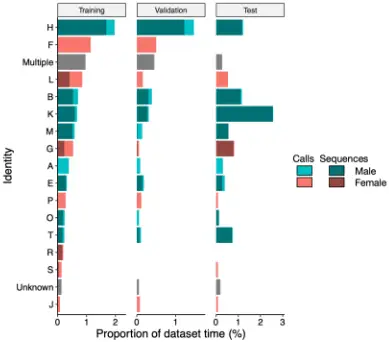
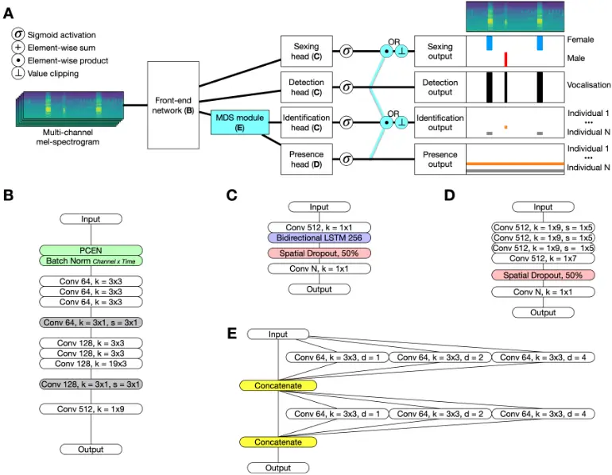
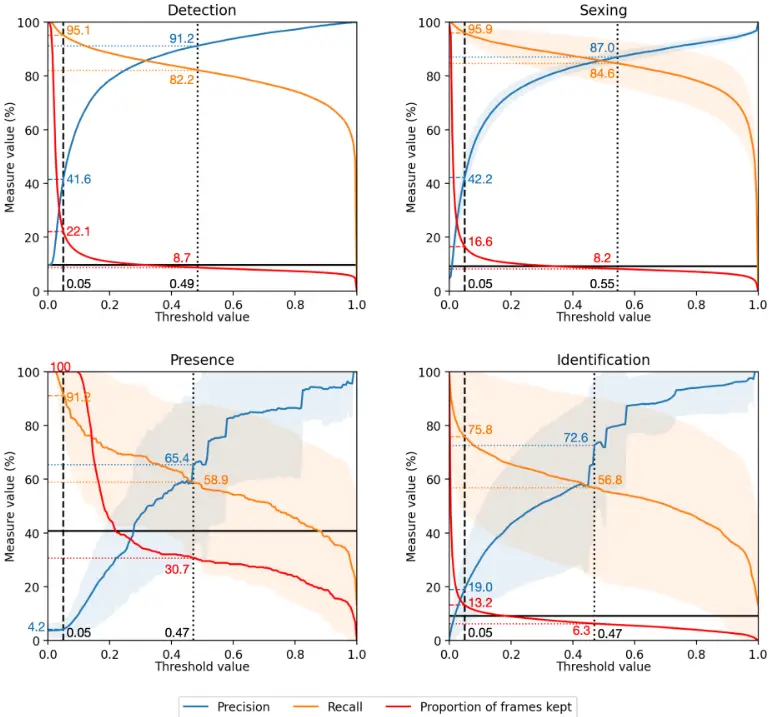
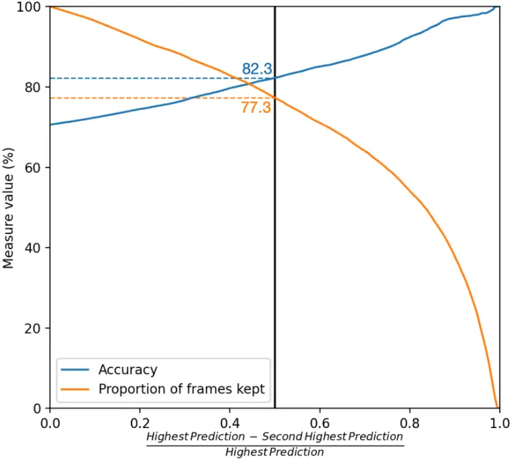
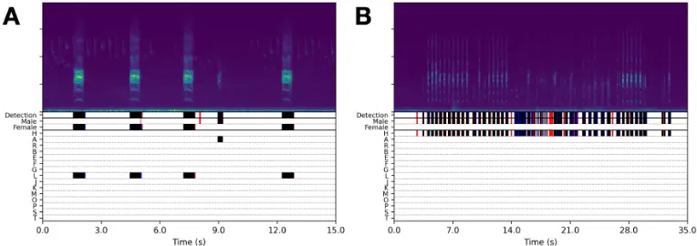

## Acoustic detection and identification of individual rooks in field recordings using multi-task neural networks

Killian Martin 1, 5 , Olivier Adam 2,3 , Nicolas Obin 4, _ , and Val´erie Dufour 1, _

1 PRC, UMR 7247, Ethologie Cognitive et Sociale,

INRAE-CNRS-IFCE-Universit´e de Tours, Strasbourg, France 2 Institut Jean Le Rond d'Alembert, UMR 7190, Sorbonne Universit´e-CNRS, F-75005 Paris, France 3 Institut des Neurosciences Paris-Saclay, UMR 9197, CNRS-Universit´e Paris Sud, Orsay, France

4 STMS Lab, IRCAM, CNRS, Sorbonne Universit´e, Paris, France

February 20, 2022

5 E-mail: killian.martin@ens-lyon.fr

. CC-BY-NC-ND 4.0 International license available under a (which was not certified by peer review) is the author/funder, who has granted bioRxiv a license to display the preprint in perpetuity. It is made The copyright holder for this preprint this version posted February 20, 2022. ; https://doi.org/10.1101/2022.02.19.481011 doi: bioRxiv preprint

## Abstract

Individual-level monitoring is essential in many behavioural and bioacoustics studies, but collecting these data is costly in human effort. Many studies of bird vocalisations in particular also involve manipulating the animals or human presence during observations, which can bias vocal production. Autonomous recording units can be used to collect large amounts of data without human supervision, largely removing these sources of bias. Moreover, the recent progress of deep learning greatly facilitated analysing these large amounts of data, for instance to extract vocalisations, classify the species, or classify the vocalisation types in recordings. Acoustic individual identification, however, has so far largely remained limited to a single vocalisation type for a given species, preventing the use of these techniques for automated data collection. We developed a deep convolutional neural network to detect vocalisations as well as identify individuals regardless of the vocalisation produced. We tested it in a group of rooks, a Eurasian social corvid with a diverse vocal repertoire, and found the system to work reliably for these tasks. Our system represents a powerful tool to individually monitor groups of animals in both outdoor and indoor settings, even across long periods of time, and regardless of a species' vocal complexity.

Keywords: convolutional neural network, vocalisation-independent, automated monitoring, data collection, corvid

## 1 Introduction

Observing individual birds is a challenge for biologists, ornithologists, and ethologists. Being able to follow individuals is essential to understand population dynamics and behaviours (Clutton-Brock and Sheldon, 2010; Terry et al., 2005). However, the collection of precise behavioural data is difficult in wild animals; researchers therefore mainly study animals in captivity, which facilitates observations of subtle behaviours in a controlled environment. The vocal behaviour of birds has been widely studied in this manner (see Catchpole and Slater (2008) and Marler and Slabbekoorn (2004) for reviews). Individual birds are often separated from their usual group and recorded in acoustically isolated chambers. However, this experimental setting deprives birds of their natural and social environment and can influence vocal production, as can manipulation by and the presence of human observers during experiments. The vocal behaviour of animals should be studied through the most naturalistic approach possible, which includes limiting human presence. Autonomous recording units (ARUs) greatly facilitate the collection of long acoustic recordings in the absence of human observers. Recent ecological surveys have increasingly used ARUs to sample soundscapes over long periods and large spaces (Blumstein et al., 2011; Darras et al., 2019; Fristrup and Mennitt, 2012; Potamitis et al., 2014; Shonfield and Bayne, 2017). However, vocalisations that are of interest are often rare in raw acoustic recordings. Large amounts of raw data must be collected to obtain representative samples, especially in species with complex vocalisations. Manually reviewing this data is extremely time-consuming, and spreading the effort over multiple observers raises issues of reliability (Fristrup and Mennitt, 2012). Automating this extraction process with machine learning algorithms would greatly reduce this bottleneck in analysis workflows. Another interest of automation is increased data collection, and thus an improved statistical power for further studies. In this study, we developed a system to automatically detect vocalisations and identify the emitters in a captive group of rooks (Corvus frugilegus), a Eurasian social corvid.

Individual identification based on raw acoustic recordings is a complex task. First, vocalisations must be detected from the background noise of the recording, which can be diverse and vary over time. Second, the individual producing each vocalisation must be identified, even between acoustically different vocalisations or, conversely, acoustically similar individuals. This can be operationally framed as a succession of classification tasks that the system will have to accomplish. For a raw recording in an outdoor environment, the system would need to classify rook vocalisations versus other sounds, then further classify rook vocalisations by sex and finally by individual identity.

The first step of vocalisation detection requires the separation of background data from vocalisations of interest. This step is probably the most time-saving in terms of human effort: vocalisations are usually rare, so discarding background data can considerably reduce the duration of recording that requires analysis. Recent years have seen impressive results in bird audio data mining thanks to the progress of deep learning, and particularly convolutional neural networks (CNNs). CNNs map image (or image-like) inputs to a number of classes (see e.g. Lecun et al. (2015) for a more in-depth overview). The mapping process involves stacking layers that summarise small neighbourhoods of pixels into higher order features, which are themselves successively summarised into even higher order features until the input can be classified. The classification process is learned directly from the data by training the network with a manually labelled dataset. In this respect, CNNs excel at solving complex analysis tasks for which explicit rules cannot be defined (Caruana, 1997). An illustrative example is the classification of images as containing a dog or a cat: humans can easily tell them apart, but it is difficult to define corresponding decision rules. CNNs have largely outperformed previous machine learning approaches such as Random Forests, Support-Vector Machines and systems based on Gaussian Mixture Models and Hidden Markov Models in a variety of acoustic tasks. The latter include detecting whether or not a given audio clip contains any bird vocalisations (Fanioudakis and Potamitis, 2017; Grill and Schluter, 2017; Kong et al., 2017; Liaqat et al., 2018; Sevilla and Glotin, 2017; Stowell, Wood, et al., 2019), locating bird vocalisations in recordings of flocks of migratory birds (Lostanlen et al., 2019) and in birdsong recordings (Cohen et al., 2020), identifying the bird species present in a clip (Kahl et al., 2019), or locating sound sources in space (Adavanne et al., 2019). CNNs are able to learn robust features for these applications with appropriate architecture design. For instance, Lostanlen et al. (2019) included Per Channel Energy Normalisation (PCEN, Wang et al., 2017) to attenuate background noise and an auxiliary branch to collect summary statistics over long periods of time to adapt decision thresholds to the noise contexts. Adavanne et al. (2018) used 3D convolution and cross-correlation features to combine multi-channel audio and to better compute the position of a sound source with respect to a multi-microphone array. Despite their strong performances, CNNs suffer from low data efficiency, i.e. require large datasets to learn meaningful decision processes. Training a network on too small a dataset can lead to overfitting as the network simply "memorises" the dataset and loses the ability to generalise decisions to other data. This could explain why they have not been applied to acoustic individual recognition before: datasets that include individual identity are almost always small (dozens to hundreds of samples) due the difficulty if acquiring the data (Foote et al., 2013; Ptacek et al., 2016; Spillmann et al., 2017). Stowell, Petruskov´a, et al. (2019) pointed out that, in extreme cases, an individual may only be recorded in a single session; a network trained to recognise this individual may then learn to recognise the association of the individual bird with the background noise in this sole recording rather than the individual bird itself, and may thus fail to recognise the same bird in a different context.

Previous approaches to the second step of individual identification typically used researcher-designed acoustic parameters to classify individuals. In corvids, parameters such as fundamental frequency or vocalisation duration and linear classification techniques such as discriminant function analysis suffice to identify individual and sex differences in a given vocalisation type (Benti et al., 2019; Boeckle et al., 2012, 2018; Laiolo et al., 2000; Mates et al., 2015; Yorzinski et al., 2006). Corvids, however, produce chaotic, noisy vocalisations with little harmonic structure (Fagerlund and H¨arm¨a, 2005; Fletcher, 2000) and possess a diverse vocal repertoire (Brown, 1985; Federspiel, 2010; Roskaft and Espmark, 1982) that is only partially shared between individuals ((Boeckle et al., 2012; Kondo et al., 2010; Mates et al., 2015). In other bird species, algorithms trained on one vocalisation type can correctly identify the emitter when tested on a different vocalisation type (Fox et al., 2008; Kirschel et al., 2009), suggesting that vocalisations may differ systematically between individuals, despite intra-individual diversity. However, all of these techniques assume that vocalisations can be extracted ahead of parameter measurement, which is incompatible with raw recording data. Moreover, raw recordings contain varying background noise of different origins, and multiple individuals can vocalise in close succession or even simultaneously. These combined conditions require higher resolution analyses for identification. Instead of using hand-crafted acoustic features defined by experts, recent advances of deep learning algorithms seek to extract meaningful features directly from the spectrogram of the data. This representation can efficiently detect vocalisations and identify individuals (Cheng et al., 2012; Stowell et al., 2016; Stowell, Petruskov´a, et al., 2019). These representations do not require the prior extraction of vocalisations and can be applied to entire recordings. Like in the previously described vocalisation detection task, a CNN may be able to learn from this representation to identify individual emitters for a given vocalisation.

A limitation of CNNs is their largely black-box nature, forcing the user to accept predictions without much insight into the decision process of the CNN. In a classification scheme, a CNN can return scores measuring the likelihood of a given output belonging to a given class (e.g. in our case, that a given spectrogram frame is part of a vocalisation emitted by a given bird). In a complex task however, a single output may be insufficient to provide the insights necessary for a user to trust the predictions of the network. In this case, it is often possible to factorise a complex task into simpler, more manageable tasks. This paradigm is close to multi-task learning (Caruana, 1997; Liebel and K¨orner, 2018; Ruder, 2017), training a single neural network to learn multiple tasks at the same time, with some parts of the network shared between tasks while other parts are taskspecific. These tasks can be chosen to provide additional insight into the predictions of the network, and should ideally require little to no additional labelling effort. For individual acoustic identification from raw recordings, a natural factorisation consists of separating the two previous steps of vocalisation detection and individual identification, as applied in previous approaches combining object detection and classification (Morfi and Stowell, 2018; Pankajakshan et al., 2019). Identification may be further factorised into sub-tasks classifying the sex of the emitter, the individuals present at any point within a clip, and finally the main task of identifying the individual emitting a vocalisation at a given time.

Our main contributions in this paper are:

- A large-scale dataset of vocalisations recorded from a captive outdoor group of rooks over a long period, with start and end times and emitter identity noted for all vocalisations.
- The first vocalisation-independent individual identification approach in corvids.
- A system to extract vocalisations and identify the individual emitting each

vocalisation from field recordings that were collected using a multi-microphone array with overlap between microphones.

- The illustration of how multi-task learning with simpler auxiliary tasks can facilitate the collection of information throughout a complex task, thereby increasing the operational control users have over the system they implement.

## 2 Material and methods

## 2.1 Dataset

We recorded the vocalisations produced by a captive colony of 15 rooks (8 males, 7 females) housed in a 26 x 8 x 3.7 m outdoor aviary in Strasbourg, France. The colony was recorded for several consecutive hours each morning from January 2020 onwards. Recordings were digitised at 48 kHz with a 16-bit resolution using three ARUs with two microphones each, connected with 3m cables (Song Meter 4 recorders and SMM-A2 microphones, Wildlife Acoustics, USA). We placed the microphones across the aviary to ensure they were less than 10 m from the birds and used different gain values to record both loud and soft vocalisations. The surrounding soundscape included both biotic (other birds, animals, human voices) and abiotic (weather, vehicles) noises.

Eleven sessions and several shorter recordings obtained throughout 2020 and 2021 were annotated by an expert observer, first onsite, then adjusted in AudioSculpt v2.4.3 (Bogaards et al., 2004) after synchronising the corresponding audio files. Each vocalisation was annotated with the start time, end time, emitter identity, and whether it was part of a sequence. Due to the multi-microphone array and sound propagation speed, the start and end times were defined as the time when a vocalisation was perceived on any audio channel for the first and last time, respectively. A vocalisation was defined as either an uninterrupted sound or a short succession of small, similar elements that were always produced together. Annotations relied on spectrogram and audio; video (recorded on a camcorder during observations) was used to resolve any ambiguities (e.g., two individuals close together when one vocalised). When identity was unclear even with video assistance, the emitter was noted as either "Unknown" (single emitter could not be identified), or "Multiple" (multiple emitters vocalised simultaneously). The dataset included 17667 vocalisations in 17.4h of audio recordings. The vocalisations were not equally distributed among individuals; one male in particular vocalised much more often than all the other birds (Fig. 1). We defined two vocalisation modes, namely calls and sequences (accounting for 37% and 63% of vocalisations, respectively). Sequences were characterised by highly diverse vocalisations emitted in close succession by one individual.

## 2.2 Feature representation

All CNNs were trained with spectrograms of 10 s clips extracted from the raw recordings. We computed the Short Time Fourier Transform of each clip using a 50 ms Hamming window with 75% overlap, then took the squared magnitude of the result. The spectrograms were then downscaled to 80 Mel-scale frequency coefficients to emphasise lower frequencies. This resulted in spectrograms with dimensions 80 x 800 x 6 (frequency x time x channels). Smaller clips were zeropadded at the end of each dimension.

Figure 1: Distribution of vocalisations for each bird, split by dataset. The distribution is expressed as the proportion of total dataset time that contains vocalisations from a given bird. Bars coloured by sex and shaded by vocalisation mode. Multiple and Unknown represent cases where vocalisations could not be attributed to an individual bird. No sequences were attributed to either Unknown (as sequences always lasted long enough to identify the emitter) or Multiple (as by definition, sequences were produced by a single individual).

The training labels for a clip were binary matrices representing the presence of the relevant classes (1 if a class is present and 0 otherwise) with the same time resolution as the corresponding spectrograms. This resulted in matrices of size 800 x N (where N=1 for detection, 2 for sexing, and 15 for identification), or a vector of size 15 for the presence task (which summarised information over time).

## 2.3 Network architecture

All networks used a common front-end that branched out into task-specific heads (Fig. 2). The first two layers implemented two spectrogram normalisations: PCEN (Wang et al., 2017) and centre-scaling each frequency band and channel separately. The latter operation was implemented with a Batch Normalisation layer for convenience. PCEN combines a time-domain filter that attenuates slowvarying noises (e.g., vehicle noises) and a compression similar to log-scaling. PCEN introduces 5 parameters that can each vary at different frequency bands. PCEN was implemented as a layer to learn these parameters during training, and we allowed the parameters to vary between frequency bands.

The front-end of the network was a linear stack of three convolutional layers, one pooling layer, three convolutional layers, one pooling layer and one convolutional layer (see Fig. 2B for details), based on a submission to the 2018 BirdCLEF

(Schl¨uter, 2018). This architecture is meant to summarise information from the entire frequency axis of the spectrogram and a small part of the time axis. We adapted the architecture to preserve time resolution throughout the front-end by pooling only on the frequency axis and zero-padding the time axis before each convolution. All convolutions were followed by a non-linear activation and a Batch Normalisation layer, in this order. We empirically replaced the activation function after each convolution with the Mish function (Misra, 2019), replaced regular Batch Normalisation with Batch Renormalisation (Ioffe, 2017), and finally replaced the original Max-pooling layers with strided convolutions without activation functions (Pankajakshan et al., 2018).

Each task was learned by a dedicated head added after the front-end. For the tasks that preserved time resolution (detection, sexing, identification), we used a 1x1 convolution followed a bidirectional LSTM layer (used to model temporal dependencies both forward and backward), and finally another 1x1 convolution (Fig. 2C). The head dedicated to the presence task was designed to summarise information over the time dimension using strided convolutions with large filter sizes (Fig. 2D). The final output of each head was constrained within the [0,1] range by a sigmoid function.

Salient information for individual identification may be present at different scales from local to vocalisation-wide. Multi-scale information can be exploited with large receptive fields (the number and shape of the neurones from the previous layer that influence a neurone in the next layer) and skip connections (where layers may be connected to layers earlier in the network than the layer immediately before them, "skipping" part of the network). We use both mechanisms based on a mixed-scale, densely-connected (MSD) module proposed by Pelt and Sethian, 2017. One such module (Fig. 2E) was optionally added after the frontend of the network.

Figure 2: Proposed system. A) Overview of the network. Elements in light blue were optionally included at training time: MSD module (before each head in the single task experiments; the configuration shown here is the one used in the multitask experiments), product and clipping operations. On the right: example clip containing three vocalisations, two from a female and one from a male. Under the mel-spectrogram are the corresponding ground truth labels (in the case of the presence output, stretched in time to match the shape of the other outputs). B) Front-end detail. C) Head detail for detection, identification and sexing tasks. D) Presence head detail. E) MSD module detail. Boxes represent one layer each, with Batch Renormalisation and activation layers omitted for clarity. Convolution layers (Conv) used the parameters in each box (e.g. first grey Conv box in B: 64 filters, 3x1 filter size, 3x1 stride). When omitted (in particular in F), parameters were 64 filters, 1x3 filter size, 1x1 stride. Boxes coloured according to operation type (green: normalisation, white: convolution, grey: pooling, blue: LSTM, red: dropout, yellow: concatenation). N: number of classes for a particular task (detection: 1, sexing: 2, presence and identification: 15).

We also investigated whether combining the outputs of different heads could facilitate learning. For instance, combining detection and identification may allow the latter to only attend to frames containing vocalisations, and forcibly return low predictions for frames with no vocalisations. We tested two operations for combining, namely element-wise product and value clipping (e.g., when combining detection and identification, value clipping prevents identification from reaching high values if detection is low). We applied one of these operations in a given configuration. The following combinations were used: detection and presence combined with identification, and detection combined with sexing (Fig. 2A).

## 2.4 Experimental details

The networks were written in Python 3.7 using Keras 2.4.3 with Tensorflow 2.4.1, and trained on an NVIDIA Quadro RTX600 GPU with CUDA 11.0.

## 2.4.1 Hyperparameters

These hyperparameters were set identically for all networks. We used batches of 32 clips, and the networks were trained to minimise a focal binary crossentropy loss function (Lin et al., 2020) with parameter g = 2; multi-task networks had one loss per head. The focal loss focuses the training on difficult samples by raising their relative contribution to the overall loss. We implemented a variant of the Ranger21 optimiser (Wright and Demeure, 2021), with a weight decay of 10-4 and gradient centralisation (Yong et al., 2020). We used a "triangular2" cyclical learning rate schedule (Smith, 2018) bouncing between 10-6 and 10-3 , with cycles of 6 epochs and halving the maximum learning rate after each cycle. Large learning rates allow the network to "jump" out of solutions during training, potentially finding better solutions when the learning rate decreases again. We used mixed precision training to accelerate training and decrease memory footprint. Finally, all networks were initialised with the same scheme and the training data was fed to the network in a different order during each epoch. We limited the effects of randomness in our experiments by using the same seed for all random processes, set once when initialising a network, and once when starting to process the data.

## 2.4.2 Regularisation

CNNs trained for too long eventually overfit to the training dataset. This can be mitigated with regularisation. First, we stopped the training when validation AUPRC (see Evaluation below) stopped increasing for 15 consecutive epochs. We set a minimum training length of 18 epochs to prevent networks from achieving a high performance by chance early on then stopping too early. Second, we applied spatial dropout before the final layer of each head. Spatial dropout randomly drops a fraction (50% in our experiments) of the connections between two consecutive convolution layers, preventing the network from learning to depend on specific connections. Third, we applied L2-norm weight decay with a strength of 10-4

(the same value as the Ranger21 optimiser above). This penalises large absolute values of the weights that can destabilise training (Smith, 2018). Fourth, we use label smoothing, so that the actual training labels used to minimise the loss functions were not 0 and 1 but 0.05 and 0.95, respectively. Label smoothing similarly encourages lower weights for stable training, particularly in the last layer of the network.

## 2.4.3 Training and evaluation data

We randomly split the recordings into three datasets: training, validation and test. The splits were determined before the experiments and kept identical throughout. The training dataset (80% of the vocalisations) was used to train the network. The other two were held out for evaluation: the validation dataset (11.6% of the vocalisations) allowed evaluation after each epoch during training to monitor for overfitting, and the test dataset (8.4% of the vocalisations) allowed evaluation on the network after training was complete.

Training clips were sampled around each vocalisation with a random start time of up to 10 seconds before the vocalisation ended. Twenty percent more clips were sampled from background-only parts of the recordings to increase the variety of background noise. New clips were sampled before each epoch. Both of the evaluation datasets were simply split into adjacent, non-overlapping clips and sent in order to the network.

Vocalisations from the Unknown or Multiple classes were weighted at 0 during loss computation, effectively excluding them from training. The detection task was exempt from this, as identity has no effect on whether or not a vocalisation occurs.

## 2.5 Evaluation

We ranked our models with the Area Under the Receiver Operating Curve (AUROC) and the Area Under the Precision-Recall Curve (AUPRC). AUROC and AUPRC both summarise the performance of a network over its entire output range. AUROC indicates the probability a classifier will score a random positive sample higher than a random negative sample. Whatever the dataset, random guessing leads to 50% AUROC and perfect classification to 100% AUROC (Fawcett, 2006). AUROC can over-emphasise the correct rejection of negative samples, especially if negative samples outweigh positive samples, in which case AUPRC can be more representative (Saito and Rehmsmeier, 2015). AUPRC is based on precision and recall, and evaluates the ability of the classifier to correctly classify positive samples without false positives or negatives. Unlike AUROC, AUPRC is directly dependant on the proportion of positive samples in the dataset, and so cannot be compared between different datasets. We used AUROC and AUPRC computed on the training and test datasets to rank networks, but made training dependant on the AUPRC across the validation dataset, and extracted weights at the epoch with the highest AUPRC validation values. In multi-task networks, only the identification task validation AUPRC was used.

By definition, AUROC and AUPRC consider all possible thresholds, so they cannot be used to select one for real use. We therefore used precision and recall to choose thresholds in the best configuration. For all metrics, in multi-class tasks (i.e. sexing, identification and presence) we report the arithmetic mean of the perclass results. The mean was computed from the classes present in a given dataset (i.e., only 13 of the 15 birds were present in the test dataset, so the corresponding results were averaged over 13 classes instead of 15).

## 3 Results

## 3.1 Network performance

We trained models dedicated to each of the four tasks to establish baseline performance. For each task, we trained one model with and another without the MSD module, to investigate whether the multi-scale information was useful for each task (Table 1). All the networks learn and generalise well on their respective task, with little differences between the training, validation and test AUROC. Identification and presence benefit from using the MSD module with higher test AUPRC than without the module. Sexing is largely unaffected by the MSD module, although performance is slightly better without it. Finally, detection is substantially better without the MSD module, in particular generalising better to validation and test data. This confirms our expectations that tasks involving vocal identity benefit from multi-scale information, while other tasks do not.

In accordance with the single-task experiments, we trained multi-task networks on all four tasks simultaneously, with a shared MSD module before the identification and presence heads (corresponding to the configuration in Fig. 2A).

Table 1: Performance of the networks on training, validation, and test data, at the best epoch measured by validation data AUPRC. For multi-task network, the AUPRC of the identification task was used. Single-task networks ("STL") were trained using two architectures variants, with ("MSD") and without ("Simple") the MSD module between the front-end and the head. Best performance was determined by test AUPRC and set as baseline. Multi-task networks ("MTL") were trained using either no combining operation ("None"), element-wise product ("Product"), or value clipping ("Clip"), with the combination shown in Fig. 2A. For each column, the best performance is emphasised in bold (separately for STL and MTL networks), and MTL values above the STL baselines are underlined. Note that AUROC values can be compared between both models and datasets for a given task; AUPRC values can only be compared between models. The table was split in two for better readability.

| Network | Network            | Detection - AUROC - Training | Detection - AUROC - Validation | Detection - Test  | Detection - Training | Detection - AUPRC - Validation | Detection - AUPRC - Test | Sexing - AUROC - Training | Sexing - AUROC - Validation | Sexing - AUPRC - Test | Sexing - AUPRC - Training | Sexing - AUPRC - Validation | Sexing - AUPRC - Test |
| ------- | ------------------ | ---------------------------- | ------------------------------ | ----------------- | -------------------- | ------------------------------ | ------------------------ | ------------------------- | --------------------------- | --------------------- | ------------------------- | --------------------------- | --------------------- |
| STL     | Simple MSD         | 98.81 99.71                  | 98.13 95.79                    | 94.03 86.69       | 97.40 99.25          | 88.98 87.87                    | 81.04 77.81              | 99.17 98.70               | 99.32 99.25                 | 98.88 98.81           | 88.73 87.28               | 85.00 85.15                 | 89.72 89.71           |
| MTL     | None Multiply Clip | 99.81 99.95 99.83            | 96.94 95.71 94.46              | 88.44 87.06 84.41 | 99.52 99.86 99.55    | 88.01 87.75 88.23              | 77.64 77.24 77.03        | 99.33 99.48 99.33         | 99.09 98.95 99.32           | 98.81 98.75 98.70     | 89.80 91.61 89.68         | 82.88 85.01 83.60           | 89.19 90.52 89.65     |

| Network | Network            | Presence - AUROC - Training | Presence - AUROC - Validation | Presence - Test   | Presence - Training | Presence - AUPRC Validation | Presence - Test   | Identification - AUROC - Training | Identification - AUROC - Validation | Identification - Test | Identification - Training | Identification - AUPRC Validation | Identification - Test |
| ------- | ------------------ | --------------------------- | ----------------------------- | ----------------- | ------------------- | --------------------------- | ----------------- | --------------------------------- | ----------------------------------- | --------------------- | ------------------------- | --------------------------------- | --------------------- |
| STL     | Simple MSD         | 99.52 99.02                 | 94.33 94.89                   | 83.62 86.50       | 97.12 94.04         | 57.46 63.76                 | 53.11 54.39       | 99.93 99.95                       | 95.00 93.09                         | 92.87 93.81           | 93.02 94.91               | 57.95 59.65                       | 55.28 58.50           |
| MTL     | None Multiply Clip | 98.95 99.68 98.84           | 94.92 95.11 95.59             | 83.90 84.46 88.57 | 94.60 98.37 93.34   | 53.53 60.72 60.20           | 53.92 58.18 56.06 | 99.91 99.96 99.91                 | 97.92 97.54 97.86                   | 95.57 92.75 94.89     | 92.98 95.01 92.68         | 59.10 59.72 60.10                 | 56.79 58.93 56.14     |

Multi-task learning has relatively little effect on training performance, possibly because the networks already learn the tasks almost perfectly (Table 1, lower half). Conditioning the outputs of the identification on the outputs of detection and presence improved performance compared to simple multi-task learning, albeit with no compelling pattern favouring one operation over the other, suggesting the effect is more task or dataset-dependent. We chose value clipping for the following results, as improved overall generalisation performance compared to the other settings.

## 3.2 Detecting vocalisations with the chosen network

For real use, a prediction threshold must be chosen to accept or reject samples. Lowering the threshold decreases the probability of false negatives, but increases that of false positives. We therefore examine the effect of threshold value on precision and recall for the detection task (Fig. 3 top left). To evaluate the network's potential to reduce human effort, we also compute the proportion of spectrogram frames kept at the same thresholds. A conservative threshold, set at 0.05, has excellent recall but relatively low precision due to retaining a larger data (though still only 22.1%) of the data. A higher threshold, chosen to optimize the F1 score (the harmonic mean of recall and precision), finds a better compromise and removes over 90% of the data, potentially dividing the human effort by 10, but misses slightly more vocalisations.

False positive frames are most often due to the network predicting that vocalisations would start earlier and end later than annotated, sometimes bridging vocalisations in close succession. Some false positives are due to noises that were structurally similar to the vocalisations, including audible breaths from the rooks, pecking noises, and wild bird vocalisations. Finally, a large number of false positives show no clear cause. However, the majority of the last two categories are very short segments (4 frames or less, below 0.05 s at our time resolution), and so might be discarded at the cost of missing extremely short vocalisations. Possible causes for false negatives were less clear, except for one vocalisation type of both low volume and low frequency (between 250 and 400 Hz), possibly making it difficult for the network to discriminate this vocalisation type from background noise.

Figure 3: Test data precision, recall and proportion of spectrogram frames kept as a function of threshold value, for each task of the multi-task network. For all multiclass tasks (sexing, presence, identification), the precision and recall curves are class averages and the shaded area represents one standard deviation. In all plots, the black vertical lines corresponds to specific threshold values: dashed lines correspond to the conservative threshold at 0.05, dotted lines to the threshold optimising the harmonic mean of recall and precision. Coloured horizontal lines are the values of all three metrics at the corresponding thresholds, with the associated values in the corresponding colours.

## 3.3 Identifying emitters with the joint network

We finally evaluated how well the network identified individuals in relation to each other. We computed the confusion matrix based solely on the vocalisations in the test dataset produced by exactly one identified individual, and retained the prediction with the highest score at each frame. The resulting matrix, along with the precision and recall associated with each individual, is shown in Table 2.

Out of the thirteen individuals in the test dataset, the network correctly identifies the vast majority with both high precision (including seven with more than 75% precision) and high recall (including eight with more than 75% recall). Overall, the network correctly identified the emitter in 70.6% of cases.

To fully automate the extraction of vocalisations, predictions can be further restricted to only retain vocalisation frames where the network confidently identifies one individual, i.e. where the highest predicted value is sufficiently higher than the rest (Fig. 4). This also has the effect of discarding overlapping vocalisations produced by multiple individuals.

Table 2: Confusion matrix computed from the identification predictions, restricted to labelled vocalisations from exactly one individual at a time. Birds are coloured by sex (males in blue, females in red). Columns correspond to labels, rows to predictions. For instance: for the cell in the first row (A), second column (B) the network predicted 2 frames as produced by A that were actually produced by B. Diagonal cells (grey) correspond to correct identifications. For each bird, the second-to-last column indicates predicted frames, the second-to-last row indicates labelled frames, the last column indicates precision and the last row indicates recall. The four bottom-right cells contain: total frames (top left), average recall (bottom left), average precision (top right) and overall accuracy (bottom right). Precision, recall and accuracy values are expressed as percentages. Individuals that were absent from the test dataset (F and R) had their recall and precision left blank (as recall is undefined and precision is 0 in the absence of positive samples) and did not contribute to the averages.

|          | A    | B    | E    | F   | G    | H    | J    | K    | L    | M    | O   | P    | R   | S    | T    | Predicted | Precision |
| -------- | ---- | ---- | ---- | --- | ---- | ---- | ---- | ---- | ---- | ---- | --- | ---- | --- | ---- | ---- | --------- | --------- |
| A        | 1009 | 2    | 0    | 0   | 0    | 8    | 0    | 130  | 0    | 71   | 0   | 1    | 0   | 0    | 0    | 1221      | 82.6      |
| B        | 14   | 3943 | 111  | 0   | 0    | 123  | 0    | 8    | 0    | 12   | 92  | 0    | 0   | 0    | 918  | 5221      | 75.5      |
| E        | 0    | 8    | 437  | 0   | 0    | 0    | 0    | 81   | 4    | 204  | 0   | 0    | 0   | 0    | 124  | 858       | 50.9      |
| F        | 0    | 0    | 13   | 0   | 18   | 0    | 0    | 0    | 53   | 0    | 0   | 0    | 0   | 0    | 0    | 84        | -         |
| G        | 1    | 22   | 41   | 0   | 2729 | 5    | 0    | 748  | 45   | 0    | 0   | 26   | 0   | 27   | 0    | 3644      | 74.9      |
| H        | 4    | 0    | 106  | 0   | 0    | 3957 | 0    | 2078 | 6    | 0    | 0   | 0    | 0   | 0    | 20   | 6171      | 64.1      |
| J        | 0    | 0    | 0    | 0   | 0    | 0    | 251  | 0    | 45   | 0    | 0   | 0    | 0   | 2    | 0    | 298       | 84.2      |
| K        | 3    | 13   | 159  | 0   | 0    | 35   | 0    | 5541 | 3    | 8    | 5   | 0    | 0   | 0    | 934  | 6701      | 82.7      |
| L        | 0    | 9    | 210  | 0   | 11   | 0    | 76   | 4    | 1583 | 0    | 0   | 196  | 0   | 15   | 0    | 2104      | 75.2      |
| M        | 0    | 3    | 0    | 0   | 9    | 0    | 0    | 213  | 0    | 1783 | 372 | 0    | 0   | 0    | 65   | 2445      | 72.9      |
| O        | 0    | 0    | 64   | 0   | 0    | 0    | 0    | 676  | 1    | 73   | 33  | 0    | 0   | 0    | 0    | 847       | 3.9       |
| P        | 0    | 0    | 73   | 0   | 0    | 0    | 0    | 31   | 0    | 0    | 0   | 81   | 0   | 0    | 0    | 185       | 43.8      |
| R        | 0    | 0    | 0    | 0   | 0    | 0    | 0    | 0    | 21   | 0    | 0   | 16   | 0   | 0    | 0    | 37        | -         |
| S        | 0    | 0    | 0    | 0   | 21   | 0    | 0    | 0    | 0    | 0    | 0   | 0    | 0   | 179  | 0    | 200       | 89.5      |
| T        | 0    | 7    | 214  | 0   | 0    | 402  | 0    | 24   | 0    | 0    | 0   | 0    | 0   | 4    | 439  | 1090      | 40.3      |
| Labelled | 1031 | 4007 | 1428 | 0   | 2788 | 4530 | 327  | 9534 | 1761 | 2151 | 502 | 320  | 0   | 227  | 2500 | 31106     | 64.7      |
| Recall   | 97.9 | 98.4 | 30.6 | -   | 97.9 | 87.4 | 76.8 | 58.1 | 89.9 | 82.9 | 6.6 | 25.3 | -   | 78.9 | 17.6 | 65.2      | 70.6      |

Figure 4: Post-processing of the identification task predictions. Predictions are only retained if the highest prediction is sufficiently higher than the second highest, meaning the network is confident in identifying one individual. We chose to retain predictions if the highest value is at last twice as high as the second highest (solid black line), with the corresponding accuracy and proportion of frames retained shown as the coloured dashed lines.

Figure 5: Two example mel-spectrograms from the test dataset (only one channel shown), with corresponding network outputs (the presence output was omitted for clarity). A) Calls produced by one female (L) and one male (A). B) Sequence produced by one male (H). The following settings were used: detection output above 0.05, and for sexing and identification we retained frames where the highest prediction was at least twice as high as the second highest. True negatives are in white, true positives in black, false negatives in blue, and false positives in red.

## 4 Discussion

We propose a deep learning system for the acoustic detection and vocalisationindependent identification of rooks in an outdoor soundscape. We split up the complex overall task and added the resulting auxiliary tasks to the learning process. Selectively attending to specific time frames based on auxiliary tasks did not improve training performance, likely because the networks could not learn any better than they already were. Instead, multi-task learning appeared to improve generalisation to unseen data, especially in the more complex tasks of presence and identification. Multi-task learning has been proposed as acting as additional regularisation (Liebel and K¨orner, 2018), so splitting a complex task may help the network with learning better decision processes that can then be used on the unseen data. In addition, the auxiliary tasks allow a user to separately determine task-specific thresholds for more direct control over the precision and recall tradeoff. Furthermore, conditioning the outputs of more complex tasks on the outputs of simple tasks may help the learning process, possibly by acting as an attention mechanism: in this case the detection and presence tasks allow early rejection of either non-vocalisations or individuals absent from the audio clip.

The most frequent detection errors (either false positives or false negatives) appeared to be due to structural similarity between some vocalisations and the background noise. In particular, short percussive noises (such as pecking noises) were more often falsely predicted as vocalisations, despite clear differences to the human ear. Many of the identification errors occurred between specific individual pairs (e.g. K predicted as H, O predicted as M, T predicted as B or K). Most of the individuals involved did not vocalise less than others who were successfully identified, so it is unclear if this is due to a lack of representation of these individuals in the training data. Alternatively, some of these individuals may be more similar in their vocalisations. Vocal similarity reflects social proximity in many birds (Brown, 1985; Grießmann and Naguib, 2002; Hausberger et al., 1995). This was not the case here, as the misidentified pairs did not correspond to social bonds (Boucherie et al., 2016). Some species of corvids can also mimic other sounds

(Brown and Veltman, 1987; Federspiel, 2010; Laiolo et al., 2000), including vocalisations produced by conspecifics (Brown, 1985). While this may explain the misclassifications, it is difficult to establish that mimicry is the underlying cause. Vocal similarity may complicate data collection by human observers before training, but a neural network may overcome this difficulty given sufficient training data, as shown by L and J being successfully identified.

One limitation of the CNN approach is the fully supervised training process: only classes present in the training data may be learned and subsequently predicted. For this reason, new individuals arriving in the group will not be recognised. Our system is designed so vocalisations from unknown individuals can be simply not attributed to any individual. However, the network can learn to recognise these new individuals simply by collecting vocalisation data from them and retraining the network, either from scratch or by transfer learning. Transfer learning consists in replacing and training only the output layers of a network. This greatly reduces the training time and the quantity of new data necessary, but assumes the learned representations can be applied to these new individuals (Pan and Yang, 2010). For this reason, transfer learning may work best for applications to other groups of rooks and possibly other corvids, but re-training the network from scratch may be necessary for other species. On the other hand, the network is designed to recognise individuals regardless of vocalisation type. As such, vocal changes without group composition changes should not cause the network to fail, although periodic retraining with new data would solve this issue regardless.

Deep learning models are extremely powerful tools for annotating complex acoustic data. Any task that can be consistently labelled by humans can theoretically be learned by a CNN if sufficient training data is provided. Collecting and labelling this training data can be time-consuming, but is often done anyway at the beginning of behavioural studies. Our approach can be applied to any similar data in other species with minimal adjustments. Moreover, automatic behavioural data collection and extraction can remove biases caused by human presence and allow non-invasive monitoring. Future work in improving classification ability, memory footprint, or data efficiency will greatly facilitate analysis of ever-increasing quantities of data.

## 5 Acknowledgements

This project was funded by a Michelin Foundation grant to V.D. We are grateful to the Eurometropole of Strasbourg for granting us the use of the terrain for housing the animals. We also thank IRCAM for granting us access to the AudioSculpt software.

## 6 Conflict of interest

The authors declare no conflict of interest.

## 7 Data accessibility

Our code is available online at https://gitlab.com/kimartin/rook-vocalisation-detection. The dataset is available under a Creative Commons Attribution licence (CC BY 4.0) at https://doi.org/10.5281/zenodo.6091940

## References

- Adavanne, S., Politis, A., Nikunen, J., &amp; Virtanen, T. (2019). Sound Event Localization and Detection of Overlapping Sources Using Convolutional Recurrent Neural Networks. IEEE Journal on Selected Topics in Signal Processing, 13(1), 34-48. https://doi.org/10.1109/JSTSP.2018.2885636
- Adavanne, S., Politis, A., &amp; Virtanen, T. (2018). Multichannel Sound Event Detection Using 3D Convolutional Neural Networks for Learning Inter-channel Features. Proceedings of the International Joint Conference on Neural Networks, 2018-July. https://doi.org/10.1109/IJCNN.2018.8489542
- Benti, B., Cur´e, C., &amp; Dufour, V. (2019). Individual signature in the most common and context-independent call of the Rook (Corvus frugilegus). The Wilson Journal of Ornithology, 131(2), 373. https://doi.org/10.1676/18-41
- Blumstein, D. T., Mennill, D. J., Clemins, P., Girod, L., Yao, K., Patricelli, G., Deppe, J. L., Krakauer, A. H., Clark, C., Cortopassi, K. A., Hanser, S. F., Mccowan, B., Ali, A. M., &amp; Kirschel, A. N. G. (2011). Acoustic monitoring in terrestrial environments using microphone arrays : applications ,

technological considerations and prospectus. Journal of Applied Ecology, (48), 758-767. https://doi.org/10.1111/j.1365-2664.2011.01993.x

- Boeckle, M., Szipl, G., &amp; Bugnyar, T. (2012). Who wants food? Individual characteristics in raven yells. Animal Behaviour, 84(5), 1123-1130. https: / / doi.org/10.1016/j.anbehav.2012.08.011
- Boeckle, M., Szipl, G., &amp; Bugnyar, T. (2018). Raven food calls indicate sender's age and sex. Frontiers in Zoology, 15(1), 1-9. https://doi.org/10.1186/ s12983-018-0255-z
- Bogaards, N., R¨obel, A., &amp; Rodet, X. (2004). Sound Analysis and Processing with AudioSculpt 2. Proc. Int. Computer Music Conference (ICMC), 2-5.
- Boucherie, P. H., Mariette, M. M., Bret, C., &amp; Dufour, V. (2016). Bonding beyond the pair in a monogamous bird: Impact on social structure in adult rooks (Corvus frugilegus). Behaviour, 153(8), 897-925. https://doi.org/10.1163/ 1568539X-00003372
- Brown, E. D. (1985). The Role of Song and Vocal Imitation among Common Crows (Corvus brachyrhynchos). Zeitschrift f¨ur Tierpsychologie, 68(2), 115-136. https://doi.org/10.1111/j.1439-0310.1985.tb00119.x
- Brown, E. D., &amp; Veltman, C. J. (1987). Ethogram of the Australian Magpie (Gymnorhina tibicen) in Comparison to Other Cracticidae and Corvus Species. Ethology, 76(4), 309-333. https://doi.org/10.1111/j.1439-0310.1987. tb00692.x
- Caruana, R. (1997). Multitask Learning (Doctoral dissertation). Carnegie Mellon University. https://doi.org/10.1007/978-1-4899-7687-1 100322

- Catchpole, C., &amp; Slater, P. (2008). Bird song: Biological themes and variations, second edition. https://doi.org/10.1017/CBO9780511754791
- Cheng, J., Xie, B., Lin, C., &amp; Ji, L. (2012). A comparative study in birds: Calltype-independent species and individual recognition using four machinelearning methods and two acoustic features. Bioacoustics, 21(2), 157-171. https://doi.org/10.1080/09524622.2012.669664
- Clutton-Brock, T., &amp; Sheldon, B. (2010). Individuals and populations: The role of long-term, individual-based studies of animals in ecology and evolutionary biology. Trends in ecology &amp; evolution, 25, 562-73. https://doi.org/10. 1016/j.tree.2010.08.002
- Cohen, Y., Nicholson, D., &amp; Gardner, T. J. (2020). TweetyNet: A neural network that enables high-throughput, automated annotation of birdsong. bioRxiv, 1-25. https://doi.org/10.1101/2020.08.28.272088
- Darras, K., Bat´ary, P., Furnas, B. J., Grass, I., Mulyani, Y. A., &amp; Tscharntke, T. (2019). Autonomous sound recording outperforms human observation for sampling birds: a systematic map and user guide. Ecological Applications, 29(6). https://doi.org/10.1002/eap.1954
- Fagerlund, S., &amp; H¨arm¨a, A. (2005). Parametrization of inharmonic bird sounds for automatic recognition. 13th European Signal Processing Conference, EUSIPCO 2005, (June), 1039-1042.
- Fanioudakis, L., &amp; Potamitis, I. (2017). Deep networks tag the location of bird vocalisations on audio spectrograms. CoRR. http: / /arxiv.org/abs/1711. 04347

- Fawcett, T. (2006). An introduction to ROC analysis. Pattern Recognition Letters, 27(8), 861-874. https://doi.org/10.1016/j.patrec.2005.10.010
- Federspiel, I. G. (2010). Sociality , Social Learning and Individual Differences in Rooks , Jackdaws and Eurasian Jays (Doctoral dissertation).
- Fletcher, N. H. (2000). A class of chaotic bird calls? The Journal of the Acoustical Society of America, 108(2), 821-826. https://doi.org/10.1121/1.429615
- Foote, J. R., Palazzi, E., &amp;Mennill, D. J. (2013). Songs of the Eastern Phoebe, a suboscine songbird, are individually distinctive but do not vary geographically. Bioacoustics, 22(2), 137-151. https://doi.org/10.1080/09524622. 2012.740174
- Fox, E. J. S., Roberts, J. D., &amp; Bennamoun, M. (2008). Call-independent individual identification in birds. Bioacoustics: The International Journal of Animal Sound and its Recording, 18:1(December 2012), 51-67.
- Fristrup, K. M., &amp; Mennitt, D. (2012). Biacoustical monitoring in terrestrial environments. Acoustics Today, 8(3), 16-24.
- Grießmann, B., &amp; Naguib, M. (2002). Song Sharing in Neighboring and NonNeighboring Thrush Nightingales (Luscinia luscinia) and its Implications for Communication. Ethology, 14, 377-387. https://doi.org/10.1046/j. 1439-0310.2002.00781.x
- Grill, T., &amp; Schluter, J. (2017). Two convolutional neural networks for bird detection in audio signals. 25th European Signal Processing Conference, EUSIPCO 2017, 2017-Janua, 1764-1768. https : / / doi . org / 10 . 23919 / EUSIPCO.2017.8081512

- Hausberger, M., Richard-Yris, M., Henry, L., Lepage, L., &amp; Schmidt, I. (1995). Song Sharing Reflects the Social Organization in a Captive Group of European Starlings (Sturnus vulgaris). Journal of Comparative Psychology, 109(3), 222-241. https://doi.org/10.1037/0735-7036.109.3.222
- Ioffe, S. (2017). Batch Renormalization: Towards reducing minibatch dependence in batch-normalized models. Advances in Neural Information Processing Systems, 2017-Decem, 1946-1954.
- Kahl, S., St¨oter, F. R., Go¨eau, H., Glotin, H., Planqu´e, R., Vellinga, W. P., &amp; Joly, A. (2019). Overview of BIRDCLEF 2019: Large-scale bird recognition in soundscapes. CEUR Workshop Proceedings, 2380, 9-12.
- Kirschel, A. N., Earl, D. A., Yao, Y., Escobar, I. A., Vilches, E., Vallejo, E. E., &amp; Taylor, C. E. (2009). Using songs to identify individual mexican antthrush Formicarius moniliger: Comparison of four classification methods. Bioacoustics, 19(1-2), 1-20. https://doi.org/10.1080/09524622.2009.9753612
- Kondo, N., Izawa, E. I., &amp;Watanabe, S. (2010). Perceptual mechanism for vocal individual recognition in jungle crows (Corvus macrorhynchos): Contact call signature and discrimination. Behaviour, 147(8), 1051-1072. https: //doi.org/10.1163/000579510X505427
- Kong, Q., Xu, Y., &amp; Plumbley, M. D. (2017). Joint detection and classification convolutional neural network on weakly labelled bird audio detection. 25th European Signal Processing Conference, EUSIPCO 2017, 2017-Janua, 1749-1753. https://doi.org/10.23919/EUSIPCO.2017.8081509

- Laiolo, P., Palestrini, C., &amp; Rolando, A. (2000). A study of Choughs' vocal repertoire: Variability related to individuals, sexes and ages. Journal fur Ornithologie, 141(2), 168-179. https://doi.org/10.1046/j.1439-0361.2000. 00074.x
- Lecun, Y., Bengio, Y., &amp; Hinton, G. (2015). Deep learning. Nature, 521(7553), 436-444. https://doi.org/10.1038/nature14539
- Liaqat, S., Bozorg, N., Jose, N., Conrey, P., Tamasi, A., &amp; Johnson, M. T. (2018). Domain Tuning Methods For Bird Audio Detection. https://github.com/ UKYSpeechLab/ukybirddet
- Liebel, L., &amp; K¨orner, M. (2018). Auxiliary Tasks in Multi-task Learning, 1-8. http://arxiv.org/abs/1805.06334
- Lin, T. Y., Goyal, P., Girshick, R., He, K., &amp; Dollar, P. (2020). Focal Loss for Dense Object Detection. IEEE Transactions on Pattern Analysis and Machine Intelligence, 42(2), 318-327. https://doi.org/10.1109/TPAMI.2018. 2858826
- Lostanlen, V., Salamon, J., Farnsworth, A., Kelling, S., &amp; Bello, J. P. (2019). Robust sound event detection in bioacoustic sensor networks. PLoS ONE, 14(10), 1-31. https://doi.org/10.1371/journal.pone.0214168
- Marler, P., &amp; Slabbekoorn, H. (Eds.). (2004). Nature's Music: The Science of Birdsong. Elsevier.
- Mates, E. A., Tarter, R. R., Ha, J. C., Clark, A. B., &amp; McGowan, K. J. (2015). Acoustic profiling in a complexly social species, the American crow: Caws

encode information on caller sex, identity and behavioural context. Bioacoustics, 24(1), 63-80. https://doi.org/10.1080/09524622.2014.933446

- Misra, D. (2019). Mish: A Self Regularized Non-Monotonic Activation Function. arXiv preprint arXiv:1908.08681. http://arxiv.org/abs/1908.08681
- Morfi, V., &amp; Stowell, D. (2018). Deep learning for audio event detection and tagging on low-resource datasets. Applied Sciences (Switzerland), 8(8). https: //doi.org/10.3390/app8081397
- Pan, S. J., &amp; Yang, Q. (2010). A survey on transfer learning. IEEE Transactions on Knowledge and Data Engineering, 22(10), 1345-1359. https://doi.org/ 10.1109/TKDE.2009.191
- Pankajakshan, A., Bear, H. L., &amp; Benetos, E. (2019). Polyphonic sound event and sound activity detection: A multi-task approach. arXiv, 1-5.
- Pankajakshan, A., Thakur, A., Thapar, D., Rajan, P., &amp; Nigam, A. (2018). All-conv net for bird activity detection: Significance of learned pooling. Proceedings of the Annual Conference of the International Speech Communication Association, INTERSPEECH, 2018-Septe, 2122-2126. https://doi.org/10. 21437/Interspeech.2018-1522
- Pelt, D. M., &amp; Sethian, J. A. (2017). A mixed-scale dense convolutional neural network for image analysis. Proceedings of the National Academy of Sciences of the United States of America, 115(2), 254-259. https://doi.org/ 10.1073/pnas.1715832114

- Potamitis, I., Ntalampiras, S., Jahn, O., &amp; Riede, K. (2014). Automatic bird sound detection in long real-field recordings: Applications and tools. Applied Acoustics, 80, 1-9. https://doi.org/10.1016/j.apacoust.2014.01.001
- Ptacek, L., MacHlica, L., Linhart, P., Jaska, P., &amp; Muller, L. (2016). Automatic recognition of bird individuals on an open set using as-is recordings. Bioacoustics, 25(1), 55-73. https://doi.org/10.1080/09524622.2015.1089524
- Roskaft, E., &amp; Espmark, Y. (1982). Vocal communication by the rook Corvus frugilegus during the breeding season. Ornis Scandinavica, 13(1), 38-46. https://doi.org/10.2307/3675971
- Ruder, S. (2017). An Overview of Multi-Task Learning in Deep Neural Networks. (May). http://arxiv.org/abs/1706.05098
- Saito, T., &amp; Rehmsmeier, M. (2015). The precision-recall plot is more informative than the ROC plot when evaluating binary classifiers on imbalanced datasets. PLoS ONE, 10(3), 1-21. https://doi.org/10.1371/journal.pone. 0118432
- Schl ¨uter, J. (2018). Bird identification from timestamped, geotagged audio recordings. CEUR Workshop Proceedings, 2125(1).
- Sevilla, A., &amp; Glotin, H. (2017). Audio bird classification with inception-v4 extended with time and time-frequency attention mechanisms. CEUR Workshop Proceedings, 1866.
- Shonfield, J., &amp; Bayne, E. M. (2017). Autonomous recording units in avian ecological research: current use and future applications. Avian Conservation and Ecology, 12(1). https://doi.org/10.5751/ace-00974-120114

- Smith, L. N. (2018). A Disciplined Approach To Neural Network Hyper-Parameters: Part 1 - Learning Rate, Batch Size, Momentum, and Weight Decay. arXiv, 1-21.
- Spillmann, B., van Schaik, C. P., Setia, T. M., &amp; Sadjadi, S. O. (2017). Who shall I say is calling? Validation of a caller recognition procedure in Bornean flanged male orangutan (Pongo pygmaeus wurmbii) long calls. Bioacoustics, 26(2), 109-120. https://doi.org/10.1080/09524622.2016.1216802
- Stowell, D., Morfi, V., &amp; Gill, L. F. (2016). Individual identity in songbirds: Signal representations and metric learning for locating the information in complex corvid calls. Proceedings of the Annual Conference of the International Speech Communication Association, INTERSPEECH, 08-12-Sept, 2607-2611. https://doi.org/10.21437/Interspeech.2016-465
- Stowell, D., Petruskov´a, T., ˇS´alek, M., &amp; Linhart, P. (2019). Automatic acoustic identification of individual animals: Improving generalisation across species and recording conditions. J. R. Soc. Interface, 16(153). https://doi. org/10.1098/rsif.2018.0940
- Stowell, D., Wood, M. D., Pamuła, H., Stylianou, Y., &amp; Glotin, H. (2019). Automatic acoustic detection of birds through deep learning: The first Bird Audio Detection challenge. Methods in Ecology and Evolution, 10(3), 368380. https://doi.org/10.1111/2041-210X.13103
- Terry, A. M., Peake, T. M., &amp;McGregor, P. K. (2005). The role of vocal individuality in conservation. Frontiers in Zoology, 2, 1-16. https://doi.org/10. 1186/1742-9994-2-10

- Wang, Y., Getreuer, P., Hughes, T., Lyon, R. F., &amp; Saurous, R. A. (2017). Trainable frontend for robust and far-field keyword spotting. ICASSP, IEEE International Conference on Acoustics, Speech and Signal Processing - Proceedings, 5670-5674. https://doi.org/10.1109/ICASSP.2017.7953242
- Wright, L., &amp; Demeure, N. (2021). Ranger21: a synergistic deep learning optimizer. http://arxiv.org/abs/2106.13731
- Yong, H., Huang, J., Hua, X., &amp; Zhang, L. (2020). Gradient Centralization: A New Optimization Technique for Deep Neural Networks. Lecture Notes in Computer Science (including subseries Lecture Notes in Artificial Intelligence and Lecture Notes in Bioinformatics), 12346 LNCS, 635-652. https://doi.org/10.1007/978-3-030-58452-8 37
- Yorzinski, J. L., Vehrencamp, S. L., McGowan, K. J., &amp; Clark, A. B. (2006). The Inflected Alarm Caw of the American Crow: Differences in Acoustic Structure Among Individuals and Sexes. The Condor, 108(3), 518-529. https://doi.org/10.1093/condor/108.3.518
